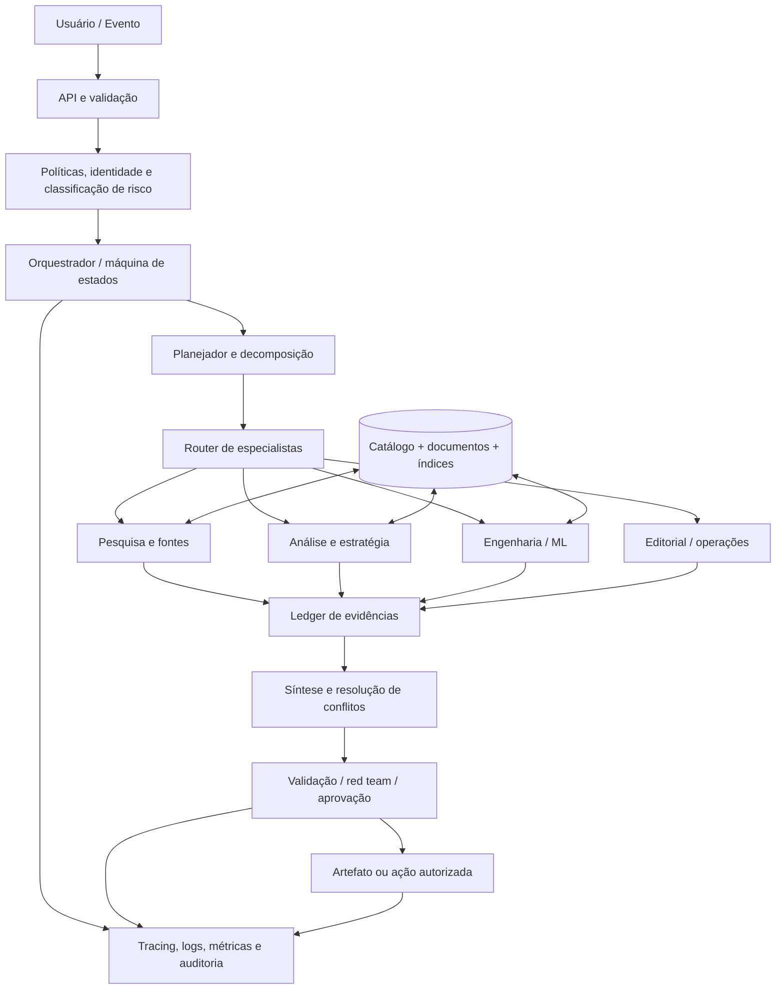

# Arquitetura de referência

## 1. Contexto e fronteiras

O Brain OS é uma plataforma de inteligência e execução assistida por IA. Ele pode pesquisar fontes, manter conhecimento versionado, delegar tarefas especializadas, sintetizar evidências e produzir artefatos acionáveis. Não deve ser tratado como uma única persona com acesso irrestrito a tudo.

### Contextos lógicos
- **Experience/API**: recebe solicitações, autentica usuários, valida entrada e apresenta resultados.
- **Orchestration**: classifica tarefas, cria plano, delega trabalho, aplica limites, mantém estado e controla retomada.
- **Specialists**: módulos especializados com objetivo, escopo, ferramentas permitidas, formato de saída e critérios de qualidade.
- **Knowledge**: catálogo de fontes, documentos normalizados, chunks, índice lexical/vetorial, grafo de entidades e ledger de evidências.
- **Execution**: ferramentas de leitura, busca, transformação e ações externas, segregadas por risco.
- **Evaluation**: testes determinísticos, avaliações por modelo, testes adversariais, avaliação humana e regressão.
- **Control plane**: identidade, políticas, permissões, configuração, versionamento, aprovações, quotas e feature flags.
- **Telemetry**: traces, logs, métricas, custos, auditoria, alertas e incidentes.

## 2. Mapa lógico

## 3. Fluxo canônico

1. **Intake**: validar intenção, escopo, usuário, sensibilidade e resultado esperado.
2. **Triage**: classificar tarefa por risco, necessidade de frescor, ferramentas e modalidade de saída.
3. **Plan**: decompor em subtarefas com dependências, critérios de conclusão e orçamento.
4. **Retrieve/research**: coletar fontes, registrar URL, data de acesso, autoria, tipo de fonte e trechos de evidência.
5. **Execute**: chamar somente ferramentas autorizadas, com timeouts, limites e validação de argumentos.
6. **Synthesize**: separar fatos, inferências, hipóteses, conflitos e lacunas.
7. **Evaluate**: executar avaliações pertinentes ao tipo de tarefa e ao risco.
8. **Approve**: exigir revisão humana para operações de alto impacto ou irreversíveis.
9. **Deliver**: produzir artefato com proveniência, limitações e próximos passos.
10. **Learn safely**: registrar feedback e erros; não transformar automaticamente qualquer saída em memória confiável.

## 4. Separação de planos

| Plano | Responsabilidade | Exemplos |
|---|---|---|
| Control plane | Decide quem pode fazer o quê | IAM, políticas, limites, aprovações |
| Data plane | Processa conteúdo e tarefas | ingestão, retrieval, inferência |
| Evaluation plane | Mede qualidade e regressão | evals, testes, red team |
| Knowledge plane | Armazena e relaciona conhecimento | fontes, documentos, evidências |
| Observability plane | Explica o comportamento do sistema | traces, métricas, auditoria |

## 5. Princípios de implantação
- Começar com um fluxo vertical estreito, não com dezenas de agentes.
- Preferir funções determinísticas a agentes quando a lógica for conhecida.
- Usar agentes para tarefas com ambiguidade real, pesquisa, síntese ou adaptação.
- Separar leitura de escrita e escrita de ações externas.
- Usar uma máquina de estados persistente para tarefas longas.
- Armazenar artefatos e metadados fora do contexto conversacional.
- Fazer o sistema degradar com segurança quando busca, modelo ou ferramenta falhar.
- Não promover memória ou política a partir de texto não verificado.
