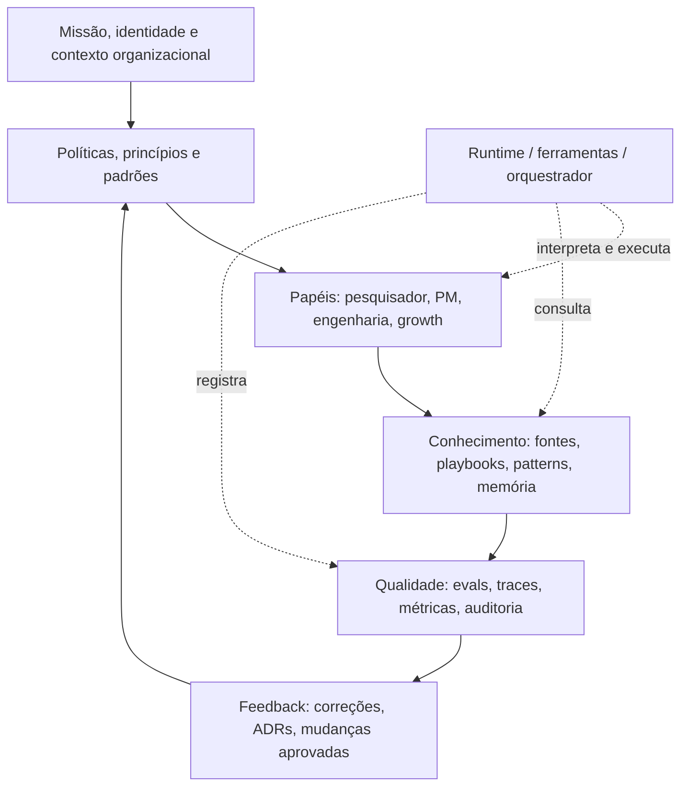
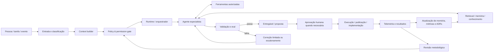
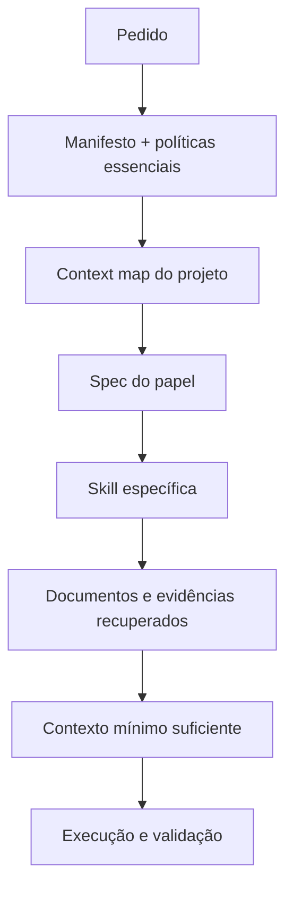
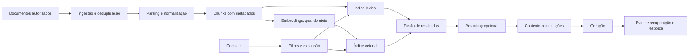
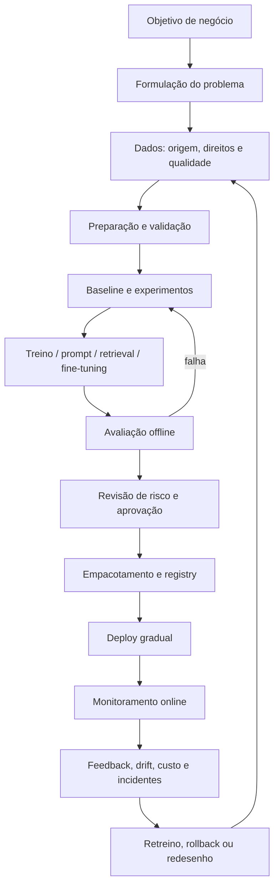
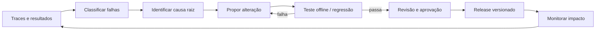
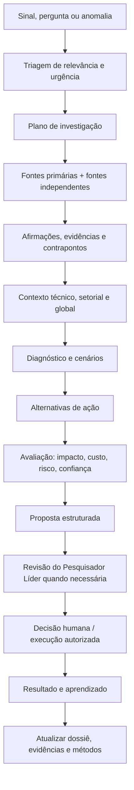
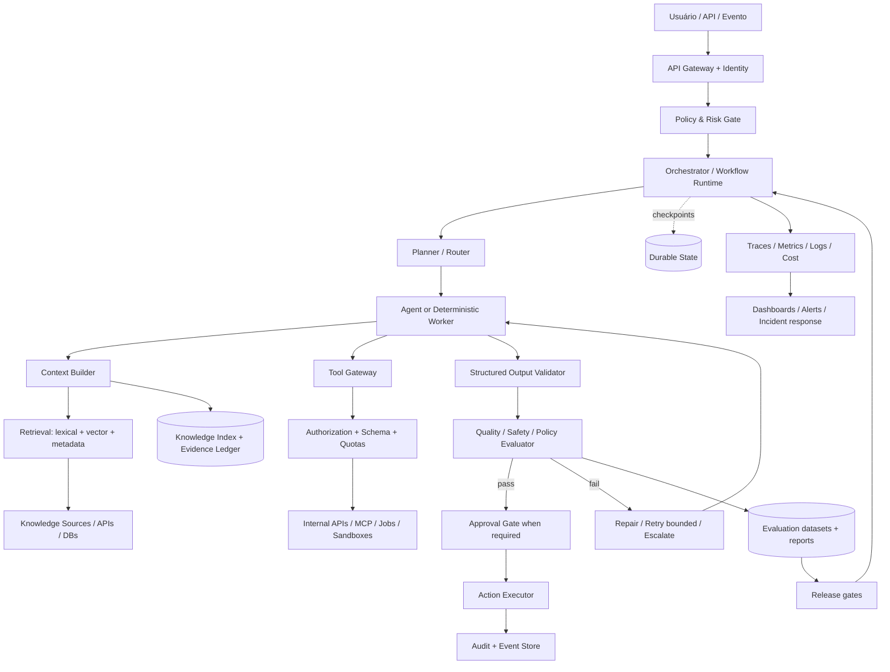
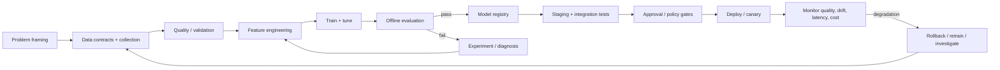

# AI/ML Brain OS

## Manual de bolso, arquitetura de referência e blueprint reproduzível

> **Objetivo:** transformar um repositório de conhecimento,
> especificações, padrões e papéis de IA em um sistema operacional de
> trabalho assistido por IA que seja modular, verificável, seguro,
> observável, versionado e evolutivo.

**Status deste documento:** arquitetura de referência proposta. Não é
certificação, auditoria concluída nem afirmação de que uma implementação
existente já satisfaz todos os controles.

------------------------------------------------------------------------

## Sumário

1.  [Como usar este manual](#1-como-usar-este-manual)
2.  [Princípios e decisões de
    arquitetura](#2-princípios-e-decisões-de-arquitetura)
3.  [Mapa de camadas](#3-mapa-de-camadas)
4.  [Arquitetura de referência](#4-arquitetura-de-referência)
5.  [Estrutura de repositório
    recomendada](#5-estrutura-de-repositório-recomendada)
6.  [Contratos normativos](#6-contratos-normativos)
7.  [Agente, skill, subagente, harness e
    orquestrador](#7-agente-skill-subagente-harness-e-orquestrador)
8.  [Context engineering, recuperação e
    memória](#8-context-engineering-recuperação-e-memória)
9.  [Padrões de arquitetura de sistemas
    agênticos](#9-padrões-de-arquitetura-de-sistemas-agênticos)
10. [Padrões de software e sistemas](#10-padrões-de-software-e-sistemas)
11. [Ciclo de vida de ML e MLOps](#11-ciclo-de-vida-de-ml-e-mlops)
12. [Avaliação, observabilidade e melhoria
    contínua](#12-avaliação-observabilidade-e-melhoria-contínua)
13. [Segurança, governança e risco](#13-segurança-governança-e-risco)
14. [Protocolo operacional de pesquisa e
    propostas](#14-protocolo-operacional-de-pesquisa-e-propostas)
15. [Contratos de dados mínimos](#15-contratos-de-dados-mínimos)
16. [Fluxos de trabalho de ponta a
    ponta](#16-fluxos-de-trabalho-de-ponta-a-ponta)
17. [Checklist de prontidão](#17-checklist-de-prontidão)
18. [Plano de implementação](#18-plano-de-implementação)
19. [Índice de termos](#19-índice-de-termos)
20. [Biblioteca de referências e
    recursos](#20-biblioteca-de-referências-e-recursos)
21. [Registro de decisões e evolução deste
    manual](#21-registro-de-decisões-e-evolução-deste-manual)

------------------------------------------------------------------------

## 1. Como usar este manual

Este documento serve como:

-   **Manual de bolso:** consulta rápida de termos, princípios, decisões
    e checklists.
-   **Blueprint:** arquitetura que pode ser implementada em um
    repositório Git.
-   **Norma de trabalho:** contratos comuns para pesquisadores, agentes,
    skills, subagentes e orquestradores.
-   **Mapa de aprendizagem:** índice de padrões, disciplinas e fontes
    primárias.
-   **Base de auditoria:** lista de controles a verificar na
    implementação real.

### Convenções

-   **MUST / DEVE:** requisito obrigatório do blueprint.
-   **SHOULD / DEVERIA:** prática recomendada; desvios devem ter
    justificativa.
-   **MAY / PODE:** opção contextual.
-   **ADR:** Architecture Decision Record, registro de uma decisão
    arquitetural.
-   **Reference architecture:** modelo de referência que precisa ser
    adaptado e testado no ambiente real.
-   **Human approval:** autorização explícita de uma pessoa responsável
    para ações com impacto relevante.

### Regra de ouro

Documentação descreve a intenção; código, testes, políticas de acesso,
traces e resultados demonstram o comportamento. Nunca marque um controle
como implementado apenas porque existe um arquivo que o menciona.

------------------------------------------------------------------------

## 2. Princípios e decisões de arquitetura

1.  **Separação entre conhecimento e execução.** O conteúdo normativo e
    os dados do cérebro não devem depender de um único runtime de
    agentes.
2.  **Simplicidade antes de autonomia.** Comece com um fluxo
    determinístico ou um agente especializado. Adicione multiagentes
    quando houver benefício demonstrável.
3.  **Contexto explícito e mínimo suficiente.** Carregue primeiro mapas
    e instruções compactas; abra documentos extensos sob demanda.
4.  **Proveniência por padrão.** Toda afirmação importante deve permitir
    rastrear a fonte, a versão, a data e o trecho de evidência.
5.  **Saídas verificáveis.** Entregáveis importantes têm critérios de
    aceitação e avaliação.
6.  **Permissões mínimas.** Cada runtime e agente recebe apenas o acesso
    necessário à tarefa.
7.  **Separar plano de ação de execução.** Uma recomendação não autoriza
    automaticamente alterações em produção.
8.  **Falha segura.** Em incerteza, erro de ferramenta, violação de
    política ou orçamento excedido, pausar, registrar e escalar.
9.  **Estado durável para tarefas longas.** Checkpoints, estado de
    execução e retomada devem estar fora da memória volátil do modelo.
10. **Mudança versionada.** Alterações em regras, skills, prompts,
    schemas e políticas passam por revisão e testes.
11. **Avaliação contínua.** Testar casos normais, limites, ataques,
    regressões e resultados de negócio.
12. **Portabilidade.** Evitar que a identidade, o conhecimento e os
    contratos fiquem presos a um único fornecedor de modelo.
13. **Observabilidade sem exposição indevida.** Registrar o necessário
    para depurar, sem despejar segredos ou dados pessoais em logs.
14. **Autonomia proporcional ao risco.** Quanto maior o impacto, menor
    deve ser a autonomia sem revisão humana.

------------------------------------------------------------------------

## 3. Mapa de camadas

O modelo de cinco camadas é uma taxonomia útil para organizar o cérebro,
não uma norma universal. Para implementação, separe as cinco camadas
conceituais da camada de runtime e da infraestrutura.



### Camadas normativas

  -----------------------------------------------------------------------
  Camada                  Pergunta                Conteúdo
  ----------------------- ----------------------- -----------------------
  1\. Identidade e        Quem somos e qual       Missão, escopo,
  contexto                objetivo perseguimos?   princípios,
                                                  vocabulário, contexto
                                                  da organização

  2\. Políticas e padrões Como decidimos e quais  Regras globais,
                          limites não podem ser   segurança, padrões
                          violados?               técnicos, políticas de
                                                  aprovação

  3\. Papéis e            Quem é responsável por  Specs de papéis,
  competências            cada tipo de trabalho?  responsabilidades,
                                                  interfaces, skills e
                                                  delegação

  4\. Conhecimento e      O que sabemos e como    Fontes, memória,
  operação                trabalhamos?            playbooks, templates,
                                                  backlog, decisões e
                                                  procedimentos

  5\. Avaliação e         Como sabemos se         Evals, telemetria,
  evolução                funciona e como         auditorias, incidentes,
                          corrigimos?             métricas, mudanças
                                                  propostas
  -----------------------------------------------------------------------

### Camadas de execução

-   **Runtime:** carrega instruções, invoca modelo, gerencia contexto e
    executa o loop do agente.
-   **Tool layer:** APIs, shell, navegador, banco, repositório, MCP e
    sistemas externos.
-   **State layer:** estado durável, checkpoints, filas, resultados
    intermediários e retomada.
-   **Infrastructure layer:** identidade, secrets, rede, storage,
    compute, observabilidade e deployment.

**Critério de completude:** não basta nomear as camadas; cada uma
precisa ter artefatos, responsável, teste e evidência de operação.

------------------------------------------------------------------------

## 4. Arquitetura de referência



### Responsabilidades por componente

-   **Entrada/classificação:** identifica objetivo, tipo de tarefa,
    urgência, risco, formato e departamento.
-   **Context builder:** resolve o `CONTEXT_MAP`, carrega regras
    aplicáveis e seleciona documentos relevantes.
-   **Policy gate:** valida identidade, autorização, escopo de
    ferramentas, dados sensíveis e necessidade de aprovação.
-   **Runtime/orquestrador:** controla etapas, estado, limites, retries,
    timeout, cancelamento e handoffs.
-   **Agente especialista:** executa uma função definida; não ganha
    autoridade apenas por sua persona.
-   **Ferramentas:** expõem operações com contratos claros, validação de
    argumentos, autenticação e limites.
-   **Retrieval/memória:** recupera informação com proveniência,
    atualidade, permissões e avaliação.
-   **Validação/eval:** testa formato, conteúdo, fontes, comportamento,
    segurança e critérios da tarefa.
-   **Aprovação:** interrompe ações irreversíveis ou de alto impacto até
    haver autorização explícita.
-   **Telemetria:** registra eventos e resultados úteis para depuração e
    melhoria.
-   **Revisão metodológica:** propõe mudanças em padrões e instruções;
    não as publica autonomamente sem controle.

### Separação de planos

-   **Control plane:** políticas, roteamento, identidades, permissões,
    orçamento, estado, aprovação e configuração.
-   **Knowledge plane:** documentos, dados, entidades, evidências,
    memória, embeddings e índices.
-   **Execution plane:** modelos, agentes, ferramentas, jobs, pipelines
    e integrações.
-   **Evaluation plane:** datasets de teste, graders, benchmarks,
    traces, alertas e auditorias.

Essa separação reduz acoplamento e facilita trocar modelos, runtimes,
mecanismos de busca ou ferramentas sem reescrever o conhecimento
organizacional.

------------------------------------------------------------------------

## 5. Estrutura de repositório recomendada

A estrutura abaixo é um ponto de partida. Não crie pastas vazias para
simular maturidade: cada pasta deve ter um propósito, proprietário e
critério de manutenção.

``` text
brain-os/
├── README.md
├── 00_MANIFESTO.md
├── 01_CONTEXT_MAP.md
├── 02_GLOSSARY.md
├── 03_GLOBAL_POLICIES.md
├── 04_ARCHITECTURE.md
├── 05_CHANGELOG.md
├── _kernel/
│   ├── identity/
│   ├── governance/
│   │   ├── permissions/
│   │   ├── privacy/
│   │   ├── security/
│   │   └── budgets/
│   ├── memory/
│   │   ├── semantic/
│   │   ├── episodic/
│   │   └── procedural/
│   └── schemas/
├── _system/
│   ├── harness/
│   ├── policies/
│   ├── architecture-patterns/
│   ├── design-systems/
│   ├── templates/
│   ├── evals/
│   ├── observability/
│   ├── incident-response/
│   └── release-process/
├── _knowledge/
│   ├── sources/
│   ├── references/
│   ├── playbooks/
│   ├── patterns/
│   ├── datasets/
│   └── evidence-ledger/
├── _interfaces/
│   ├── tool-contracts/
│   ├── mcp/
│   ├── api-schemas/
│   └── event-schemas/
├── _operations/
│   ├── backlog/
│   ├── decisions/
│   ├── incidents/
│   ├── sprints/
│   └── metrics/
├── departments/
│   ├── research-intelligence/
│   ├── product/
│   ├── engineering/
│   ├── growth-operations/
│   ├── security-governance/
│   └── editorial/
├── projects/
│   └── <project-name>/
├── runtime/
│   ├── adapters/
│   ├── orchestration/
│   ├── state/
│   └── policies/
├── evals/
│   ├── datasets/
│   ├── tasks/
│   ├── graders/
│   └── regression/
├── observability/
│   ├── dashboards/
│   ├── runbooks/
│   └── schemas/
└── scripts/
```

### Regras para o repositório

-   `README.md` explica como começar; `01_CONTEXT_MAP.md` explica onde
    procurar informação.
-   O arquivo `CONTEXT_MAP` deve ser um índice roteável: tarefa →
    documentos obrigatórios → documentos opcionais → saída esperada.
-   Os arquivos normativos têm proprietário, versão, estado, data de
    revisão e links para testes.
-   Os dados volumosos, segredos, datasets privados e logs sensíveis não
    devem ser colocados no Git por padrão.
-   Usar Git submodule é uma opção de distribuição, não um requisito
    arquitetural. Alternativas incluem pacote versionado, template de
    repositório, monorepo ou serviço de conhecimento.
-   Cada projeto registra a versão do cérebro usada e os desvios locais.
-   Evite cópias divergentes de políticas globais; prefira referências
    versionadas e mecanismos claros de override.

------------------------------------------------------------------------

## 6. Contratos normativos

### 6.1. Contrato de cada documento normativo

``` yaml
id: SPEC-ENGINEERING-001
title: "Engineering Researcher"
type: role-spec
version: 2.0.0
status: draft
owner: engineering
created: 2026-10-19
reviewed_at: null
review_interval_days: 90
applies_to:
  - engineering
  - ai-ml-systems
inputs:
  - task_brief
  - context_map
outputs:
  - research_dossier
  - proposal
required_evals:
  - evidence_traceability
  - security_policy
  - output_contract
change_policy: pull-request-review
```

### 6.2. Contrato do agente

Todo papel executável precisa declarar:

1.  Missão e objetivos.
2.  Escopo e fora de escopo.
3.  Tipos de tarefas aceitos.
4.  Entradas obrigatórias e opcionais.
5.  Fontes de contexto que deve consultar.
6.  Ferramentas autorizadas e negadas.
7.  Permissões de leitura e escrita.
8.  Estratégia de planejamento e delegação.
9.  Critérios de qualidade e critérios de parada.
10. Formatos de saída e schemas.
11. Política de citação e incerteza.
12. Limites de custo, tempo, tentativas e paralelismo.
13. Condições para pedir esclarecimento.
14. Condições para escalar para uma pessoa.
15. Evals obrigatórios e testes de regressão.

### 6.3. Precedência das instruções

Uma política recomendada:

1.  Leis, contratos e controles de segurança aplicáveis.
2.  Políticas globais e autorização do runtime.
3.  Política específica do projeto.
4.  Contrato do departamento e do papel.
5.  Skill da tarefa.
6.  Preferências locais do usuário, desde que compatíveis com os níveis
    anteriores.
7.  Conteúdo recuperado de fontes externas, tratado como dado não
    confiável --- nunca como instrução de sistema.

Quando houver conflito, o runtime deve aplicar a política de maior
precedência, registrar o conflito e, se necessário, interromper a
execução.

------------------------------------------------------------------------

## 7. Agente, skill, subagente, harness e orquestrador

  -----------------------------------------------------------------------
  Conceito                Definição operacional   Exemplo
  ----------------------- ----------------------- -----------------------
  Papel/agente            Configuração executável Pesquisador de IA/ML
                          com missão, instruções, 
                          ferramentas, contexto e 
                          critérios de saída      

  Skill                   Procedimento            Avaliar um artigo
                          reutilizável para uma   científico
                          classe de tarefa        

  Subagente               Unidade especializada   Analista de segurança
                          delegada por outro      
                          agente ou workflow      

  Harness                 Ambiente e controles    Runtime com tool gate e
                          que enquadram o loop do budget
                          modelo: ferramentas,    
                          estado, permissões,     
                          limites, validação e    
                          parada                  

  Orquestrador            Coordena sequência,     Pipeline de pesquisa
                          paralelismo, estado,    multi-etapas
                          retries, handoffs e     
                          checkpoints             

  Workflow                Grafo de passos com     Capturar → extrair →
                          transições explícitas,  validar → publicar
                          muitas vezes            
                          determinísticas         

  Ferramenta              Operação externa que o  Buscar documentos,
                          agente pode invocar por consultar API
                          contrato                

  MCP                     Protocolo para conectar Servidor de consulta de
                          aplicações de IA a      documentos
                          ferramentas e fontes de 
                          contexto                

  Memória                 Estado ou conhecimento  Decisões, episódios,
                          persistente com         preferências
                          política de escrita,    
                          leitura e retenção      

  RAG                     Pipeline de recuperação Busca híbrida sobre
                          de evidência para       documentos
                          fundamentar a geração   
  -----------------------------------------------------------------------

**Teste de distinção:** uma skill diz como executar uma tarefa; um
agente define quem é responsável por ela e quais limites possui; o
harness controla o ambiente de execução; o orquestrador coordena
unidades de trabalho. Esses componentes podem compartilhar arquivos, mas
não são sinônimos.

### Quando usar um ou vários agentes

Use **um agente** quando a tarefa tiver objetivo relativamente claro,
contexto manejável, poucas ferramentas e necessidade de revisão simples.

Use **workflow determinístico** quando as etapas, os contratos e as
transições forem conhecidos e a repetibilidade importar.

Use **multiagentes** quando houver decomposição real em domínios
independentes, necessidade de paralelismo ou revisão especializada cujo
benefício supere o custo de coordenação.

Não crie agentes adicionais apenas para representar cargos
organizacionais. Primeiro valide se a especialização muda de fato a
qualidade, a cobertura, o tempo ou a governança.

------------------------------------------------------------------------

## 8. Context engineering, recuperação e memória

### 8.1. Hierarquia de carregamento de contexto



### 8.2. Níveis de recuperação

1.  **Nível 0 --- leitura explícita:** pessoa ou workflow aponta para um
    arquivo conhecido.
2.  **Nível 1 --- índice e roteamento:** `CONTEXT_MAP` decide quais
    arquivos devem ser lidos.
3.  **Nível 2 --- busca lexical:** full-text, nomes, termos exatos e
    filtros por metadados.
4.  **Nível 3 --- busca híbrida:** lexical + vetorial + filtros
    estruturados.
5.  **Nível 4 --- reranking e expansão por relações:** reordena
    resultados e segue referências, entidades ou citações.
6.  **Nível 5 --- recuperação avaliada:** datasets de consultas,
    métricas de recall/precision, avaliação de grounding e testes de
    regressão.

Não é obrigatório chegar ao nível 5. Escolha pelo volume, diversidade,
taxa de descoberta, latência e custo. Para um repositório pequeno e bem
estruturado, índices explícitos e busca lexical podem ser melhores do
que introduzir infraestrutura vetorial.

### 8.3. Pipeline RAG de referência



Controles obrigatórios para um RAG de produção:

-   Preservar URL, documento de origem, datas, autor e permissões.
-   Tratar documentos recuperados como conteúdo não confiável.
-   Respeitar controle de acesso na recuperação, não apenas na
    interface.
-   Deduplicar versões e distinguir cópias de fontes independentes.
-   Manter estratégia de atualização e remoção de documentos.
-   Testar retrieval separado de geração.
-   Avaliar precisão, cobertura, freshness, grounding, citações e
    vazamento de informação.
-   Definir o que acontece quando não há evidência suficiente: responder
    com incerteza, pedir mais contexto ou abster-se.

### 8.4. Tipos de memória

-   **Semântica:** conhecimento relativamente estável, fatos, conceitos
    e referências.
-   **Episódica:** eventos, tarefas realizadas, decisões e resultados
    passados.
-   **Procedural:** como executar processos, playbooks e skills.
-   **Estado de execução:** estado temporário/durável de um workflow em
    andamento.
-   **Preferências:** escolhas explícitas e autorizadas do usuário ou
    organização.

Cada tipo exige política própria de atualização, validade, acesso e
retenção. Memória não é um depósito indiscriminado de transcrições.

------------------------------------------------------------------------

## 9. Padrões de arquitetura de sistemas agênticos

  -------------------------------------------------------------------------
  Padrão                    Use quando              Risco / controle
  ------------------------- ----------------------- -----------------------
  Single-agent + tools      Tarefa delimitada,      Contexto excessivo;
                            ferramentas limitadas   limitar tools e testar
                                                    saída

  Prompt chaining /         Etapas dependentes e    Erro propaga; validar
  sequential                conhecidas              cada etapa

  Router                    Classificar e           Roteamento errado;
                            encaminhar tarefas      fallback e eval de
                                                    classificação

  Parallel workers          Subtarefas              Duplicação e
                            independentes           divergência; contratos
                                                    e síntese

  Generator--critic /       Produção seguida de     Loops caros; limite de
  evaluator--optimizer      crítica útil            iterações e critérios
                                                    de parada

  Planner--executor         Planejamento adaptativo Plano ruim ou
                            necessário              excessivo; checagem de
                                                    viabilidade

  Supervisor--specialists   Domínios especializados Gargalo e viés do
                            com síntese central     supervisor; revisão
                                                    independente

  Handoff                   Um papel transfere      Perda de contexto;
                            responsabilidade a      schema de handoff
                            outro                   

  Event-driven              Reação a eventos        Eventos
                            externos ou mudanças de duplicados/perdidos;
                            estado                  idempotência e DLQ

  Human-in-the-loop         Alto risco, baixa       Atraso; critérios
                            reversibilidade,        claros de escalonamento
                            ambiguidade ou          
                            obrigação legal         

  Retrieval-augmented       Conhecimento externo    Recuperação ruim;
                            muda ou precisa de      retrieval evals
                            proveniência            

  Tool-use / ReAct-style    O agente precisa        Tool misuse;
  loop                      alternar entre          allowlists, schema
                            observação e ação       validation e limite de
                                                    passos
  -------------------------------------------------------------------------

### Regras de composição

-   Toda etapa tem entrada, saída, timeout, política de erro e critério
    de sucesso.
-   Toda operação externa deve ser idempotente quando possível.
-   Retries devem ter limite, backoff e distinção entre falha
    transitória e permanente.
-   Uma ação de escrita deve ter escopo limitado e ser validada antes da
    execução.
-   Handoffs transportam um resumo estruturado, evidências, pendências e
    estado --- não apenas uma conversa longa.
-   Paralelize somente subtarefas suficientemente independentes.
-   Defina máximo de profundidade, passos, tokens, custo, duração e
    chamadas de ferramenta.
-   Use checkpoint/resume para tarefas longas.
-   Não use autoavaliação do próprio modelo como único mecanismo de
    qualidade para saídas de alto impacto.

------------------------------------------------------------------------

## 10. Padrões de software e sistemas

### 10.1. Padrões de arquitetura

-   **Layered architecture:** separação por responsabilidade.
-   **Hexagonal / Ports and Adapters:** domínio independente de
    provedores e infraestrutura.
-   **Modular monolith:** módulos bem delimitados antes de distribuir
    serviços.
-   **Microservices:** somente quando houver necessidade real de
    implantação, escala ou ownership independente.
-   **Event-driven architecture:** produtores e consumidores
    desacoplados por eventos.
-   **CQRS:** separar leitura e escrita quando modelos de acesso e
    consistência justificarem.
-   **Workflow orchestration:** coordenação explícita de etapas e
    estado.
-   **Data pipeline:** ingestão, transformação, validação e publicação.
-   **Control plane / data plane:** separar configuração e controle da
    execução.
-   **Plugin architecture:** extensões com interfaces e permissões
    explícitas.

### 10.2. Design patterns de código

-   Adapter, Strategy, Factory, Builder e Dependency Injection.
-   Repository e Unit of Work quando fizerem sentido para persistência.
-   Decorator para adicionar comportamento sem alterar o núcleo.
-   State Machine para ciclos de vida e transições explícitas.
-   Command para encapsular operações.
-   Observer / Pub-Sub para eventos.
-   Circuit Breaker, Timeout, Retry with Backoff e Bulkhead para
    resiliência.
-   Idempotency Key para operações repetíveis.
-   Saga para transações distribuídas com compensações.
-   Outbox Pattern para publicação confiável de eventos.
-   Anti-Corruption Layer para integração com sistemas externos.

### 10.3. Padrões específicos de IA/ML

-   Model gateway / provider adapter.
-   Prompt e schema versionados.
-   Retrieval pipeline separado de geração.
-   Tool registry com schemas e permissões.
-   Guardrail / policy gate antes e depois do modelo.
-   Human approval gate para ações de risco.
-   Evaluation harness com datasets fixos e graders.
-   Trace correlation entre entrada, recuperação, chamadas de modelo,
    ferramentas e saída.
-   Model registry e lineage para modelos treinados.
-   Feature/data validation antes de treinamento e serving.
-   Canary/shadow deployment e rollback para releases de modelos.
-   Drift monitoring e feedback loop para modelos em produção.

### 10.4. Princípios de design

-   Alta coesão, baixo acoplamento.
-   Interfaces explícitas.
-   Falhas isoladas e observáveis.
-   Configuração separada do código.
-   Segredos fora do repositório.
-   Dados e modelos versionados ou identificados por hash.
-   Contratos testados em CI.
-   Dependências e versões fixadas quando a reprodutibilidade exigir.
-   Decisões arquiteturais registradas em ADRs.
-   Evitar microserviços, bancos vetoriais e frameworks multiagentes sem
    requisito demonstrável.

------------------------------------------------------------------------

## 11. Ciclo de vida de ML e MLOps

Este blueprint cobre tanto sistemas com LLMs quanto ML preditivo
tradicional. Eles compartilham governança e operação, mas têm diferenças
relevantes.

### 11.1. Ciclo de vida



### 11.2. Artefatos mínimos para um modelo

-   Problem statement e métrica de negócio.
-   Data card e lineage dos dados.
-   Critérios de qualidade, representatividade e permissões dos dados.
-   Código, configuração, dependências e seed quando aplicável.
-   Registro de experimentos e parâmetros.
-   Baseline e conjunto de avaliação congelado.
-   Model card com uso pretendido, limitações e riscos.
-   Resultado de avaliação offline e critérios de promoção.
-   Registro de versão e artefato implantado.
-   Monitoramento, rollback e responsável operacional.

### 11.3. Diferenças entre ML tradicional e sistemas com LLM

  -----------------------------------------------------------------------
  Tema                    ML preditivo            Aplicação com
                                                  LLM/agentes
  ----------------------- ----------------------- -----------------------
  Principal objeto        Modelo, dados, features Modelo +
  avaliado                e pipeline              prompt/contexto +
                                                  retrieval + tools +
                                                  workflow

  Falhas típicas          Drift, leakage,         Alucinação, tool
                          desbalanceamento,       misuse, prompt
                          latência                injection, retrieval
                                                  ruim, loops

  Teste offline           Métricas estatísticas e Datasets de tarefas,
                          conjuntos de validação  rubricas, verificadores
                                                  e traces

  Operação                Serving, features,      Contexto, custo por
                          drift, retreino         tarefa, ferramentas,
                                                  permissões, segurança e
                                                  qualidade

  Versionamento           Dados, código,          Modelo, prompt,
                          features, modelo        instruções, índice,
                                                  documentos,
                                                  ferramentas, políticas
                                                  e evals

  Mudança segura          Canary, shadow,         Canary, sandbox,
                          rollback                approval gates, evals e
                                                  rollback de
                                                  prompt/configuração
  -----------------------------------------------------------------------

### 11.4. CI/CD/CT

-   **CI:** lint, testes, schema checks, segurança, evals de regressão.
-   **CD:** empacotamento e deploy controlado de aplicação, pipeline,
    prompt/configuração ou modelo.
-   **CT:** treinamento contínuo, quando apropriado para o problema e
    com validação antes de promover modelos.
-   **Release gate:** bloqueia promoção quando testes obrigatórios
    falham.
-   **Rollback:** caminho testado para retornar a versão estável.

Não treine ou promova automaticamente um modelo apenas porque chegou
dado novo. Exija validação da qualidade dos dados, avaliação do modelo e
política de aprovação proporcional ao risco.

------------------------------------------------------------------------

## 12. Avaliação, observabilidade e melhoria contínua

### 12.1. Quatro famílias de avaliação

1.  **Unitária:** funções, parsers, regras, schemas e ferramentas.
2.  **Integração:** retrieval, APIs, banco, runtime, permissões e
    workflows.
3.  **E2E / task eval:** a tarefa completa, com casos de sucesso, falha
    e limites.
4.  **Produção:** latência, custo, falhas, feedback, incidentes e
    métricas de negócio.

### 12.2. Avaliação de sistemas LLM

Medir separadamente:

-   Correção factual e aderência à evidência.
-   Qualidade e cobertura de retrieval.
-   Precisão das citações.
-   Cumprimento do formato de saída.
-   Uso correto das ferramentas.
-   Taxa de conclusão e de escalonamento.
-   Robustez a inputs ambíguos e adversariais.
-   Segurança, privacidade e resistência a prompt injection.
-   Latência, tokens, custo e número de chamadas.
-   Utilidade humana e resultado de negócio.

**Não use uma única nota de "qualidade" como substituto de métricas
específicas.** Uma resposta pode ser fluente, mas não fundamentada;
correta, mas cara; útil, mas insegura.

### 12.3. Observabilidade

Cada execução deve ter um identificador correlacionável e registrar,
conforme a política de privacidade:

-   Run ID, tarefa, versão do agente, modelo, prompt/spec e
    configuração.
-   Documentos recuperados e suas referências.
-   Chamadas de ferramentas, argumentos validados, status e duração.
-   Transições de workflow e handoffs.
-   Evals executados e resultados.
-   Tokens/custo estimado, latência e erros.
-   Aprovações humanas, cancelamentos e retries.
-   Saída final e localização do artefato, quando permitido.

Evite registrar segredos, credenciais, conteúdo pessoal desnecessário ou
chain-of-thought privado. Registre eventos observáveis, justificativas
resumidas, evidências e decisões relevantes para auditoria.

### 12.4. Loop de melhoria



O sistema pode sugerir mudanças em `SPEC.md`, `SKILL.md`, prompts,
schemas ou roteamento. **Não deve reescrever automaticamente as próprias
políticas de segurança, permissões ou regras de produção sem revisão,
testes e aprovação.**

------------------------------------------------------------------------

## 13. Segurança, governança e risco

### 13.1. Threat model mínimo

Considere, no mínimo:

-   Prompt injection direta e indireta em documentos, páginas, emails e
    resultados de ferramentas.
-   Exfiltração de dados por respostas, ferramentas, logs ou contextos
    cruzados.
-   Acesso excessivo a arquivos, repositórios, APIs e credenciais.
-   Tool misuse e ações não autorizadas.
-   Saídas inseguras ou não validadas consumidas por outros sistemas.
-   Dependência de fontes ou fornecedores comprometidos.
-   Poisoning de dados, memória ou bases de conhecimento.
-   Abuso de custo, loops e chamadas excessivas.
-   Cross-tenant leakage, se houver múltiplos clientes.
-   Riscos de licença, privacidade, retenção e direitos de uso.

### 13.2. Controles mínimos

-   Allowlist de ferramentas e validação de argumentos.
-   Menor privilégio para identidade, arquivos e APIs.
-   Segredos em secret manager ou ambiente protegido; nunca em commits,
    prompts ou logs.
-   Separação entre ambientes de desenvolvimento, teste e produção.
-   Sandbox para execução de código e arquivos não confiáveis.
-   Aprovação humana para operações irreversíveis ou de alto impacto.
-   Limites de custo, tempo, passos, concorrência e retries.
-   Proteção contra prompt injection; tratar conteúdo recuperado como
    dado, não comando.
-   Validação de saída antes de executar SQL, shell, código, publicação
    ou alteração de estado.
-   Logs redigidos, retenção definida e controle de acesso.
-   Testes de segurança e incident response.
-   Inventário de modelos, provedores, datasets e dependências.
-   Revisão de licenças e políticas de uso de dados.

### 13.3. Matriz de autonomia

  -----------------------------------------------------------------------
  Nível                   Ação                    Política recomendada
  ----------------------- ----------------------- -----------------------
  A0                      Ler e resumir           Permitido dentro das
                                                  permissões

  A1                      Produzir proposta ou    Permitido com validação
                          arquivo em sandbox      

  A2                      Alterar arquivos de     Escopo restrito, diff e
                          trabalho versionados    testes

  A3                      Abrir PR, publicar      Revisão ou política
                          rascunho ou acionar     específica
                          workflow reversível     

  A4                      Alterar produção,       Aprovação explícita e
                          gastar recursos         trilha de auditoria
                          relevantes, enviar      
                          comunicações externas   

  A5                      Ação irreversível,      Bloqueada por padrão;
                          sensível ou regulada    procedimento
                                                  especializado
  -----------------------------------------------------------------------

A classificação depende do contexto e do dano potencial. O nome do
agente não concede autoridade.

------------------------------------------------------------------------

## 14. Protocolo operacional de pesquisa e propostas

O pesquisador setorial mantém um dossiê vivo e transforma sinais em
recomendações. O fluxo padrão:



### Template de proposta

Toda proposta relevante deve conter:

1.  ID, título, departamento, responsável e data.
2.  Problema/oportunidade observada.
3.  Evidências e fontes, incluindo evidência contrária.
4.  Contexto técnico, econômico, competitivo e geopolítico pertinente.
5.  Hipóteses explícitas e grau de confiança.
6.  Alternativas consideradas, incluindo não agir.
7.  Recomendação e justificativa.
8.  Impacto esperado e métrica de sucesso.
9.  Custo, esforço, riscos e dependências.
10. Plano de execução e checkpoints.
11. Critérios de interrupção ou rollback.
12. Aprovação necessária.
13. Como e quando medir o resultado.

### Dossiê vivo por departamento

-   Estado da arte técnico-científico.
-   Mapa do setor e de seus atores.
-   Contexto global e cenários.
-   Usuários, problemas e evidências de demanda.
-   Operações, métricas e gargalos.
-   Crescimento, distribuição e concorrência.
-   Riscos, premissas e incertezas.
-   Carteira priorizada de propostas.
-   Lacunas de cobertura e plano de pesquisa.
-   Histórico de decisões e resultados.

------------------------------------------------------------------------

## 15. Contratos de dados mínimos

### 15.1. Registro de fonte

``` yaml
source_id: SRC-EXAMPLE-0001
name: "Nome oficial"
source_type: primary-research
canonical_url: "https://example.org/"
domains: [ai-ml, engineering]
geographic_scope: global
source_role: primary
authority_basis: "Publica diretamente os resultados da instituição."
known_biases: []
collection_method: rss
priority: P1
owner_department: research-intelligence
last_checked_at: null
last_successful_ingestion_at: null
access_and_license: "Verificar termos antes de redistribuir conteúdo."
status: candidate
```

### 15.2. Registro de afirmação e evidência

``` yaml
claim_id: CLAIM-0001
claim_text: "Afirmação verificável, delimitada e datada."
status: under_review
scope: "Condição e contexto aos quais a afirmação se aplica."
created_at: "YYYY-MM-DD"
evidence:
  - evidence_id: EVD-0001
    relation: supports
    source_id: SRC-EXAMPLE-0001
    document_url: "https://example.org/document"
    locator: "Seção 2, parágrafo 4"
    observed_at: "YYYY-MM-DD"
    independence_group: "origem-da-evidência"
confidence: medium
counterevidence: []
reviewer: null
```

### 15.3. Registro de execução

``` yaml
run_id: RUN-0001
task_id: TASK-0001
agent_spec_version: "1.0.0"
model_provider: "provider"
model_id: "model-version"
context_refs: []
tool_calls: []
eval_results: []
started_at: null
finished_at: null
status: pending
cost_estimate: null
artifact_refs: []
approval_refs: []
```

Os exemplos são esquemas de referência, não schemas de produção
completos. Antes de implementar, definir JSON Schema ou equivalente,
validar tipos, datas, enums, campos obrigatórios e compatibilidade de
versões.

------------------------------------------------------------------------

## 16. Fluxos de trabalho de ponta a ponta

### 16.1. Criar uma feature de produto com IA

1.  Product/research define problema, usuário e resultado desejado.
2.  Pesquisador valida demanda e evidências.
3.  Engenharia avalia arquitetura, dados, dependências, segurança e
    custo.
4.  Proposta registra alternativas, riscos e métricas.
5.  Pessoa responsável aprova escopo e recursos.
6.  Implementação ocorre em branch/sandbox.
7.  CI executa testes de código, integração, segurança e evals de IA.
8.  Release gradual com monitoramento e rollback.
9.  Resultados atualizam a hipótese de produto e o dossiê.

### 16.2. Atualizar um padrão do cérebro

1.  Detectar falha recorrente em traces ou revisões.
2.  Abrir issue com exemplos e causa provável.
3.  Propor alteração versionada.
4.  Rodar testes contra casos de referência e casos adversariais.
5.  Revisar efeitos colaterais em outros departamentos.
6.  Aprovar via pull request.
7.  Publicar nova versão e registrar changelog.
8.  Monitorar regressões e reverter se necessário.

### 16.3. Pesquisa setorial global

1.  Definir a pergunta e as decisões que podem mudar.
2.  Mapear fontes primárias, especialistas e fontes independentes por
    região.
3.  Capturar documentos e metadados.
4.  Separar fato, interpretação, previsão e opinião.
5.  Buscar contradições e explicações alternativas.
6.  Relacionar mudanças técnicas a economia, geopolítica, regulação e
    mercado.
7.  Construir cenários e sinais de alerta.
8.  Gerar propostas diversificadas e priorizadas.
9.  Revisar com o Pesquisador Líder quando houver impacto transversal.
10. Registrar resultados e atualizar fontes, hipóteses e métodos.

------------------------------------------------------------------------

## 17. Checklist de prontidão

Marque cada item como `not_started`, `in_progress`, `verified` ou
`not_applicable`, sempre com evidência.

### Identidade e arquitetura

-   [ ] Missão, escopo e objetivos mensuráveis definidos.
-   [ ] Mapa de contexto roteia corretamente tarefas comuns.
-   [ ] Contratos e precedência de políticas documentados.
-   [ ] Componentes normativos separados de runtime e infraestrutura.
-   [ ] ADRs registram decisões estruturais e trade-offs.

### Agentes e ferramentas

-   [ ] Cada papel tem inputs, outputs, permissões e limites.
-   [ ] Skills são reutilizáveis e têm critérios de aceitação.
-   [ ] Tool schemas são validados.
-   [ ] Limites de custo, duração, passos e retries são aplicados pelo
    runtime.
-   [ ] Handoffs carregam estado estruturado.
-   [ ] Ações sensíveis exigem aprovação apropriada.

### Conhecimento e retrieval

-   [ ] Fontes e documentos preservam proveniência e datas.
-   [ ] Acesso é verificado antes de fornecer conteúdo ao modelo.
-   [ ] Duplicatas, versões e atualidade são tratados.
-   [ ] Retrieval e geração são avaliados separadamente quando
    aplicável.
-   [ ] Conteúdo externo é tratado como não confiável.
-   [ ] Remoção e retenção de documentos têm política definida.

### Qualidade e operação

-   [ ] Evals incluem casos normais, limites e adversariais.
-   [ ] CI executa testes obrigatórios.
-   [ ] Traces correlacionam ferramentas, versões e resultados.
-   [ ] Logs evitam segredos e dados desnecessários.
-   [ ] Há alertas, runbooks, cancelamento e recuperação.
-   [ ] Há rollback testado para releases relevantes.
-   [ ] Métricas incluem qualidade, latência, custo e resultado.

### Governança

-   [ ] Threat model revisado.
-   [ ] Inventário de dados, modelos, provedores e dependências.
-   [ ] Licenças, privacidade e retenção revisadas.
-   [ ] Segredos protegidos fora do Git.
-   [ ] Acesso e autonomia são proporcionais ao risco.
-   [ ] Alterações no cérebro passam por revisão e versionamento.

**Critério de prontidão:** nenhum item crítico de segurança,
proveniência, autorização ou rollback deve ser considerado resolvido
apenas por declaração documental.

------------------------------------------------------------------------

## 18. Plano de implementação

### Fase 0 --- Inventário e arquitetura

-   Auditar arquivos existentes e classificá-los como normativos,
    conhecimento, execução, memória ou saída.
-   Identificar contradições, duplicatas, documentos sem dono e
    afirmações sem evidência.
-   Criar mapa mestre, glossário, ADR inicial e matriz de
    responsabilidades.

### Fase 1 --- Núcleo mínimo

-   Implementar identidade, políticas, contratos de papel e context
    maps.
-   Definir permissões, diretórios de escrita, política de secrets e
    orçamento.
-   Criar templates de skills, propostas, evidências e decisões.

### Fase 2 --- Execução controlada

-   Selecionar um runtime e um caso de uso.
-   Implementar um agente com ferramentas mínimas.
-   Acrescentar state, timeout, retries, checkpoints e aprovação.
-   Não iniciar com uma frota de agentes.

### Fase 3 --- Evals e observabilidade

-   Criar dataset de tarefas representativas.
-   Medir baseline, erros, custo e latência.
-   Instrumentar traces e logs redigidos.
-   Bloquear regressões críticas em CI.

### Fase 4 --- Conhecimento e retrieval

-   Começar com índice explícito e busca lexical.
-   Medir falhas de descoberta.
-   Adicionar busca híbrida, embeddings ou reranking apenas se os
    resultados justificarem.
-   Implementar freshness, ACL-aware retrieval e avaliações.

### Fase 5 --- Especialização e orquestração

-   Adicionar pesquisador setorial, engenharia e growth/operations.
-   Testar tarefas que exijam colaboração real.
-   Comparar single-agent, workflow e multiagente.
-   Adotar o desenho de menor complexidade que atenda aos requisitos.

### Fase 6 --- Operação e evolução

-   Estabelecer incident response, métricas e revisões.
-   Automatizar releases e regressão.
-   Permitir propostas de autoaperfeiçoamento com aprovação.
-   Versionar releases do cérebro e monitorar efeitos.

------------------------------------------------------------------------

## 19. Índice de termos

-   **ADR --- Architecture Decision Record:** registro curto de uma
    decisão arquitetural, contexto, alternativas e consequências.
-   **Agent:** unidade executável que usa modelo, instruções, estado e
    ferramentas para atingir um objetivo.
-   **Agentic workflow:** fluxo de trabalho que delega parte das
    decisões de execução a um modelo, dentro de limites.
-   **AI RMF:** framework do NIST para gestão de riscos de IA.
-   **Artifact lineage:** relação entre artefatos e os dados, código,
    configurações e execuções que os produziram.
-   **Backpressure:** mecanismo para limitar a entrada quando
    consumidores não conseguem acompanhar a carga.
-   **Benchmark:** conjunto de tarefas/dados e método de medição usado
    para comparar desempenho.
-   **Canary release:** liberar uma versão inicialmente para uma fração
    do tráfego ou dos usuários.
-   **Checkpoint:** estado persistido que permite retomar uma execução.
-   **CI/CD/CT:** integração contínua, entrega contínua e treinamento
    contínuo.
-   **Context engineering:** seleção, estruturação e gestão de
    instruções, documentos, estado, ferramentas e histórico fornecidos
    ao modelo.
-   **Context map:** índice que orienta quais documentos carregar para
    cada tarefa.
-   **Data drift:** mudança na distribuição dos dados de entrada ao
    longo do tempo.
-   **Data lineage:** proveniência e transformação dos dados ao longo do
    pipeline.
-   **Design pattern:** solução reutilizável para um problema recorrente
    de design de software.
-   **Eval:** avaliação de uma tarefa ou sistema com critérios
    explícitos.
-   **Feature store:** camada para gerenciar features usadas por
    modelos, quando apropriado.
-   **Guardrail:** controle que limita entradas, saídas ou ações do
    sistema.
-   **Harness:** conjunto de runtime, ferramentas, estado, políticas,
    limites e loops que enquadra a execução do modelo.
-   **Human-in-the-loop:** etapa em que uma pessoa revisa ou autoriza
    uma ação.
-   **Idempotency:** propriedade em que repetir uma operação não duplica
    indevidamente o efeito.
-   **MCP:** Model Context Protocol, protocolo para conectar
    modelos/aplicações a ferramentas e fontes de contexto.
-   **MLOps:** práticas para desenvolver, implantar, monitorar e manter
    sistemas de ML de forma reprodutível.
-   **Model card:** documento sobre finalidade, avaliação, limitações e
    riscos de um modelo.
-   **Model registry:** catálogo versionado de modelos e metadados de
    ciclo de vida.
-   **Observability:** capacidade de entender o comportamento interno a
    partir de traces, logs e métricas.
-   **Orchestrator:** componente que coordena etapas, estado,
    tentativas, delegação e conclusão de um workflow.
-   **Prompt injection:** tentativa de manipular o comportamento do
    sistema por instruções em entradas ou conteúdos externos.
-   **RAG:** recuperação de informação relevante para fundamentar a
    geração.
-   **Reranking:** reordenação dos resultados recuperados para melhorar
    relevância.
-   **Retrieval eval:** avaliação de quais documentos são recuperados
    para consultas de referência.
-   **Runbook:** procedimento operacional para diagnóstico e resposta a
    situações conhecidas.
-   **Skill:** procedimento reutilizável para executar uma classe de
    tarefa.
-   **Source of truth:** fonte autoritativa designada para um tipo de
    dado ou decisão.
-   **Spec-driven development:** desenvolvimento guiado por
    especificações explícitas, verificáveis e versionadas.
-   **State machine:** modelo de estados e transições permitidas.
-   **Trace:** sequência correlacionada de eventos de uma execução.
-   **Tool contract:** interface formal de uma ferramenta, incluindo
    schema, autorização, erros e efeitos colaterais.
-   **Vector search:** recuperação por proximidade em representações
    vetoriais.
-   **Workflow:** sequência ou grafo de etapas com entradas, saídas e
    transições.
-   **Zero trust:** princípio de não confiar implicitamente em
    identidade, rede ou componente; verificar cada acesso.

------------------------------------------------------------------------

## 20. Biblioteca de referências e recursos

As referências abaixo são documentação oficial, frameworks ou materiais
de engenharia primários. São pontos de partida para estudo e
implementação; não significam que um fornecedor específico deva ser
adotado.

### Arquitetura e sistemas de IA

1.  [Microsoft Azure Architecture Center --- AI
    overview](https://learn.microsoft.com/en-us/azure/architecture/ai-ml/ai-overview)
    --- conceitos, RAG, context engineering e arquiteturas de IA.
2.  [Microsoft Azure Architecture
    Center](https://learn.microsoft.com/en-us/azure/architecture/) ---
    arquiteturas de referência e padrões.
3.  [AWS Well-Architected
    Framework](https://docs.aws.amazon.com/wellarchitected/) ---
    princípios de confiabilidade, segurança, eficiência e custo.
4.  [AWS Machine Learning
    Lens](https://docs.aws.amazon.com/wellarchitected/latest/machine-learning-lens/machine-learning-lens.html)
    --- ciclo de vida e práticas de sistemas ML.
5.  [Google Cloud Architecture Center --- ML application and
    operations](https://docs.cloud.google.com/architecture/ai-ml/ml-application-operations-architecture-guides?hl=pt-br)
    --- guias e arquiteturas de referência.

### MLOps e dados

6.  [Google --- MLOps: CI/CD and automation
    pipelines](https://docs.cloud.google.com/architecture/mlops-continuous-delivery-and-automation-pipelines-in-machine-learning?hl=pt-BR)
    --- pipelines, CI/CD, treinamento e monitoramento.
7.  [DVC documentation](https://doc.dvc.org/user-guide) ---
    versionamento de dados, pipelines e experimentos.
8.  [DVC pipeline
    definition](https://doc.dvc.org/user-guide/pipelines/defining-pipelines)
    --- definição reprodutível de etapas.
9.  [MLflow Tracking](https://www.mlflow.org/docs/latest/tracking/) ---
    rastreamento de experimentos.
10. [MLflow Model
    Registry](https://www.mlflow.org/docs/latest/registry/) ---
    versionamento, lineage e ciclo de vida de modelos.

### Agentes, ferramentas e padrões

11. [OpenAI Agents
    SDK](https://developers.openai.com/api/docs/guides/agents/sdk) ---
    agentes, ferramentas, handoffs e evolução de runtime.
12. [OpenAI Agents SDK
    tracing](https://openai.github.io/openai-agents-js/guides/tracing/)
    --- tracing de gerações, ferramentas, handoffs e guardrails.
13. [Anthropic Engineering](https://www.anthropic.com/engineering) ---
    engenharia prática de sistemas de IA.
14. [Anthropic --- Building effective
    agents](https://www.anthropic.com/engineering/building-effective-agents)
    --- padrões simples, sequenciais, paralelos e avaliador-otimizador.
15. [Anthropic --- Writing effective tools for
    agents](https://www.anthropic.com/engineering/writing-tools-for-agents)
    --- desenho e avaliação de ferramentas.
16. [Anthropic --- Contextual
    Retrieval](https://www.anthropic.com/engineering/contextual-retrieval)
    --- técnicas para melhorar recuperação contextual.

### Governança, risco e segurança

17. [NIST AI Risk Management Framework
    resources](https://www.nist.gov/itl/ai-risk-management-framework/ai-risk-management-framework-resources)
    --- AI RMF e perfil de IA generativa.
18. [NIST AI RMF --- Generative AI Profile
    (PDF)](https://nvlpubs.nist.gov/nistpubs/ai/NIST.AI.600-1.pdf) ---
    riscos e práticas para sistemas de IA generativa.
19. [OWASP Top 10 for LLM
    Applications](https://genai.owasp.org/resource/owasp-top-10-for-llm-applications-2025/)
    --- riscos de segurança de aplicações LLM.
20. [OpenTelemetry documentation](https://opentelemetry.io/docs/) ---
    traces, métricas, logs e instrumentação independente de fornecedor.

### Como manter esta biblioteca

Cada recurso deve ter `resource_id`, título, URL canônica, responsável,
categoria, data da última verificação, relevância, status e notas sobre
limitações. Não copie integralmente materiais protegidos para o
repositório; mantenha links, metadados, anotações próprias e trechos
dentro dos limites de licença.

------------------------------------------------------------------------

## 21. Registro de decisões e evolução deste manual

### ADR-0001 --- Conhecimento separado de runtime

-   **Status:** accepted
-   **Decisão:** as políticas, specs, skills, referências e schemas
    devem permanecer portáveis e separados da implementação específica
    do runtime.
-   **Motivo:** reduzir lock-in e permitir mudar ferramentas sem
    reescrever o cérebro.
-   **Consequências:** adaptadores e contratos explícitos serão
    necessários.

### ADR-0002 --- Começar com recuperação simples

-   **Status:** accepted
-   **Decisão:** começar com context maps, leitura explícita e busca
    lexical; adicionar busca híbrida e vetorial somente após medir
    falhas de descoberta.
-   **Motivo:** minimizar complexidade prematura e manter controle sobre
    a proveniência.
-   **Consequências:** será necessário criar um conjunto de consultas de
    referência e medir recall/precision antes de evoluir.

### ADR-0003 --- Evals antes de autoevolução

-   **Status:** accepted
-   **Decisão:** nenhuma mudança autônoma em políticas normativas de
    produção sem evals, revisão e aprovação.
-   **Motivo:** evitar regressões silenciosas e mudanças inseguras.
-   **Consequências:** propostas automáticas podem ser geradas, mas a
    promoção permanece controlada.

### Política de revisão

-   Revisar o manual a cada 90 dias ou quando houver mudança
    arquitetural relevante.
-   Cada alteração normativa deve ter justificativa, owner, impacto,
    testes e versão.
-   Registrar recursos descontinuados ou URLs alteradas.
-   Manter um changelog legível.
-   Tratar este manual como uma referência viva: a implementação real e
    seus resultados podem exigir mudanças.

------------------------------------------------------------------------

## Apêndice A --- Checklist de uma página para qualquer nova skill

-   [ ] Objetivo e fora de escopo definidos.
-   [ ] Entradas e saídas tipadas.
-   [ ] Contexto necessário referenciado.
-   [ ] Ferramentas e permissões explícitas.
-   [ ] Passos e decisões documentados.
-   [ ] Tratamento de erro, cancelamento e escalonamento.
-   [ ] Limites de custo, tempo e tentativas.
-   [ ] Critérios de aceitação e evals.
-   [ ] Exemplos positivos, negativos e adversariais.
-   [ ] Proprietário, versão e data de revisão.

## Apêndice B --- Checklist de uma página para arquitetura de IA

-   [ ] Problema de negócio e baseline definidos.
-   [ ] Dados, direitos, qualidade e proveniência compreendidos.
-   [ ] Modelo, retrieval e ferramentas escolhidos com justificativa.
-   [ ] Alternativas simples consideradas antes de multiagentes.
-   [ ] Segurança, privacidade e threat model revisados.
-   [ ] Avaliação offline e critérios de release definidos.
-   [ ] Estado, timeout, retries, idempotência e recuperação desenhados.
-   [ ] Observabilidade e custos instrumentados.
-   [ ] Rollback e resposta a incidentes testados.
-   [ ] Métricas de produção e responsáveis definidos.

**Fim do manual de referência.**


# Parte II — Expansão de arquitetura, engenharia e implementação

> Esta parte amplia o blueprint para cobrir decisões de arquitetura, opções tecnológicas, artefatos de engenharia, padrões de operação e critérios de expansão. É uma arquitetura de referência agnóstica: as ferramentas citadas são opções, não dependências obrigatórias. URLs, preços, licenças, limites e capacidades mudam; valide a documentação oficial e a licença antes de adotar.

## 22. Modelo de requisitos e qualidade arquitetural

### 22.1 Defina o sistema antes de escolher o framework

Cada caso de uso deve começar por um **AI System Brief** com:

- Problema, usuário, decisão ou trabalho a apoiar e resultado de negócio esperado.
- Classe de solução: regra/consulta tradicional, busca, ML preditivo, LLM de chamada única, RAG, workflow agêntico, fine-tuning, modelo próprio ou combinação.
- Entradas, saídas, fontes de verdade, direitos de uso, dados sensíveis e retenção.
- Perfil de risco, consequências de erro, reversibilidade, impacto em pessoas e necessidade de aprovação humana.
- Requisitos de qualidade: correção, groundedness, cobertura, robustez, segurança, consistência, explicabilidade, acessibilidade e utilidade.
- SLOs: disponibilidade, latência p50/p95/p99, taxa de erro, frescor, custo por tarefa e volume.
- Restrições: residência de dados, rede, fornecedor, licença, hardware, orçamento, equipe, operação e dependências.
- Baseline atual e método de comparação. Sem baseline, não se pode afirmar ganho.

### 22.2 Atributos de qualidade (quality attributes)

| Atributo | Pergunta verificável | Evidência típica |
|---|---|---|
| Correção | Resolve casos representativos? | Dataset de referência, revisão humana, métricas por segmento |
| Confiabilidade | Falha de forma previsível e recuperável? | Chaos tests, retries limitados, recuperação de checkpoint |
| Segurança | Pode ser abusado ou induzido a executar ações indevidas? | Threat model, red team, testes de injeção e autorização |
| Privacidade | Dados pessoais e segredos são minimizados e protegidos? | Data map, política de retenção, testes de acesso e redaction |
| Observabilidade | É possível reconstruir o caminho da decisão? | Traces correlacionados, logs de auditoria, lineage |
| Manutenibilidade | Pode ser alterado sem quebrar interfaces? | Contratos, testes, ADRs, ownership |
| Portabilidade | Trocar modelo/provedor exige reescrever domínio? | Adapter layer, suite de evals cross-provider |
| Eficiência | O benefício justifica custo, latência e energia? | Cost per successful task, tokens, benchmark de carga |
| Governança | Existe dono, classificação, aprovação e trilha? | Registro de sistema/modelo, risk register, release record |
| Acessibilidade | Usuários conseguem usar e contestar o resultado? | Testes de acessibilidade, UX research, mecanismo de recurso |

### 22.3 Método de seleção de solução

1. Teste primeiro a opção determinística mais simples.
2. Se a tarefa exige conhecimento atualizado, teste busca/API/RAG antes de fine-tuning.
3. Se a tarefa exige formato estável, use saída estruturada validada por schema.
4. Se o processo tem etapas previsíveis, use workflow explícito; não entregue o fluxo inteiro à autonomia do modelo.
5. Use agente quando houver decisões contextuais entre etapas, ferramentas e caminhos variáveis — e demonstre que supera o workflow simples.
6. Use multiagentes somente quando paralelismo, especialização ou isolamento compensarem custo, latência, coordenação e risco adicionais.
7. Fine-tune quando há evidência de que instrução, exemplos, retrieval e ferramentas não resolvem o problema com custo/qualidade aceitáveis.
8. Treine um modelo próprio apenas quando dados, vantagem estratégica, volume, equipe, infraestrutura e obrigação de controle justificarem o custo total.

## 23. Arquitetura lógica de referência expandida



### 23.1 Planos arquiteturais

- **Data plane:** requisições, conteúdo, embeddings, features, previsões, ações.
- **Control plane:** políticas, autorização, limites, roteamento, aprovação, configuração e release.
- **Knowledge plane:** fontes, metadados, índice, memória, evidências, lineage e políticas de retenção.
- **Evaluation plane:** datasets, graders, métricas, regressões, red team e gates de promoção.
- **Observability plane:** logs, traces, métricas, custo, alertas e auditoria.
- **Execution plane:** workers, sandbox, filas, workflow engine, serving, batch e GPU/CPU.

Esses planos são separações lógicas; não exigem seis microsserviços. Um MVP pode implementá-los em um único serviço com módulos e fronteiras claras.

### 23.2 Componentes e contratos

| Componente | Responsabilidade | Não deve assumir |
|---|---|---|
| API / ingress | Autenticar, validar tamanho/formato, rate limit, request ID | Decidir política de domínio sem contrato |
| Policy gate | Classificar risco e permitir/recusar/encaminhar | Delegar a autorização apenas ao prompt |
| Orchestrator | Estado, transições, timeout, cancelamento, retries | Armazenar todo o conhecimento no prompt |
| Context builder | Montar contexto com origem, frescor e limites | Tratar texto recuperado como instrução confiável |
| Retrieval | Buscar, filtrar, reranquear e devolver evidência | Fabricar fatos quando não há resultado |
| Tool gateway | Schema, authz, quotas, idempotência, auditoria | Dar credenciais amplas ao modelo |
| Validator | Validar schema, invariantes, referências e políticas | Confundir JSON válido com resposta correta |
| Evaluator | Aplicar testes de qualidade/risco adequados | Ser o único controle de segurança |
| Approval gate | Exigir decisão humana antes de efeito relevante | Tratar aprovação genérica como consentimento permanente |
| State store | Persistir checkpoint, status e artefatos | Usar conversa como banco transacional |
| Evidence ledger | Ligar claims a fontes/trechos/datas | Misturar fato, inferência e opinião sem rótulo |

## 24. Catálogo ampliado de padrões agênticos

| Padrão | Forma | Bom uso | Principal risco | Guardrail recomendado |
|---|---|---|---|---|
| Direct model call | Entrada → modelo → saída | Extração, classificação, redação simples | Saída variável | Schema + evals |
| Prompt chain | Etapas sequenciais explícitas | Processo decomponível | Erro propaga entre etapas | Validar saída em cada fronteira |
| Router | Classificador → especialista/workflow | Vários tipos de tarefa | Rota errada | Fallback + métricas por rota |
| Parallel fan-out/fan-in | Tarefas paralelas → agregador | Pesquisa multi-fonte, análise independente | Duplicação e conflito | Limite de concorrência + síntese com evidência |
| Supervisor/worker | Supervisor delega e revisa | Domínios com especialistas | Supervisor vira gargalo | Contratos e budget por subtask |
| Handoff | Agente transfere controle | Fluxo com ownership variável | Perda de contexto/loop | Estado explícito e limites de handoff |
| Evaluator–optimizer | Gerar → avaliar → corrigir | Conteúdo, código, análises | Loop infinito e overfitting ao grader | Máximo de iterações + stop criteria |
| Plan-and-execute | Plano → execução por passos | Tarefas longas com decomposição | Plano desatualizado | Replanejar sob eventos/novas evidências |
| ReAct / tool loop | Raciocínio operacional + ação iterativa | Uso de ferramentas em ambiente variável | Ação excessiva ou prompt injection | Allowlist, quotas, confirmação por risco |
| Blackboard/shared workspace | Especialistas leem/escrevem estado comum | Pesquisa colaborativa | Corrupção/ambiguidade de estado | Schema, ownership e versionamento |
| Event-driven agent | Evento → workflow/agent | Monitoramento e tarefas assíncronas | Duplicatas e eventos fora de ordem | Idempotência, dedupe e DLQ |
| Durable workflow | Estado persistente e retomada | Processos de horas/dias, aprovações | Complexidade operacional | Versionar workflow e testar replay |
| Human-in-the-loop | Pausa → revisão humana → retomada | Ações de alto impacto, ambiguidade | Aprovação fatigue | Mostrar evidência, impacto e reversibilidade |
| Debate / independent critique | Perspectivas independentes → arbitragem | Problemas ambíguos de alto valor | Custo sem ganho real | Testar contra baseline single-agent |
| Retrieval-augmented generation | Retrieve → compose → answer | Conhecimento externo/privado atualizável | Retrieval ruim ou fonte contaminada | Evals de retrieval e citações verificáveis |
| Tool-using analyst | Modelo chama APIs/SQL/calculadora | Pesquisa e análise de dados | SQL/action inseguro | Read-only default, sandbox, least privilege |
| Batch map-reduce | Map por itens → reduce | Classificar/extraír grandes coleções | Viés de agregação | Amostragem e auditoria de outputs |

### Regras de composição

- Todo loop tem `max_iterations`, timeout, budget de tokens/custo e condição de parada.
- Todo worker recebe uma tarefa delimitada, contrato de saída, evidências exigidas e critérios de sucesso.
- Todo resultado paralelo preserva `task_id`, autor/agente, fontes, confiança e divergências.
- Nunca use consenso entre modelos como substituto de evidência independente.
- Faça fan-out apenas se as tarefas forem realmente independentes ou se a diversidade reduzir risco.
- Aumente autonomia gradualmente: sugerir → preparar → executar em sandbox → executar com aprovação → executar autonomamente em escopo limitado.

## 25. Context engineering, RAG e memória — arquitetura detalhada

### 25.1 Pipeline de conhecimento

```mermaid
flowchart LR
  S[Fontes autorizadas] --> I[Ingestão + provenance]
  I --> D[Parse / OCR / extraction]
  D --> C[Clean + classify + redact]
  C --> CH[Chunking semântico e estrutural]
  CH --> M[Metadata + access labels]
  M --> E[Embedding + lexical index]
  E --> V[(Vector index)]
  M --> L[(Lexical index)]
  V --> R[Hybrid retrieval]
  L --> R
  R --> F[Filter by ACL, time, trust]
  F --> RR[Rerank / diversify]
  RR --> CTX[Context pack with citations]
  CTX --> G[Generation / structured synthesis]
  G --> VER[Claim verification + eval]
  VER --> LED[Evidence ledger + feedback]
```



### 25.2 Estratégias de recuperação

- **Lexical/BM25:** ótimo para nomes, códigos, identificadores e termos exatos.
- **Dense/vector:** útil para paráfrases e semântica; depende da qualidade do embedding e do corpus.
- **Hybrid:** combina lexical e semântico; frequentemente é baseline forte para corpus heterogêneo.
- **Metadata filtering:** restringe por departamento, data, autoridade, confidencialidade, versão e tipo de documento.
- **Reranking:** reordena candidatos; aumenta qualidade potencial, mas adiciona latência/custo.
- **Query rewriting/decomposition:** transforma pergunta em consultas; avalie risco de mudar a intenção.
- **Multi-hop retrieval:** recupera evidência em várias etapas; use quando uma única busca não basta.
- **Graph retrieval:** aproveita relações entre entidades; útil para perguntas relacionais, não obrigatório para todo RAG.
- **Parent-child / hierarchical retrieval:** busca trechos pequenos e recupera contexto maior; útil para documentos longos.
- **Late chunking/contextual chunking:** preserve contexto quando tecnicamente suportado e avaliado.
- **Temporal retrieval:** privilegia frescor, validade e histórico; essencial para pesquisa de mercado e inteligência.

### 25.3 Métricas para retrieval e resposta

- Retrieval: Recall@k, Precision@k, MRR, nDCG, hit rate, cobertura de fontes, diversidade e taxa de documentos obsoletos.
- Resposta: correção factual, faithfulness/groundedness, relevância, completude, calibração de incerteza, citação válida e aderência ao formato.
- Operação: p95 de retrieval, custo por resposta, cache hit, falhas por fonte, frescor e taxa de abstinência adequada.
- Avalie separadamente retrieval e geração; senão não se sabe onde está o defeito.

### 25.4 Política de memória

| Memória | Conteúdo | Persistência | Regra |
|---|---|---|---|
| Working/context | Informação necessária para a tarefa atual | Curta | Minimizar e descartar após tarefa quando possível |
| Episodic | Execuções, feedback, resultados e incidentes | Durável com retenção definida | Guardar resumo, outcome e links; não transcrição indiscriminada |
| Semantic | Conhecimento validado, conceitos, entidades | Durável e versionada | Requer origem, validade e revisão |
| Procedural | Policies, skills, runbooks, SOPs | Git/repositório versionado | Mudanças por PR, evals e owner |
| Organizational | Estratégia, contexto setorial, decisões aprovadas | Base controlada | ACL, data de validade e responsabilidade |
| Model/feature memory | Features ou parâmetros aprendidos | Registry/versionamento | Lineage e monitoramento de drift |

Nunca deixe que texto recuperado de uma fonte externa altere a hierarquia de instruções. Conteúdo recuperado é dado, não política de sistema. A memória não deve virar um depósito ilimitado de conversas; cada tipo precisa de finalidade, retenção, ACL, processo de correção e exclusão.

## 26. Engenharia de dados, ML clássico e GenAI

### 26.1 Pipeline de ML tradicional



### 26.2 Artefatos mínimos por modelo

- Problem statement e hipótese de valor.
- Data card/dataset card, permissões, lineage, split strategy e prevenção de leakage.
- Feature definitions e transformações versionadas.
- Código, ambiente, dependências, seed/config e artefatos de treino.
- Experimentos, métricas globais e segmentadas, baselines e intervalos de incerteza quando aplicáveis.
- Model card: intended use, limitations, known failure modes, evals, fairness considerations.
- Registry entry, assinatura de input/output, versão, status e dependências.
- Plano de deploy, rollback, monitoramento, thresholds e owner.

### 26.3 Escolha de técnica

| Necessidade | Técnica a avaliar primeiro | Alternativas / alerta |
|---|---|---|
| Dados tabulares com alvo conhecido | Baseline linear/árvore/boosting | Deep learning pode não compensar custo |
| Previsão temporal | Baseline sazonal + modelos de séries | Backtesting temporal; evitar leakage |
| Texto/visão/áudio rotulados | Modelo pré-treinado + fine-tuning | Medir custo de anotação e viés de dados |
| Conhecimento privado/atual | RAG/API de fonte autoritativa | Fine-tuning não é banco de fatos atualizado |
| Formato/estilo/comportamento repetido | Prompt e exemplos; depois fine-tuning se necessário | Avaliar regressão e memorização |
| Raciocínio multi-etapas com ferramentas | Workflow explícito ou agente | Não confundir benchmark de modelo com desempenho do sistema |
| Decisão regulada/alto risco | Sistema híbrido com regras e revisão humana | LLM não deve ser autoridade única por padrão |
| Alta escala/baixa latência | Cache, batching, quantização, serving otimizado | Medir qualidade degradada e tail latency |

### 26.4 MLOps e LLMOps

MLOps cobre dados, treino, registry, deploy, monitoramento e feedback. LLMOps amplia isso para prompts, versões de modelo/provider, contexto recuperado, tools, traces, eval datasets, tokens/custos, guardrails e comportamento agêntico. Os dois precisam de CI/CD, lineage, segurança e monitoramento; não são disciplinas mutuamente exclusivas.

## 27. Catálogo de frameworks, ferramentas e plataformas

**Critério de seleção:** requisito e benchmark primeiro; preferência de equipe, licença, maturidade, comunidade, integração, exportabilidade, operação e custo total depois. Evite selecionar ferramenta só por popularidade. A tabela é um mapa de opções, não um ranking universal.

### 27.1 Runtime de agentes e orquestração

| Opção | Categoria / quando investigar | Trade-off a verificar | Link oficial |
|---|---|---|---|
| OpenAI Agents SDK | Runtime code-first, handoffs, tools, tracing | Integração com stack e requisitos de portabilidade | https://developers.openai.com/api/docs/guides/agents/sdk |
| LangGraph | Workflows stateful, grafo, pausa/resume, human-in-loop | Curva de aprendizado e governança de estado | https://docs.langchain.com/oss/python/langgraph/overview |
| Google Agent Development Kit (ADK) | Desenvolvimento de agentes e composição | Integração com runtime/provider e deployment | https://google.github.io/adk-docs/ |
| Microsoft Agent Framework | Agentes/workflows no ecossistema Microsoft/.NET/Python | Maturidade, versões e dependências de plataforma | https://learn.microsoft.com/en-us/agent-framework/ |
| Pydantic AI | Agentes tipados em Python, output schemas e integrações | Ecossistema e adequação ao runtime existente | https://ai.pydantic.dev/ |
| LlamaIndex Workflows | Pipelines/agents sobre dados e eventos | Evitar acoplamento desnecessário ao framework de dados | https://developers.llamaindex.ai/python/llamaagents/workflows/ |
| Semantic Kernel | Orquestração, plugins e integrações empresariais | Alinhamento com stack e modelo de abstração | https://learn.microsoft.com/en-us/semantic-kernel/ |
| CrewAI | Equipes de agentes e tarefas orientadas a papéis | Verificar controle fino, estado e rastreabilidade | https://docs.crewai.com/ |
| Haystack | Pipelines, retrieval e aplicações LLM | Comparar design de pipeline e integrações | https://docs.haystack.deepset.ai/ |
| Temporal | Execução durável de workflows de longa duração | Operação do workflow engine e disciplina de versionamento | https://docs.temporal.io/ |
| Prefect | Orquestração de data/ML workflows | Adequação a fluxos agentic e requisitos de durabilidade | https://docs.prefect.io/ |
| Apache Airflow | Agendamento/orquestração de pipelines batch | Não usar DAG batch como substituto automático de runtime interativo | https://airflow.apache.org/docs/ |
| Ray | Computação distribuída, serving e workloads de ML | Operação distribuída, overhead e observabilidade | https://docs.ray.io/ |

### 27.2 Retrieval, busca e armazenamento

| Opção | Categoria | Link oficial |
|---|---|---|
| PostgreSQL + pgvector | Banco relacional com busca vetorial | https://github.com/pgvector/pgvector |
| OpenSearch | Busca lexical, vetorial e híbrida | https://opensearch.org/docs/latest/ |
| Elasticsearch | Busca textual e vetorial | https://www.elastic.co/guide/index.html |
| Qdrant | Banco vetorial | https://qdrant.tech/documentation/ |
| Weaviate | Banco vetorial / busca híbrida | https://weaviate.io/developers/weaviate |
| Milvus | Banco vetorial distribuído | https://milvus.io/docs |
| Chroma | Banco vetorial para prototipagem e aplicações | https://docs.trychroma.com/ |
| FAISS | Biblioteca de busca de similaridade | https://github.com/facebookresearch/faiss |
| Vespa | Busca, ranking e serving em escala | https://docs.vespa.ai/ |
| LlamaIndex | Ingestão, retrieval e conectores de dados | https://developers.llamaindex.ai/ |
| Haystack | Pipelines de busca e RAG | https://docs.haystack.deepset.ai/ |

### 27.3 Modelos, serving e otimização

| Opção | Categoria | Link oficial |
|---|---|---|
| Hugging Face Transformers | Modelos e pipelines | https://huggingface.co/docs/transformers/ |
| Hugging Face PEFT | Parameter-efficient fine-tuning | https://huggingface.co/docs/peft/ |
| Hugging Face TRL | Fine-tuning/alinhamento de modelos | https://huggingface.co/docs/trl/ |
| vLLM | Serving de modelos e throughput | https://docs.vllm.ai/ |
| NVIDIA Triton Inference Server | Serving de inferência | https://github.com/triton-inference-server/server |
| KServe | Serving Kubernetes para ML | https://kserve.github.io/website/ |
| BentoML | Empacotamento e serving de modelos | https://docs.bentoml.com/ |
| Ollama | Execução local de modelos | https://docs.ollama.com/ |
| llama.cpp | Inferência local otimizada | https://github.com/ggml-org/llama.cpp |
| LiteLLM | Gateway/roteamento multi-provider | https://docs.litellm.ai/ |
| MLflow Deployments / AI Gateway | Gestão de experimentos, modelos e serving/gateway conforme recursos da versão | https://mlflow.org/docs/latest/ |

### 27.4 Dados, treinamento e MLOps

| Opção | Categoria | Link oficial |
|---|---|---|
| MLflow | Tracking, registry, evals e ciclo de vida | https://mlflow.org/docs/latest/ |
| DVC | Versionamento de dados e pipelines | https://dvc.org/doc |
| Kubeflow | Plataforma de workflows de ML | https://www.kubeflow.org/docs/ |
| Feast | Feature store | https://docs.feast.dev/ |
| lakeFS | Versionamento de data lakes | https://docs.lakefs.io/ |
| Great Expectations | Testes/expectativas de qualidade de dados | https://docs.greatexpectations.io/ |
| Soda | Data quality checks | https://docs.soda.io/ |
| Evidently AI | Avaliação/monitoramento de dados e ML | https://docs.evidentlyai.com/ |
| Weights & Biases | Experimentos, artefatos e tracking | https://docs.wandb.ai/ |
| Neptune.ai | Tracking de experimentos, sujeito a disponibilidade/planos | https://docs.neptune.ai/ |
| Apache Spark | Processamento de dados distribuído | https://spark.apache.org/docs/latest/ |
| Dagster | Orquestração de ativos de dados | https://docs.dagster.io/ |

### 27.5 Evals, testes e observabilidade de GenAI

| Opção | Categoria | Link oficial |
|---|---|---|
| OpenTelemetry | Padrão aberto de traces/métricas/logs | https://opentelemetry.io/docs/ |
| OpenAI tracing/evals | Trace e avaliação no stack OpenAI | https://developers.openai.com/api/docs/guides/agents/integrations-observability |
| Langfuse | Observabilidade, prompt management e evals | https://langfuse.com/docs |
| Arize Phoenix | Tracing e avaliação de LLM/RAG | https://arize.com/docs/phoenix |
| LangSmith | Debugging, traces e evals para aplicações LangChain/LLM | https://docs.smith.langchain.com/ |
| Ragas | Métricas e avaliação para RAG/LLM | https://docs.ragas.io/ |
| DeepEval | Testes/evals de aplicações LLM | https://docs.confident-ai.com/ |
| promptfoo | Testes, red teaming e comparação de prompts/modelos | https://www.promptfoo.dev/docs/ |
| TruLens | Avaliação e observabilidade de aplicações LLM | https://www.trulens.org/ |
| Giskard | Testes de qualidade e segurança de modelos/LLM | https://docs.giskard.ai/ |
| Inspect AI | Framework de avaliação de modelos | https://inspect.ai-safety-institute.org.uk/ |
| MLflow GenAI evaluation | Evals e tracing integrados ao MLflow | https://mlflow.org/docs/latest/genai/ |

### 27.6 Infraestrutura, integração e operação

| Opção | Categoria | Link oficial |
|---|---|---|
| Docker | Containers | https://docs.docker.com/ |
| Kubernetes | Orquestração de containers | https://kubernetes.io/docs/home/ |
| Terraform | Infraestrutura como código | https://developer.hashicorp.com/terraform/docs |
| OpenTofu | Infraestrutura como código open source | https://opentofu.org/docs/ |
| GitHub Actions | CI/CD | https://docs.github.com/actions |
| GitLab CI/CD | CI/CD | https://docs.gitlab.com/ee/ci/ |
| Argo CD | GitOps delivery | https://argo-cd.readthedocs.io/ |
| Prometheus | Métricas e alertas | https://prometheus.io/docs/ |
| Grafana | Dashboards e observabilidade | https://grafana.com/docs/ |
| Vault | Gestão de segredos | https://developer.hashicorp.com/vault/docs |
| Keycloak | IAM/identity | https://www.keycloak.org/documentation |
| MCP | Protocolo de integração de ferramentas/contexto | https://modelcontextprotocol.io/ |
| AsyncAPI | Contratos de APIs/eventos assíncronos | https://www.asyncapi.com/docs |
| OpenAPI | Contrato de APIs HTTP | https://spec.openapis.org/oas/latest.html |
| JSON Schema | Validação de dados estruturados | https://json-schema.org/ |
| Protobuf | Schemas e serialização de mensagens | https://protobuf.dev/ |

### 27.7 Como escolher sem criar uma colcha de retalhos

- Selecione **um runtime primário** para o primeiro release; mantenha contratos e lógica de domínio fora dele.
- Selecione **um workflow engine** apenas se precisar de durabilidade, retries complexos, long-running jobs ou operação assíncrona robusta.
- Escolha armazenamento pelo requisito: relacional, objeto, busca lexical, vetorial, grafo ou feature store; não force tudo num banco só.
- Padronize observabilidade com OpenTelemetry quando possível; escolha backend com base em privacidade, escala, custo e operação.
- Não adote simultaneamente várias ferramentas que resolvem a mesma camada sem um motivo medido.
- Para cada ferramenta candidata, registre: necessidade atendida, alternativas, maturidade, licença, segurança, exportabilidade, custo total, skills disponíveis, lock-in e plano de saída.

## 28. Segurança, privacidade e governança avançadas

### 28.1 Threat model mínimo

Modele ativos, atores, fronteiras de confiança, superfícies, ameaças, controles, evidências e risco residual. Incluir no mínimo:

- Prompt injection direta e indireta, incluindo documentos, páginas web, emails e resultados de tools.
- Vazamento de dados, secrets, cross-tenant retrieval e exposição via logs/traces.
- Tool abuse, SSRF, command/code execution, SQL injection e escalada de privilégio.
- Supply-chain risk em dependências, modelos, datasets, plugins e MCP servers.
- Data poisoning, retrieval poisoning, model inversion/memorization e adversarial input.
- Excesso de autonomia, ações irreversíveis, abuso de credenciais e loops de custo.
- Alucinação de evidência, citação fabricada, conteúdo desatualizado e falsa confiança.
- Denial of service, rate exhaustion, context flooding e ataque por arquivo grande/malformado.
- Discriminação, falhas por segmento, acessibilidade e consequências não intencionais.

### 28.2 Controles em camadas

1. **Identity:** autenticação forte, autorização por recurso/ação/tenant, menor privilégio.
2. **Input:** limites de tamanho, tipos permitidos, validação, malware scanning e classificação.
3. **Context:** rotular conteúdo não confiável, aplicar ACL no retrieval, separar instruções de dados, reduzir dados sensíveis.
4. **Model:** política de uso, saída estruturada, recusa e testes adversariais; não confiar apenas em filtros de prompt.
5. **Tools:** allowlist, schema, validação server-side, dry-run, quotas, idempotência e autorização fora do modelo.
6. **Execution:** sandbox, egress control, isolamento, timeouts, cancelamento e limites de recursos.
7. **Action:** aprovação humana para impacto material, preview de alterações, confirmação explícita e rollback.
8. **Data:** criptografia, retenção, deleção, segregação, lineage e acesso mínimo.
9. **Supply chain:** pin de dependências, SBOM, scan, provenance, revisão de MCP/skills e artefatos.
10. **Monitoring:** audit log, deteção de abuso, alertas, incident response e exercícios regulares.

### 28.3 Classificação de risco e autonomia

| Classe | Exemplos | Modo padrão |
|---|---|---|
| R0 — leitura/baixo impacto | Resumir documentação pública | Autonomia ampla com citações e limites de uso |
| R1 — proposta reversível | Rascunhar PR, campanha, relatório | Gerar proposta; revisão antes de publicação |
| R2 — ação interna reversível | Abrir ticket, atualizar rascunho, executar teste sandbox | Permissão por escopo + log + rollback |
| R3 — impacto externo/material | Enviar mensagem externa, publicar, alterar dados de negócio | Aprovação humana específica por ação |
| R4 — alto risco/regulado/irreversível | Decisões sobre direitos, dinheiro, saúde, segurança ou produção crítica | Não automatizar sem avaliação formal, controles especializados e autorização explícita; alguns casos devem permanecer humanos |

A classificação depende do contexto, da legislação e do impacto real; a tabela não é uma classificação jurídica universal.

## 29. Avaliação, release gates e melhoria contínua

### 29.1 Pirâmide de testes para sistemas de IA

- **Unit tests:** parsers, transforms, autorização, schemas, cálculos, políticas determinísticas.
- **Contract tests:** tool APIs, schemas de saída, eventos, modelos e retrieval interfaces.
- **Golden datasets:** exemplos representativos, rótulos e rubricas versionados.
- **Component evals:** retrieval, reranking, extraction, summarization, tool selection, classifiers.
- **End-to-end evals:** tarefa completa, estado, evidências, comportamento de falha e UX.
- **Adversarial/red-team:** prompt injection, jailbreak, data leakage, tool abuse, ambiguity e conflito de instruções.
- **Shadow/canary:** comparar versões sem expor todos os usuários a risco.
- **Production monitoring:** drift, reclamações, falhas, qualidade por segmento, custo e latency.

### 29.2 Rubrica mínima de avaliação

Cada avaliação deve registrar `eval_id`, dataset/version, casos, modelo/provider, prompt/skill version, tools, retrieval index version, timestamp, evaluator, scores, falhas, threshold e decisão. Combine métricas automáticas com amostragem humana. LLM-as-judge pode escalar avaliação, mas deve ser calibrado contra julgamento humano e não ser o único gate para segurança ou alto impacto.

### 29.3 Gates sugeridos

- **Gate A — Data readiness:** schema, lineage, direitos, qualidade e privacidade aprovados.
- **Gate B — Offline quality:** superar baseline em métricas-alvo sem regressões críticas por segmento.
- **Gate C — Security:** threat model, abuso e permissões testados.
- **Gate D — Operational readiness:** timeout, retries, custos, observabilidade, alertas e rollback testados.
- **Gate E — Human/business acceptance:** owner aprova o comportamento real e limitações.
- **Gate F — Post-release:** canary/monitoramento e critério de rollback ativo.

## 30. SRE, confiabilidade e economics de IA

### 30.1 Padrões operacionais

- Timeout por chamada e deadline total por tarefa; propagar deadline aos workers.
- Retry somente para falhas transitórias, com backoff exponencial, jitter e limite.
- Circuit breaker para dependências degradadas; bulkhead para isolamento de concorrência.
- Idempotency key em ações e workers; deduplicação de eventos.
- Dead-letter queue e runbook para jobs falhos; não descartar silenciosamente.
- Checkpoints para tarefas longas e retomada após falha.
- Cache apenas quando a chave inclui contexto de segurança, versão de dados/modelo e validade.
- Fallback explícito: modelo menor, resposta parcial, busca alternativa, escalonamento ou abstinência.
- Rate limit por usuário/tenant/feature/provider e limite de custo por execução.
- Chaos/fault tests para timeouts, provider outage, rate limit, index indisponível e tool malformada.

### 30.2 Métricas operacionais de IA

- **Task success rate:** tarefas concluídas com critérios de aceitação satisfeitos / tarefas válidas.
- **Cost per successful task:** custo total / tarefas bem-sucedidas; mais útil que custo por chamada isolada.
- **Evidence coverage:** claims importantes sustentados por evidência rastreável / claims importantes.
- **Tool success rate:** chamadas que atingem resultado esperado / chamadas válidas.
- **Human override rate:** saídas/ações corrigidas ou rejeitadas por pessoas.
- **Abstention quality:** quando o sistema se abstém nos casos em que não há evidência suficiente.
- **Freshness lag:** atraso entre mudança na fonte e atualização do conhecimento indexado.
- **p95/p99 latency, availability, error budget, token usage, cache hit, retries, escalation rate.**

Não otimize uma métrica isolada. Reduzir custo pode aumentar erro; maximizar confiança percebida pode reduzir calibração; maximizar taxa de conclusão pode incentivar ações indevidas.

## 31. Templates normativos para copiar e adaptar

### 31.1 AI System Brief

```yaml
system_id: "ai.<domain>.<capability>"
owner: "team-or-person"
status: proposed # proposed | pilot | production | deprecated
problem_statement: ""
users_and_decisions: []
intended_use: []
out_of_scope: []
solution_class: "deterministic|ml|llm|rag|agent|hybrid"
inputs: []
outputs: []
source_of_truth: []
data_classification: "public|internal|confidential|restricted"
risk_class: "R0|R1|R2|R3|R4"
quality_targets:
  task_success_rate: null
  groundedness: null
  citation_validity: null
  latency_p95_ms: null
  cost_per_successful_task: null
reliability_targets:
  availability: null
  timeout_seconds: null
  max_retries: null
human_approval_required: true
retention_policy: ""
monitoring_owner: ""
rollback_plan: ""
acceptance_tests: []
open_questions: []
```

### 31.2 Architecture Decision Record (ADR)

```markdown
# ADR-NNNN: <título>
- Status: proposed | accepted | rejected | superseded
- Date: YYYY-MM-DD
- Owners: <responsáveis>
- Related systems: <IDs>

## Contexto e problema
## Requisitos e restrições
## Opções consideradas
## Decisão e justificativa
## Consequências positivas e negativas
## Segurança, privacidade e risco
## Custo/latência/operabilidade
## Evidências, benchmarks e links
## Plano de migração/rollback
## Revisão futura / condições para reconsiderar
```

### 31.3 Tool contract

```yaml
tool_id: "<namespace>.<action>"
version: "1.0.0"
purpose: ""
input_schema: "JSON Schema URI or embedded schema"
output_schema: "JSON Schema URI or embedded schema"
authz:
  mode: "service|user-delegated"
  scopes: []
side_effects: "none|read|write|external"
idempotent: true
idempotency_key_required: true
risk_class: "R0|R1|R2|R3|R4"
rate_limit: ""
timeout_seconds: 15
retry_policy: "bounded-transient-only"
dry_run_supported: true
approval_required: true
audit_fields: ["actor", "request_id", "timestamp", "resource", "outcome"]
error_codes: []
owner: ""
```

### 31.4 Evaluation case

```yaml
eval_id: "eval.<suite>.<case>"
version: 1
input: {}
expected_properties:
  - "claims supported by source"
  - "valid schema"
  - "no unauthorized action"
forbidden_properties:
  - "invented citation"
  - "secret disclosure"
metrics: ["correctness", "groundedness", "format_validity"]
severity: "critical|high|medium|low"
source_refs: []
reviewer: ""
```

### 31.5 Research dossier / evidence ledger

```yaml
dossier_id: "research.<domain>.<YYYYMMDD>.<slug>"
question: ""
scope: {geography: [], period: "", sectors: []}
created_at: "ISO-8601"
research_owner: ""
claims:
  - claim_id: "C1"
    statement: ""
    claim_type: "fact|estimate|inference|forecast|opinion"
    confidence: "low|medium|high"
    evidence:
      - source_id: "SRC-0001"
        url: ""
        published_at: ""
        accessed_at: ""
        locator: "section/page/paragraph"
        quote_or_data: ""
    counterevidence: []
    limitations: []
recommendations:
  - action: ""
    expected_impact: ""
    effort: "S|M|L"
    confidence: "low|medium|high"
    owner: ""
    validation_metric: ""
    review_date: ""
```

### 31.6 Source registry

```yaml
source_id: "SRC-0001"
title: ""
canonical_url: ""
publisher: ""
source_type: "primary|standard|paper|documentation|journalism|analysis|community"
author_or_owner: ""
published_at: ""
last_verified_at: ""
accessed_at: ""
claims_supported: []
coverage: {domains: [], geography: [], languages: []}
reliability_notes: ""
bias_or_conflict_notes: ""
license_or_terms: ""
access_method: "web|api|rss|manual|connector"
status: "active|review|deprecated|blocked"
review_interval_days: 90
```

### 31.7 Release checklist

- [ ] Versões de código, prompts, modelos, ferramentas, índice e datasets registradas.
- [ ] Evals offline passaram; diferenças contra baseline revisadas.
- [ ] Testes de segurança e autorização passaram.
- [ ] Citações e evidências validadas quando exigidas.
- [ ] PII/secrets não vazam em logs ou outputs.
- [ ] Limites de timeout, retries, custo e concorrência configurados.
- [ ] Traces, métricas, alertas e runbook testados.
- [ ] Plano de rollback e owner de plantão definidos.
- [ ] Aprovações necessárias registradas.
- [ ] Canary/shadow e critérios de parada definidos.

## 32. Padrões de organização do repositório e governança documental

Estrutura de referência expandida:

```text
brain-ai-ml/
├── README.md
├── MANIFESTO.md
├── ARCHITECTURE.md
├── GLOSSARY.md
├── CHANGELOG.md
├── adr/                         # decisões arquiteturais
├── standards/                   # normas e políticas
│   ├── security/ privacy/ evals/ data/ observability/
├── domains/                     # conhecimento e contexto por domínio
├── roles/                       # papéis, ownership e interfaces
├── skills/                      # procedimentos reutilizáveis
├── workflows/                   # fluxos determinísticos e agênticos
├── tools/                       # contratos, permissões, adaptadores
├── knowledge/
│   ├── sources/                 # catálogo de fontes
│   ├── evidence/                # claims e proveniência
│   ├── indexes/                 # configuração do retrieval, não dados secretos
│   └── memory/                  # política e schemas de memória
├── ml/
│   ├── datasets/ model_cards/ feature_specs/ pipelines/
│   └── evaluation/ registry/ monitoring/
├── evals/
│   ├── golden/ regression/ adversarial/ segment_slices/
├── schemas/                     # JSON Schema, OpenAPI, AsyncAPI
├── templates/                   # brief, ADR, dossier, tool, incident, release
├── runbooks/                    # operação e incidentes
├── infra/                       # IaC, deployment, policy-as-code
├── tests/                       # unit, contract, integration, e2e
└── security/                    # threat models, SBOM, reviews
```

### Regras de contribuição

- Cada artefato tem owner, status, versão, data de revisão e links relacionados.
- Mudança normativa via pull request; revisão por owner e função de segurança/risco quando aplicável.
- CI valida Markdown/links, schemas, YAML, referências, testes e consistência de versões.
- Conteúdo sensível não deve ser commitado no repositório de documentação; usar secret manager e armazenamento com ACL.
- Fonte não confiável deve ser marcada como dado externo e nunca mesclada silenciosamente com política normativa.
- Arquivar e depreciar explicitamente; não apagar silenciosamente decisão importante.
- Separar templates, exemplos fictícios e dados reais.

## 33. Roadmap de maturidade e possibilidades de expansão

| Nível | Capacidades | Condição para avançar |
|---|---|---|
| L0 — Manual | Documentação, padrões, papéis e fontes | Escopo e ownership definidos |
| L1 — Reprodutível | Contratos, templates, versionamento, eval set inicial | Tarefas e outputs verificáveis |
| L2 — Assistido | Busca, um runtime, tools read-only, traces | Qualidade e segurança mensuradas |
| L3 — Operacional | Workflows duráveis, filas, aprovações, RBAC, incidentes | Falhas recuperáveis e auditáveis |
| L4 — Multi-domínio | Especialistas, router/supervisor, índices segmentados, SLOs | Benefício multiagente demonstrado |
| L5 — Adaptativo controlado | Feedback loop, evals contínuas, atualização assistida de conhecimento | Alterações com testes e gates |
| L6 — Plataforma interna | Catálogo de sistemas, self-service, policy-as-code, tenancy, quotas | Operação de plataforma madura |
| L7 — Otimização avançada | Model routing, caching, distillation/fine-tuning, serving próprio, capacity planning | Volume/ROI justifica complexidade |

Expansões possíveis, quando houver requisito real:

- Graph/knowledge graph para relações complexas e entity resolution.
- Event-driven ingestion com CDC, webhooks, RSS, APIs e freshness SLAs.
- Multimodal RAG para PDFs com layout, imagens, áudio, vídeo e diagramas.
- Pesquisa científica com scholarly metadata, deduplicação de papers, citation graph e replicação de resultados.
- Inteligência competitiva/geopolítica com provenance, temporal validity, source diversity e análise de cenários.
- Model routing por classe de tarefa, privacidade, custo, latência e qualidade avaliada.
- Fine-tuning/LoRA, distillation, quantization e self-hosted inference quando justified.
- Agent sandboxing, browser/computer-use, code execution isolada e approval gates.
- Federated/multi-tenant knowledge com ACL e retrieval security.
- Data mesh, feature store, lineage, data contracts e policy-as-code.
- Red team contínuo, abuse monitoring e tabletop incident exercises.
- Portfolio management: backlog de hipóteses, experimentos, métricas de valor e custo de oportunidade.

## 34. Fontes de referência e pesquisa — registro consolidado

Esta lista é um catálogo de fontes primárias, padrões e documentação oficial usados como base de referência para o blueprint. Não implica que todos os produtos devam ser usados nem que cada página seja uma norma universal. O conteúdo e os endpoints podem mudar; verifique a versão vigente, licença, data de revisão e disponibilidade antes da implementação.

### 34.1 Padrões, risco e governança

1. NIST AI Risk Management Framework: https://www.nist.gov/itl/ai-risk-management-framework
2. NIST AI RMF resources/playbook: https://www.nist.gov/itl/ai-risk-management-framework/ai-risk-management-framework-resources
3. NIST AI RMF Generative AI Profile (NIST AI 600-1): https://nvlpubs.nist.gov/nistpubs/ai/NIST.AI.600-1.pdf
4. NIST Cybersecurity Framework: https://www.nist.gov/cyberframework
5. NIST Privacy Framework: https://www.nist.gov/privacy-framework
6. OWASP GenAI Security Project / Top 10: https://genai.owasp.org/initiative/owasp-top-10-for-llm-and-genai/
7. OWASP Application Security Verification Standard: https://owasp.org/www-project-application-security-verification-standard/
8. OWASP API Security: https://owasp.org/www-project-api-security/
9. ISO/IEC 42001 overview: https://www.iso.org/standard/81230.html
10. ISO/IEC 23894 AI risk management: https://www.iso.org/standard/77304.html
11. OECD AI Principles: https://oecd.ai/en/ai-principles
12. EU AI Act official portal: https://digital-strategy.ec.europa.eu/en/policies/regulatory-framework-ai
13. MITRE ATLAS (AI threat knowledge base): https://atlas.mitre.org/
14. Google Secure AI Framework (SAIF): https://saif.google/
15. Microsoft Responsible AI: https://www.microsoft.com/ai/principles-and-approach

### 34.2 Arquitetura de sistemas, agentes e engenharia de contexto

16. OpenAI Agents SDK: https://developers.openai.com/api/docs/guides/agents/sdk
17. OpenAI agents observability: https://developers.openai.com/api/docs/guides/agents/integrations-observability
18. OpenAI API docs: https://developers.openai.com/api/docs/
19. Anthropic Engineering: https://www.anthropic.com/engineering
20. Anthropic, Building effective agents: https://www.anthropic.com/engineering/building-effective-agents
21. Anthropic, Writing effective tools for agents: https://www.anthropic.com/engineering/writing-tools-for-agents
22. Anthropic, Contextual Retrieval: https://www.anthropic.com/engineering/contextual-retrieval
23. Google Cloud, choose an agent design pattern: https://docs.cloud.google.com/architecture/choose-design-pattern-agentic-ai-system
24. Microsoft, agent architecture principles and patterns: https://learn.microsoft.com/en-us/agents/architecture/
25. Microsoft, AI agent observability: https://learn.microsoft.com/security/zero-trust/sfi/observability-ai-systems
26. LangGraph docs: https://docs.langchain.com/oss/python/langgraph/overview
27. LangChain learn docs: https://docs.langchain.com/oss/python/learn
28. Google Agent Development Kit: https://google.github.io/adk-docs/
29. Microsoft Agent Framework: https://learn.microsoft.com/en-us/agent-framework/
30. Pydantic AI: https://ai.pydantic.dev/
31. LlamaIndex Workflows: https://developers.llamaindex.ai/python/llamaagents/workflows/
32. Semantic Kernel: https://learn.microsoft.com/en-us/semantic-kernel/
33. CrewAI docs: https://docs.crewai.com/
34. Haystack docs: https://docs.haystack.deepset.ai/
35. Temporal docs: https://docs.temporal.io/
36. Prefect docs: https://docs.prefect.io/
37. MCP specification and docs: https://modelcontextprotocol.io/

### 34.3 Cloud architecture e MLOps

38. AWS Well-Architected Framework: https://docs.aws.amazon.com/wellarchitected/
39. AWS Machine Learning Lens: https://docs.aws.amazon.com/wellarchitected/latest/machine-learning-lens/machine-learning-lens.html
40. AWS ML lifecycle architecture: https://docs.aws.amazon.com/wellarchitected/latest/machine-learning-lens/architecture-diagram.html
41. Microsoft Azure Architecture Center: https://learn.microsoft.com/en-us/azure/architecture/
42. Microsoft AI/ML architecture overview: https://learn.microsoft.com/en-us/azure/architecture/ai-ml/ai-overview
43. Google Cloud Architecture Center: https://cloud.google.com/architecture
44. Google MLOps continuous delivery and automation: https://docs.cloud.google.com/architecture/mlops-continuous-delivery-and-automation-pipelines-in-machine-learning
45. Google enterprise GenAI/ML blueprint: https://docs.cloud.google.com/architecture/blueprints/genai-mlops-blueprint
46. MLflow docs: https://mlflow.org/docs/latest/
47. MLflow Tracking: https://mlflow.org/docs/latest/tracking/
48. MLflow Model Registry: https://mlflow.org/docs/latest/model-registry/
49. DVC docs: https://dvc.org/doc
50. Kubeflow docs: https://www.kubeflow.org/docs/
51. Feast feature store: https://docs.feast.dev/
52. Ray docs: https://docs.ray.io/
53. Apache Airflow: https://airflow.apache.org/docs/
54. Dagster: https://docs.dagster.io/
55. Great Expectations: https://docs.greatexpectations.io/
56. Evidently AI: https://docs.evidentlyai.com/

### 34.4 Model development, serving e infraestrutura

57. Hugging Face Transformers: https://huggingface.co/docs/transformers/
58. Hugging Face PEFT: https://huggingface.co/docs/peft/
59. Hugging Face TRL: https://huggingface.co/docs/trl/
60. vLLM: https://docs.vllm.ai/
61. KServe: https://kserve.github.io/website/
62. BentoML: https://docs.bentoml.com/
63. NVIDIA Triton Inference Server: https://github.com/triton-inference-server/server
64. llama.cpp: https://github.com/ggml-org/llama.cpp
65. Ollama: https://docs.ollama.com/
66. LiteLLM: https://docs.litellm.ai/
67. Docker docs: https://docs.docker.com/
68. Kubernetes docs: https://kubernetes.io/docs/home/
69. Terraform docs: https://developer.hashicorp.com/terraform/docs
70. GitHub Actions: https://docs.github.com/actions
71. Argo CD: https://argo-cd.readthedocs.io/

### 34.5 Retrieval, bancos e busca

72. PostgreSQL: https://www.postgresql.org/docs/
73. pgvector: https://github.com/pgvector/pgvector
74. OpenSearch: https://opensearch.org/docs/latest/
75. Elasticsearch: https://www.elastic.co/guide/index.html
76. Qdrant: https://qdrant.tech/documentation/
77. Weaviate: https://weaviate.io/developers/weaviate
78. Milvus: https://milvus.io/docs
79. Chroma: https://docs.trychroma.com/
80. FAISS: https://github.com/facebookresearch/faiss
81. Vespa: https://docs.vespa.ai/
82. LlamaIndex: https://developers.llamaindex.ai/

### 34.6 Evals, telemetria e monitoramento

83. OpenTelemetry: https://opentelemetry.io/docs/
84. Langfuse docs: https://langfuse.com/docs
85. Arize Phoenix: https://arize.com/docs/phoenix
86. LangSmith: https://docs.smith.langchain.com/
87. Ragas: https://docs.ragas.io/
88. DeepEval: https://docs.confident-ai.com/
89. promptfoo: https://www.promptfoo.dev/docs/
90. TruLens: https://www.trulens.org/
91. Giskard: https://docs.giskard.ai/
92. Inspect AI: https://inspect.ai-safety-institute.org.uk/
93. Prometheus: https://prometheus.io/docs/
94. Grafana: https://grafana.com/docs/
95. OpenTelemetry GenAI semantic conventions: https://opentelemetry.io/docs/specs/semconv/gen-ai/

### 34.7 Contratos, protocolos e engenharia de software

96. OpenAPI specification: https://spec.openapis.org/oas/latest.html
97. JSON Schema: https://json-schema.org/
98. AsyncAPI: https://www.asyncapi.com/docs
99. Protocol Buffers: https://protobuf.dev/
100. Semantic Versioning: https://semver.org/
101. The Twelve-Factor App: https://12factor.net/
102. C4 model: https://c4model.com/
103. Architecture Decision Records overview: https://adr.github.io/
104. SLSA supply-chain framework: https://slsa.dev/
105. OpenSSF Scorecard: https://securityscorecards.dev/
106. HashiCorp Vault: https://developer.hashicorp.com/vault/docs
107. Keycloak: https://www.keycloak.org/documentation

### 34.8 Método de pesquisa e manutenção das fontes

Para cada recurso, manter no catálogo: `source_id`, URL canônica, publisher, tipo (norma, documentação, paper, notícia, análise, comunidade), autor, data de publicação/atualização, data de acesso, escopo, claims que suporta, confiabilidade, vieses/conflitos, licença/termos, método de captura, status e próxima revisão. Para alegações importantes, preferir fonte primária; para temas controversos, buscar corroboradores independentes e evidência contrária. Não tratar documentação de fornecedor como avaliação independente de seu próprio produto.

**Data desta consolidação:** 2026-10-19. A data indica quando este catálogo foi preparado, não garante que todas as páginas tenham sido revalidadas manualmente nessa data. Faça link-check e revisão antes de release ou uso regulatório.

---

## Apêndice C — Índice rápido de decisões

- **RAG vs fine-tuning:** informação factual mutável → retrieval; comportamento/estilo repetível → prompt/examples e, se necessário, fine-tuning; muitas vezes combinam-se.
- **Workflow vs agent:** passos conhecidos → workflow; decisões abertas entre passos → agente com limites.
- **Single-agent vs multi-agent:** comece simples; paralelize se medir ganho líquido.
- **Vector DB vs SQL:** escolha por query patterns, ACL, transações, escala e operação; pgvector pode bastar em muitos sistemas.
- **Managed vs self-hosted:** comparar privacidade, compliance, latência, capacidade, lock-in, operação e TCO.
- **Fine-tune vs prompt:** primeiro evals + prompt + exemplos; fine-tuning exige dataset, splits, benchmark e monitoramento.
- **Batch vs online:** tolerância à latência e frescor; não use streaming sem requisito.
- **Graph RAG vs hybrid RAG:** relações multi-hop justificam grafo; comece com hybrid retrieval se não houver evidência do contrário.
- **Autonomia:** risco, reversibilidade e qualidade das evidências determinam os gates.
- **Métrica norte:** sucesso útil e seguro por custo total, não volume de chamadas nem quantidade de agentes.

## Apêndice D — Referências de pesquisa usadas diretamente nesta revisão

- OpenAI Agents SDK e tracing: https://developers.openai.com/api/docs/guides/agents/sdk ; https://developers.openai.com/api/docs/guides/agents/integrations-observability
- NIST AI RMF e GenAI Profile: https://www.nist.gov/itl/ai-risk-management-framework ; https://nvlpubs.nist.gov/nistpubs/ai/NIST.AI.600-1.pdf
- Google Cloud agent design patterns: https://docs.cloud.google.com/architecture/choose-design-pattern-agentic-ai-system
- Microsoft agent architecture: https://learn.microsoft.com/en-us/agents/architecture/
- Microsoft AI observability: https://learn.microsoft.com/security/zero-trust/sfi/observability-ai-systems
- Google Cloud MLOps: https://docs.cloud.google.com/architecture/mlops-continuous-delivery-and-automation-pipelines-in-machine-learning
- AWS ML lifecycle: https://docs.aws.amazon.com/wellarchitected/latest/machine-learning-lens/architecture-diagram.html
- OWASP GenAI Security Project: https://genai.owasp.org/initiative/owasp-top-10-for-llm-and-genai/
- LangChain/LangGraph learning resources: https://docs.langchain.com/oss/python/learn
- Pydantic AI: https://ai.pydantic.dev/
- Temporal: https://docs.temporal.io/
- LlamaIndex evaluation and observability: https://developers.llamaindex.ai/python/framework/module_guides/evaluating/ ; https://developers.llamaindex.ai/python/framework/module_guides/observability/

**Encerramento:** este blueprint define uma arquitetura abrangente de referência e um processo reproduzível. Ele não substitui requisitos específicos do domínio, revisão jurídica/segurança, testes de implementação, nem a validação de custos e desempenho no ambiente-alvo.
