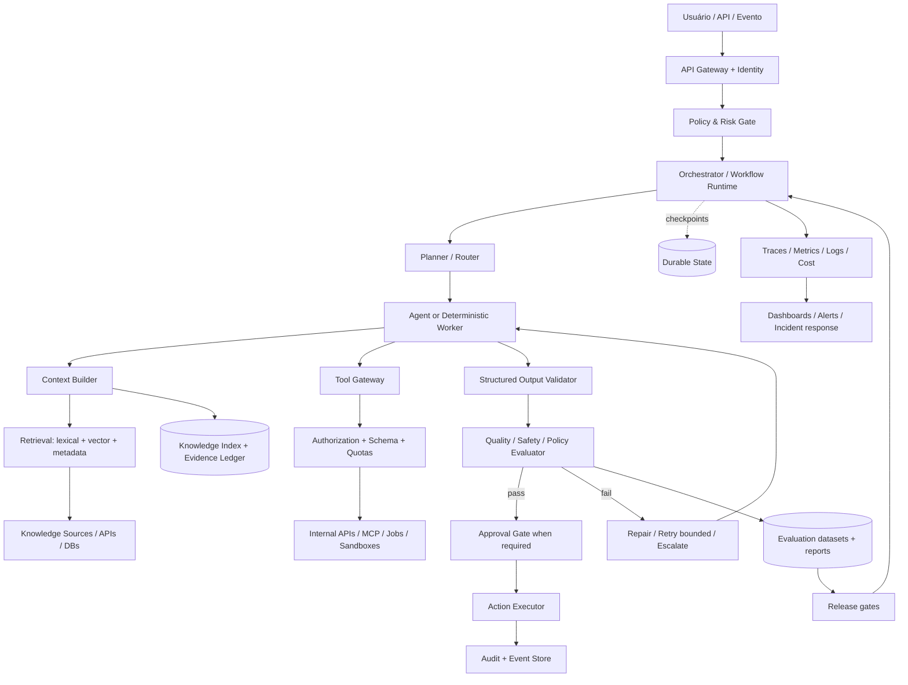
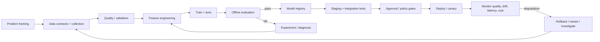

# Parte II — Expansão de arquitetura, engenharia e implementação

> Esta parte amplia o blueprint para cobrir decisões de arquitetura, opções tecnológicas, artefatos de engenharia, padrões de operação e critérios de expansão. É uma arquitetura de referência agnóstica: as ferramentas citadas são opções, não dependências obrigatórias. URLs, preços, licenças, limites e capacidades mudam; valide a documentação oficial e a licença antes de adotar.

## 22. Modelo de requisitos e qualidade arquitetural

### 22.1 Defina o sistema antes de escolher o framework

Cada caso de uso deve começar por um **AI System Brief** com:

- Problema, usuário, decisão ou trabalho a apoiar e resultado de negócio esperado.
- Classe de solução: regra/consulta tradicional, busca, ML preditivo, LLM de chamada única, RAG, workflow agêntico, fine-tuning, modelo próprio ou combinação.
- Entradas, saídas, fontes de verdade, direitos de uso, dados sensíveis e retenção.
- Perfil de risco, consequências de erro, reversibilidade, impacto em pessoas e necessidade de aprovação humana.
- Requisitos de qualidade: correção, groundedness, cobertura, robustez, segurança, consistência, explicabilidade, acessibilidade e utilidade.
- SLOs: disponibilidade, latência p50/p95/p99, taxa de erro, frescor, custo por tarefa e volume.
- Restrições: residência de dados, rede, fornecedor, licença, hardware, orçamento, equipe, operação e dependências.
- Baseline atual e método de comparação. Sem baseline, não se pode afirmar ganho.

### 22.2 Atributos de qualidade (quality attributes)

| Atributo | Pergunta verificável | Evidência típica |
|---|---|---|
| Correção | Resolve casos representativos? | Dataset de referência, revisão humana, métricas por segmento |
| Confiabilidade | Falha de forma previsível e recuperável? | Chaos tests, retries limitados, recuperação de checkpoint |
| Segurança | Pode ser abusado ou induzido a executar ações indevidas? | Threat model, red team, testes de injeção e autorização |
| Privacidade | Dados pessoais e segredos são minimizados e protegidos? | Data map, política de retenção, testes de acesso e redaction |
| Observabilidade | É possível reconstruir o caminho da decisão? | Traces correlacionados, logs de auditoria, lineage |
| Manutenibilidade | Pode ser alterado sem quebrar interfaces? | Contratos, testes, ADRs, ownership |
| Portabilidade | Trocar modelo/provedor exige reescrever domínio? | Adapter layer, suite de evals cross-provider |
| Eficiência | O benefício justifica custo, latência e energia? | Cost per successful task, tokens, benchmark de carga |
| Governança | Existe dono, classificação, aprovação e trilha? | Registro de sistema/modelo, risk register, release record |
| Acessibilidade | Usuários conseguem usar e contestar o resultado? | Testes de acessibilidade, UX research, mecanismo de recurso |

### 22.3 Método de seleção de solução

1. Teste primeiro a opção determinística mais simples.
2. Se a tarefa exige conhecimento atualizado, teste busca/API/RAG antes de fine-tuning.
3. Se a tarefa exige formato estável, use saída estruturada validada por schema.
4. Se o processo tem etapas previsíveis, use workflow explícito; não entregue o fluxo inteiro à autonomia do modelo.
5. Use agente quando houver decisões contextuais entre etapas, ferramentas e caminhos variáveis — e demonstre que supera o workflow simples.
6. Use multiagentes somente quando paralelismo, especialização ou isolamento compensarem custo, latência, coordenação e risco adicionais.
7. Fine-tune quando há evidência de que instrução, exemplos, retrieval e ferramentas não resolvem o problema com custo/qualidade aceitáveis.
8. Treine um modelo próprio apenas quando dados, vantagem estratégica, volume, equipe, infraestrutura e obrigação de controle justificarem o custo total.

## 23. Arquitetura lógica de referência expandida



### 23.1 Planos arquiteturais

- **Data plane:** requisições, conteúdo, embeddings, features, previsões, ações.
- **Control plane:** políticas, autorização, limites, roteamento, aprovação, configuração e release.
- **Knowledge plane:** fontes, metadados, índice, memória, evidências, lineage e políticas de retenção.
- **Evaluation plane:** datasets, graders, métricas, regressões, red team e gates de promoção.
- **Observability plane:** logs, traces, métricas, custo, alertas e auditoria.
- **Execution plane:** workers, sandbox, filas, workflow engine, serving, batch e GPU/CPU.

Esses planos são separações lógicas; não exigem seis microsserviços. Um MVP pode implementá-los em um único serviço com módulos e fronteiras claras.

### 23.2 Componentes e contratos

| Componente | Responsabilidade | Não deve assumir |
|---|---|---|
| API / ingress | Autenticar, validar tamanho/formato, rate limit, request ID | Decidir política de domínio sem contrato |
| Policy gate | Classificar risco e permitir/recusar/encaminhar | Delegar a autorização apenas ao prompt |
| Orchestrator | Estado, transições, timeout, cancelamento, retries | Armazenar todo o conhecimento no prompt |
| Context builder | Montar contexto com origem, frescor e limites | Tratar texto recuperado como instrução confiável |
| Retrieval | Buscar, filtrar, reranquear e devolver evidência | Fabricar fatos quando não há resultado |
| Tool gateway | Schema, authz, quotas, idempotência, auditoria | Dar credenciais amplas ao modelo |
| Validator | Validar schema, invariantes, referências e políticas | Confundir JSON válido com resposta correta |
| Evaluator | Aplicar testes de qualidade/risco adequados | Ser o único controle de segurança |
| Approval gate | Exigir decisão humana antes de efeito relevante | Tratar aprovação genérica como consentimento permanente |
| State store | Persistir checkpoint, status e artefatos | Usar conversa como banco transacional |
| Evidence ledger | Ligar claims a fontes/trechos/datas | Misturar fato, inferência e opinião sem rótulo |

## 24. Catálogo ampliado de padrões agênticos

| Padrão | Forma | Bom uso | Principal risco | Guardrail recomendado |
|---|---|---|---|---|
| Direct model call | Entrada → modelo → saída | Extração, classificação, redação simples | Saída variável | Schema + evals |
| Prompt chain | Etapas sequenciais explícitas | Processo decomponível | Erro propaga entre etapas | Validar saída em cada fronteira |
| Router | Classificador → especialista/workflow | Vários tipos de tarefa | Rota errada | Fallback + métricas por rota |
| Parallel fan-out/fan-in | Tarefas paralelas → agregador | Pesquisa multi-fonte, análise independente | Duplicação e conflito | Limite de concorrência + síntese com evidência |
| Supervisor/worker | Supervisor delega e revisa | Domínios com especialistas | Supervisor vira gargalo | Contratos e budget por subtask |
| Handoff | Agente transfere controle | Fluxo com ownership variável | Perda de contexto/loop | Estado explícito e limites de handoff |
| Evaluator–optimizer | Gerar → avaliar → corrigir | Conteúdo, código, análises | Loop infinito e overfitting ao grader | Máximo de iterações + stop criteria |
| Plan-and-execute | Plano → execução por passos | Tarefas longas com decomposição | Plano desatualizado | Replanejar sob eventos/novas evidências |
| ReAct / tool loop | Raciocínio operacional + ação iterativa | Uso de ferramentas em ambiente variável | Ação excessiva ou prompt injection | Allowlist, quotas, confirmação por risco |
| Blackboard/shared workspace | Especialistas leem/escrevem estado comum | Pesquisa colaborativa | Corrupção/ambiguidade de estado | Schema, ownership e versionamento |
| Event-driven agent | Evento → workflow/agent | Monitoramento e tarefas assíncronas | Duplicatas e eventos fora de ordem | Idempotência, dedupe e DLQ |
| Durable workflow | Estado persistente e retomada | Processos de horas/dias, aprovações | Complexidade operacional | Versionar workflow e testar replay |
| Human-in-the-loop | Pausa → revisão humana → retomada | Ações de alto impacto, ambiguidade | Aprovação fatigue | Mostrar evidência, impacto e reversibilidade |
| Debate / independent critique | Perspectivas independentes → arbitragem | Problemas ambíguos de alto valor | Custo sem ganho real | Testar contra baseline single-agent |
| Retrieval-augmented generation | Retrieve → compose → answer | Conhecimento externo/privado atualizável | Retrieval ruim ou fonte contaminada | Evals de retrieval e citações verificáveis |
| Tool-using analyst | Modelo chama APIs/SQL/calculadora | Pesquisa e análise de dados | SQL/action inseguro | Read-only default, sandbox, least privilege |
| Batch map-reduce | Map por itens → reduce | Classificar/extraír grandes coleções | Viés de agregação | Amostragem e auditoria de outputs |

### Regras de composição

- Todo loop tem `max_iterations`, timeout, budget de tokens/custo e condição de parada.
- Todo worker recebe uma tarefa delimitada, contrato de saída, evidências exigidas e critérios de sucesso.
- Todo resultado paralelo preserva `task_id`, autor/agente, fontes, confiança e divergências.
- Nunca use consenso entre modelos como substituto de evidência independente.
- Faça fan-out apenas se as tarefas forem realmente independentes ou se a diversidade reduzir risco.
- Aumente autonomia gradualmente: sugerir → preparar → executar em sandbox → executar com aprovação → executar autonomamente em escopo limitado.

## 25. Context engineering, RAG e memória — arquitetura detalhada

### 25.1 Pipeline de conhecimento

```mermaid
flowchart LR
  S[Fontes autorizadas] --> I[Ingestão + provenance]
  I --> D[Parse / OCR / extraction]
  D --> C[Clean + classify + redact]
  C --> CH[Chunking semântico e estrutural]
  CH --> M[Metadata + access labels]
  M --> E[Embedding + lexical index]
  E --> V[(Vector index)]
  M --> L[(Lexical index)]
  V --> R[Hybrid retrieval]
  L --> R
  R --> F[Filter by ACL, time, trust]
  F --> RR[Rerank / diversify]
  RR --> CTX[Context pack with citations]
  CTX --> G[Generation / structured synthesis]
  G --> VER[Claim verification + eval]
  VER --> LED[Evidence ledger + feedback]
```



### 25.2 Estratégias de recuperação

- **Lexical/BM25:** ótimo para nomes, códigos, identificadores e termos exatos.
- **Dense/vector:** útil para paráfrases e semântica; depende da qualidade do embedding e do corpus.
- **Hybrid:** combina lexical e semântico; frequentemente é baseline forte para corpus heterogêneo.
- **Metadata filtering:** restringe por departamento, data, autoridade, confidencialidade, versão e tipo de documento.
- **Reranking:** reordena candidatos; aumenta qualidade potencial, mas adiciona latência/custo.
- **Query rewriting/decomposition:** transforma pergunta em consultas; avalie risco de mudar a intenção.
- **Multi-hop retrieval:** recupera evidência em várias etapas; use quando uma única busca não basta.
- **Graph retrieval:** aproveita relações entre entidades; útil para perguntas relacionais, não obrigatório para todo RAG.
- **Parent-child / hierarchical retrieval:** busca trechos pequenos e recupera contexto maior; útil para documentos longos.
- **Late chunking/contextual chunking:** preserve contexto quando tecnicamente suportado e avaliado.
- **Temporal retrieval:** privilegia frescor, validade e histórico; essencial para pesquisa de mercado e inteligência.

### 25.3 Métricas para retrieval e resposta

- Retrieval: Recall@k, Precision@k, MRR, nDCG, hit rate, cobertura de fontes, diversidade e taxa de documentos obsoletos.
- Resposta: correção factual, faithfulness/groundedness, relevância, completude, calibração de incerteza, citação válida e aderência ao formato.
- Operação: p95 de retrieval, custo por resposta, cache hit, falhas por fonte, frescor e taxa de abstinência adequada.
- Avalie separadamente retrieval e geração; senão não se sabe onde está o defeito.

### 25.4 Política de memória

| Memória | Conteúdo | Persistência | Regra |
|---|---|---|---|
| Working/context | Informação necessária para a tarefa atual | Curta | Minimizar e descartar após tarefa quando possível |
| Episodic | Execuções, feedback, resultados e incidentes | Durável com retenção definida | Guardar resumo, outcome e links; não transcrição indiscriminada |
| Semantic | Conhecimento validado, conceitos, entidades | Durável e versionada | Requer origem, validade e revisão |
| Procedural | Policies, skills, runbooks, SOPs | Git/repositório versionado | Mudanças por PR, evals e owner |
| Organizational | Estratégia, contexto setorial, decisões aprovadas | Base controlada | ACL, data de validade e responsabilidade |
| Model/feature memory | Features ou parâmetros aprendidos | Registry/versionamento | Lineage e monitoramento de drift |

Nunca deixe que texto recuperado de uma fonte externa altere a hierarquia de instruções. Conteúdo recuperado é dado, não política de sistema. A memória não deve virar um depósito ilimitado de conversas; cada tipo precisa de finalidade, retenção, ACL, processo de correção e exclusão.

## 26. Engenharia de dados, ML clássico e GenAI

### 26.1 Pipeline de ML tradicional



### 26.2 Artefatos mínimos por modelo

- Problem statement e hipótese de valor.
- Data card/dataset card, permissões, lineage, split strategy e prevenção de leakage.
- Feature definitions e transformações versionadas.
- Código, ambiente, dependências, seed/config e artefatos de treino.
- Experimentos, métricas globais e segmentadas, baselines e intervalos de incerteza quando aplicáveis.
- Model card: intended use, limitations, known failure modes, evals, fairness considerations.
- Registry entry, assinatura de input/output, versão, status e dependências.
- Plano de deploy, rollback, monitoramento, thresholds e owner.

### 26.3 Escolha de técnica

| Necessidade | Técnica a avaliar primeiro | Alternativas / alerta |
|---|---|---|
| Dados tabulares com alvo conhecido | Baseline linear/árvore/boosting | Deep learning pode não compensar custo |
| Previsão temporal | Baseline sazonal + modelos de séries | Backtesting temporal; evitar leakage |
| Texto/visão/áudio rotulados | Modelo pré-treinado + fine-tuning | Medir custo de anotação e viés de dados |
| Conhecimento privado/atual | RAG/API de fonte autoritativa | Fine-tuning não é banco de fatos atualizado |
| Formato/estilo/comportamento repetido | Prompt e exemplos; depois fine-tuning se necessário | Avaliar regressão e memorização |
| Raciocínio multi-etapas com ferramentas | Workflow explícito ou agente | Não confundir benchmark de modelo com desempenho do sistema |
| Decisão regulada/alto risco | Sistema híbrido com regras e revisão humana | LLM não deve ser autoridade única por padrão |
| Alta escala/baixa latência | Cache, batching, quantização, serving otimizado | Medir qualidade degradada e tail latency |

### 26.4 MLOps e LLMOps

MLOps cobre dados, treino, registry, deploy, monitoramento e feedback. LLMOps amplia isso para prompts, versões de modelo/provider, contexto recuperado, tools, traces, eval datasets, tokens/custos, guardrails e comportamento agêntico. Os dois precisam de CI/CD, lineage, segurança e monitoramento; não são disciplinas mutuamente exclusivas.

## 27. Catálogo de frameworks, ferramentas e plataformas

**Critério de seleção:** requisito e benchmark primeiro; preferência de equipe, licença, maturidade, comunidade, integração, exportabilidade, operação e custo total depois. Evite selecionar ferramenta só por popularidade. A tabela é um mapa de opções, não um ranking universal.

### 27.1 Runtime de agentes e orquestração

| Opção | Categoria / quando investigar | Trade-off a verificar | Link oficial |
|---|---|---|---|
| OpenAI Agents SDK | Runtime code-first, handoffs, tools, tracing | Integração com stack e requisitos de portabilidade | https://developers.openai.com/api/docs/guides/agents/sdk |
| LangGraph | Workflows stateful, grafo, pausa/resume, human-in-loop | Curva de aprendizado e governança de estado | https://docs.langchain.com/oss/python/langgraph/overview |
| Google Agent Development Kit (ADK) | Desenvolvimento de agentes e composição | Integração com runtime/provider e deployment | https://google.github.io/adk-docs/ |
| Microsoft Agent Framework | Agentes/workflows no ecossistema Microsoft/.NET/Python | Maturidade, versões e dependências de plataforma | https://learn.microsoft.com/en-us/agent-framework/ |
| Pydantic AI | Agentes tipados em Python, output schemas e integrações | Ecossistema e adequação ao runtime existente | https://ai.pydantic.dev/ |
| LlamaIndex Workflows | Pipelines/agents sobre dados e eventos | Evitar acoplamento desnecessário ao framework de dados | https://developers.llamaindex.ai/python/llamaagents/workflows/ |
| Semantic Kernel | Orquestração, plugins e integrações empresariais | Alinhamento com stack e modelo de abstração | https://learn.microsoft.com/en-us/semantic-kernel/ |
| CrewAI | Equipes de agentes e tarefas orientadas a papéis | Verificar controle fino, estado e rastreabilidade | https://docs.crewai.com/ |
| Haystack | Pipelines, retrieval e aplicações LLM | Comparar design de pipeline e integrações | https://docs.haystack.deepset.ai/ |
| Temporal | Execução durável de workflows de longa duração | Operação do workflow engine e disciplina de versionamento | https://docs.temporal.io/ |
| Prefect | Orquestração de data/ML workflows | Adequação a fluxos agentic e requisitos de durabilidade | https://docs.prefect.io/ |
| Apache Airflow | Agendamento/orquestração de pipelines batch | Não usar DAG batch como substituto automático de runtime interativo | https://airflow.apache.org/docs/ |
| Ray | Computação distribuída, serving e workloads de ML | Operação distribuída, overhead e observabilidade | https://docs.ray.io/ |

### 27.2 Retrieval, busca e armazenamento

| Opção | Categoria | Link oficial |
|---|---|---|
| PostgreSQL + pgvector | Banco relacional com busca vetorial | https://github.com/pgvector/pgvector |
| OpenSearch | Busca lexical, vetorial e híbrida | https://opensearch.org/docs/latest/ |
| Elasticsearch | Busca textual e vetorial | https://www.elastic.co/guide/index.html |
| Qdrant | Banco vetorial | https://qdrant.tech/documentation/ |
| Weaviate | Banco vetorial / busca híbrida | https://weaviate.io/developers/weaviate |
| Milvus | Banco vetorial distribuído | https://milvus.io/docs |
| Chroma | Banco vetorial para prototipagem e aplicações | https://docs.trychroma.com/ |
| FAISS | Biblioteca de busca de similaridade | https://github.com/facebookresearch/faiss |
| Vespa | Busca, ranking e serving em escala | https://docs.vespa.ai/ |
| LlamaIndex | Ingestão, retrieval e conectores de dados | https://developers.llamaindex.ai/ |
| Haystack | Pipelines de busca e RAG | https://docs.haystack.deepset.ai/ |

### 27.3 Modelos, serving e otimização

| Opção | Categoria | Link oficial |
|---|---|---|
| Hugging Face Transformers | Modelos e pipelines | https://huggingface.co/docs/transformers/ |
| Hugging Face PEFT | Parameter-efficient fine-tuning | https://huggingface.co/docs/peft/ |
| Hugging Face TRL | Fine-tuning/alinhamento de modelos | https://huggingface.co/docs/trl/ |
| vLLM | Serving de modelos e throughput | https://docs.vllm.ai/ |
| NVIDIA Triton Inference Server | Serving de inferência | https://github.com/triton-inference-server/server |
| KServe | Serving Kubernetes para ML | https://kserve.github.io/website/ |
| BentoML | Empacotamento e serving de modelos | https://docs.bentoml.com/ |
| Ollama | Execução local de modelos | https://docs.ollama.com/ |
| llama.cpp | Inferência local otimizada | https://github.com/ggml-org/llama.cpp |
| LiteLLM | Gateway/roteamento multi-provider | https://docs.litellm.ai/ |
| MLflow Deployments / AI Gateway | Gestão de experimentos, modelos e serving/gateway conforme recursos da versão | https://mlflow.org/docs/latest/ |

### 27.4 Dados, treinamento e MLOps

| Opção | Categoria | Link oficial |
|---|---|---|
| MLflow | Tracking, registry, evals e ciclo de vida | https://mlflow.org/docs/latest/ |
| DVC | Versionamento de dados e pipelines | https://dvc.org/doc |
| Kubeflow | Plataforma de workflows de ML | https://www.kubeflow.org/docs/ |
| Feast | Feature store | https://docs.feast.dev/ |
| lakeFS | Versionamento de data lakes | https://docs.lakefs.io/ |
| Great Expectations | Testes/expectativas de qualidade de dados | https://docs.greatexpectations.io/ |
| Soda | Data quality checks | https://docs.soda.io/ |
| Evidently AI | Avaliação/monitoramento de dados e ML | https://docs.evidentlyai.com/ |
| Weights & Biases | Experimentos, artefatos e tracking | https://docs.wandb.ai/ |
| Neptune.ai | Tracking de experimentos, sujeito a disponibilidade/planos | https://docs.neptune.ai/ |
| Apache Spark | Processamento de dados distribuído | https://spark.apache.org/docs/latest/ |
| Dagster | Orquestração de ativos de dados | https://docs.dagster.io/ |

### 27.5 Evals, testes e observabilidade de GenAI

| Opção | Categoria | Link oficial |
|---|---|---|
| OpenTelemetry | Padrão aberto de traces/métricas/logs | https://opentelemetry.io/docs/ |
| OpenAI tracing/evals | Trace e avaliação no stack OpenAI | https://developers.openai.com/api/docs/guides/agents/integrations-observability |
| Langfuse | Observabilidade, prompt management e evals | https://langfuse.com/docs |
| Arize Phoenix | Tracing e avaliação de LLM/RAG | https://arize.com/docs/phoenix |
| LangSmith | Debugging, traces e evals para aplicações LangChain/LLM | https://docs.smith.langchain.com/ |
| Ragas | Métricas e avaliação para RAG/LLM | https://docs.ragas.io/ |
| DeepEval | Testes/evals de aplicações LLM | https://docs.confident-ai.com/ |
| promptfoo | Testes, red teaming e comparação de prompts/modelos | https://www.promptfoo.dev/docs/ |
| TruLens | Avaliação e observabilidade de aplicações LLM | https://www.trulens.org/ |
| Giskard | Testes de qualidade e segurança de modelos/LLM | https://docs.giskard.ai/ |
| Inspect AI | Framework de avaliação de modelos | https://inspect.ai-safety-institute.org.uk/ |
| MLflow GenAI evaluation | Evals e tracing integrados ao MLflow | https://mlflow.org/docs/latest/genai/ |

### 27.6 Infraestrutura, integração e operação

| Opção | Categoria | Link oficial |
|---|---|---|
| Docker | Containers | https://docs.docker.com/ |
| Kubernetes | Orquestração de containers | https://kubernetes.io/docs/home/ |
| Terraform | Infraestrutura como código | https://developer.hashicorp.com/terraform/docs |
| OpenTofu | Infraestrutura como código open source | https://opentofu.org/docs/ |
| GitHub Actions | CI/CD | https://docs.github.com/actions |
| GitLab CI/CD | CI/CD | https://docs.gitlab.com/ee/ci/ |
| Argo CD | GitOps delivery | https://argo-cd.readthedocs.io/ |
| Prometheus | Métricas e alertas | https://prometheus.io/docs/ |
| Grafana | Dashboards e observabilidade | https://grafana.com/docs/ |
| Vault | Gestão de segredos | https://developer.hashicorp.com/vault/docs |
| Keycloak | IAM/identity | https://www.keycloak.org/documentation |
| MCP | Protocolo de integração de ferramentas/contexto | https://modelcontextprotocol.io/ |
| AsyncAPI | Contratos de APIs/eventos assíncronos | https://www.asyncapi.com/docs |
| OpenAPI | Contrato de APIs HTTP | https://spec.openapis.org/oas/latest.html |
| JSON Schema | Validação de dados estruturados | https://json-schema.org/ |
| Protobuf | Schemas e serialização de mensagens | https://protobuf.dev/ |

### 27.7 Como escolher sem criar uma colcha de retalhos

- Selecione **um runtime primário** para o primeiro release; mantenha contratos e lógica de domínio fora dele.
- Selecione **um workflow engine** apenas se precisar de durabilidade, retries complexos, long-running jobs ou operação assíncrona robusta.
- Escolha armazenamento pelo requisito: relacional, objeto, busca lexical, vetorial, grafo ou feature store; não force tudo num banco só.
- Padronize observabilidade com OpenTelemetry quando possível; escolha backend com base em privacidade, escala, custo e operação.
- Não adote simultaneamente várias ferramentas que resolvem a mesma camada sem um motivo medido.
- Para cada ferramenta candidata, registre: necessidade atendida, alternativas, maturidade, licença, segurança, exportabilidade, custo total, skills disponíveis, lock-in e plano de saída.

## 28. Segurança, privacidade e governança avançadas

### 28.1 Threat model mínimo

Modele ativos, atores, fronteiras de confiança, superfícies, ameaças, controles, evidências e risco residual. Incluir no mínimo:

- Prompt injection direta e indireta, incluindo documentos, páginas web, emails e resultados de tools.
- Vazamento de dados, secrets, cross-tenant retrieval e exposição via logs/traces.
- Tool abuse, SSRF, command/code execution, SQL injection e escalada de privilégio.
- Supply-chain risk em dependências, modelos, datasets, plugins e MCP servers.
- Data poisoning, retrieval poisoning, model inversion/memorization e adversarial input.
- Excesso de autonomia, ações irreversíveis, abuso de credenciais e loops de custo.
- Alucinação de evidência, citação fabricada, conteúdo desatualizado e falsa confiança.
- Denial of service, rate exhaustion, context flooding e ataque por arquivo grande/malformado.
- Discriminação, falhas por segmento, acessibilidade e consequências não intencionais.

### 28.2 Controles em camadas

1. **Identity:** autenticação forte, autorização por recurso/ação/tenant, menor privilégio.
2. **Input:** limites de tamanho, tipos permitidos, validação, malware scanning e classificação.
3. **Context:** rotular conteúdo não confiável, aplicar ACL no retrieval, separar instruções de dados, reduzir dados sensíveis.
4. **Model:** política de uso, saída estruturada, recusa e testes adversariais; não confiar apenas em filtros de prompt.
5. **Tools:** allowlist, schema, validação server-side, dry-run, quotas, idempotência e autorização fora do modelo.
6. **Execution:** sandbox, egress control, isolamento, timeouts, cancelamento e limites de recursos.
7. **Action:** aprovação humana para impacto material, preview de alterações, confirmação explícita e rollback.
8. **Data:** criptografia, retenção, deleção, segregação, lineage e acesso mínimo.
9. **Supply chain:** pin de dependências, SBOM, scan, provenance, revisão de MCP/skills e artefatos.
10. **Monitoring:** audit log, deteção de abuso, alertas, incident response e exercícios regulares.

### 28.3 Classificação de risco e autonomia

| Classe | Exemplos | Modo padrão |
|---|---|---|
| R0 — leitura/baixo impacto | Resumir documentação pública | Autonomia ampla com citações e limites de uso |
| R1 — proposta reversível | Rascunhar PR, campanha, relatório | Gerar proposta; revisão antes de publicação |
| R2 — ação interna reversível | Abrir ticket, atualizar rascunho, executar teste sandbox | Permissão por escopo + log + rollback |
| R3 — impacto externo/material | Enviar mensagem externa, publicar, alterar dados de negócio | Aprovação humana específica por ação |
| R4 — alto risco/regulado/irreversível | Decisões sobre direitos, dinheiro, saúde, segurança ou produção crítica | Não automatizar sem avaliação formal, controles especializados e autorização explícita; alguns casos devem permanecer humanos |

A classificação depende do contexto, da legislação e do impacto real; a tabela não é uma classificação jurídica universal.

## 29. Avaliação, release gates e melhoria contínua

### 29.1 Pirâmide de testes para sistemas de IA

- **Unit tests:** parsers, transforms, autorização, schemas, cálculos, políticas determinísticas.
- **Contract tests:** tool APIs, schemas de saída, eventos, modelos e retrieval interfaces.
- **Golden datasets:** exemplos representativos, rótulos e rubricas versionados.
- **Component evals:** retrieval, reranking, extraction, summarization, tool selection, classifiers.
- **End-to-end evals:** tarefa completa, estado, evidências, comportamento de falha e UX.
- **Adversarial/red-team:** prompt injection, jailbreak, data leakage, tool abuse, ambiguity e conflito de instruções.
- **Shadow/canary:** comparar versões sem expor todos os usuários a risco.
- **Production monitoring:** drift, reclamações, falhas, qualidade por segmento, custo e latency.

### 29.2 Rubrica mínima de avaliação

Cada avaliação deve registrar `eval_id`, dataset/version, casos, modelo/provider, prompt/skill version, tools, retrieval index version, timestamp, evaluator, scores, falhas, threshold e decisão. Combine métricas automáticas com amostragem humana. LLM-as-judge pode escalar avaliação, mas deve ser calibrado contra julgamento humano e não ser o único gate para segurança ou alto impacto.

### 29.3 Gates sugeridos

- **Gate A — Data readiness:** schema, lineage, direitos, qualidade e privacidade aprovados.
- **Gate B — Offline quality:** superar baseline em métricas-alvo sem regressões críticas por segmento.
- **Gate C — Security:** threat model, abuso e permissões testados.
- **Gate D — Operational readiness:** timeout, retries, custos, observabilidade, alertas e rollback testados.
- **Gate E — Human/business acceptance:** owner aprova o comportamento real e limitações.
- **Gate F — Post-release:** canary/monitoramento e critério de rollback ativo.

## 30. SRE, confiabilidade e economics de IA

### 30.1 Padrões operacionais

- Timeout por chamada e deadline total por tarefa; propagar deadline aos workers.
- Retry somente para falhas transitórias, com backoff exponencial, jitter e limite.
- Circuit breaker para dependências degradadas; bulkhead para isolamento de concorrência.
- Idempotency key em ações e workers; deduplicação de eventos.
- Dead-letter queue e runbook para jobs falhos; não descartar silenciosamente.
- Checkpoints para tarefas longas e retomada após falha.
- Cache apenas quando a chave inclui contexto de segurança, versão de dados/modelo e validade.
- Fallback explícito: modelo menor, resposta parcial, busca alternativa, escalonamento ou abstinência.
- Rate limit por usuário/tenant/feature/provider e limite de custo por execução.
- Chaos/fault tests para timeouts, provider outage, rate limit, index indisponível e tool malformada.

### 30.2 Métricas operacionais de IA

- **Task success rate:** tarefas concluídas com critérios de aceitação satisfeitos / tarefas válidas.
- **Cost per successful task:** custo total / tarefas bem-sucedidas; mais útil que custo por chamada isolada.
- **Evidence coverage:** claims importantes sustentados por evidência rastreável / claims importantes.
- **Tool success rate:** chamadas que atingem resultado esperado / chamadas válidas.
- **Human override rate:** saídas/ações corrigidas ou rejeitadas por pessoas.
- **Abstention quality:** quando o sistema se abstém nos casos em que não há evidência suficiente.
- **Freshness lag:** atraso entre mudança na fonte e atualização do conhecimento indexado.
- **p95/p99 latency, availability, error budget, token usage, cache hit, retries, escalation rate.**

Não otimize uma métrica isolada. Reduzir custo pode aumentar erro; maximizar confiança percebida pode reduzir calibração; maximizar taxa de conclusão pode incentivar ações indevidas.

## 31. Templates normativos para copiar e adaptar

### 31.1 AI System Brief

```yaml
system_id: "ai.<domain>.<capability>"
owner: "team-or-person"
status: proposed # proposed | pilot | production | deprecated
problem_statement: ""
users_and_decisions: []
intended_use: []
out_of_scope: []
solution_class: "deterministic|ml|llm|rag|agent|hybrid"
inputs: []
outputs: []
source_of_truth: []
data_classification: "public|internal|confidential|restricted"
risk_class: "R0|R1|R2|R3|R4"
quality_targets:
  task_success_rate: null
  groundedness: null
  citation_validity: null
  latency_p95_ms: null
  cost_per_successful_task: null
reliability_targets:
  availability: null
  timeout_seconds: null
  max_retries: null
human_approval_required: true
retention_policy: ""
monitoring_owner: ""
rollback_plan: ""
acceptance_tests: []
open_questions: []
```

### 31.2 Architecture Decision Record (ADR)

```markdown
# ADR-NNNN: <título>
- Status: proposed | accepted | rejected | superseded
- Date: YYYY-MM-DD
- Owners: <responsáveis>
- Related systems: <IDs>

## Contexto e problema
## Requisitos e restrições
## Opções consideradas
## Decisão e justificativa
## Consequências positivas e negativas
## Segurança, privacidade e risco
## Custo/latência/operabilidade
## Evidências, benchmarks e links
## Plano de migração/rollback
## Revisão futura / condições para reconsiderar
```

### 31.3 Tool contract

```yaml
tool_id: "<namespace>.<action>"
version: "1.0.0"
purpose: ""
input_schema: "JSON Schema URI or embedded schema"
output_schema: "JSON Schema URI or embedded schema"
authz:
  mode: "service|user-delegated"
  scopes: []
side_effects: "none|read|write|external"
idempotent: true
idempotency_key_required: true
risk_class: "R0|R1|R2|R3|R4"
rate_limit: ""
timeout_seconds: 15
retry_policy: "bounded-transient-only"
dry_run_supported: true
approval_required: true
audit_fields: ["actor", "request_id", "timestamp", "resource", "outcome"]
error_codes: []
owner: ""
```

### 31.4 Evaluation case

```yaml
eval_id: "eval.<suite>.<case>"
version: 1
input: {}
expected_properties:
  - "claims supported by source"
  - "valid schema"
  - "no unauthorized action"
forbidden_properties:
  - "invented citation"
  - "secret disclosure"
metrics: ["correctness", "groundedness", "format_validity"]
severity: "critical|high|medium|low"
source_refs: []
reviewer: ""
```

### 31.5 Research dossier / evidence ledger

```yaml
dossier_id: "research.<domain>.<YYYYMMDD>.<slug>"
question: ""
scope: {geography: [], period: "", sectors: []}
created_at: "ISO-8601"
research_owner: ""
claims:
  - claim_id: "C1"
    statement: ""
    claim_type: "fact|estimate|inference|forecast|opinion"
    confidence: "low|medium|high"
    evidence:
      - source_id: "SRC-0001"
        url: ""
        published_at: ""
        accessed_at: ""
        locator: "section/page/paragraph"
        quote_or_data: ""
    counterevidence: []
    limitations: []
recommendations:
  - action: ""
    expected_impact: ""
    effort: "S|M|L"
    confidence: "low|medium|high"
    owner: ""
    validation_metric: ""
    review_date: ""
```

### 31.6 Source registry

```yaml
source_id: "SRC-0001"
title: ""
canonical_url: ""
publisher: ""
source_type: "primary|standard|paper|documentation|journalism|analysis|community"
author_or_owner: ""
published_at: ""
last_verified_at: ""
accessed_at: ""
claims_supported: []
coverage: {domains: [], geography: [], languages: []}
reliability_notes: ""
bias_or_conflict_notes: ""
license_or_terms: ""
access_method: "web|api|rss|manual|connector"
status: "active|review|deprecated|blocked"
review_interval_days: 90
```

### 31.7 Release checklist

- [ ] Versões de código, prompts, modelos, ferramentas, índice e datasets registradas.
- [ ] Evals offline passaram; diferenças contra baseline revisadas.
- [ ] Testes de segurança e autorização passaram.
- [ ] Citações e evidências validadas quando exigidas.
- [ ] PII/secrets não vazam em logs ou outputs.
- [ ] Limites de timeout, retries, custo e concorrência configurados.
- [ ] Traces, métricas, alertas e runbook testados.
- [ ] Plano de rollback e owner de plantão definidos.
- [ ] Aprovações necessárias registradas.
- [ ] Canary/shadow e critérios de parada definidos.

## 32. Padrões de organização do repositório e governança documental

Estrutura de referência expandida:

```text
brain-ai-ml/
├── README.md
├── MANIFESTO.md
├── ARCHITECTURE.md
├── GLOSSARY.md
├── CHANGELOG.md
├── adr/                         # decisões arquiteturais
├── standards/                   # normas e políticas
│   ├── security/ privacy/ evals/ data/ observability/
├── domains/                     # conhecimento e contexto por domínio
├── roles/                       # papéis, ownership e interfaces
├── skills/                      # procedimentos reutilizáveis
├── workflows/                   # fluxos determinísticos e agênticos
├── tools/                       # contratos, permissões, adaptadores
├── knowledge/
│   ├── sources/                 # catálogo de fontes
│   ├── evidence/                # claims e proveniência
│   ├── indexes/                 # configuração do retrieval, não dados secretos
│   └── memory/                  # política e schemas de memória
├── ml/
│   ├── datasets/ model_cards/ feature_specs/ pipelines/
│   └── evaluation/ registry/ monitoring/
├── evals/
│   ├── golden/ regression/ adversarial/ segment_slices/
├── schemas/                     # JSON Schema, OpenAPI, AsyncAPI
├── templates/                   # brief, ADR, dossier, tool, incident, release
├── runbooks/                    # operação e incidentes
├── infra/                       # IaC, deployment, policy-as-code
├── tests/                       # unit, contract, integration, e2e
└── security/                    # threat models, SBOM, reviews
```

### Regras de contribuição

- Cada artefato tem owner, status, versão, data de revisão e links relacionados.
- Mudança normativa via pull request; revisão por owner e função de segurança/risco quando aplicável.
- CI valida Markdown/links, schemas, YAML, referências, testes e consistência de versões.
- Conteúdo sensível não deve ser commitado no repositório de documentação; usar secret manager e armazenamento com ACL.
- Fonte não confiável deve ser marcada como dado externo e nunca mesclada silenciosamente com política normativa.
- Arquivar e depreciar explicitamente; não apagar silenciosamente decisão importante.
- Separar templates, exemplos fictícios e dados reais.

## 33. Roadmap de maturidade e possibilidades de expansão

| Nível | Capacidades | Condição para avançar |
|---|---|---|
| L0 — Manual | Documentação, padrões, papéis e fontes | Escopo e ownership definidos |
| L1 — Reprodutível | Contratos, templates, versionamento, eval set inicial | Tarefas e outputs verificáveis |
| L2 — Assistido | Busca, um runtime, tools read-only, traces | Qualidade e segurança mensuradas |
| L3 — Operacional | Workflows duráveis, filas, aprovações, RBAC, incidentes | Falhas recuperáveis e auditáveis |
| L4 — Multi-domínio | Especialistas, router/supervisor, índices segmentados, SLOs | Benefício multiagente demonstrado |
| L5 — Adaptativo controlado | Feedback loop, evals contínuas, atualização assistida de conhecimento | Alterações com testes e gates |
| L6 — Plataforma interna | Catálogo de sistemas, self-service, policy-as-code, tenancy, quotas | Operação de plataforma madura |
| L7 — Otimização avançada | Model routing, caching, distillation/fine-tuning, serving próprio, capacity planning | Volume/ROI justifica complexidade |

Expansões possíveis, quando houver requisito real:

- Graph/knowledge graph para relações complexas e entity resolution.
- Event-driven ingestion com CDC, webhooks, RSS, APIs e freshness SLAs.
- Multimodal RAG para PDFs com layout, imagens, áudio, vídeo e diagramas.
- Pesquisa científica com scholarly metadata, deduplicação de papers, citation graph e replicação de resultados.
- Inteligência competitiva/geopolítica com provenance, temporal validity, source diversity e análise de cenários.
- Model routing por classe de tarefa, privacidade, custo, latência e qualidade avaliada.
- Fine-tuning/LoRA, distillation, quantization e self-hosted inference quando justified.
- Agent sandboxing, browser/computer-use, code execution isolada e approval gates.
- Federated/multi-tenant knowledge com ACL e retrieval security.
- Data mesh, feature store, lineage, data contracts e policy-as-code.
- Red team contínuo, abuse monitoring e tabletop incident exercises.
- Portfolio management: backlog de hipóteses, experimentos, métricas de valor e custo de oportunidade.

## 34. Fontes de referência e pesquisa — registro consolidado

Esta lista é um catálogo de fontes primárias, padrões e documentação oficial usados como base de referência para o blueprint. Não implica que todos os produtos devam ser usados nem que cada página seja uma norma universal. O conteúdo e os endpoints podem mudar; verifique a versão vigente, licença, data de revisão e disponibilidade antes da implementação.

### 34.1 Padrões, risco e governança

1. NIST AI Risk Management Framework: https://www.nist.gov/itl/ai-risk-management-framework
2. NIST AI RMF resources/playbook: https://www.nist.gov/itl/ai-risk-management-framework/ai-risk-management-framework-resources
3. NIST AI RMF Generative AI Profile (NIST AI 600-1): https://nvlpubs.nist.gov/nistpubs/ai/NIST.AI.600-1.pdf
4. NIST Cybersecurity Framework: https://www.nist.gov/cyberframework
5. NIST Privacy Framework: https://www.nist.gov/privacy-framework
6. OWASP GenAI Security Project / Top 10: https://genai.owasp.org/initiative/owasp-top-10-for-llm-and-genai/
7. OWASP Application Security Verification Standard: https://owasp.org/www-project-application-security-verification-standard/
8. OWASP API Security: https://owasp.org/www-project-api-security/
9. ISO/IEC 42001 overview: https://www.iso.org/standard/81230.html
10. ISO/IEC 23894 AI risk management: https://www.iso.org/standard/77304.html
11. OECD AI Principles: https://oecd.ai/en/ai-principles
12. EU AI Act official portal: https://digital-strategy.ec.europa.eu/en/policies/regulatory-framework-ai
13. MITRE ATLAS (AI threat knowledge base): https://atlas.mitre.org/
14. Google Secure AI Framework (SAIF): https://saif.google/
15. Microsoft Responsible AI: https://www.microsoft.com/ai/principles-and-approach

### 34.2 Arquitetura de sistemas, agentes e engenharia de contexto

16. OpenAI Agents SDK: https://developers.openai.com/api/docs/guides/agents/sdk
17. OpenAI agents observability: https://developers.openai.com/api/docs/guides/agents/integrations-observability
18. OpenAI API docs: https://developers.openai.com/api/docs/
19. Anthropic Engineering: https://www.anthropic.com/engineering
20. Anthropic, Building effective agents: https://www.anthropic.com/engineering/building-effective-agents
21. Anthropic, Writing effective tools for agents: https://www.anthropic.com/engineering/writing-tools-for-agents
22. Anthropic, Contextual Retrieval: https://www.anthropic.com/engineering/contextual-retrieval
23. Google Cloud, choose an agent design pattern: https://docs.cloud.google.com/architecture/choose-design-pattern-agentic-ai-system
24. Microsoft, agent architecture principles and patterns: https://learn.microsoft.com/en-us/agents/architecture/
25. Microsoft, AI agent observability: https://learn.microsoft.com/security/zero-trust/sfi/observability-ai-systems
26. LangGraph docs: https://docs.langchain.com/oss/python/langgraph/overview
27. LangChain learn docs: https://docs.langchain.com/oss/python/learn
28. Google Agent Development Kit: https://google.github.io/adk-docs/
29. Microsoft Agent Framework: https://learn.microsoft.com/en-us/agent-framework/
30. Pydantic AI: https://ai.pydantic.dev/
31. LlamaIndex Workflows: https://developers.llamaindex.ai/python/llamaagents/workflows/
32. Semantic Kernel: https://learn.microsoft.com/en-us/semantic-kernel/
33. CrewAI docs: https://docs.crewai.com/
34. Haystack docs: https://docs.haystack.deepset.ai/
35. Temporal docs: https://docs.temporal.io/
36. Prefect docs: https://docs.prefect.io/
37. MCP specification and docs: https://modelcontextprotocol.io/

### 34.3 Cloud architecture e MLOps

38. AWS Well-Architected Framework: https://docs.aws.amazon.com/wellarchitected/
39. AWS Machine Learning Lens: https://docs.aws.amazon.com/wellarchitected/latest/machine-learning-lens/machine-learning-lens.html
40. AWS ML lifecycle architecture: https://docs.aws.amazon.com/wellarchitected/latest/machine-learning-lens/architecture-diagram.html
41. Microsoft Azure Architecture Center: https://learn.microsoft.com/en-us/azure/architecture/
42. Microsoft AI/ML architecture overview: https://learn.microsoft.com/en-us/azure/architecture/ai-ml/ai-overview
43. Google Cloud Architecture Center: https://cloud.google.com/architecture
44. Google MLOps continuous delivery and automation: https://docs.cloud.google.com/architecture/mlops-continuous-delivery-and-automation-pipelines-in-machine-learning
45. Google enterprise GenAI/ML blueprint: https://docs.cloud.google.com/architecture/blueprints/genai-mlops-blueprint
46. MLflow docs: https://mlflow.org/docs/latest/
47. MLflow Tracking: https://mlflow.org/docs/latest/tracking/
48. MLflow Model Registry: https://mlflow.org/docs/latest/model-registry/
49. DVC docs: https://dvc.org/doc
50. Kubeflow docs: https://www.kubeflow.org/docs/
51. Feast feature store: https://docs.feast.dev/
52. Ray docs: https://docs.ray.io/
53. Apache Airflow: https://airflow.apache.org/docs/
54. Dagster: https://docs.dagster.io/
55. Great Expectations: https://docs.greatexpectations.io/
56. Evidently AI: https://docs.evidentlyai.com/

### 34.4 Model development, serving e infraestrutura

57. Hugging Face Transformers: https://huggingface.co/docs/transformers/
58. Hugging Face PEFT: https://huggingface.co/docs/peft/
59. Hugging Face TRL: https://huggingface.co/docs/trl/
60. vLLM: https://docs.vllm.ai/
61. KServe: https://kserve.github.io/website/
62. BentoML: https://docs.bentoml.com/
63. NVIDIA Triton Inference Server: https://github.com/triton-inference-server/server
64. llama.cpp: https://github.com/ggml-org/llama.cpp
65. Ollama: https://docs.ollama.com/
66. LiteLLM: https://docs.litellm.ai/
67. Docker docs: https://docs.docker.com/
68. Kubernetes docs: https://kubernetes.io/docs/home/
69. Terraform docs: https://developer.hashicorp.com/terraform/docs
70. GitHub Actions: https://docs.github.com/actions
71. Argo CD: https://argo-cd.readthedocs.io/

### 34.5 Retrieval, bancos e busca

72. PostgreSQL: https://www.postgresql.org/docs/
73. pgvector: https://github.com/pgvector/pgvector
74. OpenSearch: https://opensearch.org/docs/latest/
75. Elasticsearch: https://www.elastic.co/guide/index.html
76. Qdrant: https://qdrant.tech/documentation/
77. Weaviate: https://weaviate.io/developers/weaviate
78. Milvus: https://milvus.io/docs
79. Chroma: https://docs.trychroma.com/
80. FAISS: https://github.com/facebookresearch/faiss
81. Vespa: https://docs.vespa.ai/
82. LlamaIndex: https://developers.llamaindex.ai/

### 34.6 Evals, telemetria e monitoramento

83. OpenTelemetry: https://opentelemetry.io/docs/
84. Langfuse docs: https://langfuse.com/docs
85. Arize Phoenix: https://arize.com/docs/phoenix
86. LangSmith: https://docs.smith.langchain.com/
87. Ragas: https://docs.ragas.io/
88. DeepEval: https://docs.confident-ai.com/
89. promptfoo: https://www.promptfoo.dev/docs/
90. TruLens: https://www.trulens.org/
91. Giskard: https://docs.giskard.ai/
92. Inspect AI: https://inspect.ai-safety-institute.org.uk/
93. Prometheus: https://prometheus.io/docs/
94. Grafana: https://grafana.com/docs/
95. OpenTelemetry GenAI semantic conventions: https://opentelemetry.io/docs/specs/semconv/gen-ai/

### 34.7 Contratos, protocolos e engenharia de software

96. OpenAPI specification: https://spec.openapis.org/oas/latest.html
97. JSON Schema: https://json-schema.org/
98. AsyncAPI: https://www.asyncapi.com/docs
99. Protocol Buffers: https://protobuf.dev/
100. Semantic Versioning: https://semver.org/
101. The Twelve-Factor App: https://12factor.net/
102. C4 model: https://c4model.com/
103. Architecture Decision Records overview: https://adr.github.io/
104. SLSA supply-chain framework: https://slsa.dev/
105. OpenSSF Scorecard: https://securityscorecards.dev/
106. HashiCorp Vault: https://developer.hashicorp.com/vault/docs
107. Keycloak: https://www.keycloak.org/documentation

### 34.8 Método de pesquisa e manutenção das fontes

Para cada recurso, manter no catálogo: `source_id`, URL canônica, publisher, tipo (norma, documentação, paper, notícia, análise, comunidade), autor, data de publicação/atualização, data de acesso, escopo, claims que suporta, confiabilidade, vieses/conflitos, licença/termos, método de captura, status e próxima revisão. Para alegações importantes, preferir fonte primária; para temas controversos, buscar corroboradores independentes e evidência contrária. Não tratar documentação de fornecedor como avaliação independente de seu próprio produto.

**Data desta consolidação:** 2026-10-19. A data indica quando este catálogo foi preparado, não garante que todas as páginas tenham sido revalidadas manualmente nessa data. Faça link-check e revisão antes de release ou uso regulatório.

---

## Apêndice C — Índice rápido de decisões

- **RAG vs fine-tuning:** informação factual mutável → retrieval; comportamento/estilo repetível → prompt/examples e, se necessário, fine-tuning; muitas vezes combinam-se.
- **Workflow vs agent:** passos conhecidos → workflow; decisões abertas entre passos → agente com limites.
- **Single-agent vs multi-agent:** comece simples; paralelize se medir ganho líquido.
- **Vector DB vs SQL:** escolha por query patterns, ACL, transações, escala e operação; pgvector pode bastar em muitos sistemas.
- **Managed vs self-hosted:** comparar privacidade, compliance, latência, capacidade, lock-in, operação e TCO.
- **Fine-tune vs prompt:** primeiro evals + prompt + exemplos; fine-tuning exige dataset, splits, benchmark e monitoramento.
- **Batch vs online:** tolerância à latência e frescor; não use streaming sem requisito.
- **Graph RAG vs hybrid RAG:** relações multi-hop justificam grafo; comece com hybrid retrieval se não houver evidência do contrário.
- **Autonomia:** risco, reversibilidade e qualidade das evidências determinam os gates.
- **Métrica norte:** sucesso útil e seguro por custo total, não volume de chamadas nem quantidade de agentes.

## Apêndice D — Referências de pesquisa usadas diretamente nesta revisão

- OpenAI Agents SDK e tracing: https://developers.openai.com/api/docs/guides/agents/sdk ; https://developers.openai.com/api/docs/guides/agents/integrations-observability
- NIST AI RMF e GenAI Profile: https://www.nist.gov/itl/ai-risk-management-framework ; https://nvlpubs.nist.gov/nistpubs/ai/NIST.AI.600-1.pdf
- Google Cloud agent design patterns: https://docs.cloud.google.com/architecture/choose-design-pattern-agentic-ai-system
- Microsoft agent architecture: https://learn.microsoft.com/en-us/agents/architecture/
- Microsoft AI observability: https://learn.microsoft.com/security/zero-trust/sfi/observability-ai-systems
- Google Cloud MLOps: https://docs.cloud.google.com/architecture/mlops-continuous-delivery-and-automation-pipelines-in-machine-learning
- AWS ML lifecycle: https://docs.aws.amazon.com/wellarchitected/latest/machine-learning-lens/architecture-diagram.html
- OWASP GenAI Security Project: https://genai.owasp.org/initiative/owasp-top-10-for-llm-and-genai/
- LangChain/LangGraph learning resources: https://docs.langchain.com/oss/python/learn
- Pydantic AI: https://ai.pydantic.dev/
- Temporal: https://docs.temporal.io/
- LlamaIndex evaluation and observability: https://developers.llamaindex.ai/python/framework/module_guides/evaluating/ ; https://developers.llamaindex.ai/python/framework/module_guides/observability/

**Encerramento:** este blueprint define uma arquitetura abrangente de referência e um processo reproduzível. Ele não substitui requisitos específicos do domínio, revisão jurídica/segurança, testes de implementação, nem a validação de custos e desempenho no ambiente-alvo.
