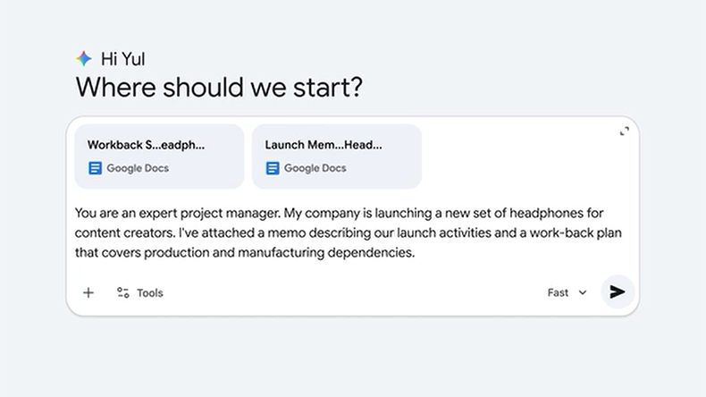

# IA Para Brainstorming e Planejamento

<figure><figcaption></figcaption></figure>

As maiores coisas que conquistamos no trabalho ​geralmente começam como uma ideia. ​Mas a jornada de uma centelha de inspiração ​para um projeto finalizado não é fácil. ​Identificar a solução certa, criar um plano ​e, você sabe, gerenciar todos os obstáculos ao longo do caminho? ​Isso pode parecer muito. ​Mas e se você tivesse um novo parceiro nesse processo? ​Um colaborador criativo para ajudá-lo a gerar possibilidades, ​um estrategista mestre para testar suas suposições ​e um especialista em execução ​para criar um plano com base em suas ideias para realizar o trabalho? ​Oi, meu nome é Yul. ​Sou VPO de gerenciamento de produtos no Google ​e ajudo a liderar uma equipe de pesquisa ​chamada Paradigms of Intelligence, ​que tenta entender a ​natureza e os alicerces da inteligência. ​

<figure><figcaption></figcaption></figure>

Agora, neste curso, mostraremos como Gêmeos pode ser esse ​parceiro criativo para você, para ​que você possa pensar em grande escala e alcançar seus objetivos no trabalho. ​Primeiro, você aprenderá técnicas para gerar ideias com você. ​Simularemos especialistas e expandiremos os limites criativos ​para descobrir soluções que você nunca teria considerado. ​E mostraremos como você pode usar o Gemini ​para incluir o conhecimento do setor no processo e ajudar. ​Em seguida, você testará soluções de pressão. ​

Agora, as melhores ideias são aquelas ​que podem enfrentar possíveis problemas no futuro. ​Mas identificar esses problemas antes que eles aconteçam pode ser difícil. ​Você aprenderá a usar Gêmeos como advogado do diabo ​para encontrar riscos em sua estratégia antes que eles se tornem problemas. ​Você também aprenderá a aplicar restrições ​para chegar às soluções mais relevantes e ​escolher o melhor caminho. ​Por fim, você gerenciará seu projeto ​colocando todos na mesma página. ​Mostraremos como usar o NotebookLM ​para criar um hub de informações ​onde você e seus colegas de equipe possam fazer perguntas ​e obter respostas sobre o projeto em literalmente segundos. ​Tudo parece muito bom, certo? ​Bem, meio que é. ​

<figure><figcaption></figcaption></figure>

Mas para tornar isso realidade, ​você também precisará entender alguns princípios fundamentais ​para usar a IA de forma eficaz. ​Mas não se preocupe, temos tudo o que você precisa. ​O primeiro é o enquadramento do problema. ​Antes mesmo de pensar em usar a IA, ​você precisa definir claramente ​o problema que está tentando resolver e por quê. ​Onde você está e para onde quer ir ​ancorará o processo do início ao fim. ​Você também fornece um contexto essencial. ​

Agora, a IA não tem todas as informações básicas ​sobre seus clientes, a dinâmica de sua equipe ​ou as prioridades de sua liderança. ​Essas são as coisas críticas ​que determinam quais soluções buscar ​e quais etapas devem ser adicionadas ao seu plano de projeto. ​E essa informação só pode vir de você. ​Durante todo esse processo, ​você está configurando o problema, explorando as opções ​e usando seu julgamento ​para tomar uma decisão sobre o que fazer a seguir. ​Agora, a IA não é perfeita ​e, às vezes, pode dar ideias ​que não são adequadas. ​Então, por favor, seja um crítico severo. ​Com essa nova forma de trabalhar, ​você terá um recurso ao qual recorrer ​em quase todas as etapas do ciclo de vida do projeto, ​da ideia ao plano e à entrega. ​É uma mudança de mentalidade. ​E, ao final deste curso, ​você poderá superar os bloqueios criativos, ​encontrar soluções inesperadas para problemas complicados ​e transformar suas melhores ideias em planos de ação ​que impulsionam o progresso. ​Então, boa sorte.

<figure><figcaption></figcaption></figure>

***

Lesson 1 -&#x20;

Neste laboratório, Owen, do Google Marketing, mostrará como usar o Gemini para ajudar no brainstorming de ideias, para que você possa tomar decisões melhores e mais rápidas. Você praticará a colaboração com a IA para gerar ideias e avaliá-las com base em um conjunto de critérios. Você também definirá ações programadas para automatizar a pesquisa em andamento.

**O que você ganhará:**

* **Validação mais rápida:** Passe em menos tempo de muitas ideias para várias ideias de qualidade e para a ideia certa
* **Decisões informadas:** Fundamente suas decisões em insights em vez de apenas no instinto
* **Conhecimento do setor:** Mantenha-se atualizado sobre as pesquisas mais recentes com relatórios automatizados

**Aplique o que você aprendeu:**

No laboratório, demonstraremos como fazer um brainstorming de acessórios para o lançamento de um produto de fone de ouvido. No entanto, nossas técnicas funcionam em uma variedade de projetos, como avaliação de conceitos de campanha, priorização de solicitações de recursos ou exploração de novas oportunidades de mercado. ASeguir, considere quais prompts você adaptaria para as decisões que estão em sua mesa agora.

Pronto para tornar sua próxima sessão de brainstorming mais produtiva? Vamos mergulhar de cabeça!

**É necessário o Google IA Pro.** Este laboratório requer maior acesso aos modelos mais eficientes do Google. Como aluno inscrito neste certificado, você tem direito a uma assinatura de avaliação gratuita de três meses para ajudá-lo a criar seu portfólio de soluções de IA. Certifique-se de ter ativado [a avaliação](https://www.coursera.org/learn/google-ai-fundamentals/supplement/XsBZb/complete-labs-with-google-ai-pro-at-no-cost) antes de iniciar este laboratório.

Este laboratório é opcional, mas altamente recomendado para ajudar você a praticar o uso da IA no trabalho. Não é necessário concluir este laboratório para avançar no curso ou obter o certificado do Google. 

***

### Criar com IA: plano estratégico

Para usar os recursos abordados neste laboratório, faça login no Gemini usando sua Conta do Google.

Ao seguir as instruções em vídeo deste laboratório, personalize os prompts abaixo de acordo com seu próprio trabalho.

Fique à vontade para pausar o vídeo conforme necessário.

### Tarefas do laboratório:

### Etapa 1: Brainstorming de ideias de novos produtos

Clique no botão "New chat" (Novo bate-papo) no menu do lado esquerdo para iniciar um novo bate-papo com o Gemini. Em seguida, cole o prompt abaixo e substitua o texto entre \[colchetes] por seus próprios detalhes.

You are a \[persona, e.g. marketing expert] in the \[industry, e.g. audio industry]. My company is developing a \[new product, e.g. new line of premium headphones]. Help me brainstorm \[items to brainstorm, e.g. accessories or add-ons] that I could \[purpose, e.g. bundle with this product].

Revise as ideias de Gemini. Você as analisará na próxima etapa.

### Etapa 2: Criar uma tabela de análise de custo-benefício

No mesmo bate-papo com Gemini, cole o prompt abaixo para comparar as opções geradas na etapa anterior. Você pode personalizar as colunas da tabela para sua análise.

Perform a \[type of analysis, e.g. cost-benefit analysis] for each of these ideas. Format your response as a table with the following columns:

\- \[Column 1 name, e.g. Idea]

\- \[Column 2 name, e.g. Cost (low/medium/high)]

\- \[Column 3 name, e.g. Benefit (low/medium/high)]

Use a tabela criada pelo Gemini para identificar as opções que oferecem alto benefício a um baixo custo.

### Etapa 3: Pesquise as tendências do setor

No mesmo bate-papo com a Gemini, cole o prompt abaixo para obter mais contexto para sua decisão.

What are some current industry trends around \[your product or industry]? I'd like to factor those insights into my decision.

Analise as tendências da Gemini. Você automatizará essa pesquisa na próxima etapa.

### Etapa 4: agendar uma análise recorrente

No mesmo chat com o Gemini, cole o prompt abaixo para programar a execução automática da consulta anterior.

Run this analysis \[desired frequency, e.g. once a week] so I can stay up to date on these trends.

Depois que o Gemini confirmar a ação, você poderá selecionar "Edit" (Editar) para alterar o nome ou ajustar a programação. Quando estiver pronto, os resultados da ação agendada aparecerão na lista de conversas no painel esquerdo. Para editar a ação agendada posteriormente, selecione "Settings & help" (Configurações e ajuda) e, em seguida, selecione "Scheduled actions" (Ações agendadas) no menu para abrir a lista de ações agendadas.

### Próximas etapas:

Pense em como você pode usar o Gemini para ajudá-lo a avaliar ideias. Lembre-se de que o Gemini pode orientar a sua avaliação com qualquer tipo de análise, inclusive as formas que você usa com frequência para comparar diferentes opções no seu próprio trabalho.

Quando estiver satisfeito com os resultados deste laboratório, feche esta página e retorne à tela principal deste curso.

***

Lesson 2 - wtf

​- Eu uso o Gemini para ajudar a abrir buracos em meu plano ​para coisas como o desenvolvimento de novos recursos. ​Assim, frequentemente escrevo ​um Documento de requisitos do produto para um recurso, dizendo ​qual recurso quero desenvolver, por que estamos desenvolvendo, ​dados relevantes. ​Depois, carrego esse PRD no Gemini e digo, ​"Dê-me feedback" ou "Diga-me por que isso é uma má ideia" ​E o Gemini pode analisar e abrir buracos no plano, ​e isso realmente me ajuda a refletir, ​será que essa é uma boa ideia? ​Há outras considerações que preciso fazer ​ao desenvolver esse recurso? ​O que me ajuda a refinar e levar meus planos ​para o próximo nível.

***

Lesson 3 -  Identificação de Riscos

## Identificar riscos em seu próximo plano de projeto situação:

Neste laboratório, Owen, do Google Marketing, mostrará como usar o Gemini para analisar planos de projetos e identificar riscos ocultos. Você praticará como dar ao Gemini o contexto, as informações básicas e as instruções claras de que ele precisa para atuar como um parceiro de pensamento estratégico. Você começará com um Plano de projeto, solicitará que o Gemini faça correções e gerará um cronograma atualizado que o preparará para o sucesso.

**O que você ganhará:**

* **Gerenciamento de riscos aprimorado**: Detecte possíveis problemas antes que eles atrapalhem seu projeto
* **Análise mais profunda**: Obtenha uma revisão abrangente do seu plano em minutos, em vez de horas
* **Comunicação mais clara**: Crie cronogramas que contemplem todas as partes móveis e mostrem como elas se conectam para que você possa compartilhá-las com confiança com a sua equipe

**Aplique o que você aprendeu:**

No laboratório, demonstraremos como analisar um plano de lançamento de produto para fones de ouvido. No entanto, você aproveitará ao máximo o laboratório quando aplicar essas técnicas ao seu próprio trabalho. AS, pense em adaptar os prompts aos seus projetos, prazos e necessidades de planejamento específicos.

Vamos transformar seus planos em ação com menos surpresas ao longo do caminho!

***

Lesson 4 - Lab

### Criar com IA: avaliação de risco

Para usar os recursos abordados neste laboratório, faça login no Gemini usando sua Conta do Google.

Ao seguir as instruções em vídeo deste laboratório, personalize os prompts abaixo de acordo com seu próprio trabalho.

Fique à vontade para pausar o vídeo conforme necessário.

### Tarefas do laboratório:

### Etapa 1: Identificar dependências de projeto ausentes

Clique no botão "New chat" (Novo bate-papo) para iniciar um novo bate-papo com o Gemini. Em seguida, anexe seus documentos de planejamento de projeto. Se não tiver seus próprios documentos, você pode usar estes materiais de amostra: [launch memo](https://drive.google.com/file/d/1muw8tQ0A7pIR41QDY0WN8bXP-Mrr_meL/view?usp=drive_link) e [launch workback schedule](https://drive.google.com/file/d/1svfy91vRy4OUdAHfFdtaD5DbRArAkHwR/view?usp=sharing). Em seguida, cole o prompt abaixo e substitua o texto entre \[colchetes] por seus próprios detalhes.

You are a \[persona, e.g. project manager]. My company is launching a \[product, service or initiative]. I've attached \[document 1, e.g. a launch memo] and \[document 2, e.g. a launch work-back schedule]. Are there any dependencies missing from the plan?

Revise a análise da Gemini sobre as dependências ausentes e identifique uma área para se concentrar na próxima etapa.

### Etapa 2: avaliar o risco de dependências ausentes

No mesmo bate-papo com o Gemini, cole o prompt abaixo e substitua o texto entre \[colchetes] por seus próprios detalhes.

Let's focus on \[a missing dependency from Gemini’s previous response]. How do they affect the \[overall project goal, e.g. the launch]?

### Etapa 3: gerar uma linha do tempo atualizada do projeto

No mesmo bate-papo com o Gemini, cole o prompt abaixo e substitua o texto entre \[colchetes] por seus próprios detalhes.

Create a timeline listing key milestones for \[the missing dependency from the previous step]. Flag what might be missing from my current plan.

### Próximas etapas:

Na próxima vez que tiver de criar um plano para o seu projeto, tente aplicar esse processo para reduzir os riscos e garantir que o projeto não perca nenhuma etapa importante. Ajuste os avisos e as etapas de acordo com o que for melhor para você e seu local de trabalho.

Quando estiver satisfeito com os resultados deste laboratório, você poderá fechar esta página e retornar à tela principal deste certificado.

***

Lesson 5 - Wiki Hub Para Pesquisas

## Crie um centro de conhecimento para responder a perguntas instantaneamente

Neste laboratório, Owen, do Google Marketing, mostrará como usar o NotebookLM para criar um hub de conhecimento centralizado com base em suas fontes específicas. Sua equipe poderá consultá-lo usando linguagem natural. O NotebookLM é útil quando é necessário criar um hub de conhecimento compartilhado em que sua equipe possa encontrar instantaneamente respostas precisas diretamente nos documentos do projeto.

**O que você ganhará:**

* **Respostas instantâneas e precisas**: Ofereça à sua equipe uma maneira de encontrar informações sem esperar por uma resposta
* **Redução das interrupções**: Gaste menos tempo respondendo a perguntas rotineiras e mais tempo em trabalho focado
* **Uma fonte de verdade**: garanta que todos na equipe estejam trabalhando com as mesmas informações, com base apenas nos documentos que você forneceu

**Aplique o que você aprendeu:**

No laboratório, demonstraremos como criar um hub para o lançamento de um projeto específico. No entanto, você terá mais impacto quando aplicar essas técnicas ao seu próprio trabalho. Por exemplo, você pode usar isso para integrar um novo membro da equipe com documentos de RH e guias de equipe, ou para dar à sua equipe de vendas um especialista virtual que os ajudará a se atualizar rapidamente. ASeguir, pense em quais documentos você faria upload para desbloquear ou apoiar sua equipe.

Vamos criar um hub que ajude a sua equipe a manter a sincronia e a avançar mais rapidamente!

***

Lesson 6 - Lab

### Criar com IA: hub de conhecimento

Para usar os recursos abordados neste laboratório, faça login no NotebookLM usando sua Conta do Google.

Ao seguir as instruções em vídeo deste laboratório, personalize os prompts abaixo de acordo com seu próprio trabalho.

Fique à vontade para pausar o vídeo conforme necessário.

### Tarefas do laboratório:

### Etapa 1: Faça perguntas sobre os documentos de seu projeto

Vá para o NotebookLM e selecione "Create a new notebook" (Criar um novo caderno).

Em seguida, você verá um menu pop-up no qual poderá carregar todos os documentos relacionados a um projeto. Você também pode pesquisar na Web ou em seus arquivos do Google Drive para obter novas fontes. Se você não tiver nenhuma fonte em mente, poderá usar estes exemplos de materiais para um projeto: [memorando](https://drive.google.com/file/d/177qj8ojXVDRVbSJ86-exuWngOXrD8Huk/view?usp=sharing), [plano de trabalho](https://drive.google.com/file/d/1FHd0Or5Cp8Bmktipnvoj8AdGvP9GahAn/view?usp=sharing), [plano de embalagem](https://drive.google.com/file/d/1eneEgcyV6-xs3xcw7ZZ6jIBrTwjh28EZ/view?usp=sharing) e [briefing criativo](https://drive.google.com/file/d/1Je6vtv6wuuceTgLio1SK3RA1z3pOBxdV/view?usp=sharing). Depois de adicionar seus arquivos, o menu pop-up desaparecerá e você será levado à tela principal do NotebookLM. No lado esquerdo, você pode adicionar outros documentos sempre que desejar.

Depois de enviar os documentos iniciais, você será levado à tela principal do NotebookLM.

Na caixa de texto na parte inferior da tela, faça uma pergunta sobre o seu projeto. Por exempl&#x6F;_:_

When are we starting \[key phase in your project, e.g., full-scale packaging production]?

_Or:_

What are the key milestones of this project?

Revise a resposta do NotebookLM. Observe as citações, que remetem aos documentos de origem que você carregou.

Você pode continuar fazendo perguntas conforme necessário.

### Etapa 2: Compartilhe o notebook com a sua equipe

No mesmo notebook do NotebookLM, clique no botão "Share" (Compartilhar) na parte superior da página.

Em seguida, adicione os membros da equipe inserindo seus endereços de e-mail. Além disso, você pode criar uma "Nota de boas-vindas" para os membros da equipe com os quais está compartilhando e também pode ajustar os níveis de acesso.

Quando estiver pronto, deixe a caixa "Notify people" (Notificar pessoas) marcada e clique em "Save" (Salvar) Seus colegas de equipe receberão um e-mail com um link para o notebook.

### Próximas etapas:

Da próxima vez que estiver trabalhando em um projeto complexo com várias pessoas, tente adicionar todos os seus principais documentos relacionados ao projeto em um notebook. Ajuste os prompts para solicitar qualquer informação que você ou outras pessoas precisem.

Quando estiver satisfeito com os resultados deste laboratório, você poderá fechar esta página e retornar à tela principal deste certificado.

***

Lesson 7 - Final Challenge

## Solicite seu crachá de conclusão do cursoSituação: Traduzido automaticamente do InglêsTraduzido automaticamente do Inglês

Informações:Este item inclui conteúdo que ainda não foi traduzido para o idioma de sua preferência.

Parabéns por concluir o curso IA para Brainstorming e Planejamento, você está no caminho certo para se tornar um profissional de IA 🎉.

### Solicite seu emblema de conclusão do curso

<figure><figcaption></figcaption></figure>

Dentro de uma semana após a conclusão deste curso, você receberá um e-mail do Coursera com instruções sobre como reivindicar seu emblema. Depois de fazer o opt-in, o Credly (admin@credly.com) enviará seu emblema. Esse emblema de certificado é uma representação visual de uma credencial verificada que você obteve. Você pode compartilhar seu selo em plataformas como o LinkedIn® para chamar a atenção de possíveis empregadores.

* **Compartilhe suas realizações nas mídias sociais.** Use estes [exemplos de postagens e prompts](https://drive.google.com/file/d/1arEyrHdmlwRY_u_VJXn1-vwlMSsqbBkL/view?usp=sharing) e inclua #GrowWithGoogle para alcançar um público mais amplo.
* **Adicione o emblema ao seu LinkedIn.** Você pode seguir as etapas deste [artigo](https://support.credly.com/hc/en-us/articles/360021221491-How-can-I-add-my-badge-to-my-LinkedIn-profile-and-share-to-my-feed-) ou do [tutorial em vídeo](https://vimeo.com/725834127?embedded=true\&source=vimeo_logo\&owner=149323741).
* **Inspire outras pessoas compartilhando sua história**. As histórias de graduados, como você, podem inspirar outras pessoas a se tornarem habilitadas para IA. Além disso, seu feedback pode ajudar a aprimorar o curso. Preencha [este breve questionário](https://docs.google.com/forms/d/e/1FAIpQLSdw1lRXtgSYeV3GKDMLgCJ7Sjr0F7ZbOsBji-6qt0tq5wxgog/viewform) sobre sua jornada.

**Continue avançando em sua carreira.** [Inscreva-se para receber atualizações por e-mail do Grow with Google](https://goo.gle/learner-subscribe-coursera). Você receberá recursos de carreira selecionados, alertas sobre os cursos mais recentes e dicas profissionais sobre a utilização de IA, com base nas habilidades que você adquiriu com este curso.

***

### Torne-se um profissional de IA

Um profissional de IA vai além de usar a IA como um simples completador de tarefas e passa a adotá-la como um colaborador profissional. Ao concluir todos os sete cursos deste programa de aprendizado, você alcançará a fluência em IA e receberá o Certificado Profissional de IA do Google.

<figure><figcaption></figcaption></figure>

### Dê o próximo passo em sua jornada de aprendizado

Cada curso deste programa de aprendizado foi criado para se adequar às suas metas profissionais específicas. Inscreva-se em outro curso para continuar construindo seu portfólio de projetos aprimorados por IA:

* [**Fundamentos de IA.**](https://www.coursera.org/learn/google-ai-fundamentals) Aprenda os conceitos essenciais de IA e pratique a solicitação de forma eficaz.
* I[**A for Brainstorming and Planning.**](https://www.coursera.org/learn/google-ai-for-brainstorming-and-planning) Use IA para fazer brainstorming de conceitos, criar cronogramas detalhados e organizar um plano claro para qualquer objetivo.
* [**IA para pesquisa e insights.**](https://www.coursera.org/learn/google-ai-for-research-and-insights) Use a IA como sua parceira de pesquisa, aproveitando o Deep Research e o NotebookLM para obter insights, gerar resumos e testar ideias com pressão para tomar decisões informadas.
* [**IA para redação e comunicação.**](https://www.coursera.org/learn/google-ai-for-writing-and-communicating) Transforme anotações grosseiras em mensagens claras, adapte-as facilmente para diferentes partes interessadas e treine para apresentações antecipando perguntas e preocupações.
* [**IA para criação de conteúdo.**](https://www.coursera.org/learn/google-ai-for-content-creation) Use a IA como seu parceiro criativo para gerar imagens, vídeos e apresentações de alta qualidade.
* [**IA para análise de dados.**](https://www.coursera.org/learn/google-ai-for-data-analysis) Transforme dados não estruturados em insights claros, domine as habilidades de análise de dados e crie visualizações e fórmulas atraentes com o Gemini no Google Sheets.
* [**IA para criação de aplicativos**](https://www.coursera.org/learn/google-ai-for-workflow-automation). Domine a codificação de vibração e crie seu próprio aplicativo personalizado. Enfrente as tarefas mais tediosas, tudo sem escrever uma única linha de código.

***
