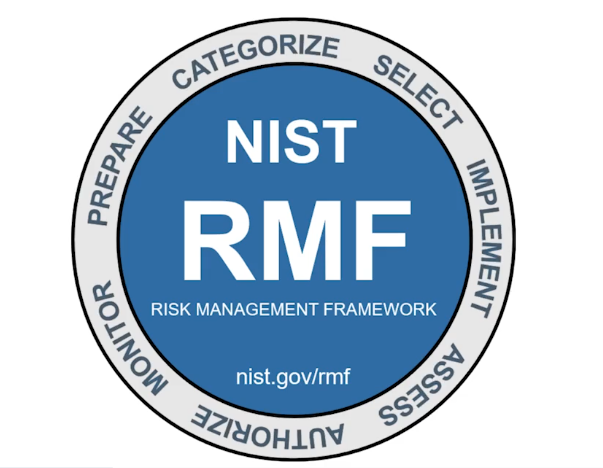

# Play It Safe : Manage Security Risks

### Modulo 1

Lesson 1 -

​Meu nome é Ashley e sou Líder de Capacitação de Engenharia de Clientes ​para Vendas de Operações de Segurança no Google. ​Estou empolgado em ser seu instrutor neste curso. ​Vamos começar analisando rapidamente o que abordamos até agora. ​Anteriormente, definimos a segurança e ​exploramos algumas responsabilidades comuns de trabalho para analistas iniciantes. ​

Também discutimos as principais habilidades e conhecimentos que os analistas precisam desenvolver. ​Em seguida, compartilhamos alguns eventos importantes, como os ataques LoveLetter e Morris, ​que levaram ao desenvolvimento e à evolução contínua do campo de segurança. ​Também apresentamos estruturas, controles e a ​tríade da CIA, que são todos usados para reduzir riscos.

<figure><figcaption></figcaption></figure>


\
​Neste curso, discutiremos o foco dos ​oito domínios de segurança do Certified Information Systems Security Professional, ou CISSP. ​Também abordaremos estruturas e controles de segurança com mais detalhes, ​com foco na Estrutura de Gerenciamento de Riscos do NIST. ​

Além disso, exploraremos as auditorias de segurança, incluindo ​elementos comuns das auditorias internas. ​Em seguida, apresentaremos algumas ferramentas básicas de segurança e ​você terá a chance de explorar como usar ferramentas de segurança para proteger ativos e dados ​contra ameaças, riscos e vulnerabilidades. ​Proteger uma organização e seus ativos contra ameaças, riscos e ​vulnerabilidades é uma etapa importante na manutenção das operações comerciais. ​Em minha experiência como analista de segurança, ajudei a responder a ​uma violação grave que custou à organização quase $250.000. ​Então, espero que você esteja se sentindo motivado a continuar sua jornada de segurança.
\
​Eu sei que estou animada. ​Vamos começar!

***

Lesson 2 -

## Visão geral do curso 2Situação: Traduzido automaticamente do InglêsTraduzido automaticamente do Inglês

<figure><figcaption></figcaption></figure>

Olá, bem-vindo ao **Play It Safe: Gerencie os riscos de segurança**, o segundo curso do Certificado de segurança cibernética do Google. Você está em uma jornada emocionante!

Ao final deste curso, você compreenderá melhor os domínios de segurança do Certified Information Systems Security Professional (CISSP), bem como as estruturas e os controles de segurança específicos. Também será apresentado a como usar ferramentas e auditorias de segurança para ajudar a proteger ativos e dados. Esses são conceitos-chave no campo da segurança cibernética, e compreendê-los o ajudará a manter as organizações e as pessoas que elas atendem a salvo de ameaças, riscos e vulnerabilidades.

### Progresso do programa de certificação

O programa de certificação em segurança cibernética do Google tem nove cursos. **Jogar com segurança: Gerenciar os riscos de segurança** é o segundo curso.

<figure><figcaption></figcaption></figure>

1. [**Fundamentos da segurança cibernética**](https://www.coursera.org/learn/foundations-of-cybersecurity/home/week/1) - Explore a profissão de segurança cibernética, incluindo eventos significativos que levaram ao desenvolvimento do campo da segurança cibernética e sua importância contínua para as operações organizacionais. Conheça as funções e responsabilidades de segurança cibernética de nível básico.
2. [**Play It Safe: Gerencie os riscos de segurança**](https://www.coursera.org/learn/manage-security-risks/home/week/1) - _(curso atual)_ Identifique como os profissionais de segurança cibernética usam estruturas e controles para proteger as operações comerciais e explore as ferramentas comuns de segurança cibernética.
3. [**Conectar e Proteger: Networks and Network Security**](https://www.coursera.org/learn/networks-and-network-security/home/week/1) - Compreenda as vulnerabilidades em nível de rede e como protegê-las.
4. [**Tools of the Trade: Linux e SQL**](https://www.coursera.org/learn/linux-and-sql/home/week/1) - Explore as habilidades básicas de computação, incluindo a comunicação com o sistema operacional Linux por meio da linha de comando e a consulta a bancos de dados com SQL.
5. [**Assets, Threats, and Vulnerabilities (Ativos, ameaças e vulnerabilidades**](https://www.coursera.org/learn/assets-threats-and-vulnerabilities/home/week/1)) - Aprenda sobre a importância dos controles de segurança e do desenvolvimento de uma mentalidade de ator de ameaças para proteger e defender os ativos de uma organização contra várias ameaças, riscos e vulnerabilidades.
6. [**Soe o Alarme: Detecção e resposta**](https://www.coursera.org/learn/detection-and-response/home/week/1) - Entenda o ciclo de vida da resposta a incidentes e pratique o uso de ferramentas para detectar e responder a incidentes de segurança cibernética.
7. [**Automate Cybersecurity Tasks with Python**](https://www.coursera.org/learn/automate-cybersecurity-tasks-with-python/home/week/1) - Explore a linguagem de programação Python e escreva códigos para automatizar tarefas de segurança cibernética.
8. [**Coloque-a em prática: Prepare-se para empregos de segurança cibernética**](https://www.coursera.org/learn/prepare-for-cybersecurity-jobs/home/week/1) - Aprenda sobre classificação de incidentes, escalonamento e maneiras de se comunicar com as partes interessadas. Este curso encerra o programa com dicas sobre como se envolver com a comunidade de segurança cibernética e uma introdução à IA na segurança cibernética.
9. [**Acelere sua busca de emprego com IA**](https://www.coursera.org/learn/accelerate-your-job-search-with-ai/home/module/1) - Obtenha estratégias práticas de busca de emprego e aprenda a aproveitar as ferramentas de IA (como Gemini e NotebookLM) para descobrir suas habilidades mais valiosas, criar um plano de busca de emprego, gerenciar suas candidaturas e praticar para entrevistas enquanto navega em seu caminho para a próxima função.

### Conteúdo do curso 2

Cada curso deste programa de certificação é dividido em módulos. Você pode concluir os cursos no seu próprio ritmo, mas a divisão em módulos foi criada para ajudá-lo a concluir todo o Certificado de segurança cibernética do Google em cerca de seis meses.

O que está por vir? Aqui está uma visão geral rápida das habilidades que você aprenderá em cada módulo deste curso.

#### **Módulo 1: Domínios de segurança**

<figure><figcaption></figcaption></figure>

Você conhecerá os oito domínios de segurança do CISSP. Em seguida, você aprenderá sobre as principais ameaças, riscos e vulnerabilidades às operações comerciais. Além disso, você explorará a Estrutura de Gerenciamento de Riscos do National Institute of Standards and Technology (NIST) e as etapas do gerenciamento de riscos.

#### **Módulo 2: Estruturas e controles de segurança**

<figure><figcaption></figcaption></figure>

Você se concentrará em estruturas e controles de segurança, juntamente com os principais componentes da tríade Confiança, integridade e disponibilidade (CIA). Você aprenderá sobre os princípios de segurança e as auditorias de segurança do Open Web Application Security Project (OWASP).

#### **Módulo 3: Introdução às ferramentas de segurança cibernética**

<figure><figcaption></figcaption></figure>

Você explorará as ferramentas de gerenciamento de eventos e informações de segurança (SIEM) líderes do setor que são usadas pelos profissionais de segurança para proteger as operações comerciais. Você aprenderá como os analistas de segurança iniciantes usam os painéis do SIEM como parte de seu trabalho diário.

#### **Module 4: Use playbooks para responder a incidentes**

<figure><figcaption></figcaption></figure>

Você aprenderá sobre as finalidades e os usos comuns dos manuais. Você também explorará como os profissionais de segurança cibernética usam os manuais para responder a ameaças, riscos e vulnerabilidades identificados.

### O que esperar

Cada curso oferece vários tipos de oportunidades de aprendizado:

* **Vídeos** conduzidos por instrutores do Google ensinam novos conceitos, introduzem o uso de ferramentas relevantes, oferecem suporte à carreira e fornecem histórias pessoais inspiradoras.
* **As leituras** se baseiam nos tópicos discutidos nos vídeos, apresentam conceitos relacionados, compartilham recursos úteis e descrevem estudos de caso.
* **Conecte-se com outros alunos**: Se tiver alguma dúvida, é provável que você não esteja sozinho. Visite a [comunidade](http://www.coursera.support/s/group-invite?id=MEY5VkgwMDAwMDAwMWMxMEFB) privada de [segurança cibernética](http://www.coursera.support/s/group-invite?id=MEY5VkgwMDAwMDAwMWMxMEFB) do Coursera para expandir sua rede de contatos, discutir jornadas de carreira e compartilhar experiências. Confira o [guia de início rápido](https://www.coursera.support/s/article/Community-Quick-Start-Guide).
* **As atividades de autoavaliação** e **os laboratórios** oferecem prática na aplicação das habilidades que você está aprendendo e permitem que você avalie seu próprio trabalho comparando-o com um exemplo concluído.
* **Os plug-ins interativos** o incentivam a praticar tarefas específicas e o ajudam a integrar o conhecimento adquirido no curso.
* **Os testes em vídeo** o ajudam a verificar sua compreensão à medida que avança em cada vídeo.
* **Os testes práticos** permitem que você verifique sua compreensão dos principais conceitos e fornecem feedback valioso.
* **Os testes com notas** demonstram sua compreensão dos principais conceitos de um curso. Você deve obter uma pontuação de 80% ou mais em cada teste avaliado para obter um certificado, e pode fazer um teste avaliado várias vezes para obter uma pontuação de aprovação.

### Dicas para o sucesso

* É altamente recomendável que você passe pelos itens de cada lição na ordem em que eles aparecem, pois as novas informações e conceitos se baseiam no conhecimento anterior.
* Participe de todas as oportunidades de aprendizado para obter o máximo de conhecimento e experiência possível.
* Se algo estiver confuso, não hesite em reproduzir um vídeo, revisar uma leitura ou repetir uma atividade de auto-revisão.
* Use os recursos adicionais mencionados neste curso. Eles foram criados para apoiar seu aprendizado. Você pode encontrar todos esses recursos na guia [Recursos](https://www.coursera.org/learn/manage-security-risks/resources/jvwzA).
* Quando encontrar links úteis neste curso, marque-os como favoritos para que você possa consultar as informações posteriormente para estudo ou revisão.
* Entenda e siga o [Código de Conduta da Coursera](https://www.coursera.support/s/article/208280036-Coursera-Code-of-Conduct?) para garantir que a comunidade de aprendizagem permaneça um lugar acolhedor, amigável e de apoio para todos os membros.

***

Lesson 3 -

## Recursos e dicas úteisSituação: Traduzido automaticamente do InglêsTraduzido automaticamente do Inglês

Informações:Este item inclui conteúdo que ainda não foi traduzido para o idioma de sua preferência.

Como aluno, você pode optar por concluir um ou vários cursos deste programa. No entanto, para obter o Certificado de Segurança Cibernética do Google, você deve concluir todos os cursos. Esta leitura descreve o que é necessário para obter um certificado e as práticas recomendadas para que você tenha uma boa experiência de aprendizado no Coursera.

### Obter o certificado de segurança cibernética do Google

Para receber seu certificado oficial de segurança cibernética do Google, você deve:

* Ser aprovado em todas as tarefas avaliadas em todos os 9 cursos do programa de certificação. Cada tarefa avaliada faz parte de uma pontuação cumulativa do curso, e a nota de aprovação para cada curso é 80%.

E**uma**das seguintes opções:

* Pagar a [taxa de certificação do curso](https://www.coursera.support/s/article/209818963-Payments-on-Coursera?language=en_US),
* Ser aprovado para o [auxílio financeiro da Coursera](https://www.coursera.support/s/article/209819033-Apply-for-Financial-Aid-or-a-Scholarship?language=en_US), ou
* Concluir o certificado por meio de uma instituição educacional, empregador ou agência que esteja patrocinando sua participação.

### Hábitos saudáveis para a conclusão do curso

Aqui está uma lista de práticas recomendadas que o ajudarão a concluir os cursos do programa em tempo hábil:

* **Planeje seu tempo:** Definir horários de estudo regulares e segui-los semanalmente pode ajudá-lo a tornar o aprendizado parte de sua rotina. Use um calendário ou horário para criar uma programação e liste o que planeja fazer a cada dia a fim de estabelecer metas alcançáveis. Encontre um espaço que permita que você se concentre ao assistir aos vídeos, revisar as leituras e concluir as atividades.
* **Trabalhe em seu próprio ritmo:** Cada pessoa aprende de forma diferente, portanto, este programa foi desenvolvido para permitir que você trabalhe no seu próprio ritmo. Embora os prazos personalizados comecem quando você se matricula, sinta-se à vontade para percorrer o programa na velocidade que for melhor para você. Não há penalidade para tarefas atrasadas; para obter o certificado, basta concluir todo o trabalho. Você pode estender os prazos a qualquer momento acessando **Overview (Visão geral)** no painel de navegação e selecionando **Switch Sessions (Alternar sessões)**. Se você já perdeu prazos anteriores, selecione **Redefinir meus prazos**.
* **Seja curioso:** se você encontrar uma ideia que o empolgue, coloque-a em prática! Enriqueça sua experiência de aprendizado com o[**recurso Guided Learning**](https://blog.google/outreach-initiatives/education/guided-learning/) **do Gemini** . Ele atua como seu assistente pessoal de aprendizagem, ajudando-o a fazer perguntas perspicazes, encontrar mais detalhes on-line e explorar tópicos interessantes. As medidas que você toma para apoiar o seu aprendizado ao longo do caminho aumentarão o seu conhecimento, criarão mais oportunidades nesse campo de alto crescimento e o ajudarão a se qualificar para empregos.
* **Faça anotações:** As anotações o ajudarão a se lembrar de informações importantes no futuro, especialmente quando estiver se preparando para entrar em um novo campo de trabalho. Além disso, fazer anotações é uma maneira eficaz de estabelecer conexões entre tópicos e obter uma melhor compreensão desses tópicos.
* **Revise os exemplos:** Os exemplos são tarefas concluídas que atendem plenamente aos critérios de uma atividade. Muitas atividades deste programa têm exemplos para você validar seu trabalho ou verificar se há erros. Embora muitas vezes existam várias maneiras de concluir uma tarefa, os exemplos oferecem orientação e inspiração sobre como concluir a atividade.
* **Construa a identidade de sua carreira**: A identidade de sua carreira é o valor exclusivo que você traz para a força de trabalho. [Assista a este vídeo](https://www.youtube.com/watch?v=_xbT4qMrot4) para saber mais sobre os principais componentes da identidade de carreira e escreva sua própria declaração de identidade de carreira. Descobrir e definir sua própria identidade de carreira o torna mais bem equipado para escolher um caminho de carreira que se alinhe com seus pontos fortes, valores e metas e seja mais eficaz na profissão escolhida.
* **Conecte-se com outros alunos**: Se você tiver uma dúvida, é provável que não esteja sozinho. Visite a [Google Cybersecurity Community](https://www.coursera.support/s/group-invite?id=MEY5VkgwMDAwMDAwMWMxMEFB) privada do Coursera para expandir sua rede, discutir jornadas de carreira e compartilhar experiências. Confira o [guia de início rápido](https://www.coursera.support/s/article/Community-Quick-Start-Guide).
* **Atualize seu perfil:** Considere [atualizar seu perfil](https://www.coursera.org/account/profile) no Coursera com sua foto, objetivos de carreira e muito mais. Quando outros alunos o encontrarem na Comunidade, eles poderão clicar em seu nome para acessar seu perfil e conhecê-lo melhor.

### Documentos, planilhas, apresentações e laboratórios para as atividades do curso

Para concluir determinadas atividades do programa, você precisará usar documentos digitais, planilhas, apresentações e/ou laboratórios. Os profissionais de segurança usam essas ferramentas de software para colaborar com suas equipes e organizações. Se você precisar de mais informações sobre o uso de uma determinada ferramenta, consulte estes recursos:

* [Microsoft Word: Ajuda e aprendizado](https://support.microsoft.com/en-us/word): Página de suporte da Microsoft para o Word
* [Google Docs](https://support.google.com/docs/topic/9046002?hl=en\&ref_topic=1382883): página da Central de Ajuda do Google Docs
* [Microsoft Excel: Ajuda e aprendizado](https://support.microsoft.com/en-us/excel): Página de suporte da Microsoft para o Excel
* [Google Sheets](https://support.google.com/docs/topic/9054603?hl=en\&ref_topic=1382883): Página da Central de Ajuda do Google Sheets
* [Microsoft PowerPoint: Ajuda e aprendizado](https://support.microsoft.com/en-us/powerpoint): Página de suporte da Microsoft para o PowerPoint
* [Como usar o Google Slides](https://support.google.com/docs/answer/2763168?hl=en\&co=GENIE.Platform%3DDesktop): Página da Central de Ajuda do Google Slides
* [Problemas comuns com laboratórios](https://support.google.com/qwiklabs/topic/15791768?hl=en\&ref_topic=9134804\&sjid=11253880943307401027-NC): Ajuda para solução de problemas das atividades do Qwiklabs

### Glossários de módulos, cursos e certificados

Este programa abrange muitos termos e conceitos, alguns dos quais talvez você já conheça e outros talvez não lhe sejam familiares. Para revisar os termos e ajudá-lo a se preparar para os testes com notas, consulte os glossários a seguir:

* **Glossários de módulos**: No final do conteúdo de cada módulo, você pode revisar um glossário de termos desse módulo. O glossário de cada módulo se baseia nos termos dos módulos anteriores do curso. Os glossários dos módulos não podem ser baixados; no entanto, todos os termos e definições estão incluídos nos glossários do curso e do certificado, que podem ser baixados.
* **Glossários do curso**: No final de cada curso, você pode acessar e fazer download de um glossário que abrange todos os termos desse curso.
* **Glossário de certificados**: O glossário do certificado inclui todos os termos de todo o programa de certificação e é um recurso útil que você pode consultar durante todo o programa ou a qualquer momento no futuro.

Você pode acessar e fazer download dos glossários de certificados e salvá-los em seu computador. Você sempre pode encontrar os glossários do curso e do certificado na seção [Recursos](https://www.coursera.org/learn/manage-security-risks/resources/Lv5j3) do curso. Para acessar o **glossário do Cybersecurity Certificate**, clique no link abaixo e selecione _Use Template (Usar modelo)_.

* [Glossário do Certificado de Segurança Cibernética](https://docs.google.com/document/d/1Feb8pHRY-blnpaLOohds2esd6IWdCIp-ikG7G_omSj4/template/preview?usp=sharing\&resourcekey=0-YHcAISkCiqGDq5KwO6yNeQ)

OU

* Se você não tiver uma conta do Google, poderá fazer o download do glossário diretamente do anexo abaixo.

### Comentários sobre o curso

É fácil fornecer feedback sobre vídeos, leituras e outros materiais. Com o recurso aberto no navegador, você pode encontrar os símbolos de polegar para cima e polegar para baixo.

* Clique em " **polegar** para **cima** " para os materiais que você considera úteis.
* Clique em " **polegar** para **baixo** " para materiais que você não considera úteis.

Se você quiser sinalizar um problema específico com um item, clique no ícone de sinalização, selecione uma categoria e digite uma explicação na caixa de texto. Esse feedback é enviado para a equipe de desenvolvimento do curso e não fica visível para outros alunos. Todos os comentários recebidos ajudam a criar programas de certificação ainda melhores no futuro.

Para obter ajuda técnica, visite a [Central de ajuda do estudante](https://learner.coursera.help/hc/en-us).

***

Lesson 4 -&#x20;

​O mundo da segurança, que também chamamos de ​cibersegurança em todo este programa, é vasto. ​Portanto, garantir que você tenha o conhecimento, as habilidades e as ​ferramentas para navegar com sucesso neste mundo é o motivo pelo qual estamos aqui. ​Nos vídeos a seguir, ​você aprenderá sobre o foco dos oito domínios de segurança do CISSP. ​

Em seguida, discutiremos ameaças, riscos e vulnerabilidades com mais detalhes. ​Também apresentaremos as três camadas da web e ​compartilharemos alguns exemplos para ajudá-lo a entender os diferentes tipos de ataques que ​discutiremos ao longo do programa. ​Por fim, examinaremos como gerenciar riscos usando a ​Estrutura de Gerenciamento de Riscos do Instituto Nacional de Padrões e Tecnologia, conhecida como NIST RMF. ​

Como esses tópicos e ​habilidades técnicas relacionadas são considerados conhecimentos essenciais na área de segurança, ​continuar a desenvolver sua compreensão deles o ajudará a mitigar e ​gerenciar os riscos e ameaças que as organizações enfrentam diariamente.
\
​No próximo vídeo, discutiremos mais detalhadamente o foco dos oito ​domínios de segurança apresentados no primeiro curso.

***

Lesson 5 -&#x20;

\
pt-BR​

### Histórico de cursos interativo — habilitar o modo de histórico de cursos básico pressionando-se a tecla Esc

​Bem-vindo de volta! ​Você deve se lembrar do primeiro curso que existem oito domínios ou categorias de segurança ​identificados pelo CISSP. ​As equipes de segurança os usam para organizar tarefas diárias e ​identificar lacunas na segurança que podem causar consequências negativas para ​uma organização e para estabelecer sua postura de segurança.&#x20;

<figure><figcaption></figcaption></figure>

A ​postura de segurança se refere à capacidade de uma organização gerenciar ​sua defesa de ativos e dados críticos e reagir às mudanças. ​Neste vídeo, discutiremos o foco dos quatro primeiros domínios: ​segurança e gerenciamento de riscos, segurança de recursos, ​arquitetura e engenharia de segurança e segurança de comunicação e rede. ​

<figure><figcaption></figcaption></figure>

<figure><figcaption></figcaption></figure>

O primeiro domínio é a segurança e o gerenciamento de riscos. ​Há várias áreas de foco nesse domínio: ​definição de metas e objetivos de segurança, redução de riscos ​, conformidade, continuidade de negócios e regulamentações legais. ​Vamos discutir cada área de foco com mais detalhes. ​Ao definir metas e objetivos de segurança, ​as organizações podem reduzir os riscos a ativos e dados críticos ​, como PII ou informações de identificação pessoal.&#x20;

<figure><figcaption></figcaption></figure>

A ​mitigação de riscos significa ter os procedimentos e regras corretos ​em vigor para reduzir rapidamente o impacto de um risco, como uma violação. A ​conformidade é o principal método usado para desenvolver ​as políticas internas de segurança, os requisitos regulatórios e os padrões independentes de uma organização. A ​continuidade dos negócios está relacionada à capacidade de uma organização de manter ​sua produtividade diária estabelecendo planos de recuperação de riscos e desastres. ​

<figure><figcaption></figcaption></figure>

E, finalmente, embora as leis relacionadas à segurança e ao ​gerenciamento de riscos sejam diferentes em todo o mundo, as metas gerais são semelhantes. ​Como profissional de segurança, isso significa seguir as regras e expectativas de ​comportamento ético para minimizar a negligência, o abuso ou a fraude.&#x20;

<figure><figcaption></figcaption></figure>

​O próximo domínio é a segurança de recursos. ​O domínio de segurança de recursos está focado na proteção de ativos digitais e físicos. ​Também está relacionado ao armazenamento, manutenção ​, retenção e destruição de dados. ​Isso significa que ativos como PII ou SPII devem ser manuseados e ​protegidos com segurança, sejam armazenados em um computador, transferidos por uma ​rede como a Internet ou até mesmo coletados fisicamente. ​

As organizações também precisam ter políticas e procedimentos que garantam que ​os dados sejam armazenados, mantidos, retidos e destruídos adequadamente. ​Saber quais dados você tem e quem tem acesso a eles é necessário para ter ​uma postura de segurança forte que reduza o risco de ativos e dados críticos. ​Anteriormente, fornecemos alguns exemplos que abordaram o descarte de dados. ​Por exemplo, uma organização pode fazer com que você, como analista de segurança, ​supervisione a destruição dos discos rígidos para garantir que eles sejam descartados adequadamente. ​Isso garante que os dados privados armazenados nessas unidades não possam ser acessados pelos ​agentes de ameaças. ​

<figure><figcaption></figcaption></figure>

O terceiro domínio é arquitetura e engenharia de segurança. ​Esse domínio está focado na otimização da segurança de dados, garantindo a implementação de ferramentas ​, sistemas e processos eficazes para proteger os ativos e os dados de uma organização.&#x20;

<figure><figcaption></figcaption></figure>

Um dos principais conceitos da arquitetura de design segura é a responsabilidade compartilhada. ​Responsabilidade compartilhada significa que todos os indivíduos de ​uma organização desempenham um papel ativo na redução de riscos e na ​manutenção da segurança física e virtual. ​

Com políticas que incentivam os usuários a reconhecer e ​relatar problemas de segurança, muitos problemas podem ser resolvidos de forma rápida e eficaz.

​O quarto domínio é a comunicação e a segurança de rede, que se ​concentra principalmente no gerenciamento e na proteção de redes físicas e comunicações sem fio. ​As redes seguras mantêm os dados e as comunicações de uma organização seguros ​, seja no local, na nuvem ou ao se conectar a serviços remotamente. ​Por exemplo, funcionários que trabalham remotamente em espaços públicos precisam ser ​protegidos contra vulnerabilidades que podem ocorrer quando usam ​conexões Bluetooth inseguras ou pontos de acesso Wi-Fi públicos. ​

Ao fazer com que os membros da equipe de segurança removam ​o acesso a esses tipos de canais de comunicação no nível organizacional, os funcionários podem ser desencorajados a ​praticar comportamentos inseguros que poderiam ser explorados por agentes de ameaças. ​Agora que analisamos o foco dos nossos primeiros quatro domínios, ​vamos discutir os últimos quatro domínios.

***

Lesson 6 -&#x20;

<figure><figcaption></figcaption></figure>

​Neste vídeo, abordaremos os últimos quatro domínios: ​gerenciamento de identidade e acesso, avaliação e teste de segurança ​, operações de segurança e segurança de desenvolvimento de software. ​

<figure><figcaption></figcaption></figure>

O quinto domínio é o gerenciamento de identidade e acesso, ou IAM. ​E está focado no acesso e na autorização para manter os dados seguros, ​garantindo que os usuários sigam as políticas estabelecidas para controlar e gerenciar ativos. ​Como analista iniciante, é essencial manter os sistemas e os dados de uma organização o mais ​seguros possível, garantindo que o acesso do usuário seja limitado ao que os funcionários precisam. ​

<figure><figcaption></figcaption></figure>

Basicamente, o objetivo do IAM é reduzir o risco geral para sistemas e dados. ​Por exemplo, se todos em uma empresa estiverem usando o mesmo login de administrador, ​não há como rastrear quem tem acesso a quais dados. ​No caso de uma violação, ​seria impossível separar a atividade válida do usuário do agente da ameaça. O ​IAM tem quatro componentes principais.


\
​A identificação é quando um usuário verifica quem é fornecendo um nome de usuário, ​um cartão de acesso ou dados biométricos, como uma impressão digital. A ​autenticação é o processo de verificação para provar a ​identidade de uma pessoa, como inserir uma senha ou PIN. ​A autorização ocorre após a confirmação da identidade do usuário e está ​relacionada ao seu nível de acesso, que depende da função na organização. ​Responsabilidade se refere ao monitoramento e registro das ações do usuário, ​como tentativas de login, para provar que os sistemas e os dados são usados adequadamente.&#x20;

<figure><figcaption></figcaption></figure>

​O sexto domínio de segurança é a avaliação e o teste de segurança. ​Esse domínio se concentra na realização de testes de controle de segurança, ​coleta e análise de dados e realização de auditorias de segurança para monitorar ​riscos, ameaças e vulnerabilidades. ​Os testes de controle de segurança podem ajudar uma organização a identificar ​maneiras novas e melhores de mitigar ameaças, riscos e vulnerabilidades.


\
​Isso envolve examinar as metas e objetivos organizacionais e ​avaliar se os controles usados realmente atingem essas metas. ​Coletar e analisar dados de segurança regularmente também ajuda a evitar ameaças e ​riscos para a organização. ​Os analistas podem usar avaliações de testes de controle de segurança e ​relatórios de avaliação de segurança para melhorar os controles existentes ou implementar novos controles. ​Um exemplo de implementação de um novo controle pode exigir o uso de ​autenticação multifator para proteger melhor a organização contra possíveis ameaças e riscos. ​A seguir, vamos discutir as operações de segurança.&#x20;

<figure><figcaption></figcaption></figure>

​O domínio de operações de segurança está focado na condução de investigações e na ​implementação de medidas preventivas. ​As investigações começam quando um incidente de segurança é identificado.


​Esse processo exige um maior senso de urgência para minimizar ​os riscos potenciais para a organização. ​Se houver um ataque ativo, mitigar o ataque e ​evitar que ele se intensifique ainda mais é essencial para ​garantir que as informações privadas sejam protegidas dos agentes da ameaça. ​Assim que a ameaça for neutralizada, a coleta de ​evidências digitais e físicas para conduzir uma investigação forense começará. ​Uma investigação forense digital deve ocorrer para identificar ​quando, como e por que a violação ocorreu. ​Isso ajuda as equipes de segurança a determinar áreas de melhoria e ​medidas preventivas que podem ser tomadas para mitigar futuros ataques. ​

<figure><figcaption></figcaption></figure>

O oitavo e último domínio de segurança é a segurança do desenvolvimento de software. ​Esse domínio se concentra no uso de práticas de programação seguras.


\
​Como você deve se lembrar, as práticas de programação segura são diretrizes ​recomendadas usadas para criar aplicativos e serviços seguros. ​O ciclo de vida de desenvolvimento de software é um processo eficiente usado pelas equipes para criar ​rapidamente produtos e recursos de software. ​Nesse processamento, a segurança é uma etapa adicional. ​Ao garantir que cada fase do ciclo de vida de desenvolvimento de software passe por ​análises de segurança, a segurança pode ser totalmente integrada ao produto de software.

&#x20;​Por exemplo, realizar uma revisão segura do projeto durante a fase de projeto, ​revisões seguras de código durante as fases de desenvolvimento e teste ​e teste de penetração durante a fase de implantação e implementação ​garantem que a segurança seja incorporada ao produto de software em cada etapa. ​Isso mantém o software seguro e os dados confidenciais protegidos, além de ​reduzir riscos desnecessários para uma organização. ​Estar familiarizado com esses domínios pode ajudar você a entender melhor como eles são ​usados para melhorar a segurança geral de uma organização e ​o papel fundamental que as equipes de segurança desempenham. A ​seguir, discutiremos ameaças, riscos e vulnerabilidades à segurança, ​incluindo ransomware, e apresentaremos as três camadas da web.

***

Lesson 7 -

## Domínios de segurança que os analistas de segurança cibernética precisam conhecerSituação: Traduzido automaticamente do InglêsTraduzido automaticamente do Inglês

Como analista, você pode explorar várias áreas da segurança cibernética que lhe interessam. Uma maneira de explorar essas áreas é compreender os diferentes domínios de segurança e como eles são usados para organizar o trabalho dos profissionais de segurança. Nesta leitura, você aprenderá mais sobre os oito domínios de segurança do CISSP e como eles se relacionam com o trabalho que você realizará como analista de segurança.

<figure><figcaption></figcaption></figure>

### Domínio um: Gerenciamento de segurança e de riscos

Todas as organizações devem desenvolver sua postura de segurança. A postura de segurança é a capacidade da organização de gerenciar sua defesa de recursos e dados críticos e reagir a mudanças. Os elementos do domínio de gerenciamento de segurança e de riscos que afetam a postura de segurança de uma organização incluem:

* Objetivos e metas de segurança
* Processos de redução de riscos
* Conformidade
* Planos de continuidade de negócios
* Reguladores legais
* Ética profissional e organizacional

A segurança das informações, ou InfoSec, também está relacionada a esse domínio e refere-se a um conjunto de processos estabelecidos para proteger as informações. Uma organização pode usar manuais e implementar treinamentos como parte de seu programa de segurança e Gerenciamento de Riscos, com base em suas necessidades e no risco percebido. Há muitos processos de design de InfoSec, tais como

* Resposta a incidentes
* Gerenciamento de vulnerabilidade
* Segurança de aplicativos
* Segurança na nuvem
* Segurança da infraestrutura

Como exemplo, uma equipe de segurança pode precisar alterar a forma como as informações de identificação pessoal (PII) são tratadas para aderir ao Regulamento Geral de Proteção de Dados (GDPR) da União Europeia.

### Segundo domínio: Segurança de recursos

A segurança de ativos envolve o gerenciamento de processos de segurança cibernética de recursos organizacionais, incluindo o armazenamento, a manutenção, a retenção e a destruição de dados físicos e virtuais. Como a perda ou o roubo de recursos pode expor uma organização e aumentar o nível de risco, é essencial manter o controle dos recursos e dos dados que eles contêm. A realização de uma análise de impacto na segurança, o estabelecimento de um plano de recuperação de dados e o Gerenciamento da exposição ao risco dos dados dependerão do nível de risco associado a cada recurso. Os analistas de segurança talvez precisem armazenar, manter e reter dados criando backups para garantir que sejam capazes de restaurar o ambiente se um incidente de segurança colocar os dados da organização em risco.

### Domínio três: Arquitetura e engenharia de segurança

Esse domínio se concentra no Gerenciamento da segurança de dados. Garantir a implementação de ferramentas, sistemas e processos eficazes ajuda a proteger os recursos e os dados de uma organização. Os arquitetos e engenheiros de segurança criam esses processos.

Um aspecto importante desse domínio é o conceito de responsabilidade compartilhada. Responsabilidade compartilhada significa que todos os indivíduos envolvidos assumem uma função ativa na redução do risco durante o design de um sistema de segurança. Outros princípios de projeto relacionados a esse domínio, que serão discutidos posteriormente no programa, incluem:

* Modelo de ameaças
* Menor privilégio
* Defesa em profundidade
* Falha segura
* Separação de tarefas
* Manter a simplicidade
* Confiança zero
* Confiar, mas verificar

Um exemplo de gerenciamento de dados é o uso de uma ferramenta de gerenciamento de eventos e informações de segurança (SIEM) para monitorar sinalizadores relacionados a login incomum ou atividade de usuário que possa indicar que um agente de ameaça está tentando acessar dados privados.

### Domínio quatro: Comunicação e segurança de rede

Este domínio concentra-se no gerenciamento e na segurança de redes físicas e comunicações sem fio. Isso inclui comunicações no local, remotas e na Nuvem.

As organizações com ambientes de trabalho remoto, híbrido e no local devem garantir que os dados permaneçam seguros, mas o Gerenciamento de conexões externas para garantir que os funcionários remotos acessem com segurança as redes de computadores de uma organização é um desafio. A criação de controles de segurança de rede - como acesso restrito à rede - pode ajudar a proteger os usuários e garantir que a rede da organização permaneça segura quando os funcionários viajam ou trabalham fora do escritório principal.

### Domínio cinco: Gerenciamento de identidade e acesso

O domínio Gerenciamento de identidade e acesso (IAM) concentra-se em manter a Segurança de dados. Ele faz isso garantindo que as identidades dos usuários sejam confiáveis e autenticadas e que o acesso aos recursos físicos e lógicos seja autorizado. Isso ajuda a evitar usuários não autorizados e, ao mesmo tempo, permite que os usuários autorizados realizem suas tarefas.

Essencialmente, o IAM usa o que é chamado de princípio de privilégio mínimo, que é o conceito de conceder apenas o acesso e a autorização mínimos necessários para concluir uma tarefa. Por exemplo, um analista de segurança cibernética pode ser solicitado a garantir que os representantes do Atendimento ao Cliente só possam visualizar os dados privados de um cliente, como seu número de telefone, enquanto trabalham para resolver o problema do cliente; em seguida, remova o acesso quando o problema do cliente for resolvido.

### Domínio seis: avaliação e teste de segurança

O domínio de avaliação e teste de segurança concentra-se na identificação e redução de riscos, ameaças e vulnerabilidades. As avaliações de segurança ajudam as organizações a determinar se seus sistemas internos estão seguros ou em risco. As organizações podem empregar testadores de penetração, geralmente chamados de "pen testers", para encontrar vulnerabilidades que poderiam ser exploradas por um agente de ameaças.

Esse domínio sugere que as organizações realizem testes de controle de segurança, além de coletar e analisar dados. Além disso, ele enfatiza a importância de realizar auditorias de segurança para monitorar e reduzir a Probabilidade de Violação de dados. Para contribuir com esses tipos de tarefas, os profissionais de segurança cibernética podem ser encarregados de auditar as permissões dos usuários para validar se eles têm os níveis corretos de acesso aos sistemas internos.

### Sétimo domínio: Operações de segurança

O domínio de operações de segurança concentra-se na investigação de uma possível Violação de dados e na implementação de medidas preventivas após a ocorrência de um incidente de segurança. Isso inclui o uso de estratégias, processos e ferramentas, tais como

* Treinamento e conscientização
* Relatórios e documentação
* Detecção e prevenção de intrusões
* Ferramentas SIEM
* Gerenciamento de registros
* Gerenciamento de incidentes
* Playbooks
* Análise forense pós-violação
* Reflexão sobre as Lições aprendidas

Os profissionais de segurança cibernética envolvidos nesse domínio trabalham em equipe para gerenciar, prevenir e investigar ameaças, riscos e vulnerabilidades. Esses indivíduos são treinados para lidar com ataques ativos, como grandes quantidades de dados sendo acessados da rede interna de uma organização, fora do horário normal de trabalho. Depois que uma ameaça é identificada, a equipe trabalha diligentemente para manter os dados e as informações privadas a salvo dos agentes da ameaça.

### Oitavo domínio: Segurança de desenvolvimento de software

O domínio de segurança de desenvolvimento de software se concentra no uso de práticas e diretrizes de programação segura para criar aplicativos seguros. Ter aplicativos seguros ajuda a fornecer serviços seguros e confiáveis, o que ajuda a proteger as organizações e seus usuários.

A segurança deve ser incorporada a cada elemento do ciclo de vida de desenvolvimento de software (SDLC), desde o projeto e o desenvolvimento até o teste e a liberação. Para obter segurança, o processamento do desenvolvimento de software deve ter a segurança em mente em cada etapa. A segurança não pode ser uma reflexão tardia.

A realização de testes de segurança de aplicativos pode ajudar a garantir que as vulnerabilidades sejam identificadas e mitigadas adequadamente. É necessário ter um sistema para testar as convenções de programação, os executáveis de software e as medidas de segurança incorporadas ao software. Ter profissionais de garantia de qualidade e de teste de caneta para garantir que o software atenda aos padrões de segurança e desempenho também é uma parte essencial do processo de desenvolvimento de software. Por exemplo, um analista de nível básico que trabalha para uma empresa farmacêutica pode ser solicitado a garantir que a criptografia esteja configurada corretamente para um novo dispositivo médico que armazenará dados privados de pacientes.

### Principais lições

Nesta leitura, você aprendeu mais sobre as áreas de foco dos oito domínios de segurança do CISSP. Além disso, você aprendeu sobre a InfoSec e o princípio do privilégio mínimo. Estar familiarizado com esses domínios de segurança e conceitos relacionados o ajudará a obter insights sobre o campo da segurança cibernética.

***

Lesson 8 -

## Teste de Segurança da Informação - Domínios de Segurança (CISSP)

### Pergunta 1

**Preencha o espaço em branco:** O domínio \_\_\_\_\_ concentra-se no acesso e na autorização para manter a segurança dos dados, garantindo que os usuários do domínio sigam as políticas estabelecidas para controlar e gerenciar os recursos.

* segurança de comunicação e de rede
* gerenciamento de identidade e acesso
* segurança de recursos
* operações de segurança

**Resposta correta:** gerenciamento de identidade e acesso

**Explicação:** O domínio de **Gerenciamento de Identidade e Acesso (IAM - Identity and Access Management)** trata exatamente de controlar quem tem acesso a quais recursos (autenticação) e o que podem fazer com eles (autorização), além de garantir conformidade com políticas de acesso.

**Por que as outras opções estão incorretas:**

| Opção                                  | Motivo da incorreção                                                                                                                    |
| -------------------------------------- | --------------------------------------------------------------------------------------------------------------------------------------- |
| **segurança de comunicação e de rede** | Foca na proteção de dados em trânsito e infraestrutura de rede, não em acesso/ autorização de usuários.                                 |
| **segurança de recursos**              | Não é um domínio padrão CISSP. O termo correto seria "Segurança de Ativos", que trata de classificação e manuseio de ativos.            |
| **operações de segurança**             | Envolve monitoramento, resposta a incidentes e operações diárias, mas não é o domínio principal para políticas de acesso e autorização. |

***

### Pergunta 2

**Qual é o foco do domínio de segurança e Gerenciamento de riscos?**

* Otimização da segurança de dados, garantindo a implementação de processos eficazes
* Gerencie e proteja as comunicações sem fio
* Definir metas e objetivos de segurança, redução de riscos, conformidade, continuidade dos negócios e reguladores
* Proteger as redes físicas e as comunicações sem fio

**Resposta correta:** Definir metas e objetivos de segurança, redução de riscos, conformidade, continuidade dos negócios e reguladores

**Explicação:** O domínio **Segurança e Gerenciamento de Riscos (Security and Risk Management)** é a base da segurança da informação. Ele abrange:

* Governança e políticas de segurança
* Gestão de riscos (identificação, análise, tratamento)
* Conformidade com leis e regulamentações (LGPD, GDPR, HIPAA, etc.)
* Continuidade de negócios (BCP) e recuperação de desastres (DRP)
* Definição de metas e objetivos estratégicos de segurança

**Por que as outras opções estão incorretas:**

| Opção                                             | Motivo da incorreção                                                     |
| ------------------------------------------------- | ------------------------------------------------------------------------ |
| **Otimização da segurança de dados**              | Isso se relaciona mais com "Segurança de Ativos" ou "Proteção de Dados". |
| **Gerencie e proteja as comunicações sem fio**    | Isso pertence ao domínio "Comunicação e Segurança de Rede".              |
| **Proteger redes físicas e comunicações sem fio** | Também é foco do domínio de rede, não do gerenciamento de riscos.        |

***

### Pergunta 3

**Em que domínio um profissional de segurança conduziria testes de controle de segurança, coletaria e analisaria dados e realizaria auditorias de segurança para monitorar riscos, ameaças e vulnerabilidades?**

* Avaliação e teste de segurança
* Comunicação e engenharia de rede de computadores
* Gerenciamento de identidade e acesso
* Arquitetura e engenharia de segurança

**Resposta correta:** Avaliação e teste de segurança

**Explicação:** O domínio **Avaliação e Teste de Segurança (Security Assessment and Testing)** inclui exatamente essas atividades:

* Testes de controles de segurança (efetividade)
* Coleta e análise de dados de segurança
* Auditorias internas e externas
* Testes de penetração (pentests)
* Varreduras de vulnerabilidade
* Revisões de conformidade

**Por que as outras opções estão incorretas:**

| Opção                                     | Motivo da incorreção                                                             |
| ----------------------------------------- | -------------------------------------------------------------------------------- |
| **Comunicação e engenharia de rede**      | Foca em projetar e proteger redes, não em testar controles ou auditar.           |
| **Gerenciamento de identidade e acesso**  | Trata de autenticação, autorização e provisionamento de usuários.                |
| **Arquitetura e engenharia de segurança** | Envolve o projeto e construção de sistemas seguros, não a avaliação/teste deles. |

***

### Pergunta 4

**Preencha o espaço em branco:** O domínio \_\_\_\_\_ diz respeito à realização de investigações e à implementação de medidas preventivas.

* segurança de recursos
* segurança no desenvolvimento de software
* operações de segurança
* engenharia de comunicações e redes de computadores

**Resposta correta:** operações de segurança

**Explicação:** O domínio **Operações de Segurança (Security Operations)** cobre:

* Investigações de incidentes de segurança
* Resposta a incidentes (contenção, erradicação, recuperação)
* Implementação de medidas preventivas (bloqueios, patches, regras de firewall)
* Monitoramento contínuo (SIEM, alertas)
* Gestão de eventos e logs
* Atividades diárias de proteção do ambiente

**Por que as outras opções estão incorretas:**

| Opção                                        | Motivo da incorreção                                                                              |
| -------------------------------------------- | ------------------------------------------------------------------------------------------------- |
| **segurança de recursos**                    | Não é um domínio padrão CISSP. O termo correto seria "Segurança de Ativos".                       |
| **segurança no desenvolvimento de software** | Foca em práticas seguras durante a codificação e ciclo de vida do software (SDLC).                |
| **engenharia de comunicações e redes**       | Trata do projeto e proteção de redes e comunicações, não de investigações ou medidas preventivas. |

***

### Resumo do Teste

| Pergunta | Conteúdo                                  | Resposta correta                     |
| -------- | ----------------------------------------- | ------------------------------------ |
| 1        | Controle de acesso e autorização          | Gerenciamento de identidade e acesso |
| 2        | Metas, riscos, conformidade, continuidade | Segurança e Gerenciamento de riscos  |
| 3        | Testes, coleta de dados, auditorias       | Avaliação e teste de segurança       |
| 4        | Investigações e medidas preventivas       | Operações de segurança               |

***

### Referência - Domínios de Segurança CISSP

<table><thead><tr><th width="77.75">#</th><th>Domínio CISSP</th><th>Descrição resumida</th></tr></thead><tbody><tr><td>1</td><td>Segurança e Gerenciamento de Riscos</td><td>Governança, políticas, riscos, conformidade, continuidade</td></tr><tr><td>2</td><td>Segurança de Ativos</td><td>Classificação, manuseio, retenção e descarte de ativos</td></tr><tr><td>3</td><td>Arquitetura e Engenharia de Segurança</td><td>Projeto de sistemas seguros, criptografia, modelos de segurança</td></tr><tr><td>4</td><td>Comunicação e Segurança de Rede</td><td>Proteção de redes, comunicações e dados em trânsito</td></tr><tr><td>5</td><td>Gerenciamento de Identidade e Acesso (IAM)</td><td>Autenticação, autorização, provisionamento</td></tr><tr><td>6</td><td>Avaliação e Teste de Segurança</td><td>Testes, auditorias, varreduras, pentests</td></tr><tr><td>7</td><td>Operações de Segurança</td><td>Monitoramento, resposta a incidentes, medidas preventivas</td></tr><tr><td>8</td><td>Segurança no Desenvolvimento de Software</td><td>SDLC seguro, codificação segura, testes de aplicação</td></tr></tbody></table>

***

Lesson 9 -&#x20;

​Como analista de segurança de nível básico, uma de suas muitas funções será lidar com os ativos ​digitais e físicos de uma organização. ​Como lembrete, ​um recurso é um item percebido como tendo valor para uma organização. ​Durante sua vida útil, as organizações adquirem todos os tipos de ativos, incluindo ​espaços físicos de escritório, computadores, PII dos clientes, propriedade intelectual, ​como patentes ou dados protegidos por direitos autorais, e muito mais. ​Infelizmente, as organizações operam em um ambiente que apresenta ​várias ameaças, riscos e vulnerabilidades à segurança de seus ativos.

<figure><figcaption></figcaption></figure>

&#x20;​Vamos analisar o que são ameaças, riscos e vulnerabilidades e ​discutir alguns exemplos comuns de cada um. ​Uma ameaça é qualquer circunstância ou evento que possa impactar negativamente os ativos. ​Um exemplo de ameaça é um ataque de engenharia social. ​

<figure><figcaption></figcaption></figure>

A engenharia social é uma técnica de manipulação que explora o erro humano ​para obter informações privadas, acesso ou objetos de valor. ​Links maliciosos em mensagens de e-mail que parecem ser de empresas ​ou pessoas legítimas são um método de engenharia social conhecido como phishing. ​Como lembrete, o phishing é uma técnica usada para adquirir dados confidenciais, ​como nomes de usuário, senhas ou informações bancárias.&#x20;

<figure><figcaption></figcaption></figure>

​Os riscos são diferentes das ameaças. ​Um risco é qualquer coisa que possa afetar a confidencialidade, a integridade ​ou a disponibilidade de um recurso. ​Pense em um risco como a probabilidade de uma ameaça ocorrer. ​Um exemplo de risco para uma organização pode ser a falta de protocolos de backup para ​garantir que as informações armazenadas possam ser recuperadas em caso de acidente ou ​incidente de segurança.

<figure><figcaption></figcaption></figure>

&#x20;​As organizações tendem a classificar os riscos em diferentes níveis: baixo, médio ​e alto, dependendo das possíveis ameaças e do valor de um recurso.&#x20;

<figure><figcaption></figcaption></figure>

​Um recurso de baixo risco é uma informação que não prejudicaria a reputação ou ​as operações em andamento da organização e não causaria danos financeiros se comprometidas. ​Isso inclui informações públicas, como conteúdo do site ou ​dados de pesquisas publicados. ​

<figure><figcaption></figcaption></figure>

Um recurso de médio risco pode incluir informações que não estão disponíveis ​ao público e podem causar algum dano às finanças, à ​reputação ou às operações contínuas da organização. ​Por exemplo, a divulgação antecipada dos lucros trimestrais de uma empresa pode afetar ​o valor de suas ações. ​

<figure><figcaption></figcaption></figure>

Um recurso de alto risco é qualquer informação protegida por regulamentos ou leis ​que, se comprometida, teria um impacto negativo severo nas ​finanças, nas operações em andamento ou na reputação de uma organização. ​Isso pode incluir ativos vazados com SPII, PII ou propriedade intelectual. ​

<figure><figcaption></figcaption></figure>

Agora, vamos discutir as vulnerabilidades. ​Uma vulnerabilidade é uma fraqueza que pode ser explorada por uma ameaça. ​E é importante notar que tanto uma vulnerabilidade ​quanto uma ameaça devem estar presentes para que haja um risco. ​Exemplos de vulnerabilidades incluem: um firewall, software ou ​aplicativo desatualizados; senhas fracas; ou dados confidenciais desprotegidos. ​As pessoas também podem ser consideradas uma vulnerabilidade.&#x20;

As ​ações das pessoas podem afetar significativamente a rede interna de uma organização. ​Seja um cliente, fornecedor externo ou funcionário, ​manter a segurança deve ser um esforço conjunto. ​Portanto, analistas iniciantes precisam educar e ​capacitar as pessoas a se preocuparem mais com a segurança. ​Por exemplo, educar as pessoas sobre como identificar um e-mail de phishing é um ótimo ponto de partida. ​

Usar cartões de acesso para conceder aos funcionários acesso aos espaços físicos e, ao mesmo tempo, ​restringir os visitantes externos é outra boa medida de segurança. ​As organizações devem aprimorar continuamente seus esforços quando se trata de ​identificar e mitigar vulnerabilidades para minimizar ameaças e riscos. ​Analistas iniciantes podem apoiar essa meta incentivando os funcionários a ​denunciar atividades suspeitas e monitorando e ​documentando ativamente o acesso dos funcionários a ativos essenciais. ​Agora que você está familiarizado com algumas das ameaças, riscos e ​vulnerabilidades que os analistas frequentemente encontram ​, discutiremos como elas afetam as operações comerciais.&#x20;

***

Lesson 10 -&#x20;

​Neste vídeo, discutiremos um tipo caro de malware chamado ransomware. ​Em seguida, abordaremos os três principais impactos de ameaças, riscos e ​vulnerabilidades nas operações organizacionais. ​O ransomware é um ataque malicioso em que os agentes de ameaças criptografam ​os dados de uma organização e exigem pagamento para restaurar o acesso. ​

<figure><figcaption></figcaption></figure>

Depois que o ransomware é implantado por um invasor, ​ele pode congelar os sistemas de rede, deixar os dispositivos inutilizáveis e ​criptografar ou bloquear dados confidenciais, tornando os dispositivos inacessíveis.

&#x20;​O agente da ameaça então exige um resgate antes de fornecer uma ​chave de descriptografia para permitir que as organizações retornem às suas operações comerciais normais. ​Pense em uma chave de descriptografia como uma senha fornecida para recuperar o acesso aos seus dados. ​Observe que quando ocorrem negociações de resgate ou dados são vazados por agentes de ameaças, ​esses eventos podem ocorrer por meio da dark web.

<figure><figcaption></figcaption></figure>

​Embora muitas pessoas usem mecanismos de pesquisa para navegar até suas contas de mídia social ou ​fazer compras on-line, isso é apenas uma pequena parte do que a web realmente é. ​A web é, na verdade, uma rede interligada de conteúdo on-line ​composta por três camadas: a surface web, a deep web e a dark web.

<figure><figcaption></figcaption></figure>

​A teia de superfície é a camada que a maioria das pessoas usa. ​Ele contém conteúdo que pode ser acessado usando um navegador da web. ​A deep web geralmente requer autorização para acessá-la. ​A intranet de uma organização é um exemplo da deep web ​, pois ela só pode ser acessada por funcionários ou outras pessoas que tenham acesso concedido. ​Por fim, a dark web só pode ser acessada usando um software especial.


\
​A dark web geralmente tem uma conotação negativa, pois é a ​camada preferida dos criminosos devido ao sigilo que fornece. ​Agora, vamos discutir os três principais impactos de ameaças, riscos e vulnerabilidades. ​

<figure><figcaption></figcaption></figure>

O primeiro impacto que discutiremos é o impacto financeiro.​Quando os ativos de uma organização são comprometidos por um ataque, como o uso ​de malware, as consequências financeiras podem ser significativas por vários motivos. ​

Isso pode incluir a interrupção da produção e dos serviços, ​o custo de corrigir o problema e multas se os ativos forem comprometidos ​devido à não conformidade com leis e regulamentações. ​O segundo impacto é o roubo de identidade. ​As organizações devem decidir se devem armazenar ​dados particulares de clientes, funcionários e fornecedores externos e por quanto tempo.


\
​Armazenar qualquer tipo de dados confidenciais representa um risco para a organização. ​Os dados confidenciais podem incluir informações de identificação pessoal, ou ​PII, que podem ser vendidas ou divulgadas pela dark web. ​Isso porque a dark web oferece uma sensação de sigilo e os agentes de ameaças podem ​ter a capacidade de vender dados lá sem enfrentar consequências legais. ​O último impacto que discutiremos é o dano à reputação de uma organização. ​

Uma base sólida de clientes apoia a missão, a ​visão e as metas financeiras de uma organização. ​Uma vulnerabilidade explorada pode levar os clientes a buscarem novos ​relacionamentos comerciais com concorrentes ou ​criar uma má publicidade que cause danos permanentes à reputação de uma organização. ​A perda de dados do cliente não afeta apenas a reputação e ​as finanças de uma organização, mas também pode resultar em penalidades e multas legais.


\
​As organizações são fortemente encorajadas a tomar medidas de segurança adequadas e ​seguir determinados protocolos para evitar o impacto significativo de ameaças ​, riscos e vulnerabilidades. ​Ao usar todas as ferramentas do kit de ferramentas, as equipes de segurança estão melhor ​preparadas para lidar com um evento, como um ataque de ransomware. ​A seguir, abordaremos as ​sete etapas da estrutura de gerenciamento de risco do NIST para gerenciar riscos.

***

Lesson 11 -&#x20;

<figure><figcaption></figcaption></figure>

***

Lesson 12 -&#x20;

<figure><figcaption></figcaption></figure>

​Como você deve se lembrar do início do programa, ​o Instituto Nacional de Padrões e Tecnologia, ​NIST, fornece muitas estruturas que são usadas por ​profissionais de segurança para gerenciar ​riscos, ameaças e vulnerabilidades. ​Neste vídeo, vamos nos concentrar na ​Estrutura de Gerenciamento de Riscos ou RMF do NIST.&#x20;

​Como analista iniciante, ​você pode não se envolver em todas essas etapas, ​mas é importante estar familiarizado com esse framework. ​Ter uma sólida compreensão básica ​de como mitigar e gerenciar riscos pode ​se diferenciar de outros candidatos ao ​iniciar sua busca de emprego na área de segurança. ​

<figure><figcaption></figcaption></figure>

Há sete etapas na RMF: preparar, categorizar, ​selecionar, implementar, avaliar, autorizar e monitorar. ​

<figure><figcaption></figcaption></figure>

Vamos começar com a primeira etapa, prepare-se. ​Preparar se refere às atividades que são necessárias para gerenciar ​os riscos de segurança e privacidade antes que uma violação ocorra.​Como analista iniciante, ​você provavelmente usará essa etapa para monitorar riscos e ​identificar controles que podem ser usados para reduzir esses riscos.&#x20;

<figure><figcaption></figcaption></figure>

​A segunda etapa é categorizar, ​que é usada para desenvolver ​processos e tarefas de gerenciamento de riscos. ​Em seguida, os profissionais de segurança usam esses processos e ​desenvolvem tarefas pensando em como a confidencialidade ​, a integridade e a disponibilidade dos ​sistemas e das informações podem ser afetadas pelo risco. ​

Como analista iniciante, ​você precisará entender como ​seguir os processos estabelecidos ​pela sua organização para reduzir os riscos a ​ativos essenciais, como informações privadas de clientes. ​

<figure><figcaption></figcaption></figure>

O terceiro passo é selecionar. ​Selecionar significa escolher, personalizar ​e capturar a documentação ​dos controles que protegem uma organização. ​Um exemplo da etapa selecionada seria manter ​um manual atualizado ou ajudar a ​gerenciar outra documentação que permita que você e ​sua equipe resolvam os problemas com mais eficiência.

<figure><figcaption></figcaption></figure>


\
​A quarta etapa é implementar ​planos de segurança e privacidade para a organização. ​Ter bons planos em vigor é essencial para ​minimizar o impacto dos riscos de segurança contínuos. ​Por exemplo, se você notar um padrão de ​funcionários precisando constantemente de redefinições de senha, ​implementar uma alteração nos ​requisitos de senha pode ajudar a resolver esse problema. ​

<figure><figcaption></figcaption></figure>

O quinto passo é avaliar.​Avaliar meios para determinar se ​os controles estabelecidos são implementados corretamente. ​Uma organização sempre quer ​operar da forma mais eficiente possível. ​Portanto, é essencial ​analisar se os protocolos ​, procedimentos e controles implementados ​estão atendendo às necessidades organizacionais.


\
​Durante essa etapa, os analistas identificam ​possíveis pontos fracos e determinam ​se as ferramentas, ​procedimentos, controles ​e protocolos da organização devem ser ​alterados para gerenciar melhor os riscos potenciais. ​

<figure><figcaption></figcaption></figure>

O sexto passo é autorizar. ​Autorizar significa ser responsável pelos ​riscos de segurança e privacidade que ​possam existir em uma organização. ​Como analista, ​a etapa de autorização pode envolver a geração de relatórios, o ​desenvolvimento de planos de ação ​e o estabelecimento de marcos do projeto que estejam ​alinhados às metas de segurança da sua organização.&#x20;

<figure><figcaption></figcaption></figure>

​O passo sete é o monitor. ​Monitorar significa estar ciente de como os sistemas estão operando. ​Avaliar e manter as operações técnicas ​são tarefas que os analistas realizam diariamente.Parte da manutenção de um baixo nível de ​risco para uma organização é ​saber como os sistemas atuais suportam ​as metas de segurança da organização. ​Se os sistemas existentes não atingirem essas metas, ​mudanças podem ser necessárias. ​Embora possa não ser ​seu trabalho estabelecer esses procedimentos, ​você precisará garantir que ​eles estejam funcionando conforme o esperado, para que ​os riscos para a própria organização ​e para as pessoas que ela atende sejam minimizados.

***

Lesson 13 -&#x20;

## Gerenciar ameaças, riscos e vulnerabilidades comunsSituação: Traduzido automaticamente do InglêsTraduzido automaticamente do Inglês

Informações:Este item inclui conteúdo que ainda não foi traduzido para o idioma de sua preferência.

Anteriormente, você aprendeu que a segurança envolve a proteção de organizações e pessoas contra ameaças, riscos e vulnerabilidades. Compreender os cenários atuais de ameaças dá às organizações a capacidade de criar políticas e processos projetados para ajudar a prevenir e mitigar esses tipos de problemas de segurança. Nesta leitura, você explorará melhor como gerenciar riscos e algumas táticas e técnicas comuns de agentes de ameaças, para que esteja mais bem preparado para proteger as organizações e as pessoas que elas atendem quando entrar no Campo da segurança cibernética.

### Gerenciamento de riscos

Um dos principais objetivos das organizações é proteger os recursos. Um **recurso** é um item percebido como tendo valor para uma organização. Os recursos podem ser digitais ou físicos. Exemplos de recursos digitais incluem as informações pessoais de funcionários, clientes ou Fornecedores, tais como

* Números de Seguro Social (SSNs) ou números de identificação nacional únicos atribuídos a indivíduos
* Datas de nascimento
* Números de contas bancárias
* Endereços de correspondência

Exemplos de recursos físicos incluem:

* Quiosques de pagamento
* Servidores
* Computadores de mesa
* Espaços de escritório

Algumas estratégias comuns usadas para gerenciar riscos incluem:

* **Aceitação**: Aceitar um Risco para evitar a interrupção da continuidade dos negócios
* **Evitar**: Criação de um planejamento para evitar totalmente o risco
* **Transferência**: Transferir o risco para um terceiro gerenciar
* **Mitigação**: Diminuição do impacto de um risco conhecido

Além disso, as organizações implementam processos de gerenciamento de riscos com base em frameworks amplamente aceitos para ajudar a proteger os recursos digitais e físicos de várias ameaças, riscos e vulnerabilidades. Exemplos de frameworks comumente usados no setor de segurança cibernética incluem o National Institute of Standards and Technology Risco Management Framework[(NIST RMF](https://csrc.nist.gov/projects/risk-management/about-rmf)) e a Health Informações Trust Alliance[(HITRUST](https://hitrustalliance.net/product-tool/hitrust-csf/?utm_term=\&utm_campaign=HITRUST_i1_PaidSearch\&utm_source=adwords\&utm_medium=ppc\&hsa_acc=2724012343\&hsa_cam=16641331914\&hsa_grp=136906352837\&hsa_ad=598980848547\&hsa_src=g\&hsa_tgt=dsa-1659695676388\&hsa_kw=\&hsa_mt=\&hsa_net=adwords\&hsa_ver=3\&gclid=Cj0KCQiAorKfBhC0ARIsAHDzsluRN5tSpCQal-rYnZLo2wUNppQdUHUba82LMX3JMGOoRPEJ6wG6-LgaAryYEALw_wcB)).

Seguem alguns tipos comuns de ameaças, riscos e vulnerabilidades que você ajudará as organizações a gerenciar como profissional de segurança.

### Ameaças, Riscos e Vulnerabilidades mais comuns da atualidade

#### **Ameaças**

Uma **ameaça** é qualquer circunstância ou evento que possa afetar negativamente os recursos. AS Como analista de segurança de nível básico, seu trabalho é ajudar a defender os recursos da organização contra ameaças internas e externas. Portanto, compreender os tipos comuns de ameaças é importante para o trabalho diário de um analista. Para relembrar, as ameaças comuns incluem:

* **Ameaças internas:** Membros da equipe ou Fornecedores abusam de seu acesso autorizado para obter dados que podem prejudicar a organização.
* **Ameaças persistentes avançadas (APTs):** Um agente de ameaça mantém o acesso não autorizado a um sistema por um longo período de tempo.

#### **Riscos**

Um **risco** é qualquer coisa que possa afetar a confidencialidade, a integridade ou a disponibilidade de um recurso. Uma fórmula básica para determinar o nível de risco é que o risco é igual à probabilidade de uma ameaça. Uma maneira de pensar sobre isso é que um risco é chegar atrasado ao trabalho e as ameaças são o Tráfego, um acidente, um pneu furado, etc.

Há diferentes fatores que podem afetar a probabilidade de um risco para os recursos de uma organização, incluindo

* **Risco externo:** Qualquer coisa fora da organização que tenha o potencial de prejudicar os recursos organizacionais, como agentes de ameaças que tentam obter acesso a informações privadas
* **Risco interno:** Um funcionário, fornecedor ou parceiro de confiança, atual ou antigo, que represente um Risco de segurança
* **Sistemas legados:** Sistemas antigos que podem não ser contabilizados ou atualizados, mas que ainda podem impactar os recursos, como estações de trabalho ou sistemas antigos de mainframe. Por exemplo, uma organização pode ter uma máquina de venda automática antiga que aceita pagamentos com cartão de crédito ou uma estação de trabalho que ainda esteja conectada ao sistema de contabilização legado.
* **Risco de várias partes:** A terceirização do trabalho para Fornecedores terceirizados pode lhes dar acesso à propriedade intelectual, como segredos comerciais, projetos de software e invenções.
* **Conformidade/licenciamento de software:** Software que não está atualizado ou em conformidade, ou patches que não são instalados em tempo hábil

Há muitos recursos, como o NIST, que fornecem listas de [riscos de segurança cibernética](https://www.nist.gov/itl/smallbusinesscyber/cybersecurity-basics/cybersecurity-risks). Além disso, o Projeto de Segurança de Aplicativos da Web Aberta (OWASP) publica um documento de conscientização padrão sobre os [10 principais riscos de segurança mais críticos](https://owasp.org/www-project-top-ten/) para aplicativos da Web, que é atualizado regularmente.

**Observação:** a lista de tipos de ataque comuns do OWASP contém três novos riscos para os anos de 2017 a 2021: design inseguro, falhas na integridade do software e dos dados e falsificação de solicitações do lado do servidor. Essa atualização enfatiza o fato de que a segurança é um Campo em constante evolução. Ela também demonstra a importância de se manter atualizado sobre as táticas e técnicas atuais dos agentes de ameaças, para que você possa estar mais bem preparado para gerenciar esses tipos de riscos.

<figure><figcaption></figcaption></figure>

#### **Vulnerabilidades**

Uma **vulnerabilidade** é um ponto fraco que pode ser explorado por uma ameaça. Portanto, as organizações precisam inspecionar regularmente as vulnerabilidades em seus sistemas. Algumas vulnerabilidades incluem:

* **ProxyLogon:** Uma vulnerabilidade pré-autenticada que afeta o servidor Microsoft Exchange. Isso significa que um agente de ameaça pode concluir um processamento de autenticação de usuário para implantar um código malicioso de um local remoto.
* **ZeroLogon:** Uma vulnerabilidade no protocolo de autenticação Netlogon da Microsoft. Um protocolo de autenticação é uma forma de verificar a identidade de uma pessoa. O Netlogon é um serviço que garante a identidade de um usuário antes de permitir o acesso ao local de um site.
* **Log4Shell:** Permite que os atacantes executem programação Java no computador de outra pessoa ou vazem informações confidenciais. Ele faz isso permitindo que um ataque remoto assuma o controle de dispositivos conectados à Internet e execute códigos maliciosos.
* **PetitPotam:** Afeta o NTLM (New Technology Local Area Rede) Manager (Gerenciador de rede local) do Windows. É uma técnica de roubo que permite que um ataque baseado em LAN inicie uma solicitação de autenticação.
* **Falhas na geração de registros e monitoramento de segurança:** Recursos insuficientes de geração de registros e monitoramento que fazem com que os atacantes explorem vulnerabilidades sem que a organização saiba
* **Falsificação de solicitação no lado do servidor:** Acessível para que os atacantes manipulem um aplicativo do lado do servidor para acessar e atualizar recursos de backend. Também pode permitir que os agentes de ameaças roubem dados.

AS Como analista de segurança de nível básico, você pode trabalhar no gerenciamento de vulnerabilidades, que é o monitoramento de um sistema para identificar e mitigar vulnerabilidades. Embora possam existir patches e atualizações, se eles não forem aplicados, ainda podem ocorrer intrusões. Por esse motivo, o monitoramento constante é importante. Quanto mais cedo uma organização identificar uma vulnerabilidade e abordá-la aplicando patches ou atualizando seus sistemas, mais cedo ela poderá ser mitigada, reduzindo a exposição da organização à vulnerabilidade.

Para saber mais sobre as vulnerabilidades explicadas nesta seção de leitura, bem como sobre outras vulnerabilidades, explore o [Banco de Dados de Vulnerabilidades Nacionais do NIST](https://nvd.nist.gov/vuln) e o [Catálogo de Vulnerabilidades Exploradas Conhecidas da CISA](https://www.cisa.gov/known-exploited-vulnerabilities-catalog).

### Principais conclusões

Nesta leitura, você aprendeu sobre algumas estratégias e frameworks de gerenciamento de riscos que podem ser usadas para desenvolver políticas e processos em toda a organização para reduzir ameaças, riscos e vulnerabilidades. Você também aprendeu sobre algumas das ameaças, riscos e vulnerabilidades mais comuns atualmente nas operações de negócios. A compreensão desses conceitos pode prepará-lo melhor para não apenas se proteger, mas também mitigar os tipos de problemas relacionados à segurança que podem prejudicar as organizações e as pessoas.

### Recursos para obter mais informações

Para saber mais, Clique nos termos vinculados nesta leitura. Além disso, considere explorar os seguintes sites:

* [OWASP Top Ten](https://owasp.org/www-project-top-ten/)
* [NIST RMF](https://csrc.nist.gov/projects/risk-management/about-rmf)

***

Lesson 14 -

<figure><figcaption></figcaption></figure>

​Agora você concluiu a primeira seção deste curso! ​Vamos revisar o que discutimos até agora. ​Começamos explorando o foco dos oito domínios de segurança do CISSP. ​Em seguida, discutimos ameaças, riscos e ​vulnerabilidades e como eles podem impactar as organizações. ​Isso incluiu um exame minucioso do ransomware e ​uma introdução às três camadas da web. ​Finalmente, nos concentramos em sete etapas da ​Estrutura de Gerenciamento de Riscos do NIST, também chamada de RMF. ​Você fez um trabalho fantástico adicionando novos conhecimentos ao seu ​kit de ferramentas para analistas de segurança.


\
​Nos próximos vídeos, entraremos em mais detalhes sobre ​algumas ferramentas comuns usadas por analistas de segurança iniciantes. ​Em seguida, você terá a oportunidade de analisar os dados gerados por essas ​ferramentas para identificar riscos, ameaças ou vulnerabilidades. ​Você também terá a chance de usar um manual para responder a incidentes. ​Isso é tudo por enquanto. ​Continue com o ótimo trabalho!

***

Lesson 15 -

## Termos do glossário do Módulo 1

### **Termos e definições do Curso 2, Módulo 1**

**Avaliar:** A quinta etapa do NIST RMF, que significa determinar se os Controles estabelecidos estão implementados corretamente

**Autorizar:** A sexta etapa do RMF do NIST refere-se à contabilização dos riscos de segurança e privacidade que podem existir em uma organização

**Continuidade dos negócios:** A capacidade de uma organização de manter sua produtividade diária por meio do estabelecimento de planos de recuperação de desastres de risco

**Categorizar:** A segunda etapa do NIST RMF, que é usada para desenvolver processos e tarefas de Gerenciamento de Riscos

**Ameaça externa:** Qualquer coisa fora da organização que tenha o potencial de prejudicar os recursos organizacionais

**Implementar:** A quarta etapa do NIST RMF, que significa implementar planos de segurança e privacidade para uma organização

**Ameaça interna:** Um funcionário ou ex-funcionário, fornecedor externo ou parceiro de confiança que represente um Risco de segurança

**Monitorar**: A sétima etapa do NIST RMF significa estar ciente de como os sistemas estão operando

**Preparar-se:** A primeira etapa do NIST RMF relacionada às atividades necessárias para gerenciar os riscos de segurança e privacidade antes que ocorra uma violação

**Ransomware:** Um ataque malicioso em que os agentes da ameaça criptografam os dados de uma organização e exigem pagamento para restaurar o acesso

**Risco:** qualquer coisa que possa afetar a confidencialidade, a integridade ou a disponibilidade de um recurso

**Redução de riscos:** O processamento de ter os procedimentos e as regras corretos em vigor para reduzir rapidamente o impacto de um risco, como uma violação

**Postura de segurança:** A capacidade de uma organização de gerenciar sua defesa de recursos e dados críticos e reagir a mudanças

**SELECT**: A terceira etapa do RMF do NIST significa escolher, personalizar e capturar a documentação dos Controles que protegem uma organização

**Responsabilidade compartilhada:** A ideia de que todos os indivíduos de uma organização desempenham um papel ativo na redução do Risco e na manutenção da segurança física e virtual

**Engenharia social:** Uma técnica de manipulação que explora o erro humano para obter Informações privadas, acesso ou valores

**Vulnerabilidade:** Um ponto fraco que pode ser explorado por uma ameaça

***

### Modulo 2

\
Lesson 1 -

​Bem-vindo de volta! Como analista de segurança, ​seu trabalho não é apenas manter as organizações seguras. ​Seu papel é muito mais importante. ​Você também está ajudando a manter as pessoas seguras. ​Violações que afetam os ​dados de clientes, fornecedores e funcionários podem causar danos significativos à estabilidade ​financeira e à reputação das pessoas.

&#x20;​Como analista, seu trabalho diário ​ajudará a manter as pessoas e as organizações seguras. ​Nesta seção do curso, ​discutiremos estruturas de segurança, controles ​e princípios de design com mais detalhes e como eles podem ser ​aplicados às auditorias de segurança para ajudar a ​proteger organizações e pessoas. ​Manter as informações dos clientes confidenciais é ​uma parte crucial do meu trabalho diário no Google. ​

O NIST Cybersecurity Framework ​desempenha um papel importante nisso. ​O framework garante a proteção e a conformidade das ​ferramentas do cliente e dos dispositivos pessoais de trabalho ​por meio do uso de controles de segurança. ​Bem-vindo ao mundo das estruturas e controles de segurança. ​Vamos começar!

***

Lesson 2 -

​Em uma organização, planos são implementados para proteger ​contra uma variedade de ameaças, riscos e vulnerabilidades. ​No entanto, os requisitos usados para proteger ​organizações e pessoas geralmente se sobrepõem. ​Por isso, as organizações usam estruturas de segurança como ​ponto de partida para criar ​suas próprias políticas e processos de segurança. ​Vamos começar analisando rapidamente quais são os frameworks.

<figure><figcaption></figcaption></figure>

&#x20;​As estruturas de segurança são diretrizes usadas para criar ​planos para ajudar a mitigar riscos e ​ameaças aos dados e à privacidade, ​como ataques de engenharia social e ransomware. ​A segurança envolve mais do que apenas o espaço virtual. ​Também inclui o físico, e ​é por isso que muitas organizações têm ​planos para manter a segurança no ambiente de trabalho. ​Por exemplo, o acesso a um prédio ​pode exigir o uso de um cartão-chave ou crachá. ​

Outras estruturas de segurança fornecem ​orientação sobre como prevenir ​, detectar e responder às violações de segurança. ​Isso é particularmente importante ​ao tentar proteger uma organização contra ​ataques de engenharia social, como ​phishing, que têm como alvo seus funcionários. ​Lembre-se de que as pessoas são a maior ameaça à segurança. ​

Assim, as estruturas podem ser usadas para criar planos que aumentem a ​conscientização dos funcionários e os eduquem sobre ​como eles podem proteger a organização, ​seus colegas de trabalho e a si mesmos. ​Educar os funcionários sobre os desafios de segurança existentes é ​essencial para minimizar a possibilidade de uma violação.

&#x20;​Oferecer treinamento aos funcionários sobre como ​reconhecer sinais de alerta ou ameaças ​em potencial é essencial, além de ter planos ​para relatar e resolver problemas de segurança rapidamente. ​Como analista, será ​importante que você entenda e ​implemente os planos que sua organização ​tem em vigor para manter a organização, ​seus funcionários e as pessoas ​atendidas a salvo de ataques de engenharia social ​, violações e outros incidentes de segurança prejudiciais. ​

A seguir, analisaremos e ​discutiremos os controles de segurança, que são usados ​junto com as estruturas para atingir as ​metas de segurança de uma organização.&#x20;

***

Lesson 3 -

​Enquanto as estruturas são usadas para criar ​planos para lidar com riscos de segurança ​, ameaças e vulnerabilidades, ​os controles são usados para reduzir riscos específicos. ​Se os controles adequados não estiverem em vigor, ​uma organização poderá enfrentar impactos financeiros significativos ​e danos à sua reputação ​devido à exposição a riscos, ​incluindo invasão de propriedade, criação de contas falsas de funcionários ​ou fornecimento de benefícios gratuitos. ​Vamos revisar a definição de controles.

<figure><figcaption></figcaption></figure>

&#x20;​Os controles de segurança são proteções ​projetadas para reduzir riscos de segurança específicos. ​Neste vídeo, discutiremos três tipos comuns ​de controles: criptografia ​, autenticação e autorização.

<figure><figcaption></figcaption></figure>

A ​criptografia é o processo de conversão de dados ​de um formato legível para um formato codificado. ​Normalmente, a criptografia envolve a conversão de ​dados de texto simples em texto cifrado.


\
​Texto criptografado é a ​mensagem bruta e codificada que é ilegível para humanos e computadores. ​Os dados de texto criptografado não podem ser lidos até serem ​descriptografados em sua forma original de texto sem formatação. ​A criptografia é usada para garantir a ​confidencialidade de dados confidenciais, ​como informações de contas de clientes ​ou números de previdência social. ​

<figure><figcaption></figcaption></figure>

Outro controle que pode ser usado para proteger ​dados confidenciais é a autenticação. ​Autenticação é o processamento de ​verificar quem é alguém ou alguma coisa. ​Um exemplo real de autenticação é a geração de ​registros em um site com seu nome de usuário e senha. ​Essa forma básica de autenticação prova que você ​sabe o nome de usuário e a senha ​e deve ter permissão para acessar o site.

<figure><figcaption></figcaption></figure>


\
​Métodos mais avançados de autenticação, ​como a autenticação multifatorial, ou MFA ​, ​desafiam o usuário a demonstrar que é quem afirma ​ser, exigindo uma ​senha e uma forma adicional de autenticação ​, como um código de segurança ou biometria ​, como impressão digital ​, voz ou escaneamento facial. ​

<figure><figcaption></figcaption></figure>

A biometria é uma característica física única ​que pode ser usada para verificar a identidade de uma pessoa. ​Exemplos de biometria são uma impressão digital, um ​exame ocular ou um escaneamento da palma da mão.&#x20;

<figure><figcaption></figcaption></figure>

​Um exemplo de ataque de engenharia social ​que pode explorar a biometria é o vishing, o vishing é a exploração da ​comunicação eletrônica de voz para ​obter informações confidenciais ou se ​passar por uma fonte conhecida. ​Por exemplo, a pesca pode ser usada para se passar pela ​voz de uma pessoa para roubar ​sua identidade e depois cometer um crime. ​Outro controle de segurança muito importante é a autorização. A ​autorização se refere ao conceito de ​conceder acesso a recursos específicos dentro de um sistema.

<figure><figcaption></figcaption></figure>


\
​Essencialmente, a autorização é usada para verificar ​se uma pessoa tem permissão para acessar um recurso. ​Por exemplo, se você trabalha como ​analista de segurança de nível básico ​para o governo federal, ​pode ter permissão para acessar ​dados por meio da deep web ou de ​outros dados internos que só podem ​ser acessados se você for um funcionário federal. ​Os controles de segurança que discutimos ​hoje são apenas um elemento de ​um modelo central de segurança conhecido como tríade da CIA. ​A seguir, falaremos mais sobre esse modelo e como ​as equipes de segurança o usam para proteger suas organizações.

***

Lesson 4 -

## A relação entre frameworks e Controles

Informações:Este item inclui conteúdo que ainda não foi traduzido para o idioma de sua preferência.

Anteriormente, você aprendeu como as organizações usam frameworks e controles de segurança para se protegerem contra ameaças, riscos e vulnerabilidades. Isso incluiu discussões sobre a Estrutura de Gerenciamento de Riscos (RMF) e a Estrutura de Segurança Cibernética (CSF) do National Institute of Standards and Technology (NIST), bem como a tríade Confiança, integridade e disponibilidade (CIA). Nesta leitura, você explorará melhor as estruturas e os controles de segurança e como eles são usados em conjunto para ajudar a reduzir os riscos organizacionais.

### Frameworks e controles

**As estruturas de segurança** são diretrizes usadas para criar planos que ajudem a reduzir os riscos e as ameaças à privacidade dos dados. As frameworks apoiam a capacidade das organizações de aderir às leis e aos regulamentos de conformidade. Por exemplo, o setor de saúde usa frameworks para cumprir a HIPAA (Health Insurance Portability and Responsabilidade Act) dos Estados Unidos, que exige que os profissionais médicos mantenham as informações dos pacientes seguras.

**Os controles de segurança** são proteções criadas para reduzir riscos _específicos_ à segurança. Os controles de segurança são as medidas que as organizações usam para reduzir os riscos e as ameaças aos dados e à privacidade dos dados. Por exemplo, um controle que pode ser usado juntamente com os frameworks para garantir que um hospital permaneça em conformidade com a HIPAA é exigir que os pacientes usem a Autenticação multifator (MFA) para acessar seus registros médicos. Usar uma medida como a MFA para validar a identidade de alguém é uma maneira de ajudar a reduzir os possíveis riscos e ameaças aos dados privados.

### Frameworks e controles específicos

Há muitos frameworks e controles diferentes que as organizações podem usar para permanecer em conformidade com os Reguladores e atingir suas metas de segurança. Os frameworks abordados nesta leitura são o Cyber Threat Framework (CTF) e a International Organization for Standardization/International Electrotechnical Commission (ISO/IEC) 27001. Vários controles de segurança comuns, usados juntamente com esses tipos de frameworks, também são explicados.

#### **Framework de Ameaça Cibernética (CTF)**

De acordo com o Escritório do Diretor de Inteligência Nacional, o CTF foi desenvolvido pelo governo dos EUA para fornecer "uma linguagem comum para descrever e comunicar informações sobre a atividade de ameaças cibernéticas" Ao fornecer uma linguagem comum para comunicar informações sobre a atividade de ameaças, o CTF ajuda os profissionais de segurança cibernética a analisar e compartilhar informações com mais eficiência. Isso permite que as organizações melhorem sua resposta ao cenário de segurança cibernética em constante evolução e às diversas táticas e técnicas dos agentes de ameaças.

#### **Organização Internacional de Padronização/Comissão Eletrotécnica Internacional (ISO/IEC) 27001**

Um framework internacionalmente reconhecido e usado é o ISO/IEC 27001. A família de padrões ISO 27000 permite que organizações de todos os setores e tamanhos gerenciem a segurança de recursos, como informações financeiras, propriedade intelectual, dados de funcionários e informações confiadas a terceiros. Essa framework descreve os requisitos de um sistema de gerenciamento de segurança da informação, as práticas recomendadas e os controles que apoiam a capacidade da organização de gerenciar riscos. Embora a framework ISO/IEC 27001 não exija o uso de controles específicos, ela fornece um conjunto de controles que as organizações podem usar para melhorar sua postura de segurança.

#### **Controles**

Os controles são usados juntamente com as estruturas para reduzir a possibilidade e o impacto de uma ameaça, risco ou vulnerabilidade à segurança. Os controles podem ser físicos, técnicos e administrativos e, normalmente, são usados para prevenir, detectar ou corrigir problemas de segurança.

Exemplos de controles físicos:

* Portões, cercas e travas
* Guardas de segurança
* Circuito fechado de televisão (CCTV), câmeras de vigilância e detectores de movimento
* Cartões de acesso ou crachás para entrar em espaços de escritórios

Exemplos de controles técnicos:

* Firewalls
* MFA
* Software antivírus

Exemplos de controles administrativos:

* Separação de tarefas
* Autorização
* Classificação de recursos

Para saber mais sobre controles, especialmente aqueles usados para proteger recursos relacionados à saúde contra diversos tipos de ameaças, leia [a apresentação Controle de acesso físico](https://www.hhs.gov/sites/default/files/physical-access-control.pdf) do U.S. Department of Health and Human Services.

### Principais conclusões

Os frameworks e controles de segurança cibernética são usados em conjunto para estabelecer a postura de segurança de uma organização. Eles também apoiam a capacidade da organização de atingir as metas de segurança e cumprir as leis e os Reguladores. Embora esses frameworks e controles sejam normalmente voluntários, as organizações são fortemente incentivadas a implementá-los e usá-los para ajudar a garantir a segurança dos recursos críticos.

***

Lesson 5 -

<figure><figcaption></figcaption></figure>

​Ótimo ver você de novo! ​Enquanto trabalha como analista de segurança de nível básico, sua principal responsabilidade é ​ajudar a proteger os ativos e dados confidenciais de sua organização contra agentes de ameaças. ​A tríade da CIA é um modelo central de segurança que o ajudará a fazer isso. ​Neste vídeo, exploraremos a tríade da CIA e discutiremos a importância de ​cada componente para manter uma organização protegida contra ameaças, riscos e vulnerabilidades. ​Vamos começar! ​A tríade da CIA é um modelo que ajuda a informar como ​as organizações consideram o risco ao configurar sistemas e políticas de segurança. ​Como lembrete, as três letras da tríade da CIA representam ​confidencialidade, integridade e disponibilidade.

<figure><figcaption></figcaption></figure>


\
​Como analista iniciante, você se referirá constantemente a ​esses três princípios fundamentais ao trabalhar para proteger sua organização e as pessoas ​que ela atende. ​Confidencialidade significa que somente usuários autorizados podem acessar ativos ou dados específicos. ​

<figure><figcaption></figcaption></figure>

Os dados confidenciais devem estar disponíveis com base na “necessidade de conhecimento”, para ​que somente as pessoas autorizadas a lidar com determinados ativos ou dados tenham acesso. ​Integridade significa que os dados estão corretos, autênticos e confiáveis.&#x20;

<figure><figcaption></figcaption></figure>

​Determinar a integridade dos dados e analisar como eles são usados ajudarão você, como ​profissional de segurança, a decidir se os dados podem ou não ser confiáveis. ​

<figure><figcaption></figcaption></figure>

Disponibilidade significa que os dados estão acessíveis para aqueles que ​estão autorizados a acessá-los. ​Dados inacessíveis não são úteis e ​podem impedir que as pessoas possam realizar seu trabalho.


​Como profissional de segurança, garantir que sistemas, redes e ​aplicativos estejam funcionando adequadamente para permitir o ​acesso oportuno e confiável pode fazer parte de suas responsabilidades diárias de trabalho. ​

Agora que definimos a tríade da CIA e seus componentes ​, vamos explorar como você pode usar a tríade da CIA para proteger uma organização. ​Se você trabalha para uma organização que tem grandes quantidades de dados privados, como um banco, ​o princípio da confidencialidade é essencial porque ​o banco deve manter as informações pessoais e financeiras das pessoas seguras. ​

O princípio da integridade também é uma prioridade. ​Por exemplo, se os hábitos de consumo ou os ​locais de compra de uma pessoa ​mudarem drasticamente, o banco provavelmente desativará o acesso à conta até que ela possa verificar se o proprietário da conta, e ​não um agente de ameaça, é realmente quem está fazendo as compras.

&#x20;​O princípio da disponibilidade também é fundamental. ​Os bancos se esforçam muito para garantir que as pessoas ​possam acessar as informações de suas contas facilmente na web.


\
​E para garantir que as informações sejam protegidas contra agentes de ameaças, os bancos ​usam um processo de validação para ajudar a minimizar os danos caso suspeitem que ​as contas dos clientes foram comprometidas. ​Como analista, você usará regularmente cada componente ​da tríade para ajudar a proteger sua organização e as pessoas que ela atende. ​

E ter a tríade da CIA sempre em mente ​ajudará você a manter dados e ativos confidenciais protegidos de uma variedade de ameaças ​, riscos e vulnerabilidades, incluindo os ataques de engenharia social ​, malware e roubo de dados que discutimos anteriormente. ​A seguir, exploraremos estruturas e princípios específicos que também ​ajudarão você a proteger sua organização contra ameaças, riscos e vulnerabilidades. Te ​vejo em breve!

***

LAB -&#x20;

#### Pergunta 1

**Como as frameworks de segurança permitem que os profissionais de segurança ajudem a reduzir os riscos?**

* Eles são usados para refinar os elementos de um modelo de segurança central conhecido como a tríade CIA.
* Eles são usados para criar características físicas exclusivas para verificar a identidade de uma pessoa.
* Eles são usados para estabelecer leis que reduzem um Risco de segurança específico.
* **Eles são usados para estabelecer diretrizes para a construção de planos de segurança.**

**Resposta correta:** Eles são usados para estabelecer diretrizes para a construção de planos de segurança.

**Explicação:** Frameworks de segurança (como NIST, ISO 27001, CIS Controls) fornecem estruturas, melhores práticas e diretrizes para que as organizações construam, implementem e gerenciem seus planos de segurança de forma consistente e eficaz. Eles não criam leis nem são usados para autenticação biométrica.

***

#### Pergunta 2

**As organizações concorrentes são a maior ameaça à segurança de uma empresa.**

* Verdadeiro
* **Falso**

**Resposta correta:** Falso

**Explicação:** Embora concorrentes possam representar ameaças (espionagem industrial), a maior ameaça à segurança de uma empresa geralmente vem de agentes internos (funcionários mal-intencionados ou negligentes), criminosos cibernéticos em geral, ataques de phishing, ransomware, e não exclusivamente de concorrentes. Concorrentes não são considerados a "maior" ameaça na maioria das estatísticas de segurança.

***

#### Pergunta 3

**Preencha o espaço em branco: Controles de segurança são proteções criadas para reduzir os riscos de segurança do \_\_\_\_\_.**

* público
* específico
* em larga escala
* **geral**

**Resposta correta:** geral

**Explicação:** Controles de segurança são medidas (técnicas, administrativas ou físicas) criadas para reduzir os riscos de segurança de forma **geral**, ou seja, aplicáveis a diversos cenários e ameaças. Embora possam ser adaptados a riscos específicos, o propósito abrangente é reduzir o risco geral da organização.

***

#### Pergunta 4

**Um analista de segurança trabalha em um projeto criado para reduzir o risco de vishing. Ele desenvolve um plano para proteger sua organização contra ataques que possam explorar a biometria. Que tipo de controle de segurança esse cenário descreve?**

* Criptografia
* Texto criptografado
* **Autenticação**
* Classificação

**Resposta correta:** Autenticação

**Explicação:** A biometria (impressão digital, reconhecimento facial, íris, etc.) é um fator de autenticação (algo que você é). Vishing (voice phishing) pode tentar enganar usuários para revelar dados biométricos ou contornar controles biométricos. Proteger contra ataques que exploram a biometria está diretamente relacionado a controles de **autenticação**, que verificam a identidade de quem está acessando um sistema ou recurso.

***

**Resumo final:**

| Pergunta | Resposta                                                                              |
| -------- | ------------------------------------------------------------------------------------- |
| 1        | Eles são usados para estabelecer diretrizes para a construção de planos de segurança. |
| 2        | Falso                                                                                 |
| 3        | geral                                                                                 |
| 4        | Autenticação                                                                          |

***

Lesson 6 -

## Use a tríade CIA para proteger as organizações

Informações:Este item inclui conteúdo que ainda não foi traduzido para o idioma de sua preferência.

Anteriormente, você foi apresentado à tríade Confiança, integridade e disponibilidade (CIA) e como ela ajuda as organizações a considerar e reduzir os riscos. Nesta leitura, você aprenderá como os analistas de segurança cibernética usam a tríade CIA no local de trabalho.

### A tríade CIA para analistas

A **tríade CIA** é um modelo que ajuda a informar como as organizações consideram o risco ao configurar sistemas e políticas de segurança. Ela é composta por três elementos que os analistas de segurança cibernética e as organizações trabalham para manter: confidencialidade, integridade e disponibilidade. Manter um nível aceitável de risco e garantir que os sistemas e as políticas sejam projetados com esses elementos em mente ajuda a estabelecer uma **postura de segurança** bem-sucedida, que se refere à capacidade de uma organização de gerenciar a defesa de recursos e dados críticos e reagir a mudanças.

#### **Confidencialidade**

**Confidencialidade** é a ideia de que somente usuários autorizados podem acessar recursos ou dados específicos. Em uma organização, a confidencialidade pode ser aprimorada por meio da implementação de princípios de design, como o princípio do privilégio mínimo. O princípio do privilégio mínimo limita o acesso dos usuários apenas às informações necessárias para realizar tarefas relacionadas ao trabalho. Limitar o acesso é uma forma de manter a confidencialidade e a segurança dos dados privados.

#### **Integridade**

**Integridade** dos dados é a ideia de que os dados são comprovadamente corretos, autênticos e confiáveis. É essencial ter protocolos em vigor para verificar a autenticação dos dados. Uma maneira de verificar a Integridade dos dados é por meio da [criptografia](https://www.nist.gov/cryptography), que é usada para transformar os dados de modo que partes não autorizadas não possam lê-los ou adulterá-los (NIST, 2022). Outro exemplo de como uma organização pode implementar a integridade é ativar a criptografia, que é o processamento da conversão de dados de um formato legível em um formato codificado. A criptografia pode ser usada para impedir o acesso e garantir que os dados, como mensagens na plataforma de bate-papo interna de uma organização, não possam ser adulterados.

#### **Disponibilidade**

**Disponibilidade** é a ideia de que os dados são acessíveis àqueles que estão autorizados a usá-los. Quando um sistema adere aos princípios de disponibilidade e confidencialidade, os dados podem ser usados quando necessário. No local de trabalho, isso pode significar que a organização permite que funcionários remotos acessem sua rede interna para realizar seus trabalhos. É importante observar que o acesso aos dados na rede interna ainda é LIMIT, dependendo do tipo de acesso que os funcionários precisam para realizar seu trabalho. Se, por exemplo, um funcionário trabalha no departamento de contabilização da organização, ele pode precisar de acesso a contas corporativas, mas não a dados relacionados a projetos de desenvolvimento em andamento.

### Principais conclusões

A tríade CIA é essencial para estabelecer a postura de segurança de uma organização. Saber o que ela é e como é aplicada pode ajudá-lo a entender melhor como as Equipes de segurança trabalham para proteger as organizações e as pessoas a quem elas servem.

***

Lesson 7 - Lab

### Pergunta 1

**O que é a tríade CIA?**

* **Um modelo de segurança fundamental usado para configurar políticas e sistemas de segurança**
* Um framework de segurança obrigatório que envolve a seleção de controles apropriados
* Um conjunto de controles de segurança usado para atualizar sistemas e redes de computadores
* Processos contínuos de validade envolvendo todos os funcionários de uma organização

**Resposta correta:** Um modelo de segurança fundamental usado para configurar políticas e sistemas de segurança

**Explicação:** A tríade CIA (Confidencialidade, Integridade, Disponibilidade) é o modelo central e fundamental da segurança da informação. Ela orienta a criação de políticas, a implementação de controles e o design de sistemas de segurança. Não é um framework obrigatório ou um conjunto específico de controles, mas sim um princípio base.

***

### Pergunta 2

**Qual elemento da tríade CIA especifica que somente usuários autorizados podem acessar informações específicas?**

* Integridade
* **Confidencialidade**
* Confirmação
* Acessível

**Resposta correta:** Confidencialidade

**Explicação:** A confidencialidade garante que os dados sejam acessíveis apenas a usuários autorizados. Ela protege contra divulgação não autorizada, usando mecanismos como criptografia, controle de acesso e autenticação.

***

### Pergunta 3

**Um analista de dados descobre que determinados dados estão inacessíveis aos usuários autorizados, o que impede que esses funcionários realizem seu trabalho com eficiência. O analista trabalha para corrigir o aplicativo envolvido, a fim de permitir um acesso oportuno e confiável. Que elemento da tríade CIA esse cenário descreve?**

* Capacidade
* Aplicativos
* **Disponibilidade**
* Integridade

**Resposta correta:** Disponibilidade

**Explicação:** A disponibilidade garante que dados e sistemas estejam acessíveis e utilizáveis por usuários autorizados sempre que necessário. O cenário descreve exatamente uma falha de disponibilidade (dados inacessíveis) e a ação corretiva para restaurar o acesso oportuno e confiável.

***

### Pergunta 4

**Preencha o espaço em branco: De acordo com a tríade CIA, \_\_\_\_\_ refere-se a garantir que os dados de uma organização sejam comprovadamente corretos, autênticos e confiáveis.**

* Precisão
* **Integridade**
* Disponibilidade
* Credibilidade

**Resposta correta:** Integridade

**Explicação:** A integridade garante que os dados não tenham sido alterados de forma não autorizada ou indevida, permanecendo corretos, autênticos e confiáveis. Ela é mantida por meio de controles como hashes, checksums, assinaturas digitais e logs de auditoria.

***

#### Resumo final:

| Pergunta | Resposta                                                                                   |
| -------- | ------------------------------------------------------------------------------------------ |
| 1        | Um modelo de segurança fundamental usado para configurar políticas e sistemas de segurança |
| 2        | Confidencialidade                                                                          |
| 3        | Disponibilidade                                                                            |
| 4        | Integridade                                                                                |

***

Lesson 8 -

​Bem-vindo de volta. Antes de começarmos, ​vamos analisar rapidamente o propósito dos frameworks. ​As organizações usam estruturas como ​ponto de partida para desenvolver planos que mitiguem riscos ​, ameaças e vulnerabilidades a ​dados e ativos confidenciais. ​Felizmente, existem organizações em todo o mundo que ​criam estruturas que os profissionais de segurança ​podem usar para desenvolver esses planos. ​

Neste vídeo, discutiremos duas ​estruturas do Instituto Nacional de Padrões e Tecnologia, ou NIST, que podem apoiar os ​esforços contínuos de segurança para todos os tipos de organizações, ​inclusive empresas com e sem fins lucrativos, ​bem como agências governamentais.&#x20;

​Embora o NIST seja uma organização com sede nos EUA, ​a orientação que ele fornece pode ajudar analistas de todo ​o mundo a entender como ​implementar práticas essenciais de segurança cibernética. ​Uma estrutura do NIST que ​discutiremos ao longo do programa é a Estrutura de ​Cibersegurança do NIST, ou CSF.

<figure><figcaption></figcaption></figure>


\
​O CSF é uma estrutura voluntária ​que consiste em padrões ​, diretrizes e melhores práticas ​para gerenciar riscos de segurança cibernética. ​Essa estrutura é amplamente respeitada e essencial para ​manter a segurança, independentemente ​da organização em que você trabalha. ​O CSF consiste em ​cinco funções principais importantes: identificar, ​proteger, detectar, responder e recuperar, ​que discutiremos em detalhes em um vídeo futuro.

<figure><figcaption></figcaption></figure>


**NÃO SÃO MAIS 4, SÃO 6!  FAVOR PESQUISAR E ATUALIZAR -----**


&#x20;​Por enquanto, vamos nos concentrar em ​como o CSF beneficia as organizações ​e como ele pode ser usado para proteger contra ameaças, ​riscos e vulnerabilidades, ​fornecendo um exemplo de local de trabalho. ​Imagine que, certa manhã, você receba ​uma notificação de alto risco de que ​uma estação de trabalho foi comprometida.&#x20;

<figure><figcaption></figcaption></figure>

​Você identifica a estação de trabalho ​e descobre que há ​um dispositivo desconhecido conectado a ela. ​Você bloqueia o dispositivo desconhecido remotamente para impedir ​qualquer ameaça em potencial e proteger a organização.


\
​Em seguida, você remove a estação de trabalho infectada ​para evitar a propagação dos danos e usa ​ferramentas para detectar qualquer comportamento adicional do agente de ameaças ​e identificar o dispositivo desconhecido. ​Você responde investigando ​o incidente para determinar quem usou o dispositivo desconhecido, ​como a ameaça ocorreu, ​o que foi afetado e de onde o ataque se originou. ​Nesse caso, você descobre que um funcionário estava ​carregando o telefone infectado usando ​uma porta USB do laptop de trabalho.&#x20;

​Por fim, você faz o possível para ​recuperar todos os arquivos ou dados ​afetados e corrigir qualquer dano ​causado pela ameaça à própria estação de trabalho. ​Conforme demonstrado no exemplo anterior, ​as principais funções do CSF do NIST fornecem ​orientação e ​orientação específicas para profissionais de segurança. ​Essa estrutura é usada para desenvolver planos para lidar com ​um incidente de forma adequada e rápida para reduzir o risco, ​proteger uma organização contra uma ameaça ​e mitigar quaisquer possíveis vulnerabilidades.

<figure><figcaption></figcaption></figure>

&#x20;​O NIST CSF também se expande para a proteção do ​governo federal dos Estados Unidos com a publicação ​especial do NIST, ou SP 800-53.
\
​Ele fornece uma estrutura unificada para proteger ​a segurança dos sistemas de informação ​dentro do governo federal, ​incluindo os sistemas fornecidos por ​empresas privadas para uso do governo federal. ​Os controles de segurança fornecidos por ​essa estrutura são usados para manter ​a tríade da CIA para os sistemas usados pelo governo.

&#x20;​Não é incrível como todas ​essas estruturas e controles funcionam juntos? ​Discutimos alguns tópicos de segurança realmente importantes ​neste vídeo que ​serão muito úteis para ​você ao continuar sua jornada de segurança. ​Por serem elementos fundamentais da profissão de segurança, ​o NIST CSF é ​uma estrutura útil ​com a qual a maioria dos profissionais de segurança está familiarizada, ​e ter uma compreensão do NIST, ​SP 800-53, é crucial ​se você tiver interesse em trabalhar para o governo federal dos EUA. A seguir ​, continuaremos explorando ​as cinco funções do NIST CSF e ​como as organizações as usam para proteger ativos e dados.

***

Lesson 9 -

​Olá de novo! Estou animada por você estar aqui. ​Temos muito o que discutir. ​Anteriormente, abordamos os usos ​e benefícios do NIST CSF. ​Neste vídeo, vamos nos concentrar especificamente nas ​cinco funções principais da estrutura CSF do NIST. ​Vamos começar. ​O NIST CSF se concentra em cinco funções principais: identificar, ​proteger, detectar, responder e recuperar.

<figure><figcaption></figcaption></figure>


\
​Essas funções principais ajudam as ​organizações a gerenciar riscos de segurança cibernética, ​implementar estratégias de gerenciamento de riscos ​e aprender com os erros anteriores. ​Basicamente, quando se trata de operações de segurança, as ​funções do NIST CSF são ​fundamentais para garantir que uma organização esteja ​protegida contra possíveis ameaças ​, riscos e vulnerabilidades. ​Então, vamos explorar um pouco de tempo como ​cada função pode ser usada para ​melhorar a segurança de uma organização. ​

<figure><figcaption></figcaption></figure>

A primeira função principal é ​identificar, que está relacionada ao gerenciamento do ​risco de segurança cibernética e seu efeito nas ​pessoas e nos ativos de uma organização. ​Por exemplo, como analista de segurança, ​você pode ser solicitado a monitorar sistemas e dispositivos na ​rede interna da sua organização para identificar ​possíveis problemas de segurança.&#x20;

<figure><figcaption></figcaption></figure>

​A segunda função principal é proteger, que é a estratégia ​usada para proteger uma organização ​por meio da implementação de políticas, ​procedimentos, treinamento ​e ferramentas que ajudam a mitigar as ameaças à segurança cibernética. ​Por exemplo, como analista de segurança, ​você e sua equipe podem encontrar ​ameaças e ataques novos e desconhecidos. ​Por esse motivo, estudar dados históricos e ​fazer melhorias nas políticas ​e procedimentos é essencial. ​

<figure><figcaption></figcaption></figure>

A terceira função principal é detectar, o que ​significa identificar possíveis incidentes de segurança ​e melhorar os recursos de monitoramento para ​aumentar a velocidade e a eficiência das detecções. ​Por exemplo, como analista, ​você pode ser solicitado a analisar a ​configuração de uma nova ferramenta de segurança para verificar se ela está sinalizando ​risco baixo, médio ou alto ​e, em seguida, alertar a equipe de segurança sobre ​possíveis ameaças ou incidentes.&#x20;

<figure><figcaption></figcaption></figure>

<figure><figcaption></figcaption></figure>

​A quarta função é responder, o que significa ​garantir que os procedimentos adequados sejam usados para conter, ​neutralizar ​e analisar incidentes de segurança e ​implementar melhorias no processo de segurança. ​Como analista, você pode ​trabalhar com uma equipe para coletar e ​organizar dados para documentar um incidente e sugerir ​melhorias nos processos para ​evitar que o incidente aconteça novamente.&#x20;

<figure><figcaption></figcaption></figure>

A quinta função principal é ​recuperar, que é o processo de ​devolver os sistemas afetados à operação normal. ​Por exemplo, como analista de segurança de nível básico, ​você pode trabalhar com sua equipe de segurança ​para restaurar sistemas ​, dados e ativos, como ​arquivos financeiros ou legais, que ​foram afetados por um incidente, como uma violação.


\
​Abordamos muitas informações neste vídeo. ​Espero que tenha ajudado você a ​entender o valor de aprender sobre ​o NIST CSF e suas cinco funções principais. ​De medidas proativas a reativas, todas as cinco funções são ​essenciais para garantir que uma organização ​tenha estratégias de segurança eficazes em vigor. ​Incidentes de segurança vão acontecer, ​mas uma organização deve ter ​a capacidade de se recuperar rapidamente de ​qualquer dano causado por um incidente ​para minimizar seu nível de risco. ​A ​seguir, discutiremos ​os princípios de segurança que funcionam lado a lado com as estruturas do ​NIST e a tríade da CIA para ajudar a proteger dados e ativos críticos.

***

Lesson 10 - LAB

### Pergunta 1

**O que é a estrutura de segurança cibernética (CSF) do National Institute of Standards and Technology (NIST)?**

* Uma coleção de princípios de segurança focados na manutenção da confidencialidade, integridade e disponibilidade
* **Padrões, diretrizes e práticas recomendadas que as organizações seguem voluntariamente para gerenciar o risco de segurança cibernética**
* Um conjunto de controles de segurança que ajuda os analistas a determinar o que fazer se ocorrer uma violação de dados
* Business-to-business framework necessário para garantir que as atualizações e os reparos de segurança sejam bem-sucedidos

**Resposta correta:** Padrões, diretrizes e práticas recomendadas que as organizações seguem voluntariamente para gerenciar o risco de segurança cibernética

**Explicação:** O NIST CSF é um framework voluntário que fornece padrões, diretrizes e melhores práticas para ajudar organizações a gerenciar e reduzir riscos de segurança cibernética. Ele não é obrigatório (embora possa ser exigido por alguns regulamentos) nem se limita apenas à tríade CIA ou a respostas a violações.

***

### Pergunta 2

**Preencha o espaço em branco: As seis principais funções que compõem o CSF são: governar, identificar, proteger, detectar, \_\_\_\_\_ e recuperar.**

* refletir
* regulador
* reavaliar
* **responder**

**Resposta correta:** responder

**Explicação:** As seis funções principais do NIST CSF (versão 2.0) são:

1. **Governar** (Govern)
2. **Identificar** (Identify)
3. **Proteger** (Protect)
4. **Detectar** (Detect)
5. **Responder** (Respond)
6. **Recuperar** (Recover)

A função "Responder" envolve a tomada de ações apropriadas quando um incidente de segurança é detectado.

***

### Pergunta 3

**Preencha o espaço em branco: A função CSF \_\_\_\_\_ envolve a compreensão dos ativos, riscos e políticas de uma organização para estabelecer uma base sólida para o gerenciamento de ameaças à segurança cibernética.**

* recuperar
* proteger
* responder
* **identificar**

**Resposta correta:** identificar

**Explicação:** A função **Identificar** (Identify) é responsável por desenvolver a compreensão organizacional de como gerenciar riscos de segurança cibernética em relação a ativos, sistemas, pessoas, dados e capacidades. Isso inclui identificar ativos críticos, riscos, políticas e o contexto de negócio para estabelecer uma base sólida.

***

### Pergunta 4

**O que envolve o trabalho de um analista de segurança durante a função de recuperação do CSF?**

* Identificar ameaças e melhorar os recursos de monitoramento
* Contenção, neutralização e análise de incidentes de segurança
* **Retornar os sistemas afetados à operação normal**
* Proteger uma organização por meio da implementação do treinamento de funcionários

**Resposta correta:** Retornar os sistemas afetados à operação normal

**Explicação:** A função **Recuperar** (Recover) envolve restaurar sistemas, dados e serviços afetados por um incidente de segurança às operações normais. Isso inclui atividades como restaurar backups, reconstruir sistemas, implementar melhorias para prevenir recorrências e comunicar a recuperação às partes interessadas.

***

#### Resumo final:

<table><thead><tr><th width="112.75">Pergunta</th><th>Resposta</th></tr></thead><tbody><tr><td>1</td><td>Padrões, diretrizes e práticas recomendadas que as organizações seguem voluntariamente para gerenciar o risco de segurança cibernética</td></tr><tr><td>2</td><td>responder</td></tr><tr><td>3</td><td>identificar</td></tr><tr><td>4</td><td>Retornar os sistemas afetados à operação normal</td></tr></tbody></table>

***

Lesson 11 -

​É importante entender como proteger os ​dados e os ativos de uma organização, ​pois isso fará parte de ​sua função como analista de segurança. ​Felizmente, existem princípios e ​diretrizes que podem ser usados, junto com as ​estruturas do NIST e a tríade da CIA, para ​ajudar as equipes de segurança a minimizar ameaças e riscos. ​

Neste vídeo, exploraremos alguns ​princípios de segurança do Projeto de Segurança de Aplicativos Web Abertos, ou OWASP, que é ​útil conhecer como analista iniciante.&#x20;

<figure><figcaption></figcaption></figure>

​O primeiro princípio do OWASP é ​minimizar a área da superfície de ataque. ​Uma superfície de ataque se refere a ​todas as vulnerabilidades potenciais ​que um agente de ameaças pode explorar, ​como vetores de ataque, que são ​caminhos que os atacantes usam para penetrar nas defesas de segurança. ​Exemplos de vetores de ataque comuns são ​e-mails de phishing e senhas fracas. ​Para minimizar a superfície de ataque ​e evitar incidentes com esses tipos de ​vetores, as equipes de segurança podem desativar recursos de software, ​restringir quem pode acessar determinados ativos ou ​estabelecer requisitos de senha mais complexos.


\
​O princípio de privilégio ​mínimo significa garantir que os usuários ​tenham a menor quantidade de ​acesso necessária para realizar suas tarefas diárias. ​O principal motivo para limitar o acesso ​às informações e ​recursos organizacionais é reduzir a quantidade de ​danos que uma violação de segurança pode causar. ​

Por exemplo, como analista iniciante, ​você pode ter acesso aos dados de registro, ​mas pode não ter acesso para alterar as permissões do usuário. ​Portanto, se ​um agente de ameaças comprometer suas credenciais, ​ele só poderá obter ​acesso limitado a ativos digitais ou físicos, o ​que pode não ser suficiente para que ele ​implemente o ataque pretendido. ​

O próximo princípio que discutiremos é a defesa em profundidade. A ​defesa em profundidade significa que uma organização deve ter ​vários controles de segurança que ​abordem riscos e ameaças de maneiras diferentes. ​Um exemplo de controle de segurança é a ​autenticação multifator, ou MFA ​, que exige que os usuários dêem ​mais um passo além de ​simplesmente digitar seu nome de usuário ​e senha para obter acesso a um aplicativo.


\
​Outros controles incluem firewalls ​, sistemas de detecção de intrusão ​e configurações de permissão que podem ser ​usadas para criar vários pontos de defesa, pelos quais ​um agente de ameaças deve passar ​para violar uma organização. ​

Outro princípio é a separação de funções, ​que pode ser usada para impedir que indivíduos ​realizem atividades fraudulentas ou ilegais. ​Esse princípio significa que ninguém deve ter ​tantos privilégios que possa usar indevidamente o sistema. ​Por exemplo, a pessoa de uma empresa que assina ​os contracheques também não deve ​ser a pessoa que os prepara. ​Faltam apenas mais dois princípios! Você está indo muito bem. ​Manter a segurança simples é ​o próximo princípio. Como o nome sugere, ​ao implementar controles de segurança, ​soluções desnecessariamente complicadas devem ​ser evitadas, pois podem se tornar incontroláveis.


\
​Quanto mais complexos forem os controles de segurança, ​mais difícil será para as pessoas trabalharem de forma colaborativa. ​O último princípio é corrigir os problemas de segurança corretamente. ​A tecnologia é uma ótima ferramenta, ​mas também pode apresentar desafios. ​Quando ocorre um incidente de ​segurança, espera-se que os profissionais de segurança ​identifiquem a causa raiz rapidamente. ​

A partir daí, é importante corrigir ​todas as vulnerabilidades identificadas e ​realizar testes para garantir que os reparos sejam bem-sucedidos. ​Um exemplo de problema é uma senha fraca para ​acessar o wifi de uma organização ​, pois isso pode levar a uma violação. ​Para corrigir esse tipo de problema de segurança, ​políticas de senha mais rígidas podem ser implementadas.


\
​Sei que abordamos muitas coisas, ​mas entender esses princípios aumenta ​seu conhecimento geral sobre segurança ​e pode ajudá-lo a se destacar como profissional de segurança.

***

Lesson 12 -

## Mais sobre os princípios de segurança da OWASPSituação: Traduzido automaticamente do InglêsTraduzido automaticamente do Inglês

Informações:Este item inclui conteúdo que ainda não foi traduzido para o idioma de sua preferência.

Anteriormente, você aprendeu que os Analistas de segurança cibernética ajudam a manter os dados seguros e a reduzir os riscos para uma organização usando uma variedade de estruturas de segurança, controles e princípios de segurança. Nesta leitura, você aprenderá mais sobre os princípios de segurança do Open Web Application Security Project, recentemente renomeado Open Worldwide Application Security Project® (OWASP), e como os analistas de nível básico os utilizam.

### Princípios de segurança

No local de trabalho, os princípios de segurança estão incorporados em suas tarefas diárias. Quer esteja analisando logs, monitorando um painel de gerenciamento de eventos e informações de segurança (SIEM) ou usando uma [verificação de vulnerabilidades](https://csrc.nist.gov/glossary/term/vulnerability_scanner), você usará esses princípios de alguma forma.

Anteriormente, você foi apresentado a vários princípios de segurança da OWASP. Esses princípios incluem:

* **Minimizar a superfície de ataque**: A superfície de ataque refere-se a todas as possíveis vulnerabilidades que um agente de ameaças poderia explorar.
* **Princípio do privilégio mínimo**: Os usuários têm a menor quantidade de acesso necessária para realizar suas tarefas diárias.
* **Defesa em profundidade**: As organizações devem ter vários controles de segurança que atenuem os riscos e as ameaças.
* **Separação de tarefas**: As ações críticas devem depender de várias pessoas, cada uma das quais deve seguir o princípio do privilégio mínimo.
* **Mantenha a segurança simples**: Evite soluções desnecessariamente complicadas. A complexidade dificulta a segurança.
* **Corrija os problemas de segurança corretamente**: Quando ocorrerem incidentes de segurança, identifique a causa raiz, contenha o impacto, identifique as vulnerabilidades e realize testes para garantir que a correção seja bem-sucedida.

### Princípios adicionais de segurança da OWASP

A seguir, você conhecerá outros quatro princípios de segurança da OWASP que os analistas de segurança cibernética e suas equipes usam para manter as operações organizacionais e as pessoas seguras.

#### **Estabelecer padrões seguros**

Esse princípio significa que o estado de segurança ideal de um aplicativo também é o estado padrão para os usuários; deve ser necessário um trabalho extra para tornar o aplicativo inseguro.

#### **Falhar com segurança**

Falhar com segurança significa que, quando um controle falha ou é interrompido, ele deve fazer isso usando como padrão a sua opção mais segura. Por exemplo, quando um firewall falha, ele deve simplesmente fechar todas as conexões e bloquear todas as novas, em vez de começar a aceitar tudo.

#### **Não confie nos serviços**

Muitas organizações trabalham com parceiros terceirizados. Esses parceiros externos geralmente têm políticas de segurança diferentes das da organização. E a organização não deve confiar explicitamente que os sistemas de seus parceiros são seguros. Por exemplo, se um fornecedor terceirizado rastreia pontos de recompensa para clientes de companhias aéreas, a companhia aérea deve garantir que o saldo seja preciso antes de compartilhar essas informações com seus clientes.

#### **Evite a segurança por obscuridade**

A segurança dos principais sistemas não deve se basear em manter os detalhes ocultos. Considere o seguinte exemplo da OWASP (2016): [OWASP Mobile Top 10](https://owasp.org/www-project-mobile-top-10/2016-risks/)

A segurança de um aplicativo não deve depender da manutenção do código-fonte em segredo. Sua segurança deve depender de muitos outros fatores, incluindo políticas de senha razoáveis, defesa em profundidade, limites de transações comerciais, Arquitetura de rede sólida e controles de fraude e auditoria.

### Principais conclusões

Os profissionais de segurança cibernética estão constantemente aplicando princípios de segurança para proteger as organizações e as pessoas que elas atendem. Como analista de segurança de nível básico, você pode usar esses princípios de segurança para promover práticas de desenvolvimento seguras que reduzam os riscos para as empresas e os usuários.

***

Lesson 13 - wtf

<figure><figcaption></figcaption></figure>

​Meu nome é Wajih e ​sou engenheiro de segurança no Google e trabalho no departamento de perícia digital. ​Você precisa de experiência em cibersegurança? ​Não, você não. ​Minhas experiências anteriores foram trabalhar em um parque aquático como mecânico de cones de neve. ​Eu trabalhei em um cinema vendendo pipoca em barracas de concessão. ​

Durante minha graduação, eu me especializei em biologia no início, como no meu primeiro ano. ​Eu conheci alguém em um ônibus que estava mencionando sobre essa ​startup bacana de segurança cibernética que parecia muito legal.


\
​Algumas estratégias que usei para me manter atualizado sobre as últimas ​tendências de segurança cibernética estão sendo usadas em fóruns on-line, como o Medium, para ​pesquisar diferentes tendências e tópicos de segurança. ​

Pessoalmente, uso muito o Medium, pois posso filtrar pela tag ​“Quero encontrar artigos relacionados à segurança cibernética ​e/ou quero encontrar artigos relacionados à segurança na nuvem”. ​Com base no algoritmo de filtragem deles, eu continuo e vejo o que as outras pessoas ​estão falando e é isso que me ajuda a me manter atualizado. ​Se você está ansioso por fazer networking ​, recomendo fortemente que você participe de conferências. ​Meu conselho para as pessoas que desejam entrar na segurança cibernética é que não se sobrecarreguem ​tentando entender todas as especializações em segurança cibernética.

&#x20;​Há muita coisa acontecendo no campo da segurança cibernética em termos de tendências e ​é bom se manter atualizado com todas elas, mas às ​vezes você precisa dar um passo atrás e priorizar ​em quais assuntos da segurança cibernética você está se mantendo mais atualizado. ​Adoro esse trabalho.


\
​Adoro os desafios. ​Sinto que há uma escassez de profissionais de segurança cibernética por causa de ​experiências passadas, ouvindo de outros amigos nas áreas de ciência da computação. ​A maioria deles diz que, oh, é muito difícil, muito complicado entrar. ​Não detectar essas pessoas. ​Eu encorajo você a seguir em frente. ​Definitivamente, vale a pena. ​Primeiro, aprenda os fundamentos e seja persistente.

***

Lesson 14 -

​Agora que abordamos diferentes estruturas, ​controles, princípios de segurança ​e regulamentações de conformidade, a pergunta é: ​como todos eles funcionam juntos? ​A resposta para essa pergunta é ​realizar auditorias de segurança. ​Uma auditoria de segurança é uma revisão dos ​controles ​, políticas e procedimentos de segurança de uma organização em relação a um conjunto de expectativas.&#x20;

<figure><figcaption></figcaption></figure>

​Existem dois tipos principais de ​auditorias de segurança: externas e internas. ​Vamos nos concentrar nas auditorias internas de segurança ​porque esses são os tipos ​de auditoria com os quais os analistas iniciantes ​podem ser convidados a contribuir. ​

<figure><figcaption></figcaption></figure>

Uma auditoria interna de segurança ​geralmente é conduzida por uma equipe de ​pessoas que pode incluir o ​oficial de conformidade da organização, o ​gerente de segurança e outros membros da equipe de segurança. ​As auditorias internas de segurança são usadas para ajudar a melhorar a ​postura de segurança de uma organização e ajudar as organizações a ​evitar multas de ​agências governamentais devido à falta de conformidade.

<figure><figcaption></figcaption></figure>


​As auditorias internas de ​segurança ajudam as equipes de segurança a identificar riscos organizacionais, ​avaliar controles e corrigir problemas de conformidade. ​Agora que discutimos os propósitos das auditorias internas, ​vamos abordar alguns elementos comuns das auditorias internas. ​Isso inclui estabelecer o escopo ​e as metas da auditoria, ​conduzir uma avaliação ​de risco dos ativos da organização, ​concluir uma avaliação de controles, ​avaliar a conformidade ​e comunicar os resultados às partes interessadas. ​

Neste vídeo, abordaremos ​os dois primeiros elementos, que fazem ​parte do processo de planejamento de auditoria: ​estabelecer o escopo e as metas e, em ​seguida, concluir uma avaliação de risco.&#x20;

<figure><figcaption></figcaption></figure>

​Escopo se refere aos critérios específicos ​de uma auditoria interna de segurança. O ​escopo exige que as organizações identifiquem pessoas, ativos ​, políticas, procedimentos ​e tecnologias que possam ​afetar a postura de segurança de uma organização. ​As metas são um esboço ​dos objetivos de segurança da organização ​ou do que ela deseja alcançar ​para melhorar sua postura de segurança.


\
​Embora mais membros da equipe de segurança de nível sênior e outras ​partes interessadas geralmente estabeleçam ​o escopo e as metas da auditoria, os ​analistas iniciantes podem ser ​solicitados a revisar e compreender ​o escopo e as metas para ​concluir outros elementos da auditoria. ​Como exemplo, o escopo ​dessa auditoria envolve a avaliação das permissões do usuário; a ​identificação de controles, políticas ​e procedimentos existentes; e a contabilização ​da tecnologia atualmente em uso pela organização.

<figure><figcaption></figcaption></figure>

&#x20;​As metas descritas incluem a ​implementação das principais funções das estruturas, ​como o CSF do NIST; o ​estabelecimento de políticas e procedimentos para garantir a ​conformidade; e o fortalecimento dos controles do sistema. ​

O próximo elemento é realizar uma avaliação de risco ​, focada na identificação de ​possíveis ameaças, riscos e vulnerabilidades. ​Isso ajuda as organizações a considerar ​quais medidas de segurança devem ​ser implementadas e monitoradas ​para garantir a segurança dos ativos. ​

<figure><figcaption></figcaption></figure>

Semelhante ao estabelecimento do escopo e das metas, ​uma avaliação de risco geralmente é ​concluída por gerentes ou outras partes interessadas. ​No entanto, talvez você precise analisar ​os detalhes fornecidos na avaliação de risco ​para considerar quais tipos de ​controles e regulamentações de conformidade ​precisam estar em vigor para ajudar a ​melhorar a postura de segurança da organização.

<figure><figcaption></figcaption></figure>


Por exemplo, essa avaliação de risco ​destaca que existem controles ​, processos e procedimentos ​inadequados para proteger os ativos da organização. ​Especificamente, há uma falta de gerenciamento adequado de ​ativos físicos e digitais, ​incluindo equipamentos de funcionários. ​O equipamento usado para ​armazenar dados não está devidamente protegido.

<figure><figcaption></figcaption></figure>

&#x20;​

<figure><figcaption></figcaption></figure>

E o acesso às informações privadas armazenadas ​na rede interna da organização ​provavelmente precisa de controles mais robustos. ​Agora que discutimos ​os elementos iniciais ​de planejamento de uma auditoria interna ​de segurança, nos concentraremos nos últimos três elementos.

***

Lesson 15 -

​Anteriormente, discutimos os elementos iniciais de planejamento de uma ​auditoria interna de segurança. ​Neste vídeo, abordaremos os elementos finais que um analista iniciante ​pode precisar preencher. ​

<figure><figcaption></figcaption></figure>

Como lembrete, os elementos de planejamento das auditorias internas de segurança incluem ​o estabelecimento do escopo e das metas e, em seguida, a realização de uma avaliação de risco. ​Os elementos restantes estão concluindo uma avaliação de controles, ​avaliando a conformidade e comunicando os resultados.

<figure><figcaption></figcaption></figure>

Antes de concluir esses três últimos elementos, você precisará revisar o escopo e as metas, ​bem como a avaliação de risco, e fazer algumas perguntas a si mesmo. ​Por exemplo: O que a auditoria pretende alcançar? Quais ativos estão em maior risco? Os ​controles atuais são suficientes para proteger esses ativos?

<figure><figcaption></figcaption></figure>


\
​Se não, quais controles e regulamentações de conformidade precisam ser implementados? ​Considerar perguntas como essas pode apoiar sua ​capacidade de concluir o próximo elemento: uma avaliação de controles. ​

<figure><figcaption></figcaption></figure>

Uma avaliação de controles envolve analisar de perto os ​ativos existentes de uma organização e, em seguida, avaliar os riscos potenciais para esses ativos, ​para garantir que os controles e processos internos sejam eficazes.

&#x20;​Para fazer isso, os analistas iniciantes podem ter a tarefa de classificar ​os controles nas seguintes categorias: controles administrativos, controles ​técnicos e controles físicos. ​Os controles administrativos estão relacionados ao componente humano da cibersegurança. ​Eles incluem políticas e procedimentos que definem como uma organização ​gerencia dados, como a implementação de políticas de senha. ​

<figure><figcaption></figcaption></figure>

Os controles técnicos são soluções de hardware e software usadas para proteger ativos, ​como o uso de sistemas de detecção de intrusão, ou IDS, e criptografia.

<figure><figcaption></figcaption></figure>


Os controles físicos se referem às medidas implementadas para impedir o ​acesso físico a ativos protegidos, como câmeras de vigilância e fechaduras. ​

<figure><figcaption></figcaption></figure>

<figure><figcaption></figcaption></figure>

O próximo elemento é determinar se ​a organização está aderindo ou não aos regulamentos de conformidade necessários. ​Como lembrete, os regulamentos de conformidade são leis que as ​organizações devem seguir para garantir que os dados privados permaneçam seguros. ​Neste exemplo, a organização conduz negócios na União Europeia e ​aceita pagamentos com cartão de crédito. ​Portanto, eles precisam aderir ao GDPR e ao Padrão de ​segurança de dados da indústria de cartões de pagamento (PCI DSS), ou PCI DSS.&#x20;

<figure><figcaption></figcaption></figure>

​O último elemento comum de uma auditoria interna de segurança é a comunicação. ​Depois que a auditoria interna de segurança for concluída, os resultados e ​as recomendações precisam ser comunicados às partes interessadas. Em geral, esse tipo de comunicação resume o escopo e ​os objetivos da auditoria. ​

Em seguida, ele lista os riscos existentes e observa a rapidez com que esses riscos precisam ser resolvidos. ​Além disso, ele identifica ​os regulamentos de conformidade que a organização precisa seguir e fornece recomendações para ​melhorar a postura de segurança da organização. ​

As auditorias internas são uma ótima maneira de identificar lacunas dentro de uma organização. ​Quando trabalhei em uma empresa anterior, minha equipe e eu conduzimos uma ​auditoria interna de senhas e descobrimos que muitas delas eram fracas. ​

Depois que identificamos esse problema, a equipe de conformidade assumiu a liderança e ​começou a aplicar políticas de senha mais rígidas. ​As auditorias são uma oportunidade de determinar quais medidas de segurança uma ​organização tem em vigor e quais áreas precisam ser aprimoradas para ​alcançar a postura de segurança desejada pela organização.


\
​As auditorias de segurança são bastante complexas, mas de extremo valor para as organizações. ​Posteriormente no curso, ​você terá a oportunidade de concluir elementos de uma auditoria interna de segurança para ​uma empresa fictícia, que você pode incluir em seu portfólio profissional.

***

Lesson 16 -

## Mais informações sobre auditorias de segurançaSituação: Traduzido automaticamente do InglêsTraduzido automaticamente do Inglês

Informações:Este item inclui conteúdo que ainda não foi traduzido para o idioma de sua preferência.

Anteriormente, você foi apresentado a como planejar e concluir uma auditoria de segurança interna. Nesta leitura, você aprenderá mais sobre auditorias de segurança, incluindo os objetivos e as metas das auditorias.

### Auditorias de segurança

Uma **auditoria de segurança** é uma revisão dos controles, políticas e procedimentos de segurança de uma organização em relação a um conjunto de expectativas. As auditorias são revisões independentes que avaliam se uma organização está atendendo a critérios internos e externos. Os critérios internos incluem políticas, procedimentos e práticas recomendadas delineadas. Os critérios externos incluem conformidade regulatória, leis e normas federais.

Além disso, uma auditoria de segurança pode ser usada para avaliar os controles de segurança estabelecidos por uma organização. AS, **os controles de segurança** são salvaguardas projetadas para reduzir riscos de segurança específicos.

As auditorias ajudam a garantir que sejam feitas verificações de segurança (ou seja, monitoramento diário de painéis de gerenciamento de eventos e informações de segurança) para identificar ameaças, riscos e vulnerabilidades. Isso ajuda a manter a postura de segurança de uma organização. E, se houver problemas de segurança, um processamento de correção deve estar em vigor.

### Objetivos e metas de uma auditoria

A meta de uma auditoria é garantir que as práticas de tecnologia da informação (TI) de uma organização atendam aos padrões organizacionais e do setor. O Objetivo é identificar e abordar áreas de correção e crescimento. As auditorias fornecem orientação e clareza, identificando quais são as falhas atuais e desenvolvendo um plano para corrigi-las.

As auditorias de segurança devem ser realizadas para proteger os dados e evitar penalidades e multas de agências governamentais. A Frequência das auditorias depende das leis locais e dos Regulamentos Federais de Conformidade.

### Fatores que afetam as auditorias

Os fatores que determinam os tipos de auditorias que uma organização implementa incluem:

* Tipo de setor
* Tamanho da organização
* Vínculos com as regulamentações governamentais aplicáveis
* A localização geográfica de uma empresa
* Uma decisão comercial de aderir a uma conformidade regulatória específica

Para analisar os regulamentos de conformidade comuns que diferentes organizações precisam cumprir, consulte [a leitura sobre controles, frameworks e conformidade](https://www.coursera.org/learn/foundations-of-cybersecurity/supplement/xu4pr/controls-frameworks-and-compliance).

### Função das estruturas e dos controles nas auditorias

Juntamente com a conformidade, é importante mencionar a função das estruturas e dos controles nas auditorias de segurança. Estruturas como a National Institute of Standards and Technology Cybersecurity Framework (NIST CSF) e a série de normas internacionais de segurança da informação (ISO 27000) foram criadas para ajudar as organizações a se prepararem para auditorias de segurança de conformidade regulamentar. Ao aderir a essas e outras frameworks relevantes, as organizações podem economizar tempo ao realizar auditorias externas e internas. Além disso, as frameworks, quando usadas juntamente com os controles, podem apoiar a capacidade das organizações de se alinharem aos Requisitos e padrões de conformidade regulamentar.

Há três categorias principais de controles a serem analisados durante uma auditoria, que são os controles administrativos e/ou gerenciais, técnicos e físicos. Para saber mais sobre os controles específicos relacionados a cada categoria, clique no link a seguir e selecione "Usar modelo".

Link para o modelo: [Categorias de controle](https://docs.google.com/document/d/1Ut_H5A9FHwuQEy6_qG6Lfy3zwF6GSJnj3DZTMaNRWEE/template/preview?resourcekey=0-i4dR5qZFqQyfzr8uk3OOmA)

OU

Se você não tiver uma conta do Google, poderá fazer o download do modelo diretamente do seguinte anexo

### Lista de verificação de auditoria

É necessário criar uma lista de verificação de auditoria antes de realizar uma auditoria. Uma lista de verificação geralmente é composta pelas seguintes áreas de foco:

**Identificar o escopo da auditoria**

* A auditoria deve:
  * Listar os recursos que serão avaliados (por exemplo, se os firewalls estão configurados corretamente, se os PII estão seguros, se os recursos físicos estão trancados etc.)
  * Observar como a auditoria ajudará a organização a atingir seus objetivos desejados
  * Indicar a frequência com que a auditoria deve ser realizada
  * Inclua uma Avaliação das políticas, protocolos e procedimentos organizacionais para garantir que estejam funcionando como pretendido e sendo implementados pelos funcionários

**Avaliação de risco**

* Uma Avaliação de risco é usada para avaliar os riscos organizacionais identificados relacionados a orçamento, controles, processos internos e normas externas (ou seja, Reguladores).

**Conduzir a auditoria**

* Ao realizar uma auditoria interna, você avaliará a segurança dos recursos identificados e listados no escopo da auditoria.

**Crie um plano de mitigação**

* Um plano de mitigação é uma estratégia estabelecida para reduzir o nível de risco e os possíveis custos, penalidades ou outros problemas que possam afetar negativamente a postura de segurança da organização.

**Comunicar os resultados às partes interessadas**

* O resultado final desse processamento é o fornecimento de um relatório detalhado das descobertas, das melhorias sugeridas necessárias para reduzir o nível de risco da organização e dos Regulamentos e padrões de conformidade que a organização precisa cumprir.

### Principais conclusões

Nesta leitura, você aprendeu mais sobre auditorias de segurança, incluindo o que são, por que são realizadas e a função de frameworks, controles e conformidade nas auditorias.

Embora haja muito mais a aprender sobre auditorias de segurança, esta introdução tem o objetivo de apoiar sua capacidade de realizar uma auditoria própria para uma atividade de portfólio de autorreflexão mais adiante neste curso.

### Recursos para obter mais informações

Recursos que você pode explorar para desenvolver ainda mais sua compreensão das auditorias no espaço da segurança cibernética:

* [Recursos de avaliação e auditoria](https://www.nist.gov/cyberframework/assessment-auditing-resources)
* [Plano de recuperação de desastres de TI](https://www.ready.gov/it-disaster-recovery-plan)

***

Lesson 17 -

***

### Pergunta 1

**Um analista de segurança desativa determinados recursos de software para reduzir as possíveis vulnerabilidades que um ataque poderia explorar em sua organização. Qual princípio de segurança do OWASP esse cenário descreve?**

* Separação de funções
* **Minimizar a superfície de ataque**
* Corrigir corretamente os problemas de segurança
* Defesa em profundidade

**Resposta correta:** Minimizar a superfície de ataque

**Explicação:** Minimizar a superfície de ataque significa reduzir o número de pontos de entrada (recursos, portas, serviços, funcionalidades) que um atacante pode explorar. Desativar recursos de software não utilizados ou desnecessários é uma prática direta de redução da superfície de ataque. O OWASP lista este como um princípio fundamental de segurança de aplicações.

***

### Pergunta 2

**Preencha o espaço em branco: A segurança \_\_\_\_\_ é uma análise dos controles, políticas e procedimentos de segurança de uma organização em relação a um conjunto de expectativas.**

* classificação
* pesquisa
* **auditoria**
* exame

**Resposta correta:** auditoria

**Explicação:** Uma auditoria de segurança é uma avaliação sistemática e formal dos controles, políticas, procedimentos e práticas de segurança de uma organização, comparando-os com um conjunto predefinido de expectativas (padrões, regulamentos, políticas internas ou frameworks de conformidade). O objetivo é verificar se os requisitos estão sendo atendidos.

***

### Pergunta 3

**Um profissional de segurança examina atentamente a rede de sua organização e, em seguida, avalia os possíveis riscos para a rede. Seu objetivo é garantir que as proteções e os processamentos internos sejam eficazes. Que conceito de segurança esse cenário descreve?**

* **Avaliação dos controles**
* Comunicação dos resultados
* Recomendações de segurança
* Reguladores de conformidade

**Resposta correta:** Avaliação dos controles

**Explicação:** Avaliação de controles (controle de avaliação) é o processo de examinar, testar e analisar os controles de segurança existentes para determinar se eles são eficazes na mitigação de riscos. O cenário descreve exatamente isso: examinar a rede, avaliar riscos e verificar se as proteções e processamentos internos funcionam conforme o esperado.

***

### Pergunta 4

**Pede-se a um profissional de segurança que comunique os resultados de uma auditoria de segurança interna às partes interessadas. O que deve ser incluído nessa comunicação? Selecione três respostas.**

* **Uma recomendação sobre como melhorar a postura de segurança da organização**
* **Lista de riscos e requisitos de conformidade que precisam ser abordados**
* **Um resumo do escopo e dos objetivos da auditoria**
* Uma lista de perguntas para as partes interessadas responderem

**Respostas corretas (3):**

1. Uma recomendação sobre como melhorar a postura de segurança da organização
2. Lista de riscos e requisitos de conformidade que precisam ser abordados
3. Um resumo do escopo e dos objetivos da auditoria

**Explicação:** A comunicação de resultados de auditoria deve incluir: (1) o escopo e objetivos para contextualizar o que foi auditado; (2) os riscos e lacunas de conformidade identificados; (3) recomendações acionáveis para melhoria. Uma lista de perguntas para as partes interessadas não faz parte do relatório de resultados — isso seria parte de uma reunião de coleta de requisitos ou follow-up, não do comunicado formal.

***

#### Resumo final:

<table><thead><tr><th width="110.25">Pergunta</th><th>Resposta</th></tr></thead><tbody><tr><td>1</td><td>Minimizar a superfície de ataque</td></tr><tr><td>2</td><td>auditoria</td></tr><tr><td>3</td><td>Avaliação dos controles</td></tr><tr><td>4</td><td>Recomendação de melhoria; Lista de riscos e requisitos; Resumo do escopo e objetivos</td></tr></tbody></table>

***

Lesson 18 -

### Visão geral da atividade

<figure><figcaption></figcaption></figure>

Na primeira parte desta atividade, você realizará uma auditoria de segurança interna, que poderá ser incluída em seu portfólio de segurança cibernética. Para analisar a importância de criar um portfólio profissional e as opções para criar seu portfólio, leia [Criar um portfólio de segurança c](https://www.coursera.org/learn/manage-security-risks/resources/pyALD)ibernética.

AS, as auditorias ajudam a garantir que sejam feitas verificações de segurança para monitorar ameaças, riscos ou vulnerabilidades que possam afetar a continuidade dos negócios e os ativos críticos de uma organização.

Certifique-se de concluir essa atividade e responder às perguntas a seguir antes de prosseguir. O próximo item do curso fornecerá um exemplo concluído para você comparar com seu próprio trabalho.

### Cenário

<figure><figcaption></figcaption></figure>

Analise o cenário a seguir. Em seguida, conclua as instruções passo a passo.

_Esse cenário é baseado em uma empresa fictícia:_

A Botium Toys é uma pequena empresa dos EUA que desenvolve e vende brinquedos. A empresa tem um único local físico, que serve como escritório principal, vitrine e depósito para seus produtos. No entanto, a presença on-line da Botium Toy cresceu, atraindo clientes nos EUA e no exterior. Como resultado, seu departamento de tecnologia da informação (TI) está sob pressão crescente para dar suporte ao mercado on-line em todo o mundo.

A gerente do departamento de TI decidiu que é necessário realizar uma auditoria interna de TI. Ela está preocupada em manter a conformidade e as operações comerciais à medida que a empresa cresce sem um plano claro. Ela acredita que uma auditoria interna pode ajudar a proteger melhor a infraestrutura da empresa e ajudá-la a identificar e reduzir possíveis riscos, ameaças ou vulnerabilidades a ativos críticos. A gerente também está interessada em garantir a conformidade com os regulamentos relacionados ao processamento interno e à aceitação de pagamentos on-line e à realização de negócios na União Europeia (UE).

O gerente de TI começa implementando a estrutura de segurança cibernética do National Institute of Standards and Technology (NIST CSF), estabelecendo um escopo e metas de auditoria, listando os ativos atualmente gerenciados pelo departamento de TI e concluindo uma Avaliação de riscos. O objetivo da auditoria é fornecer uma visão geral dos riscos e/ou multas que a empresa pode sofrer devido ao estado atual de sua postura de segurança.

Sua tarefa é analisar o escopo, as metas e o relatório de avaliação de risco do gerente de TI. Em seguida, realize uma auditoria interna preenchendo uma lista de verificação de controles e conformidade.

### Instruções passo a passo

<figure><figcaption></figcaption></figure>

Siga as instruções para concluir cada etapa da atividade. Em seguida, responda às 5 perguntas no final da atividade antes de ir para o próximo item do curso para comparar seu trabalho com o exemplo concluído.

####

Os seguintes materiais de apoio o ajudarão a concluir esta atividade. Mantenha os materiais abertos enquanto você prossegue para as próximas etapas.

Para usar os materiais de apoio para este item do curso, clique nos links.

Links para materiais de apoio:

* [Botium Toys: Escopo, metas e relatório de Avaliação de risco](https://docs.google.com/document/d/1s2u_RuhRAI40JSh-eZHvaFsV1ZMxcNSWXifHDTOsgFc/template/preview#heading=h.evidx83t54sc)
* [Categorias de controle](https://docs.google.com/document/d/1HsIw5HNDbRXzW7pmhPLsK06B7HF-KMifENO_TlccbSU/template/preview)

Link para o modelo: [Lista de verificação de controles e conformidade](https://docs.google.com/document/d/10NoXfyE3ZSiHFqiTE0fINL3xdPvTZq0j0VwnFEM0N3g/template/preview#heading=h.87tykp1u0l36)

OU

Se você não tiver uma conta do Google, poderá fazer o download dos materiais de apoio diretamente dos seguintes anexos.

***

Realize a auditoria de segurança preenchendo a lista de verificação de controles e conformidade.

Para preencher a lista de verificação, abra os materiais de apoio fornecidos na Etapa 1. Em seguida:

1. Revise o **Botium Toys: escopo, objetivos e relatório de avaliação de risco**, com foco em:
   1. Os ativos atualmente gerenciados pelo departamento de TI
   2. Os pontos em "Comentários adicionais" na seção Avaliação de risco
2. Considere as informações fornecidas no relatório usando o documento **Categorias de controles** .
3. Em seguida, revise a **lista de verificação de controles e conformidade** e selecione **"sim" ou "não"** para responder à pergunta em cada seção _(observação: a seção de recomendações é opcional)_.\*

**Observação:** a lista de verificação de [controles e conformidade](https://docs.google.com/document/d/10NoXfyE3ZSiHFqiTE0fINL3xdPvTZq0j0VwnFEM0N3g/edit#heading=h.87tykp1u0l36) é o que você precisa preencher para realizar essa auditoria de segurança.

<figure><figcaption></figcaption></figure>

#### **Dica profissional: Salve uma cópia de seu trabalho**

Por fim, não se esqueça de fazer o download e salvar uma cópia da atividade concluída em seu próprio dispositivo. Você pode carregá-la na plataforma de portfólio de sua escolha e depois compartilhá-la com possíveis empregadores para ajudar a demonstrar seu conhecimento e experiência.

### O que incluir em sua resposta

<figure><figcaption></figcaption></figure>

Certifique-se de abordar os seguintes elementos em sua atividade concluída:

**Lista de verificação de controles e conformidade**

* "Sim" ou "não" é selecionado para responder à pergunta relacionada a cada controle listado
* "Sim" ou "não" é selecionado para responder à pergunta relacionada a cada prática recomendada de conformidade
* É fornecida uma recomendação para o gerente de TI _(opcional)_

### Etapa 3: Avalie sua atividade

A seguir, apresentamos uma autoavaliação da sua lista de verificação de controles e conformidade. Você usará essas declarações para revisar seu próprio trabalho. O processo de autoavaliação é uma parte importante da experiência de aprendizado, pois permite que você avalie _objetivamente_ sua auditoria de segurança.

Há um total de 5 pontos possíveis para esta atividade e cada declaração vale 1 ponto. Os itens correspondem a cada etapa concluída na atividade.

Para concluir a autoavaliação, primeiro abra sua lista de verificação de avaliação de controles e conformidade. Em seguida, responda sim ou não a cada afirmação.

Ao concluir e enviar suas respostas, você receberá uma pontuação percentual. Essa pontuação o ajudará a confirmar se você concluiu as etapas necessárias da atividade. A nota de aprovação recomendada para este projeto é de pelo menos 80% (ou 4/5 pontos). Se quiser aumentar a pontuação, você pode revisar o projeto e reenviar as respostas para refletir as alterações feitas. Tente obter pelo menos 4 pontos antes de passar para o próximo item do curso.

***

Lesson 19 -

### Exemplar concluído

Para revisar o exemplar desse item do curso, clique no link a seguir e selecione _Use Template (Usar modelo_).

<figure><figcaption></figcaption></figure>

Link para o exemplo:

* [Exemplar da lista de verificação de controles e conformidade](https://docs.google.com/document/d/1QQOXccTxs9g9OGlm56O52nelOuOYZz1NE6LAN_sV5nU/template/preview)

OU

Se você não tiver uma conta do Google, poderá fazer download dos exemplos diretamente dos seguintes anexos.

<figure><figcaption></figcaption></figure>

### Avaliação do exemplo

<figure><figcaption></figcaption></figure>

Compare o exemplo com sua atividade concluída. Revise seu trabalho usando cada um dos critérios do exemplo. O que você fez bem? Onde você pode melhorar? Use suas respostas para revisar seu projeto conforme necessário e guiá-lo à medida que continuar a progredir no programa de certificação.

_**Observação:** O exemplo representa uma maneira possível de concluir a atividade. A sua provavelmente será diferente em alguns aspectos. O importante é que sua atividade demonstre sua capacidade de selecionar os controles que a Botium Toys precisa ou não implementar e as práticas recomendadas de conformidade que a empresa precisa adotar para reduzir de riscos e evitar multas._

<figure><figcaption></figcaption></figure>

***

Lesson 20 -&#x20;

## Termos do glossário do módulo 2Situação: Traduzido automaticamente do InglêsTraduzido automaticamente do Inglês

### **Termos e definições do Curso 2, Módulo 2**

**Ativo:** um item percebido como tendo valor para uma organização

**Vetores de ataque:** Os caminhos que os atacantes usam para penetrar nas defesas de segurança

**Autenticação:** O processo de verificação da identidade de uma pessoa

**Autorização:** O conceito de concessão de acesso a recursos específicos em um sistema

**Disponibilidade:** A ideia de que os dados são acessíveis àqueles que estão autorizados a acessá-los

**Biometria:** As características físicas exclusivas que podem ser usadas para verificar a identidade de uma pessoa

**Confidencialidade:** A ideia de que somente usuários autorizados podem acessar ativos ou dados específicos

**Tríade CIA (Confiança, integridade e disponibilidade):** Um modelo que ajuda a informar como as organizações consideram o risco ao configurar sistemas e políticas de segurança

**Detectar:** Uma função central do NIST relacionada à identificação de possíveis incidentes de segurança e à melhoria dos recursos de monitoramento para aumentar a velocidade e a eficiência das detecções

**Criptografia:** O processo de conversão de dados de um formato legível em um formato codificado

**Governança**: Uma função essencial do NIST relacionada à garantia de que uma organização estabeleça, supervisione e aprimore sua estratégia de segurança cibernética, políticas, funções e processos de gerenciamento de riscos para se alinhar aos objetivos de negócios e às regulamentações

**Identificar**: Uma função essencial do NIST relacionada ao gerenciamento de riscos de segurança cibernética e seu efeito sobre as pessoas e os ativos de uma organização.

**Integridade:** A ideia de que os dados são corretos, autênticos e confiáveis

**Estrutura de segurança cibernética (CSF) do Instituto Nacional de Padrões e Tecnologia (NIST):** Uma estrutura voluntária que consiste em padrões, diretrizes e práticas recomendadas para gerenciar o risco de segurança cibernética

**Publicação Especial (S.P.) 800-53 do National Institute of Standards and Technology (NIST):** uma estrutura unificada para proteger a segurança dos sistemas de informação no governo federal dos EUA

**Open Web Application Security Project/Open Worldwide Application Security Project (OWASP):** Uma organização sem fins lucrativos voltada para o aprimoramento da segurança de software

**Protect (Proteger):** Uma função essencial do NIST usada para proteger uma organização por meio da implementação de políticas, procedimentos, treinamento e ferramentas que ajudam a mitigar as ameaças à segurança cibernética

**Recuperar:** Uma função essencial do NIST relacionada ao retorno dos sistemas afetados à operação normal

**Responder:** Uma função essencial do NIST relacionada à garantia de que os procedimentos adequados sejam usados para conter, neutralizar e analisar incidentes de segurança e implementar melhorias no processo de segurança

**Risco:** qualquer coisa que possa afetar a confidencialidade, a integridade ou a disponibilidade de um ativo

**Auditoria de segurança:** Uma análise dos controles, políticas e procedimentos de segurança de uma organização em relação a um conjunto de expectativas

**Controles de segurança:** Salvaguardas projetadas para reduzir riscos de segurança específicos

**Estruturas de segurança:** Diretrizes usadas para criar planos que ajudem a reduzir os riscos e as ameaças aos dados e à privacidade

**Postura de segurança:** A capacidade de uma organização de gerenciar sua defesa de ativos e dados críticos e reagir a mudanças

**Ameaça:** Qualquer circunstância ou evento que possa afetar negativamente os ativos

***

### Modulo 3&#x20;

Lesson 1 -

<figure><figcaption></figcaption></figure>

​Bem-vindo de volta! ​Anteriormente, discutimos estruturas de segurança, controles e ​princípios de design e como os profissionais de segurança os aplicam às auditorias de segurança. ​Nesta seção, continuaremos explorando as ferramentas de segurança e ​como elas podem ajudar você a manter as organizações e as pessoas que elas atendem seguras. ​

Os profissionais de segurança geralmente usam uma variedade de ferramentas para enfrentar ​desafios específicos de segurança, como coletar dados de segurança, ​detectar e analisar ameaças ou automatizar tarefas. ​As ferramentas de segurança ajudam as organizações a alcançar uma postura de segurança mais abrangente. ​Começaremos abordando os diferentes tipos de registros, ​o que eles rastreiam e como são usados. ​Em seguida, exploraremos os painéis de gerenciamento de eventos e gerenciamento de eventos, ​também conhecidos como SIEM.
\
​Por fim, discutiremos algumas ferramentas SIEM comuns usadas no setor de segurança. ​Vamos começar!

***

Lesson 2 -

​Como analista de segurança, ​uma de suas responsabilidades pode incluir a análise de ​dados de registro para mitigar e gerenciar ​ameaças, riscos e vulnerabilidades. ​Como lembrete, um registro é um registro de eventos que ​ocorrem nos sistemas e redes de uma organização. ​Os analistas de segurança acessam uma variedade ​de registros de diferentes fontes. ​

<figure><figcaption></figcaption></figure>

<figure><figcaption></figcaption></figure>

Três fontes de registro comuns incluem registros do firewall ​, registros da rede e registros do servidor. ​Vamos explorar cada uma dessas fontes de registro com mais detalhes.

<figure><figcaption></figcaption></figure>

&#x20;​Um registro de firewall é um registro de ​conexões tentadas ou estabelecidas para o ​tráfego de entrada da Internet. ​Também inclui solicitações de saída ​para a Internet de dentro da rede.

<figure><figcaption></figcaption></figure>

Um registro de rede é um registro de ​todos os computadores e dispositivos ​que entram e saem da rede. ​Ele também registra conexões entre ​dispositivos e serviços na rede. ​

<figure><figcaption></figcaption></figure>

Finalmente, um registro do servidor é um registro de ​eventos relacionados a serviços como sites ​, e-mails ou compartilhamentos de arquivos. ​Inclui ações como ​solicitações de login, senha e nome de usuário.&#x20;

​Ao monitorar registros, como o mostrado aqui, ​as equipes de segurança podem identificar ​vulnerabilidades e possíveis violações de dados. ​Compreender os registros é importante ​porque as ferramentas do SIEM dependem dos ​registros para monitorar sistemas e detectar ameaças à segurança.&#x20;

<figure><figcaption></figcaption></figure>

​Uma ferramenta de gerenciamento de eventos e informações de segurança, ou SIEM, ​é um aplicativo que ​coleta e analisa dados de registro para ​monitorar atividades críticas em uma organização.


Ele fornece visibilidade em tempo real, ​monitoramento e análise de eventos e alertas automatizados. ​Ele também armazena todos os dados de registro em um local centralizado. ​Como as ferramentas de SIEM indexam e minimizam o número de registros que ​um profissional de segurança deve ​revisar e analisar manualmente, ​elas aumentam a eficiência e economizam tempo. ​

<figure><figcaption></figcaption></figure>

Porém, as ferramentas de SIEM devem ser configuradas e personalizadas para ​atender às necessidades de segurança exclusivas de cada organização. ​À medida que surgem novas ameaças e vulnerabilidades, ​as organizações devem personalizar continuamente suas ​ferramentas de SIEM para garantir que as ​ameaças sejam detectadas e tratadas rapidamente. ​

Posteriormente, no programa de certificação, ​você terá a chance de praticar o uso de ​diferentes ferramentas de SIEM para ​identificar possíveis incidentes de segurança. ​A seguir, exploraremos os ​painéis de SIEM e como os ​profissionais de segurança cibernética os usam para monitorar ​ameaças, riscos e vulnerabilidades.

***

Lesson 3 -

​Exploramos como as ferramentas de SIEM são ​usadas para coletar e analisar dados de registro. ​No entanto, essa é apenas uma das ​muitas maneiras pelas quais as ferramentas SIEM são usadas na segurança cibernética. ​As ferramentas de SIEM também podem ser usadas para criar painéis. ​Você pode ter encontrado painéis ​em um aplicativo em seu telefone ou outro dispositivo. ​Eles apresentam informações sobre sua conta ou ​localização em um formato fácil de entender. ​

Por exemplo, os ​aplicativos meteorológicos exibem dados como temperatura ​, precipitação ​, velocidade do vento e previsão usando tabelas ​, gráficos e outros elementos visuais. ​Esse formato facilita a ​identificação rápida de padrões e tendências climáticas, ​para que você possa se manter preparado e planejar seu dia adequadamente.


\
​Assim como os aplicativos meteorológicos ajudam as pessoas a ​tomar decisões rápidas e informadas com base em dados, os ​painéis do SIEM ajudam os analistas de segurança a ​acessar de forma rápida e fácil ​as informações de segurança de sua organização na forma de ​tabelas, gráficos ou tabelas. ​Por exemplo, um analista de segurança ​recebe um alerta sobre uma tentativa suspeita de login.&#x20;

​O analista acessa o ​painel do SIEM para coletar informações sobre esse alerta. ​Usando o painel, ​o analista descobre que houve ​500 tentativas de login ​na conta da Ymara em cinco minutos. ​Eles também descobrem que as tentativas de login ocorreram em ​localizações geográficas fora da ​localização normal de Ymara e fora de seu horário normal de trabalho.

<figure><figcaption></figcaption></figure>

&#x20;​Usando um painel, ​o analista de segurança conseguiu analisar rapidamente as ​representações visuais da linha do tempo ​das tentativas de login, ​da localização e da hora exata da atividade e, em ​seguida, determinar se a atividade era suspeita. ​Além de fornecer ​um resumo abrangente dos dados relacionados à segurança, os ​painéis do SIEM também fornecem às partes interessadas métricas diferentes.

<figure><figcaption></figcaption></figure>


\
​Métricas são atributos técnicos fundamentais, ​como tempo de resposta ​, disponibilidade e taxa de falhas, ​que são usados para avaliar ​o desempenho de um aplicativo de software. ​Os painéis do SIEM podem ser ​personalizados para exibir métricas específicas ​ou outros dados relevantes ​para diferentes membros de uma organização. ​

Por exemplo, um analista de segurança pode criar um painel ​que exiba métricas para ​monitorar as operações comerciais diárias, ​como o volume de tráfego de entrada e saída da rede. ​Examinamos como os analistas de segurança usam os ​painéis do SIEM para ajudar as ​organizações a manter sua postura de segurança. ​Bem feito! ​A seguir, discutiremos algumas ferramentas SIEM comuns ​usadas no setor de segurança cibernética. Encontro você lá.

***

Lesson 4 -&#x20;

## O futuro das Ferramentas SIEMSituação: Traduzido automaticamente do InglêsTraduzido automaticamente do Inglês

Anteriormente, você foi apresentado às ferramentas de gerenciamento de eventos e informações de segurança (SIEM), juntamente com alguns exemplos de ferramentas SIEM. Nesta leitura, você aprenderá mais sobre como as ferramentas SIEM são usadas para proteger as operações organizacionais. Também obterá insight sobre como e por que as ferramentas SIEM estão mudando para ajudar a proteger as organizações e as pessoas a quem elas servem contra as táticas e técnicas de atores de ameaças em evolução.

### Soluções SIEM atuais

Uma ferramenta **SIEM** é um aplicativo que coleta e analisa dados de registros para monitorar atividades críticas em uma organização. As ferramentas SIEM oferecem monitoramento e acompanhamento em tempo real de registros de eventos de segurança. Os dados são usados para realizar uma análise completa de qualquer ameaça potencial à segurança, risco ou vulnerabilidade identificados. As ferramentas SIEM têm muitas opções de painéis. Cada opção de painel ajuda os Membros da equipe de segurança cibernética a gerenciar e monitorar os dados organizacionais. Entretanto, atualmente, as ferramentas SIEM exigem interação humana para a análise de eventos de segurança.

### O futuro das ferramentas SIEM

Como a segurança cibernética continua a evoluir, a necessidade de funcionalidade em Nuvem aumentou. As ferramentas SIEM evoluíram e continuam evoluindo para funcionar em ambientes hospedados na nuvem e nativos da nuvem. As ferramentas SIEM hospedadas na nuvem são operadas por Fornecedores que são responsáveis por manter e gerenciar a infraestrutura necessária para usar as ferramentas. As ferramentas hospedadas na Nuvem são simplesmente acessadas pela Internet e são uma solução ideal para organizações que não querem investir na criação e manutenção de sua própria infraestrutura.

Acessível às ferramentas SIEM hospedadas na nuvem, as ferramentas SIEM nativas da nuvem também são totalmente mantidas e gerenciadas pelos Fornecedores e acessadas pela Internet. No entanto, as ferramentas nativas da nuvem são projetadas para aproveitar ao máximo os recursos de computação em nuvem, como disponibilidade, flexibilidade e escalonabilidade.

Ainda assim, espera-se que a evolução das ferramentas SIEM continue a fim de acomodar a natureza mutável da tecnologia, bem como as novas táticas e técnicas dos agentes de ameaças. Por exemplo, considere o desenvolvimento atual de dispositivos interconectados com acesso à Internet, conhecido como Internet das Coisas (IoT). Quanto mais dispositivos interconectados houver, maior será a superfície de ataque à segurança cibernética e a quantidade de dados que os agentes de ameaças podem exploit. Espera-se que a diversidade de ataques e dados que exigem atenção especial aumente significativamente. Além disso, à medida que a inteligência artificial (IA) e a tecnologia de aprendizado de máquina (ML) continuarem a progredir, os recursos do SIEM serão aprimorados para identificar melhor a terminologia relacionada a ameaças, a visualização de painéis e a função de armazenamento de dados.

A implementação da automação também ajudará as equipes de segurança a responder mais rapidamente a possíveis incidentes, realizando muitas ações sem esperar por uma resposta humana. A **orquestração, automação e resposta de segurança (SOAR)** é um conjunto de aplicativos, ferramentas e Fluxos de trabalho que usa a automação para responder a eventos de segurança. Essencialmente, isso significa que o processamento de incidentes comuns relacionados à segurança com o uso de ferramentas SIEM deverá se tornar um processo mais simplificado, exigindo menos intervenção manual. Isso libera os analistas de segurança para lidar com incidentes mais complexos e incomuns que, consequentemente, não podem ser automatizados com um SOAR. No entanto, a expectativa é que as plataformas relacionadas à segurança cibernética se comuniquem e interajam umas com as outras. Embora a tecnologia que permite que sistemas e dispositivos interconectados se comuniquem entre si exista, ela ainda é um trabalho em andamento.

### Principais conclusões

As ferramentas SIEM desempenham um papel importante no monitoramento dos dados de uma organização. Como analista de segurança de nível básico, é possível que você monitore os painéis do SIEM como parte de suas tarefas diárias. A pesquisa regular de novos desenvolvimentos na tecnologia SIEM o ajudará a crescer e a se adaptar às mudanças no campo da segurança cibernética. Computação em nuvem, integração de aplicativos SIEM e automação são apenas alguns dos avanços que os profissionais de segurança podem esperar na evolução futura das Ferramentas SIEM.

***

Lesson 5 -&#x20;

<figure><figcaption></figcaption></figure>

​\[MÚSICA] ​Meu nome é Parisa e sou vice-presidente de engenharia e lidero a Equipe do Chrome. ​Então, como gerente geral da equipe do Chrome, lidero uma equipe de engenheiros, ​gerentes de produto e designers em todo o mundo que realmente ​criam o Chrome e mantêm todos os nossos usuários seguros. ​Acho que a acessibilidade é importante para todos os aspectos da tecnologia ​e, quando pensamos em sua relevância ​para a segurança cibernética, você sabe, em última análise, queremos manter todos seguros. ​Eu penso em acessibilidade como tornar as informações, atividades ​ou mesmo ambientes significativos, sensatos e utilizáveis para o maior número possível de pessoas. ​E quando falamos sobre isso do ponto de vista tecnológico, geralmente se ​trata de disponibilizar informações ou serviços para pessoas com deficiências. ​As decisões que tomamos com base em nossas próprias habilidades para melhorar a segurança podem, ​na verdade, ser ineficazes. ​Por exemplo, às vezes você verá a cor vermelha usada para ​indicar um aviso.


\
​Bem, para alguém que é daltônico, isso vai ser ineficaz. ​Então, pensar realmente na acessibilidade quando estamos tentando manter as pessoas seguras ​é muito importante para que elas sejam eficazes. ​Eu trabalhei na área de segurança por muito tempo. ​E eu vejo alguns paralelos entre os espaços. ​Eu realmente pude ver a inovação impulsionada quando você está tentando resolver ​um problema de segurança muito específico ou um problema específico de acessibilidade. A ​legenda oculta foi originalmente projetada e construída para ajudar pessoas ​com deficiência auditiva, mas acaba ajudando a todos. ​Para pessoas que são novas no campo da segurança cibernética, é muito importante ​lembrar que há uma série de habilidades que você deseja oferecer.

<figure><figcaption></figcaption></figure>


\
​É muito importante obter pesquisas e feedback dos usuários e uma variedade de habilidades ​em termos de testar a eficácia de suas mitigações de segurança. ​Eu sei que foi assustador para mim desde o início. ​Eu não me parecia com todo mundo. ​Eu realmente tive dificuldade em saber se eu pertencia. ​Encontrar pessoas que poderiam ser mentoras, ter a coragem de fazer perguntas e ​reconhecer que você raramente é a única pessoa com essa pergunta. ​E, com perseverança, às vezes momentos difíceis podem ​levar a descobertas e também a aumentar a confiança. ​E uma das coisas que aprendi é que ter uma ​formação diferente das outras pessoas nesse espaço era minha própria superpotência.
\
​Em vez de me concentrar no delta entre o que eu era e o que era normal na ​sala, eu deveria sentir muito orgulho do que me tornou único e das ​habilidades e perspectivas únicas que eu trouxe para a mesa.

***

Lesson 6 -&#x20;

### Pergunta 1

**Qual fonte de log registra eventos relacionados a sites, e-mails e compartilhamentos de arquivos, bem como solicitações de senha e nome de usuário?**

* **Firewall**
* Servidor
* Rede
* Recebimento

**Resposta correta:** Firewall

**Explicação:** Os logs de firewall registram tráfego de rede que passa pelo firewall, incluindo acessos a sites (HTTP/HTTPS), e-mails (SMTP), compartilhamentos de arquivos (SMB/FTP), além de tentativas de autenticação (solicitações de nome de usuário e senha). Embora servidores também gerem logs, a pergunta descreve especificamente eventos que um firewall tipicamente registra como parte do controle de tráfego de rede.

***

### Pergunta 2

**Preencha o espaço em branco: Uma ferramenta de gerenciamento de informações de segurança e \_\_\_\_\_ (SIEM) é um aplicativo que coleta e analisa dados de registro para monitorar atividades críticas em uma organização.**

* eficiência
* funcionário
* emergência
* **evento**

**Resposta correta:** evento

**Explicação:** SIEM significa Security Information and Event Management (Gerenciamento de Informações e Eventos de Segurança). A ferramenta coleta, agrega, correlaciona e analisa dados de log (informações) e eventos de segurança em tempo real de várias fontes.

***

### Pergunta 3

**Um profissional de segurança avalia um software de aplicativo analisando as principais características técnicas, incluindo tempo de resposta, disponibilidade e taxa de falhas. O que ele está usando para avaliar o desempenho?**

* Padrões de indexação
* Modelos
* Ferramentas em nuvem
* **Métricas**

**Resposta correta:** Métricas

**Explicação:** Métricas são medidas quantitativas usadas para avaliar, comparar e rastrear o desempenho de sistemas. Exemplos incluem tempo de resposta (latência), disponibilidade (uptime) e taxa de falhas (error rate). Essas são métricas de desempenho comuns em segurança e engenharia de software.

***

### Pergunta 4

**Preencha o espaço em branco: As ferramentas SIEM devem ser configuradas e \_\_\_\_\_ para atender às necessidades de segurança exclusivas de cada organização.**

* **personalizado**
* centralizado
* revisado
* indexação

**Resposta correta:** personalizado

**Explicação:** Ferramentas SIEM precisam ser configuradas e personalizadas (customizadas) de acordo com as necessidades específicas de cada organização, incluindo fontes de log, regras de correlação, thresholds de alerta, dashboards e relatórios. Não há uma configuração única que sirva para todas as organizações.

***

#### Resumo final:

| Pergunta | Resposta      |
| -------- | ------------- |
| 1        | Firewall      |
| 2        | evento        |
| 3        | Métricas      |
| 4        | personalizado |

***

Lesson 7 -

​Olá de novo! ​Anteriormente, discutimos como as ferramentas de SIEM ajudam os analistas de segurança a monitorar sistemas e ​detectar ameaças à segurança. ​Neste vídeo, abordaremos algumas das principais ferramentas de SIEM do setor que você ​provavelmente encontrará como analista de segurança.&#x20;

​Primeiro, vamos discutir os diferentes tipos de ferramentas de SIEM que as ​organizações podem escolher, com base em suas necessidades exclusivas de segurança. As ​ferramentas de SIEM auto-hospedadas exigem que as organizações instalem, operem ​e mantenham a ferramenta usando sua própria infraestrutura física, como a capacidade do servidor. ​

<figure><figcaption></figcaption></figure>

Esses aplicativos são então gerenciados e mantidos pelo ​departamento de TI da organização, em vez de por um fornecedor terceirizado. ​As ferramentas SIEM auto-hospedadas são ideais quando uma organização ​precisa manter o controle físico sobre dados confidenciais.


\
​Como alternativa, as ferramentas SIEM hospedadas na nuvem são mantidas e ​gerenciadas pelos provedores de SIEM, tornando-as acessíveis pela Internet. ​As ferramentas SIEM hospedadas na nuvem são ideais para organizações que não querem ​investir na criação e manutenção de sua própria infraestrutura.

&#x20;​Ou, uma organização pode optar por usar uma combinação de ​ferramentas SIEM auto-hospedadas e hospedadas na nuvem, conhecida como solução híbrida. ​As organizações podem escolher uma solução SIEM híbrida para aproveitar os benefícios da ​nuvem e, ao mesmo tempo, manter o controle físico sobre os dados confidenciais.&#x20;

<figure><figcaption></figcaption></figure>

O ​Splunk Enterprise, o Splunk Cloud e o Chronicle são ​ferramentas SIEM comuns que muitas organizações usam para ajudar a proteger seus dados e sistemas. ​Vamos começar discutindo o Splunk. A ​Splunk é uma plataforma de análise de dados e a Splunk Enterprise fornece soluções de SIEM. O ​Splunk Enterprise é uma ferramenta auto-hospedada usada para reter, analisar e pesquisar os ​dados de registro de uma organização para fornecer informações e alertas de segurança em tempo real.&#x20;

<figure><figcaption></figcaption></figure>

O ​Splunk Cloud é uma ferramenta hospedada na nuvem usada para coletar, pesquisar e monitorar dados de registro. O ​Splunk Cloud é útil para organizações que executam ambientes híbridos ou somente em nuvem, ​onde alguns ou todos os serviços da organização estão na nuvem.

<figure><figcaption></figcaption></figure>


Finalmente, há o Google Chronicle. O ​Chronicle é uma ferramenta nativa da nuvem projetada para reter, analisar e pesquisar dados. O ​Chronicle fornece monitoramento de registros, análise de dados e coleta de dados. ​

Assim como as ferramentas hospedadas na ​nuvem, as ferramentas nativas da nuvem também são totalmente mantidas e gerenciadas pelo fornecedor. ​Mas as ferramentas nativas da nuvem são projetadas especificamente para ​aproveitar ao máximo os recursos de computação em nuvem, como disponibilidade ​, flexibilidade e escalonabilidade. ​

Como os agentes de ameaças estão frequentemente aprimorando suas estratégias para ​comprometer a confidencialidade, a integridade e a ​disponibilidade de seus alvos, é importante que ​as organizações usem uma variedade de ferramentas de segurança para ajudar a se defender contra ataques. ​

As ferramentas de SIEM que acabamos de discutir são apenas alguns exemplos das ferramentas disponíveis para as ​equipes de segurança usarem para ajudar a defender suas organizações.
\
​Mais tarde, no programa de certificação, ​você terá a excelente oportunidade de praticar o uso do Splunk Cloud e do Chronicle.

***

Lesson 8 -

## Mais sobre Ferramentas de segurança cibernéticaSituação: Traduzido automaticamente do InglêsTraduzido automaticamente do Inglês

Anteriormente, você aprendeu sobre várias ferramentas usadas pelos Membros da equipe de segurança cibernética para monitorar e identificar possíveis ameaças, riscos e vulnerabilidades à segurança. Nesta leitura, você aprenderá mais sobre as ferramentas comuns de segurança cibernética de código aberto e proprietárias que você pode usar como profissional de segurança cibernética.

### Ferramentas de código aberto

As ferramentas de código aberto geralmente são de uso gratuito e podem ser fáceis de usar. O objetivo das ferramentas de código aberto é fornecer aos usuários um software criado pelo público de forma colaborativa, o que pode fazer com que o software seja mais seguro. Além disso, as ferramentas de código aberto permitem maior personalização pelos usuários, resultando em uma variedade de novos serviços criados a partir do mesmo pacote de software de código aberto.

Os engenheiros de software criam projetos de código aberto para aprimorar o software e torná-lo disponível para uso de qualquer pessoa, desde que a licença especificada seja respeitada. O código-fonte dos projetos de código aberto está prontamente disponível para os usuários, assim como o material de treinamento que os acompanha. Ter essas fontes prontamente disponíveis permite que os usuários modifiquem e aprimorem os materiais do projeto.

### Ferramentas proprietárias

As ferramentas proprietárias são desenvolvidas e pertencem a uma pessoa ou empresa, e os usuários geralmente pagam uma taxa pelo uso e pelo treinamento. Os proprietários das ferramentas proprietárias são os únicos que podem acessar e modificar o código-fonte. Isso significa que os usuários geralmente precisam esperar que sejam feitas atualizações no software e, às vezes, podem precisar pagar uma taxa por essas atualizações. O software proprietário geralmente permite que os usuários modifiquem um número LIMIT de recursos para atender às necessidades individuais e organizacionais. Exemplos de ferramentas proprietárias incluem as ferramentas SIEM Splunk® e Google SecOps (Chronicle).

#### **Equívocos comuns**

Há uma concepção errônea comum de que as ferramentas de código aberto são menos eficazes e não são tão seguras de usar quanto as ferramentas proprietárias. No entanto, os desenvolvedores vêm criando materiais de código aberto há anos que se tornaram padrões do setor. Embora seja verdade que os agentes de ameaças tenham tentado manipular as ferramentas de código aberto, como essas ferramentas são de código aberto, é realmente mais difícil para as pessoas mal-intencionadas causarem danos com sucesso. A ampla exposição e o acesso imediato ao código-fonte por usuários e profissionais bem-intencionados e informados tornam menos provável a ocorrência de problemas, pois eles podem corrigi-los assim que forem identificados.

### Exemplos de ferramentas de código aberto

Em segurança, há muitas ferramentas em uso que são de código aberto e comumente disponíveis. Dois exemplos são o Linux e o Suricata.

#### **Linux**

O Linux é um sistema operacional de código aberto amplamente utilizado. Ele permite que você adapte o sistema operacional às suas necessidades usando uma interface de Linha de Comando (CLI). Um **sistema operacional** é a interface entre o hardware do computador e o usuário. É usado para se comunicar com o hardware de um computador e gerenciar aplicativos de software.

Há várias versões do Linux que existem para realizar tarefas específicas. O Linux e sua interface de Linha de Comando (CLI) serão discutidos em detalhes posteriormente no programa de certificação.

#### **Suricata**

O Suricata é um software de código aberto de análise de rede e detecção de ameaças, usado para inspecionar o tráfego de rede a fim de identificar comportamentos suspeitos e gerar registros de dados da rede. O software de detecção encontra atividades entre usuários, computadores ou endereços IP (Protocolo de Internet) para ajudar a descobrir possíveis ameaças, riscos ou vulnerabilidades.

O Suricata foi desenvolvido pela Open Information Security Foundation (OISF). A OISF se dedica a manter o uso do código aberto do projeto Suricata para garantir que ele seja gratuito e esteja disponível ao público. A Suricata é amplamente utilizada nos setores público e privado e se integra a muitas ferramentas SIEM e outras ferramentas de segurança. O Suricata também será discutido em mais detalhes posteriormente no programa.

### Principais conclusões

As ferramentas de código aberto são amplamente utilizadas na profissão de segurança cibernética. Ao longo do programa de certificação, você terá várias oportunidades de aprender e explorar ferramentas de código aberto e proprietárias com mais profundidade.

***

Lesson 9 -&#x20;

## Use as Ferramentas SIEM para proteger as organizaçõesSituação: Traduzido automaticamente do InglêsTraduzido automaticamente do Inglês

Anteriormente, você foi apresentado às ferramentas de gerenciamento de eventos e informações de segurança (SIEM) e a alguns Painéis SIEM. Você também aprendeu sobre diferentes ameaças, Riscos e vulnerabilidades que uma organização pode enfrentar. Nesta leitura, você aprenderá mais sobre os dados do Painel SIEM e como os profissionais de segurança cibernética usam esses dados para identificar uma possível ameaça, risco ou vulnerabilidade.

### Splunk

A Splunk oferece diferentes opções de ferramentas de SIEM: Splunk® Enterprise e Splunk® Nuvem. Ambas permitem que você analise os dados de uma organização em Painéis. Isso ajuda os profissionais de segurança a gerenciar a infraestrutura interna de uma organização, coletando, pesquisando, monitorando e analisando dados de registros de várias fontes para obter visibilidade total das operações diárias de uma organização.

Analise os seguintes painéis do Splunk e suas finalidades:

#### **Painel de postura de segurança**

O painel de postura de segurança foi projetado para Centros de operações de segurança (SOC). Ele exibe as últimas 24 horas dos eventos e tendências notáveis relacionados à segurança de uma organização e permite que os profissionais de segurança determinem se a infraestrutura e as políticas de segurança estão funcionando conforme projetado. Os analistas de segurança podem usar esse painel para monitorar e investigar possíveis ameaças em tempo real, como atividades de rede suspeitas originadas de um endereço IP específico.

#### **Painel de resumo executivo**

O painel de resumo executivo analisa e monitora a saúde geral da organização ao longo do tempo. Isso ajuda as Equipes de segurança a melhorar as medidas de segurança que reduzem o Risco. Os analistas de segurança podem usar esse painel para fornecer insights de alto nível às partes interessadas, como a geração de um resumo dos incidentes de segurança e das tendências em um período específico.

#### **Painel de revisão de incidentes**

O Painel de revisão de incidentes permite que os analistas identifiquem padrões suspeitos que podem ocorrer no caso de um incidente. Ele ajuda a destacar os itens de maior Risco que precisam de revisão imediata por um analista. Esse Painel pode ser muito útil porque fornece uma linha do tempo visual dos eventos que levaram a um incidente.

#### **Painel de análise de risco**

O Painel de análise de risco ajuda os analistas a identificar o risco para cada objeto de risco (por exemplo, um usuário específico, um computador ou um endereço IP). Ele mostra mudanças em atividades ou comportamentos relacionados a riscos, como a geração de registros de um usuário fora do horário normal de trabalho ou o tráfego de rede anormalmente alto de um computador específico. Um analista de segurança pode usar esse Painel para analisar o impacto potencial das vulnerabilidades em recursos críticos, o que ajuda os analistas a priorizarem seus esforços de redução de riscos.

### Crônica

O Chronicle é uma ferramenta SIEM nativa da nuvem do Google que retém, analisa e pesquisa dados de registro para identificar possíveis ameaças à segurança, riscos e vulnerabilidades. O Chronicle permite coletar e analisar dados de registros de acordo com:

* Um recurso específico
* Um nome de domínio
* Um usuário
* Um endereço IP

O Chronicle fornece vários painéis que ajudam os analistas a monitorar os registros de uma organização, criar filtros e alertas e acompanhar nomes de domínio suspeitos.

Analise os seguintes painéis do Chronicle e suas finalidades:

#### **Painel de insights da empresa**

O Painel de insights da empresa destaca os alertas recentes. Ele identifica nomes de domínios suspeitos nos registros, conhecidos como indicadores de comprometimento (IOCs). Cada resultado é rotulado com uma pontuação de confiança para indicar a probabilidade de uma ameaça. Ele também fornece um nível de gravidade que indica a importância de cada ameaça para a organização. Um analista de segurança pode usar esse painel para monitorar tentativas de login ou de acesso a dados relacionados a um recurso crítico - como um aplicativo ou sistema - de locais ou dispositivos incomuns.

#### **Painel deingestão e integridade de dados**

O painel de ingestão e integridade de dados mostra o número de registros de eventos, as gerações de registros e as taxas de sucesso dos dados que estão sendo processados no Chronicle. Um analista de segurança pode usar esse painel para garantir que as origens de registros estejam configuradas corretamente e que os registros sejam recebidos sem erros. Isso ajuda a garantir que os problemas relacionados aos registros sejam resolvidos para que a equipe de segurança tenha acesso aos dados de registro de que precisa.

#### **Painel de** **correspondências** de**IOC**

O painel de correspondências de IOC indica as principais ameaças, riscos e vulnerabilidades da organização. Os profissionais de segurança usam esse painel para observar nomes de domínio, endereços IP e IoCs de dispositivos ao longo do tempo a fim de identificar tendências. Essas informações são então usadas para direcionar o foco da equipe de segurança para as ameaças de maior prioridade. Por exemplo, os analistas de segurança podem usar esse painel para procurar atividades adicionais associadas a um alerta, como um login de usuário suspeito em uma localização geográfica incomum.

#### **Painelprincipal**

O painel principal exibe um resumo de alto nível das informações relacionadas à ingestão de dados, aos alertas e à atividade de eventos da organização ao longo do tempo. Os profissionais de segurança podem usar esse painel para acessar uma linha do tempo de eventos de segurança - como um pico de tentativas de login com falha - para identificar tendências de ameaças em fontes de registros, dispositivos, endereços IP e locais físicos.

#### **Painel dedetecções de regras**

O painel de detecções de regras fornece estatísticas relacionadas a incidentes com as maiores ocorrências, gravidades e detecções ao longo do tempo. Os analistas de segurança podem usar esse painel para acessar uma lista de todos os alertas acionados por uma regra de detecção específica, como uma regra criada para alertar sempre que um usuário abrir um anexo malicioso conhecido de um e-mail. Em seguida, os analistas usam essas estatísticas para ajudar a gerenciar incidentes recorrentes e estabelecer táticas de redução de riscos para reduzir o nível de risco de uma organização.

#### **Painel devisão geral do login do usuário**

O painel de visão geral do login do usuário fornece informações sobre o comportamento de acesso do usuário em toda a organização. Os analistas de segurança podem usar esse painel para acessar uma lista de todos os eventos de login do usuário para identificar atividades incomuns do usuário, como um usuário que faz login em vários locais ao mesmo tempo. Essas informações são usadas para ajudar a reduzir as ameaças, os riscos e as vulnerabilidades das contas de usuários e dos aplicativos da organização.

### Principais conclusões

As Ferramentas SIEM fornecem Painéis que ajudam os profissionais de segurança a organizar e concentrar seus esforços de segurança. Isso é importante porque permite que os analistas reduzam os riscos identificando, analisando e corrigindo os itens de maior prioridade em tempo hábil. Mais adiante no programa, você terá a oportunidade de praticar o uso de vários recursos e comandos da ferramenta SIEM para consultas de pesquisa.

***

Lesson 10 -&#x20;

### Pergunta 1

**Uma equipe de segurança deseja que alguns de seus serviços sejam hospedados na Internet em vez de em dispositivos locais. No entanto, eles também precisam manter o controle físico de determinados dados de confidencialidade. Que tipo de solução SIEM eles devem selecionar?**

* **Híbrido**
* Auto-hospedado
* Remoto
* Hospedado em Nuvem

**Resposta correta:** Híbrido

**Explicação:** Uma solução SIEM híbrida combina elementos de implantação local (on-premise) e na nuvem. Isso permite que a equipe mantenha controle físico sobre dados confidenciais (usando a parte local) enquanto aproveita a hospedagem na internet para serviços que não exigem esse nível de controle físico. É a melhor opção para necessidades mistas como as descritas.

***

### Pergunta 2

**As ferramentas de gerenciamento de eventos e informações de segurança (SIEM) fornecem painéis que ajudam os profissionais de segurança cibernética a organizar e concentrar seus esforços de segurança.**

* **Verdadeiro**
* Falso

**Resposta correta:** Verdadeiro

**Explicação:** Os painéis SIEM são uma das principais funcionalidades dessas ferramentas. Eles fornecem visualizações centralizadas, relatórios em tempo real, gráficos, alertas e métricas que ajudam os profissionais a organizar dados, priorizar incidentes e concentrar seus esforços nas atividades mais críticas de segurança.

***

### Pergunta 3

**Preencha o espaço em branco: Uma ferramenta SIEM \_\_\_\_\_ foi projetada especificamente para aproveitar os recursos da computação em nuvem, incluindo disponibilidade, flexibilidade e escalabilidade.**

* nuvem-local
* hardware em nuvem
* infraestrutura em nuvem
* **nativo da nuvem**

**Resposta correta:** nativo da nuvem

**Explicação:** Uma ferramenta SIEM **nativa da nuvem** (cloud-native) é projetada desde o início para operar em ambientes de nuvem, aproveitando recursos como escalabilidade automática, elasticidade, microsserviços, contêineres e APIs. Diferente de ferramentas apenas "hospedadas na nuvem", as nativas da nuvem são otimizadas para esse ambiente.

***

### Pergunta 4

**Quais são os diferentes tipos de Ferramentas SIEM? Selecione três respostas.**

* **Auto-hospedado**
* **Hospedado em Nuvem**
* **Híbrido**
* Físico

**Respostas corretas:**

1. Auto-hospedado (Self-hosted / On-premise)
2. Hospedado em Nuvem (Cloud-hosted / SaaS SIEM)
3. Híbrido (Hybrid)

**Explicação:** Os três principais modelos de implantação de ferramentas SIEM são:

* **Auto-hospedado (On-premise):** A organização instala e gerencia o SIEM em sua própria infraestrutura local.
* **Hospedado em Nuvem (Cloud-hosted):** O fornecedor gerencia a infraestrutura; a organização acessa via navegador ou API.
* **Híbrido:** Combina elementos locais e na nuvem.

"Físico" não é uma categoria de tipo de SIEM, pois todas as implantações usam hardware físico ou virtual, mas essa não é uma classificação relevante para diferenciar tipos de SIEM.

***

#### Resumo final:

| Pergunta | Resposta                                    |
| -------- | ------------------------------------------- |
| 1        | Híbrido                                     |
| 2        | Verdadeiro                                  |
| 3        | nativo da nuvem                             |
| 4        | Auto-hospedado, Hospedado em Nuvem, Híbrido |

***

Lesson 11 -&#x20;

<figure><figcaption></figcaption></figure>

Vamos analisar rapidamente o que abordamos nesta seção do curso. ​Começamos discutindo a importância dos registros e da cibersegurança ​e exploramos diferentes tipos de registros, como registros do firewall, da rede e do servidor. ​Em seguida, exploramos os painéis do SIEM ​e como eles usam representações visuais para fornecer às equipes de segurança ​informações rápidas e claras sobre a postura de segurança de uma organização. ​Por fim, apresentamos ferramentas SIEM comuns usadas no ​setor de segurança cibernética, incluindo Splunk e Chronicle. ​Exploraremos ainda mais ferramentas de segurança posteriormente no programa, e ​você terá a oportunidade de praticar o uso delas. ​A seguir, discutiremos os manuais e como eles ajudam os profissionais de segurança a ​responder adequadamente para identificar ameaças, riscos e vulnerabilidades. ​Encontro você lá.

***

Lesson 12 -&#x20;

## Termos do glossário do módulo 3Situação: Traduzido automaticamente do InglêsTraduzido automaticamente do Inglês

### Termos e definições do Curso 2, Módulo 3

**Crônica:** Uma ferramenta nativa da nuvem projetada para reter, analisar e pesquisar dados

**Resposta a incidentes:** A tentativa rápida de uma organização de identificar um ataque, contenção dos danos e correção dos efeitos de uma violação de segurança

**Geração de registros:** Um registro A de eventos que ocorrem nos sistemas de uma organização

**Métricas:** Atributos técnicos chave, como tempo de resposta, disponibilidade e taxa de falha, que são usados para avaliar o desempenho de um software de aplicativo

**Sistema operacional (SO):** A interface entre o hardware do computador e o usuário

**Playbook:** Um manual que fornece detalhes sobre qualquer ação operacional

**Gerenciamento de eventos e informações de segurança (SIEM):** Um aplicativo que coleta e analisa dados de registros para monitorar atividades críticas em uma organização

**Security orchestration, automation, and response (SOAR) (Orquestração, automação e resposta de segurança):** Um conjunto de aplicativos, ferramentas e fluxos de trabalho que usam a automação para responder a eventos de segurança

**Ferramentas SIEM:** Uma plataforma de software que coleta, analisa e correlaciona dados de segurança de várias fontes em toda a infraestrutura de TI, o que ajuda a identificar e responder a ameaças à segurança em tempo real, investigar incidentes de segurança e cumprir os Reguladores de segurança

**Nuvem Splunk:** Uma ferramenta hospedada na Nuvem usada para coletar, pesquisar e monitorar dados de registro

**Splunk Enterprise:** Uma ferramenta auto-hospedada usada para reter, analisar e pesquisar os dados de registro de uma organização para fornecer informações e alertas de segurança em tempo real

***

Lesson 13 -&#x20;

## Avaliação: Ferramentas SIEM e Registros (Logs)

### Pergunta 1

**Quais das seguintes afirmações descrevem corretamente os registros? Selecione três respostas.**

* Ações como solicitações de nome de usuário são registradas em um log de rede.
* **As ferramentas SIEM dependem da geração de registros para monitorar sistemas e detectar ameaças à segurança.**
* **Um registro de conexões entre dispositivos e serviços em uma rede faz parte de um registro de rede.**
* **Um registro de eventos relacionados a logins de funcionários e solicitações de nome de usuário faz parte de um registro do servidor.**

**Respostas corretas:**

1. As ferramentas SIEM dependem da geração de registros para monitorar sistemas e detectar ameaças à segurança.
2. Um registro de conexões entre dispositivos e serviços em uma rede faz parte de um registro de rede.
3. Um registro de eventos relacionados a logins de funcionários e solicitações de nome de usuário faz parte de um registro do servidor.

**Explicação:**

* A primeira afirmação é incorreta porque solicitações de nome de usuário são registradas em logs de servidor, não em logs de rede.
* As demais estão corretas conforme as definições padrão de logs.

***

### Pergunta 2

**Quais são algumas das principais vantagens das Ferramentas SIEM? Selecione três respostas.**

* **Aumentar a eficiência**
* **Fornecer alertas automatizados**
* **Minimizar o número de registros a serem revisados manualmente**
* Personalização automática para atender às necessidades de segurança em constante mudança

**Respostas corretas:**

1. Aumentar a eficiência
2. Fornecer alertas automatizados
3. Minimizar o número de registros a serem revisados manualmente

**Explicação:**\
A personalização não é automática – exige configuração manual por administradores.

***

### Pergunta 3

**Preencha o espaço em branco: Um profissional de segurança cria um painel que exibe atributos técnicos sobre operações de negócios chamados \_\_\_\_\_\_, como tráfego de entrada e saída de rede.**

* **métricas**
* médias
* geração de registros
* Ferramentas SIEM

**Resposta correta:** métricas

**Explicação:** Métricas são medidas quantitativas de atributos técnicos e operacionais.

***

### Pergunta 4

**Uma equipe de segurança opta por implementar uma ferramenta SIEM que será gerenciada e mantida pelo departamento de TI da organização, em vez de um fornecedor terceirizado. Que tipo de ferramenta está sendo usada?**

* **Auto-hospedado**
* Hospedado pelo departamento
* Hospedado em Nuvem
* Híbrido

**Resposta correta:** Auto-hospedado (On-premise)

**Explicação:** Quando a própria organização gerencia a ferramenta em sua própria infraestrutura, é auto-hospedado.

***

### Pergunta 5

**Você é um profissional de segurança e deseja economizar tempo usando uma ferramenta SIEM que será gerenciada por um provedor e acessível somente pela Internet. Que tipo de ferramenta você deve escolher?**

* Auto-hospedado
* **Hospedado em Nuvem**
* Hospedado em TI
* Híbrido

**Resposta correta:** Hospedado em Nuvem (Cloud-hosted / SaaS)

**Explicação:** Um provedor externo gerencia a infraestrutura e o acesso é via Internet, economizando tempo de manutenção.

***

### Pergunta 6 (pergunta 7 na sequência original)

**Um analista de segurança recebe um alerta sobre centenas de tentativas de login de locais geográficos incomuns nos últimos minutos. O que o analista pode usar para analisar uma linha do tempo das tentativas de login, dos locais e do horário da atividade?**

* Um manual
* **Painel da ferramenta SIEM**
* Um analisador de protocolo de rede (sniffer de pacotes)
* Um sistema operacional

**Resposta correta:** Painel da ferramenta SIEM

**Explicação:** O painel SIEM oferece visualizações, gráficos e linhas do tempo para correlacionar eventos.

***

### Pergunta 7 (pergunta 8 na sequência original)

**Preencha o espaço em branco: A ampla exposição e o acesso imediato ao código-fonte das ferramentas de código aberto tornam \_\_\_\_\_ provável a ocorrência de problemas.**

* muito
* **mais**
* igualmente
* menos

**Resposta correta:** mais

**Explicação:** Código aberto permite que atacantes analisem vulnerabilidades, tornando problemas mais prováveis se o software não for bem mantido.

***

### Pergunta 8 (nova, baseada na pergunta de log original)

**Qual fonte de log registra eventos relacionados a sites, e-mails e compartilhamentos de arquivos, bem como solicitações de senha e nome de usuário?**

* **Firewall**
* Servidor
* Rede
* Recebimento

**Resposta correta:** Firewall

**Explicação:** Logs de firewall registram acessos a sites, e-mails, compartilhamentos e tentativas de autenticação.

***

### Pergunta 9

**Preencha o espaço em branco: Uma ferramenta de gerenciamento de informações de segurança e \_\_\_\_\_ (SIEM) é um aplicativo que coleta e analisa dados de registro para monitorar atividades críticas em uma organização.**

* eficiência
* funcionário
* emergência
* **evento**

**Resposta correta:** evento (Security Information and Event Management)

***

### Pergunta 10

**Um profissional de segurança avalia um software de aplicativo analisando as principais características técnicas, incluindo tempo de resposta, disponibilidade e taxa de falhas. O que ele está usando para avaliar o desempenho?**

* Padrões de indexação
* Modelos
* Ferramentas em nuvem
* **Métricas**

**Resposta correta:** Métricas

***

### Resumo Final

<table><thead><tr><th width="109">Pergunta</th><th>Resposta</th></tr></thead><tbody><tr><td>1</td><td>SIEM depende de registros; Log de rede (conexões); Log de servidor (logins)</td></tr><tr><td>2</td><td>Aumentar eficiência; Alertas automatizados; Minimizar revisão manual</td></tr><tr><td>3</td><td>métricas</td></tr><tr><td>4</td><td>Auto-hospedado</td></tr><tr><td>5</td><td>Hospedado em Nuvem</td></tr><tr><td>6</td><td>Painel da ferramenta SIEM</td></tr><tr><td>7</td><td>mais</td></tr><tr><td>8</td><td>Firewall</td></tr><tr><td>9</td><td>evento</td></tr><tr><td>10</td><td>Métricas</td></tr></tbody></table>

***

### Modulo 4

Lesson 1 -

​Anteriormente, discutimos como as ferramentas de SIEM são usadas para ​ajudar a proteger os ativos e dados essenciais de uma organização. ​Neste vídeo, apresentaremos ​outra ferramenta importante para ​manter a segurança de uma organização, ​conhecida como manual. ​

<figure><figcaption></figcaption></figure>

Um manual é um manual que fornece ​detalhes sobre qualquer ação operacional. ​Os manuais também esclarecem quais ferramentas ​devem ser usadas em resposta a um incidente de segurança. ​No campo da segurança, os ​manuais são essenciais. ​Urgência, eficiência e precisão são necessárias para ​identificar e mitigar rapidamente ​uma ameaça à segurança e reduzir o risco potencial. ​Os manuais garantem que as pessoas sigam ​uma lista consistente de ações de uma forma prescrita, ​independentemente de quem esteja trabalhando no caso.


\
​Diferentes tipos de manuais são usados. ​Isso inclui manuais para resposta a incidentes ​, alertas de segurança e finalidades ​específicas para equipes e produtos. ​Aqui, vamos nos concentrar em um manual comumente usado em ​segurança cibernética, chamado de manual de resposta a incidentes. ​

<figure><figcaption></figcaption></figure>

A resposta a incidentes é ​a tentativa rápida de uma organização de identificar um ataque, ​conter os danos e ​corrigir os efeitos de uma violação de segurança. ​Um manual de resposta a incidentes é um guia com ​seis fases usado para ajudar a mitigar e ​gerenciar incidentes de segurança do início ao fim. ​Vamos discutir cada fase. ​

<figure><figcaption></figcaption></figure>

<mark style="background-color:pink;">A primeira fase é a preparação.</mark>As organizações devem se preparar para ​mitigar a probabilidade, o risco ​e o impacto de ​um incidente de segurança documentando procedimentos, ​estabelecendo planos de pessoal e educando os usuários. ​A preparação estabelece a base ​para uma resposta bem-sucedida a incidentes. ​Por exemplo, as organizações ​podem criar planos e ​procedimentos de resposta a incidentes que descrevem as funções e ​responsabilidades de cada membro da equipe de segurança. ​

<mark style="background-color:pink;">A segunda fase é detecção e análise. ​</mark>O objetivo dessa fase é detectar e analisar ​eventos usando processos e tecnologias definidos. ​O uso de ferramentas e ​estratégias apropriadas durante essa fase ajuda ​os analistas de segurança a determinar se uma violação ​ocorreu e a analisar sua possível magnitude. ​

<mark style="background-color:pink;">A terceira fase é a contenção.</mark>O objetivo da contenção é evitar ​maiores danos e reduzir ​o impacto imediato de um incidente de segurança. ​Durante essa fase, os profissionais de segurança tomam ​medidas para conter um incidente e minimizar os danos. A ​contenção é uma alta prioridade para as organizações ​porque ajuda a evitar ​riscos contínuos a ativos e dados críticos. ​

<mark style="background-color:pink;">A quarta fase de um ​manual de resposta</mark> a incidentes é a erradicação e a recuperação. ​Essa fase envolve a remoção completa dos ​artefatos de um incidente para que a organização ​possa retornar às operações normais. ​Durante essa fase, ​os profissionais de segurança eliminam os artefatos ​do incidente removendo ​códigos maliciosos e mitigando vulnerabilidades. ​

Depois de exercerem a devida diligência, ​eles podem começar a restaurar ​o ambiente afetado para um estado seguro.
\
​Isso também é conhecido como restauração de TI. ​

A <mark style="background-color:pink;">quinta fase é a atividade pós-incidente.</mark> ​Essa fase inclui documentar o incidente, ​informar a liderança organizacional ​e aplicar as lições aprendidas para garantir que a ​organização esteja melhor ​preparada para lidar com futuros incidentes. ​

Dependendo da gravidade do incidente, ​as organizações podem realizar uma análise completa do incidente ​para determinar a causa raiz ​do incidente e implementar várias atualizações ​ou melhorias para aprimorar sua postura geral de segurança.&#x20;

<mark style="background-color:pink;">​A sexta e última fase de ​um manual de resposta a incidentes é a coordenação.</mark> ​A coordenação envolve relatar incidentes ​e compartilhar informações em todo ​o processo de resposta a incidentes, com ​base nos padrões estabelecidos pela organização. ​A coordenação é importante por vários motivos.


\
​Ele garante que as organizações atendam ​aos requisitos de conformidade e ​permite uma resposta e resolução coordenadas. ​Há muitas maneiras pelas quais ​os profissionais de segurança podem ser alertados sobre um incidente. ​Recentemente, você aprendeu sobre as ​ferramentas de SIEM e como elas coletam e analisam dados. ​

Eles usam esses dados para detectar ameaças e gerar ​alertas, que podem informar ​a equipe de segurança sobre um possível incidente. ​Então, quando um analista de segurança recebe um alerta de SIEM, ​ele pode usar o manual apropriado ​para orientar o processo de resposta. ​As ferramentas e os manuais do SIEM funcionam juntos para fornecer ​uma maneira estruturada e eficiente de ​responder a possíveis incidentes de segurança. ​Ao longo do programa, ​você terá oportunidades de continuar a desenvolver ​sua compreensão desses conceitos importantes.

***

Lesson 2 -

## Mais informações sobre playbooksSituação: Traduzido automaticamente do InglêsTraduzido automaticamente do Inglês

Informações:Este item inclui conteúdo que ainda não foi traduzido para o idioma de sua preferência.

Anteriormente, você aprendeu que os manuais são ferramentas usadas pelos profissionais de segurança cibernética para identificar e responder a problemas de segurança. Nesta leitura, você aprenderá mais sobre os manuais e sua finalidade no Campo da segurança cibernética.

### Visão geral do manual

Um **playbook** é um manual que fornece detalhes sobre qualquer ação operacional. Essencialmente, um manual fornece uma lista predefinida e atualizada de etapas a serem executadas ao responder a um incidente.

<figure><figcaption></figcaption></figure>

Os manuais são acompanhados de uma Estratégia. A Estratégia descreve as expectativas dos Membros da equipe aos quais é atribuída uma tarefa, e alguns manuais também listam os indivíduos responsáveis. As expectativas delineadas são acompanhadas por um plano. O plano determina como a tarefa específica descrita no manual deve ser concluída.

Os manuais devem ser tratados como documentos vivos, o que significa que são atualizados com frequência pelos membros da equipe de segurança para abordar as mudanças no setor e as novas ameaças. Os manuais são geralmente gerenciados como um esforço de colaboração, uma vez que os membros da equipe de segurança têm diferentes níveis de especialização.

As atualizações geralmente são feitas se:

* Uma falha é identificada, como uma supervisão nas políticas e nos procedimentos delineados ou no próprio playbook.
* Houver uma mudança nos padrões do setor, como mudanças nas leis ou na conformidade regulatória.
* O cenário da segurança cibernética mudar devido à evolução das táticas e técnicas dos agentes de ameaças.

### Tipos de manuais

Às vezes, os manuais abrangem incidentes e vulnerabilidades específicos. Isso pode incluir ransomware, vishing, BEC (Business Email Compromise) e outros ataques discutidos anteriormente. Os manuais de resposta a incidentes e vulnerabilidades são muito comuns, mas não são os únicos tipos de manuais que as organizações desenvolvem.

Cada organização tem um conjunto diferente de ferramentas, metodologias, protocolos e procedimentos de playbook que adere, e diferentes indivíduos são envolvidos em cada etapa do processo de resposta, dependendo do país em que se encontram. Por exemplo, os Requisitos de notificação de incidentes de leis e regulamentações impostas pelo governo, juntamente com os padrões de conformidade, afetam o conteúdo dos manuais. Esses requisitos estão sujeitos a mudanças com base no local de origem do incidente e no Tipo de dados afetados.

#### **Manuais de resposta a incidentes e vulnerabilidades**

Os manuais de resposta a incidentes e vulnerabilidades são comumente usados por profissionais de segurança cibernética iniciantes. Eles são desenvolvidos com base nos objetivos delineados no plano de continuidade de negócios de uma organização. Um plano de continuidade de negócios é um caminho estabelecido que permite que uma empresa se recupere e continue a operar normalmente, apesar de uma interrupção como uma violação de segurança.

Esses dois tipos de manuais são semelhantes, pois ambos contêm listas predefinidas e atualizadas de etapas a serem executadas ao responder a um incidente. Seguir essas etapas é necessário para garantir que você, como profissional de segurança, esteja aderindo aos padrões e protocolos legais e organizacionais. Esses manuais também ajudam a minimizar erros e a garantir que ações importantes sejam executadas em um prazo específico.

Quando ocorre ou é identificado um incidente, uma ameaça ou uma vulnerabilidade, o nível de risco para a organização depende do dano potencial aos seus recursos. Uma fórmula básica para determinar o nível de risco é que o risco é igual à probabilidade de uma ameaça. Por esse motivo, um senso de urgência é essencial. Seguir as etapas descritas nos manuais também é importante se alguma tarefa forense estiver sendo realizada. O manuseio incorreto dos dados pode facilmente comprometer os dados forenses, tornando-os inutilizáveis.

As etapas comuns incluídas nos manuais de incidentes e vulnerabilidades incluem:

* Preparação
* Detecção
* Análise
* Contenção
* Erradicação
* Recuperação de um incidente

As etapas adicionais incluem a realização de atividades pós-incidente e a coordenação de esforços durante os estágios de investigação e resposta a incidentes e vulnerabilidades.

### Principais conclusões

É essencial refinar os processos e procedimentos descritos em um manual. Com cada incidente documentado, as equipes de segurança cibernética precisam considerar o que foi aprendido com o incidente e quais melhorias devem ser feitas para lidar com incidentes de forma mais eficaz no futuro. Os manuais criam uma estrutura e garantem a conformidade com a lei.

### Recursos para obter mais informações

Os manuais de resposta a incidentes e vulnerabilidade são apenas dois exemplos dos muitos manuais que uma organização usa. Se você planeja trabalhar como profissional de segurança cibernética fora dos EUA, talvez queira explorar os seguintes recursos:

* [Reino Unido, Centro Nacional de Segurança Cibernética (NCSC) - Gerenciamento de incidentes](https://www.ncsc.gov.uk/section/about-ncsc/incident-management)
* [Governança australiana - Plano de resposta a incidentes cibernéticos](https://www.cyber.gov.au/sites/default/files/2023-03/ACSC%20Cyber%20Incident%20Response%20Plan%20Guidance_A4.pdf)
* [Centro de Coordenação da Equipe de Resposta a Emergências em Computadores do Japão (JPCERT/CC) - Manuseio de vulnerabilidade e diretrizes relacionadas](https://www.jpcert.or.jp/english/vh/guidelines.html)
* [Governança do Canadá - Ransomware Playbook](https://cyber.gc.ca/en/guidance/ransomware-playbook-itsm00099)
* [Governança da Escócia - Modelos de manuais](https://www.gov.scot/publications/cyber-resilience-incident-management/)

***

Lesson 3 - wtf

​Meu nome é Zack. Sou engenheiro de software na ​equipe de segurança do Google Workspace. ​Eu tenho uma formação não tradicional. ​Quando me formei na faculdade, originalmente ​pensei que cursaria direito, ​mas fui aceito e decidi não ir. ​Em vez disso, entrei para o Google no recrutamento. ​Por meio desse trabalho, fiz um pequeno ​trabalho de estratégia em que aprendi sozinho sobre ​web scraping e gostei muito, então ​fiz um dos ​cursos de treinamento interno do Google que me ajudou a ​passar do recrutamento para a engenharia de software. ​Processos e manuais são a ​documentação que os engenheiros de software e outras pessoas ​do Google usam para determinar como podemos ​responder às coisas que acontecem.


\
​Seja um incidente de segurança ou privacidade, ​seja um ataque ativo, ​temos conjuntos de diretrizes ou ​algoritmos que usamos para determinar ​o melhor curso de ação para garantir que gerenciemos ​bem os dados e a segurança das pessoas. ​Sou relativamente novo em cibersegurança. ​Sou engenheiro de software aqui há cerca de dois anos ​e não tenho conhecimento suficiente ​para responder a ​cada coisa que ​possa surgir quando estou de ​plantão ou quando estou ajudando a resolver uma vulnerabilidade. ​

Os manuais são muito importantes ​para pessoas como eu e outras pessoas que estão ​ingressando no setor porque permitem que você resolva ​o problema com a experiência ​de uma pessoa muito mais experiente, ​basicamente décadas de experiência em ​sua própria resolução, porque você pode ​confiar nesse manual e nos conselhos de outras pessoas. ​

<figure><figcaption></figcaption></figure>

O tipo de coisas que usamos nos manuais para nossos ataques abertos, ​incidentes de privacidade, vazamentos de dados, ​ataques de negação de serviço, ​alertas de serviço e outros. ​Quando comecei no Google, ​minha primeira tarefa na equipe de segurança ​foi corrigir uma vulnerabilidade relatada externamente. ​Isso significa que algum pesquisador ​de segurança estava brincando com ​nosso aplicativo e encontrou algo que ​poderia vazar os dados de nossos usuários.


\
​Quando recebi ​isso, foi minha primeira tarefa na equipe. ​Olhando para trás, é ​uma coisa relativamente fácil de resolver, ​mas parecia muito difícil na época. ​Mas quando recebemos um relatório de vulnerabilidade ​, ele vem com orientações de remediação. ​Houve etapas no bug que ​me foram enviadas dizendo que essas ​são as coisas que achamos que você deveria fazer. ​O que eu diria para ​alguém interessado em começar na ​segurança cibernética é conversar com o maior ​número possível de pessoas no setor. ​Você aprenderá sobre como é o trabalho. ​Você aprenderá sobre as habilidades ​necessárias para chegar lá.


\
​Se isso é algo que lhe interessa, ​você aprenderá sobre vagas e vagas abertas, ​como é trabalhar em empresas diferentes. ​Eu gostaria que as pessoas tivessem me dito quando me formei na ​faculdade como esses empregos realmente são. ​Achei que ​programar seria de cabeça baixa, digitar em um computador e em ​um escritório escuro 12 horas por dia. ​Mas não é nada disso. ​50% está se comunicando com ​outras pessoas, revisando ​projetos e falando sobre ideias. ​Isso é muito convincente e ​acho que se alguém tivesse dito isso ​para mim no início da minha ​carreira teria sido totalmente diferente. ​Algumas equipes entram e saem da moda, ​mas a segurança está sempre presente. ​É muito importante agora, está ​ficando cada vez mais importante.
\
​Há uma certa segurança ​em estar em uma equipe de segurança. ​Definitivamente, um bom lugar para se estar.

***

Lesson 4 -&#x20;

### Pergunta 1

**No caso de um incidente de segurança, quando seria apropriado consultar um manual de resposta a incidentes?**

* Somente quando o incidente ocorre pela primeira vez
* **Durante todo o incidente**
* Somente antes da ocorrência do incidente
* Pelo menos um mês após o término do incidente

**Resposta correta:** Durante todo o incidente

**Explicação:** O manual de resposta a incidentes (playbook) deve ser consultado **durante todo o ciclo de resposta ao incidente**, desde a detecção até a recuperação e atividades pós-incidente. Ele fornece orientações passo a passo em cada fase, garantindo uma resposta consistente e eficaz, independentemente de o incidente ser o primeiro ou não.

***

### Pergunta 2

**Preencha o espaço em branco: Durante a fase \_\_\_\_\_, os profissionais de segurança usam ferramentas e estratégias para determinar se ocorreu uma violação e para avaliar sua possível magnitude.**

* preparação
* coordenação
* **detecção e análise**
* contenção

**Resposta correta:** detecção e análise

**Explicação:** A fase de **detecção e análise** é quando a equipe de segurança investiga alertas, coleta evidências, determina se um incidente realmente ocorreu e avalia seu escopo, impacto e gravidade. Ferramentas SIEM, análise de logs e correlação de eventos são usadas nesta fase.

***

### Pergunta 3

**Em que fase do manual de resposta a incidentes uma equipe de segurança documentaria um incidente para garantir que sua organização esteja mais bem preparada para lidar com futuros eventos de segurança?**

* Coordenação
* Contenção
* **Atividade pós-incidente**
* Erradicação e recuperação

**Resposta correta:** Atividade pós-incidente

**Explicação:** A fase de **atividade pós-incidente** (ou pós-mortem / lições aprendidas) é quando a equipe documenta o incidente, analisa o que funcionou e o que não funcionou, identifica melhorias e atualiza os manuais e controles para evitar recorrências e melhorar a preparação futura.

***

### Pergunta 4

**Qual é a relação entre as Ferramentas SIEM e os playbooks?**

* Os manuais coletam e analisam os dados e, em seguida, as ferramentas SIEM orientam o processamento da resposta.
* **Eles trabalham juntos para oferecer uma maneira estruturada e eficiente de responder a incidentes de segurança.**
* Eles trabalham juntos para prever ameaças futuras e eliminar a necessidade de intervenção humana.
* Os manuais detectam ameaças e geram alertas, e as ferramentas SIEM fornecem à equipe de segurança uma estratégia comprovada.

**Resposta correta:** Eles trabalham juntos para oferecer uma maneira estruturada e eficiente de responder a incidentes de segurança.

**Explicação:** As ferramentas SIEM detectam e correlacionam eventos, gerando alertas. Os playbooks (manuais) fornecem os procedimentos estruturados para responder a esses alertas. Juntos, eles formam um fluxo de trabalho eficiente: SIEM alerta → playbook orienta a resposta. Nenhum elimina a necessidade de intervenção humana, e suas funções não estão invertidas como nas outras alternativas.

***

#### Resumo final:

<table><thead><tr><th width="120.25">Pergunta</th><th>Resposta</th></tr></thead><tbody><tr><td>1</td><td>Durante todo o incidente</td></tr><tr><td>2</td><td>detecção e análise</td></tr><tr><td>3</td><td>Atividade pós-incidente</td></tr><tr><td>4</td><td>Eles trabalham juntos para oferecer uma maneira estruturada e eficiente de responder a incidentes de segurança</td></tr></tbody></table>

***

Lesson 5 -&#x20;

​Bem-vindo de volta! ​Neste vídeo, ​revisaremos as ​ferramentas de SIEM e como elas são usadas ​junto com os manuais para reduzir ameaças ​, riscos e vulnerabilidades organizacionais. ​Um manual de resposta a incidentes é ​um guia que ajuda os profissionais de segurança a ​mitigar problemas com um maior senso de ​urgência, mantendo a precisão. ​

Os manuais criam estrutura, garantem a conformidade ​e descrevem processos de ​comunicação e documentação. ​As organizações podem usar diferentes tipos de ​manuais de resposta a incidentes, dependendo da situação. ​Por exemplo, uma organização pode ter ​manuais específicos para lidar com ​diferentes tipos de ataques, ​como ransomware, malware, ​negação de serviço distribuída e muito mais. ​

Para começar, vamos discutir como um analista de segurança pode usar ​um manual para lidar com um alerta de SIEM, como um possível ataque de malware.
\
​Nessa situação, um manual é inestimável para ​orientar um analista nas ​ações necessárias para abordar adequadamente o alerta. ​A primeira ação no manual é avaliar o alerta. ​Isso significa determinar se o alerta é realmente ​válido identificando por que ​o alerta foi gerado pelo SIEM. ​

Isso pode ser feito analisando ​dados de registro e métricas relacionadas. ​Em seguida, o manual descreve as ações e ferramentas a serem ​usadas para conter o malware e reduzir mais danos. ​Por exemplo, esse manual instrui ​o analista a isolar ou desconectar ​o sistema de rede infectado para evitar que o ​malware se espalhe ​para outras partes da rede. ​Depois de conter o incidente, a ​terceira etapa do manual descreve ​maneiras de eliminar todos os vestígios do incidente ​e restaurar as ​operações normais dos sistemas afetados.


\
​Por exemplo, o manual pode instruir ​o analista a restaurar o sistema operacional afetado e, em ​seguida, restaurar os dados afetados usando ​um backup limpo, criado antes do surto de malware. ​Finalmente, depois que o incidente for resolvido, a ​quarta etapa do manual instrui o analista a realizar ​várias atividades pós-incidente ​e esforços de coordenação com a equipe de segurança. ​

Algumas ações incluem a criação de um relatório final para ​comunicar o incidente de segurança às partes interessadas ​ou relatar o incidente às autoridades competentes, ​como o Departamento Federal de Investigações dos EUA ​ou outras agências que investigam crimes cibernéticos. ​Esse é apenas um exemplo de como ​você pode seguir as etapas de um manual, ​já que as organizações desenvolvem seus próprios procedimentos internos ​para lidar com incidentes de segurança. ​

O mais importante é entender que os manuais ​fornecem um processo consistente ​para os profissionais de segurança seguirem. ​Observe que os playbooks são documentos vivos, ​o que significa que a equipe de segurança fará mudanças ​, atualizações e melhorias frequentes para ​lidar com novas ameaças e vulnerabilidades. ​Além disso, as organizações aprendem com ​incidentes de segurança anteriores para ​melhorar sua postura de segurança, ​refinar políticas e procedimentos e ​reduzir a probabilidade e o impacto de incidentes futuros.


\
​Em seguida, eles atualizam seus manuais adequadamente. ​Como analista de segurança iniciante, ​talvez seja necessário usar manuais com frequência, ​especialmente ao monitorar redes ​e responder a incidentes. ​Compreender por que ​os manuais são importantes e como eles podem ajudá-lo a ​atingir seus objetivos de trabalho ​ajudará a garantir seu sucesso nesse campo.

***

Lesson 6 -&#x20;

## Playbooks, ferramentas SIEM e ferramentas SOARSituação: Traduzido automaticamente do InglêsTraduzido automaticamente do Inglês

Anteriormente, você aprendeu que as Equipes de segurança encontram ameaças, Riscos, vulnerabilidades e incidentes regularmente e que seguem manuais para tratar de problemas relacionados à segurança. Nesta leitura, você aprenderá mais sobre os manuais, inclusive como eles são usados no gerenciamento de eventos e informações de segurança (SIEM) e na orquestração, automação e resposta de segurança (SOAR).

### Playbooks e ferramentas SIEM

Os manuais são usados pelas equipes de segurança cibernética no caso de um incidente. Os manuais ajudam as equipes de segurança a responder a incidentes, garantindo que uma lista consistente de ações seja seguida de maneira prescrita, independentemente de quem esteja trabalhando no caso. Os manuais podem ser muito detalhados e podem incluir fluxogramas e tabelas para esclarecer quais ações devem ser tomadas e em que ordem. Os manuais também são usados para procedimentos de recuperação no caso de um ataque de ransomware. Diferentes tipos de incidentes de segurança têm seus próprios manuais que detalham quem deve tomar qual ação e quando.

Os manuais são geralmente usados juntamente com as Ferramentas SIEM. Se, por exemplo, um comportamento incomum do usuário for sinalizado por uma ferramenta SIEM, um playbook fornecerá aos analistas instruções sobre como resolver o Problema.

### Playbooks e ferramentas SOAR

Os manuais também são usados com as ferramentas SOAR. As ferramentas SOAR são semelhantes às ferramentas SIEM, pois são usadas para monitoramento de ameaças. O SOAR é um software usado para automatizar tarefas repetitivas geradas por ferramentas como o SIEM ou a detecção e resposta gerenciadas (MDR). Por exemplo, se um usuário tentar fazer o registro no computador muitas vezes com a senha errada, um SOAR bloquearia automaticamente a contabilização para impedir uma possível intrusão. Em seguida, os analistas consultariam um manual para tomar as medidas necessárias para resolver o problema.

### Principais conclusões

O mais importante é saber que os manuais, às vezes também chamados de runbooks, fornecem ações detalhadas para as Equipes de segurança tomarem no caso de um incidente. Saber exatamente quem precisa fazer o quê e quando pode ajudar a reduzir o impacto de um incidente e reduzir o risco de danos aos recursos essenciais de uma organização.

***

Lesson 7 -

## Termos do glossário do módulo 4

### **Termos e definições do Curso 2, Módulo 4**

**Resposta a incidentes:** A tentativa rápida de uma organização de identificar um ataque, contenção dos danos e correção dos efeitos de uma violação de segurança

**Playbook:** Um manual que fornece detalhes sobre qualquer ação operacional

***

Lesson 8 -

## Refletir e se conectar com seus colegas

Parabéns por ter concluído o curso **Play It Safe: Gerenciamento de riscos de segurança**!

Você aprendeu sobre riscos de segurança, domínios de segurança e como usar ferramentas de segurança para identificar e responder a ameaças.

Leve seu aprendizado para o próximo nível interagindo com outras pessoas que estão inscritas nesse programa de certificação. O aprendizado é mais gratificante quando você faz parte de uma comunidade que lhe dá apoio. Veja como você pode se conectar com outros alunos do Certificado de segurança cibernética do Google:

**Participe da comunidade de segurança cibernética do Google**

* **Discuta o conteúdo do curso:** Obtenha respostas para suas perguntas, compartilhe percepções e aprofunde-se no material com seus colegas.
* **Expanda sua rede:** Conecte-se com outros alunos de todo o mundo, crie relacionamentos e aumente seu círculo profissional.
* **Desbloqueie oportunidades de carreira:** Explore caminhos de carreira, compartilhe oportunidades de emprego e receba conselhos de outras pessoas da área.

Pronto para mergulhar de cabeça? [Acesse sua comunidade](https://www.coursera.support/s/group-invite?id=MEY5VkgwMDAwMDAwMWMxMEFB)

A comunidade está aqui para apoiá-lo em cada passo do caminho. _A participação na comunidade é opcional e oferecida sem nenhum custo para você._

***

## Glossário do curso 2

Informações:Este item inclui conteúdo que ainda não foi traduzido para o idioma de sua preferência.

Abordamos muitos termos - alguns dos quais talvez você já conheça e outros são novos. Para facilitar a memorização do significado de uma palavra, criamos este glossário de termos e definições.

<figure><figcaption></figcaption></figure>

Para usar o glossário para este item do curso, clique no link abaixo e selecione "Use Template" (Usar modelo).

Link para o glossário: [Glossário do curso 2](https://docs.google.com/document/d/1wvEvTZeN2iOg_Cil52pe9WRsLZyhK9U0gKcztftrzRE/template/preview?usp=sharing\&resourcekey=0-BPIcdyJSYeqNxaQ3l1qAAA)

OU

Se você não tiver uma conta do Google, poderá fazer o download do glossário diretamente do anexo abaixo.

***

## Do início ao início do próximo curso

Parabéns por ter concluído o Curso 2 do Certificado de segurança cibernética do Google: **Jogar com segurança: Gerenciamento de riscos de segurança**! Nesta parte do programa, você aprendeu sobre o foco dos nove domínios de segurança do Certified Information Systems Security Professional (CISSP). Também aprendeu mais sobre ameaças, riscos e vulnerabilidades, bem como sobre controles e estruturas de segurança comuns. Além disso, você explorou como usar a Estrutura de Gerenciamento de Riscos do National Institute of Standards and Technology (NIST RMF), a tecnologia de gerenciamento de eventos e informações de segurança (SIEM) e os manuais para identificar e ajudar a evitar problemas de segurança que podem prejudicar as organizações e as pessoas que elas atendem.

O Certificado de Segurança Cibernética do Google tem nove cursos:

<figure><figcaption></figcaption></figure>

1. **Fundamentos de segurança cibernética** - Explore a profissão de segurança cibernética, incluindo eventos significativos que levaram ao desenvolvimento do campo de segurança cibernética e sua importância contínua para as operações organizacionais. Saiba mais sobre as funções e responsabilidades de segurança cibernética de nível básico.
2. **Jogar com segurança: Gerenciamento de riscos de segurança** - Identifique como os profissionais de segurança cibernética usam estruturas e controles para proteger as operações comerciais e explore as ferramentas comuns de segurança cibernética. _(Esse é o curso que você acabou de concluir. Muito bem!)_
3. **Conectar e proteger: Redes e Segurança de Rede** - Compreenda as vulnerabilidades em nível de rede e como protegê-las.
4. **Tools of the Trade: Linux e SQL** - Explore as habilidades básicas de computação, incluindo a comunicação com o sistema operacional Linux por meio da linha de comando e a consulta a bancos de dados com SQL.
5. **Assets, Threats, and Vulnerabilities (Ativos, ameaças e vulnerabilidades** ) - Aprenda sobre a importância dos controles de segurança e do desenvolvimento de uma mentalidade de ator de ameaças para proteger e defender os ativos de uma organização contra várias ameaças, riscos e vulnerabilidades.
6. **Soe o alarme: Detecção e resposta** - Entenda o ciclo de vida da resposta a incidentes e pratique o uso de ferramentas para detectar e responder a incidentes de segurança cibernética.
7. **Automatize tarefas de segurança cibernética com Python** - Explore a linguagem de programação Python e escreva códigos para automatizar tarefas de segurança cibernética.
8. **Coloque-a em prática: Prepare-se para empregos em segurança cibernética** - Aprenda sobre classificação de incidentes, escalonamento e maneiras de se comunicar com as partes interessadas. Este curso encerra o programa com dicas sobre como se envolver com a comunidade de segurança cibernética e se preparar para sua busca de emprego.
9. **Acelere sua busca de emprego com IA** - Obtenha estratégias práticas de busca de emprego e aprenda a aproveitar as ferramentas de IA (como Gemini e NotebookLM) para descobrir suas habilidades mais valiosas, criar um plano de busca de emprego, gerenciar suas candidaturas e praticar para entrevistas enquanto navega em seu caminho para a próxima função.

Agora que você concluiu este curso, está pronto para passar para o próximo curso: [**Conectar e Proteger: Redes e Segurança de Rede**](https://www.coursera.org/learn/networks-and-network-security/home/week/1).

Continue fazendo um ótimo trabalho!

***
