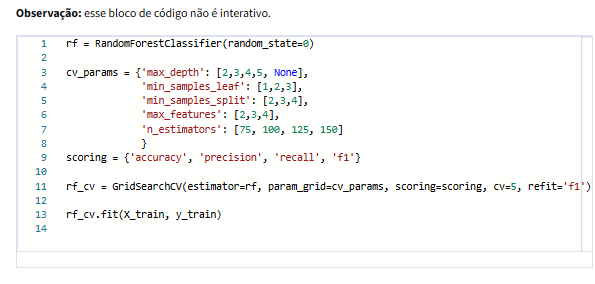

# The Nuts and Bolts of Machine Learning

## Modulo 1

### Lesson 1 -&#x20;

## Visão geral do curso 5Situação: Traduzido automaticamente do InglêsTraduzido automaticamente do Inglês

<figure><figcaption></figcaption></figure>

Olá, bem-vindo ao curso **Os fundamentos e os parafusos do aprendizado de máquina**, o quinto curso do Certificado de análise avançada de dados do Google. Você fez um progresso maravilhoso nessa jornada!

Nos cursos anteriores, você aprendeu a usar o Python para Análise exploratória de dados (EDA), trabalhou com estatísticas para analisar e interpretar dados e usou modelos de regressão para obter ainda mais informações sobre os dados. Neste curso, você explorará o aprendizado de máquina. Conhecerá os diferentes tipos de aprendizado de máquina, entenderá a finalidade de cada tipo de aprendizado de máquina e criará vários de seus próprios modelos de aprendizado de máquina.

### Descrições dos cursos

O Certificado de Análise Avançada de Dados do Google tem sete cursos. O quinto curso é o de **Fundamentos e parafusos do Aprendizado de máquina**.

<figure><figcaption></figcaption></figure>

1. [**Fundamentos da Ciência de Dados**](https://www.coursera.org/learn/foundations-of-data-science/home/week/1) - Saiba como os profissionais de dados atuam no local de trabalho e como as diferentes funções no campo da ciência de dados contribuem para a visão de futuro de uma organização. Em seguida, explore as funções da Ciência de dados, as habilidades de comunicação e a Ética de dados.
2. [**Vá além dos números: Traduzir dados em insights**](https://www.coursera.org/learn/go-beyond-the-numbers-translate-data-into-insight/home/week/1) - Aprenda os fundamentos da Limpeza de dados e das Visualizações de dados e como revelar as histórias importantes que residem nos dados.
3. [**O poder da estatística**](https://www.coursera.org/learn/the-power-of-statistics/home/week/1) - Explore estatísticas descritivas e inferenciais, probabilidade básica e distribuições de probabilidade, Amostragem de probabilidade, Intervalos de confiança e Teste de hipótese.
4. [**Análise de regressão: Simplify Complex Data Relationships**](https://www.coursera.org/learn/regression-analysis-simplify-complex-data-relationships/home/week/1) - Aprenda a modelar relações entre variáveis, com foco em regressão linear e logística.
5. [**The Nuts and Bolts of Aprendizado de máquina**](https://www.coursera.org/learn/the-nuts-and-bolts-of-machine-learning/home/week/1) - _(curso atual)_ Aprenda técnicas de Aprendizagem não supervisionada de máquina e como aplicá-las a dados organizacionais.
6. [**Google Advanced Data Analytics Capstone**](https://www.coursera.org/learn/google-advanced-data-analytics-capstone/home/week/1) - Conclua um projeto prático projetado para demonstrar as habilidades e competências adquiridas no programa.
7. [**Acelere sua busca de emprego com IA**](https://www.coursera.org/learn/accelerate-your-job-search-with-ai/home/module/1) - Obtenha estratégias práticas de busca de emprego e aprenda a aproveitar as ferramentas de IA (como Gemini e NotebookLM) para descobrir suas habilidades mais valiosas, criar um plano de busca de emprego, gerenciar suas candidaturas e praticar para entrevistas enquanto navega em seu caminho para a próxima função.

### Conteúdo do curso 5

Cada curso deste programa de certificação é dividido em módulos. Você pode concluir os cursos no seu próprio ritmo, mas a divisão em módulos foi projetada para ajudá-lo a concluir todo o Certificado de Análise Avançada de Dados do Google em cerca de seis meses.

O que está por vir? Aqui está uma visão geral rápida das habilidades que você aprenderá em cada módulo deste curso.

<figure><figcaption></figcaption></figure>

#### **Módulo 1: Os diferentes tipos de Aprendizado de máquina**

Nesta seção do curso, você conhecerá o panorama de alto nível do aprendizado de máquina e explorará dois de seus principais tipos: Aprendizagem supervisionada e não supervisionada. Você também analisará diferentes tipos de dados, determinando se são variáveis categóricas ou contínuas. Você aprenderá sobre um tipo de modelagem chamado sistema de recomendação. Por fim, você considerará as questões éticas relacionadas ao aprendizado de máquina e aprenderá algumas práticas recomendadas para criar modelos éticos.

#### **Módulo 2: Fluxo de trabalho para criar modelos complexos**

Nesta seção do curso, você aprenderá sobre todo o processo de aprendizagem de máquina, desde o início com um problema de negócios até a criação de um modelo para resolvê-lo. Você entenderá melhor as etapas preparatórias necessárias para criar um modelo bem-sucedido, criará um modelo próprio e analisará o desempenho do modelo em relação à necessidade do negócio.

#### **Módulo 3: Técnicas de aprendizagem não supervisionada**

Esta seção do curso concentra-se na aprendizagem não supervisionada. Você aprenderá a criar um modelo de agrupamento K-means e a explorar várias outras técnicas de agrupamento. Você entenderá como os métodos de Aprendizagem não supervisionada e supervisionada são diferentes, e quando e por que aplicar cada tipo de modelo.

#### **Módulo 4: Aprendizagem supervisionada baseada em árvores**

Nesta seção do curso, você aprenderá sobre modelagem baseada em árvore. Os modelos baseados em árvores são técnicas preditivas mais avançadas que se enquadram na Aprendizagem supervisionada. Você aprenderá sobre Árvores de decisão e como elas podem ser usadas para abordar problemas de classificação, bem como modelos complexos, como Random Forest, Adaptive Boosting e Gradient Boosting. Por fim, você aprenderá como o ajuste de hiperparâmetros pode ajudá-lo a obter o melhor desempenho do seu modelo.

#### **Módulo 5: Projeto de fim de curso do curso 5**

Ao concluir esta parte do Certificado em Análise Avançada de Dados, você colocará tudo o que aprendeu em um projeto de fim de curso. Você terá a tarefa de resolver um problema de negócios usando os dados fornecidos. Os conceitos e as habilidades que você aprenderá nesta parte do curso serão fundamentais para o seu sucesso como profissional de dados.

### O que esperar

Cada curso oferece vários tipos de oportunidades de aprendizado:

* **Vídeos** conduzidos por instrutores do Google ensinam novos conceitos, introduzem o uso de ferramentas relevantes, oferecem suporte à carreira e fornecem histórias pessoais inspiradoras.
* **As leituras** se baseiam nos tópicos discutidos nos vídeos, apresentam conceitos relacionados, compartilham recursos úteis e descrevem estudos de caso.
* **Conecte-se com outros alunos:** Se tiver alguma dúvida, é provável que você não esteja sozinho. Visite[ a comunidade](http://www.coursera.support/s/group-invite?id=MEY5VkgwMDAwMDAwMWdyMEFB) privada de[ Análise Avançada de Dados](http://www.coursera.support/s/group-invite?id=MEY5VkgwMDAwMDAwMWdyMEFB) do Coursera para expandir sua rede de contatos, discutir jornadas de carreira e compartilhar experiências. Confira o[ guia de início rápido](https://www.coursera.support/s/article/Community-Quick-Start-Guide).
* **As atividades de autoavaliação** e **os laboratórios** oferecem prática na aplicação das habilidades que você está aprendendo e permitem que você avalie seu próprio trabalho comparando-o com um exemplo concluído.
* **Os plug-ins interativos** o incentivam a praticar tarefas específicas e o ajudam a integrar o conhecimento adquirido no curso.
* **Os testes em vídeo** o ajudam a verificar sua compreensão à medida que avança em cada vídeo.
* **Os testes práticos** permitem que você verifique sua compreensão dos principais conceitos e fornecem feedback valioso.
* **Os testes com notas** demonstram sua compreensão dos principais conceitos de um curso. Você deve obter uma pontuação de 80% ou mais em cada teste avaliado para obter um certificado, e pode fazer um teste avaliado várias vezes para obter uma pontuação de aprovação.

### Dicas para o sucesso

* É altamente recomendável que você leia os itens de cada lição na ordem em que aparecem, pois as novas informações e conceitos se baseiam no conhecimento anterior.
* Participe de todas as oportunidades de aprendizado para obter o máximo de conhecimento e experiência possível.
* Se algo estiver confuso, não hesite em reproduzir um vídeo, revisar uma leitura ou repetir uma atividade de auto-revisão.
* Use os recursos adicionais mencionados neste curso. Eles foram criados para apoiar seu aprendizado. Você pode encontrar todos esses recursos na guia [Recursos](https://www.coursera.org/learn/the-nuts-and-bolts-of-machine-learning/resources/zwq5I).
* Quando encontrar links úteis neste curso, marque-os como favoritos para que você possa consultar as informações posteriormente para estudo ou revisão.
* Entenda e siga o[ Código de Conduta da Coursera](https://www.coursera.support/s/article/208280036-Coursera-Code-of-Conduct?) para garantir que a comunidade de aprendizagem permaneça um lugar acolhedor, amigável e de apoio para todos os membros.

***

### Lesson 2 - Os principais tipos de aprendizado de máquina

​No início do programa, ​você aprendeu que a regressão logística e a regressão ​linear têm finalidades diferentes. ​Por exemplo, quando você descobre que os pontos de dados estão ​agrupados em duas categorias diferentes em um conjunto de dados, ​uma linha reta pode não descrever os dados muito bem ​ou ser útil como meio de prever resultados. ​Uma regressão logística ou função sigmóide ​é mais adequada para um conjunto de dados como esse, ​especialmente quando novos pontos de dados são introduzidos nele. ​Como você aprendeu, a regressão linear ​é particularmente boa para ​conjuntos de dados nos quais os pontos de dados ​podem ser representados com uma linha reta. ​Com alguns conjuntos de dados, ​modelos de regressão simples podem não ​ser suficientes para sua análise. ​Por exemplo, esse gráfico mostra ​a distribuição de três classes. ​Um modelo de regressão linear simples não seria muito útil ​se não soubéssemos a que classe ​nossas observações pertenciam.
\
​Um modelo simples de regressão logística não ​seria capaz de prever um problema com três classes. ​É aqui que os profissionais de dados ​precisam de um aprendizado de máquina mais complexo. ​Mas muitos modelos de aprendizado de máquina ​usam princípios de regressão como ​uma camada fundamental para iniciar o processo de ​ensinar um modelo de computador a tomar decisões. ​Dependendo do tipo de dados ​disponíveis e do tipo de problema que você deseja resolver, ​você provavelmente selecionará um dos ​dois tipos de aprendizado de máquina: supervisionado e não supervisionado. ​Como os problemas de aprendizado supervisionado ​ocorrem com mais frequência no local de trabalho, ​os profissionais de dados usam esse tipo com mais frequência. O ​aprendizado de máquina supervisionado usa conjuntos de dados rotulados para ​treinar algoritmos para classificar ou prever resultados. ​Profissionais de dados usam ​aprendizado de máquina supervisionado para previsão.
\
​Dados rotulados são dados que foram marcados com ​um rótulo que representa uma ​identificação específica de métrica, propriedade ou classe. ​Por exemplo, imagine que você ​precise de um algoritmo para prever se ​um pássaro é pinguim ou avestruz com base na altura. ​Você tem um conjunto de dados de alturas, ​um indicador que especifica se ​essa medida veio de um pinguim ou de um avestruz. ​O valor da altura são os dados x. ​O indicador é o rótulo ou os dados y. ​Aqui está outro exemplo: ​você é dono de um restaurante e tem dados sobre ​quantos clientes visitam por mês ​e quanta receita você gera por mês. ​Se x for o número de ​clientes e Y for o valor da receita, ​você poderá usar um algoritmo para prever a ​receita do próximo mês com ​base no número de clientes projetados.
\
​Se você está medindo pássaros ou prevendo receita, ​você precisa de dados rotulados para aprendizado de máquina supervisionado. ​Em seguida, pense nos termos ​classificar e prever conforme ​se aplicam ao aprendizado supervisionado. ​Podemos usar nossos exemplos de pássaros e restaurantes para ajudar. ​O exemplo do pássaro requer ​um algoritmo que busque classificar ou coletar ​diferentes tipos em ​categorias, classes ou grupos. ​No exemplo do restaurante sobre previsão de receita, ​o objetivo do algoritmo é prever ou ​estimar um valor com base nos dados que já estão rotulados. ​Resumindo, os algoritmos de aprendizado de máquina supervisionado ​usam dados com respostas já contidas ​e os usam para obter mais respostas, ​categorizando ou estimando dados futuros. ​Como profissional de dados, ​você ajustará manualmente ​esses tipos de modelos para atender às necessidades comerciais.
\
​Usando seu conhecimento sobre ​limpeza de dados, estatísticas e regressão, ​você aprenderá a treinar, ajustar ​e otimizar modelos complexos ​para fornecer resultados mais precisos. ​O outro tipo mais comum de aprendizado de máquina usado ​por profissionais de dados é o aprendizado não supervisionado. O ​aprendizado de máquina não supervisionado usa algoritmos para ​analisar e agrupar conjuntos de dados não rotulados. ​Nesse tipo, os profissionais de dados ​pedem que o modelo forneça ​informações sem dizer ao modelo ​qual deve ser a resposta. ​Neste ponto, você pode ter ​uma ideia do que significam dados não rotulados. ​Pense no exemplo de avestruz que discutimos anteriormente. ​Dados não rotulados descreveriam ​um conjunto de pássaros que não voam e ​não conteriam rótulos, etiquetas ou categorizações.
\
​Quando você recebe um conjunto de dados como esse, ​o objetivo é agrupar os pássaros por ​sua semelhança com base nos padrões detectados pelo ​seu modelo, sem que haja ​necessariamente uma resposta correta. ​Depois que um algoritmo é implantado, o ​aprendizado não supervisionado gerencia os dados à medida que eles ​chegam e os classifica ou analisa. ​Por exemplo, quando ​um agregador de notícias categoriza um artigo por ​tópico ou uma plataforma de mídia categoriza um vídeo por gênero, ​isso é feito por algoritmos de aprendizado não supervisionado. ​Posteriormente no programa, ​você aprenderá como esses algoritmos ​funcionam em um nível conceitual, ​como implementá-los e como ​aplicá-los aos conjuntos de dados que você encontrará no trabalho. ​Existem alguns outros tipos de ​aprendizado de máquina além do supervisionado e não supervisionado. ​O aprendizado por reforço é frequentemente usado em robótica e se ​baseia em recompensar ou punir os comportamentos de um computador. ​O computador agirá com base em ​uma política ou conjunto de regras que ele aprendeu.
\
​Se a ação resultar em um resultado favorável, ​ela receberá uma recompensa. ​Em um resultado desfavorável, ​o computador receberá uma penalidade. ​Com base no fato de ter recebido uma recompensa ou punição, ​o computador atualizará sua política tentando ​otimizar as recompensas ou minimizar as penalidades. ​Esse processo se repetirá até que ​uma política satisfatória seja encontrada. ​Finalmente, há o aprendizado profundo. ​Os modelos de aprendizado profundo são feitos de ​camadas de nós interconectados. ​Cada camada de nós recebe ​sinais da camada anterior.
\
​Os nós são ativados pela entrada que recebem e, em ​seguida, passam os sinais transformados ​para outra camada ou para uma saída final. ​Outro termo que você costuma ouvir em relação ao ​aprendizado de máquina é inteligência artificial. ​A Inteligência Artificial inclui ​todos os tipos de aprendizado de máquina. ​Não confiaremos no termo para ​os propósitos deste curso. ​Em vez disso, vamos nos concentrar no aprendizado ​supervisionado e não supervisionado. ​Essas são as aplicações mais comuns ​do aprendizado de máquina e ter ​fortes habilidades nesses domínios é ​valioso para potenciais empregadores. O aprendizado ​supervisionado e não supervisionado usa muitos dos ​mesmos princípios do aprendizado por ​reforço e do aprendizado profundo.
\
​Você terá a base necessária para ​explorar esses tópicos ainda mais por conta própria. ​Agora você está familiarizado com o cenário do aprendizado de máquina. ​Neste curso, o aprendizado de máquina se ​enquadra no escopo da inteligência artificial ​, ilustrada neste mapa. ​O aprendizado de máquina e a inteligência artificial se referem ao mesmo princípio: ​treinar um computador para detectar padrões nos dados ​sem ser explicitamente programado para isso. ​Na categoria de aprendizado de máquina, ​você também encontrará todos os outros tipos ​de aprendizado que discutimos. ​Finalmente, há um aspecto do aprendizado de máquina ​e da ciência de dados que todo ​profissional de dados deve conhecer: a ​qualidade é mais importante do que a quantidade. ​Uma pequena quantidade de ​dados diversos e representativos geralmente é mais ​valiosa para profissionais de dados do que ​uma grande quantidade de dados tendenciosos e não representativos.

***

### Lesson 3 - Determinar quando os recursos são infinitos

​O conceito de infinito pode ser difícil de compreender. ​Quer estejamos cozinhando uma refeição ou lendo um livro, a ​maioria das atividades das quais os humanos participam ​tem começo, meio e fim. ​Em outras palavras, eles são finitos. ​Mas, como você aprendeu em cursos anteriores, ​nós, profissionais de dados, lidamos com o infinito o tempo todo. ​E isso também é verdade na construção de modelos complexos. ​Como você aprendeu anteriormente no programa, os ​recursos contínuos podem assumir ​um conjunto infinito e incontável de valores. ​Compreender esse conceito é fundamental ao selecionar ​um modelo de aprendizado de máquina e escolher ​as medidas para verificar a utilidade desse modelo.
\
​Imagine que você possui uma fazenda de árvores cítricas e quer ​saber o peso médio ​da produção de kumquats deste ano. ​O rendimento total da população é de 100 alqueires. ​Usando uma amostragem aleatória simples, ​você retirou 3 kumquats de ​cada alqueire e os pesou individualmente. ​Os pesos individuais registrados ​de todos esses kumquats são considerados ​dados contínuos porque o valor possível de ​um kumquat é infinito e incontável. ​Em outras palavras, um kumquat não pesa exatamente 15 g. ​E dos 300 kumquats que você pesou, ​seus pesos podem ter sido medidos com ​2 casas decimais, como 15,76, ​16,09 e 15,56, ​mas a medição é contínua porque os ​pesos podem ser qualquer número infinito entre esses pontos medidos, como 15,762950. ​Simplificando, o peso é ​um recurso contínuo porque tem ​um conjunto incontável de valores possíveis.
\
​Por outro lado, o número total de ​kumquats em seus 100 alqueires tem uma quantidade fixa. ​Por causa disso, o número total de ​kumquats não é uma característica contínua. ​Como profissional de dados, ​saber se os recursos inseridos em ​um algoritmo de aprendizado de máquina são contínuos ou ​fixos será essencial para escolher ​o modelo correto e ​a métrica de avaliação desse modelo. ​Reconhecer se os recursos de dados são ​contínuos não é o único indicador a ser considerado ao ​decidir qual modelo de aprendizado de máquina usar, ​mas é muito útil. ​Aqui está nosso mapa de aprendizado de máquina novamente, ​com algumas novas informações adicionadas a ele. ​Abaixo de 'Supervisionado', você encontra um bloco de modelos usados para ​prever resultados contínuos, ​incluindo vários regressores. ​Modelos de aprendizado supervisionado que ​fazem previsões ​contínuas são chamados de algoritmos de regressão.
\
​Alguns desses modelos foram ​introduzidos anteriormente no programa. ​Outros serão definidos posteriormente no curso. ​Por enquanto, saiba que os profissionais de dados usam ​esses tipos de modelos para trabalhar com dados contínuos. ​O objetivo desses modelos é prever ​resultados ou valores com base nos conjuntos de dados fornecidos. ​A natureza do trabalho de um profissional de dados nesse caso é ​treinar o modelo para prever ​os valores com a maior precisão possível. ​E é isso que você aprenderá a seguir. Encontro você lá.

***

### Lesson 4 - Recursos categóricos e modelos de classificação

​Classificar os doces por tamanho, ​forma e cor é bem simples. ​Pode parecer que ensinar ​uma máquina a classificar não seria tão difícil. O ​fato de um modelo específico ser ​apropriado ou não para um problema, como a classificação por ​característica, é amplamente determinado ​pelo tipo de variável que ele deve prever. ​Neste vídeo, ​analisaremos alguns tipos de variáveis que são ​úteis para determinar o ​modelo de aprendizado de máquina supervisionado correto para seus dados. ​Como lembrete, variáveis contínuas são variáveis ​que podem assumir um ​conjunto infinito e incontável de valores. ​Por outro lado, variáveis categóricas e ​variáveis discretas não são contínuas por natureza. ​Em vez disso, as variáveis categóricas contêm ​um número finito de grupos ou categorias.
\
​Por exemplo, você pode usar uma variável categórica para ​classificar um tipo de veículo, como carro, moto ou ônibus. ​Em seguida, existem variáveis discretas que têm ​um número contável de valores ​entre quaisquer dois valores fornecidos. ​Dessa forma, as variáveis discretas ​são diferentes das variáveis contínuas, ​que são incontáveis e têm um conjunto infinito de valores. ​A altura de uma árvore é uma variável contínua, ​mas o número de árvores em um parque é uma variável discreta. ​As variáveis discretas podem ser contadas e ​as variáveis categóricas podem ser agrupadas. ​Por exemplo, a cor da pintura de uma casa é categórica, ​enquanto o número de casas em um ​bairro pintadas de lavanda é discreto. ​Lembre-se da definição de aprendizado de máquina supervisionado.
\
​Uma categoria de aprendizado de máquina ​que usa conjuntos de dados rotulados para ​treinar algoritmos para classificar ou prever resultados. A ​classificação categórica e as variáveis discretas ​fazem parte dessa definição de aprendizado supervisionado. ​Muitos algoritmos de aprendizado de máquina são treinados usando ​grandes conjuntos de dados que ​agrupam as entradas de dados em dois ou mais grupos. ​Saber quais tipos de recursos você tem ​em um conjunto de dados e quais resultados você está ​procurando ajudará você a determinar ​o modelo de aprendizado de máquina mais aplicável. ​Vamos considerar um exemplo do setor manufatureiro. ​Você é o principal cientista de dados de ​um fabricante de bichos de pelúcia. ​Você tem sorte de ter um sistema automatizado que ​enche, costura e marca cães e gatos de pelúcia ao mesmo tempo.
\
​O sistema foi configurado dessa forma porque ​os bichos de pelúcia são vendidos em embalagens de dois, ​um gato e um cachorro. ​Mas agora o varejista está ​solicitando que cães e gatos sejam vendidos separadamente. ​Em vez de comprar peças novas para atualizar a máquina, ​o gerente da fábrica pede que você use uma câmera para ​identificar cães e gatos ​para que possam ser separados automaticamente. ​O algoritmo para agrupar ​cães e gatos com base nas imagens de ​uma câmera usaria ​dados categóricos como parte de ​um modelo de aprendizado de máquina supervisionado. ​O algoritmo perguntará: ​isso é um cachorro ou um gato? ​Você treinará o computador usando os dados visuais para ​reconhecer e separar os cães e gatos que chegam. ​Com esse problema resolvido, ​você deve criar um modelo para prever ​quantos contêineres são ​necessários para transportar todos os bichos de pelúcia.
\
​Isso tem uma variável de destino discreta ​porque você está contando vários contêineres. ​Agora, vamos revisitar ​nosso mapa de aprendizado de máquina com ​a área categórica recém-adicionada. ​Você encontrará alguns termos novos. ​A ​classificação é a categoria ampla ​sob a qual residem a regressão logística, os classificadores da ​árvore de decisão, os classificadores Naive Bayes e alguns outros. ​Observe que a árvore de decisão, a floresta aleatória ​e os modelos de reforço estão presentes ​em uma área contínua e ​na área categórica como regressores e classificadores. ​Assim como qualquer outro campo de estudo, ​existem funções e aplicações que ​podem ser categorizadas em apenas um grupo. ​À medida que você continua desenvolvendo ​sua compreensão desses modelos, ​a colocação em ambas as áreas fará mais sentido.
\
​Vamos dedicar mais tempo a ​esses algoritmos mais tarde no curso. ​Em breve, você estará construindo seus próprios modelos.

***

### Lesson 5 - Recursos categóricos e modelos de classificação

​Classificar os doces por tamanho, ​forma e cor é bem simples. ​Pode parecer que ensinar ​uma máquina a classificar não seria tão difícil. O ​fato de um modelo específico ser ​apropriado ou não para um problema, como a classificação por ​característica, é amplamente determinado ​pelo tipo de variável que ele deve prever. ​Neste vídeo, ​analisaremos alguns tipos de variáveis que são ​úteis para determinar o ​modelo de aprendizado de máquina supervisionado correto para seus dados. ​Como lembrete, variáveis contínuas são variáveis ​que podem assumir um ​conjunto infinito e incontável de valores. ​Por outro lado, variáveis categóricas e ​variáveis discretas não são contínuas por natureza. ​Em vez disso, as variáveis categóricas contêm ​um número finito de grupos ou categorias.
\
​Por exemplo, você pode usar uma variável categórica para ​classificar um tipo de veículo, como carro, moto ou ônibus. ​Em seguida, existem variáveis discretas que têm ​um número contável de valores ​entre quaisquer dois valores fornecidos. ​Dessa forma, as variáveis discretas ​são diferentes das variáveis contínuas, ​que são incontáveis e têm um conjunto infinito de valores. ​A altura de uma árvore é uma variável contínua, ​mas o número de árvores em um parque é uma variável discreta. ​As variáveis discretas podem ser contadas e ​as variáveis categóricas podem ser agrupadas. ​Por exemplo, a cor da pintura de uma casa é categórica, ​enquanto o número de casas em um ​bairro pintadas de lavanda é discreto. ​Lembre-se da definição de aprendizado de máquina supervisionado.
\
​Uma categoria de aprendizado de máquina ​que usa conjuntos de dados rotulados para ​treinar algoritmos para classificar ou prever resultados. A ​classificação categórica e as variáveis discretas ​fazem parte dessa definição de aprendizado supervisionado. ​Muitos algoritmos de aprendizado de máquina são treinados usando ​grandes conjuntos de dados que ​agrupam as entradas de dados em dois ou mais grupos. ​Saber quais tipos de recursos você tem ​em um conjunto de dados e quais resultados você está ​procurando ajudará você a determinar ​o modelo de aprendizado de máquina mais aplicável. ​Vamos considerar um exemplo do setor manufatureiro. ​Você é o principal cientista de dados de ​um fabricante de bichos de pelúcia. ​Você tem sorte de ter um sistema automatizado que ​enche, costura e marca cães e gatos de pelúcia ao mesmo tempo.
\
​O sistema foi configurado dessa forma porque ​os bichos de pelúcia são vendidos em embalagens de dois, ​um gato e um cachorro. ​Mas agora o varejista está ​solicitando que cães e gatos sejam vendidos separadamente. ​Em vez de comprar peças novas para atualizar a máquina, ​o gerente da fábrica pede que você use uma câmera para ​identificar cães e gatos ​para que possam ser separados automaticamente. ​O algoritmo para agrupar ​cães e gatos com base nas imagens de ​uma câmera usaria ​dados categóricos como parte de ​um modelo de aprendizado de máquina supervisionado. ​O algoritmo perguntará: ​isso é um cachorro ou um gato? ​Você treinará o computador usando os dados visuais para ​reconhecer e separar os cães e gatos que chegam. ​Com esse problema resolvido, ​você deve criar um modelo para prever ​quantos contêineres são ​necessários para transportar todos os bichos de pelúcia.
\
​Isso tem uma variável de destino discreta ​porque você está contando vários contêineres. ​Agora, vamos revisitar ​nosso mapa de aprendizado de máquina com ​a área categórica recém-adicionada. ​Você encontrará alguns termos novos. ​A ​classificação é a categoria ampla ​sob a qual residem a regressão logística, os classificadores da ​árvore de decisão, os classificadores Naive Bayes e alguns outros. ​Observe que a árvore de decisão, a floresta aleatória ​e os modelos de reforço estão presentes ​em uma área contínua e ​na área categórica como regressores e classificadores. ​Assim como qualquer outro campo de estudo, ​existem funções e aplicações que ​podem ser categorizadas em apenas um grupo. ​À medida que você continua desenvolvendo ​sua compreensão desses modelos, ​a colocação em ambas as áreas fará mais sentido.
\
​Vamos dedicar mais tempo a ​esses algoritmos mais tarde no curso. ​Em breve, você estará cons

***

### Lesson 6 - Orientar o interesse do usuário com sistemas de recomendação

​Agora que você entende os diferentes tipos ​de recursos usados nos modelos de aprendizado de máquina, ​vamos investigar como eles podem ser usados juntos em ​um tipo de modelo com o qual você provavelmente está familiarizado. ​Você já transmitiu seu novo álbum favorito ​e, quando chega ao final, ​algo totalmente novo começa a tocar? ​Você nunca ouviu isso antes, ​mas você realmente gosta. ​Como seu serviço de streaming fez ​um trabalho tão bom ao escolher uma música nova para você? ​Ele usou um sistema de recomendação. ​Os sistemas de recomendação são uma subclasse de ​algoritmos de aprendizado de máquina que oferecem ​sugestões relevantes aos usuários. ​Como você provavelmente percebeu, eles estão em toda parte.
\
​Praticamente qualquer site ou ​aplicativo que combine você com algo, ​seja uma roupa para vestir ou uma receita para cozinhar, ​provavelmente usa um sistema de recomendação. ​O objetivo principal de um sistema de recomendação é ​quantificar a semelhança de uma coisa com a outra ​e usar essas informações para ​sugerir uma opção estreitamente relacionada. ​Dessa forma, os sistemas de recomendação ​facilitam que os usuários encontrem e se conectem com informações ​, produtos e conteúdos relevantes e agradáveis. ​Vamos examinar como isso funciona. ​Primeiro, você selecionou ​uma música no serviço de streaming de música e ​, quando a música terminou, ​o serviço reproduziu mais músicas ​relacionadas à sua escolha inicial. ​Esse é um exemplo de filtragem baseada em conteúdo em ​que as comparações são feitas com base nos ​atributos do próprio conteúdo. ​Nesse caso, os atributos da música que você tocou são ​comparados aos atributos de ​outras músicas para determinar a semelhança.
\
​Para fazer essa comparação, é ​preciso que haja dados sobre cada música ​que sejam uma desconstrução de seus atributos. ​Em outras palavras, tudo o que torna ​a música única é identificado e rotulado, ​como o tipo de voz do artista, ​o ritmo ou a batida, ​ou se um determinado instrumento está presente. ​Então, quando você pesquisar por uma música, ​o sistema de recomendação baseado em conteúdo ​acessará a lista de ​atributos dessa música ​e de todas as outras músicas em sua biblioteca. ​Finalmente, o sistema comparará ​todos usando a mesma lista de atributos. ​Bons sistemas de recomendação de músicas ​comparam centenas de atributos. A ​filtragem baseada em conteúdo tem vantagens e desvantagens. ​Alguns dos benefícios são ​que eles são fáceis de entender, ​ajudam a recomendar mais do que um usuário gosta, ​até mesmo coisas de nicho nas quais poucos estão interessados, ​e não precisam ​de informações de nenhum outro usuário para trabalhar.
\
​Outra vantagem é que a filtragem ​não se limita à comparação de itens, como músicas. ​Eles podem mapear usuários e itens no mesmo espaço e depois ​recomendar coisas que estejam mais próximas das ​preferências típicas de um usuário. ​Curiosamente, às vezes, um benefício ​também pode ser uma desvantagem e vice-versa. ​Por exemplo, o fato de os sistemas baseados em conteúdo ​sempre recomendarem mais ​do mesmo tipo de coisa pode ser uma desvantagem. ​Os usuários não serão apresentados a algo diferente do ​que eles selecionaram no passado nem aprenderão algo novo. ​Outra desvantagem é que ​os atributos geralmente precisam ser ​selecionados e mapeados manualmente para todos os itens, o ​que dá muito trabalho. ​Por fim, a filtragem baseada em conteúdo é ineficaz ​para fazer recomendações entre tipos de conteúdo, ​porque diferentes tipos de conteúdo ​não usam os mesmos recursos.
\
​Por exemplo, um livro não tem batidas por minuto, ​então o mesmo serviço de streaming não poderá usar ​suas preferências de música para recomendar um novo romance. ​Os casos de uso podem ser limitados. ​Observe que neste exemplo de streaming de música, ​você realmente não avaliou nada, ​apenas ouviu sua playlist e ​o algoritmo encontrou músicas semelhantes. ​Por outro lado, ao transmitir vídeos, ​você pode avaliar ou revisar algo quando quiser. ​O sistema de recomendação também pode usar ​seus comentários para sugerir outros vídeos que você possa gostar. ​No exemplo de streaming de vídeo, ​você assistiu e ​participou ativamente do processo de feedback curtindo os vídeos que curtiu. ​Uma desvantagem desse método de recomendação é que você ​provavelmente gosta de vídeos sobre vários tópicos, ​mas o sistema usará seus comentários para ​sugerir apenas vídeos semelhantes aos que você gostou.
\
​Aqui está outro exemplo de como os sistemas de recomendação funcionam ​com base no seu feedback, chamado filtragem colaborativa. ​Quando um usuário curte ativamente o ​conteúdo avaliando-o ou fazendo uma boa avaliação, ​isso leva à filtragem colaborativa. ​Um sistema de recomendação ​usará a filtragem colaborativa para ​fazer comparações com base em quem mais gostou do conteúdo. ​Em seguida, ele sugerirá vídeos ​para outra pessoa com preferências semelhantes. A ​filtragem colaborativa é diferente ​da filtragem baseada em conteúdo, pois ​o sistema de recomendação não precisa ​saber nada sobre o conteúdo em si, ​tudo o que importa é se você gostou. ​É um sabor diferente do sistema de recomendação, ​o que me leva ao sorvete. ​Talvez queiramos saber quais sabores de sorvete ​David gostará.
\
​Um sistema de filtragem colaborativo compararia ​itens anteriores que ele gostou com os que outras pessoas gostaram. ​Como os gostos e ​desgostos de David são muito parecidos com os de Fátima, ​o algoritmo preverá que ele gostará de ​brownie de chocolate porque Fátima gosta. A ​filtragem colaborativa funciona ​independentemente dos itens, ​os sabores não importam. ​Nem importa que seja sorvete. ​Podem ser carros, restaurantes ou produtos para o cabelo. ​Tudo o que importa é que David e ​Fatima tenham gostos semelhantes. ​A capacidade de recomendar vários tipos de conteúdo é ​uma das principais vantagens da filtragem colaborativa.
\
​Outros benefícios são que ele encontra correlações ocultas ​nos dados e não exige um mapeamento manual tedioso. As ​desvantagens da filtragem colaborativa ​são que esses sistemas precisam ​de muitos dados para começar a obter resultados úteis, ​e cada usuário deve fornecer muitos dados ao sistema. ​Além disso, os dados de filtragem colaborativa são muito esparsos, ​o que significa que faltam muitos valores. ​Vamos usar filmes como exemplo. ​Existem centenas de milhares de filmes, ​mas a maioria das pessoas ​assistiu apenas a uma pequena fração deles. ​Os dados do filme de cada pessoa teriam ​valores ausentes para ​todos os filmes que ela não assistiu. ​Um sistema de recomendação precisaria usar ​técnicas avançadas de filtragem para ​gerenciar todo esse espaço vazio.
\
​A maioria dos sistemas de recomendação é altamente complexa e usa ​modelos hibridizados que usam elementos da filtragem ​colaborativa e baseada em conteúdo. ​Mas mesmo nos casos de uso mais simples, ​há diferentes necessidades ​, recursos e estratégias disponíveis ​para os profissionais de dados usarem. O ​trabalho dos profissionais de dados é ​recomendar a melhor abordagem de solução de problemas.

***

### Lesson 7 - Estudo de caso: The Woobles: O poder dos sistemas de recomendação para impulsionar as vendas

Informações:Este item inclui conteúdo que ainda não foi traduzido para o idioma de sua preferência.

Anteriormente, você aprendeu que os profissionais de dados usam o aprendizado de máquina para descobrir padrões nos dados e fazer previsões informadas. Este estudo de caso descreve como [a The Woobles](https://thewoobles.com/), uma varejista on-line com sede em Cary, Carolina do Norte, usa o aprendizado de máquina e a análise de sites para expandir seus negócios e aprimorar a experiência do cliente. Você aprenderá como o aprendizado de máquina gera recomendações personalizadas de produtos para economizar tempo e aumentar as vendas. Você também aprenderá como os chatbots habilitados pelo aprendizado de máquina podem melhorar o atendimento ao cliente.

<figure><figcaption></figcaption></figure>

### Histórico da empresa

<figure><figcaption></figcaption></figure>

Os fundadores, Justine Tiu e Adrian Zhang, criaram a The Woobles como uma varejista on-line de kits de amigurumi de crochê. **Amigurumi** é a arte de fazer crochê (ou tricô) de figuras em miniatura. A palavra é uma mistura de duas palavras japonesas, "ami", que significa crochê, e "nuigurumi", que significa boneco de pelúcia. O pinguim, mostrado abaixo, é um de seus kits mais populares.

<figure><figcaption></figcaption></figure>

Quando Justine começou a aprender sozinha a fazer animais amigurumi, ela encontrou muitos obstáculos para aprender - desde ter que juntar vídeos, blogs e instruções incompletas. Somente depois de muitos erros e várias iterações é que um pinguim fofo surgiu de seus esforços! Justine pensou que deveria haver uma maneira melhor, e isso inspirou a criação do The Woobles. Cada kit oferecido na loja on-line contém tudo o que qualquer pessoa - desde um iniciante até um criador avançado - precisa para ter sucesso com amigurumi de crochê. Em sintonia com a tendência atual de pessoas que desejam aprimorar suas habilidades, a Loja The Woobles na Plataforma de e-commerce da Shopify ajuda as pessoas a provarem a si mesmas (de uma forma divertida) que são capazes de aprender algo novo.

### O desafio

As lojas de e-commerce exibem recomendações de produtos como links para produtos que um cliente também pode estar interessado em comprar. As recomendações de produtos no site da The Woobles ajudam a impulsionar as vendas de produtos. O maior desafio é garantir que os produtos certos sejam recomendados aos clientes certos, no momento certo, com o objetivo de aumentar as vendas.

A The Woobles recebe ajuda do aprendizado de máquina da Shopify. As empresas que implementam recomendações de produtos com aprendizado de máquina não precisam se preocupar com os detalhes para criá-las ou personalizá-las para cada cliente; elas podem concentrar seu tempo em outros assuntos importantes. AS descreveu Adrian: "Trabalhar com aprendizado de máquina é uma caixa preta. Você conecta as coisas e espera que algo de bom aconteça. É útil saber o que o aprendizado de máquina está analisando, mas, como empresário, eu não gostaria de conhecer todos os detalhes."

Como empreendedores e proprietários de empresas, Adrian e Justine não têm tempo ou conhecimento para desenvolver seus próprios sistemas de recomendação. Para eles, esses sistemas parecem uma caixa preta, mas para os cientistas de dados que os criam, eles são bastante compreensíveis!

### A abordagem

A Woobles se baseia em uma combinação de aprendizado de máquina e análise do produto para garantir que as recomendações de produtos exibidas aos clientes levem ao maior aumento nas vendas. Ela usa uma abordagem automatizada e manual para gerenciar as recomendações de produtos em seu site. As métricas do site do [Google Analytics](https://marketingplatform.google.com/about/analytics/) e os dados analíticos da [Triple Whale](https://trytriplewhale.com/) informam as decisões humanas e baseadas em máquina sobre quais recomendações devem ser exibidas.

#### **Recomendações automatizadas nas páginas de produtos**

O The Woobles exibe recomendações de produtos na parte inferior de cada página de produto para incentivar os clientes a continuar navegando e comprando.

<figure><figcaption></figcaption></figure>

Como o The Woobles está hospedado na plataforma de e-commerce da Shopify, o algoritmo de Aprendizado de Máquina da Shopify gera automaticamente essas recomendações. O algoritmo se baseia em dados do histórico de compras para recomendar produtos que historicamente foram comprados juntos. Ele também se baseia nas descrições dos produtos na loja para recomendar produtos com descrições semelhantes.

Esses algoritmos de recomendação são complexos e segredos de propriedade bem guardados, pois são muito valiosos no cenário atual do comércio eletrônico. Eles podem usar elementos de filtragem colaborativa e baseada em conteúdo. Eles também podem usar algumas técnicas de processamento de linguagem natural (NLP), como é o caso aqui.

Nesse caso, o algoritmo pode usar a filtragem baseada em conteúdo para comparar todos os itens que a The Woobles vende e atribuir a cada um deles um lugar em um espaço de recursos. Por exemplo, os kits para iniciantes podem estar mais próximos uns dos outros nesse espaço de recursos do que os kits para especialistas.

Ao mesmo tempo, o modelo pode usar a Filtragem colaborativa em conjunto com as pontuações médias dos itens no site. Por exemplo, se uma pessoa demonstrar interesse no produto A e a pontuação de similaridade mais alta de uma abordagem de filtragem baseada em conteúdo retornar o produto B com uma classificação de 3,9 estrelas, e o produto C estiver em segundo lugar por pontuação de similaridade, mas tiver uma classificação de 4,9 estrelas, ele poderá combinar essas informações para oferecer o produto C ao cliente.

Finalmente, o algoritmo usa técnicas de NLP para ajudar a determinar as semelhanças entre os produtos. Para fazer isso, ele pode usar uma técnica de "saco de palavras". Esse é um método no qual, para cada produto, a descrição é "tokenizada" ou separada em suas palavras individuais, que são usadas como recursos. As palavras são então contadas. Assim, se as palavras "agulha", "padrão" e "especialista" aparecerem cinco, três e duas vezes, respectivamente, essas contagens são capturadas. Isso é repetido para todos os produtos, e as contagens de palavras resultantes são colocadas no que é conhecido como "matriz de termo de documento" - essencialmente uma tabela com palavras como colunas e produtos como linhas. Em seguida, o algoritmo calcula a distância entre cada vetor de produto. Há muitas maneiras diferentes de fazer isso, e elas podem ser muito complexas. Por fim, os produtos com a menor distância entre eles ou com a maior similaridade são recomendados.

**Principais benefícios das recomendações de produtos da Shopify**

* A Shopify gera os links para os produtos recomendados e o processo é automatizado usando o algoritmo de Aprendizado de máquina da Shopify.
* A Shopify usa dados de transações de clientes para garantir que seu algoritmo de recomendações de produtos tenha informações atualizadas ao selecionar os produtos a serem recomendados.
* O custo para aumentar as vendas por meio de recomendações de produtos geradas automaticamente é mínimo.

### Os resultados

As recomendações automatizadas de produtos aprimoram a experiência de compra do cliente, ajudando-o a encontrar produtos relevantes e, ao mesmo tempo, maximizando os valores dos pedidos do carrinho. Há muitas maneiras pelas quais os varejistas on-line podem tentar aumentar as vendas, mas a implementação de recomendações de produtos é uma opção econômica que comprovadamente compensa para a The Woobles. Em particular, as recomendações de produtos geradas automaticamente pelo algoritmo de aprendizado de máquina da Shopify proporcionam uma experiência de compra personalizada para cada cliente. Os clientes economizam tempo com a apresentação de links de produtos, e essa personalização é obtida sem nenhum trabalho manual ou comprometimento de tempo adicional da equipe do The Woobles. De fato, a The Woobles estima que as recomendações de produtos da Shopify nas páginas de produtos economizam cinco horas por mês em trabalho manual, uma vez que o processo é automatizado por meio do Aprendizado de máquina.

### O futuro

A recomendação de produtos não é a única maneira de uma pequena empresa aproveitar o aprendizado de máquina. ASua empresa cresceu, assim como o número de perguntas relacionadas a informações sobre produtos, remessa, faturamento e outros aspectos rotineiros do comércio. Muito tempo é gasto para responder a essas perguntas. Para ajudá-los, a The Woobles gostaria de implementar outra solução viabilizada pelo aprendizado de máquina: chatbots. **Os chatbots** são programas de software projetados para simular conversas com usuários humanos, especialmente pela Internet. A The Woobles prevê que os chatbots poderão ajudar a responder às perguntas dos clientes em potencial depois que eles assistirem a qualquer um dos tutoriais de crochê oferecidos no site. Os chatbots podem ajudar em certos aspectos da Aquisição de clientes, como a educação do cliente.

Assim como os sistemas de recomendação, os chatbots são algoritmos multicamadas altamente complexos que fazem uso de várias técnicas. Por exemplo, um chatbot pode dividir as frases em sacos de palavras ou "n-gramas" (combinações compostas por _um_ número _n_ de palavras), depois usar a Aprendizagem não supervisionada para reduzir a dimensionalidade da matriz vetorial resultante e agrupá-la, e usar a Aprendizagem supervisionada para prever as palavras com maior probabilidade de seguir um determinado prompt. O resultado, idealmente, é uma experiência que não se distingue de um bate-papo com um ser humano.

### Principais conclusões

Veja abaixo um resumo das principais percepções desse estudo de caso.

* **Os mecanismos de recomendação podem usar combinações de filtragem colaborativa e baseada em conteúdo.** Os produtos podem ser comparados com base em semelhanças intrínsecas _e_ oferecidos com base em índices de satisfação colaborativos. O NLP pode ser usado para ajudar a determinar métricas de similaridade baseadas em conteúdo.
* **As empresas que implementam recomendações de produtos com aprendizado de máquina economizam tempo.** Ao usar uma solução orientada por ML para recomendações de produtos, a The Woobles não precisa gastar tempo atualizando manualmente as recomendações à medida que novos dados e produtos chegam.
* **A análise dos dados de vendas atuais e das tendências dos clientes é fundamental para a seleção dos produtos apresentados nas recomendações de produtos.** Uma abordagem automatizada para gerenciar as recomendações de produtos on-line é um componente eficaz da estratégia da The Woobles para aumentar as vendas e maximizar os valores dos pedidos de carrinho.
* **Os chatbots habilitados pelo aprendizado de máquina** **também podem ser implementados para auxiliar em outras tarefas demoradas**, como os aspectos educacionais da Aquisição de clientes.

***

### Lesson 8 - Equidade e justiça no aprendizado de máquina

​Recentemente, você aprendeu sobre algoritmos de recomendação e ​como eles ajudam os usuários a descobrir ​tudo, desde novas músicas ​para transmitir, novos produtos para o cabelo para experimentar ​ou novos jogos para jogar com amigos e familiares. ​Esses algoritmos podem ser extremamente precisos, ​mas também podem errar. ​Por exemplo, uma limitação das ​ferramentas de recomendação é o problema do viés de popularidade, ​que é o fenômeno de ​itens mais populares serem recomendados com muita frequência. ​Isso faz com que a maioria dos outros itens ​, que podem ser igualmente agradáveis para os usuários, ​não recebam a atenção que merecem. ​À medida que o aprendizado de máquina se torna mais acessível e ​seu poder é aplicado a ​um conjunto cada vez maior de desafios, ​há um maior potencial de os modelos terem consequências ​não intencionais e até prejudiciais. ​Como profissional de dados, ​é importante priorizar a ​equidade nos dados que você tem e usa. ​Parte dessa administração responsável de dados ​é tomar medidas para reduzir ​o potencial de consequências não intencionais de ​seus aplicativos de aprendizado de máquina.
\
​Os profissionais de dados também devem considerar os riscos. ​Talvez eles precisem tomar decisões que possam expor ​uma empresa e as pessoas que ela ​atende a consequências negativas. ​Reconhecer o potencial de ​preconceito ajudará a minimizar o risco. O ​preconceito no aprendizado de máquina é particularmente ​enganoso porque decorre do preconceito humano. ​Mas, como um computador faz a previsão, ​é fácil que o resultado pareça objetivo. ​Muitas vezes, o preconceito não é intencional. ​Vamos considerar um exemplo de criação de ​um modelo involuntariamente antiético.
\
​Suponha que você esteja criando um modelo de reconhecimento facial para ​implantar como parte de um serviço para um revendedor de óculos de sol. ​Para gerar um banco de dados de modelos faciais, ​você recruta pessoas em seu escritório ​para que seus rostos sejam escaneados. ​Eventualmente, você tem várias centenas de digitalizações, ​que você acha que devem ser suficientes para ​gerar os modelos de que precisa. ​Você está animado para testar o que você fez. ​Você pede que pessoas de ​outro departamento atuem como um grupo de teste. ​Os resultados do teste superam suas expectativas. ​Você até mesmo torna o projeto em código aberto para que ​outras pessoas possam usá-lo e desenvolvê-lo.
\
​Mas quando o serviço entra em operação ​, não está funcionando tão bem quanto o esperado. ​Um dos motivos pode ser que você não considerou ​toda a gama de pessoas que usariam o serviço. ​Se todas as pessoas que você usa para gerar os modelos tinham, ​digamos, mais de 30 anos, ​talvez o serviço não tenha funcionado bem com ​jovens adultos ou talvez ​você tenha usado muito mais pessoas em ​uma extremidade do espectro de gênero. ​Como seu trabalho foi lançado ao público, ​outras pessoas agora podem estar usando ​seus modelos em seus próprios modelos sem ​perceber que pode haver um problema com ​o modelo e o modelo de reconhecimento facial. ​Nada disso foi causado por más intenções. ​As consequências negativas foram ​o resultado do viés nos dados de treinamento, ​que foi herdado do ​viés no processo de coleta de dados. ​Especificamente, os rostos usados para gerar ​o modelo não representavam ​uma variedade suficientemente grande de pessoas.
\
​Ao usar esse repositório para criar seu modelo, ​você acabou com um conjunto de dados com um desequilíbrio de classes de dados. ​Em outras palavras, os dados de entrada foram ​tendenciosos antes mesmo de a modelagem começar. ​Esse é apenas um exemplo de como as ​soluções de aprendizado de máquina têm o potencial de ​acarretar consequências não intencionais ​relacionadas à equidade e justiça. ​Você aprenderá sobre outros exemplos posteriormente neste curso. ​Você também aprenderá algumas perguntas fundamentais ​que podem ser feitas em cada etapa ​do processo de modelagem para ajudar a ​reduzir o risco de um modelo causar danos.

***

### Lesson 9 - Criar modelos éticos

​Os modelos preditivos são fundamentais para o ​aprendizado de máquina e têm ​o potencial de fazer muitas coisas boas. ​Mas com esse potencial vem o risco. ​Portanto, é fundamental que ​os profissionais de dados ​garantam que seus modelos sejam éticos. ​Primeiro, vamos considerar o que isso significa. ​Não há um guia simples para isso porque existem ​muitos tipos diferentes de modelos que ​são aplicados a uma variedade de tarefas. ​Como profissional de dados em qualquer nível, ​você provavelmente terá que ​tomar decisões sobre modelos que tenham ​implicações éticas, independentemente do ​problema que você esteja tentando resolver. ​No entanto, é sempre importante fazer ​perguntas que ajudem você a considerar ​a imparcialidade de seu modelo.
\
​Vamos explorar algumas das perguntas que você deve fazer ​durante o estágio de planejamento do desenvolvimento do modelo. ​Imediatamente, você deve se perguntar ​qual é o propósito pretendido do modelo. ​Como suas previsões serão usadas e por quem? ​Quem é afetado pelo modelo e quão ​prejudiciais ou significativos podem ser os efeitos? ​Se seu modelo usa informações pessoais, ​essas pessoas deram seu consentimento ​para que você coletasse e usasse esses dados? ​Existe uma maneira de eles retirarem o consentimento? ​Eles estão cientes do que você está ​fazendo com as informações deles?
\
​Uma aplicação comum do ​aprendizado de máquina é fazer previsões de mérito. ​Quem está qualificado para receber algo? ​Pode ser sozinho, ​admissão em uma universidade ​ou acesso a serviços governamentais. ​Essas são situações eticamente sensíveis porque ​os modelos que fazem essas previsões afetam a vida das pessoas. ​Se você estiver criando um modelo para ​prever se um banco deve emitir ​um empréstimo para alguém, quem usará essas informações? ​O que pode acontecer se o modelo estiver errado? ​Quais são as consequências a longo prazo ​se o empréstimo for negado?
\
​Depois de considerar essas questões, ​a próxima etapa é analisar os dados. ​Essa etapa contém seu próprio conjunto de perguntas. ​Você deve perguntar se os dados que você pretende ​usar para criar seu modelo são apropriados, ​bem fornecidos e representativos. ​Para continuar nosso exemplo, os ​dados do seu empréstimo remontam a muitos anos? ​Nesse caso, é provável que as ​classes marginalizadas e oprimidas estejam sub-representadas nos dados. ​Porque as medições anteriores foram ​influenciadas por preconceitos ou preconceitos. ​Há um ditado comum na ciência de dados: ​lixo entra, lixo sai.
\
​Se houver problemas com seus dados ​, haverá problemas com suas previsões. ​Depois de planejar seu processo e analisar os dados, ​é hora de construir ​o modelo e fazer outras perguntas. ​Por exemplo, é importante ​que as previsões do modelo sejam explicáveis? ​Com algumas metodologias de modelagem, ​pode ser difícil saber de ​onde vieram suas previsões. ​Isso às vezes é conhecido como modelo de caixa preta. ​As redes neurais são amplamente ​conhecidas por serem difíceis de explicar e ​, portanto, não são apropriadas para ​muitas aplicações em que a transparência é importante. ​Algoritmos como random forest, Adaboost ​e XGBoost não são totalmente pretos, ​mas podem exigir esforços adicionais ​para explicar e justificar suas previsões.
\
​No outro extremo do espectro, os ​métodos de regressão linear e logística são ​altamente explicáveis, assim como as árvores de decisão. ​Depois de planejar tudo, analisar os dados ​e criar seu modelo, ​há mais perguntas a serem feitas antes de ​concluir a fase de execução. ​Antes de tudo, pergunte a si mesmo se você ​entende seu modelo e suas previsões. ​Eles fazem sentido? Suas previsões são justas? ​Uma forma de avaliar a imparcialidade do modelo é ​verificar como o erro do modelo é ​distribuído em uma população. ​Se o modelo cometer erros apenas em ​casos específicos semelhantes, ​ele poderá acarretar maior risco ético.
\
​Outra pergunta a ser feita é se ​alguém tem a responsabilidade de ​revisar e monitorar o modelo antes e depois da ​implantação para garantir que ele esteja funcionando ​bem e avaliar o potencial de danos. ​Por fim, certifique-se de considerar a questão do ​consentimento em cada estágio do processo de ritmo. ​Como você pode perceber, ​há muitas ​perguntas a serem feitas para garantir o desenvolvimento de modelos éticos. ​Poucos profissionais de dados serão responsáveis ​por responder a todas essas perguntas sozinhos, ​mas quase todos os ​profissionais de dados devem responder a algumas delas. ​É importante que você sempre tenha em mente. ​Quando você faz as perguntas certas em ​cada estágio do fluxo de trabalho do Pace, ​você ajuda a garantir que seus modelos sejam bons para os ​negócios e para todos os envolvidos.

***

### Lesson 10 - Python para aprendizado de máquina

​- Atualmente, existem muitas ferramentas ​e programas que podem ajudar você a realizar análises de dados ​e criar modelos de aprendizado de máquina. ​Saber o que está disponível em seu cinto de ferramentas digitais ​é importante à medida que você aborda e resolve problemas, ​como profissional de análise de dados. ​No YouTube, precisamos reunir grandes quantidades de dados ​em vez de reinventar a roda. ​Sempre uso ferramentas e bibliotecas ​que outros profissionais de dados já criaram ​para me ajudar a limpar, validar ​e visualizar meus dados com eficiência. ​Você aplicou ​muitas dessas ferramentas ao longo deste programa, ​mas vamos analisar ​alguns dos softwares que você usou, ​outros que não usou, ​e descobrir como eles se relacionam. ​Ao criar qualquer script ou programa Python, o ​desenvolvimento quase sempre é feito ​dentro de um ambiente de desenvolvimento integrado ou IDE. ​Um IDE é um software ​com uma interface para escrever, executar e testar um trecho de código.
\
​É possível criar ​e executar scripts em qualquer editor de texto padrão, ​mas os IDEs fornecem muitas ferramentas ​para apoiar o desenvolvimento do seu código. ​Você já usou um IDE neste programa. ​Talvez, mesmo sem saber, ​você tenha codificado em ​Python e executado esse ​código na interface do Jupyter Notebook Jupyter. ​Nesse caso, o Jupyter Notebook é o IDE. ​Para a maioria das linguagens de codificação, ​há muitos IDEs disponíveis para um desenvolvedor. ​Todos eles funcionam de forma semelhante, com diferenças na funcionalidade ​e nas ferramentas incluídas. A ​seleção de um geralmente dependerá de sua preferência pessoal ​ou da preferência do seu empregador.
\
​Posteriormente, você aprenderá mais sobre IDEs, ​mas, por enquanto, vamos examinar ​como cada um deles lida com diferentes arquivos Python. ​Os dois tipos de arquivo mais comuns são scripts Python ​indicados com a extensão.py e arquivos de ​notebook Python indicados com a extensão .ipynb. ​Dependendo da tarefa, ​um profissional de dados pode usar esses dois tipos de arquivo ​e até mesmo alternar enquanto trabalha em um problema. ​Embora esses dois tipos de arquivo possam executar código, ​cada um tem suas próprias vantagens. ​É importante lembrar ​que o Python não é apenas uma linguagem usada na ciência de dados. ​É uma linguagem flexível de uso geral ​que pode ser usada para desenvolvimento web, automação ​, criptografia e outras tarefas. ​Muitas vezes, tudo o que você precisa é de um script Python. O ​script Python é o código Python ​escrito em um arquivo de texto simples ​executado pelo computador ​sem a necessidade de supervisão humana.
\
​Em situações em que não é necessário que um humano ​verifique o código enquanto ele está em execução, ​os profissionais de dados geralmente preferem usar o script Python. ​Os scripts são especialmente úteis ​quando o programa incorpora vários arquivos. ​Os scripts também são úteis quando há muitos erros ​no programa que exigem depuração, ​pois os scripts podem aproveitar funcionalidades adicionais ​que os notebooks não conseguem. ​No entanto, os scripts Python normalmente não são ideais ​para ciência de dados. ​Um profissional de análise de dados, especialmente durante a Análise exploratória de dados (EDA), ​precisa usar Python para explorar interativamente um ​conjunto de dados e visualizar as saídas de seu código quase em tempo real. ​Freqüentemente, esses resultados são compartilhados com colegas ​e devem estar em um formato legível por humanos. Os ​notebooks Python são preferíveis para tarefas de dados ​que usam código para contar uma história.
\
​Os notebooks podem ser muito úteis para combinar código ​com descrições e saídas legíveis por humanos. ​Elementos não codificados, como imagens, links ​e texto geral, podem ser incorporados diretamente no arquivo. ​Eles também têm algumas vantagens funcionais interessantes ​, como a capacidade de exportar o arquivo como PDF. ​Pode parecer que arquivos.py são preferíveis ​aos arquivos.ipynb, mas isso não é necessariamente verdade. Os ​notebooks Python são apenas outra ferramenta ​comum no espaço de dados, ​tanto para estudantes quanto para profissionais do setor. ​Muitos empregadores buscam candidatos ​que tenham experiência em trabalhar com notebooks Python existentes ​e saibam como criar novos. ​Você continuará usando os cadernos Jupyter ​nesta parte do curso.
\
​No entanto, todo o código e os conceitos que você aprendeu também ​funcionarão bem em um arquivo.py padrão. ​Se você estiver em uma situação que exija esse tipo de arquivo. ​Scripts, notebooks e ​IDEs em Python são apenas parte do cinto ​de ferramentas. Pense neles como a ​base para o restante dos projetos nos quais você trabalhará ​neste ​programa e como profissional de dados. ​Selecionar a combinação certa dessas ferramentas ​ajudará você a concluir com êxito qualquer tarefa que lhe seja dada.

***

### Lesson 11 - Diferentes tipos de IDEs Python

​Anteriormente, você explorou ambientes de desenvolvimento integrados. ​Tendo em mente os diferentes tipos de arquivos python que estão disponíveis ​neste vídeo, você aprenderá mais sobre opções específicas para IDEs ​que você pode usar como ​profissional de dados. Saber se você quer ou não usar um notebook ou ​um script python pode ajudá-lo a visualizar o fluxo de trabalho geral do seu projeto, mas ​quando você inicia um projeto usando um tipo, ​isso não significa que você precisa usá-lo em todo o projeto. ​Os profissionais de dados mudam seu ambiente de desenvolvimento no meio do ​fluxo de trabalho com mais frequência do que você imagina. Você sempre pode mudar se ​perceber que precisa de alguma funcionalidade oferecida por um IDE ​ou tipo de arquivo diferente. O Jupyter Notebooks é um dos IDEs mais usados que ​suportam notebooks python. ​No entanto, ele oferece suporte apenas para notebooks python, não scripts python.
\
​Outras ideias, como o Spider, só suportarão scripts python. ​Alguns IDEs ​, como o Visual Code Studio, podem oferecer suporte a notebooks e scripts python. ​Outra coisa a considerar ao selecionar seu IDE ​são as ferramentas ​incorporadas ao software. ​Muitos deles são relativamente simples e tornam o desenvolvimento mais eficiente. ​O preenchimento de código é um recurso muito comum. ​Ele completa automaticamente o que você digita com base nas funções e ​variáveis presentes no código. ​Além disso, muitas ideias incluem um gerenciador de arquivos que é ​útil quando você gerencia um projeto maior.
\
​Suporte de depuração e teste de código também estão disponíveis para muitos IDEs. ​No entanto, eles são mais avançados e ​podem não ser algo que você usa no seu dia a dia de trabalho como profissional de dados. ​Às vezes, você pode começar a trabalhar em um IDE ​apenas para descobrir que faltam algumas ferramentas que você precisa ou deseja. ​Depois de descobrir quais recursos você precisa ou quais alterações gostaria de fazer. ​Em seguida, você pode personalizar o IDE ​que está usando ou usar um IDE diferente ​que melhor atenda às suas necessidades. ​Pense no seu IDE ​como uma cozinha. Existem várias ferramentas e ​utensílios que são vitais para cozinhar uma refeição, ​mas a cozinha é o espaço físico onde todo o trabalho ​vai acontecer. Se você é a pessoa que cozinha, ​ter uma cozinha onde se sinta confortável e encontre tudo o que precisa ​torna o processo de cozinhar muito mais fácil.
\
​Aplicar a mesma lógica às suas ferramentas e ​software fará de você um profissional de dados melhor ao longo de sua carreira.

***

### Lesson 12 - Guia de referência: Python para aprendizado de máquina

Informações:Este item inclui conteúdo que ainda não foi traduzido para o idioma de sua preferência.

Anteriormente, você aprendeu mais sobre o ecossistema Python para o Aprendizado de máquina. Você desenvolveu uma compreensão dos diferentes tipos de arquivos Python que estão disponíveis para abordar uma tarefa de análise de dados, juntamente com os vários tipos de ambientes de desenvolvimento integrado (IDE) nos quais a codificação ocorre.

Aqui, você aprenderá mais sobre diferentes casos de uso do Python, juntamente com as vantagens e desvantagens de usar diferentes tipos de arquivos e ambientes de desenvolvimento.

### Salvar este item do curso

Talvez você queira salvar uma cópia deste guia para referência futura. Você pode usá-lo como um recurso para prática adicional ou em seus futuros projetos profissionais. Para acessar uma versão para download deste item do curso, clique no link abaixo e selecione "Usar modelo".

[Guia de referência: Python para Aprendizado de máquina](https://docs.google.com/document/d/1bLNdn-9u2w6K6KcehXwJELWPrkVSF5AjfV1l1lumWCY/template/preview#heading=h.rzwlp2zb8sqx)

OU

Se você não tiver uma conta do Google, poderá fazer o download do item diretamente do anexo abaixo.

### Linguagens de codificação para profissionais de dados

AS com o avanço do campo da Ciência de dados, cada vez mais ferramentas foram lançadas para facilitar o desenvolvimento de soluções orientadas por dados para vários problemas. As ferramentas não só se tornaram mais sofisticadas, como também, muitas vezes, mais fáceis de usar.

Softwares como o Tableau e o Looker tornaram a análise de dados muito mais simples e eficiente. Eles podem permitir visões gerais rápidas e abrangentes de um conjunto de dados e, muitas vezes, são usados como ponto de partida antes de iniciar análises mais profundas ou desenvolver modelos de dados.

É nesse ponto que as linguagens de codificação desempenham um papel importante para continuar a resolver a tarefa em questão. Elas não só podem realizar grande parte da mesma análise preliminar que é feita em outros softwares, mas também contêm algumas funcionalidades muito poderosas que podem ser usadas com bastante facilidade.

As duas linguagens de codificação mais populares para a Ciência de dados são R e Python. Na maioria das vezes, ambas podem realizar as mesmas coisas, e decidir qual delas usar geralmente depende da preferência pessoal ou do que o restante da sua equipe está usando.

A linguagem R foi projetada para estatísticas desde seu início. Grande parte da funcionalidade necessária está embutida na própria linguagem. Python, por outro lado, foi e ainda é uma linguagem de uso geral que ganhou popularidade no Ecossistema de ciência de dados.

Nesta certificação, você usou exclusivamente a linguagem Python para aprender sobre técnicas de análise de dados e como usar essas técnicas para solucionar problemas que possam surgir no local de trabalho. WHERE você pode se deparar com uma situação em que precise usar R para realizar uma análise, mas os mesmos princípios e conceitos que aprendeu aqui se aplicam independentemente do software usado.

### Tipos de arquivos Python

AS que você aprendeu em um vídeo, há dois tipos gerais de arquivos Python: scripts Python e Notebooks Python. Ambos os tipos de arquivos podem executar exatamente o mesmo código; no entanto, há certas situações em que um é preferível ao outro.

#### **Scripts Python**

Os scripts Python são, sem dúvida, o tipo mais comum de arquivo em geral, mas não necessariamente no mundo da Ciência de dados. Eles são indicados com a extensão de arquivo ".py" e são muito mais usados em projetos maiores ou em projetos em que não é essencial ver cada parte do código ser executada individualmente. Para códigos que serão implantados e colocados em produção, os scripts Python são muito mais comuns. Eles são muito mais fáceis de depurar do que os Notebooks, além de serem muito melhores para reproduzir resultados. Além disso, eles funcionam muito melhor com outras peças de software e infraestrutura.

#### **Notebooks Python**

Os notebooks Python são o que você tem usado durante todo o programa. Embora tecnicamente possam fazer tudo o que um script pode fazer, eles são usados principalmente para exploração, visualização ou apresentação.

Um dos principais recursos dos notebooks Python é a possibilidade de executar facilmente diferentes seções de código de forma independente. Além disso, é possível ver o resultado de cada seção de código, em vez de ver tudo no final, como acontece com os scripts.

Os Notebooks também contêm funcionalidades para inserir elementos que não sejam de código no próprio notebook. Se quiser inserir texto em um script Python, você estará limitado a escrever comentários. Mas com os notebooks, você pode adicionar texto de markdown, imagens e links para fornecer mais contexto ao código.

### Ambientes de desenvolvimento integrado (IDE) para Python

Ao realizar qualquer tarefa relacionada à codificação, um Ambiente de desenvolvimento integrado (IDE) é onde grande parte do trabalho é de fato realizada. Trata-se de um software que oferece um local para escrever, testar e executar o código. Para qualquer linguagem de programação, geralmente há muitos IDEs diferentes disponíveis para uso, variando ligeiramente em termos de funcionalidade e ferramentas incluídas. A escolha de um deles geralmente se resume aos tipos de ferramentas que você precisa para criar seu programa ou apenas à sua preferência pessoal.

Neste programa de certificação, até agora, você tem usado o Notebook Jupyter na Internet. O Jupyter Notebooks é um IDE que oferece suporte a muitos ambientes e linguagens de codificação diferentes. A linguagem/ambiente usado por um Notebook é chamado de kernel. O Jupyter suporta muitos tipos diferentes de kernels, mas seu padrão é o IPython, que usa Python, e é o que você continuará a usar neste programa de certificação. É possível criar sua própria instância do Notebook Jupyter em seu dispositivo pessoal, mas a funcionalidade é essencialmente a mesma que usar uma instância baseada na Web. Outros IDEs, como o Visual Studio Code e o PyCharm, são executados localmente em seu dispositivo.

Os IDEs podem ter muitas ferramentas incluídas, mas há algumas que são tão comuns que você as encontrará em quase todos os IDEs. O recurso autocompletar código, o gerenciamento de arquivos e o suporte à depuração são muito úteis, simplificando o fluxo de trabalho e permitindo que você resolva problemas no código à medida que eles surgem.

### Principais conclusões

* As linguagens de codificação são extremamente úteis para abordar um problema orientado por dados. Python e R são duas opções populares de linguagens de codificação, cada uma com suas próprias vantagens.
* Os dois principais tipos de arquivos Python são conhecidos como scripts Python e Notebooks Python.
  * Os scripts Python são melhores para códigos de nível de produção e são mais fáceis de depurar e gerenciar.
  * Os Python notebooks são melhores para análises exploratórias, apresentações ou qualquer coisa que precise ser voltada para o ser humano. Você pode inserir imagens, texto e links diretamente no código.
* Um IDE (Ambiente de desenvolvimento integrado) é um software que oferece um local para escrever, testar e executar códigos. Cada linguagem tem seu próprio conjunto de IDEs para escolher. Os próprios IDEs podem oferecer diferentes benefícios, como ferramentas de autocompletar código, gerenciamento de arquivos e depuração.

#### Concluído

***

### Lesson 13 - Mais sobre os pacotes Python

## Bibliotecas e pacotes PythonSituação: Traduzido automaticamente do InglêsTraduzido automaticamente do Inglês

### Visão geral

Python é uma linguagem de programação poderosa, e a existência de pacotes e bibliotecas faz com que ela possa ser usada para resolver praticamente qualquer problema. Os pacotes são essencialmente coleções de código Python que foram escritas por outros desenvolvedores, permitindo que você reutilize esse código sempre que precisar. As bibliotecas, por sua vez, são simplesmente uma coleção de pacotes. Ao usar a palavra-chave "import" em um arquivo Python, você pode trazer todas as funcionalidades desses pacotes ou bibliotecas de que precisar. Para fins desta leitura, há três tipos de bibliotecas. O primeiro são os pacotes de visualização de dados, que permitem criar plotagens e gráficos de dados. Em seguida, há os pacotes operacionais. Eles permitem a limpeza e a manipulação dos dados, além da execução de algumas funções matemáticas mais avançadas. Por fim, há os pacotes de aprendizado de máquina. Os pacotes de aprendizado de máquina oferecem muitas funções para ajudar a criar modelos a partir de um conjunto de dados, além da funcionalidade de examinar o modelo depois de criado. Mais uma vez, essas categorias não são rígidas, e alguns pacotes contêm funcionalidades em várias dessas categorias. Além disso, esses não são os únicos pacotes que você encontrará em sua jornada de aprendizado! O Python tem milhares e milhares de pacotes disponíveis publicamente, permitindo que você realize praticamente qualquer coisa.

### Pacotes operacionais

#### NumPy

NumPy, uma abreviação de Numerical Python, é um dos pacotes Python mais importantes para a computação científica. Em sua essência, ele permite que os desenvolvedores usem objetos de matriz multidimensional junto com vários outros objetos que se originam da matriz multidimensional, como matrizes. Além disso, ele contém uma variedade de funções que permitem operações rápidas com esses objetos de matriz.

1234Redefinir

Aqui, o pacote NumPy é importado e tem o alias np. Uma matriz bidimensional simples é criada com alguns valores aleatórios e depois impressa.

#### **pandas**

O Pandas é outro pacote amplamente usado na análise de dados ou na Ciência de dados em Python. Embora não seja tão fundamental quanto o NumPy, ele oferece manipulação de dados de alto desempenho e ferramentas analíticas que o Python básico não tem. Antes do lançamento do Pandas, o Python era usado principalmente para refinar dados brutos e prepará-los para análise posterior. Porém, com o pandas, você pode executar todos os estágios do processo de análise de dados.

12345678910Redefinir

Aqui, o pandas é importado e tem o alias pd. Um dicionário é definido contendo dados sobre vários hula-hoopers, especificamente sua velocidade máxima e por quanto tempo eles andaram de bambolê. Essas informações são usadas para criar um dataframe do pandas.

### Pacotes de visualização

#### **Matplotlib**

O Matplotlib é outra biblioteca muito popular e amplamente utilizada no setor de análise de dados. Ela fornece várias ferramentas e funções para visualizar dados em Python. Ela é multiplataforma e facilita muito a criação de gráficos bidimensionais a partir de matrizes em Python. Com apenas algumas linhas de código, você pode criar vários tipos de gráficos, como gráficos de dispersão, histogramas, gráficos de barras e diagramas em caixa.

1234567891011121314151617Redefinir

Aqui, o módulo pyplot da biblioteca Matplotlib é importado e tem o alias plt. Para criar um gráfico de dispersão dos dados do hula-hooper, é necessária apenas uma única linha de código!

#### **Seaborn**

O Seaborn é outro pacote de visualização para Python, desenvolvido especificamente com a intenção de facilitar a criação de belas visualizações. O pacote é, na verdade, uma extensão do Matplotlib, usando-o como base. Por isso, seu objetivo é mais complementar o Matplotlib do que substituí-lo completamente. Enquanto o Matplotlib pode se tornar muito complexo rapidamente à medida que você personaliza seus gráficos, o Seaborn se concentra em manter as coisas simples.

**Observação:** o bloco de código a seguir não é interativo.

1234567891011

<figure><figcaption></figcaption></figure>

Observe como ele se parece quase exatamente com o trecho de código do Matplotlib. Lembre-se de que o Seaborn foi totalmente desenvolvido com base no Matplotlib. O Seaborn está lá apenas para oferecer alguma funcionalidade extra.

#### **Plotly**

O Plotly é outra biblioteca de código aberto usada para criar Visualizações de dados em Python. Com ela, você pode criar visualizações muito bonitas com muita facilidade e acessíveis a uma ampla gama de públicos. Ela suporta quase 50 tipos exclusivos de gráficos que são comumente usados em muitos setores diferentes, como finanças, geografia e estatística.

**Observação:** O bloco de código a seguir não é interativo.

123

<figure><figcaption></figcaption></figure>

Este é outro gráfico com os mesmos dados, mas, sem dúvida, é um pouco mais atraente visualmente desde o início. Esse mesmo gráfico pode ser obtido com os outros pacotes, mas com mais trabalho.

### Pacotes de Aprendizado de Máquina

#### **scikit-learn**

O Scikit-learn, às vezes chamado de Sklearn, é uma das bibliotecas mais robustas disponíveis para o Aprendizado de máquina em Python. Ela contém uma série de ferramentas que podem ser usadas para problemas de classificação e regressão, modelagem estatística, agrupamento e redução de dimensionalidade. Na verdade, ela foi criada com base em alguns dos pacotes que você já conheceu e usou, como NumPy, Pandas e Matplotlib.

### Principais lições

Conhecer os pacotes que estão disponíveis é essencial para criar modelos ou analisar dados com sucesso. Ao continuar a desenvolver o conhecimento sobre as ferramentas disponíveis, você poderá saber "o que procurar", independentemente da situação em que se encontrar.

Pacotes e bibliotecas Python

Pacotes operacionais

* NumPy
  * Permite mais operações matemáticas em Python, fornece funções para objetos do tipo array, etc
* pandas
  * Criação de Data Frames, análise de dados, Limpeza de dados, Manipulação de dados, realização de operações eficientes em grandes conjuntos de dados

Pacotes de visualização

* Matplotlib
  * Biblioteca de gráficos para Python fácil de aprender e difícil de dominar. Excelente para gráficos rápidos e exploratórios
* Seaborn
  * Criado com base no matplotlib, permite uma personalização mais fácil dos gráficos em comparação com o matplotlib
* Plotly
  * Fácil de criar gráficos e plotagens bonitos e com qualidade de apresentação. Tem muitas funcionalidades integradas e pode ter elementos interativos.

Pacotes de Aprendizado de Máquina

* scikit-learn
  * Oferece funcionalidade para uma série de modelos de aprendizado de máquina e ferramentas analíticas.

***

### Lesson 14 - Recursos para responder a perguntas sobre programação

​Aqui está um pequeno segredo sobre o campo de dados. ​Quase ninguém sabe o que está ​fazendo 100% do tempo. ​Até mesmo os profissionais mais experientes encontram problemas ​com seu código ou com o próprio processo de análise de dados ​e precisam procurar respostas. ​É por isso que é tão importante entender ​os recursos disponíveis que podem ajudar ​você a encontrar as soluções de que precisa. ​Vamos considerar uma situação. ​Você acabou de terminar um trecho de código ​e pressionou o botão Executar. ​Mas aparece um erro.
\
​Pode ser um problema com a forma como ​você importou seus dados ​ou algo não totalmente correto na forma como você ​preparou os dados para análise. O que você pode fazer? ​A primeira etapa pode ser pesquisar o erro, ​pois a maioria dos problemas já foi ​encontrada por outros desenvolvedores. ​Python é particularmente bom ​em dizer onde está o erro, ​seja um simples erro de sintaxe ​ou alguma outra exceção. ​Seu IDE geralmente identifica especificamente ​o problema junto com ​o número exato da linha em que ele foi detectado. ​Pegue a saída do erro e pesquise on-line. ​Isso geralmente produz alguns resultados bastante úteis.
\
​Na verdade, muitas vezes você encontrará ​exatamente o mesmo erro nos primeiros resultados da pesquisa. ​Se você não está recebendo a ajuda de que precisa, ​pode pesquisar diretamente em uma plataforma pública ​como o Stack Overflow. ​O ​Stack Overflow é um recurso essencial para problemas de codificação, ​considerado por muitos profissionais de dados como a ​coleção definitiva de perguntas e respostas sobre codificação. ​Não só isso, mas a comunidade ​é muito receptiva e prestativa. ​Portanto, você deve se sentir à vontade para postar suas próprias perguntas. ​Outro recurso que pode ser ótimo ​é a documentação ​do pacote ou módulo com o qual você está trabalhando. ​A documentação é um guia detalhado ​escrito pelos desenvolvedores que criaram o pacote, os ​recursos da documentação, ​informações específicas sobre várias funções ​e recursos, e geralmente inclui exemplos úteis. O ​Kaggle é outro recurso que ​muitos profissionais de dados usam ​em algum momento de sua jornada.
\
​A comunidade on-line apresenta ​dezenas de milhares de conjuntos de dados públicos, ​além de notebooks Python que ​fornecem exemplos de como conquistar uma variedade de análises. ​Muitas pessoas que estão começando no ​setor de ciência de dados usam o ​Kaggle porque ele oferece tutoriais ​e conjuntos de dados para aprender e praticar técnicas de aprendizado de máquina. ​Profissionais de dados que estão ​no setor há muitos anos ​também usam o Kaggle para aprender ​sobre novos avanços em tecnologia ​e manter suas habilidades aprimoradas. ​Quando você encontra uma mensagem de erro ​ou outro problema de codificação, ​também é uma boa prática ​considerar se suas ferramentas estão atualizadas. ​Às vezes, as atualizações de pacotes podem quebrar o código preexistente ​ou alterar a forma como uma função específica ​é acessada e usada. ​Seu código geralmente gera um erro que informa ​se um determinado pacote ou ​software está desatualizado. ​Mas permanecer proativo pode ​evitar os problemas em primeiro lugar.
\
​Verifique se você tem as versões corretas ​de todos os seus softwares e ferramentas. ​Esses recursos são apenas alguns a serem ​considerados quando você precisar de ajuda com sua programação. ​Você encontrará desenvolvedores colaborando em ​toda a Internet. ​Quanto mais você aprender, mais ​fácil será encontrar soluções sozinho.

***

### Lesson 15 - Encontre soluções on-line

Informações:Este item inclui conteúdo que ainda não foi traduzido para o idioma de sua preferência.

### Encontre soluções on-line

Ao longo deste certificado, você aprendeu sobre muitas ferramentas e processos diferentes que os profissionais de dados usam todos os dias: Python, Jupyter Notebooks, Scikit-learn, Matplotlib, statsmodels e muitos outros. Saber como solucionar os problemas que encontrar e onde encontrar atualizações para os pacotes o tornará um profissional de dados mais confiante, eficiente e eficaz. Nesta leitura, você aprenderá mais sobre alguns dos recursos a serem consultados quando estiver com dificuldades.

#### **Documentação disponível**

Um ótimo lugar para começar quando você encontra problemas é com a própria documentação. Cada biblioteca de código, módulo e pacote tem sua própria documentação, publicada pelos próprios desenvolvedores. Se o gráfico de dispersão do Seaborn não estiver se comportando da maneira desejada, por exemplo, pesquise no Google "Seaborn scatterplot" e um dos primeiros resultados será a [documentação do Seaborn](https://seaborn.pydata.org/generated/seaborn.scatterplot.html). Você encontrará todos os parâmetros de entrada e o que eles fazem. Se você rolar a página para baixo, encontrará diferentes exemplos de gráficos de dispersão, bem como o código usado para gerá-los. A maior parte da documentação de bibliotecas, pacotes e funções tem esse mesmo formato. Uma das maneiras mais fáceis de corrigir seu código pode ser simplesmente copiar o código diretamente da documentação, colá-lo em seu Notebook e, em seguida, trocar os dados pelos seus próprios. Não tenha medo de copiar o código!

####

<figure><figcaption></figcaption></figure>

Às vezes, a documentação pode ser densa ou pode não fornecer informações sobre o problema que você está tendo com seu caso de uso específico. O Stack Overflow é um site em que as pessoas interessadas em codificação podem fazer perguntas e buscar respostas de outros programadores. Ele está aberto tanto para iniciantes quanto para profissionais experientes. Muitas vezes, uma busca pelo seu problema retornará um dos principais resultados do Stack Overflow. Você também pode pesquisar diretamente no próprio site. Há uma boa chance de sua pergunta exata já ter sido feita e respondida, geralmente com uma variedade de soluções diferentes! Caso contrário, você mesmo pode fazer uma pergunta, desde que ela esteja relacionada a um problema específico de programação, a um algoritmo de software ou a ferramentas de software comumente usadas por programadores; e que seja um problema prático e passível de resposta que seja exclusivo da Programação de computadores. Qualquer pessoa pode pesquisar respostas no site, mas para fazer perguntas, votar em soluções ou fornecer respostas, é necessário criar uma conta gratuita.

O Stack Overflow é um recurso para tópicos relacionados a código e software, mas você pode ter outras perguntas sobre coisas como a teoria na qual um algoritmo se baseia, o processo de desenvolvimento de modelos em geral ou talvez uma pergunta relacionada à matemática. Esses outros tópicos estão fora do escopo do Stack Overflow. Felizmente, o Stack Overflow faz parte de uma rede maior de sites conhecida como Stack Exchange. Há dezenas de sites de perguntas e respostas sobre assuntos específicos no Stack Exchange, que certamente terão as informações que você procura. Alguns dos mais úteis para profissionais de dados incluem:

* [**Stack Overflow**](https://stackoverflow.com/questions)**:** Um site para codificadores e programadores
* [**Cross Validated**](https://stats.stackexchange.com/)**:** Um site para pessoas interessadas em estatística, Aprendizado de máquina, Análise de dados, Mineração de dados e Visualização de dados
* [**Ciência de dados**](https://datascience.stackexchange.com/)**:** Um site para profissionais de ciência de dados, especialistas em aprendizado de máquina e interessados em aprender mais sobre a área.
* [**Matemática**](https://math.stackexchange.com/)**:** Um site para pessoas que estudam matemática em qualquer nível e profissionais de áreas relacionadas

Todos esses sites estão repletos de informações valiosas e respostas para quase todas as perguntas possíveis, especialmente se estiverem relacionadas a material de nível iniciante. Entre e faça parte da comunidade!

####

<figure><figcaption></figcaption></figure>

[**O Kaggle**](http://www.kaggle.com/) é outro recurso indispensável para profissionais de dados. Trata-se de um vasto site com um fórum de perguntas e respostas relacionadas à Ciência de dados. Ele também tem um repositório de conjuntos de dados, material educacional e notebooks IPython de iniciantes e profissionais avançados da ciência de dados. ASim, o Kaggle é um ótimo lugar para conhecer o código e o fluxo de trabalho de outras pessoas para coisas como análise exploratória de dados e desenvolvimento de modelos.

Além disso, o Kaggle organiza competições de modelagem e concede prêmios à pessoa ou à equipe que desenvolver o modelo com maior pontuação. Os dados para essas competições vêm de empresas e organizações existentes que estão tentando obter informações sobre fenômenos relacionados ao seu campo. Há uma grande variedade de [competições](https://www.kaggle.com/competitions) diferentes ocorrendo a qualquer momento, desde a previsão de jardas para a Liga Nacional de Futebol Americano até a detecção de ondas gravitacionais para o Observatório Gravitacional Europeu. As competições são particularmente úteis porque as soluções vencedoras são públicas, portanto, você pode descobrir as estratégias usadas por alguns dos melhores profissionais de Aprendizado de máquina do mundo.

A maioria das diferentes partes do Kaggle é gratuita e aberta para uso de qualquer pessoa, mas, para postar coisas ou participar de competições, é necessário criar uma conta gratuita. Esses são apenas alguns dos muitos recursos úteis que estão a apenas um clique do mouse. Explore-os para ter uma ideia do que funciona melhor para você. E lembre-se: todo mundo fica preso, especialmente no início, mas há comunidades de pessoas que ficam felizes em ajudar. Em pouco tempo, talvez você esteja respondendo a perguntas e ajudando as pessoas também!

<figure><figcaption></figcaption></figure>

Além dos recursos externos fornecidos acima, há outras ferramentas disponíveis para programadores e profissionais de dados - ferramentas que são integradas diretamente ao IDE ou ao ambiente de codificação para proporcionar uma experiência de codificação mais perfeita. Por exemplo, o [Gemini Code Assist](https://codeassist.google/) é uma ferramenta de IA gratuita que se integra a IDEs populares, como o Visual Studio Code e o JetBrains. Ele funciona como um assistente que pode ajudar a analisar o código e encontrar erros, sugerir modificações e também interagir de forma conversacional para responder a muitas outras perguntas, sejam elas técnicas ou mais conceituais.

#### **Uma palavra de cautela**

Nem tudo que você lê on-line é preciso. Ao buscar orientação em recursos on-line, é importante estar atento à fonte de qualquer informação encontrada. A Ciência de dados tornou-se recentemente um campo de grande interesse e popularidade devido à sua crescente acessibilidade, rápido desenvolvimento e capacidade de transformar o mundo ao nosso redor. Ela também oferece muitas oportunidades de trabalho interessantes. Esse aumento de interesse levou a um corpo cada vez maior de conhecimento e recursos on-line para profissionais de dados. Porém, qualquer pessoa pode escrever um blog sobre ciência de dados e publicá-lo on-line, e qualquer pessoa pode responder a uma pergunta em um fórum de ciência de dados. Embora a verdade geralmente seja a mais importante, ainda há muita desinformação na Internet. Sempre considere a credibilidade da fonte de informações e tente verificar todas as afirmações que encontrar. Não acredite em tudo o que você lê!

### Principais conclusões

* Há muitos recursos gratuitos disponíveis para os profissionais de dados, e todos os profissionais de dados os utilizam.
* A documentação é um bom ponto de partida para solucionar problemas relacionados ao código. Role a tela para baixo para verificar os exemplos fornecidos na documentação. Eles são muito úteis! Também é possível copiar/colar uma mensagem de erro diretamente no Mecanismo de busca e, muitas vezes, encontrar uma resposta apenas com isso.
* O Stack Overflow e outros sites do Stack Exchange, como Cross Validation, Ciência de dados e Matemática, são ótimos lugares para encontrar respostas para perguntas, além de fazer suas próprias perguntas e obter ajuda da comunidade de ciência de dados em todo o mundo.
* O Kaggle é um recurso valioso para respostas a perguntas, material educacional, conjuntos de dados e notebooks enviados pela comunidade. Ele também organiza competições de modelagem e publica as soluções de todos os vencedores e vice-campeões.

### Recursos para obter mais informações

* [Lista de sites do Stack Exchange](https://stackexchange.com/sites): Uma visão geral de todos os diferentes sites disponíveis na rede Stack Exchange
* [Como fazer perguntas no Stack Overflow](https://stackoverflow.com/help/on-topic): Um guia sobre como fazer perguntas eficazes e apropriadas no Stack Overflow
* [Conteúdo educacional do Kaggle](https://www.kaggle.com/learn)

***

### Lesson 16 - Sua equipe de aprendizado de máquina

​Há muita tecnologia que ajuda você a realizar tarefas de dados, e ​há um amplo conhecimento on-line para referência sempre que ​você tiver um problema durante o processo. ​Mas é igualmente importante, especialmente quando se trabalha no setor, saber quais ​membros da equipe podem ajudá-lo a responder perguntas ou resolver problemas. ​E isso não significa necessariamente outros profissionais de dados. ​Há muitas partes interessadas que contribuem com as tarefas de dados. ​Equipes de tecnologia da informação, departamentos de negócios e inteligência e ​profissionais de marketing podem fornecer informações críticas. ​As empresas geralmente têm sua própria tecnologia específica, e ​o departamento de TI pode explicar o que está disponível para uso. ​Por exemplo, se você perceber que precisa de um software ou ​hardware específico para resolver o problema em que está trabalhando, ​o departamento de TI poderá ajudá-lo a acessar o que você precisa.
\
​As equipes de business intelligence coletam dados brutos e os tornam acessíveis para ​análises adicionais. ​Isso pode ser na forma de painéis para insights rápidos ou ​fornecer informações preliminares sobre um conjunto de dados que você ​usará para informar seus modelos. ​Também existem departamentos de marketing, às vezes conhecidos como ​equipes de vendas, contas, insights ou gerenciamento de produtos. ​Eles podem explicar melhor o porquê de uma análise específica do ponto de ​vista do produto final. ​Se você quiser confirmar que seu projeto de dados está indo na direção certa, entrar ​em contato com o marketing pode lhe dar uma meta mais clara a ser alcançada. ​Além das que mencionamos, existem muitas outras equipes que você pode consultar. ​Conhecer os profissionais que trabalham ao lado do seu projeto pode ajudá-lo ​tremendamente.
\
​Portanto, aprender sobre eles é valioso sempre que você inicia um novo emprego. ​Além disso, as diferentes equipes em um local de trabalho são algo ​sobre o qual você pode e deve perguntar em uma situação de entrevista. ​Perguntas como com quais outras equipes trabalharei? ​Ou quais recursos estão disponíveis se eu encontrar esse problema? ​Pode lhe dar uma ótima perspectiva de ​como será seu ambiente de trabalho diário. ​Lembre-se de que o trabalho com dados é colaborativo, ​seus projetos sempre terão outras partes interessadas envolvidas e ​você deve aproveitar

***

### Lesson 17 - Glossário

## Termos do glossário do módulo 1

## Termos e definições do Curso 5, Módulo 1

**Variáveis categóricas**: Variáveis que contêm um número finito de grupos ou categorias

**Filtragem colaborativa**: Uma técnica usada por sistemas de recomendação para fazer comparações com base em quem mais gostou do conteúdo

**Filtragem baseada em conteúdo:** Uma técnica usada por sistemas de recomendação para fazer comparações com base em atributos de conteúdo

**Variáveis contínuas**: Variáveis que podem assumir um conjunto infinito e incontável de valores

**Árvore de decisão**: Uma estrutura semelhante a um fluxograma que usa caminhos de ramificação para prever os resultados dos eventos ou a probabilidade de determinados resultados

**Recursos discretos**: Características com um número contável de valores entre dois valores quaisquer

**Documentação**: Um guia detalhado escrito pelos desenvolvedores que criaram um pacote que apresenta informações muito específicas sobre várias funções e recursos

**Ambiente de desenvolvimento integrado (IDE)**: Um software que tem uma interface para escrever, executar e testar um trecho de código

**Aprendizado de máquina**: O uso e o desenvolvimento de algoritmos e modelos estatísticos para ensinar os sistemas de computador a analisar e descobrir padrões nos dados.

**Viés de popularidade**: O fenômeno de itens mais populares serem recomendados com muita frequência

**Sistemas de recomendação**: Técnicas de aprendizagem não supervisionadas que usam dados não rotulados para oferecer sugestões relevantes aos usuários

**Aprendizagem supervisionada de máquina**: Uma categoria de aprendizado de máquina que usa conjuntos de dados rotulados para treinar algoritmos para classificar ou prever resultados

***

## Modulo 2

### Lesson 1 - PACE em aprendizado de máquina

​Bem vindo de volta. ​Neste vídeo, vamos nos concentrar no fluxo de trabalho PACE para ​criar modelos eficazes. ​Como uma atualização, o PACE consiste em quatro estágios: planejar, ​analisar, construir e executar. O ​PACE ajuda a orientar as etapas que os profissionais de dados tomam ao alinharmos nossos dados ​e modelos às necessidades de negócios. ​Em breve, nós o usaremos para obter uma ​compreensão mais abrangente dos dados e prepará-los para modelagem usando engenharia de recursos e ​técnicas para gerenciar desequilíbrios de classe. ​A partir daí, ​praticaremos um modelo de aprendizado supervisionado usando Python chamado Naive Bayes. ​O objetivo será modelar a taxa de rotatividade de clientes bancários para prever se um cliente ​fechará sua conta bancária.
\
​Nesse contexto, a rotatividade é a taxa na qual os clientes param de fazer negócios com ​uma empresa durante um determinado período de tempo. ​E para a melhoria contínua, criará diferentes iterações de modelo. ​Por fim, usaremos métricas de desempenho para avaliar o sucesso com que o modelo ​atendeu às necessidades do negócio. ​O uso do fluxo de trabalho PACE não só fornece uma boa base para ​abordar o problema, mas ​também ajuda os profissionais de dados a se concentrarem durante todo o processo. ​Ao aplicar e referenciar essa estrutura, ​você terá as habilidades necessárias para gerenciar problemas baseados em dados em sua carreira. ​Pronto? ​Vamos.

***

### Lesson 2 - Planejar um projeto de aprendizado de máquina

​Feliz por ter você de volta. ​Eu tenho um plano para este vídeo e ​a primeira parte é discutir a etapa planejada no PACE. ​Há duas partes: centralizar a necessidade do negócio e considerar o ​modelo de aprendizado de máquina mais adequado. Ao usar o PACE, é essencial ​alinhar seu plano com as equipes de negócios e dados. Para o aprendizado de máquina, ​isso significa garantir que o modelo de aprendizado de máquina que você planeja construir ​atenda às necessidades reais do negócio. ​Isso pode parecer um pouco óbvio, mas, dada a complexidade potencial do problema, ​vários departamentos provavelmente estarão envolvidos na produção. ​Você também precisa considerar os dados que estão disponíveis para ​você antes de entrar no restante do processo de construção do modelo.
\
​Lembre-se de que, na maioria das vezes, você estará criando modelos para ​uma empresa ou organização. Por isso, ​você precisará garantir que, durante os outros estágios do PACE, seus dados, ​modelagem, métricas e estratégias de otimização ​permaneçam focados no que você desenvolveu durante o estágio planejado. ​Vamos explorar um exemplo, suponha que você esteja trabalhando no setor financeiro e ​sua empresa esteja tentando prever os preços da habitação. ​Você tem um enorme conjunto de dados sobre casas em uma determinada área. ​Esse conjunto de dados contém informações sobre as casas, como metragem quadrada, ​número de quartos e banheiros e localização. ​Mais importante ainda, o conjunto de dados também contém o preço de venda mais recente de ​cada casa. ​Como segunda parte do estágio planejado do seu fluxo de trabalho PACE, ​você usa o contexto e os requisitos da necessidade comercial para considerar que tipo de ​modelo de aprendizado de máquina seria mais adequado para o problema ​de previsão de preços imobiliários. Com base no que você sabe sobre modelos de aprendizado de máquina, ​até agora, você precisa criar um ​modelo supervisionado e contínuo para obter o resultado numérico desejado.
\
​Os modelos contínuos são os únicos que podem ajudá-lo a prever os preços da habitação ​neste exemplo. Agora que você tem seu plano para o problema de negócios e o escopo do ​modelo de aprendizado de máquina, você está pronto para a próxima etapa, analise. Te ​vejo em breve.

***

### Lesson 3 - Mais informações sobre o planejamento de um projeto de aprendizado de máquina

O fluxo de trabalho do PACE é algo que pode ser usado para manter os profissionais de dados mais experientes no caminho certo em seus projetos. Nesta leitura, você aprenderá mais sobre o estágio de planejamento do PACE e os aspectos que devem ser considerados e determinados para garantir um processo de desenvolvimento de modelo tranquilo e bem-sucedido.

### O estágio de planejamento

O fluxo de trabalho do PACE é algo que pode ser usado para mantê-lo no caminho certo, independentemente do projeto em que esteja trabalhando. Cada etapa é importante para chegar ao seu produto final. No entanto, como em muitas coisas, a parte mais importante é estabelecer as bases do seu projeto - o estágio do plano.

O estágio de planejamento é a parte do processo em que você começa a pensar sobre qual é realmente o problema e o que precisa ser feito para encontrar uma solução. Você começa a considerar quais ferramentas estão disponíveis e como será necessário manipular o conjunto de dados. Às vezes, isso pode ser tão simples quanto a necessidade de criar algumas visualizações dos dados. Ou pode ser tão complexo quanto a necessidade de criar um modelo preditivo usando o conjunto de dados.

<figure><figcaption></figcaption></figure>

O plano que você criar durante esse estágio será levado adiante durante todo o processo, portanto, é importante certificar-se de que você realmente considerou todos os aspectos e restrições do projeto. No entanto, isso não quer dizer que o plano criado deva permanecer imutável; você pode reavaliá-lo à medida que avança. Ele serve para que você comece a seguir na direção certa.

#### **O que o seu plano deve incluir?**

Esta seção do curso se concentra em algoritmos de aprendizado de máquina, portanto, usaremos esses tipos de projetos como exemplo aqui. No entanto, em primeiro lugar, você precisa pensar se precisa de um modelo! Muitas tarefas analíticas não exigem a criação de um modelo, e você pode perder tempo criando algo que não é necessário para o que você está tentando alcançar.

#### **Saber o que você precisa para um problema**

A primeira coisa a fazer ao elaborar seu plano é considerar o objetivo final. O que exatamente você está tentando modelar e que tipos de resultados do modelo são necessários? Algo que pode ser determinado imediatamente é o tipo de modelo de aprendizado de máquina de que você precisará. Os dois tipos que você viu até agora são modelos supervisionados e não supervisionados.

Os modelos supervisionados são usados para fazer previsões sobre eventos não vistos. Esses tipos de dados usam dados rotulados, e o modelo usará esses rótulos e as variáveis preditoras presentes para aprender com o conjunto de dados. E quando recebem novos pontos de dados, eles são capazes de fazer uma previsão do rótulo. Assim, por exemplo, se você tiver a tarefa de prever a quantidade de chuva, já sabe que precisará de um modelo de Aprendizagem supervisionada.

Os modelos não supervisionados, por outro lado, não fazem previsões de fato. Eles são usados para descobrir a estrutura natural dos dados, encontrando relações em dados não rotulados. Assim, por exemplo, se você tiver a tarefa de descobrir relações entre os hábitos dos clientes e segmentar os usuários, saberá que precisará de um modelo não supervisionado.

Agora, vamos voltar ao exemplo da chuva. Só pela definição do problema, sabemos que precisamos de um modelo de aprendizagem supervisionada. Entretanto, nem todos os modelos de aprendizado supervisionado são iguais. Os dois principais tipos de aprendizado supervisionado são Regressão e Classificação. Há diferentes tipos de modelos de regressão que você praticou, com diferentes modelos capazes de realizar tarefas de regressão ou classificação.

Os modelos de regressão linear são usados quando o resultado deve ser uma variável contínua. AS você aprendeu que as variáveis contínuas são valores numéricos que podem ter um número ilimitado de valores entre os pontos mais altos e mais baixos de medição. Portanto, se precisar de quantidades de chuva em polegadas ou centímetros, você sabe que é necessário um modelo de regressão linear.

No entanto, e se não precisarmos de previsões exatas da quantidade de chuva, mas apenas se choverá ou não naquele dia? É nesse caso que um modelo de classificação, como um modelo de regressão logística, seria mais adequado. Os modelos de classificação fornecerão resultados como uma variável categórica, em que há um conjunto finito de valores que a variável pode ter. Neste exemplo, o modelo só poderia prever dois resultados: Vai chover ou não vai chover.

#### **Descobrindo as ferramentas de que você precisa**

Depois de determinar o tipo de modelo de que precisará, você deve considerar o que tem à sua disposição para concluir o projeto. Mais importante ainda, você precisa descobrir se tem os dados necessários para criar o modelo.

Se seu conjunto de dados tiver apenas uma ou duas variáveis preditoras, provavelmente não produzirá um modelo que seja útil. Ou, se tiver muito poucos pontos de dados, o desempenho do modelo também será prejudicado. Por outro lado, seu conjunto de dados pode ser grande e pesado, o que significa que você precisará limpá-lo ou reduzi-lo para colocá-lo em um formato que possa ser usado para treinar o modelo. Esses problemas significam que você terá que trabalhar um pouco mais para colocá-lo em um formato utilizável ou procurar em outro lugar os dados que serão úteis para criar o modelo.

**Principais conclusões**

* O fluxo de trabalho PACE para aprendizado de máquina é muito útil para planejar e resolver problemas orientados por dados.
* O estágio de planejamento do PACE é um dos mais importantes, preparando-o para o sucesso em todo o restante do processo
* No estágio de Planejamento, você primeiro considera o problema em questão e o que será necessário para resolvê-lo
* Você também verifica se tem as ferramentas e os recursos necessários para resolver o problema
* O plano não é definitivo. Ele serve apenas como um ponto de partida fundamental para o restante do projeto

 

***

### Lesson 4 - Analisar dados para um modelo de aprendizado de máquina

​Anteriormente, exploramos o estágio do plano ​de nossa estrutura PACE. ​Agora que você concluiu o planejamento preliminar, ​é hora da etapa de análise do PACE. ​Embora manter a necessidade comercial em foco seja ​particularmente verdadeiro na fase de planejamento, ​também é essencial durante todo ​o processo de desenvolvimento de um modelo de aprendizado de máquina. ​A necessidade comercial informa um ​profissional de dados sobre o que o modelo precisa produzir. ​O resultado indica que tipo de modelo é necessário. ​A necessidade comercial também informa ​os profissionais de dados sobre os dados ​necessários para treinar o modelo ​para alcançar o resultado desejado. ​O foco principal da etapa de análise ​é desenvolver uma compreensão mais profunda dos dados, ​tendo em mente o que ​o modelo precisa eventualmente prever.
\
​Por exemplo, se você estiver ​criando um modelo de aprendizado supervisionado, ​a primeira coisa que você precisa saber é ​o que seu modelo está tentando prever. ​Em outras palavras, você precisará ​entender sua variável de resposta. ​Você já fez isso no início ​do curso, quando estava decidindo que tipo de ​modelo de aprendizado supervisionado ​usar, contínuo ou categórico. ​Vamos usar o clima como exemplo. ​Se você precisar prever ​a quantidade exata de precipitação em polegadas, ​provavelmente optará por um modelo contínuo. ​Mas se a empresa precisa de um modelo que ​possa prever se haverá chuva, ​nublado ou sol, isso requer um modelo categórico. ​Muitas vezes, como profissional de dados, ​seus dados não são estruturados ​exatamente da maneira que você precisa.
\
​É aqui que você pode tirar proveito de muitos ​dos ​princípios de análise exploratória de dados que você aprendeu anteriormente. ​Você usará todas as técnicas ​que aprendeu até agora para desenvolver ​uma compreensão de quais dados você tem ​disponíveis e como eles são estruturados. ​Vamos voltar ao exemplo do modelo contínuo ​sobre a previsão da precipitação em polegadas. ​Em seu conjunto de dados, as quantidades de chuva ​registradas podem não estar nas unidades exatas necessárias ​ou os dados podem ser divididos entre chuva ​, neve e outros tipos de precipitação. ​Esses são todos os detalhes que um profissional de dados ​precisa analisar antes de criar o modelo em si. ​Para o exemplo do modelo categórico, em ​que você está prevendo se está chuvoso, ​nublado ou ensolarado, ​seu conjunto de dados pode não estar ​rotulado com as categorias de que você precisa. ​Os dias individuais no conjunto de dados ​podem ser rotulados apenas com métricas de cobertura de nuvens, ​o que é algo que você precisará alterar ​para poder analisar os resultados de forma eficaz.
\
​Depois de obter uma compreensão sólida de quais ​são suas variáveis de resposta e como elas são estruturadas. ​A próxima etapa é explorar suas variáveis preditoras. ​Compreender as relações que ​existem entre as variáveis em ​seu conjunto de dados é essencial para criar ​um modelo que produzirá resultados valiosos. ​Semelhante às variáveis de resposta, ​as variáveis preditoras podem não estar ​no formato ou estilo que você deseja. ​Nesses casos, as mesmas considerações se aplicam. ​Você precisará descobrir como deseja que seus dados sejam ​estruturados antes de criar seu modelo. ​Esse processo de considerar cuidadosamente ​as variáveis que você tem e o que você ​precisa leva à próxima parte da ​etapa de análise, a engenharia de recursos.
\
​A seguir, você aprenderá sobre engenharia de recursos, ​várias técnicas disponíveis ​, em quais cenários usá-las ​e o que elas podem fazer com seus dados.

***

### Lesson 5 - Introdução à engenharia de recursos

## Explore a engenharia de recursos

Informações:Este item inclui conteúdo que ainda não foi traduzido para o idioma de sua preferência.

Nesta leitura, você aprenderá mais sobre o que acontece no estágio Analisar do PACE, ou seja, a Engenharia de recursos. O significado do termo "Engenharia de recursos" pode variar amplamente, mas, neste curso, ele inclui a Seleção de recursos, a transformação de recursos e a Extração de recursos. Você entenderá melhor as considerações e o processo de ajuste das variáveis de previsão para melhorar o desempenho do modelo.

### Engenharia de recursos

Ao criar modelos de aprendizado de máquina, seu modelo só será tão bom quanto seus dados. Às vezes, os dados que você tem não serão preditivos de sua variável-alvo. Por exemplo, é improvável que você consiga criar um bom modelo que preveja chuvas se o treinar com dados históricos do mercado de ações. Nesse caso, isso pode parecer óbvio, mas, ao criar um modelo, muitas vezes você terá recursos que, de forma plausível, poderiam ser preditivos do seu objetivo, mas na verdade não são. Outras vezes, os recursos do seu modelo podem conter um sinal preditivo para ele, mas esse sinal pode ser reforçado se você manipular o recurso de forma a torná-lo mais detectável pelo modelo.

**A Engenharia de recursos** é o processo de usar conhecimentos práticos, estatísticos e de Ciência de dados para selecionar, transformar ou extrair características, propriedades e atributos de dados brutos. Nesta leitura, você aprenderá mais sobre esses processos, quando e por que usá-los e o que uma boa Engenharia de Recursos pode fazer pelo seu modelo.

#### **Seleção de recursos**

A Seleção de recursos é o processo de escolher variáveis de um conjunto de dados que serão usadas como variáveis preditoras em seu modelo. Com conjuntos de dados muito grandes, há dezenas, se não centenas, de recursos para cada observação nos dados. O uso de todos os recursos em um conjunto de dados geralmente não aumenta o desempenho. Na verdade, isso pode prejudicar o desempenho ao adicionar complexidade e ruído ao modelo. Portanto, a escolha dos recursos a serem usados no modelo é uma parte importante do processo de desenvolvimento do modelo.

Em geral, há três tipos de recursos:

1. Preditivos: Recursos que, por si só, contêm informações úteis para prever o alvo
2. Interativos: Recursos que não são úteis por si só para prever a variável-alvo, mas que se tornam preditivos em conjunto com outros recursos
3. Irrelevantes: Recursos que não contêm nenhuma informação útil para prever o alvo

Você deseja recursos preditivos, mas um recurso preditivo também pode ser um recurso redundante. Os recursos redundantes são altamente correlacionados com outros recursos e, portanto, não fornecem ao modelo nenhuma informação nova - por exemplo, os passos que você deu em um dia podem ser altamente correlacionados com as calorias que você queimou. O objetivo da Seleção de recursos é encontrar os recursos preditivos e interativos e excluir os recursos redundantes e irrelevantes.

<figure><figcaption></figcaption></figure>

O processo de seleção de recursos geralmente ocorre em vários estágios do fluxo de trabalho do PACE. O primeiro lugar em que ocorre é durante a fase de planejamento. Depois de definir o problema e decidir sobre uma variável-alvo a ser prevista, é necessário encontrar recursos. Lembre-se de que os conjuntos de dados nem sempre são pré-empacotados em pequenas tabelas prontas para serem modeladas. Os profissionais de dados podem passar dias, semanas ou até meses adquirindo e reunindo recursos de muitas fontes diferentes.

<figure><figcaption></figcaption></figure>

A Seleção de recursos pode ocorrer mais uma vez durante a fase de Análise. Depois de fazer uma Análise exploratória de dados, pode ficar claro que alguns dos recursos que você incluiu não são adequados para a Modelagem. Isso pode ocorrer por vários motivos. Por exemplo, você pode descobrir que um recurso tem muitos valores ausentes ou claramente errôneos, ou talvez esteja altamente correlacionado com outro recurso e deva ser descartado para não violar as suposições do seu modelo. Também é comum que o recurso seja algum tipo de metadado, como um número de IDS sem significado inerente. Seja qual for o caso, talvez você queira eliminar esses recursos.

<figure><figcaption></figcaption></figure>

Durante a fase de construção, quando você estiver criando modelos, o processo de aprimoramento do modelo poderá incluir mais seleção de recursos. Nesse ponto, o objetivo geralmente é encontrar o menor conjunto de recursos preditivos que ainda resulte em um bom desempenho geral do modelo. De fato, os profissionais de dados geralmente baseiam a seleção final do modelo não apenas na pontuação, mas também na simplicidade e na explicabilidade do modelo. Um modelo com um R2 de 0,92 e 10 recursos pode ser selecionado em vez de um modelo com um R2 de 0,94 e 60 recursos. Os modelos com menos recursos são mais simples, e os modelos mais simples geralmente são mais estáveis e mais fáceis de entender.

Quando os profissionais de dados realizam a seleção de recursos durante a fase de construção, eles normalmente usam metodologias estatísticas para determinar quais recursos devem ser mantidos e quais devem ser descartados. Isso pode ser tão simples quanto classificar a importância dos recursos do modelo e manter apenas os primeiros _a%_ deles. Outra maneira de fazer isso é manter os principais recursos que representam ≥ b% do sinal preditivo do modelo. Há muitas maneiras diferentes de realizar a Seleção de recursos, mas todas elas buscam manter os recursos preditivos e excluir os recursos não preditivos.

#### **Transformação de recursos**

A transformação de recursos é um processo em que você pega recursos que já existem no conjunto de dados e os altera para que sejam mais adequados para serem usados no treinamento do modelo. Os profissionais de dados geralmente realizam a Transformação de dados durante a fase de construção, depois de analisarem os dados e tomarem decisões sobre como transformá-los com base no que aprenderam.

**Normalização de registros**

Há vários tipos de transformações que podem ser necessárias para um determinado modelo. Por exemplo, alguns modelos não lidam muito bem com variáveis contínuas com distribuições distorcidas. Como solução, você pode usar o logaritmo de um recurso distorcido, reduzindo a distorção e tornando os dados melhores para a Modelagem de dados. Isso é conhecido como **normalização de log.**

Por exemplo, suponha que você tenha um recurso _X&#x31;_&#x63;ujo histograma demonstre a seguinte distribuição:

<figure><figcaption></figcaption></figure>

Isso é conhecido como **distribuição log-normal.** Uma distribuição log-normal é uma distribuição contínua cujo logaritmo é distribuído normalmente. Nesse caso, a distribuição é inclinada para a direita, mas se você transformar o recurso tomando seu logaritmo natural, a distribuição será normalizada:

<figure><figcaption></figcaption></figure>

A Distribuição normal da distribuição de um recurso geralmente é melhor para o treinamento de um modelo e, posteriormente, você pode verificar se a obtenção do logaritmo ajudou ou não analisando o desempenho do modelo.

**Dimensionamento**

Outro tipo de transformação de recurso é o **escalonamento**. O dimensionamento é quando você ajusta o intervalo dos valores de um recurso aplicando uma função de normalização a eles. O escalonamento ajuda a evitar que recursos com valores muito grandes tenham influência indevida sobre um modelo em comparação com recursos com valores menores, mas que podem ser igualmente importantes como preditores.

Há muitas metodologias de dimensionamento disponíveis. Algumas das mais comuns incluem:

**Normalização**

**A Normalização de** dados (por exemplo, **MinMaxScaler** no Scikit-learn) transforma os dados para reatribuir cada valor para que fique dentro do intervalo \[0, 1]. Quando aplicada a um recurso, o valor mínimo do recurso se torna zero e seu valor máximo se torna um. Todos os outros valores são escalonados para algum lugar entre eles. A fórmula para essa transformação é:

xi,normalized=xi−xminxmax−xminxi,normalized​=xmax​−xmin​xi​−xmin​​x, start subscript, i, comma, n, o, r, m, a, l, i, z, e, d, end subscript, equals, start fraction, x, start subscript, i, end subscript, minus, x, start subscript, m, i, n, end subscript, divided by, x, start subscript, m, a, x, end subscript, minus, x, start subscript, m, i, n, end subscript, end fraction

Por exemplo, suponha que você tenha a característica 1, cujos valores variam de 36 a 209; e a característica 2, cujos valores variam de 72 a 978:

<figure><figcaption></figcaption></figure>

É evidente que esses recursos estão em escalas diferentes um do outro. Os recursos com magnitudes de escala mais altas serão mais influentes em alguns algoritmos de aprendizado de máquina, como o K-means, em que as distâncias euclidianas entre os pontos de dados são calculadas com o valor absoluto dos recursos (portanto, os valores de recursos grandes têm efeitos maiores em comparação com os valores de recursos pequenos). Ao dimensionar (normalizar) cada recurso com MIN, ambos são reduzidos ao mesmo intervalo:

<figure><figcaption></figcaption></figure>

**Padronização**

Outro tipo de dimensionamento é chamado de **padronização** (por exemplo, **StandardScaler** no Scikit-learn). A padronização transforma cada valor em um recurso para que eles tenham coletivamente uma média de zero e um desvio padrão de um. Para fazer isso, para cada valor, subtraia a média do recurso e divida pelo desvio padrão do recurso:

xi,standardized=xi−xmeanxstand.dev.xi,standardized​=xstand.dev.​xi​−xmean​​x, start subscript, i, comma, s, t, a, n, d, a, r, d, i, z, e, d, end subscript, equals, start fraction, x, start subscript, i, end subscript, minus, x, start subscript, m, e, a, n, end subscript, divided by, x, start subscript, s, t, a, n, d, point, d, e, v, point, end subscript, end fraction

Esse método é útil porque centraliza os valores do recurso em zero, o que é útil para alguns algoritmos de Aprendizado de máquina. Ele também preserva os outliers, pois não coloca um limite rígido no intervalo de valores possíveis. Aqui estão os mesmos dados acima após a aplicação da padronização:

<figure><figcaption></figcaption></figure>

Observe que os pontos são distribuídos espacialmente de uma forma muito semelhante ao resultado da normalização, mas os valores e as escalas são diferentes. Nesse caso, os valores agora variam de -1,49 a 1,76.

**Codificação**

Outra forma de transformação de recursos é conhecida como **codificação**. A codificação de variáveis é o processo de conversão de dados categóricos em dados numéricos. Considere o conjunto de dados de rotatividade bancária. Os dados originais têm um recurso chamado "Geografia", cujos valores representam o país de residência de cada cliente: França, Alemanha ou Espanha. A maioria das metodologias de Aprendizado de máquina não consegue extrair significado de strings. A codificação transforma as cadeias de caracteres em números que podem ser interpretados matematicamente.

A coluna "Geography" contém valores nominais ou valores que não têm uma ordem ou classificação inerente. ASim, o recurso normalmente seria codificado em binário. Esse processo exige que uma coluna seja adicionada para representar cada classe possível contida no recurso.

| Geografia | É a França | É a Alemanha | É a Espanha |
| --------- | ---------- | ------------ | ----------- |
| França    | 1          | 0            | 0           |
| Alemanha  | 0          | 1            | 0           |
| Espanha   | 0          | 0            | 1           |
| França    | 1          | 0            | 0           |

As ferramentas comumente usadas para fazer isso incluem pandas.get\_dummies() e OneHotEncoder(). Muitas vezes, os métodos eliminam uma das colunas para evitar informações redundantes no conjunto de dados. Observe que as informações não são perdidas ao fazer isso. Se você tiver isso..

| **Cliente**    | **É a França** | **É Alemanha** |
| -------------- | -------------- | -------------- |
| Antonio García | 0              | 0              |

... então você sabe que esse cliente é da Espanha!

Lembre-se de que alguns recursos podem ser inferidos como numéricos pelo Python ou por outras estruturas, mas ainda assim representam uma categoria. Por exemplo, suponha que você tenha um conjunto de dados com pessoas atribuídas a diferentes grupos arbitrários: 1, 2 e 3:

| **Nome**     | **Grupo** |
| ------------ | --------- |
| Rachel Stein | 2         |
| Ahmed Abadi  | 2         |
| Sid Avery    | 3         |
| Ha-rin Choi  | 1         |

A coluna "Group" pode ser codificada como tipo int, mas o número é, na verdade, apenas representativo de uma categoria. O grupo 3 não é duas unidades "maior que" o grupo 1. Os grupos também poderiam ser rotulados com cores. Nesse caso, você poderia primeiro converter a coluna em uma cadeia de caracteres e, em seguida, codificar as cadeias de caracteres como colunas binárias. Esse é um problema que pode ser resolvido no estágio inicial da geração de dados: os recursos categóricos (como um grupo) não devem ser registrados usando um número.

Um tipo diferente de codificação pode ser usado para recursos que contêm valores discretos ou ordinais. Isso é chamado de codificação ordinal. Ela é usada quando os valores _contêm_ uma ordem ou classificação inerente. Por exemplo, considere uma coluna "Temperatura" que tenha valores de frio, morno e quente. Nesse caso, a codificação ordinal poderia reatribuir essas classes a 0, 1 e 2.

| Temperatura | Temperatura (codificação ordinal) |
| ----------- | --------------------------------- |
| frio        | 0                                 |
| quente      | 1                                 |
| quente      | 2                                 |

Esse método mantém a ordem ou a classificação das classes em relação umas às outras.

#### **Extração de recursos**

A Extração de recursos envolve a produção de novos recursos a partir dos existentes, com o objetivo de ter recursos que forneçam mais poder de previsão ao seu modelo. Embora haja alguma sobreposição entre extração e transformação coloquialmente, a principal diferença é que um novo recurso é criado a partir de um ou mais recursos, em vez de simplesmente alterar um que já existe.

Considere um recurso chamado "Data da última compra", que contém informações sobre quando um cliente comprou algo da empresa pela última vez. Em vez de fornecer ao modelo datas brutas, é possível extrair um novo recurso chamado "Dias desde a última compra" Isso poderia informar ao modelo quanto tempo se passou desde que um cliente comprou algo da empresa, fornecendo informações sobre a probabilidade de ele comprar algo novamente no futuro. Supondo que a data de hoje seja 30 de maio, a extração de um novo recurso poderia ser mais ou menos assim:

| Data da última compra | Dias desde a última compra |
| --------------------- | -------------------------- |
| 17 de maio            | 13                         |
| 29 de maio            | 1                          |
| 10 de maio            | 20                         |
| 21 de maio            | 9                          |

Os recursos também podem ser extraídos de várias variáveis. Por exemplo, considere modelar se um cliente retornará para comprar outra coisa. Nos dados, há duas variáveis: "Dias desde a última compra" e "Preço da última compra" Uma nova variável poderia ser criada a partir delas, dividindo o preço pelo número de dias desde a última compra, criando uma nova variável.

| Dias desde a última compra | Preço da última compra | Dólares por dia desde a última compra |
| -------------------------- | ---------------------- | ------------------------------------- |
| 13                         | $85                    | $6.54                                 |
| 1                          | $15                    | $15.00                                |
| 20                         | $8                     | $0.40                                 |
| 9                          | $43                    | $4.78                                 |

Às vezes, os recursos que você consegue gerar por meio da extração podem oferecer os maiores aumentos de desempenho ao seu modelo. Pode ser um processo de tentativa e erro, mas encontrar bons recursos a partir dos dados brutos é o que fará com que um modelo se destaque no setor.

### **Principais conclusões**

* Analisar os recursos em um conjunto de dados é essencial para criar um modelo que produzirá resultados valiosos
* Seleção de recursos é o processo de eliminar todo e qualquer recurso desnecessário ou indesejado do conjunto de dados
* Transformação de recursos é o processo de edição de recursos em um formato que seja melhor para o treinamento do modelo
* Extração de recursos é o processo de criação de novos recursos a partir de outros recursos que já existem no conjunto de dados

### Recursos para obter mais informações

* [Documentação do MinMaxScaler](https://scikit-learn.org/stable/modules/generated/sklearn.preprocessing.MinMaxScaler.html): implementação do Scikit-learn da normalização do MinMaxScaler
* [Documentação](https://scikit-learn.org/stable/modules/generated/sklearn.preprocessing.StandardScaler.html) do[StandardScaler](https://scikit-learn.org/stable/modules/generated/sklearn.preprocessing.StandardScaler.html): implementação do Scikit-learn da normalização do StandardScaler

 

***

### Lesson 6 - Resolver problemas que surgem com conjuntos de dados desequilibrados

## Mais informações sobre conjuntos de dados desequilibradosSituação: Traduzido automaticamente do InglêsTraduzido automaticamente do Inglês

Informações:Este item inclui conteúdo que ainda não foi traduzido para o idioma de sua preferência.

### Conjuntos de dados desequilibrados

ASe você já deve ter notado ao longo deste programa, muitos conjuntos de dados brutos que você encontrará exigem níveis variados de trabalho para que estejam prontos para a modelagem. Pode haver valores ausentes ou as variáveis podem não estar no formato exato de que você precisa. Você realiza uma Análise exploratória de dados para obter uma boa compreensão dos dados. Ao trabalhar com modelos de classificação, no entanto, há algo mais a ser considerado antes de avançar: o equilíbrio de classes.

Para variáveis categóricas, os diferentes valores possíveis que cada uma pode assumir são conhecidos como classes. Isso se aplica tanto às variáveis preditoras quanto às variáveis-alvo. Se estivesse tentando classificar o tempo em um determinado dia como chuvoso ou ensolarado, essas seriam consideradas duas classes. O número de classes é igual ao número de valores exclusivos da variável.

O número de ocorrências de cada classe na variável-alvo é conhecido como distribuição de classes. Ao prever um alvo categórico, podem surgir problemas quando a distribuição de classes é altamente desequilibrada. Se não houver instâncias suficientes de determinados resultados, o modelo resultante poderá não ser muito bom na previsão dessa classe.

É aí que entra o processo de balanceamento de classe, um processo que permite manipular o conjunto de dados ou o processo de ajuste do modelo de forma que o desequilíbrio de classe existente não afete o desempenho do modelo resultante. Nesta leitura, você explorará mais sobre conjuntos de dados desequilibrados, os problemas que podem ocorrer ao trabalhar com eles e alguns métodos de ajuste da distribuição de classes para minimizar o desequilíbrio.

#### **Situações de desequilíbrio**

A classificação é um campo muito amplo, com muitas aplicações em diferentes setores. Algumas necessidades comerciais, entretanto, exigem que um modelo seja bom em classificar coisas que ocorrem relativamente raramente nos dados. Esses tipos de problemas têm vários nomes que são usados comumente, incluindo previsão de eventos raros, previsão de eventos extremos e desequilíbrio grave de classes. No entanto, todos eles se referem à mesma coisa: pelo menos uma das classes na variável de destino ocorre com muito menos frequência do que outra.

Considere este exemplo. Você tem a tarefa de criar um modelo que classificará os e-mails enviados à empresa como "spam" ou "não spam" A empresa recebe milhares e milhares de e-mails diariamente, sem mencionar todos os e-mails que recebeu no passado. Entretanto, o número de exemplos de spam é muito pequeno. Para fins deste exemplo, digamos que 10 e-mails por dia sejam identificados como spam manualmente.

Todos os e-mails são coletados em um conjunto de dados para treinar o modelo, com cada exemplo rotulado como spam ou não spam. O problema é que o conjunto de dados contém muito, muito mais exemplos de não spam do que de spam. Nesse caso, o spam é conhecido como a classe minoritária e o não spam é conhecido como a classe majoritária.

Esse não é um modelo muito bom. Com tão poucos exemplos de spam em relação aos exemplos de não spam, o modelo pode ter dificuldade para detectar a classe minoritária, resultando em uma tendência para a classe majoritária ou possivelmente nunca prevendo a classe minoritária.

### Balanceamento de um conjunto de dados

O balanceamento de classes refere-se ao processo de modificação dos dados alterando o número de amostras para tornar as proporções de classes na variável de destino menos assimétricas. Esse é um grande campo de estudo por si só, e há vários métodos que permitem equilibrar as classes e, ao mesmo tempo, manter a Integridade dos dados. Aqui, você aprenderá sobre alguns dos métodos mais comuns que podem ser usados para criar um modelo melhor.

Há duas estratégias gerais para equilibrar um conjunto de dados, e o método que é melhor usar geralmente é decidido pela quantidade de dados que você tem em primeiro lugar.

#### **Reduzir a amostragem**

A redução da amostragem é o processo de fazer com que a classe minoritária represente uma parcela maior de todo o conjunto de dados simplesmente removendo observações da classe majoritária. Ela é usada principalmente com conjuntos de dados grandes. Mas qual é o tamanho suficiente para considerar a redução da amostragem? Dezenas de milhares é uma boa regra geral, mas, em última análise, isso precisa ser validado verificando se o desempenho do modelo não se deteriora à medida que você treina com menos dados.

Uma maneira de reduzir a amostragem dos dados é selecionar algumas observações aleatoriamente da classe majoritária e removê-las do conjunto de dados. Há alguns métodos mais técnicos, com base matemática, mas a remoção aleatória funciona muito bem na maioria dos casos.

#### **Upsampling**

A subamostragem é basicamente o oposto da subamostragem e é feita quando o conjunto de dados não tem um número muito grande de observações. Em vez de remover observações da classe majoritária, você aumenta o número de observações na classe minoritária.

Há algumas maneiras de fazer isso. O primeiro e mais fácil método é duplicar amostras da classe minoritária. Dependendo de quantas observações desse tipo você tiver em comparação com a classe majoritária, talvez seja necessário duplicar cada amostra várias vezes.

Outra maneira é criar observações sintéticas e exclusivas da classe minoritária. Aparentemente, parece haver algo errado em editar o conjunto de dados dessa forma, mas se a meta for simplesmente treinar um modelo de melhor desempenho, essa pode ser uma técnica válida e útil. Você pode gerar essas observações sintéticas a partir das observações que existem atualmente. Por exemplo, você pode calcular a média de dois pontos da classe minoritária e adicionar o resultado ao conjunto de dados como uma amostra da classe minoritária. Isso pode até ser feito algoritmicamente usando pacotes Python disponíveis publicamente.

#### **Como fazer isso**

Em ambos os casos, de upsampling e downsampling, é importante deixar uma partição de dados de teste inalterada pelo ajuste de amostragem. Isso é feito porque é necessário entender a qualidade da previsão do modelo na distribuição de classe real observada no mundo que os dados representam. No caso do exemplo do detector de spam, é ótimo se o seu modelo puder ter uma boa pontuação em dados reamostrados que são 80% não spam e 20% spam, mas você precisa saber como ele funcionará quando implantado no mundo real, onde os e-mails de spam são muito menos frequentes. É por isso que os dados de retenção de teste não são rebalanceados.

<figure><figcaption></figcaption></figure>

#### **Consequências**

A Manipulação da distribuição de classes de seus dados não vem sem consequências. A primeira consequência é o risco de seu modelo prever a classe minoritária mais do que deveria. Ao reequilibrar as classes para fazer com que o modelo reconheça a classe minoritária, você pode criar um modelo que reconheça demais essa classe. Isso acontece porque, no treinamento, ele aprendeu uma distribuição de dados que não é a mesma do mundo real.

A alteração da distribuição de classes afeta as probabilidades de classes subjacentes aprendidas pelo modelo. Considere, por exemplo, como funciona o algoritmo Naive Bayes. Para calcular a probabilidade de uma classe, dados os recursos, ele usa a probabilidade de fundo de uma classe nos dados.

P(A∣B)=P(B∣A)⋅P(A)P(B)P(A∣B)=P(B)P(B∣A)⋅P(A)​P, left parenthesis, A, vertical bar, B, right parenthesis, equals, start fraction, P, left parenthesis, B, vertical bar, A, right parenthesis, dot, P, left parenthesis, A, right parenthesis, divided by, P, left parenthesis, B, right parenthesis, end fraction

No numerador, _P(A_) (a probabilidade da classe _A_) depende das probabilidades de classe encontradas nos dados. Se os dados tiverem sido enriquecidos com uma classe específica, essa probabilidade não refletirá os padrões significativos da vida real, pois se baseia em dados alterados.

#### **Quando fazer isso**

O rebalanceamento de classes deve ser reservado para situações em que outras alternativas tenham sido esgotadas e você ainda não esteja obtendo resultados satisfatórios para o modelo. Algumas perguntas de orientação incluem:

* Qual é a gravidade do desequilíbrio? Um desequilíbrio moderado (< 20%) pode não exigir nenhum rebalanceamento. Um desequilíbrio extremo (< 1%) seria um candidato mais provável.
* Você já tentou treinar um modelo usando a distribuição verdadeira? Se o modelo não se ajustar bem devido a pouquíssimas amostras na classe minoritária, pode valer a pena rebalancear, mas você não saberá a menos que tente primeiro sem rebalanceamento.
* Você precisa usar as probabilidades de classe previstas pelo modelo em um processo posterior? Se tudo o que você precisa é de uma atribuição de classe, o rebalanceamento de classes pode ser uma ferramenta muito útil, mas se precisar usar as probabilidades de classe de saída do modelo em outro modelo ou decisão downstream, o rebalanceamento pode ser um problema porque altera as probabilidades subjacentes nos dados de origem.

### **Principais conclusões**

* Conjuntos de dados desequilibrados podem ser um problema quando se trabalha com problemas de classificação
* O desequilíbrio de classes nem sempre é um problema. A probabilidade e a gravidade de afetar negativamente o desempenho do modelo geralmente aumentam à medida que o grau de desequilíbrio aumenta.
* A redução da amostragem envolve a remoção de algumas observações da classe majoritária, fazendo com que elas representem uma porcentagem menor do conjunto de dados do que antes.
* A subamostragem envolve pegar observações da classe minoritária e adicionar cópias dessas observações ao conjunto de dados ou gerar novas observações para adicionar ao conjunto de dados.

### Recursos para obter mais informações

* [Desenvolvedores do Google](https://developers.google.com/machine-learning/data-prep/construct/sampling-splitting/imbalanced-data): Leitura adicional sobre desequilíbrio de classes
* [imbalanced-learn](https://imbalanced-learn.org/stable/introduction.html): Introdução ao imbalanced-learn, uma biblioteca com ferramentas para ajudar com conjuntos de dados desequilibrados. Projetada para funcionar com o Scikit-learn.
* [RandomOverSampler](https://imbalanced-learn.org/stable/references/generated/imblearn.over_sampling.RandomOverSampler.html): documentação do imbalanced-learn para uma ferramenta usada para aumentar aleatoriamente a amostragem de dados
* [Métodos de upsampling](https://imbalanced-learn.org/stable/references/over_sampling.html): documentação do imbalanced-learn para vários métodos de upsampling
* [Métodos de downsampling](https://imbalanced-learn.org/stable/references/under_sampling.html): documentação de aprendizado desequilibrado para vários métodos de downsampling

 

***

### Lesson 7 - Guia de acompanhamento com anotações: Engenharia de recursos com Python

Todos os vídeos instrutivos com demonstrações de codificação na tela têm um guia de acompanhamento correspondente que está disponível para você. O guia de acompanhamento é um Notebook Jupyter anotado, organizado para corresponder ao conteúdo de cada módulo. Ele contém o mesmo código mostrado nos vídeos desse módulo. Esse guia é fornecido para sua referência; você não precisa adicionar nenhum texto ou executar o código. Se quiser executar o código, será necessário executar cada célula sequencialmente para que o código funcione como pretendido.

Além do conteúdo idêntico ao abordado nos vídeos, muitas vezes você encontrará informações adicionais ao longo do guia para explicar a finalidade de cada conceito abordado, por que o código foi escrito de uma determinada maneira e dicas para executar o código.

A Página de destino de cada Notebook de acompanhamento também fornece informações sobre fontes de dados (quando relevante) e dicas sobre como acessar e usar esses guias.

## Dicionário de dados

Este Notebook usa o conjunto de dados **Churn\_Modelling.csv**. Esse conjunto de dados vem do [Kaggle](https://www.kaggle.com/datasets/barelydedicated/bank-customer-churn-modeling). Ele representa dados de rotatividade bancária de um banco na Europa. "Churn" é um termo que se refere à saída de clientes e ao fato de eles levarem seus negócios para outro lugar. Os dados foram desenvolvidos para fins pedagógicos.

O conjunto de dados contém:

**10.000 linhas** - cada linha é um cliente exclusivo do banco

**14 colunas:**

| **Nome da coluna**                 | **Tipo de coluna** | **Descrição**                                                          |
| ---------------------------------- | ------------------ | ---------------------------------------------------------------------- |
| Número da linha                    | int                | Números de linha de 1 a 10.000                                         |
| CustomerId                         | int                | IDS exclusivo do cliente atribuído pelo banco                          |
| Sobrenome                          | str                | Sobrenome do cliente                                                   |
| CreditScore                        | int                | Pontuação de crédito do cliente. Esse número pode variar de 300 a 850. |
| Geografia                          | str                | País de residência do cliente                                          |
| Gênero\*                           | str                | Indicador categórico                                                   |
| Idade                              | int                | Idade do cliente (anos)                                                |
| Posse                              | int                | Número de anos que o cliente está no banco                             |
| Saldo                              | float              | Saldo bancário do cliente (euros)                                      |
| NumOfProducts (número de produtos) | int                | Número de produtos que o cliente tem no banco                          |
| HasCrCard                          | bool               | Indica se o cliente tem um cartão de crédito no banco                  |
| IsActiveMember                     | bool               | Indica se o cliente é considerado ativo                                |
| EstimatedSalary (Salário estimado) | float              | Salário anual estimado do cliente (euros)                              |
| Saído                              | bool               | Indica se o cliente se desligou (deixou o banco)                       |

\*Muitas sociedades agora entendem que o gênero não é binário e que há fluidez na categoria entre as pessoas e o tempo, portanto, criar categorias que permitam isso leva a processos de coleta de dados mais precisos.

Lembre-se de que é possível acessar e fazer download dos dados de qualquer atividade do Notebook Jupyter de dentro do próprio Notebook, navegando até o menu suspenso Lab Files na parte superior da página, clicando na pasta /home/jovyan/work, selecionando o arquivo de dados relevante e clicando em Download.

### Configure uma tela dividida

Ao assistir aos vídeos que seguem este notebook, pode ser útil acompanhar o progresso do instrutor seguindo-o em seu próprio Notebook Jupyter. Pode ser útil revisar o notebook de código junto com o vídeo, especialmente se você for novo na codificação em Python.

Para fazer isso:

1. Abra o vídeo em uma janela do navegador.
2. Em seguida, abra o guia de acompanhamento anotado em uma janela separada.
3. Organize sua tela de modo que o vídeo e o guia de acompanhamento fiquem visíveis.

<figure><figcaption></figcaption></figure>

### Dicas para trabalhar com o guia de acompanhamento

Siga estas sugestões para aprimorar sua experiência de aprendizado:

* Consulte a [leitura dos Notebooks Jupyter](https://www.coursera.org/learn/get-started-with-python/supplement/2poER/create-upload-and-edit-jupyter-notebooks) antes de começar se precisar de mais informações sobre como trabalhar com os notebooks Jupyter.
* Vá para a seção do guia complementar referente ao conteúdo do módulo atual. O guia de acompanhamento tem seções diferentes para cada vídeo incluído no conteúdo do módulo. A mensagem no vídeo o direcionará para a seção relevante no guia para o vídeo específico que você está assistindo.
* Acompanhe no Notebook enquanto o instrutor discute o código.

***

### Lesson 8 - Engenharia de recursos e balanceamento de classes

​Bem vindo de volta. Neste vídeo, ​você programará em Python para concluir o ​estágio de análise da estrutura PACE. ​No estágio de análise, ​você obtém uma compreensão mais profunda dos seus dados. ​Esse é o estágio em que você prepara ​seus dados para que possam ser usados para treinar o modelo. ​Em seguida, você passará para ​o estágio de construção do fluxo de trabalho PACE. ​No restante desta parte do curso, criaremos ​modelos que preverão a rotatividade de clientes em um banco. A ​rotatividade de clientes é o termo comercial que ​descreve quantos e em que ​proporção os clientes param de usar um produto ou ​serviço ou param de fazer negócios com uma empresa. ​Os modelos serão modelos de ​classificação supervisionados porque ​cada um deles predirá uma meta categórica. ​Nesse caso, é binário. ​Independentemente de cada cliente ter se matriculado ou ficado. ​Antes de entrarmos no conjunto de dados, ​precisamos importar os pacotes que usaremos. ​Tudo o que precisaremos para este notebook é NumPy e ​Pandas porque estamos apenas ​preparando os dados para modelagem. ​Agora, leremos o conjunto de dados de ​um Arquivo CSV para o DataFrame do Panda, chamaremos o ​DataFrame ​df\_original e o inspecionaremos usando a função head. ​O conjunto de dados que usaremos para resolver ​esse problema contém dados do cliente, em ​que cada entrada no conjunto de dados representa um cliente. ​Para cada cliente, existem ​vários recursos que descrevem ​o relacionamento do cliente com o banco ​e as informações sobre as finanças do cliente. ​Além disso, há metadados para cada cliente, ​como nome, sexo e número de identificação do cliente. ​Os dois recursos que podem não ser ​totalmente intuitivos são a estabilidade, ​que representa quantos anos o cliente ​usou o banco, e a geografia, ​que identifica em qual país o cliente mora. ​Além disso, temos o recurso rotulado como encerrado. ​Isso indica se o cliente saiu do banco. ​Um significa que eles ​pararam de fazer negócios com o banco ​e um zero indica que eles ainda são clientes. ​A variável que saiu será a variável de resposta ​ou a variável que nosso modelo tentará prever. ​Ao modelar, a melhor prática é realizar ​um exame rigoroso de seus dados antes de ​iniciar a engenharia de recursos e a seleção de recursos. ​Esse processo é importante ​porque não só ajuda você a entender seus dados, ​o que eles estão dizendo e o que não estão dizendo, ​mas também pode dar dicas ​sobre quais novos recursos criar. ​Você já aprendeu os fundamentos da análise exploratória ​de dados ou Análise exploratória ​de dados (EDA), então este ​caderno ignorará essa parte essencial do processo de modelagem. ​Lembre-se de que um bom projeto de ciência de dados ​sempre incluirá a Análise exploratória de dados (EDA). ​Vamos ter uma visão geral rápida dos nossos dados. ​Usaremos a função info para inspecionar o DataFrame. ​A partir dessa tabela, podemos confirmar que os dados têm ​14 características e 10.000 observações. ​Também sabemos que nove características são inteiras, ​duas são flutuantes e três são cadeias de caracteres. ​Finalmente, podemos dizer que ​não há valores nulos porque há 10.000 ​observações e cada coluna tem 10.000 valores não nulos. ​Em seguida, prepararemos ​esse conjunto de dados para ser usado no treinamento do modelo. ​A primeira coisa que faremos é a seleção de recursos. ​Se você se lembra, esse é o processo de escolher ​as características que queremos que o modelo ​use para prever o resultado. ​Eliminamos todos os recursos que não são úteis para o modelo. ​Em nossos dados bancários, observe que ​a primeira coluna é chamada de número da linha. ​Isso apenas enumera as linhas. ​Como os números de uma linha não devem ter ​nenhuma correlação intrínseca com nossa variável de resposta, ​removeremos esse recurso do nosso conjunto de dados. ​O mesmo vale para o ID do cliente, ​que parece ser um número atribuído ao cliente para ​fins administrativos, e o sobrenome, ​que é o sobrenome do cliente, ​eliminaremos esses dois. ​Ao concluir a seleção de recursos, tenha em ​mente as questões éticas que você aprendeu anteriormente no curso. ​Considere as implicações de ​seus dados e do modelo resultante. ​Por exemplo, neste exercício de modelagem, ​não incluiremos a coluna de gênero. ​Esse recurso de dados levanta um conjunto de questões complexas, ​tecnicamente, culturalmente e eticamente. ​Reconhecemos que a abordagem mais rigorosa ​seria modelar com e ​sem esse recurso e ​examinar como ele influencia as previsões. ​Seja qual for a abordagem, ela deve ser orientada por uma meta de ​resultados equitativos e de acordo com seu caso de uso específico. ​Vamos remover essas colunas chamando ​a função drop em nosso DataFrame. ​Passamos para ele uma lista ​de nomes das colunas que queremos remover. ​Indicamos que estamos eliminando colunas, ​não linhas, incluindo eixo igual a 1. ​Atribuiremos os resultados a ​um novo DataFrame chamado churn\_df. ​O DataFrame resultante é ​mostrado chamando o método head. ​No entanto, ainda há mais a ​fazer antes de começarmos a treinar o modelo. ​A seguir, vamos praticar a extração de características. ​Esse é o processo de pegar ​dois ou mais recursos e ​usá-los para criar um recurso totalmente novo ​que tornará o modelo mais preciso. ​Normalmente, a extração de recursos é feita ​usando estatísticas para analisar o quão preditiva ​é cada variável e se o novo recurso ​extraído é mais preditivo ​do que as variáveis originais sozinhas. ​Por enquanto, vamos extrair um recurso como exemplo, ​sem realizar a análise que normalmente faríamos ​se estivéssemos tentando ​criar um modelo pronto para produção. ​Vamos criar uma nova variável e chamá-la de lealdade. ​Faremos isso ​dividindo a permanência de um cliente pela idade. ​A lógica por trás de usar a estabilidade e ​dividi-la pela idade do cliente é ​que ela representa a porcentagem ​da vida de uma pessoa em que ela foi cliente do banco. ​Pessoas com porcentagens maiores ​podem ser clientes mais fiéis. ​Agora temos uma nova coluna chamada fidelidade, ​que podemos verificar inspecionando o DataFrame. ​Vamos prosseguir com a transformação de recursos. ​Há alguns recursos ​nesse conjunto de dados que precisam ser transformados. ​Lembre-se de que a transformação de recursos é ​o processo de alterar a forma como ​um único recurso é representado no conjunto de dados ​com o objetivo de melhorar a precisão do modelo. ​Muitos modelos de classificação exigem que você ​converta características categóricas para torná-las numéricas. ​Nosso conjunto de dados tem uma característica categórica chamada geografia. ​Vamos verificar quantas classes aparecem nos dados ​desse recurso usando a função exclusiva na série. ​Existem três valores únicos: ​França, Espanha e Alemanha. ​Vamos codificar esses dados para que possam ser ​representados usando recursos booleanos. ​Usaremos uma função Pandas chamada get\_dummies para fazer isso. ​Quando chamamos pd.get\_dummies nesse recurso, ​ele substituirá a coluna geográfica por três novas colunas booleanas. ​Um para cada categoria possível ​contida na coluna que está sendo fictícia. ​Quando especificamos drop\_first ​como true na chamada da função, ​isso significa que, em vez de substituir a ​geografia por três novas colunas, ​ela será substituída por duas colunas. ​Podemos fazer isso porque nenhuma informação é ​perdida e o conjunto de dados é mais curto e simples. ​Nesse caso, acabamos com duas novas colunas ​chamadas Geography\_Germany e Geography\_Spain. ​Não precisamos de uma coluna Geography\_France. Por que não? ​Porque se os valores de um cliente em Geography\_Germany e ​Geography\_Spain forem ambos zero, saberemos que ele é da França. ​Depois da seleção, extração e transformação dos recursos, ​a próxima etapa é a modelagem. ​Usaremos esse conjunto de dados para a maior parte da modelagem que ​você fará no restante desta parte do curso. ​E agora você tem uma base sólida para ​as etapas de construção e execução do PACE.

***

### Lesson 9 - Atividade: Executar a engenharia de recursos

Neste laboratório, você realizará a Engenharia de recursos. Será apresentado a você um cenário de negócios e um conjunto de dados para usar enquanto explora o cenário. Você praticará o uso de funções em Python para identificar variáveis significativas, realizar as transformações necessárias e criar novos recursos.

## **Dicionário de dados**

Esta atividade usa um conjunto de dados chamado [nba-players.csv](https://www.coursera.org/learn/the-nuts-and-bolts-of-machine-learning/resources/FEGQu). Ele representa 22 colunas de registros de desempenho de jogadores da Associação Nacional de Basquete dos Estados Unidos (NBA) por jogo durante uma temporada, incluindo estatísticas como o número médio de cestas de 3 pontos feitas por jogo e o número médio de rebotes ofensivos por jogo.

O conjunto de dados contém:

**1.340 linhas** - cada linha é uma estatística diferente de um jogador da NBA por jogo em uma temporada

**22 colunas**

**Observação:** Um "field goal" no basquete significa que a bola passou pelo aro durante o jogo, resultando em pontos marcados. 2 e 3 pontos são marcados durante o jogo com base na distância que o jogador está da cesta. 1 ponto é marcado durante um "lance livre", que representa um tiro livre na cesta devido a uma falta cometida pela outra equipe.

| **Nome da coluna** | **Tipo de coluna** | **Descrição**                                                         |
| ------------------ | ------------------ | --------------------------------------------------------------------- |
| \[Nenhum]          | int                | Índice                                                                |
| nome               | str                | Nome e sobrenome do jogador da NBA                                    |
| gp                 | int                | Número de jogos disputados (em uma temporada)                         |
| mIN                | int                | Número médio de minutos jogados por jogo                              |
| pts                | int                | Número médio de pontos marcados por jogo                              |
| fgm                | int                | Número médio de gols de campo feitos por jogo                         |
| fga                | int                | Número médio de tentativas de gols de campo                           |
| fg                 | int                | Porcentagem de gols de campo feitos                                   |
| 3p\_made           | int                | Número médio de gols de campo de 3 pontos por jogo                    |
| 3pa                | int                | Número médio de tentativas de gols de campo de 3 pontos por jogo      |
| 3p                 | int                | Porcentagem de gols de campo de 3 pontos feitos                       |
| ftm                | int                | Média de lances livres feitos por jogo                                |
| fta                | int                | Média de lances livres tentados por jogo                              |
| ft                 | int                | Porcentagem de lances livres feitos                                   |
| oreb               | int                | Número médio de rebotes ofensivos por jogo                            |
| dreb               | int                | Número médio de rebotes defensivos por jogo                           |
| reb                | int                | Média de rebotes por jogo                                             |
| ast                | int                | Média de assistências por jogo                                        |
| stl                | int                | Média de roubos de bola por jogo                                      |
| blk                | int                | Média de bloqueios por jogo                                           |
| tov                | int                | Média de turnovers por jogo                                           |
| target\_5yrs       | int                | A duração da carreira do jogador foi superior a 5 anos (1=sim, 0=não) |

Lembre-se de que é possível acessar e fazer download dos dados de qualquer atividade do Notebook Jupyter dentro do próprio Notebook, navegando até o menu suspenso Lab Files na parte superior da página, clicando na pasta /home/jovyan/work, selecionando o arquivo de dados relevante e clicando em Download.

## Dicas

Para concluir este laboratório, você abrirá um Notebook Jupyter e seguirá as instruções para inserir código e respostas escritas quando solicitado.

O Notebook Jupyter será salvo automaticamente à medida que você trabalha, ou você pode salvá-lo manualmente clicando no botão **Save and Checkpoint** ou selecionando **Save and Checkpoint** no menu **File** .

<figure><figcaption></figcaption></figure>

Ao concluir o laboratório, observe os seguintes recursos:

* **Seções:** Instruções passo a passo em cada seção o conduzem pelo laboratório.
* **Blocos de código:** Os blocos de código permitem que você pratique os principais conceitos de codificação do Python. Adicione o código onde for solicitado e, em seguida, clique no botão **Run (Executar** ) para executar seu código e visualizar qualquer saída possível.

<figure><figcaption></figcaption></figure>

* **Perguntas:** As perguntas de reflexão oferecem momentos para fazer uma pausa e pensar sobre os conceitos e seus resultados à medida que você avança no laboratório.
* **Dicas:** As dicas ocultas fornecem sugestões que você pode usar para concluir seu trabalho.

Para revisar como trabalhar em notebooks Jupyter, consulte a leitura [Criar, carregar e editar notebooks Jupyter](https://www.coursera.org/learn/get-started-with-python/supplement/2poER/create-upload-and-edit-jupyter-notebooks).

Certifique-se de concluir este laboratório antes de prosseguir. Para começar, clique em **Open Lab**.

O próximo item do curso fornecerá um exemplo de um laboratório concluído para que você possa compará-lo ao seu próprio trabalho. Para acessar o exemplo, volte ao menu principal do curso e clique em **Next**.

<figure><figcaption></figcaption></figure>

***

### Lesson 10 - Introdução ao Naive Bayes

​Olá de novo. Agora você está na ​metade do fluxo de trabalho do PACE. ​Durante a fase de planejamento, ​você desenvolveu uma melhor compreensão ​das necessidades do negócio e dos dados disponíveis. ​Na etapa de análise, ​você investigou os dados usando ​práticas exploratórias de análise de dados. ​Você aplicou técnicas de engenharia de recursos para selecionar ​, transformar e extrair dados ​em um formato adequado para treinamento. ​Este vídeo continua na fase de construção, ​onde você dará vida ao modelo. ​Você fará isso construindo um modelo chamado Naive Bayes. ​Naive Bayes ​é uma técnica de classificação supervisionada baseada ​no teorema de Bayes com uma suposição de independência entre os preditores. ​O efeito do valor de ​uma variável preditora em uma determinada classe não é ​afetado pelos valores de ​outros preditores. Vamos detalhar isso. ​O teorema de Bayes nos dá um método para ​calcular a probabilidade posterior, ​que é a probabilidade de um evento ocorrer ​após levar em consideração novas informações. ​Em outras palavras, ao ​calcular a probabilidade de algo acontecer, ​você leva em consideração as observações relevantes. ​Ela pode ser representada com esta equação, ​que calcula a probabilidade posterior de c dado x. A ​probabilidade de x dado c é ​a probabilidade do preditor dada a classe, ​que é multiplicada por P de c, ​a probabilidade anterior da classe. ​O produto desses dois termos é então dividido por P de x, ​que é a probabilidade anterior do preditor. ​A equação de probabilidade posterior pode ser ​reescrita para revelar o que está acontecendo por trás das variáveis. ​A probabilidade de uma classe ​dada a primeira variável preditora, ​P de x\_1 dado c é ​multiplicada pela probabilidade de ​uma classe dada a segunda variável, ​P de x\_2 dado c ​e assim por diante para todas as variáveis preditoras usadas no modelo. ​Isso é complexo. ​Vamos voltar ao ​exemplo baseado no clima que discutimos em ​um vídeo anterior e aplicar ​Naive Bayes para entender melhor. ​O conjunto de dados meteorológicos ajudará você a criar um modelo ​para decidir se quer sair e jogar futebol. ​Esse conjunto de dados tem cinco colunas. ​As quatro primeiras são as variáveis preditoras ​e a coluna final é o rótulo do conjunto de dados. ​Mostra se devemos jogar futebol. ​A variável outlook identifica ​se está chuvoso, nublado ou ensolarado. ​A variável umidade indica a umidade relativa. ​Obviamente, a variável vento determina se há vento. ​Comece com a variável outlook. ​Calcule a probabilidade posterior ​de uma das características no conjunto de dados. ​Para fazer isso, construa ​uma tabela de frequência para cada atributo em relação ao alvo, ​calculando o número de vezes que o futebol ​é e não é jogado por um determinado atributo. ​Em seguida, transforme ​as tabelas de frequência em tabelas de probabilidade ​calculando o número de vezes que o futebol ​é e não é jogado para cada atributo. ​Use essas informações para encontrar a probabilidade ​do preditor dada a classe P de x dada c, ​a probabilidade da classe P de c ​e a probabilidade do preditor P de x. ​Em outras palavras, tudo o que é necessário para ​calcular a probabilidade posterior. ​Como lembrete, você pode ​pausar e revisar o vídeo, se necessário. ​O processo de encontrar ​a probabilidade posterior precisa ser feito ​para cada classe possível ​que esteja sendo potencialmente prevista. ​Nesse caso, existem apenas dois resultados: ​jogar ou não jogar. ​Uma vez encontrados esses valores, ​a previsão é feita com base ​na classe com maior probabilidade posterior. ​Ao repetir o processo para ​a segunda classe, não jogue, ​você só precisa modificar ​os cálculos depois de encontrar a tabela de probabilidade. ​Observou que a probabilidade posterior ​de jogar enquanto está ​ensolarado é maior do que ​a probabilidade posterior de não jogar. ​Se estiver ensolarado lá fora, ​um modelo Naive Bayes prediria ​que as condições são adequadas para jogar futebol. ​Posteriormente, você explorará ​como várias variáveis preditoras ​podem ser usadas para fazer uma previsão. ​Todos os mesmos conceitos serão aplicados. ​Independentemente do número de variáveis usadas, ​Naive Bayes calcula as probabilidades posteriores e ​faz previsões com base no resultado com maior probabilidade. ​Você está fazendo um ótimo trabalho. ​Mantenha o ritmo ​e estarei com você novamente em breve.

***

### Lesson 11 - Classificadores Naive Bayes

Informações:Este item inclui conteúdo que ainda não foi traduzido para o idioma de sua preferência.

Às vezes, as soluções mais simples são as mais poderosas. Quando se trata de técnicas de Aprendizagem supervisionada de máquina, o Naive Bayes é um exemplo perfeito disso. Os fundamentos teóricos do modelo datam de quase 300 anos atrás e, embora o campo da Ciência de dados e do aprendizado de máquina tenha crescido imensamente nos últimos anos, os modelos Naive Bayes continuam relevantes porque são simples, rápidos e bons preditores. Em determinadas situações, o Naive Bayes também é conhecido por superar métodos de classificação muito mais avançados. Mesmo que seja necessário um modelo mais avançado, a produção de um modelo Naive Bayes também pode ser um ótimo ponto de partida. Portanto, o classificador Naive Bayes é algo que todo profissional de dados precisa ter em seu conjunto de habilidades de aprendizado de máquina.

### **Como funcionam os modelos Naive Bayes?**

Um modelo Naive Bayes é uma técnica de aprendizagem supervisionada usada para problemas de classificação. ASim como todas as técnicas de aprendizagem supervisionada, para criar um modelo Naive Bayes é necessário ter uma variável de resposta e um conjunto de variáveis de previsão para treinar o modelo.

O algoritmo Naive Bayes é baseado no Teorema de Bayes, uma equação que pode ser usada para calcular a probabilidade de um resultado ou classe, dados os valores das variáveis preditoras. Esse valor é conhecido como probabilidade posterior.

Essa probabilidade é calculada usando três valores:

* A probabilidade do resultado geral P(A)
* A probabilidade do valor da variável preditora P(B)
* A probabilidade condicional P(B|A) (Observação: P(B|A) é interpretada como _a probabilidade de B, dado A._)

A probabilidade do resultado geral, P(A), é multiplicada pela probabilidade condicional, P(B|A). Esse resultado é então dividido pela probabilidade da variável preditora, P(B), para obter a probabilidade posterior.

#### **Teorema de Bayes:**

P(A∣B)=P(B∣A)⋅P(A)P(B)P(A∣B)=P(B)P(B∣A)⋅P(A)​P, left parenthesis, A, vertical bar, B, right parenthesis, equals, start fraction, P, left parenthesis, B, vertical bar, A, right parenthesis, dot, P, left parenthesis, A, right parenthesis, divided by, P, left parenthesis, B, right parenthesis, end fraction

O objetivo do Teorema de Bayes é encontrar a probabilidade de um evento, A, dado que outro evento B é verdadeiro. No contexto de um modelo preditivo, o rótulo da classe seria A e a variável preditora seria B. P(A) é considerada a Probabilidade prévia do evento A antes que qualquer evidência (recurso) seja vista. Então, P(A|B) é a probabilidade posterior, ou a probabilidade do rótulo da classe depois que a evidência (recurso) foi vista.

Em um modelo preditivo, esse cálculo é realizado para cada recurso, para cada classe. Em seguida, as probabilidades são multiplicadas. A classe com o maior produto resultante é a previsão final do modelo para essa amostra.

Esses modelos fazem uma série de suposições sobre os dados para funcionar corretamente. Uma das mais importantes é a suposição de que cada variável preditora (Bs diferentes na fórmula) é independente das outras, condicionada à classe. Isso é chamado de **independência condicional**. As variáveis B e C# são independentes uma da outra _com a condição de que_ exista uma terceira variável, A, de tal forma que:

P(B∣C,A)=P(B∣A)P(B∣C,A)=P(B∣A)P, left parenthesis, B, vertical bar, C, comma, A, right parenthesis, equals, P, left parenthesis, B, vertical bar, A, right parenthesis

Essa equação pode ser interpretada como "a probabilidade de B, dado C e A, é igual à probabilidade de &#x42;_,_ dado A" Em outras palavras, dado A, a introdução de C# não altera a probabilidade de B. Observe que dois recursos só podem ser considerados condicionalmente independentes um do outro quando considerados em relação a uma terceira variável. Além disso, é possível que as variáveis B e C# sejam condicionalmente independentes uma da outra com relação a &#x41;_,_ mas não com relação a outra variável, por exemplo, Z.

Em Naive Bayes, supõe-se que as variáveis preditoras (B e C# na equação acima) sejam condicionalmente independentes uma da outra, dada a variável-alvo (A). Essa é uma suposição que muitas vezes não é realmente verdadeira. No entanto, os modelos de Naive Bayes ainda costumam ter bom desempenho, apesar de os dados violarem a suposição. A suposição é feita para simplificar o modelo. Caso contrário, longas cadeias probabilísticas teriam de ser calculadas para determinar a probabilidade do valor de um recurso com relação aos valores de todas as outras variáveis.

Outra suposição dos dados é que nenhuma variável de previsão tem mais poder de previsão do que qualquer outra variável de previsão. Em outras palavras, supõe-se que as variáveis preditoras individuais contribuam igualmente para a previsão do modelo. Assim como a suposição de independência condicional de classe entre os recursos, essa suposição também é frequentemente violada pelos dados do mundo real, mas, apesar disso, o Naive Bayes ainda se mostra um bom modelo.

### **Positivos e negativos**

De todos os algoritmos de classificação que ainda são usados atualmente, o Naive Bayes é um dos mais simples. No entanto, ele ainda é capaz de produzir resultados valiosos. Sua simplicidade é uma vantagem porque é um dos algoritmos mais fáceis de implementar. Apesar de suas suposições, os classificadores Naive Bayes funcionam muito bem em muitos problemas do setor, sendo os mais famosos a análise/classificação de documentos e a filtragem de spam.

Além disso, o tempo de treinamento de um modelo Naive Bayes às vezes pode ser drasticamente menor do que o de outros modelos porque os cálculos necessários para fazê-lo funcionar são relativamente baratos em termos de consumo de recursos do computador. Isso também significa que ele é altamente escalonável e capaz de trabalhar com grandes aumentos na quantidade de dados que precisa tratar.

Um dos maiores problemas do Naive Bayes são as suposições de dados mencionadas anteriormente. Poucos conjuntos de dados têm recursos realmente independentes condicionalmente - isso é algo muito raro no mundo atual. No entanto, os modelos Naive Bayes ainda podem ter um bom desempenho mesmo que a suposição de independência condicional seja violada.

Outra questão que pode surgir é o que é conhecido como o problema da "frequência zero". Isso ocorre quando o conjunto de dados que está sendo usado não tem nenhuma ocorrência de um rótulo de classe e algum valor de uma variável preditora juntos. Isso significaria que a probabilidade é zero. Como a probabilidade posterior final é encontrada pela multiplicação de todas as probabilidades individuais juntas, a probabilidade de zero tornaria o resultado automaticamente zero. As implementações dos algoritmos na biblioteca levam isso em conta adicionando um valor insignificante a cada contagem de variáveis (geralmente 1) para garantir uma probabilidade diferente de zero.

### **Implementações no Scikit-learn**

Há várias implementações do Naive Bayes no scikit-learn, todas elas encontradas no módulo sklearn.naive\_bayes. Cada uma é otimizada para diferentes condições das variáveis de previsão. Esta leitura não se aprofundará na mecânica de cada variação. Seu objetivo é servir como um guia básico para o uso desses modelos. Sinta-se à vontade para explorá-los por conta própria!

BernoulliNB: Usado para recursos binários/booleanos

CategoricalNButilizado para recursos categóricos

ComplementNBusado para conjuntos de dados desequilibrados, geralmente para tarefas de classificação de texto

GaussianNBusado para recursos contínuos, recursos distribuídos normalmente

MultinomialNBusado para recursos multinomiais (discretos)

É claro que os conjuntos de dados nem sempre estão limitados a recursos de um único tipo. Nesses casos, geralmente é melhor experimentar o que faz mais sentido com base em seus dados. Muitas vezes, é útil tentar vários. Também pode ser que nenhum deles funcione muito bem. Lembre-se de que a modelagem pode ser um processo confuso. As coisas podem quebrar. As suposições serão violadas. Nada será perfeito, portanto, não deixe que o perfeito seja inimigo do bom. Um planejamento cuidadoso, uma boa tomada de decisões e muita perseverança podem ajudar muito.

### **Principais conclusões**

* Naive Bayes é uma técnica de classificação que se baseia no Teorema de Bayes.
* O modelo calculará a probabilidade posterior de um evento, dados os valores das variáveis preditoras.
* Esse modelo pressupõe a independência condicional da classe das variáveis preditoras, o que às vezes pode levar a um desempenho ruim em condições em que essa suposição é violada.
* Os modelos Naive Bayes podem ser bons de usar porque são relativamente simples de criar e são altamente escalonáveis, dependendo da necessidade do negócio.
* o scikit-learn tem diferentes implementações do algoritmo, cada uma otimizada para diferentes condições dos dados.

### Recursos para obter mais informações

* [BernoulliNB](https://scikit-learn.org/stable/modules/generated/sklearn.naive_bayes.BernoulliNB.html#sklearn.naive_bayes.BernoulliNB): documentação do Scikit-learn para a implementação do modelo BernoulliNB
* [CategoricalNB](https://scikit-learn.org/stable/modules/generated/sklearn.naive_bayes.CategoricalNB.html#sklearn.naive_bayes.CategoricalNB): documentação do Scikit-learn para a implementação do modelo CategoricalNB
* [ComplementNB](https://scikit-learn.org/stable/modules/generated/sklearn.naive_bayes.ComplementNB.html#sklearn.naive_bayes.ComplementNB): documentação do Scikit-learn para a implementação do modelo ComplementNB
* [GaussianNB](https://scikit-learn.org/stable/modules/generated/sklearn.naive_bayes.GaussianNB.html#sklearn.naive_bayes.GaussianNB): documentação do Scikit-learn para a implementação do modelo GaussianNB
* [MultinomialNB](https://scikit-learn.org/stable/modules/generated/sklearn.naive_bayes.MultinomialNB.html#sklearn.naive_bayes.MultinomialNB): documentação do Scikit-learn para a implementação do modelo MultinomialNB

***

### Lesson 12 - Guia de acompanhamento com anotações: Construir um modelo Naive Bayes com Python

Todos os vídeos instrutivos com demonstrações de codificação na tela têm um guia de acompanhamento correspondente que está disponível para você. O guia de acompanhamento é um Notebook Jupyter anotado, organizado para corresponder ao conteúdo de cada módulo. Ele contém o mesmo código mostrado nos vídeos desse módulo. Esse guia é fornecido para sua referência; você não precisa adicionar nenhum texto ou executar o código. Se quiser executar o código, será necessário executar cada célula sequencialmente para que o código funcione como pretendido.

Além do conteúdo idêntico ao abordado nos vídeos, muitas vezes você encontrará informações adicionais ao longo do guia para explicar a finalidade de cada conceito abordado, por que o código foi escrito de uma determinada maneira e dicas para executar o código.

A Página de destino de cada Notebook de acompanhamento também fornece informações sobre fontes de dados (quando relevante) e dicas sobre como acessar e usar esses guias.

## Dicionário de dados

Este notebook usa o conjunto de dados **churn\_df.csv**. O conjunto de dados original vem do [Kaggle](https://www.kaggle.com/datasets/barelydedicated/bank-customer-churn-modeling). Ele representa dados de rotatividade bancária de um banco na Europa. "Churn" é um termo que se refere à saída de clientes e ao fato de eles levarem seus negócios para outro lugar. Os dados deste Notebook contêm uma coluna adicional Loyalty que foi criada na lição sobre engenharia de recursos.

O conjunto de dados contém:

**10.000 linhas** - cada linha é um cliente exclusivo do banco

**14 colunas:**

| **Nome da coluna**                 | **Tipo de coluna** | **Descrição**                                                          |
| ---------------------------------- | ------------------ | ---------------------------------------------------------------------- |
| Número da linha                    | int                | Números de linha de 1 a 10.000                                         |
| CustomerId                         | int                | IDS exclusivo do cliente atribuído pelo banco                          |
| Sobrenome                          | str                | Sobrenome do cliente                                                   |
| CreditScore                        | int                | Pontuação de crédito do cliente. Esse número pode variar de 300 a 850. |
| Geografia                          | str                | País de residência do cliente                                          |
| Gênero\*                           | str                | Indicador categórico                                                   |
| Idade                              | int                | Idade do cliente (anos)                                                |
| Posse                              | int                | Número de anos que o cliente está no banco                             |
| Saldo                              | float              | Saldo bancário do cliente (euros)                                      |
| NumOfProducts (número de produtos) | int                | Número de produtos que o cliente tem no banco                          |
| HasCrCard                          | bool               | Indica se o cliente tem um cartão de crédito no banco                  |
| IsActiveMember                     | bool               | Indica se o cliente é considerado ativo                                |
| EstimatedSalary (Salário estimado) | float              | Salário anual estimado do cliente (euros)                              |
| Saído                              | bool               | Indica se o cliente saiu do banco                                      |
| Fidelidade                         | flutuante          | Recurso de engenharia que representa a posse/idade                     |

\*Muitas sociedades agora entendem que o gênero não é binário e que há fluidez na categoria entre as pessoas e o tempo, portanto, criar categorias que permitam isso leva a processos de coleta de dados mais precisos.

Lembre-se de que é possível acessar e fazer download dos dados de qualquer atividade do Notebook Jupyter dentro do próprio Notebook, navegando até o menu suspenso Lab Files na parte superior da página, clicando na pasta /home/jovyan/work, selecionando o arquivo de dados relevante e clicando em Download.

### Configure uma tela dividida

Ao assistir aos vídeos que seguem este notebook, pode ser útil acompanhar o progresso do instrutor seguindo-o em seu próprio Notebook Jupyter. Pode ser útil revisar o notebook de código junto com o vídeo, especialmente se você for novo na codificação em Python.

Para fazer isso:

1. Abra o vídeo em uma janela do navegador.
2. Em seguida, abra o guia de acompanhamento anotado em uma janela separada.
3. Organize sua tela de modo que o vídeo e o guia de acompanhamento fiquem visíveis.

<figure><figcaption></figcaption></figure>

### Dicas para trabalhar com o guia de acompanhamento

Siga estas sugestões para aprimorar sua experiência de aprendizado:

* Consulte a [leitura dos Notebooks Jupyter](https://www.coursera.org/learn/get-started-with-python/supplement/2poER/create-upload-and-edit-jupyter-notebooks) antes de começar se precisar de mais informações sobre como trabalhar com os notebooks Jupyter.
* Vá para a seção do guia complementar referente ao conteúdo do módulo atual. O guia de acompanhamento tem seções diferentes para cada vídeo incluído no conteúdo do módulo. A mensagem no vídeo o direcionará para a seção relevante no guia para o vídeo específico que você está assistindo.
* Acompanhe no Notebook enquanto o instrutor discute o código.

***

### Lesson 13 - Construir um modelo Naive Bayes com Python

​Agora que discutimos como o Naive Bayes funciona ​, é hora de implementá-lo usando Python. ​Vamos continuar nosso trabalho com o banco transformado em data frame que preparamos no ​caderno de engenharia de recursos. ​Lembre-se de que eliminamos as colunas de número da linha, ID do cliente, sobrenome e sexo. ​A ​Dummy codificou a coluna geográfica para converter de categórica em booleana e ​projetou um novo recurso chamado fidelidade, dividindo a permanência de cada cliente pela idade. ​Lembre-se de que as variáveis preditoras desse conjunto de dados são de tipos diferentes. ​Por exemplo, o saldo e o ​salário estimado são contínuos, enquanto a geografia é categórica. ​Além disso, lembre-se de que o scikit-learn tem algumas implementações diferentes do algoritmo Naive Bayes. ​e cada um assume que todas as suas variáveis preditoras são de um único tipo.
\
​Como profissional de dados, uma das primeiras coisas que você ​aprenderá no trabalho é que os dados do mundo real nunca são perfeitos. ​Às vezes, os dados violam as suposições do seu modelo. ​Na prática, você terá que fazer o melhor que puder com o que tem. ​Para esta lição, usaremos o classificador GaussianNB. ​Essa implementação pressupõe que todas as suas variáveis sejam contínuas e ​tenham uma distribuição gaussiana ou normal. ​Nossos dados não aderem perfeitamente a essas suposições, mas ​um modelo gaussiano ainda pode nos dar resultados utilizáveis, mesmo com dados imperfeitos. ​Vamos começar.
\
​Como sempre, a primeira coisa a fazer é importar todos os pacotes e ​bibliotecas de que você precisará. ​Começaremos importando numpy, pandas e matplotlib. ​Também importaremos a divisão de testes de trem para nos ajudar a dividir nossos dados em ​conjuntos de treinamento e teste. ​O modelo que usaremos é chamado GaussianNB. ​Que importaremos do scikit aprende o modelo Naive Bayes. ​Em seguida, importaremos funções que serão usadas para calcular a exatidão, a ​precisão, a recuperação e as pontuações F1 do nosso modelo. ​Por fim, importaremos a matriz de confusão e a exibição da matriz de confusão, ​que nos ajudarão a calcular e traçar uma matriz de confusão dos resultados de nossos modelos.
\
​Vamos ler o quadro de dados e chamá-lo de churn DF. ​Antes de começarmos a modelar, vamos fazer mais algumas coisas. ​Primeiro, verificaremos o equilíbrio da classe da coluna que saiu, que é nossa ​variável alvo. ​Podemos fazer isso chamando as contagens de valores da série pandas. ​A turma é dividida aproximadamente 80/20. ​Em outras palavras, cerca de 20% das pessoas nesse conjunto de dados se agitaram. ​Esse é um conjunto de dados desequilibrado, mas não é extremo.
\
​Portanto, prosseguiremos sem fazer nenhum rebalanceamento de classe da nossa variável alvo. ​Em segundo lugar, os modelos Naive Bayes funcionam melhor quando as ​variáveis preditoras são condicionalmente independentes umas das outras. ​Quando preparamos nossos dados, ​criamos um recurso chamado lealdade dividindo a posse por idade. ​Como esse novo recurso é apenas o quociente de duas variáveis existentes, ​ele não é mais condicionalmente independente. ​Então, vamos abandonar a estabilidade e a idade. ​Essa etapa pode ou não ser benéfica, mas a ​faremos para ajudar a aderir às suposições do nosso modelo. ​Preparamos nossos dados e estamos prontos para modelar.
\
​Agora, precisamos dividir os dados primeiro em recursos e variáveis de destino e ​depois em dados de treinamento e dados de teste. ​Vamos atribuir nossos recursos preditivos a uma variável chamada X. ​E a coluna que saiu, nosso alvo, a uma variável chamada Y. ​Então, podemos nos dividir em dados de treinamento e teste. ​Fazemos isso usando a função de divisão do teste de trem. ​Colocaremos 25% dos dados em nosso conjunto de testes e ​usaremos os 75% restantes para treinar o modelo. ​Observe que incluímos o argumento estratificar igual a Y.
\
​Se nossos dados mestres tiverem uma divisão de classes de 80/20, a estratificação garante que essa ​proporção seja mantida nos dados de treinamento e teste. ​Igual a Y diz à função que ela deve usar a razão de classes encontrada ​na variável Y, que é nosso alvo. ​Quanto menos dados você tiver em geral e maior o desequilíbrio de classes, ​mais importante será a estratificação ao dividir os dados. ​Se não estratificássemos, a função dividiria os dados aleatoriamente. ​E poderíamos obter uma divisão infeliz que não inclua nenhuma classe minoritária nos ​dados de teste. ​Nesse caso, não seríamos capazes de avaliar nosso modelo de forma eficaz. ​O pior de tudo é ​que talvez nem percebamos o que deu errado sem fazer algum trabalho de detetive.
\
​Finalmente, colocamos uma semente aleatória para que nós e outras pessoas possamos reproduzir nosso trabalho. ​Agora, é hora de criar o modelo. ​Assim como acontece com a regressão linear e logística, ​nosso processo de modelagem começará com o ajuste do modelo aos dados de treinamento e, em ​seguida, o uso do modelo para fazer previsões nos dados do teste. ​Primeiro, vamos instanciar o modelo NB gaussiano, ​atribuindo-o a uma variável chamada GNB. ​Em seguida, vamos ajustá-lo aos dados de treinamento X e Y. ​Por fim, usaremos o método de previsão para usar o modelo para fazer previsões ​nos dados do teste X, atribuindo os resultados a uma variável chamada Y preds. ​Agora podemos verificar o desempenho do nosso modelo usando as métricas de avaliação que importamos.
\
​Para cada um, passamos primeiro os dados reais do teste Y e ​depois as previsões. ​Isso não é muito bom. ​Nosso recall de precisão e as pontuações de F1 são todas zero. ​O que está acontecendo? ​Bem, vamos considerar nossa fórmula de precisão. ​Há duas maneiras de o modelo ter uma precisão de zero. ​A primeira é se o numerador for zero, ​o que significaria que nosso modelo não previu nenhum positivo verdadeiro.
\
​A segunda é que o denominador também é zero, ​o que significaria que nosso modelo não previu nenhum positivo. A ​divisão por zero resulta em um valor indefinido. ​Mas o scikit learn retornará um valor zero nesse caso. ​Dependendo do seu ambiente de modelagem, ​você pode receber um aviso informando que há um denominador zero. ​Não temos um aviso. ​Então, vamos verificar qual situação está ocorrendo aqui. ​Para fazer isso, chamaremos a função única numpy nas previsões.
\
​Ok, o modelo previu zero ou não agitação para cada amostra nos dados do teste. ​Tanto o numerador quanto o denominador são zero. ​Considere por que isso pode acontecer. Talvez tenhamos feito algo errado em nosso processo de modelagem. ​Ou talvez usar GaussianNB em variáveis preditoras de diferentes tipos e ​distribuições simplesmente não seja um bom modelo. ​Talvez tenha havido problemas com os dados. ​Antes de desistirmos, talvez os dados possam nos dar algumas dicas sobre o que pode estar ​acontecendo ou quais outras medidas podemos tomar.
\
​Vamos usar describe para inspecionar os dados X. ​Algo que se destaca é que a variável de lealdade que criamos está em uma ​escala muito diferente de algumas das outras variáveis que temos, como saldo ou ​salário estimado. ​O valor máximo da fidelidade é 0,56, ​enquanto o valor máximo do saldo é superior a 250.000. ​Quase seis ordens de magnitude maiores. ​Uma coisa que você pode tentar ao modelar é escalar suas variáveis preditoras. ​Alguns modelos exigem que você dimensione os dados para que funcionem conforme o esperado, ​enquanto outros não. O ​Naive Bayes não exige escalonamento de dados.
\
​No entanto, às vezes, pacotes e bibliotecas precisam fazer suposições e ​aproximações em seus cálculos. ​Já estamos quebrando algumas dessas suposições usando o classificador ​GaussianNB nesse conjunto de dados. ​E pode não ajudar o fato de algumas de nossas variáveis preditoras estarem em ​escalas muito diferentes. ​Em geral, o dimensionamento pode não melhorar o modelo, ​mas provavelmente não o piorará. ​Vamos tentar. ​Usaremos uma função chamada min max scalar, ​que será importada do módulo de pré-processamento do scikit learn. O ​escalar mínimo máximo normaliza cada coluna para que ​cada valor fique na faixa de zero a um.
\
​O valor máximo da coluna seria escalado para um e ​seu valor mínimo seria escalado para zero. ​Todo o resto ficaria em algum lugar no meio. ​Essa é a fórmula. ​Para usar um escalar, você deve ajustá-lo aos dados de treinamento e ​transformar os dados de treinamento e os dados de teste usando o mesmo escalar. ​Vamos aplicar isso e treinar novamente o modelo. ​Primeiro, importe o escalar. ​Em seguida, vamos instanciá-lo e atribuí-lo a uma variável chamada escalar.
\
​Agora, ajustamos o escalar passando nossos dados do trem X para ele. ​Em seguida, usamos o método de transformação para dimensionar os dados de treinamento X. ​Finalmente, transformamos os dados do teste X. ​Agora, repetiremos as etapas para ajustar um modelo, ​só que desta vez vamos ajustá-lo aos nossos novos dados em escala. ​Quando calculamos as métricas de desempenho desse modelo, não recebemos um erro. ​O modelo não é perfeito, mas pelo menos agora está prevendo a perda de clientes. ​Vamos examinar mais de perto como nosso modelo classificou os dados de teste.
\
​Faremos isso com a matriz de confusão. ​Lembre-se de que uma matriz de confusão é um gráfico que mostra seus modelos de positivos verdadeiros ​e falsos positivos e negativos verdadeiros e falsos. ​Podemos traçar isso usando a exibição da matriz de ​confusão e as funções da matriz de confusão que importamos. ​Aqui está uma função auxiliar que nos permitirá traçar uma matriz de confusão para ​nosso modelo. ​Todas as métricas do nosso modelo podem ser derivadas da matriz de confusão e ​cada métrica conta sua própria parte da história. ​O que mais se destaca na matriz de confusão é que o modelo perde muitos ​clientes que vão se demitir. ​Em outras palavras, há muitos falsos negativos, 355 para ser exato.
\
​É por isso que nossa pontuação de recall é de apenas 0,303. ​A seguir, você investigará as várias métricas de avaliação do modelo e ​quando usá-las. ​Você explorará o uso de várias métricas para avaliar o desempenho do modelo. ​Em seguida, você determinará qual dos modelos atende melhor ​aos requisitos comerciais do projeto de dados. ​Encontro você lá.

***

### Lesson 14 - Principais métricas de avaliação para modelos de classificação

​Você atingiu a última etapa do fluxo de trabalho de ritmo. ​Execute, é aqui que a ​análise modal acontece e finalmente está pronta para a produção. ​Você já aprendeu muito sobre as métricas do modelo, ​as opções disponíveis e o que elas podem ​demonstrar a um ​profissional de dados sobre o modelo que foi criado. ​Você criou modelos de aprendizado supervisionado, ​incluindo um modelo categórico ​na forma de regressão logística. ​As métricas que você usa para avaliar esses modelos ​também possibilitarão a avaliação de um modelo básico ingênuo. ​Como uma revisão, a precisão reflete o número de ​previsões corretas dividido ​pelo número total de previsões. ​No entanto, a precisão nem sempre conta a história completa.
\
​Alguns conjuntos de dados apresentarão um forte desequilíbrio de classes, ​que ocorre quando a maioria dos ​itens pertence a apenas uma classe e, em ​seguida, o conjunto de dados é considerado desequilibrado. ​Aqui está um exemplo usando um problema de classificação binária. ​Um profissional de TI quer usar um modelo para ​detectar malware nos computadores de sua empresa. ​Talvez haja 5.000 instâncias em seu conjunto de dados, ​mas apenas 500 instâncias positivas em ​que o malware estava realmente presente em um computador. ​Essa pessoa teria ​um conjunto de dados desequilibrado, pois as chances de ​encontrar malware entre todas as verificações ​que ocorrem são, na verdade, comparativamente baixas. ​É aqui que as métricas de precisão e recall podem ajudar. A ​precisão mede a proporção de ​previsões positivas que estavam corretas.
\
​Em outras palavras, se o modelo ​previu que o malware estaria presente, ​quantas vezes ele estava realmente em um computador? ​A precisão é calculada dividindo o número de ​positivos verdadeiros pela soma ​dos positivos verdadeiros e falsos. ​A métrica de recall, por outro lado, ​encontra a proporção de ​positivos reais que foram identificados corretamente. ​No contexto do nosso exemplo, o ​recall indica quantas ​ameaças de malware seriam classificadas. ​O recall é calculado ​dividindo o número de verdadeiros positivos ​pela soma dos verdadeiros positivos e dos falsos negativos. A ​pontuação de F1 combina precisão ​e recordação em uma métrica. ​Exatidão, precisão, recall e ​pontuação F1 são as principais métricas em técnicas de classificação.
\
​Mais especificamente, o recall de precisão e a ​pontuação F1 são especialmente úteis ​para medir classes desequilibradas. ​De qualquer forma, os profissionais de dados usam ​todas as quatro métricas para avaliar modelos ​categóricos de aprendizado supervisionado. ​Como você começou a descobrir, ​cada modelo tem um desempenho diferente ​e alguns algoritmos funcionam melhor do que outros. ​Ao criar qualquer modelo destinado à produção, ​é essencial melhorar os resultados. ​Você pode alterar parâmetros específicos ​para descobrir como o desempenho melhora. ​Você deve sempre ter em mente que a construção de modelos ​é um processo inerentemente iterativo. ​O primeiro modelo que você produz ​quase nunca será o que será implantado.
\
​O processo iterativo fornece ​as informações necessárias para que ​o modelo funcione de maneira ideal. ​Depois de ajustar os parâmetros ou ​alterar a forma como os recursos são projetados em cada modelo, ​as métricas de desempenho fornecem uma base para comparar ​os modelos entre si e com eles mesmos. ​A seguir, descobriremos ​o que essas métricas revelam sobre nosso modelo. ​Use-os para avaliar outros modelos que criamos ​e examinar como melhorar o desempenho do modelo. ​Melhoria contínua é uma parte fundamental ​de ser um profissional de dados. ​Esses exercícios estão preparando você para continuar ​avançando em todos os processos de dados.

***

### Lesson 15 - Mais informações sobre métricas de avaliação para modelos de classificação

Você aprendeu muito sobre modelos de classificação, desde a regressão logística até o Naive Bayes, e encontrará outros modelos em outras partes deste curso. As tarefas de classificação estão entre as aplicações mais comuns do aprendizado de máquina. O conhecimento dessas técnicas o capacitará a enfrentar desafios de dados, desde a detecção de fraudes até a previsão de eventos do mercado de ações e vencedores da Copa do Mundo.

Nesta leitura, você reexaminará algumas maneiras diferentes de avaliar o desempenho dos modelos de classificação e também aprenderá algumas novas. Você analisará a matriz de confusão e como ela se relaciona com a exatidão, a precisão e a recuperação. (Para revisitar essas informações, consulte [Principais métricas para avaliar os resultados da regressão logística](https://www.coursera.org/learn/regression-analysis-simplify-complex-data-relationships/lecture/ncuSN/key-metrics-to-assess-logistic-regression-results) e [Métricas comuns de regressão logística em Python](https://www.coursera.org/learn/regression-analysis-simplify-complex-data-relationships/supplement/sR8cn/common-logistic-regression-metrics-in-python)) Você também aprenderá sobre a avaliação de modelos usando as curvas ROC (receiver operating characteristic, característica de operação do receptor) e a área sob a curva ROC (AUC), bem como a pontuaçãoF1 e a pontuação F𝛽.

### Métricas de avaliação para modelos de classificação

Anteriormente, você aprendeu sobre modelos de regressão linear, suas suposições, teoria e casos de uso. Você também aprendeu a avaliar esses modelos usando métricas comoR2, erro quadrático médio (MSE), raiz do erro quadrático médio (RMSE) e erro absoluto médio (MAE). Todas essas métricas são úteis para avaliar o erro de uma previsão em uma variável contínua.

Você também aprendeu sobre regressão logística, que não faz previsões em uma variável contínua, mas em uma variável binária. Ela prevê uma classe. Por isso, é um tipo de modelo de classificação.

Os modelos de classificação não podem ser avaliados usando as mesmas métricas dos modelos de regressão linear. Veja por quê. Com um modelo de regressão linear, seu modelo prevê um valor contínuo que tem um rótulo de unidade (por exemplo, dólares, quilogramas, minutos etc.) e sua avaliação se refere aos resíduos das previsões do modelo - a diferença entre os valores previstos e os reais:

<figure><figcaption></figcaption></figure>

Mas com uma regressão logística binária, por exemplo, suas observações são representadas por duas classes; elas são um valor ou outro. O modelo prevê uma probabilidade e atribui observações a uma classe com base nessa probabilidade.

<figure><figcaption></figcaption></figure>

Sua avaliação deve, portanto, estar relacionada à atribuição de classe do seu modelo. Há uma série de métricas de avaliação que podem ser usadas com modelos de classificação. Algumas delas foram apresentadas anteriormente: acurácia, precisão e recuperação. Todas elas podem ser derivadas de uma matriz de confusão, que é uma representação gráfica do seu modelo.

<figure><figcaption></figcaption></figure>

#### **Exatidão**

A exatidão é a proporção de pontos de dados que são classificados corretamente. É uma representação geral do desempenho do modelo, representado como:

Accuracy=true positives + true negativestotal predictionsAccuracy=total predictionstrue positives + true negatives​A, c, c, u, r, a, c, y, equals, start fraction, start text, t, r, u, e, space, p, o, s, i, t, i, v, e, s, space, plus, space, t, r, u, e, space, n, e, g, a, t, i, v, e, s, end text, divided by, start text, t, o, t, a, l, space, p, r, e, d, i, c, t, i, o, n, s, end text, end fraction

A precisão geralmente não é adequada para uso quando há um desequilíbrio de classe nos dados, pois é possível que um modelo tenha alta precisão prevendo sempre a classe majoritária. Nesse caso, o modelo teria uma boa pontuação, mas pode não ser um modelo útil.

#### **Precisão**

A precisão mede a proporção de previsões positivas que são verdadeiros positivos. Ela é representada como:

Precision=true positivestrue positives + false positivesPrecision=true positives + false positivestrue positives​P, r, e, c, i, s, i, o, n, equals, start fraction, start text, t, r, u, e, space, p, o, s, i, t, i, v, e, s, end text, divided by, start text, t, r, u, e, space, p, o, s, i, t, i, v, e, s, space, plus, space, f, a, l, s, e, space, p, o, s, i, t, i, v, e, s, end text, end fraction

A precisão é uma boa métrica a ser usada quando é importante evitar falsos positivos. Por exemplo, se o seu modelo for projetado para selecionar inicialmente requerentes de empréstimo inelegíveis antes de uma análise humana, é melhor errar por precaução e não desqualificar automaticamente as pessoas antes que uma pessoa possa analisar o caso com mais cuidado.

#### **Recuperação**

O recall mede a proporção de positivos reais que são classificados corretamente. Ela é representada como:

Recall=true positivestrue positives + false negativesRecall=true positives + false negativestrue positives​R, e, c, a, l, l, equals, start fraction, start text, t, r, u, e, space, p, o, s, i, t, i, v, e, s, end text, divided by, start text, t, r, u, e, space, p, o, s, i, t, i, v, e, s, space, plus, space, f, a, l, s, e, space, n, e, g, a, t, i, v, e, s, end text, end fraction

O recall é uma boa métrica a ser usada quando é importante identificar o maior número possível de respondentes verdadeiros. Por exemplo, se o seu modelo estiver identificando cogumelos venenosos, é melhor identificar todas as ocorrências verdadeiras de cogumelos venenosos, mesmo que isso signifique fazer mais algumas previsões de falsos positivos.

#### Curvas de precisão-recall

Uma curva de precisão-recall é uma forma de visualizar o desempenho de um classificador em diferentes **limiares de decisão (também conhecidos como limiares de classificação)**. No contexto da classificação binária, um limite de decisão é um corte de probabilidade para diferenciar a classe positiva da classe negativa. Na maioria das bibliotecas de modelagem, incluindo o scikit-learn, o limite de decisão padrão é 0,5 (ou seja, se a probabilidade de resposta prevista de uma amostra for ≥ 0,5, ela será rotulada como "positiva").

Em uma curva de precisão-recall, necessariamente, à medida que uma métrica aumenta, a outra geralmente diminui e vice-versa. Por exemplo, suponha que o limite de decisão de seu modelo seja muito alto: 0,98. Seu modelo não preverá uma classe positiva a menos que tenha pelo menos 98% de certeza. Sua precisão será, portanto, muito alta - os positivos previstos pelo seu modelo provavelmente serão todos positivos verdadeiros. Mas o modelo provavelmente detectará muito poucos positivos reais porque é muito rigoroso, portanto, a recuperação será muito baixa.

<figure><figcaption></figcaption></figure>

O mesmo ocorre com o inverso. Se o seu modelo lançar uma rede muito ampla e prever muitos positivos, ele provavelmente capturará muitos positivos verdadeiros, mas também rotulará erroneamente muitas amostras negativas como positivas. Assim, o modelo pode ter uma recuperação perfeita, mas uma precisão muito ruim. A arte e a ciência são encontrar um modelo que maximize ambas as métricas e se adapte melhor ao seu caso de uso.

#### **Curvas ROC**

As curvas ROC (Receiver Operating Characteristic, característica de operação do receptor) são semelhantes às curvas de precisão-recuperação, pois visualizam o desempenho de um classificador em diferentes limites de decisão. No entanto, essa curva é um gráfico da taxa de verdadeiros positivos em relação à taxa de falsos positivos.

1\. **Taxa de verdadeiros positivos:** Equivalente/sinônimo de recall

True positive rate=true positivestrue positives + false negativesTrue positive rate=true positives + false negativestrue positives​start text, T, r, u, e, space, p, o, s, i, t, i, v, e, space, r, a, t, e, end text, equals, start fraction, start text, t, r, u, e, space, p, o, s, i, t, i, v, e, s, end text, divided by, start text, t, r, u, e, space, p, o, s, i, t, i, v, e, s, space, plus, space, f, a, l, s, e, space, n, e, g, a, t, i, v, e, s, end text, end fraction

2\. **Taxa de falsos positivos:** A proporção entre os falsos positivos e a contagem total de observações que devem ser previstas como falsas

False positive rate=false positivesfalse positives + true negativesFalse positive rate=false positives + true negativesfalse positives​start text, F, a, l, s, e, space, p, o, s, i, t, i, v, e, space, r, a, t, e, end text, equals, start fraction, start text, f, a, l, s, e, space, p, o, s, i, t, i, v, e, s, end text, divided by, start text, f, a, l, s, e, space, p, o, s, i, t, i, v, e, s, space, plus, space, t, r, u, e, space, n, e, g, a, t, i, v, e, s, end text, end fraction

Para cada ponto em uma curva ROC, as coordenadas horizontal e vertical representam a taxa de falsos positivos e a taxa de verdadeiros positivos no limite correspondente.

<figure><figcaption></figcaption></figure>

A taxa de falsos positivos e a taxa de verdadeiros positivos mudam juntas nos diferentes limites.

Como a curva aparece para um modelo ideal? Um modelo ideal separa perfeitamente todos os negativos de todos os positivos e dá a todos os casos positivos reais uma probabilidade muito alta e a todos os casos negativos reais uma probabilidade muito baixa. Em outras palavras, no gráfico acima, ele estaria no canto superior esquerdo. Teria uma taxa TP perfeita (1) e uma taxa FP perfeita (0).

Para contrastar, imagine agora começar com um limite de decisão logo acima de zero: 0.001. Nesse caso, é provável que todos os verdadeiros positivos fossem capturados e haveria muito poucos - se é que haveria algum - falsos negativos, porque para um modelo rotular uma amostra como "negativa", sua probabilidade prevista deve ser < 0,001. A taxa de verdadeiros positivos seria ≈ 1, o que é excelente, mas a taxa de falsos positivos também seria ≈ 1, o que é muito ruim (consulte as fórmulas acima). Esse limite de decisão resultaria em taxas de TP/FP que estariam na área superior direita do gráfico acima.

Para reiterar: graficamente, quanto mais próxima a taxa TP/FP do seu modelo estiver do canto superior esquerdo do gráfico, melhor será o modelo na classificação dos dados.

Lembre-se de que, por padrão, a maioria das bibliotecas de modelagem usa um limite de decisão de 0,5 para separar as previsões positivas das negativas. Entretanto, há alguns casos em que 0,5 pode não ser o limite de decisão ideal a ser usado. Para obter uma demonstração desse tópico aplicado a um modelo real, consulte a seção Bônus no final do [Exemplar: Caderno do projeto Waze do Curso 5](https://www.coursera.org/learn/the-nuts-and-bolts-of-machine-learning/ungradedLab/XPgRn/exemplar-course-6-waze-project-exemplar-lab).

#### **AUC**

A AUC é uma medida da área bidimensional abaixo de uma curva ROC. A AUC fornece uma medida agregada de desempenho em todos os limites de classificação possíveis. Uma maneira de interpretar a AUC é considerá-la como a probabilidade de o modelo classificar uma amostra aleatória positiva mais altamente do que uma amostra aleatória negativa. O valor da AUC varia de 0,0 a 1,0. No exemplo a seguir, a AUC é a região sombreada abaixo da curva pontilhada.

<figure><figcaption></figcaption></figure>

#### **Pontuação**F1

A pontuaçãoF1 é uma medida que combina precisão e recuperação em uma única expressão, dando a cada uma delas a mesma importância. Ela é calculada como:

F1=2⋅precision ⋅ recallprecision + recallF1​=2⋅precision + recallprecision ⋅ recall​F, start subscript, 1, end subscript, equals, 2, dot, start fraction, start text, p, r, e, c, i, s, i, o, n, space, end text, dot, start text, space, r, e, c, a, l, l, end text, divided by, start text, p, r, e, c, i, s, i, o, n, space, plus, space, r, e, c, a, l, l, end text, end fraction

Essa combinação é conhecida como a média harmônica. A pontuaçãoF1 pode variar entre \[0, 1], sendo zero a pior e um a melhor. A ideia por trás dessa métrica é que ela penaliza valores baixos de qualquer uma das métricas, o que evita que um fator muito forte - precisão ou recall - "carregue" o outro, quando este for mais fraco.

A figura a seguir ilustra uma comparação da pontuaçãoF1 com a média de precisão e recuperação. Em cada caso, a precisão é mantida constante, enquanto a recuperação varia de 0 a 1.

<figure><figcaption></figcaption></figure>

A pontuaçãoF1 nunca excede a média. Na verdade, ela só é igual à média em um único caso: quando a precisão é igual à recuperação. Quanto mais uma pontuação divergir da outra, maior será a penalidade da pontuaçãoF1. (Observe que você poderia trocar os valores de precisão e recuperação nesse experimento e as pontuações seriam as mesmas).

A plotagem das médias e das pontuaçõesde F1 para todos os valores de precisão em relação a todos os valores de recuperação resulta em dois planos.

<figure><figcaption></figcaption></figure>

Enquanto o plano de coordenadas da média é plano, o plano da pontuaçãoF1 é puxado mais para baixo quanto mais uma pontuação diverge da outra. Esse efeito de penalização torna a pontuaçãoF1 uma medida útil do desempenho do modelo.

#### **Pontuação**F𝛽

E se você ainda quiser capturar a precisão e a recuperação em uma única métrica, mas considerar uma mais importante que a outra? Existe uma métrica para isso! Ela é chamada de pontuação F𝛽 (pronuncia-se F-beta). Em uma pontuação F𝛽, 𝛽 é um fator que representa quantas vezes mais importante é a recuperação em comparação com a precisão. No caso da pontuaçãoF1, 𝛽 = 1, e a recuperação é, portanto, 1x tão importante quanto a precisão (ou seja, são igualmente importantes). Entretanto, uma pontuação F2 tem 𝛽 = 2, o que significa que a recuperação é duas vezes mais importante que a precisão; e se a precisão é duas vezes mais importante que a recuperação, então 𝛽 = 0,5. A fórmula para a pontuação F𝛽 é:

Fβ=(1+β2)⋅precision ⋅ recall(β2 ⋅ precision) + recallFβ​=(1+β2)⋅(β2 ⋅ precision) + recallprecision ⋅ recall​F, start subscript, beta, end subscript, equals, left parenthesis, 1, plus, beta, squared, right parenthesis, dot, start fraction, start text, p, r, e, c, i, s, i, o, n, space, end text, dot, start text, space, r, e, c, a, l, l, end text, divided by, left parenthesis, beta, squared, start text, space, end text, dot, start text, space, p, r, e, c, i, s, i, o, n, end text, right parenthesis, start text, space, plus, end text, start text, space, r, e, c, a, l, l, end text, end fraction

Você pode atribuir o valor que quiser a 𝛽. Entretanto, no scikit-learn, embora a maioria dos módulos tenha pontuadoresF1 e F𝛽 integrados, alguns módulos podem ter apenas um pontuadorF1 e exigir que você defina sua própria função de pontuação se quiser definir um valor 𝛽 personalizado.

### Principais conclusões

* Há muitas métricas usadas para avaliar modelos de classificação binária, incluindo exatidão, precisão, recuperação, curva ROC, AUC e pontuação F.
* A exatidão capta o desempenho geral do modelo, enquanto a precisão mede os verdadeiros positivos e a recuperação mede os falsos negativos.
* A pontuação F𝛽 combina a precisão e a recuperação em uma única métrica.
* Você pode definir 𝛽 para qualquer valor que desejar. 𝛽 é um fator que determina quantas vezes a recuperação é mais importante do que a precisão na pontuação.
* A pontuaçãoF1 é simplesmente uma pontuação F𝛽 em que 𝛽 = 1. Para a pontuaçãoF1, a precisão é igualmente importante para a recuperação.

### Recursos para obter mais informações

* [Métricas de avaliação para modelos de classificação no scikit-learn](https://scikit-learn.org/stable/modules/model_evaluation.html#precision-recall-f-measure-metrics): documentação do scikit-learn para métricas de avaliação usadas para classificação

***

### Lesson 16 - Atividade: Criar um modelo Naive Bayes

Neste laboratório, você criará seu próprio modelo Naive Bayes. Será apresentado a você um cenário de negócios e um conjunto de dados para que você explore o uso de um modelo de Árvore de decisão para fazer previsões para um alvo com base em vários recursos. Você praticará a modelagem com Naive Bayes para fazer previsões rápidas e mais precisas sobre o que pode ocorrer.

## **Dicionário de dados**

Esta atividade usa uma versão modificada do conjunto de dados da NBA usado anteriormente. O arquivo é chamado de [extracted-nba-players.csv](https://www.coursera.org/learn/the-nuts-and-bolts-of-machine-learning/resources/FEGQu). Ele representa 11 colunas de registros de desempenho de jogadores da Associação Nacional de Basquete dos Estados Unidos (NBA) por jogo durante uma temporada, incluindo estatísticas como o número médio de cestas de 3 pontos feitas por jogo e o número médio de rebotes ofensivos por jogo.

O conjunto de dados contém:

**1.340 linhas** - cada linha é uma estatística diferente de um jogador da NBA por jogo em uma temporada

**11 colunas**

**Observação:** Um "field goal" no basquete significa que a bola passou pelo aro durante o jogo, resultando em pontos marcados. 2 e 3 pontos são marcados durante o jogo com base na distância que o jogador está da cesta. 1 ponto é marcado durante um "lance livre", que representa um tiro livre na cesta devido a uma falta cometida pela outra equipe.

| **Nome da coluna** | **Tipo de coluna** | **Descrição**                                                         |
| ------------------ | ------------------ | --------------------------------------------------------------------- |
| fg                 | int                | Porcentagem de gols de campo feitos                                   |
| 3p                 | int                | Porcentagem de gols de 3 pontos feitos                                |
| ft                 | int                | Porcentagem de arremessos livres feitos                               |
| reb                | int                | Média de rebotes por jogo                                             |
| ast                | int                | Média de assistências por jogo                                        |
| stl                | int                | Média de roubos de bola por jogo                                      |
| blk                | int                | Média de bloqueios por jogo                                           |
| tov                | int                | Média de turnovers por jogo                                           |
| target\_5yrs       | int                | A duração da carreira do jogador foi superior a 5 anos (0=sim, 1=não) |
| total\_points      | int                | Número total de pontos marcados em 5 anos                             |
| efficiency         | int                | Total de pontos dividido por minutos jogados por jogo                 |

Lembre-se de que é possível acessar e fazer download dos dados de qualquer atividade do Notebook Jupyter a partir do próprio Notebook, navegando até o menu suspenso Lab Files na parte superior da página, clicando na pasta /home/jovyan/work, selecionando o arquivo de dados relevante e clicando em Download.

## Dicas

Para concluir este laboratório, você abrirá um Notebook Jupyter e seguirá as instruções para inserir código e respostas escritas quando solicitado.

O Notebook Jupyter será salvo automaticamente à medida que você trabalha, ou você pode salvá-lo manualmente clicando no botão **Save and Checkpoint** ou selecionando **Save and Checkpoint** no menu **File** .

<figure><figcaption></figcaption></figure>

Ao concluir o laboratório, observe os seguintes recursos:

* **Seções:** Instruções passo a passo em cada seção o conduzem pelo laboratório.
* **Blocos de código:** Os blocos de código permitem que você pratique os principais conceitos de codificação do Python. Adicione o código onde for solicitado e, em seguida, clique no botão **Run (Executar** ) para executar seu código e visualizar qualquer saída possível.

<figure><figcaption></figcaption></figure>

* **Perguntas:** As perguntas de reflexão oferecem momentos para fazer uma pausa e pensar sobre os conceitos e seus resultados à medida que você avança no laboratório.
* **Dicas:** As dicas ocultas fornecem sugestões que você pode usar para concluir seu trabalho.

Para revisar como trabalhar em notebooks Jupyter, consulte a leitura [Criar, carregar e editar notebooks Jupyter](https://www.coursera.org/learn/get-started-with-python/supplement/2poER/create-upload-and-edit-jupyter-notebooks).

Certifique-se de concluir este laboratório antes de prosseguir. Para começar, clique em **Open Lab**.

O próximo item do curso fornecerá um exemplo de laboratório concluído para você comparar com seu próprio trabalho. Para acessar o exemplo, volte ao menu principal do curso e clique em **Next**.

***

### Lesson 17 - Glossario

## Termos do glossário do módulo 2

## Termos e definições do Curso 5, Módulo 2

**Precisão**: Refere-se à proporção de pontos de dados que foram corretamente categorizados

**Teorema de Bayes**: Uma equação que pode ser usada para calcular a probabilidade de um resultado ou classe, dados os valores das variáveis preditoras

**Desequilíbrio de classe**: Quando um conjunto de dados tem uma variável preditora que contém mais instâncias de um resultado do que de outro

**Variáveis contínuas**: Variáveis que podem assumir um conjunto infinito e incontável de valores

**Rotatividade de clientes**: O termo comercial que descreve quantos e em que taxa os clientes deixam de usar um produto ou serviço, ou deixam de fazer negócios com uma empresa

**Redução da amostragem**: O processo de remoção de algumas observações da classe majoritária, fazendo com que elas constituam uma porcentagem menor do conjunto de dados do que antes

**F1 Score**: A média harmônica de precisão e recuperação

**Engenharia de recursos**: O processo de usar conhecimentos práticos, estatísticos e de Ciência de dados para selecionar, transformar ou extrair características, propriedades e atributos de dados brutos

**Extração de recursos**: Um tipo de engenharia de recursos que envolve a utilização de vários recursos para criar um novo que melhoraria a precisão do algoritmo

**Seleção de recursos**: Um tipo de engenharia de recursos que envolve a seleção dos recursos nos dados que mais contribuem para a previsão da variável de resposta

**Transformação de recursos**: Um tipo de engenharia de recursos que envolve a modificação de recursos existentes de forma a melhorar a precisão ao treinar o modelo

**Naive Bayes**: técnica de classificação supervisionada que se baseia no Teorema de Bayes com uma suposição de independência entre os preditores

**Estágio de planejamento**: Estágio do fluxo de trabalho PACE em que o escopo de um projeto é definido e as necessidades de informações da organização são identificadas

**Probabilidade posterior**: A probabilidade de ocorrência de um evento após a consideração de novas informações

**Precisão**: A proporção de previsões positivas que estavam corretas em relação a todas as previsões positivas

**Recall**: A proporção de positivos reais que foram identificados corretamente em relação a todos os positivos reais

**Modelo supervisionado**: Um modelo de Aprendizado de máquina que é usado para fazer previsões sobre eventos não vistos

**Modelo não supervisionado**: Um modelo de aprendizado de máquina que é usado para descobrir a estrutura natural dos dados, encontrando relações dentro de dados não rotulados

**Amostragem:** O processo de pegar observações da classe minoritária e adicionar cópias dessas observações ao conjunto de dados ou gerar novas observações para adicionar ao conjunto de dados

**problema de "frequência zero"**: ocorre quando o conjunto de dados não tem nenhuma ocorrência de um rótulo de classe e algum valor de uma variável preditora juntos

## Termos e suas definições do módulo anterior

### C

**Variáveis categóricas**: Variáveis que contêm um número finito de grupos ou categorias

**Filtragem colaborativa**: Uma técnica usada por sistemas de recomendação para fazer comparações com base em quem mais gostou do conteúdo

**Filtragem baseada em conteúdo:** Uma técnica usada pelos sistemas de recomendação para fazer comparações com base nos atributos do conteúdo

**Variáveis contínuas**: Variáveis que podem assumir um conjunto infinito e incontável de valores

### D

**Árvore de decisão**: Uma estrutura semelhante a um fluxograma que usa caminhos de ramificação para prever os resultados dos eventos ou a probabilidade de determinados resultados

**Recursos discretos**: Características com um número contável de valores entre dois valores quaisquer

**Documentação**: Um guia detalhado que é escrito pelos desenvolvedores que criaram um pacote que apresenta informações muito específicas sobre várias funções e recursos

### I

**Ambiente de desenvolvimento integrado (IDE)**: Um software que tem uma interface para escrever, executar e testar um código

### M

**Aprendizado de máquina**: O uso e o desenvolvimento de algoritmos e modelos estatísticos para ensinar os sistemas de computador a analisar e descobrir padrões nos dados.

### P

**Viés de popularidade**: O fenômeno de itens mais populares serem recomendados com muita frequência

### R

**Sistemas de recomendação**: Técnicas de Aprendizagem não supervisionada que usam dados não rotulados para oferecer sugestões relevantes aos usuários

### S

**Aprendizagem supervisionada de máquina**: Uma categoria de aprendizado de máquina que usa conjuntos de dados rotulados para treinar algoritmos para classificar ou prever resultados

***

### Lesson 18 - Introdução ao K-means

​Neste vídeo, apresentaremos o algoritmo K-means. ​K-means é um algoritmo de particionamento não supervisionado. ​Ele é usado para organizar dados não rotulados em grupos ou clusters. ​Ele faz isso criando um esquema lógico para dar sentido aos dados. ​Com K-means, cada cluster é definido por um ponto central ou centróide. ​Sua posição representa o centro do cluster, ​também conhecida como média matemática. ​Daí o nome K-means.
\
​Há quatro etapas para construir um modelo K-means. ​Vamos examiná-los um de cada vez. ​Na primeira etapa, você escolhe o número de centróides e ​os coloca no espaço de dados. ​K representa o número de centróides em seu modelo, ​que é quantos clusters você terá. ​Essa é uma decisão que você toma. ​Às vezes, você terá uma ideia sobre o número de clusters necessários para ​um projeto. ​Por exemplo, se sua empresa fabrica cinco produtos diferentes, ​talvez você queira definir seu valor de K como cinco.
\
​Outras vezes, você não saberá em quantos clusters seus dados devem ser divididos. ​Portanto, experimente valores diferentes para K e determine o que fornece os melhores resultados. ​Aqui, é evidente que nossos dados estão agrupados em dois clusters, ​um na parte superior e outro na parte inferior. ​Na etapa 1, iniciaremos aleatoriamente dois centróides, ​representados pelos Xs azul e vermelho. ​A etapa 2 é atribuir cada ponto de dados ao centróide mais próximo. ​O centróide mais próximo é aquele que está mais próximo no espaço. ​Neste exemplo, as duas observações superiores são atribuídas ao centróide azul e ​as duas observações inferiores são atribuídas ao centróide vermelho.
\
​Como uma rápida atualização, nesse contexto, ​uma observação é simplesmente qualquer ponto de dados sendo observado. ​A etapa 3 é recalcular o centróide de cada cluster. ​Novamente, a localização do centróide é calculada tomando a média ​de todos os pontos em seu agrupamento. ​Observe que o centróide é movido para o ponto médio de seus clusters. ​Isso acontecerá a cada iteração até que o algoritmo alcance a convergência. ​Esse é o ponto estável encontrado no final de uma sequência de soluções. ​A etapa 4 é repetir as etapas 2 e 3 até que o algoritmo converja.
\
​Nesse caso, temos poucos dados, então ​o modelo é simples e já convergiu. ​Se você tivesse muito mais dados, ​os centróides ficariam cada vez mais próximos de seus clusters relacionados. ​Você também pode descobrir que a atribuição de cluster de cada ponto de dados muda à ​medida que as localizações do centróide se movem em cada iteração. ​Algo a ser lembrado é que é importante executar o modelo com ​posições iniciais diferentes para os centróides. ​Isso ajuda a evitar um agrupamento deficiente causado pelos mínimos locais. ​Em outras palavras, não ter uma distância adequada entre os clusters. ​Vamos explorar esse conceito usando nosso exemplo.
\
​E se essas fossem as posições iniciais de nossos centróides? ​Observe o que acontece. Na etapa 2, ​atribuímos os pontos ao centróide mais próximo. ​Com essas posições iniciais específicas, ​as duas observações à esquerda são atribuídas ao agrupamento vermelho e ​as duas observações à direita são atribuídas ao agrupamento azul. ​Para a etapa 3, recalculamos a posição do centróide de cada cluster. ​O modelo convergiu, mas os clusters não são o que esperávamos. ​Sabemos que o agrupamento mais intuitivo seria que ​as duas primeiras observações estivessem em um agrupamento e as duas inferiores em outro.
\
​Mas não foi isso que aconteceu, e outras iterações não mudarão isso. ​É por isso que é importante executar o modelo com diferentes ​inicializações de centróide e ​evitar um agrupamento deficiente devido à convergência do modelo em mínimos locais. ​Observe que esse agrupamento não está errado, ainda é uma resolução válida ​do modelo, mas simplesmente não faz muito sentido nesse contexto. ​Afinal, ​o objetivo é encontrar um esquema de agrupamento que dê sentido aos seus dados. ​Por fim, observe que, embora o K-means seja um algoritmo de particionamento, ​os profissionais de dados geralmente falam sobre ele como um algoritmo de agrupamento. ​A diferença é que os pontos periféricos nos algoritmos de agrupamento podem existir fora ​dos clusters. ​No entanto, para algoritmos de particionamento, todos os pontos devem ser atribuídos a um cluster.
\
​Em outras palavras, o K-means não permite valores discrepantes não atribuídos. ​Então, para recapitular, K-means é uma ​técnica de aprendizado não supervisionado que agrupa dados não rotulados em K clusters com base na similaridade. ​O processo de agrupamento tem quatro etapas que se repetem até o modelo convergir. ​O valor de K é uma decisão que o modelador toma. ​E, finalmente, é importante criar vários modelos para evitar um agrupamento deficiente. ​Posteriormente nesta seção, você aprenderá como determinar o melhor valor para K. ​Você também descobrirá algumas das limitações dos modelos K-means.
\
​Muito mais chegando.

***

### Lesson 19 - Mais sobre o K-means

Informações:Este item inclui conteúdo que ainda não foi traduzido para o idioma de sua preferência.

Anteriormente, você aprendeu sobre o algoritmo K-means, uma técnica de Aprendizagem não supervisionada usada para agrupar dados não rotulados. Você tem uma compreensão básica da teoria que o sustenta. Nesta leitura, você examinará essa metodologia com mais profundidade, estudando como o algoritmo se comporta quando diferentes valores de _k_ são usados para agrupar dados bidimensionais. Você obterá uma compreensão mais profunda do K-means comparando os casos em que ele funciona bem e aqueles em que funciona mal. Estar ciente dos pontos fortes e das limitações dessa metodologia permitirá que você a use de forma adequada e eficaz como profissional de dados.

### Considere os **dados**

Suponha que lhe sejam apresentados dados de 100 amostras selecionadas de três espécies de besouros com chifres.

<figure><figcaption></figcaption></figure>

Os dados comparam a massa corporal total com o comprimento do chifre. Como são bidimensionais, você pode plotá-los e examinar os resultados para identificar padrões ou tendências.

<figure><figcaption></figcaption></figure>

O que você percebe sobre os dados no gráfico de dispersão acima? Eles se dividem em grupos? Você pode dizer que três espécies estão representadas nesses dados?

E se colorirmos os mesmos dados por espécie?

<figure><figcaption></figcaption></figure>

Esperamos que você tenha sido capaz de discernir grupos semelhantes por conta própria. Observe que os pontos nesse gráfico de dispersão estão vagamente agrupados em três grupos. Nesse caso, cada cor representa uma espécie diferente de besouro. Você pode usar o K-means para agrupar esses dados.

### Agrupamento com o K-means

Antes de continuar, é importante observar que nesse caso ilustrativo:

1. Você sabe que há três espécies de besouros.
2. Usando um gráfico de dispersão, você pode verificar se elas estão agrupadas em três grupos.

Lembre-se de que nem sempre você saberá quantos agrupamentos _deve_ ter e provavelmente não conseguirá visualizar seus dados tão facilmente porque eles provavelmente terão mais de três recursos (ou seja, dimensões). Usamos esse exemplo porque ele é eficaz para ensinar conceitos aos alunos.

#### Modelagem: _k_ = 3

Como você sabe que há três clusters, sabe que deve definir _k_ igual a três ao criar o modelo. Lembre-se das etapas do algoritmo K-means:

1. Colocar centroides aleatoriamente no espaço de dados.
2. Atribuir cada ponto ao seu centroide mais próximo.
3. Atualize o local de cada centroide para a posição média de todos os pontos atribuídos a ele.
4. Repita as etapas 2 e 3 até o modelo convergir (ou seja, todos os locais dos centroides permanecem inalterados com iterações sucessivas).

Agora, considere essas etapas à medida que o algoritmo K-means itera sobre os dados.

**Iteração 0:** os centroides são colocados aleatoriamente e os pontos são atribuídos ao centroide mais próximo.**(Observação:** os centroides são indicados por "X")

<figure><figcaption></figcaption></figure>

**Iteração 1:** Atualizar os locais dos centroides, reatribuir pontos ao centroide mais próximo.

<figure><figcaption></figcaption></figure>

Iteração**2:** Repetir.

<figure><figcaption></figcaption></figure>

Iteração**3** : Repetir.

<figure><figcaption></figcaption></figure>

Iteração**4:** Repetir.

<figure><figcaption></figcaption></figure>

**Parar.**

Por que parar aqui? Bem, observe que não há diferença significativa entre os resultados da iteração 3 e da iteração 4. O algoritmo convergiu (os centroides pararam de se mover e a atribuição de clusters se estabilizou). Os três pontos marcados com quadrados foram atribuídos a clusters errados pelo modelo. Exceto por esses pontos, as atribuições de cluster dos dados estavam corretas após apenas duas iterações, e os locais dos centroides convergiram após três. O K-means é eficaz e eficiente no agrupamento desses dados.

Observe que, no caso acima, os centroides ainda podem estar se movendo após a iteração 4, mas, nesse caso, todo o movimento está abaixo de uma tolerância de convergência que pode ser definida pelo modelador. O padrão no Scikit-learn é 0,0001. Se todos os locais do centroide se moverem menos do que essa distância, o modelo será declarado convergente.

#### Modelagem: _k_ = 2

Suponha que você não saiba a melhor forma de agrupar os dados e decida definir o valor de _k_ como dois. Observe como o agrupamento converge nesse caso:

<figure><figcaption></figcaption></figure>

<figure><figcaption></figcaption></figure>

<figure><figcaption></figcaption></figure>

<figure><figcaption></figcaption></figure>

<figure><figcaption></figcaption></figure>

<figure><figcaption></figcaption></figure>

<figure><figcaption></figcaption></figure>

<figure><figcaption></figcaption></figure>

Não apenas foram necessárias seis iterações para convergir, mas os dados no cluster superior foram divididos, resultando em uma atribuição de classe que, nesse caso, você sabe que está incorreta (porque há três espécies de besouro). Esse é um exemplo do que pode acontecer quando você não usa o melhor valor para _k_ . Se você definisse _k_ com um valor maior que três, o algoritmo poderia dividir os dados de forma semelhante em clusters não intuitivos.

### Quando não há respostas corretas

Nos exemplos anteriores, você sabia que havia três tipos diferentes de besouros e, portanto, definiu _k_ como três. O objetivo de usar esses dados rotulados para uma demonstração de Aprendizagem não supervisionada foi ilustrar que o K-means pode agrupar dados de forma eficaz. Entretanto, com mais frequência, você não terá rótulos de classe para determinar a "qualidade" do seu modelo.

Suponha que você tenha os mesmos pontos de dados, mas que eles representem outra coisa - nesse novo caso, proprietários de telefones celulares plotados por idade e uso de dados de celular (sem Wi-Fi).

<figure><figcaption></figcaption></figure>

Talvez você queira realizar uma análise de segmentação de mercado com base nesses dados. Nesse cenário, não há uma resposta "correta". Não é possível verificar o agrupamento do seu modelo em relação a uma linha de base verdadeira. É possível que você defenda o uso de dois, três, quatro ou mais clusters. Talvez você não tenha ideia de quantos escolher. Existem ferramentas para ajudá-lo a tomar essa decisão quando não for possível visualizar os dados ou não souber quantos clusters deve ter, o que você aprenderá mais adiante nesta lição.

### Uma observação sobre o K-means++

No início deste curso, você aprendeu a importância de executar o K-means várias vezes com diferentes posições iniciais dos centroides para ajudar a evitar o uso de um modelo que fica preso em mínimos locais. Felizmente, a maioria dos pacotes de aprendizado de máquina tem implementações aprimoradas do K-means que facilitam a tarefa, removendo esse requisito.

No Scikit-learn, essa implementação é chamada de **K-means++**. O K-means++ ainda inicializa aleatoriamente os centroides nos dados, mas o faz com base em uma calibração de probabilidade. Basicamente, ele escolhe aleatoriamente um ponto dentro dos dados para ser o primeiro centroide e, em seguida, usa outros pontos de dados como centroides, selecionando-os de forma pseudoaleatória. A probabilidade de um ponto ser selecionado como um centroide aumenta quanto mais distante ele estiver de outros centroides. Isso ajuda a garantir que os centroides não sejam inicialmente colocados muito próximos uns dos outros, que é quando a convergência em mínimos locais tem maior probabilidade de ocorrer.

O K-means++ é a implementação padrão quando você instancia o K-means no scikit-learn. Se você não quiser usar essa implementação e preferir começar com centroides verdadeiramente aleatórios, poderá alterar isso definindo o parâmetro "init" como "random", mas raramente você desejará fazer isso.

### Principais conclusões

Ao usar o K-means para modelar seus dados, é importante entender como a metodologia funciona para agrupar dados. Se você conhecer as maneiras mais comuns pelas quais o K-means pode chegar a resultados de agrupamento bons e ruins, isso o ajudará a entender como escolher o melhor valor para _k_ e, por fim, a tomar decisões melhores ao criar modelos como profissional de dados.

### Recursos para obter mais informações

* Para ler mais sobre a implementação do K-means no scikit-learn, consulte a [documentação](https://scikit-learn.org/stable/modules/generated/sklearn.cluster.KMeans.html).
* Para conhecer a teoria por trás do K-means++, consulte [Arthur, D.; Vassilvitskii, S. (2007). "K-means++: as vantagens da semeadura cuidadosa" (PDF). Anais do décimo oitavo simpósio anual ACM-SIAM sobre algoritmos discretos. Sociedade de Matemática Industrial e Aplicada, Filadélfia, PA, EUA. pp. 1027-1035](https://theory.stanford.edu/~sergei/papers/kMeansPP-soda.pdf)

***

### Lesson 20 - Guia de acompanhamento com anotações: Use o K-means para compactação de cores com Python

Todos os vídeos instrutivos com demonstrações de codificação na tela têm um guia de acompanhamento correspondente que está disponível para você. O guia de acompanhamento é um Notebook Jupyter anotado, organizado para corresponder ao conteúdo de cada módulo. Ele contém o mesmo código mostrado nos vídeos desse módulo. Esse guia é fornecido para sua referência; você não precisa adicionar nenhum texto ou executar o código. Se quiser executar o código, será necessário executar cada célula sequencialmente para que o código funcione como pretendido.

Além do conteúdo idêntico ao abordado nos vídeos, muitas vezes você encontrará informações adicionais ao longo do guia para explicar a finalidade de cada conceito abordado, por que o código foi escrito de uma determinada maneira e dicas para executar o código.

A Página de destino de cada Notebook de acompanhamento também fornece informações sobre fontes de dados (quando relevante) e dicas sobre como acessar e usar esses guias.

## Dicionário de dados

O notebook para esta lição usa a fotografia JPEG de tulipas abaixo como "conjunto de dados" O Notebook acessará os dados usados para codificar a imagem e os usará para realizar a Modelagem de dados.

<figure><figcaption></figcaption></figure>

Lembre-se de que é possível acessar e fazer download dos dados de qualquer atividade do Notebook Jupyter dentro do próprio Notebook, navegando até o menu suspenso Lab Files na parte superior da página, clicando na pasta /home/jovyan/work, selecionando o arquivo de dados relevante e clicando em Download.

### Configure uma tela dividida

Ao assistir aos vídeos que seguem este notebook, pode ser útil acompanhar o progresso do instrutor seguindo-o em seu próprio Notebook Jupyter. Pode ser útil revisar o notebook de código junto com o vídeo, especialmente se você for novo na codificação em Python.

Para fazer isso:

1. Abra o vídeo em uma janela do navegador.
2. Em seguida, abra o guia de acompanhamento anotado em uma janela separada.
3. Organize sua tela de modo que o vídeo e o guia de acompanhamento fiquem visíveis.

<figure><figcaption></figcaption></figure>

### Dicas para trabalhar com o guia de acompanhamento

Siga estas sugestões para aprimorar sua experiência de aprendizado:

* Consulte a [leitura dos Notebooks Jupyter](https://www.coursera.org/learn/get-started-with-python/supplement/2poER/create-upload-and-edit-jupyter-notebooks) antes de começar se precisar de mais informações sobre como trabalhar com os notebooks Jupyter.
* Vá para a seção do guia complementar referente ao conteúdo do módulo atual. O guia de acompanhamento tem seções diferentes para cada vídeo incluído no conteúdo do módulo. A mensagem no vídeo o direcionará para a seção relevante no guia para o vídeo específico que você está assistindo.
* Acompanhe no Notebook enquanto o instrutor discute o código.

 

***

### Lesson 21 - Use o K-means para compactação de cores com Python

​Neste ponto, você está familiarizado com ​a intuição básica por trás do algoritmo k-means. ​Neste vídeo, demonstraremos como ​aplicar seu conhecimento de k-means a um exemplo real. ​Usaremos o algoritmo k-means para ​compactar cores em uma imagem fotográfica. ​Esta demonstração tem como ​objetivo guiá-lo por uma aplicação da ​teoria k-means para fornecer ​uma compreensão mais profunda de como ela funciona. ​Neste vídeo, foque menos na mecânica do código ​em si e mais nos resultados. Vamos começar. ​Vamos usar uma fotografia de ​algumas tulipas como nossos dados, ​que leremos como uma matriz usando a função imread ​Matplotlib e exibiremos usando sua função imshow.
\
​Essa é a imagem que vamos ​manipular usando k-means. ​Quando verificamos o formato da imagem em pixels, ​somos informados de que é 320 por 240 por 3. ​Podemos interpretar esses números como informações em pixels. ​Cada ponto na tela é um pixel. ​Esta fotografia tem 320 pixels verticais e ​240 pixels horizontais, mas qual é a dimensão de três? ​Essa dimensão se refere aos valores que ​codificam a cor de cada pixel. ​Cada pixel tem três parâmetros, ​vermelho ou R ​, verde ou G e azul ou B.
\
​Juntos, esses valores são conhecidos como valores RGB. ​O valor de cada cor R, G ​e B pode variar de 0 a 255. ​Isso significa que existem 256 cubos ou ​mais de 16 milhões de ​combinações possíveis diferentes de RGB, ​cada uma resultando em uma cor exclusiva. ​Para preparar esses dados para modelagem, ​vamos remodelá-los em uma matriz em ​que cada linha representa os valores de cor ​RGB de um único pixel. ​Agora temos uma matriz que é 76.800 por 3. ​Cada linha representa os valores de cor de um único pixel. ​Vamos criar um quadro de dados do Pandas para ​nos ajudar a entender e visualizar esses dados.
\
​Cada linha do quadro de dados representa um único pixel ​e as três colunas são seus ​valores R, G e B. ​Como temos apenas três colunas, ​podemos visualizar esses dados no espaço tridimensional. ​Esse gráfico traça cada um dos ​pixels da fotografia em um espaço de coordenadas 3D. ​Cada eixo varia de 0 a 255, ​assim como cada valor em RGB e cada ponto no ​gráfico tem a cor especificada por seus valores RGB. ​Assim como na fotografia original. ​Quanto mais intensa a cor, ​mais pontos estão concentrados nessa área. ​As cores mais representadas aqui são ​as cores mais abundantes na fotografia, ​principalmente vermelhos, verdes e amarelos.
\
​Podemos examinar esse gráfico de ​diferentes ângulos e até mesmo aumentar e diminuir o zoom. ​Também podemos treinar um modelo de k-means com base nesses dados. ​O algoritmo criaria K clusters minimizando ​as distâncias quadradas de ​cada ponto até o centróide mais próximo. ​Aqui está um experimento. ​O que você espera que aconteça se construirmos um ​modelo k-means com apenas um único centróide? ​Em outras palavras, com K igual a um. Vamos descobrir.
\
​Primeiro instanciaremos o modelo. ​Como atualização, a instanciação ​envolve a criação de uma cópia da classe, ​que herda todas as variáveis e métodos da classe. ​Vamos definir o número de clusters como ​um e ajustá-lo aos nossos dados. ​Agora, vamos copiar a imagem original, ​substituir cada uma de suas linhas pelos valores do ​centro do cluster mais próximo ​e remodelar a imagem para que possamos exibi-la. ​A imagem que recebemos não se parece nem um pouco com tulipas. ​O que aconteceu? ​Bem, vamos percorrer as etapas da média k.
\
​Primeiro, o algoritmo colocou aleatoriamente um centróide no espaço de cores de 255 por ​255 por 255. ​Em seguida, atribuiu cada ponto ao centróide mais próximo. ​Como havia apenas um centróide, ​todos os pontos foram atribuídos a ele ​e, portanto, ao mesmo agrupamento. ​Em seguida, o algoritmo atualizou ​a localização do centróide para ​a localização média de todos os seus pontos. ​Novamente, há apenas um único centróide, ​então ele é atualizado para a localização média ​de cada ponto na imagem. ​Normalmente, essas etapas se repetiam até ​o modelo convergir, mas, nesse caso, ​foi necessária apenas uma iteração. ​Atualizamos os valores RGB de cada pixel ​para serem iguais aos do nosso centróide.
\
​O resultado é a imagem de nossas tulipas, onde ​cada pixel é substituído pela cor média. ​Podemos verificar isso por nós mesmos ​calculando manualmente a média de cada coluna na matriz. ​Isso retornará o valor R médio, o valor ​G e o valor B. ​Vamos comparar isso com o que o modelo k-means ​calculou como a localização final de seu único centróide. ​Faremos isso usando o ​atributo de centros de agrupamento do objeto do modelo fit k-means. ​Eles são iguais. Agora vamos ​voltar à renderização 3D do nosso espaço de cores.
\
​Só que desta vez, adicionaremos o centróide. ​O centróide é um grande círculo ​no meio do espaço de cores. ​Observe que esse é o centro de gravidade, ​por assim dizer, de todos os pontos no gráfico. ​Agora, vamos reajustar outro modelo de k-means aos ​dados, só que desta vez usando k igual a 3. ​Reserve um momento agora para considerar o que você ​pode esperar que resulte disso. ​Siga as etapas do que ​o modelo está fazendo, como fizemos acima. ​Quais cores você provavelmente verá?
\
​Reajustamos o modelo, ​definindo nosso número de clusters para três ​e obtemos três localizações do centróide, ​que são os valores RGB que podemos ​usar para exibir as cores de cada centróide. ​Usaremos uma função auxiliar para exibir ​nossas amostras de cores e aí estão elas. ​Você pode ter levantado a hipótese de ​que haveria cores semelhantes como ​resultado dos três modelos de agrupamento e isso está correto. ​As cores dominantes da foto, vermelho ​, verde e amarelo, estão presentes aqui. ​Novamente, podemos substituir ​cada pixel na imagem original pelos ​valores RGB do centróide ao qual ​ele foi atribuído pelo novo modelo k-means. ​Essa é uma função que exibirá a foto para ​qualquer valor de k que escolhermos. ​Chamaremos essa função com três como argumento.
\
​Agora temos uma foto com apenas três cores, ​as mesmas três cores das amostras acima. Os valores ​RGB de cada cor correspondem aos ​valores da localização do centróide mais próximo. ​Podemos retornar mais uma vez ao nosso espaço de coordenadas 3D. ​Desta vez, vamos recolorir cada ponto ​para corresponder à cor de seu centróide. ​Isso nos permitirá ver como o algoritmo k-means ​agrupou nossos dados espacialmente. Confira. ​Cada pixel agora é colorido de acordo com o valor RGB de ​seu centróide e os clusters ​estão nos vértices do espaço.
\
​Todo esse processo pode ser aplicado para qualquer valor de k. ​Aqui está a saída de cada foto para k igual a ​2 a 10. ​Observe que fica cada vez mais difícil ver ​a diferença entre as imagens ​cada vez que uma cor é adicionada. ​Esse é um exemplo visual de algo ​que acontece com todos os modelos de agrupamento, ​mesmo que os dados não sejam uma imagem que você possa ver. ​À medida que você agrupa os dados em mais e mais ​clusters, clusters adicionais além de um determinado ponto ​contribuem cada vez menos ​para sua compreensão dos dados. ​Essa demonstração aprofundou ​sua compreensão de como o algoritmo k-means funciona. ​Em breve, exploraremos métodos para ​determinar numericamente qual valor k é melhor para dados específicos.
\
​Como sempre, fique à vontade para explorar ​mais o caderno sozinho ​para continuar desenvolvendo seu conjunto de habilidades.

***

### Lesson 22 - Agrupamento além do K-means

Informações:Este item inclui conteúdo que ainda não foi traduzido para o idioma de sua preferência.

Como você já sabe, o K-means é uma maneira poderosa e direta de agrupar dados com base em sua proximidade com outros dados. Entretanto, como em todos os modelos, o K-means tem suas limitações. Esta leitura analisará os pontos fortes do K-means e também demonstrará alguns de seus pontos fracos. Além disso, você conhecerá duas outras metodologias de clustering que podem ser exploradas como alternativas:

* DBSCAN
* Agrupamento aglomerativo

O objetivo não é torná-lo um especialista em clustering, mas sim fornecer um mapa do terreno que poderá ser usado como guia se você quiser saber mais sobre esse ramo da Aprendizagem não supervisionada.

### Por que usar outros algoritmos **?**

No vídeo de demonstração do K-means, você viu como o algoritmo K-means agrupou os pixels de uma fotografia de algumas tulipas. Lembre-se de que a cor de cada pixel é representada por um vetor com três valores, cada um com um intervalo de \[0, 255]. Esses três valores correspondem às quantidades de vermelho, verde e azul (RGB) que são combinadas para formar a cor de cada pixel. Os valores RGB podem ser plotados em um espaço tridimensional para visualizar como as cores da fotografia estão relacionadas umas às outras.

Dessa forma, você poderia ir disto:

<figure><figcaption></figcaption></figure>

Para isto:

<figure><figcaption></figcaption></figure>

A partir desse gráfico, fica claro que todos os pixels estão em um espaço que se assemelha a uma pirâmide inclinada. Nessa mesma demonstração, os pixels foram agrupados em três clusters usando o K-means. Quando os valores RGB de cada pixel foram substituídos pelos valores de seu centroide mais próximo, os resultados foram os seguintes:

<figure><figcaption></figcaption></figure>

<figure><figcaption></figcaption></figure>

Talvez você esteja pensando que teria agrupado esses dados de forma diferente. Afinal de contas, parece haver áreas mais densas de pontos ao longo dos vértices da pirâmide:

<figure><figcaption></figcaption></figure>

Então, por que os agrupamentos do K-means eram tão quadrados? Bem, isso ocorre porque o K-means trabalha minimizando a variação entre clusters. Em outras palavras, o objetivo é minimizar a distância entre os pontos e seus centroides. Isso significa que o K-means funciona melhor quando os clusters são redondos. Se não estiver satisfeito com a forma como o K-means está agrupando seus dados, não se preocupe, pois há muitos outros métodos de agrupamento disponíveis para escolher.

### DBSCAN

**DBSCAN** significa clustering espacial baseado em densidade de aplicativos com ruído. Em vez de tentar minimizar a variação entre os pontos em cada cluster, o DBSCAN procura em seu espaço de dados regiões contínuas de alta densidade. Veja como ele funciona.

**Observação:** Você também pode encontrar versões alternativas em texto dessas conversas na [transcrição do adendo do DBSCAN](https://docs.google.com/document/d/1wNADqKoyaSlEYVqiHY4yFDiKXBEWHlrLEjQOJYxhumc/template/preview).

<figure><figcaption></figcaption></figure>

<figure><figcaption></figcaption></figure>

#### Hiperparâmetros

Os hiperparâmetros mais importantes do DBSCAN no Scikit-learn são:

* **eps:** Epsilon (ε) - O raio da sua área de pesquisa a partir de um determinado ponto
* **min\_samples:** O número de amostras em uma vizinhança ε para que um ponto seja considerado um ponto central (incluindo ele mesmo)

Como o DBSCAN foi projetado para encontrar clusters com base na densidade, a forma do cluster não é tão importante quanto no K-means. Veja a seguir a aparência dos dados das tulipas quando agrupados usando o DBSCAN em comparação com o K-means:

**dBSCAN**

<figure><figcaption></figcaption></figure>

**K-means**

<figure><figcaption></figcaption></figure>

Observe que os clusters não são tão parecidos com blocos como no K-means e correspondem aos vértices da pirâmide de forma muito mais próxima do que no K-means. Além disso, é claro, diferentes arranjos de agrupamento resultam em cores diferentes para cada um dos três centroides.

### Agrupamento aglomerativo

Outra maneira de agrupar dados é usar uma técnica chamada **agrupamento aglomerativo**. O clustering aglomerativo funciona primeiro atribuindo cada ponto ao seu próprio cluster e, em seguida, combinando progressivamente os clusters com base na distância entre clusters. Veja como funciona.

**Observação:** Você também pode encontrar versões de texto alternativo dessas conversas na [transcrição de Agglomerative clustering](https://docs.google.com/document/d/1JMHjXrHKqYd0mt6Ud-30OxoOgCCX7ZhSpau_R5sroHM/template/preview).

<figure><figcaption></figcaption></figure>

<figure><figcaption></figcaption></figure>

O agrupamento aglomerativo exige que você especifique um número desejado de clusters ou um limite de distância, que é a distância de ligação (explicada mais detalhadamente na próxima seção) acima da qual os clusters não serão mesclados. Se você não especificar um número desejado de clusters, o limite de distância será um parâmetro importante, pois sem ele o modelo sempre convergiria para um único cluster.

#### **Ligação**

Há diferentes maneiras de medir as distâncias que determinam se os clusters devem ou não ser mesclados. Isso é conhecido como **ligação**. Aqui estão algumas das mais comuns.

* **Única:** A distância mínima entre pares de clusters

<figure><figcaption></figcaption></figure>

* **Completa:** A distância máxima entre pares de clusters

<figure><figcaption></figcaption></figure>

* **Média:** A distância entre o centroide de cada cluster e os centroides de outros clusters.

<figure><figcaption></figcaption></figure>

* **Ward:** Essa não é uma medida de distância. Em vez disso, ele mescla os dois clusters cuja fusão resultará na menor inércia.

Observe que essas estratégias de ligação não são específicas apenas do agrupamento aglomerativo. Você as encontrará em muitas outras metodologias de clustering se decidir continuar aprendendo sobre elas, e até mesmo além do clustering em outras áreas da Ciência de dados.

#### Quando ele para?

O algoritmo de agrupamento aglomerativo será interrompido quando uma das seguintes condições for atendida:

1. Você atinge um número especificado de clusters.
2. Você atinge um limite de distância entre clusters (os clusters que estão separados por mais do que essa distância estão muito distantes uns dos outros e não serão mesclados).

#### Hiperparâmetros

Há vários hiperparâmetros disponíveis para a clusterização aglomerativa no Scikit-learn. Estes são alguns dos mais importantes:

* **n\_clusters:** O número de clusters que você deseja em seu modelo final
* **linkage:** O método de ligação a ser usado para determinar quais clusters devem ser mesclados (conforme descrito acima)
* **afinidade:** A métrica usada para calcular a distância entre os clusters. Padrão = distância euclidiana.
* **distance\_threshold:** A distância acima da qual os clusters não serão mesclados (conforme descrito acima)

O agrupamento aglomerativo pode ser muito eficaz. Ele se adapta razoavelmente bem e pode detectar clusters de várias formas. Compare o desempenho do clustering aglomerativo nos dados de tulipas em comparação com o DBSCAN e o K-means:

**Agrupamento aglomerativo:**

<figure><figcaption></figcaption></figure>

**DBSCAN**

<figure><figcaption></figcaption></figure>

**k-means**

<figure><figcaption></figcaption></figure>

O agrupamento aglomerativo dá ainda mais definição aos dados agrupados ao longo dos vértices da pirâmide, o que representa mais de perto os agrupamentos que aparecem à vista.

### Outros algoritmos de agrupamento

Há muitas outras maneiras de agrupar dados além das abordadas aqui. A documentação do Scikit-learn fornece uma referência útil que ilustra alguns dos pontos fortes e fracos de cada metodologia, executando-os em uma série de conjuntos de dados de brinquedo.

<figure><figcaption></figcaption></figure>

ASempre, sinta-se à vontade para explorar alguns desses algoritmos por conta própria!

### Principais conclusões

O K-means é um algoritmo de clustering simples e poderoso, mas não é o único. Dependendo da natureza do problema que você está tentando resolver, outros algoritmos podem ser melhores do que ele. O DBSCAN e o clustering aglomerativo são duas metodologias acessíveis a iniciantes e eficazes, e podem agrupar seus dados mesmo quando os próprios clusters têm formas incomuns.

### Recursos para obter mais informações

Você pode encontrar mais informações sobre as implementações do Scikit-learn do DBSCAN e do agrupamento aglomerativo na documentação:

* [DBSCAN](https://scikit-learn.org/stable/modules/generated/sklearn.cluster.DBSCAN.html#sklearn.cluster.DBSCAN)
* [Agrupamento aglomerativo](https://scikit-learn.org/stable/modules/generated/sklearn.cluster.AgglomerativeClustering.html#sklearn.cluster.AgglomerativeClustering)

 

***

### Lesson 22 - Principais métricas para representar o agrupamento K-means

​Agora você tem alguma familiaridade com a intuição por trás da metodologia K-means. ​Em alguns dos exemplos que apresentamos, traçamos pontos no espaço bidimensional. ​Nesses casos, ​ficou claro se o modelo estava atribuindo pontos corretamente aos clusters. ​Também estudamos um exemplo em que conseguimos visualizar os dados em três ​dimensões. ​Infelizmente, a maioria dos casos que os profissionais de dados encontram no trabalho não é ​tão fácil. ​Seus dados terão muito mais do que três dimensões, então ​você não poderá visualizar como cada observação se relaciona com as pessoas ao seu redor. ​Talvez você nem saiba quantos clusters deveriam existir.
\
​Então, como você decide o valor de K? ​E depois de fazer isso, como saber se seu modelo está funcionando conforme o esperado? ​Na regressão linear e logística, você usou métricas como R quadrado, ​erro quadrático médio, área sob a curva ROC, precisão e ​recall para avaliar a eficácia do seu modelo. ​Mas no aprendizado não supervisionado, ​você não tem nenhum dado rotulado com o qual comparar seu modelo. ​As métricas não são aplicáveis. ​Na verdade, seu modelo não está prevendo nada. ​Em vez disso, está agrupando observações com base em suas semelhanças.
\
​Cabe a você investigar e entender os diferentes clusters. ​Lembre-se de que, se você tem algum conhecimento de domínio ou o problema que está tentando ​resolver tem suas próprias restrições, use essas coisas a seu favor. ​Por exemplo, talvez você esteja investigando a segmentação de clientes para ​um serviço que oferece quatro níveis de assinatura diferentes, ​então você provavelmente gostaria de usar quatro como seu valor para K. ​Mas se você não tem como saber de antemão qual valor usar para K, ​não se preocupe, existem outras maneiras de descobrir isso. ​Antes de começarmos com as métricas de avaliação, considere o que é ​um bom modelo de agrupamento. ​Basicamente, você quer clusters claramente identificáveis. ​Isso significa que dentro de cada cluster ou intracluster, ​os pontos estão próximos uns dos outros.
\
​Isso também significa que entre os próprios clusters ou ​entre clusters, você quer muito espaço vazio. ​Uma forma de avaliar o espaço intracluster em um ​modelo K-means é identificar sua inércia. ​Esse é um conceito diferente da inércia, conforme definido na física. ​Aqui, a inércia é definida como a soma das distâncias quadradas ​entre cada observação e o centróide mais próximo. ​Essencialmente, essa é uma medida de quão estreitamente relacionadas as observações ​estão com outras observações dentro do mesmo cluster. ​Essas informações são então agregadas em todos os clusters para produzir ​uma única pontuação para a métrica específica que está sendo medida. ​Outra métrica importante para ​avaliar seu modelo K-means é a pontuação da silhueta.
\
​Essa é uma métrica de avaliação mais precisa do que a inércia, pois também leva em ​consideração a separação entre os clusters. ​A ​pontuação da silhueta é definida como a média dos coeficientes de silhueta de todas as observações no modelo. ​Abordaremos isso com mais detalhes posteriormente. ​Por enquanto, saiba que a pontuação da silhueta ajuda a avaliar seu modelo. ​Fornece uma visão sobre qual ​deve ser o valor ideal para K e usa ​medidas intracluster e intercluster em seu cálculo. ​Bom trabalho, ​agora você tem uma melhor compreensão do que constitui um bom modelo de agrupamento. ​Você também entende mais sobre algumas das métricas para determinar a ​eficácia do seu modelo.
\
​A seguir, exploraremos ainda mais essas métricas e ​aprenderemos como os profissionais de dados as usam no trabalho.

***

### Lesson 23 - Métricas de inércia e coeficiente de silhueta

​Anteriormente, você foi apresentado às ​pontuações de inércia e silhueta como métricas para avaliar modelos de k-means. ​Essas são ferramentas indispensáveis ​para profissionais de dados que trabalham com ​modelos k-means e qualquer outro modelo ​da família de clusters. ​Agora, vamos expandir esses conceitos. ​Considere novamente o que constitui um bom modelo de agrupamento. ​Idealmente, você teria ​grupos estreitos de observações estreitamente relacionadas. ​Cada cluster está bem separado dos outros clusters. ​Lembre-se de que a inércia é a soma ​das distâncias quadradas entre ​cada observação e seu centróide mais próximo.
\
​É uma medida da distância intra-cluster. ​Portanto, ele mede o quão intimamente relacionada cada observação ​está com as outras observações em seu próprio agrupamento. A ​inércia pode ser representada por essa fórmula, ​em que n é o número total de ​observações nos dados e c sub k ​é o centróide do agrupamento em que ​a observação x sub I está. ​Quanto mais compactos forem os aglomerados, ​menor será a inércia, ​porque há menos distância entre ​cada observação e o centróide mais próximo. ​Portanto, é importante que a inércia ​seja o mais próxima possível de zero. A ​inércia pode alguma vez ser zero? ​Bem, é possível, ​mas esse cenário não ofereceria ​nenhuma nova visão sobre os dados. Aqui está o porquê.
\
​Em um caso, se todas as observações fossem idênticas, ​isso significaria que todos os pontos de dados estão no mesmo local, ​então a inércia é igual a zero para todos os valores de k. ​O segundo caso é quando ​o número de agrupamentos é igual ​ao número de observações. ​Se cada observação estiver em seu próprio agrupamento, ​então seu centróide é ele mesmo. A ​inércia é uma ótima métrica porque ​nos ajuda a decidir sobre o valor ideal de k. ​Fazemos isso usando o método do cotovelo. ​No método do cotovelo, ​primeiro construímos modelos com valores diferentes de ​k. Em seguida, traçamos a inércia para cada valor de k.
\
​Aqui está um exemplo. ​Observe que quanto maior for o valor de k, ​menor será a inércia. ​Você deve sempre selecionar valores altos de k? ​Bem, não. ​Uma baixa inércia é ótima, ​mas se resultar em ​agrupamentos sem sentido ou inexplicáveis, ​não ajuda em nada. ​Uma boa maneira de escolher ​um valor k ideal é encontrar o cotovelo da curva. ​Esse é o valor de k no qual ​a diminuição da inércia começa a se estabilizar.
\
​Neste exemplo, isso ocorre quando usamos três clusters. ​Às vezes, pode ser difícil escolher entre ​dois valores consecutivos de k. Nesse caso, ​cabe a você determinar qual é o ​melhor para seu projeto específico. ​A segunda métrica importante para avaliar ​seu modelo k-means é a pontuação da silhueta. ​Essa é uma métrica de avaliação mais precisa do que a inércia ​, pois leva em consideração ​a separação entre os clusters. A ​pontuação da silhueta é definida como a média ​dos coeficientes de silhueta de ​todas as observações no modelo. ​Cada observação tem ​seu próprio coeficiente de silhueta, que é calculado ​como b menos a sobre qualquer valor maior, a ou b, ​onde a é a distância média dessa observação ​a todas as outras observações no mesmo agrupamento ​e b é a distância média ​dessa observação a cada observação no próximo agrupamento mais próximo.
\
​O coeficiente de silhueta pode estar ​entre menos 1 e 1. ​Considere esse esquema. ​Se uma observação tiver ​um coeficiente de silhueta próximo a um, ​isso significa que ela está bem dentro de ​seu próprio aglomerado e bem separada de outros aglomerados. ​Um valor zero indica que ​a observação está no limite entre os agrupamentos. ​Se sua observação tiver ​um coeficiente de silhueta próximo a -1, ​ela pode estar no agrupamento errado. ​Como você acabou de perceber, ​ao usar a pontuação de silhueta para ajudar a ​determinar quantos clusters seu modelo deve ter, ​geralmente você deve optar pelo valor k ​que maximiza sua pontuação de silhueta. A ​inércia e a pontuação da silhueta ​são métricas importantes para ajudar você a ​determinar o número mais adequado de ​clusters para seu modelo k-means.
\
​Agora que você está familiarizado com a forma como eles são derivados, ​você estará bem preparado para continuar trabalhando com eles.

***

### Lesson 24 - Mais informações sobre métricas de inércia e coeficiente de silhueta

Você sabe que as métricas de avaliação que usou para os modelos de Aprendizagem supervisionada não se aplicam aos modelos de Aprendizagem não supervisionada. Isso ocorre porque os resultados do modelo de aprendizagem não supervisionada não podem ser categorizados como "corretos" ou "incorretos" Enquanto os modelos de aprendizagem supervisionados usam variáveis preditoras para prever uma variável-alvo definida, os métodos de aprendizagem não supervisionados têm métricas que buscam uma estrutura subjacente nos dados.

Os modelos de agrupamento são um tipo de aprendizagem não supervisionada que faz isso agrupando as observações. Os profissionais de dados costumam usar a inércia e as pontuações de silhueta para avaliar seus modelos de agrupamento e ajudá-los a determinar quais agrupamentos fazem sentido. Esta leitura revisa esses conceitos e os examina com mais detalhes.

### **Inércia**

**A in** ércia é uma medida da distância intracluster. Ela indica quão compactos são os clusters em um modelo. Especificamente, a inércia é a soma da distância ao quadrado entre cada ponto e o centroide do cluster ao qual ele está atribuído. Ela pode ser representada por esta fórmula, onde:

* nnn = o número de observações nos dados,
* xixi​x, start subscript, i, end subscript= o local de uma observação específica,
* CkCk​C, start subscript, k, end subscript = a localização do centroide do cluster _k_, que é o cluster ao qual o ponto xixi​x, start subscript, i, end subscriptestá atribuído.

Inertia=∑i=1n(xi−Ck)2Inertia=i=1∑n​(xi​−Ck​)2start text, I, n, e, r, t, i, a, end text, equals, sum, start subscript, i, equals, 1, end subscript, start superscript, n, end superscript, left parenthesis, x, start subscript, i, end subscript, minus, C, start subscript, k, end subscript, right parenthesis, squared

Quanto maior a inércia, maiores as distâncias entre os pontos e seus centroides, o que significa que os pontos dentro de cada cluster estão mais distantes uns dos outros. Na figura a seguir, os três clusters à esquerda têm maior inércia do que os três clusters à direita, porque estão posicionados de forma menos compacta em torno de seus respectivos centroides.

<figure><figcaption></figcaption></figure>

**Os três clusters à esquerda têm maior inércia do que os três à direita.**

Observe, no entanto, que a inércia mede apenas a distância intracluster. Portanto, ambos os agrupamentos na figura abaixo têm a mesma inércia.

<figure><figcaption></figcaption></figure>

**Os três clusters à esquerda têm a mesma inércia que os três à direita.**

Para o mesmo conjunto de dados e o mesmo número de clusters, valores mais baixos de inércia são normalmente melhores do que valores mais altos, porque valores baixos indicam que os pontos estão mais próximos uns dos outros em seus clusters.

Por que é mais significativo que os pontos em um conjunto de dados estejam próximos uns dos outros em seus clusters? Bem, observe que você está tentando entender os dados identificando as observações que estão relacionadas umas às outras de alguma forma. Os modelos de agrupamento fazem isso agrupando os pontos com base em sua similaridade. Para algumas técnicas, a "semelhança" diz respeito à distância entre os próprios pontos (e, portanto, os pontos que estão próximos uns dos outros pertencem ao mesmo cluster). Em outras, trata-se da distância entre os pontos e um centro de cluster (de modo que os pontos próximos ao mesmo centro pertencem ao mesmo cluster) - como o K-means. Em ambos os casos, presume-se que as observações que estão mais próximas são mais semelhantes entre si. Em outras palavras, um cluster mais estreito pode ser indicativo de maior semelhança entre as observações do mundo real representadas por esses pontos de dados.

**Avaliação da inércia**

A inércia é uma métrica útil para determinar quão bem seu modelo de agrupamento identifica padrões significativos nos dados. Mas, em geral, ela não é muito útil _por si só._ Se seu modelo tiver uma inércia de 53,25, isso é bom? Depende. A medida se torna significativa quando é comparada com os valores de inércia e os valores de _k_ de outros modelos nos mesmos dados. À medida que você aumenta o número de clusters _(k)_, o valor da inércia cai, mas chega um ponto em que a adição de mais clusters produzirá apenas pequenas alterações na inércia. E é essa transição que precisamos detectar.

**O método do cotovelo**

O método do cotovelo é uma ótima maneira de encontrar esse ponto de transição. É uma forma de ajudar a decidir qual agrupamento fornece o modelo mais significativo de seus dados. Ele usa um gráfico de linhas para comparar visualmente as inércias de diferentes modelos. Com os modelos K-means, isso é feito como uma comparação entre diferentes valores de _k_. Veja um exemplo:

<figure><figcaption></figcaption></figure>

Este gráfico compara as inércias de nove modelos K-means diferentes - um para cada valor de _k_ de 2 a 10. Está claro que a inércia começa muito alta quando os dados são agrupados em dois clusters. O modelo de três clusters, entretanto, tem uma inércia muito menor, criando uma inclinação negativa acentuada entre dois e três clusters. Depois disso, a taxa de declínio da inércia diminui drasticamente, conforme indicado pela linha muito mais plana no gráfico.

Para usar o método do cotovelo para avaliar um modelo, você deseja encontrar a parte da curva que se parece com um cotovelo - a curva mais acentuada da curva. Normalmente, esse é o modelo que fornecerá o agrupamento mais significativo dos dados, pois se a inércia estiver caindo significativamente com os agrupamentos adicionados, isso significa que a distância entre os pontos e seus centroides está diminuindo significativamente. Isso implica clusters mais densos e, portanto, mais similaridade entre os pontos em um determinado cluster. Mas quando a queda na inércia é muito pequena, a distância entre os pontos e seus centroides não está mudando muito, enquanto seu modelo está se tornando mais complexo devido ao cluster adicional. A adição de clusters não está capturando a estrutura real dos dados. Um modelo com _k_ = 1.000 terá baixa inércia, mas será que ele é bom? Que significado você pode tirar de 1.000 clusters?

Lembre-se de que deseja que a inércia seja baixa, mas se adicionar cada vez mais clusters com apenas uma melhoria mínima na inércia, estará apenas adicionando complexidade sem capturar a estrutura real dos dados.

**Nem sempre há um cotovelo óbvio.**

No último exemplo, o cotovelo era muito claro. Muitas vezes, ele não é tão óbvio. Considere isso, por exemplo:

<figure><figcaption></figcaption></figure>

Nesse caso, parece que o cotovelo ocorre no modelo de três clusters, mas ainda há um declínio considerável na inércia de três para quatro clusters. Não há necessariamente uma resposta "correta". Pode valer a pena fazer uma análise das atribuições de cluster de ambos os modelos para verificar por si mesmo qual é a mais significativa. Há também outras ferramentas à sua disposição para ajudá-lo a decidir.

### Análise de silhueta

Uma dessas ferramentas é a análise de silhueta. A **análise** de silhueta é a comparação das pontuações de silhueta de diferentes modelos. Para calcular a pontuação de silhueta de um modelo, primeiro é calculado um coeficiente de silhueta para cada instância nos dados. O coeficiente de silhueta de uma instância é definido pela seguinte fórmula, onde:

* aaa = a distância média entre a instância e cada outra instância no mesmo cluster
* bbb = a distância média da instância para cada instância no outro cluster mais próximo (ou seja, excluindo o cluster ao qual a instância está atribuída)
* max(a,b)max(a,b)m, a, x, left parenthesis, a, comma, b, right parenthesis = o valor que for maior, aaa ou bbb

Silhouette coefficient=(b−a)max(a,b)Silhouette coefficient=max(a,b)(b−a)​start text, S, i, l, h, o, u, e, t, t, e, space, c, o, e, f, f, i, c, i, e, n, t, end text, equals, start fraction, left parenthesis, b, minus, a, right parenthesis, divided by, m, a, x, left parenthesis, a, comma, b, right parenthesis, end fraction

Um coeficiente de silhueta pode variar entre -1 e +1. Um valor mais próximo de +1 significa que um ponto está próximo de outros pontos em seu próprio cluster e bem separado de pontos em outros clusters.

<figure><figcaption></figcaption></figure>

Um valor próximo de zero significa que um ponto está entre clusters.

<figure><figcaption></figcaption></figure>

E um valor próximo de -1 significa que um ponto provavelmente foi atribuído ao cluster errado, porque está mais próximo dos pontos de outro cluster do que dos pontos de seu próprio cluster.

<figure><figcaption></figcaption></figure>

A pontuação de **silhueta** é o coeficiente de silhueta médio de todas as observações em um modelo. Quanto maior a pontuação da silhueta, mais bem definidos são os clusters do modelo, porque os pontos em um determinado cluster estão mais próximos uns dos outros e os próprios clusters estão mais separados uns dos outros.

Observe que, diferentemente da inércia, os coeficientes de silhueta contêm informações sobre a distância intracluster(capturada pela variável _a_) e a distância intercluster(capturada pela variável _b_).

<figure><figcaption></figcaption></figure>

**Os pontos nos três clusters à esquerda têm coeficientes de silhueta mais baixos do que os pontos nos três à direita.**

AS com os valores de inércia, você pode plotar pontuações de silhueta para diferentes modelos para compará-los entre si.

<figure><figcaption></figcaption></figure>

Neste exemplo, é evidente que um modelo de três clusters tem uma pontuação de silhueta mais alta do que qualquer outro modelo. Isso indica que esse modelo resulta em clusters individuais que são mais estreitos e mais separados de outros clusters, mais do que qualquer outro modelo testado. Com base nesse diagrama, é provável que os dados sejam melhor agrupados em três clusters.

### Principais conclusões

A inércia e a pontuação de silhueta são métricas úteis para ajudar a determinar a relevância das atribuições de cluster do seu modelo. Ambas são especialmente úteis quando seus dados têm muitas dimensões (recursos) para serem visualizados em um espaço 2-D ou 3-D. Use essas métricas em conjunto para ajudar a informar sua decisão sobre qual modelo selecionar.

**Inércia:**

* Mede a distância intracluster
* Igual à soma da distância ao quadrado entre cada ponto e o centroide do cluster ao qual ele está atribuído
* Usada em gráficos de cotovelo
* Se tudo o mais for igual, os valores mais baixos geralmente são melhores

**Pontuação de silhueta:**

* Mede a distância intercluster e a distância intracluster
* Igual à média dos coeficientes de silhueta de todos os pontos
* Pode estar entre -1 e +1 (valores maiores são melhores)

### Recursos para obter mais informações

Informações mais detalhadas sobre inércia e pontuações de silhueta podem ser encontradas aqui.

* [documentação do Scikit-learn para silhouette\_score](https://scikit-learn.org/stable/modules/generated/sklearn.metrics.silhouette_score.html?highlight=silhouette#sklearn.metrics.silhouette_score)
* [Artigo acadêmico](https://www.sciencedirect.com/science/article/pii/0377042787901257?via%3Dihub): Silhuetas: Um auxílio gráfico para a interpretação e validação da análise de cluster

***

### Lesson 25 - Recurso de acompanhamento anotado: Aplicar inércia e pontuação de silhueta com Python

Todos os vídeos instrutivos com demonstrações de codificação na tela têm um guia de acompanhamento correspondente que está disponível para você. O guia de acompanhamento é um Notebook Jupyter anotado, organizado para corresponder ao conteúdo de cada módulo. Ele contém o mesmo código mostrado nos vídeos desse módulo. Esse guia é fornecido para sua referência; você não precisa adicionar nenhum texto ou executar o código. Se quiser executar o código, será necessário executar cada célula sequencialmente para que o código funcione como pretendido.

Além do conteúdo idêntico ao abordado nos vídeos, muitas vezes você encontrará informações adicionais ao longo do guia para explicar a finalidade de cada conceito abordado, por que o código foi escrito de uma determinada maneira e dicas para executar o código.

A Página de destino de cada Notebook de acompanhamento também fornece informações sobre fontes de dados (quando relevante) e dicas sobre como acessar e usar esses guias.

## Dicionário de dados

O notebook para esta lição não usa um conjunto de dados importado. Todos os dados são gerados dentro do notebook.

### Configure uma tela dividida

Ao assistir aos vídeos que seguem este notebook, pode ser útil acompanhar o progresso do instrutor seguindo-o em seu próprio Notebook Jupyter. Pode ser útil revisar o notebook de código junto com o vídeo, especialmente se você for novo na codificação em Python.

Para fazer isso:

1. Abra o vídeo em uma janela do navegador.
2. Em seguida, abra o guia de acompanhamento anotado em uma janela separada.
3. Organize sua tela de modo que o vídeo e o guia de acompanhamento fiquem visíveis.

<figure><figcaption></figcaption></figure>

### Dicas para trabalhar com o guia de acompanhamento

Siga estas sugestões para aprimorar sua experiência de aprendizado:

* Consulte a [leitura dos Notebooks Jupyter](https://www.coursera.org/learn/get-started-with-python/supplement/2poER/create-upload-and-edit-jupyter-notebooks) antes de começar se precisar de mais informações sobre como trabalhar com os notebooks Jupyter.
* Vá para a seção do guia complementar referente ao conteúdo do módulo atual. O guia de acompanhamento tem seções diferentes para cada vídeo incluído no conteúdo do módulo. A mensagem no vídeo o direcionará para a seção relevante no guia para o vídeo específico que você está assistindo.
* Acompanhe no Notebook enquanto o instrutor discute o código.

 

***

### Lesson 26 - Aplique a inércia e a pontuação de silhueta com Python

​Anteriormente, você aprendeu sobre ​inércia e pontuações de silhueta. ​Você entende que existem métricas usadas para ajudar a decidir ​um valor efetivo para k em um modelo k-means. ​Como o k-means é um modelo de aprendizado não supervisionado, ​ele é usado para encontrar estruturas ​e relacionamentos nos dados, ​mas não há respostas certas. ​Portanto, os profissionais de dados que ​usam esses modelos precisam confiar nessas métricas para ​ajudá-los a determinar se o modelo está identificando ​características de seus dados que são ​úteis para suas necessidades. ​Neste vídeo, vamos criar um modelo de k-means ​e avaliá-lo usando a inércia e a pontuação da silhueta. ​Examinaremos quais pacotes importar, ​como escalar dados, ​instanciar e ajustar o modelo. ​Obviamente, usando os rótulos e os atributos de inércia e a ​função de pontuação de silhueta para determinar ​um valor final para k. Mais uma vez, ​retornaremos aos Jupyter Notebooks como ​a plataforma em que criaremos nossos modelos. ​Em um novo caderno, a primeira etapa, ​como sempre, é começar com as declarações de importação. ​Isso criará o ambiente de computação com ​os pacotes e ferramentas necessários para seu projeto. ​Nesse caso, importaremos o NumPy ​e os pandas como nossos pacotes operacionais. ​Também importaremos os seguintes ​itens específicos de tarefas do scikit-learn, ​k-means, silhouette score e standard scaler. ​Observe a sintaxe, pois ​cada item é importado de um pacote diferente. ​K-means vem de sklearn.cluster. A ​pontuação da silhueta vem de sklearn.metrics ​e o escalar padrão vem de sklearn.preprocessing. ​A função make\_blobs é algo que usaremos ​apenas nesta demonstração para ​nos ajudar a criar dados sintéticos. ​Usaremos seaborn para fazer gráficos. ​Na prática, você teria um conjunto de dados real e ​leria esses dados e executaria a Análise exploratória de dados ​(EDA) ​, limpeza de dados e outras manipulações para prepará-los para modelagem. ​Para simplificar e nos ajudar a ​focar na modelagem e na análise, ​usaremos dados sintéticos para essa demonstração. ​Começaremos criando um gerador de números aleatórios. ​Isso ajuda a criar dados sintéticos reproduzíveis. ​Vamos usá-lo para gerar dados agrupados. ​Por enquanto, não saberemos quantos clusters existem. ​Ao chamar o gerador de números aleatórios ​e atribuir o resultado a uma variável, ​podemos evitar ​a visualização do número real de clusters que nossos dados têm. ​Isso nos permitirá usar os ​coeficientes de inércia e silhueta para determiná-lo. A ​próxima etapa usa ​make\_blobs e nosso gerador de números aleatórios para ​criar dados com ​um número desconhecido de clusters. Pelo menos para nós. ​Essas etapas retornam uma matriz NumPy. ​Mas geralmente é útil visualizar ​seus dados como um DataFrame de pandas. ​Geralmente, é assim que seus dados serão ​organizados durante a modelagem no trabalho. ​Converteremos nossos dados em um DataFrame de pandas. ​Nas seis colunas, ​descobrimos que nossos dados têm seis características. ​São muitas dimensões para ​visualizarmos no espaço 2D ou 3D. ​Não podemos observar quantos grupos existem, então ​precisaremos usar nossas habilidades de detetive para descobrir isso. ​Como o k-means usa a distância entre ​as observações como medida de similaridade, ​é importante dimensionar nossos dados numéricos ​antes da modelagem, caso ainda não estejam escalados. ​Para isso, usaremos o escalador padrão do scikit-learn. O ​escalador padrão escala cada ponto X\_i ​subtraindo a média desse recurso ​e dividindo pelo desvio padrão do recurso. ​Isso garante que todas as variáveis tenham uma média de ​zero e um desvio padrão de variância de um. ​Existem várias técnicas de escalonamento ​disponíveis no pacote de pré-processamento scikit-learn, ​incluindo escalador padrão, minmax, escalar, normalizador e outros. ​Não há uma regra firme para ​determinar qual método funcionará melhor. ​Mas com os modelos k-means, ​usar qualquer escalador quase sempre resultará em ​melhores resultados do que não escalar nada. ​Podemos instanciar o escalador padrão ​e transformar nossos dados em uma única etapa ​usando o método dot fit transform ​e passando nossos dados para ele como argumento. ​Aqui vai uma dica. Se o seu computador tiver memória suficiente, ​é útil manter ​uma cópia sem escala dos seus dados para usar mais tarde. ​Atribuiremos os dados escalados a ​uma nova variável chamada x\_scaled. ​Agora que os dados estão dimensionados, ​podemos começar a modelar. ​Como não sabemos quantos clusters ​existem nos dados, ​começaremos examinando os valores de inércia para ​diferentes valores de k. Vamos começar com k igual a 3, ​um número arbitrário nesse caso. ​Uma coisa a observar é que, por padrão, o ​scikit-learn implementa uma versão otimizada do algoritmo k-means chamada ​k-means plus-plus. ​Isso ajuda a garantir a convergência ideal do modelo ao ​inicializar centróides distantes uns dos outros. ​Como estamos usando K-means plus, plus, ​não executaremos o modelo várias vezes. ​Agora, vamos instanciar o modelo. ​Como queremos criar um modelo que ​coloque nossos dados em três clusters, ​definimos o perímetro n\_clusters como três. ​Também definiremos o random\_state como um número arbitrário. ​Isso é apenas para que outras pessoas possam reproduzir nossos resultados. ​Se deixarmos esse valor em branco, ​é possível que outros possam replicar ​nosso código com exatidão e ainda ​obter resultados diferentes devido ​ao posicionamento inicial aleatório dos centróides. ​A próxima etapa é ajustar o modelo aos dados. ​Fazemos isso usando ​o método de ajuste e transmitindo nossos dados em escala. ​Isso retorna um objeto de modelo que aprendeu seus dados. ​Agora você pode chamar seus diferentes atributos ​para visualizar a inércia, a ​localização dos centróides ​e os rótulos das classes, entre outros. ​Podemos obter as atribuições do cluster ​usando o atributo labels. ​Da mesma forma, encontre a inércia ​usando o atributo inércia. ​Vamos descobrir o que acontece quando verificamos as ​atribuições e a inércia do cluster para esse modelo. ​O atributo do rótulo retorna uma lista de ​valores com o mesmo tamanho dos dados de treinamento. ​Cada valor corresponde ao número ​do cluster ao qual esse ponto está atribuído. ​Como nosso modelo k-means agrupa ​os dados em três grupos, ​o valor atribuído a cada observação será zero ​, um ou dois. ​O atributo de inércia retorna a soma ​das distâncias quadradas de ​cada amostra até o centro de agrupamento mais próximo. ​Esse valor de inércia não é útil por si só. ​Precisamos comparar as inércias de vários valores de k. ​Para fazer isso, crie uma função chamada ​inércia K-means que se ajuste a um modelo k-means para ​vários valores de k. No nosso caso, dois a 10. ​A função calcula a inércia de cada valor, ​anexa a uma lista ​e retorna essa lista. ​Em seguida, planejamos isso. ​O eixo x é o número de ​clusters e o eixo y é a inércia. ​Este gráfico contém um cotovelo inequívoco em cinco grupos. ​Modelos com mais de cinco clusters ​não parecem reduzir em nada a inércia. ​No momento, parece que ​um modelo de cinco clusters pode ser o ideal. ​Mas vamos verificar as pontuações da silhueta. ​Esperançosamente, os resultados corroborarão nossas descobertas. ​Para obter uma pontuação de silhueta, ​chamamos a função e passamos ​para ela dois parâmetros necessários, ​os dados de treinamento e seus rótulos atribuídos. ​Vamos verificar isso no ​modelo K-means three que criamos anteriormente. ​Funcionou. No entanto, ​esse valor não é muito ​útil se não tivermos nada com o qual compará-lo. ​Assim como fizemos para a inércia, ​escreveremos uma função que compara a pontuação da silhueta ​de cada valor de k de dois a 10. ​Agora, trace as pontuações da silhueta. ​Esse gráfico indica que ​a pontuação da silhueta é mais próxima de ​uma quando nossos dados são particionados em cinco grupos, o ​que confirma a análise de inércia. ​Nesse caso, como usamos dados sintéticos, ​podemos analisar quantos clusters ​realmente existiam em nossos dados. ​Essa é a variável criada ​pelo gerador de números aleatórios ​no início do vídeo, ​que chamamos de centros. Nós estávamos certos. ​Conseguimos usar a inércia e a pontuação da silhueta para ​deduzir corretamente que nossos dados têm cinco grupos. ​Neste ponto, faremos uma ​análise mais aprofundada para determinar se ​podemos entender nossos clusters ​e se eles são apropriados para nosso caso de uso. ​Vamos instanciar um novo modelo k-means com ​n\_clusters igual a cinco e ajustá-lo aos nossos dados de escala. ​Agora podemos confirmar que existem ​cinco rótulos exclusivos que variam de zero a quatro. ​Podemos usá-los para criar ​uma nova coluna no DataFrame sem escala. ​Em seguida, podemos realizar análises ​nos diferentes clusters para identificar o que ​os torna diferentes uns dos outros. ​Isso não teria sido possível com ​os dados dimensionados anteriormente ​porque os números não fariam muito sentido. ​Observe que, em muitos casos, ​nem sempre está claro o que ​diferencia um cluster de outro e ​pode ser necessário um pouco de esforço para determinar se ​faz sentido agrupar seus dados de uma determinada maneira. ​É aqui que o conhecimento do domínio e a experiência ​por meio da prática são muito valiosos.

***

### Lesson 27 - Atividade: Criar um modelo K-means

Neste laboratório, você criará um modelo K-means. Será apresentado a você um cenário de negócios e um conjunto de dados para usar enquanto explora o cenário. Você praticará a Interpretação de dados e coeficientes de silhueta e decidirá sobre um valor ideal de _k_ com base nessas pontuações para determinar a melhor forma de agrupar os dados.

## **Dicionário de dados**

Esta atividade usa um conjunto de dados chamado [penguins.csv](https://www.coursera.org/learn/the-nuts-and-bolts-of-machine-learning/resources/FEGQu). Ele representa dados sobre três espécies de pinguins. Os dados foram coletados na Palmer Station, na Antártica.

O conjunto de dados contém:

**344 linhas** - cada linha é um pinguim exclusivo

**7 colunas**

| **Nome da coluna**  | **Tipo de coluna** | **Descrição**                                     |
| ------------------- | ------------------ | ------------------------------------------------- |
| espécie             | str                | Espécie de pinguim                                |
| ilha                | str                | Nome da ilha no Arquipélago de Palmer             |
| bill\_length\_mm    | float              | Comprimento do bico do pinguim em milímetros      |
| bill\_depth\_mm     | flutuante          | Profundidade do bico do pinguim em milímetros     |
| flipper\_length\_mm | flutuante          | Comprimento da nadadeira do pinguim em milímetros |
| body\_mass\_g       | float              | Massa corporal do pinguim em gramas               |
| sexo                | string             | Sexo do pinguim                                   |

Mais informações sobre esse conjunto de dados podem ser encontradas na [página do GitHub do Palmer's Penguins](https://github.com/allisonhorst/palmerpenguins).

Lembre-se de que é possível acessar e fazer download dos dados de qualquer atividade do Notebook Jupyter dentro do próprio Notebook, navegando até o menu suspenso Lab Files na parte superior da página, clicando na pasta /home/jovyan/work, selecionando o arquivo de dados relevante e clicando em Download.

## Dicas

Para concluir este laboratório, você abrirá um Notebook Jupyter e seguirá as instruções para inserir código e respostas escritas quando solicitado.

O Notebook Jupyter será salvo automaticamente à medida que você trabalhar, ou você pode salvá-lo manualmente clicando no botão **Save and Checkpoint** ou selecionando **Save and Checkpoint** no menu **File** .

<figure><figcaption></figcaption></figure>

Ao concluir o laboratório, observe os seguintes recursos:

* **Seções:** Instruções passo a passo em cada seção o conduzem pelo laboratório.
* **Blocos de código:** Os blocos de código permitem que você pratique os principais conceitos de codificação do Python. Adicione o código onde for solicitado e clique no botão **Run (Executar** ) para executar seu código e visualizar qualquer saída possível.

<figure><figcaption></figcaption></figure>

* **Perguntas:** As perguntas de reflexão oferecem momentos para fazer uma pausa e pensar sobre os conceitos e seus resultados à medida que você avança no laboratório.
* **Dicas:** As dicas ocultas fornecem sugestões que você pode usar para concluir seu trabalho.

Para revisar como trabalhar em notebooks Jupyter, consulte a leitura [Criar, carregar e editar notebooks Jupyter](https://www.coursera.org/learn/get-started-with-python/supplement/2poER/create-upload-and-edit-jupyter-notebooks).

Certifique-se de concluir este laboratório antes de prosseguir. Para começar, clique em **Open Lab**.

O próximo item do curso fornecerá um exemplo de laboratório concluído para você comparar com seu próprio trabalho. Para acessar o exemplo, volte ao menu principal do curso e clique em **Next**.

<figure><figcaption></figcaption></figure>

***

### Lesson 28 -

## Termos do glossário do módulo 3Situação: Traduzido automaticamente do InglêsTraduzido automaticamente do Inglês

## Termos e definições do Curso 5, Módulo 3

**Afinidade**: A métrica usada para calcular a distância entre pontos/clusters

**Agrupamento aglomerativo**: Uma metodologia de agrupamento que funciona atribuindo primeiro cada ponto a seu próprio agrupamento e, em seguida, combinando progressivamente os agrupamentos com base na distância entre os agrupamentos

**Média**: A distância entre o centroide de cada cluster e os centroides de outros clusters

**Centroide**: O centro de um cluster determinado pela média matemática de todos os pontos desse cluster

**Completo**: A distância máxima entre os pares de clusters

**DBSCAN**: uma metodologia de clustering que busca no espaço de dados regiões contínuas de alta densidade; significa "density-based spatial clustering of applications with noise" (clustering espacial baseado em densidade de aplicativos com ruído)

**distance\_threshold (limite de distância**): Um hiperparâmetro em modelos de agrupamento aglomerativo que determina a distância acima da qual os clusters não serão mesclados.

**eps** (Epsilon): Nos modelos de agrupamento DBSCAN, um hiperparâmetro que determina o raio de uma área de pesquisa a partir de um determinado ponto

**Inércia**: a soma das distâncias quadradas entre cada observação e seu centroide mais próximo

**K-means**: Um algoritmo de particionamento não supervisionado usado para organizar dados não rotulados em grupos ou clusters

**K-means++**: Uma otimização do K-means que escolhe o primeiro centroide uniformemente de forma aleatória entre os pontos de dados, após o que cada centroide subsequente é escolhido entre os pontos restantes com probabilidade proporcional à distância ao quadrado do centroide existente mais próximo do ponto

**Ligação**: O método usado para determinar quais pontos/clusters devem ser mesclados

**min\_samples**: Nos modelos de clustering DBSCAN, um hiperparâmetro que especifica o número de amostras em uma vizinhança ε para que um ponto seja considerado um ponto central (incluindo ele mesmo)

**n\_clusters**: Nos modelos K-means e de agrupamento aglomerativo, um hiperparâmetro que especifica o número de agrupamentos no modelo final

**Análise de silhueta**: A comparação das pontuações de silhueta de diferentes modelos

**Pontuação de silhueta**: A média dos coeficientes de silhueta de todas as observações em um modelo

**Único**: A distância mínima entre pares de clusters

**Ward**: Mescla dois clusters cuja fusão resultará na menor inércia

## Termos e suas definições dos módulos anteriores

### A

**Precisão**: Refere-se à proporção de pontos de dados que foram corretamente categorizados

### B

**Teorema de Bayes**: Uma equação que pode ser usada para calcular a probabilidade de um resultado ou classe, dados os valores das variáveis preditoras

### C

**Variáveis categóricas**: Variáveis que contêm um número finito de grupos ou categorias

**Desequilíbrio de classe**: Quando um conjunto de dados tem uma variável preditora que contém mais instâncias de um resultado do que de outro

**Filtragem colaborativa**: Uma técnica usada por sistemas de recomendação para fazer comparações com base em quem mais gostou do conteúdo

**Filtragem baseada em conteúdo:** Uma técnica usada pelos sistemas de recomendação para fazer comparações com base nos atributos do conteúdo

**Variáveis contínuas**: Variáveis que podem assumir um conjunto infinito e incontável de valores

**Churn de clientes**: O termo comercial que descreve quantos e em que taxa os clientes deixam de usar um produto ou serviço, ou deixam de fazer negócios com uma empresa

### D

**Árvore de decisão**: Uma estrutura semelhante a um fluxograma que usa caminhos de ramificação para prever os resultados dos eventos ou a probabilidade de determinados resultados

**Recursos discretos**: Características com um número contável de valores entre dois valores quaisquer

**Documentação**: Um guia detalhado que é escrito pelos desenvolvedores que criaram um pacote que apresenta informações muito específicas sobre várias funções e recursos

**Redução de amostragem**: O processo de remover algumas observações da classe majoritária, fazendo com que elas constituam uma porcentagem menor do conjunto de dados do que antes

### F

**F1 Score**: A média harmônica de precisão e recuperação

**Engenharia de recursos**: O processo de usar conhecimentos práticos, estatísticos e de Ciência de dados para selecionar, transformar ou extrair características, propriedades e atributos de dados brutos

**Extração de recursos**: Um tipo de engenharia de recursos que envolve a utilização de vários recursos para criar um novo que melhoraria a precisão do algoritmo

**Seleção de recursos**: Um tipo de engenharia de recursos que envolve a seleção dos recursos nos dados que mais contribuem para a previsão da variável de resposta

**Transformação de recursos**: Um tipo de engenharia de recursos que envolve a modificação de recursos existentes de forma a melhorar a precisão ao treinar o modelo

### I

**Ambiente de desenvolvimento integrado (IDE)**: Um software que tem uma interface para escrever, executar e testar um trecho de código

### M

**Aprendizado de máquina**: O uso e o desenvolvimento de algoritmos e modelos estatísticos para ensinar os sistemas de computador a analisar e descobrir padrões nos dados.

### N

**Naive Bayes**: técnica de classificação supervisionada que se baseia no Teorema de Bayes com uma suposição de independência entre os preditores

### P

**Estágio de planejamento**: A parte do processo de fluxo de trabalho do PACE em que um profissional de dados começa a pensar sobre qual é de fato o problema e o que precisa ser feito para encontrar uma solução

**Viés de popularidade**: O fenômeno de itens mais populares serem recomendados com muita frequência

**Probabilidade posterior**: A probabilidade de ocorrência de um evento depois de levar em consideração novas informações

**Precisão**: A proporção de previsões positivas que estavam corretas em relação a todas as previsões positivas

### R

**Recuperação**: A proporção de positivos reais que foram identificados corretamente em relação a todos os positivos reais

**Sistemas de recomendação**: Técnicas de Aprendizagem não supervisionada que usam dados não rotulados para oferecer sugestões relevantes aos usuários

### S

**Aprendizagem supervisionada de máquina**: Uma categoria de aprendizado de máquina que usa conjuntos de dados rotulados para treinar algoritmos para classificar ou prever resultados

**Modelo supervisionado**: Um modelo de aprendizado de máquina que é usado para fazer previsões sobre eventos não experimentados

### U

**Modelo não supervisionado**: Um modelo de aprendizado de máquina que é usado para descobrir a estrutura natural dos dados, encontrando relações dentro de dados não rotulados

**Upsampling (Amostragem ascendente):** O processo de obter observações da classe minoritária e adicionar cópias dessas observações ao conjunto de dados ou gerar novas observações para adicionar ao conjunto de dados

### Z

**problema de "frequência zero"**: ocorre quando o conjunto de dados não tem nenhuma ocorrência de um rótulo de classe e algum valor de uma variável preditora juntos

***

## Modulo 3

### Lesson 1 - Modelagem baseada em árvores

​No mundo do aprendizado supervisionado, ​existem inúmeras técnicas que podem ajudá-lo a fazer previsões. ​Uma ferramenta popular para classificação e previsão é a árvore de decisão. ​Ele serve como base para ​alguns dos modelos mais eficazes usados na indústria atualmente. ​Uma árvore de decisão é um fluxograma como um modelo de classificação supervisionado e ​uma representação de várias soluções que estão disponíveis para resolver um determinado ​problema com base nos resultados possíveis de escolhas relacionadas. ​Como todas as técnicas de classificação de aprendizado supervisionado, ​as árvores de decisão permitem que os profissionais de dados façam previsões sobre eventos futuros ​com base nas informações atualmente disponíveis. ​Eles também têm algumas vantagens muito específicas em certas áreas em relação a outros ​modelos de aprendizado supervisionado. ​As árvores de decisão não exigem suposições sobre a distribuição dos dados ​subjacentes.
\
​Ao contrário dos modelos que abordamos anteriormente, ​eles podem lidar com a colinearidade facilmente. ​Além disso, preparar dados para treinar uma árvore de decisão pode ser um ​processo muito menos complexo, exigindo pouco pré-processamento, se houver algum. ​No entanto, as árvores de decisão não são perfeitas, nenhum modelo é. ​As árvores de decisão podem ser particularmente suscetíveis ao sobreajuste. ​O modelo pode ser extremamente bom em prever os dados vistos, mas ​assim que novos dados são introduzidos, ele pode não funcionar tão bem. ​Isso é algo que você precisa ter em mente ao criar esses tipos de ​modelos. ​Uma árvore de decisão consiste em nós e bordas.
\
​As bordas conectam os nós, essencialmente direcionando de ​um nó para o outro ao longo da árvore. ​As decisões são tomadas em cada nó. ​Em cada uma delas, uma única característica dos dados é considerada e decidida. ​Ao final, todas as características relevantes terão sido resolvidas, ​resultando na previsão da classificação. ​Vamos explorar isso um pouco mais. ​Aqui está uma árvore de decisão que o ajudará a decidir se quer ou não sair e ​jogar futebol ou futebol americano em um determinado dia. ​A primeira decisão que será tomada diz respeito às perspectivas meteorológicas.
\
​Para esta árvore, existem três opções ensolaradas, nubladas ou chuvosas. ​Esse nó em que a primeira decisão é tomada é chamado de nó raiz. ​É o primeiro nó na árvore e ​todas as decisões necessárias para fazer a previsão resultarão dele. ​É um tipo especial de nó de decisão porque não tem antecessores. ​Os nós em que uma decisão é tomada são nós de decisão. ​Os nós de decisão sempre apontam para um nó de folha ou outros nós de decisão dentro da árvore. ​Então, para nosso exemplo, se deveria estar ensolarado ou chuvoso, ​a árvore continuará tomando mais decisões para chegar a uma previsão final.
\
​No entanto, se estiver nublado, a árvore chega a uma previsão: o futebol será jogado. ​Isso nos leva a um nó foliar. ​Os nós das folhas são onde uma previsão final é feita. ​Todo o processo termina aqui. ​Portanto, nenhuma outra decisão é necessária após esse ponto. ​Agora, veja para onde a árvore decisória teria ido se a perspectiva estivesse ensolarada, ​ainda não estamos em um nó foliar. ​Ainda há decisões a serem tomadas.
\
​Desta vez, a consideração é sobre a umidade. ​Se a umidade estiver acima de 75%, ​a árvore termina em um nó foliar que diz não jogue futebol. ​No entanto, se a umidade estiver abaixo de 75%, a árvore decisória dirá jogar futebol. ​As notas que indicam se os nós das folhas ou ​outros nós de decisão são nós secundários. ​O nó que está apontando para eles é um nó aparente. ​O algoritmo decide quais e ​onde as variáveis são divididas com base no que fornecerá o maior poder preditivo. ​Então, por exemplo, se 90% das vezes que chove, o ​futebol não é jogado, essa variável seria muito preditiva.
\
​Dividir os dados sobre as perspectivas resultaria em novos grupos, ​cada um dos quais tem a maioria do jogo e não joga. ​Agora, você conhece os fundamentos das árvores de decisão. ​Essa base será útil à medida que você continuar aprendendo sobre ​modelagem baseada em árvores. ​A seguir, você abordará os aspectos da construção da árvore e do ​uso de seus dados de treinamento para desenvolver os nós e as bordas. ​Em seguida, você aprenderá a otimizar modelos baseados em árvores. ​E o que você, como profissional de dados, pode fazer para maximizar suas capacidades.

***

### Lesson 2 - Explorar árvores de decisão

### Explore as Árvores de decisão

AS como você sabe, o aprendizado baseado em árvores é uma das técnicas de aprendizado de máquina mais eficazes usadas atualmente no setor. Muitos algoritmos diferentes usam uma arquitetura baseada em árvore para fazer suas previsões. A Árvore de decisão é o bloco de construção básico desses algoritmos, além de ser um algoritmo preditivo poderoso por si só. Os profissionais de dados confiam nas árvores de decisão como ferramentas poderosas que aprimoram as decisões de modelagem. Nesta leitura, você conhecerá a fundo as árvores de decisão, como elas são estruturadas, como funcionam e como são construídas.

#### **O que é uma Árvore de decisão?**

Árvores de decisão são uma estrutura semelhante a um fluxograma que usa caminhos de ramificação para prever os resultados dos eventos, a probabilidade de determinados resultados ou para chegar a uma decisão. Elas podem ser usadas para problemas de classificação, em que uma classe ou resultado específico é previsto, como a vitória ou não de uma equipe esportiva em um jogo. Também podem ser usadas em problemas de regressão, em que uma variável contínua é prevista, como o preço de um carro. Esta leitura se concentra nas árvores de classificação, mas, em ambos os casos, os modelos dependem do mesmo processo de decisão subjacente.

As Árvores de decisão têm sido usadas há décadas para analisar problemas. No entanto, os avanços tecnológicos fizeram com que as árvores de decisão pudessem ser criadas por computadores, oferecendo uma análise muito mais profunda e precisa do que os seres humanos jamais conseguiriam.

**Observação:** todos os exemplos nesta leitura mostram nós que se dividem em apenas **dois** nós filhos, porque é assim que eles são implementados em bibliotecas de modelagem, incluindo o scikit-learn. Embora seja teoricamente possível dividir cada nó em três, quatro ou até mais grupos novos (conforme descrito anteriormente no exemplo "Devo jogar futebol?"), essa é uma abordagem impraticável devido à sua complexidade computacional. Uma divisão binária de dois níveis é funcionalmente equivalente a uma divisão de três níveis em um único nível, mas muito mais simples em termos de demanda computacional.

#### **A estrutura de uma árvore de classificação**

Árvores de decisão só se assemelham a árvores reais se você as virar de cabeça para baixo, porque elas começam com a raiz no topo e crescem para baixo, de modo que as "folhas" ficam na parte inferior. As Árvores de decisão são feitas de nós. Os nós são grupos de amostras. Há diferentes tipos de nós, dependendo de como eles funcionam na árvore. O primeiro nó em uma Árvore de decisão é chamado de **nó raiz**. A primeira divisão sempre sai do nó raiz, que divide as amostras em dois novos nós com base nos valores que elas contêm para um determinado recurso.

Esses dois novos nós são chamados de **nós filhos** da raiz. Um nó filho é qualquer nó resultante de uma divisão. O nó do qual o filho se divide é conhecido como **nó pai.** Cada um desses dois novos nós filhos, por sua vez, divide os dados novamente, com base em um novo critério. Esse processo continua até que os nós parem de se dividir. Os nós de nível inferior que não se dividem são chamados de **nós folha**. Todos os nós acima dos nós folha são chamados de **nós de decisão**, pois todos eles tomam uma decisão que classifica os dados para a esquerda ou para a direita.

<figure><figcaption>
Decision tree diagram. Root node at top. It splits into 2 decision nodes in the middle &#x26; those each split into 2 leaf nodes at bottom.
</figcaption></figure>

#### **Decisões e divisões**

Em uma Árvore de decisão, os dados são divididos e passados pelos nós de decisão até chegar a um nó folha. Um nó de decisão é dividido de acordo com o critério que minimiza a **impureza** das classes em seus filhos resultantes. A impureza refere-se ao grau de mistura com relação à classe. Os nós com baixa impureza têm muito mais de uma classe do que de qualquer outra. Uma divisão perfeita não teria nenhuma impureza nos nós filhos resultantes; ela particionaria os dados com cada filho contendo apenas uma única classe. A pior divisão possível teria alta impureza nos nós filhos resultantes; ambos os nós filhos teriam números iguais de cada classe.

<figure><figcaption>
2 trees. “Best” splits into child nodes of pure classes. “Worst” splits to equal numbers of each class in both nodes.
</figcaption></figure>

Ao construir uma árvore e desenvolver um novo nó, um conjunto de pontos de divisão em potencial é gerado para cada variável preditora no conjunto de dados. Um algoritmo é usado para calcular a "pureza" dos nós filhos que resultariam de cada ponto de divisão de cada variável. O recurso e o ponto de divisão que geram os nós filhos mais puros são selecionados para particionar os dados.

Para determinar o conjunto de possíveis pontos de divisão que serão considerados para uma variável, o algoritmo primeiro identifica o tipo de variável - como categórica ou contínua - e o intervalo de valores existentes para essa variável.

**Variáveis categóricas**

Se a variável preditora for categórica, o algoritmo da Árvore de decisão considerará a divisão com base na categoria. Aqui está um pequeno conjunto de dados de frutas, para ilustrar. Os dados contêm amostras de frutas que são maçãs ou uvas. Também contêm a cor das frutas (amarela, vermelha ou verde) e o diâmetro em centímetros. Cada uma dessas variáveis afeta o algoritmo da Árvore de decisão.

| **Cor**  | **Diâmetro (cm)** | **Fruta (alvo)** |
| -------- | ----------------- | ---------------- |
| Amarela  | 3.5               | Maçã             |
| Amarela  | 7                 | Maçã             |
| Vermelho | 2                 | Uva              |
| Vermelho | 2.5               | Uva              |
| Verde    | 4                 | Uva              |
| Verde    | 3                 | Maçã             |
| Vermelho | 6                 | Maçã             |

Primeiro, o algoritmo considerará a divisão com base na variável categórica, cor. Como há três categorias, três opções são consideradas. Observe que "sim" sempre vai para a esquerda e "não" para a direita.

<figure><figcaption>
Three trees, labeled A through C, each sorting the fruit based on its color: red, yellow, or green.
</figcaption></figure>

**Variáveis contínuas**

Se a variável preditora for contínua, as divisões podem ser feitas em qualquer lugar ao longo do Intervalo de dados existente nos dados. Geralmente, os possíveis pontos de divisão são determinados pela classificação dos valores do recurso e pela média de cada par consecutivo de valores. No entanto, pode haver qualquer número de pontos de divisão, e menos pontos de divisão podem ser considerados para economizar tempo e recursos computacionais. É muito comum, especialmente ao lidar com intervalos muito grandes de números, considerar pontos de divisão ao longo dos percentis da distribuição.

No caso do exemplo das frutas, "Diâmetro" é uma variável contínua. Uma maneira de uma Árvore de decisão lidar com isso é:

1. **Classificar os valores, identificar a média dos valores consecutivos:**

<figure><figcaption></figcaption></figure>

1. **Examinar a divisão com base nessas médias identificadas:**

<figure><figcaption>
Six trees, labeled D through I, each sorting the fruit based on diameter: 2.25, 2.75, 3.25, 3.75, 5, and 6.5 centimeters.
</figcaption></figure>

Esses são os seis pontos de divisão em potencial para o recurso Diâmetro que foram identificados pelo algoritmo. Cada opção inclui os filhos dessa divisão, mas observe que, neste momento, nenhum deles foi avaliado ainda. Essa é a próxima etapa.

#### **Escolha de divisões: Impureza de Gini**

Agora você sabe como determinar os _possíveis_ pontos de divisão. No exemplo da fruta, há nove opções para escolher: A-I. Mas como você decide qual divisão usar? É aqui que a "pureza" dos nós filhos se torna relevante. Geralmente, as divisões são melhores quando cada nó filho resultante contém muito mais amostras de uma classe do que de qualquer outra, como no exemplo E acima, porque isso significa que a divisão está efetivamente separando as classes - o trabalho principal da Árvore de decisão! Nesses casos, diz-se que os nós filhos têm baixa impureza (ou alta pureza). O algoritmo da Árvore de decisão determina a divisão que resultará na menor impureza entre os nós filhos por meio de um cálculo.

Há várias métricas possíveis a serem usadas para determinar a pureza de um nó e decidir como dividi-lo, incluindo **impureza de Gini, entropia, ganho de informações** e **perda de registros**. O mais simples é a impureza de Gini, que também é o padrão para o classificador de Árvore de decisão no Scikit-learn, portanto, esta leitura se concentrará nesse método. A impureza de Gini de um nó é definida como:

Gini impurity=1−∑i=1NP(i)2Gini impurity=1−i=1∑N​P(i)2G, i, n, i, space, i, m, p, u, r, i, t, y, equals, 1, minus, sum, start subscript, i, equals, 1, end subscript, start superscript, N, end superscript, P, left parenthesis, i, right parenthesis, squared

onde iii= class,

P(i)P(i)P, left parenthesis, i, right parenthesis = a probabilidade de as amostras pertencerem à classe _i_ em um determinado nó.

No caso do exemplo das frutas, isso se torna:

Giniimpurity=1−P(apple)2−P(grape)2Giniimpurity=1−P(apple)2−P(grape)2G, i, n, i, i, m, p, u, r, i, t, y, equals, 1, minus, P, left parenthesis, a, p, p, l, e, right parenthesis, squared, minus, P, left parenthesis, g, r, a, p, e, right parenthesis, squared

A impureza de Gini é calculada para cada nó filho de cada ponto de divisão potencial. Por exemplo, há nove opções de ponto de divisão no exemplo das frutas (A-I). O primeiro ponto de divisão em potencial é Color=red:

<figure><figcaption></figcaption></figure>

**Calcular a impureza de Gini de cada nó filho:**

Gini impurity=1−P(apple)2−P(grape)2Gini impurity=1−P(apple)2−P(grape)2G, i, n, i, space, i, m, p, u, r, i, t, y, equals, 1, minus, P, left parenthesis, a, p, p, l, e, right parenthesis, squared, minus, P, left parenthesis, g, r, a, p, e, right parenthesis, squared

\=1−(number of apples in nodetotal number of samples in node)2−(number of grapes in nodetotal number of samples in node)2=1−(total number of samples in nodenumber of apples in node​)2−(total number of samples in nodenumber of grapes in node​)2equals, 1, minus, left parenthesis, start fraction, n, u, m, b, e, r, space, o, f, space, a, p, p, l, e, s, space, i, n, space, n, o, d, e, divided by, t, o, t, a, l, space, n, u, m, b, e, r, space, o, f, space, s, a, m, p, l, e, s, space, i, n, space, n, o, d, e, end fraction, right parenthesis, squared, minus, left parenthesis, start fraction, n, u, m, b, e, r, space, o, f, space, g, r, a, p, e, s, space, i, n, space, n, o, d, e, divided by, t, o, t, a, l, space, n, u, m, b, e, r, space, o, f, space, s, a, m, p, l, e, s, space, i, n, space, n, o, d, e, end fraction, right parenthesis, squared

Para o nó filho "**vermelho=sim**":

Impureza de Gini = 1 - (1/3)2 - (2/3)2

\= 1 - 0.111 - 0.444

\= 0.445

E para o nó filho "**red=no**":

Impureza de Gini = 1 - (3/4)2 - (1/4)2

\= 1 - 0.5625 - 0.0625

\= 0.375

Agora há duas pontuações de impureza de Gini para a opção de divisão A (se a fruta é vermelha ou não) - uma para cada nó filho. A etapa final é combinar essas pontuações, obtendo sua média ponderada.

**Calcular a média ponderada das impurezas de Gini**

A média ponderada leva em conta o número diferente de amostras representativas em cada pontuação de impureza de Gini. Não é possível simplesmente somá-las e dividir por dois, porque o primeiro nó filho continha três amostras e o segundo nó filho continha quatro. A média ponderada das impurezas de Gin&#x69;_(Gi)_ é calculada da seguinte forma

_Total Gi:_

\=(number of samples in LEFT childnumber of samples in BOTH child nodes)∗Gileft child+(number of samples in RIGHT childnumber of samples in BOTH child nodes)∗Giright child=(number of samples in BOTH child nodesnumber of samples in LEFT child​)∗Gileft child​+(number of samples in BOTH child nodesnumber of samples in RIGHT child​)∗Giright child​equals, left parenthesis, start fraction, n, u, m, b, e, r, space, o, f, space, s, a, m, p, l, e, s, space, i, n, space, L, E, F, T, space, c, h, i, l, d, divided by, n, u, m, b, e, r, space, o, f, space, s, a, m, p, l, e, s, space, i, n, space, B, O, T, H, space, c, h, i, l, d, space, n, o, d, e, s, end fraction, right parenthesis, times, G, i, start subscript, l, e, f, t, space, c, h, i, l, d, end subscript, plus, left parenthesis, start fraction, n, u, m, b, e, r, space, o, f, space, s, a, m, p, l, e, s, space, i, n, space, R, I, G, H, T, space, c, h, i, l, d, divided by, n, u, m, b, e, r, space, o, f, space, s, a, m, p, l, e, s, space, i, n, space, B, O, T, H, space, c, h, i, l, d, space, n, o, d, e, s, end fraction, right parenthesis, times, G, i, start subscript, r, i, g, h, t, space, c, h, i, l, d, end subscript

\= (3/7 \* 0.445) + (4/7 \* 0.375)

Gitotal= 0,405

**Repita esse processo para cada opção de divisão**

Esse mesmo processo é repetido para cada opção de divisão. O exemplo da fruta tem nove opções (A-I):

<figure><figcaption></figcaption></figure>

Agora há nove escores de impureza de Gini que variam de 0,229 a 0,486. Como se trata de uma medida de impureza, os melhores escores são aqueles mais próximos de zero. Nesse caso, essa é a opção E. A pior das nove opções é a opção C#, porque ela não separa bem as classes. A pior pontuação de impureza de Gini possível é 0,5, o que ocorreria quando cada nó filho contivesse um número igual de cada classe.

Agora que o algoritmo identificou os pontos de divisão em potencial e calculou a impureza de Gini dos nós filhos que resultam deles, ele fará a árvore crescer selecionando o ponto de divisão com a menor impureza de Gini.

**Desenvolver a árvore**

No caso do exemplo dado, o nó raiz usaria a opção de divisão E para dividir os dados. O filho esquerdo se torna um nó folha, pois contém apenas uma classe. No entanto, o filho direito ainda não tem pureza de classe, portanto, torna-se um novo nó de decisão (na ausência de alguma condição de parada imposta). As etapas descritas acima serão repetidas nas amostras desse nó para identificar o recurso e o valor de divisão que produziriam o melhor resultado.

<figure><figcaption></figcaption></figure>

A divisão continuará até que todas as folhas estejam puras ou alguma condição imposta interrompa a divisão.

Você deve ter notado que esse processo envolve _muitos_ cálculos - e isso foi feito apenas para um conjunto de dados com dois recursos e sete observações. ASim como muitos algoritmos de aprendizado de máquina, a teoria e a metodologia por trás das árvores de decisão são bastante simples e existem há muitos anos, mas foi somente com o advento de recursos de computação poderosos que essas soluções puderam ser colocadas em prática.

#### **Vantagens e desvantagens das árvores de classificação**

**Vantagens:**

* Exigem relativamente poucas etapas de pré-processamento
* Podem trabalhar facilmente com todos os tipos de variáveis (contínuas, categóricas, discretas)
* Não requerem normalização ou escalonamento
* As decisões são transparentes
* Não são afetadas por valores univariados extremos

**Desvantagens:**

* Pode ser computacionalmente caro em relação a outros algoritmos
* Small data pode resultar em mudanças significativas nas previsões

#### **Principais conclusões**

As Árvores de decisão são ferramentas preditivas poderosas que podem identificar padrões nos dados que outros algoritmos talvez não consigam identificar. Elas são fáceis de usar porque exigem relativamente poucas etapas de pré-processamento em comparação com outros modelos. Elas consistem em uma série de nós de decisão, começando em um nó raiz e terminando em nós folha. Eles operam dividindo os dados em valores de recursos específicos que são identificados como limiares. Esses limites de divisão são determinados pelo cálculo da impureza dos nós filhos que resultam deles e pela seleção da divisão que produz a menor impureza.

***

### Lesson 3 - Guia de acompanhamento com anotações: Construir uma árvore de decisão

Todos os vídeos instrutivos com demonstrações de codificação na tela têm um guia de acompanhamento correspondente que está disponível para você. O guia de acompanhamento é um Notebook Jupyter anotado, organizado para corresponder ao conteúdo de cada módulo. Ele contém o mesmo código mostrado nos vídeos desse módulo. Esse guia é fornecido para sua referência; você não precisa adicionar nenhum texto ou executar o código. Se quiser executar o código, será necessário executar cada célula sequencialmente para que o código funcione como pretendido.

Além do conteúdo idêntico ao abordado nos vídeos, muitas vezes você encontrará informações adicionais ao longo do guia para explicar a finalidade de cada conceito abordado, por que o código foi escrito de uma determinada maneira e dicas para executar o código.

A Página de destino de cada Notebook de acompanhamento também fornece informações sobre fontes de dados (quando relevante) e dicas sobre como acessar e usar esses guias.

## Dicionário de dados

Este Notebook usa o conjunto de dados **Churn\_Modelling.csv**. Esse conjunto de dados vem do [Kaggle](https://www.kaggle.com/datasets/barelydedicated/bank-customer-churn-modeling). Ele representa dados de rotatividade bancária de um banco na Europa. "Churn" é um termo que se refere à saída de clientes e ao fato de eles levarem seus negócios para outro lugar. Os dados foram desenvolvidos para fins pedagógicos.

O conjunto de dados contém:

**10.000 linhas** - cada linha é um cliente exclusivo do banco

**14 colunas:**

| **Nome da coluna**                 | **Tipo de coluna** | **Descrição**                                                          |
| ---------------------------------- | ------------------ | ---------------------------------------------------------------------- |
| Número da linha                    | int                | Números de linha de 1 a 10.000                                         |
| CustomerId                         | int                | IDS exclusivo do cliente atribuído pelo banco                          |
| Sobrenome                          | str                | Sobrenome do cliente                                                   |
| CreditScore                        | int                | Pontuação de crédito do cliente. Esse número pode variar de 300 a 850. |
| Geografia                          | str                | País de residência do cliente                                          |
| Gênero\*                           | str                | Indicador categórico                                                   |
| Idade                              | int                | Idade do cliente (anos)                                                |
| Posse                              | int                | Número de anos que o cliente está no banco                             |
| Saldo                              | float              | Saldo bancário do cliente (euros)                                      |
| NumOfProducts (número de produtos) | int                | Número de produtos que o cliente tem no banco                          |
| HasCrCard                          | bool               | Indica se o cliente tem um cartão de crédito no banco                  |
| IsActiveMember                     | bool               | Indica se o cliente é considerado ativo                                |
| EstimatedSalary (Salário estimado) | float              | Salário anual estimado do cliente (euros)                              |
| Saído                              | bool               | Indica se o cliente se desligou (deixou o banco)                       |

\*Muitas sociedades agora entendem que o gênero não é binário e que há fluidez na categoria entre as pessoas e o tempo, portanto, criar categorias que permitam isso leva a processos de coleta de dados mais precisos.

Lembre-se de que é possível acessar e fazer download dos dados de qualquer atividade do Notebook Jupyter de dentro do próprio Notebook, navegando até o menu suspenso Lab Files na parte superior da página, clicando na pasta /home/jovyan/work, selecionando o arquivo de dados relevante e clicando em Download.

### Configure uma tela dividida

Ao assistir aos vídeos que seguem este notebook, pode ser útil acompanhar o progresso do instrutor seguindo-o em seu próprio Notebook Jupyter. Pode ser útil revisar o notebook de código junto com o vídeo, especialmente se você for novo na codificação em Python.

Para fazer isso:

1. Abra o vídeo em uma janela do navegador.
2. Em seguida, abra o guia de acompanhamento anotado em uma janela separada.
3. Organize sua tela de modo que o vídeo e o guia de acompanhamento fiquem visíveis.

<figure><figcaption></figcaption></figure>

### Dicas para trabalhar com o guia de acompanhamento

Siga estas sugestões para aprimorar sua experiência de aprendizado:

* Consulte a [leitura dos Notebooks Jupyter](https://www.coursera.org/learn/get-started-with-python/supplement/2poER/create-upload-and-edit-jupyter-notebooks) antes de começar se precisar de mais informações sobre como trabalhar com os notebooks Jupyter.
* Vá para a seção do guia complementar referente ao conteúdo do módulo atual. O guia de acompanhamento tem seções diferentes para cada vídeo incluído no conteúdo do módulo. A mensagem no vídeo o direcionará para a seção relevante no guia para o vídeo específico que você está assistindo.
* Acompanhe no Notebook enquanto o instrutor discute o código.

***

### Lesson 4 - Crie uma árvore de decisão com Python

​Agora que você desenvolveu uma compreensão sólida dos modelos de classificação, ​é hora de criar um modelo um pouco mais avançado. ​Neste vídeo, ​você examinará como criar uma única árvore decisória padrão em python. ​Vamos usar uma árvore de decisão para abordar a mesma necessidade comercial do ​modelo Naive Bayes anterior: modelar a rotatividade bancária de clientes. ​A primeira coisa, como sempre, é importar todos os pacotes e ​bibliotecas necessários para o nosso notebook. ​Você já experimentou a maioria delas antes, ​mas os pacotes para a árvore decisória em si são novos. ​Vamos importar o DecisionTreeClassifier, a implementação ​scikit-learn de uma única árvore de decisão. ​Além disso, importe a função plot\_tree para produzir um visual ​da árvore de decisão após sua criação. ​Também importamos as funções confusion\_matrix e confusionMatrixDisplay para ​nos ajudar a calcular e traçar uma matriz de confusão para nosso modelo. ​E, por fim, temos nossas quatro métricas de avaliação. ​Vamos ler o conjunto de dados original como o quadro de dados de um panda, como de costume. ​Lembre-se de que é aqui que você normalmente faria a análise exploratória de dados, ou Análise exploratória de dados (EDA). ​Em seguida, você usaria o que aprendeu com a Análise exploratória de dados ​(EDA) e o que sabe sobre o caso de uso do seu modelo para ​decidir sobre uma métrica de avaliação apropriada. ​Para nossos modelos de rotatividade bancária, ​vamos supor que uma métrica que equilibre precisão e recall é a melhor. ​A métrica que nos ajuda a alcançar esse equilíbrio é a pontuação F1, que é definida como ​a média harmônica de precisão e recall, ​ou duas vezes o produto dividido pela soma. ​Novamente, há muitas métricas para escolher. ​O importante é que você tome uma decisão informada com base no ​seu caso de uso. ​Agora que decidimos por uma métrica de avaliação, ​vamos preparar os dados para modelagem. ​Assim como antes, eliminaremos as características impreditivas e a coluna de gênero ​para que nosso modelo não preveja com base no gênero. ​Em seguida, codificaremos de forma fictícia a coluna geográfica, ​criando colunas booleanas a partir da coluna categórica. ​Nossa última preparação é separar nossa variável de destino do resto dos dados ​e depois dividir os dados em ​conjuntos de treinamento e teste usando a função train\_test\_split. ​Não se esqueça de estratificar com base no alvo. ​A primeira coisa que faremos é treinar um modelo básico de árvore de decisão. ​Não vamos ajustá-lo. ​É só para nos dar pontuações que podemos usar como pontos de referência. ​Fazemos isso instanciando o classificador e definindo o estado aleatório. ​Vamos atribuí-la a uma variável chamada decision\_tree. ​Em seguida, vamos ajustá-lo aos dados de treinamento. ​Isso cria uma árvore de decisão em nossos dados. ​Tudo acontece nos bastidores. ​Por fim, usaremos o método de previsão para usar a árvore que acabamos de criar para fazer ​previsões nos dados do X\_test, ​atribuindo os resultados a uma variável chamada dt\_pred. ​Agora podemos obter os resultados usando as diferentes funções métricas de avaliação que ​importamos. A ​pontuação F1 desse modelo é melhor do que a que obtivemos do modelo Naive Bayes que construímos. ​Vamos examinar a matriz de confusão das previsões da nossa árvore de decisão. ​Primeiro, escreveremos uma pequena função auxiliar para nos ajudar a exibir a matriz. ​Observe nessa matriz de confusão que o modelo prediz corretamente muitos ​negativos verdadeiros. ​Isso é esperado porque o conjunto de dados está desequilibrado em favor dos negativos. ​Quando o modelo comete um erro, parece um pouco mais provável que ele ​preveja um falso positivo do que um falso negativo, mas geralmente é equilibrado. ​Isso se reflete no fato de as ​pontuações de precisão e de recordação estarem muito próximas uma da outra. ​Em seguida, vamos examinar as divisões da árvore. ​Faremos isso usando a função plot\_tree que importamos. ​Passamos para ele nosso modelo de ajuste, bem como alguns parâmetros adicionais. ​Observe que, se não definíssemos max\_depth=2, a função retornaria ​um gráfico de toda a árvore até os nós das folhas. ​Mas estamos mais interessados nas divisões mais próximas da raiz porque elas nos mostram ​as características mais preditivas. ​class\_names exibe qual é a classe majoritária de cada nó ​e “preenchido” colore os nós de acordo com sua classe majoritária. ​Como lemos esse enredo? ​A primeira linha de informação em cada nó é a característica e o ​ponto de divisão que o modelo identificou como sendo os mais preditivos. ​Em outras palavras, essa é a pergunta que está sendo feita nessa divisão. ​Para nosso nó raiz, a pergunta era: o cliente tem menos ou ​igual a 42 anos e meio de idade? ​Em cada nó, se a resposta à pergunta feita for sim, ​a amostra será movida para o nó secundário à esquerda. ​Se a resposta for não, a amostra iria para o nódulo secundário à direita. ​Gini se refere à impureza gini dos nós. ​Essa é uma forma de medir o quão “puro” é um nó. ​O valor pode variar de 0 a 0,5. ​Uma pontuação de gini de zero significa que não há impureza: ​o nódulo é uma folha e todas as suas amostras são de uma única classe. ​Uma pontuação de 0,5 significa que as classes estão todas igualmente representadas ​nesse nó. ​'amostras' é quantas amostras estão nesse nó e ​'valor' indica quantas de cada classe estão no nó. ​Voltando ao nó raiz, temos um valor igual a 5.972 e 1.528. Observe que esses números somam 7.500, ​que é o número de amostras no nó. ​Isso nos diz que 5.972 clientes nesse nó permaneceram e 1.528 clientes se demitiram. ​Por fim, temos a 'classe'. ​Isso nos diz a classe majoritária das amostras em cada nó. ​Se olharmos para o topo da árvore, esse gráfico nos diz que, se pudéssemos fazer apenas ​uma única divisão em uma única variável, a que mais ​nos ajudaria a prever se um cliente perderia a rotatividade seria a idade. ​Se analisarmos os nós em profundidade um, percebemos que o número de produtos e o ​fato de o cliente ser ou não um membro ativo ​também são fortes indicadores de sua rotatividade ou não. ​Essa é uma boa indicação de que pode valer a pena retornar à sua Análise exploratória de dados ​(EDA) e examinar essas características mais de perto. ​Agora que você tem uma compreensão básica de como a modelagem baseada em árvores funciona em Python, ​você tem mais duas técnicas para aprender antes de passar para algumas técnicas de ​otimização mais poderosas: ajuste de ​hiperparâmetros e validação cruzada. ​Com eles, podemos otimizar ainda mais as árvores de decisão individuais, e ​você usará esses conceitos para turbinar os modelos que aprenderá mais tarde. ​Nos vemos novamente em breve!

***

### Lesson 5 - Ajuste de uma árvore de decisão

​Recentemente, você explorou como criar um modelo de classificador de árvore de decisão. ​Para muitos dos modelos com os quais você trabalhou ao longo deste curso, você ​usou métricas de avaliação, como a pontuação F1, para avaliar seu desempenho. ​Mas ao longo desta seção do curso, você dará um passo a mais para obter ​alguns aumentos adicionais de desempenho de seus modelos. ​Uma técnica muito popular e amplamente usada para melhorar o desempenho após a ​criação é conhecida como ajuste de hiperparâmetros. Os ​hiperparâmetros são parâmetros que podem ser definidos antes que o modelo seja treinado. ​Eles podem ser ajustados para melhorar o desempenho do modelo, afetando diretamente ​a forma como o modelo se ajusta aos dados. O ​ajuste hiperparamétrico é o processo de ajustar os parâmetros para ​encontrar os melhores valores que resultarão no modelo ideal, ​assim como um músico afina as cordas de seu violão.
\
​A ideia é alcançar equilíbrio e um belo resultado para modelagem baseada em árvores. ​Existem muitos hiperparâmetros que podem ser ajustados e ​podem ter um grande impacto no próprio modelo. ​Na verdade, você já usou um anteriormente neste curso. ​Quando você trabalhou com K médias, ​como você se lembrará ao criar um modelo de K médias, você definiu o valor de K. ​Para produzir resultados de agrupamento diferentes. ​Mas quando você alterou seu valor, você executou o ajuste de hiperparâmetros. ​Um dos hiperparâmetros mais básicos de ​uma árvore de decisão é chamado de profundidade máxima.
\
​Definir esse hiperparâmetro define um limite de quanto tempo uma árvore de decisão pode durar. ​A profundidade da árvore de decisão é o número de níveis entre o nó raiz e ​o nó mais distante do nó raiz, com o próprio nó raiz sendo o nível zero. ​Considere nosso exemplo anterior, essa árvore tem três níveis. ​O nó raiz está no nível zero. ​Os nós no meio estão no nível um e ​os nós das folhas, na parte inferior, estão no nível dois. ​Então essa árvore tem uma profundidade de dois. ​No entanto, essa árvore de decisão tem uma profundidade de quatro.
\
​Mesmo que essa árvore decisória não esteja tão preenchida quanto no exemplo anterior. ​O que importa é a distância do nó mais distante da raiz e ​se é um nó foliar ou um nó de decisão. ​Isso nos leva de volta à profundidade máxima. ​Ao trabalhar com conjuntos de dados muito grandes, você pode criar ​árvores enormes que são muito profundas, mas isso não é necessariamente o que você deseja para o seu modelo. ​Portanto, definir um valor para a profundidade máxima pode ajudar a reduzir os problemas de sobreajuste, ​limitando a profundidade da árvore. ​Além disso, ele pode reduzir a complexidade computacional do treinamento e ​do uso do modelo em primeiro lugar. ​Por exemplo, se você descobrir que uma árvore de decisão tem o mesmo desempenho ​com uma profundidade de 10 versus uma profundidade de 100, você pode definir a profundidade máxima como 10 e ​alcançar o desempenho desejado mais rapidamente.
\
​Outro hiperparâmetro muito usado é chamado de amostras mínimas. ​Folha. ​Esse hiperparâmetro define o número mínimo de amostras que devem estar contidas ​em um nó de folha. ​Isso significa que a divisão só acontecerá se houver amostras suficientes em cada um ​dos nós de resultado para satisfazer o valor necessário. ​Por exemplo, pode ser parte da descida de sua árvore. ​Há um nó de decisão que atualmente tem 10 amostras. ​No entanto, nas amostras mínimas, o hiperparâmetro leaf, é definido como seis.
\
​Não haveria como dividir os dados de forma que cada nó da folha tivesse seis amostras e ​, portanto, nenhuma divisão adicional pudesse ocorrer. ​Existem outros hiperparâmetros para árvores de decisão que você aprenderá. ​Mas primeiro vamos explorar como encontrar os valores ideais para os parâmetros. ​E é aqui que algo chamado pesquisa em grade é útil. ​A pesquisa em grade é uma ferramenta para confirmar que um modelo atinge o objetivo pretendido, ​verificando sistematicamente cada combinação de hiperparâmetros para identificar ​qual conjunto produz os melhores resultados com base na métrica selecionada. ​Portanto, no final, você terá valores que produzem resultados ideais para seu modelo. ​Ao realizar uma pesquisa na grade.
\
​A primeira etapa é especificar quais parâmetros você deseja ajustar e ​o conjunto de valores que deseja pesquisar. ​Por exemplo, talvez queiramos ajustar a profundidade máxima e a folha mínima de amostras. ​Definiríamos valores potenciais para cada um deles. ​Para uma profundidade máxima, podemos verificar profundidades de 48, 12, 20 e ​30. Para amostras de folhas masculinas, podemos tentar 1050 e 100. ​O algoritmo verificará cada combinação de valores para ver qual par tem as melhores ​métricas de avaliação. ​Primeiro, verificaria a profundidade máxima de quatro com amostras mínimas de folha de 10, depois 50.
\
​Depois 100. ​O algoritmo então verificaria a profundidade máxima de oito com amostras mínimas de folha de 10, ​depois 50 e depois 100. ​Isso continua até que cada combinação tenha sido analisada. ​Lembre-se de que você pode testar qualquer valor e qualquer número de valores durante a pesquisa na grade. ​Se você acredita que os benefícios valem o custo de seu tempo de computação, ​colocaremos em prática muitos dos conceitos de modelagem baseada em árvores que você aprendeu ​até agora, desde construir a árvore até otimizá-la e ​usá-la para fazer algumas previsões de classificação, esperando ansiosamente.

***

### Lesson 6 - Ajuste de hiperparâmetros

Informações:Este item inclui conteúdo que ainda não foi traduzido para o idioma de sua preferência.

Nesta leitura, você aprenderá sobre os hiperparâmetros e como o ajuste deles pode afetar o desempenho do modelo. Você desenvolverá uma compreensão mais profunda de alguns dos hiperparâmetros mais comumente ajustados para árvores de decisão. Além disso, aprenderá um processo que é usado para encontrar conjuntos ideais de hiperparâmetros.

### Ajuste de hiperparâmetros

Ao longo deste programa, você aprendeu sobre técnicas de modelagem para fazer previsões ou entender melhor os dados. Às vezes, os modelos funcionam bem logo de cara, usando a aplicação básica ou padrão de sua teoria subjacente. Na maioria das vezes, entretanto, não é esse o caso. Cada conjunto de dados apresenta seu próprio conjunto de características para as quais o profissional de dados deve adaptar o modelo.

Dependendo das características dos dados e do algoritmo usado para modelá-los, um modelo pode se ajustar demais ou de menos aos dados. Lembre-se de que o objetivo de um modelo preditivo é identificar padrões e características subjacentes e intrínsecos nos dados que sejam representativos de _todas_ essas distribuições e usar essas características para fazer previsões sobre novos dados.

Overfitting é quando o modelo aprende os dados de treinamento de forma tão próxima que captura mais do que os padrões intrínsecos de _todas_ essas distribuições de dados e acaba aprendendo ruídos ou idiossincrasias específicas _apenas_ dos dados de treinamento. Isso resulta em um modelo com uma pontuação muito boa nos dados de treinamento, mas consideravelmente pior em dados não vistos, pois não consegue generalizar bem.

Por outro lado, o subajuste ocorre quando o modelo não aprende bem os padrões e as características dos dados de treinamento e, consequentemente, não consegue fazer previsões precisas sobre novos dados. Normalmente, é mais fácil identificar o subajuste, porque o modelo tem um desempenho ruim nos dados de treinamento e de teste. Os melhores modelos não se ajustam nem se ajustam demais aos dados. Eles identificam padrões intrínsecos nos dados, mas não capturam a aleatoriedade ou o ruído.

Uma maneira de ajudar a alcançar esse equilíbrio é por meio do uso de **hiperparâmetros**. Os hiperparâmetros são aspectos de um modelo _que você define_ antes de o modelo ser treinado e que afetam a forma como o modelo se ajusta aos dados. Eles não são derivados dos próprios dados. O ajuste de hiperparâmetros é o processo de ajuste dos hiperparâmetros para criar um modelo que melhor se ajuste aos dados. (Observe que muitas vezes eles são chamados de "parâmetros", assim como a palavra "teoria" é usada para significar "ideia", quando na verdade tem um significado científico muito específico. Não há problema, desde que você entenda a diferença)

#### **Hiperparâmetros para árvores de decisão**

Há muitos hiperparâmetros diferentes disponíveis para controlar o crescimento de uma árvore de decisão. Cada hiperparâmetro afeta algo muito específico relacionado às condições de crescimento. Um deles pode afetar o que causa a divisão de um nó, enquanto outro pode LIMITAR a profundidade de crescimento da árvore e outro ainda pode alterar a forma como a pureza do nó é calculada. Nesta leitura, você conhecerá três hiperparâmetros: max\_depth, min\_samples\_split e min\_samples\_leaf.

#### **max\_depth**

o max\_depth define a profundidade permitida para o crescimento da árvore. A profundidade da árvore é a distância, medida em número de níveis, do nó raiz até o nó folha mais distante. O nó raiz teria uma profundidade de zero, o filho do nó raiz teria uma profundidade de um e assim por diante.

<figure><figcaption></figcaption></figure>

Uma Árvore de decisão sem restrições continuará se dividindo até que cada nó folha contenha apenas uma única classe. ASe você aumentar o parâmetro de profundidade máxima, o desempenho do modelo no Conjunto de treinamento continuará a aumentar. É possível que uma árvore se torne tão profunda que as folhas contenham apenas uma única amostra. No entanto, isso supera o ajuste do modelo aos dados de treinamento, e o desempenho nos dados de teste provavelmente seria muito pior. Uma rápida intuição de por que isso acontece: se você permitir que uma árvore tenha tantos nós representando tantas regras de decisão específicas que se alinham perfeitamente com os detalhes dos dados de treinamento, qual é a probabilidade de esses nós de decisão exatos corresponderem a novos dados no mundo real? Por outro lado, uma árvore que não tem permissão para crescer o suficiente terá um viés alto e não conseguirá fazer previsões precisas. Os melhores modelos de Árvore de decisão não são nem muito rasos nem muito profundos, mas sim perfeitos.

#### **min\_samples\_split**

min\_samples\_split é o número mínimo de amostras que um nó deve ter para se dividir em mais nós. Por exemplo, se você definir esse valor como 10, qualquer nó que contenha nove ou menos amostras se tornará automaticamente um nó folha. Ele não continuará a se dividir. Entretanto, se o nó contiver mais de 10 amostras, ele poderá continuar a se dividir em nós filhos. Quanto maior o valor que você usar para min\_samples\_split, mais cedo a árvore parará de crescer. O valor mínimo possível é dois, porque dois é o menor número que pode ser dividido em dois nós filhos separados.

<figure><figcaption></figcaption></figure>

<figure><figcaption></figcaption></figure>

Observe como a árvore no exemplo com min\_samples\_split=5 continua se dividindo até que todas as folhas sejam puras, enquanto a árvore com min\_samples\_split=10 para de se dividir em um lado, embora esse nó ainda contenha uma mistura de classes. Ela para porque contém apenas oito amostras - abaixo do limite de 10 indicado por min\_samples\_split.

#### **min\_samples\_leaf**

o min\_samples\_leaf é semelhante ao min\_samples\_split, mas com uma diferença importante. Em vez de definir quantas amostras o nó _pai_ deve ter _antes da_ divisão, min\_samples\_leaf define o número mínimo de amostras que devem estar em cada nó _filho_ _após a_ divisão do pai. Considere o exemplo a seguir, em que min\_samples\_leaf está definido como três.

<figure><figcaption></figcaption></figure>

Observe que o ramo direito da árvore se torna uma folha na profundidade = 1, enquanto o ramo esquerdo continua se dividindo até atingir a pureza de classe nos nós de folha na profundidade = 2. O ramo direito é interrompido porque sua divisão resultaria em um dos nós filhos contendo apenas uma única amostra, o que está abaixo do limite de três indicado por min\_samples\_leaf.

### Como encontrar o conjunto ideal de hiperparâmetros

Os valores que esses hiperparâmetros podem assumir são limitados apenas pelo número de amostras em seu conjunto de dados. Isso deixa em aberto a possibilidade de milhões de combinações! Como você sabe quais devem ser os valores? A resposta é treinar vários modelos diferentes para descobrir. Há várias maneiras de fazer isso. A execução de uma pesquisa de grade é um dos métodos mais populares.

#### **Pesquisa de grade**

A pesquisa de grade é uma técnica que treinará um modelo para cada combinação de intervalos predefinidos de valores de hiperparâmetros. O objetivo é encontrar a combinação de valores que resulte em um modelo que se ajuste bem aos dados de treinamento e generalize bem o suficiente para prever com precisão dados não vistos. Depois que todos esses modelos tiverem sido treinados, você os comparará para encontrar esse modelo ideal, se ele existir.

Aqui está um exemplo muito básico de como uma pesquisa de grade pode ser usada para encontrar a melhor combinação de dois hiperparâmetros: max\_depth e min\_samples\_leaf. Você pode definir o conjunto de valores de max\_depth como \[6, 8, None] e o conjunto de valores de min\_samples\_leaf como \[1, 3, 5].

<figure><figcaption></figcaption></figure>

Uma árvore é criada para cada combinação de valores de cada hiperparâmetro. Observe que essa pesquisa de grade resulta em nove modelos - o produto do número de valores que estão sendo tentados para cada hiperparâmetro (3 x 3). Se você também quisesse incluir valores de min\_samples\_split de \[2, 4, 6, 8] em sua pesquisa, então estaria cultivando árvores 3 x 3 x 4, ou 36 modelos diferentes. Observe também que, dessas combinações de hiperparâmetros, a combinação (5, 6) restringe o crescimento e regulariza mais, enquanto a combinação (1, Nenhum) permite que o modelo cresça sem restrições.

**Observação:** Para árvores de decisão (e todos os modelos baseados em árvores), restringir o crescimento é uma forma de **regularização**. Lembre-se de que, no curso de regressão, a regularização se refere ao processo de redução da complexidade do modelo para evitar o ajuste excessivo. Quanto maior a complexidade de um modelo, mais suscetível ele é de se ajustar excessivamente aos dados de treinamento. A regularização ajuda a tornar o modelo mais generalizável para novos dados.

Com mais hiperparâmetros e um conjunto mais amplo de valores para pesquisar, as pesquisas de grade podem se tornar rapidamente caras do ponto de vista computacional. Uma estratégia de pesquisa útil é tentar um conjunto mais amplo de valores para cada hiperparâmetro - digamos, \[3, 6, 9], em vez de \[3, 4, 5]. Se o melhor modelo tiver 6 como valor para esse hiperparâmetro, talvez seja possível tentar outra pesquisa de grade usando \[5, 6, 7] como valores potenciais. Essa técnica usa várias iterações de pesquisa para se concentrar progressivamente em um conjunto ideal de valores.

Outra técnica é definir um conjunto mais abrangente de valores de pesquisa desde o início - digamos, \[3, 4, 5, 6, 7, 8, 9] - e deixar o modelo treinar por um tempo que pode ser muito longo. A abordagem a ser adotada dependerá de seu ambiente de computação, de seus recursos computacionais e de quanto tempo você tem.

### Principais conclusões

* Os hiperparâmetros são aspectos de um modelo que são definidos antes do treinamento do modelo, afetando o próprio treinamento.
* Diferentes tipos de modelos têm diferentes conjuntos de hiperparâmetros que podem ser alterados
* Para Árvores de decisão, alguns dos mais importantes são
  * **max\_depth:** A profundidade máxima que a árvore construirá antes de parar
  * **min\_samples\_split:** O número mínimo de amostras que um nó deve ter para se dividir em mais nós.
  * **min\_samples\_leaf:** O número mínimo de amostras que devem estar em cada nó filho para que a divisão seja concluída.
* Você pode encontrar o conjunto ideal de hiperparâmetros usando diferentes tipos de algoritmos. O GridSearch é uma das técnicas mais populares e envolve a especificação antecipada de todos os valores que você deseja experimentar para cada hiperparâmetro e, em seguida, o treinamento do modelo para cada combinação desses valores.

### Recursos para obter mais informações

* [documentação do Scikit-learn para o DecisionTreeClassifier](https://scikit-learn.org/stable/modules/generated/sklearn.tree.DecisionTreeClassifier.html?highlight=decisiontree)

***

### Lesson 7 - Verificar o desempenho usando a validação

​Agora você conhece muitas das ferramentas ​envolvidas na construção de alguns modelos bastante poderosos. ​Agora, neste vídeo, ​você explorará a validação do modelo. A ​validação do modelo é o conjunto de processos e ​atividades destinados a verificar ​se os modelos estão funcionando conforme o esperado. ​Isso é obtido com um conjunto de dados de validação, ​que é uma amostra de dados ​retidos durante o treinamento. ​Em vez disso, o conjunto de dados de validação é usado para fornecer ​uma estimativa imparcial da ​habilidade do modelo final ajustado. ​Observe que os dados de validação são diferentes ​dos dados de teste e devem permanecer ​invisíveis até o final do processo. ​Em alguns dos modelos que construímos até agora, ​não estamos fazendo isso.
\
​Mas está tudo bem. Estávamos apenas usando esses modelos para ​entender o processo de construção e avaliação. ​Anteriormente, antes de treinar o modelo, ​pegávamos nossos dados e os dividimos em dois conjuntos: ​um conjunto de treinamento e um conjunto de testes. ​Esses conjuntos foram usados para treinar e ​testar o modelo, respectivamente. ​Com a validação, os dados são, ​na verdade, divididos em três conjuntos. ​Os dois primeiros são conjuntos de treinamento e teste, como antes, ​mas agora há um conjunto de validação adicional. ​Esse conjunto de validação é usado em vez ​do conjunto de teste para avaliar o modelo, ​deixando o conjunto de teste intocado.
\
​Além disso, outro método popular é a validação cruzada. ​A validação cruzada é um processo ​que usa diferentes partes ​dos dados para testar e treinar ​um modelo em várias iterações. ​Funciona como uma validação, ​mas com uma pequena diferença. ​Em vez de ter um ​conjunto de validação para avaliar o modelo, ​os dados de treinamento são divididos em ​várias seções conhecidas como dobras. ​Em seguida, o modelo é treinado em ​diferentes combinações dessas dobras. ​Por exemplo, talvez queiramos cinco vezes. ​Primeiro, os dados seriam ​divididos em dados de treinamento e teste.
\
​Em seguida, os dados de treinamento seriam ​divididos em cinco partes. ​A primeira iteração do modelo será treinada com as dobras 1, 2 ​, 3 e 4 usando a ​quinta dobra para obter métricas para o modelo. ​A próxima treinará com as dobras 1, 2, 3 ​e 5 usando a quarta dobra para obter métricas. ​Esse processo se repete até que cada combinação seja feita e ​as métricas de avaliação sejam ​calculadas para obter as pontuações finais de validação. A ​técnica de validação escolhida ​depende principalmente do conjunto de dados com o qual você está trabalhando. ​A validação cruzada é particularmente útil ao trabalhar com ​conjuntos de dados menores, pois ​maximiza a utilidade dos dados disponíveis. ​Mais do que a validação padrão.
\
​No entanto, a validação cruzada não é ​necessária ao trabalhar com conjuntos de dados muito grandes. ​Há tantos dados que ​não é necessário maximizar a utilidade. ​Na verdade, pode ser problemático ​dependendo dos recursos de computação à sua disposição. ​No entanto, se ​recursos computacionais limitados ou restrições nos ​dados não forem problemas, a ​validação cruzada quase sempre será aplicada. ​Os esquemas de validação são essenciais para ​criar e selecionar modelos eficazes. ​Os profissionais de dados que trabalham ​nesses tipos de projetos de negócios são ​responsáveis por determinar o melhor esquema a ser usado. ​Isso vem com a experiência, ​juntamente com a compreensão ​dos dados e das ferramentas disponíveis, ​você está no caminho certo para ​desenvolver essas habilidades importantes.

***

### Lesson 8 - Mais informações sobre validação e validação cruzada

Anteriormente, você aprendeu a dividir um conjunto de dados em dados de treinamento e de teste. Em seguida, ajustou um modelo aos dados de treinamento e avaliou seu desempenho nos dados de teste. Esse processo básico de criar modelos com dados de treinamento e avaliá-los com dados retidos é uma parte fundamental do aprendizado de máquina e algo com o qual você deve se familiarizar bastante como profissional de dados. Nesta leitura, você aprenderá sobre validação e validação cruzada, que são formas mais rigorosas de treinar e selecionar um modelo.

### Validação de modelo

Bondade do ajuste de um modelo aos dados de treinamento e sua avaliação nos dados de teste pode ser uma forma adequada de avaliar a generalização de um único modelo para novos dados, mas não é uma forma recomendada de comparar vários modelos para determinar qual é o melhor. Isso porque, ao selecionar o modelo com melhor desempenho nos dados de teste, nunca se obtém uma medida verdadeiramente objetiva do desempenho futuro. A medida seria otimista.

Isso pode parecer difícil de entender ou contraintuitivo. Você pode estar se perguntando: Como isso não é objetivo? Afinal de contas, não estou usando os dados de teste para ajustar meus modelos. Bem, se estiver comparando a pontuação de todos os modelos nesses dados e depois selecionando o modelo com a melhor pontuação como campeão, de certa forma, estará "ajustando" outro hiperparâmetro - o próprio modelo! A própria seleção do modelo final se comportaria como um processo de ajuste, porque você estaria usando os dados de teste para voltar atrás e tomar uma decisão sobre o seu modelo. Simplificando, se você quiser usar os dados de teste para obter uma medida real do desempenho futuro, nunca deverá usá-los para fazer uma escolha de modelagem. Use os dados de teste somente para avaliar seu modelo final. Como profissional de dados, você provavelmente encontrará cenários em que os dados de teste são usados para selecionar um modelo final. Essa não é a prática recomendada, mas é improvável que ela estrague seu modelo. Entretanto, há maneiras melhores e mais rigorosas de avaliar modelos e selecionar um campeão.

Uma dessas maneiras é por meio de um processo chamado **validação**. A validação de modelos é todo o processo de avaliação de diferentes modelos, seleção de um e, em seguida, a análise contínua do desempenho do modelo selecionado para entender melhor seus pontos fortes e limitações. Esta leitura se concentrará na avaliação de diferentes modelos e na seleção de um campeão. A validação e análise pós-seleção de modelos é uma disciplina própria e está além do escopo desta certificação.

#### **Conjuntos de validação**

A maneira mais simples de manter a objetividade dos dados de teste é criar outra partição nos dados - um Conjunto de dados de validação - e salvar os dados de teste para depois de selecionar o modelo final. O Conjunto de validação é então usado, em vez do conjunto de testes, para comparar modelos diferentes.

Esta é uma maneira comum de dividir os dados, mas observe que essas proporções não são obrigatórias. Você pode dividir as proporções que fizerem mais sentido para o seu caso de uso.

<figure><figcaption></figcaption></figure>

Esse método - usar um conjunto de validação separado para comparar modelos - é mais comumente usado quando se tem um conjunto de dados muito grande. A razão para isso é que quanto mais dados você usar para validação, menos terá para treinamento e teste. No entanto, se não houver dados de validação suficientes, não se pode esperar que as pontuações dos modelos forneçam uma medida confiável que possa ser usada para selecionar um modelo, pois há uma chance maior de que as distribuições nos dados de validação não sejam representativas das distribuições em todo o conjunto de dados.

Ao criar um modelo usando um Conjunto de validação separado, uma vez selecionado o modelo final, a melhor prática é voltar e ajustar o modelo selecionado a todos os dados que não são de teste (ou seja, os dados de treinamento + dados de validação) antes de pontuar esse modelo final nos dados de teste.

#### **Validação cruzada**

Há outra abordagem para a validação de dados que evita a necessidade de dividir os dados em três partições (treinamento/validação/teste) antecipadamente. **A validação cruzada** faz uso mais eficiente dos dados de treinamento dividindo-os em um número k de "dobras" (partições), treinando um Modelo de dados em k - 1 dobras e usando a dobra que ficou de fora para obter uma pontuação de validação. O processo de treinamento ocorre k vezes, cada vez usando uma dobra diferente como conjunto de validação. No final, a pontuação de validação final é a média de todas as k pontuações. Esse processo também é comumente chamado de validação cruzada k-fold.

<figure><figcaption></figcaption></figure>

Depois que um modelo é selecionado por meio da validação cruzada, esse modelo selecionado é então readaptado a todo o Conjunto de treinamento (ou seja, é retreinado em todas as _k_ dobras combinadas).

O Processo de validação de dados maximiza a utilidade de seus dados com o objetivo de obter uma medida mais precisa do desempenho do modelo. Ele faz isso calculando a média da aleatoriedade transmitida quando se divide em dobras de treinamento e validação. Em outras palavras, sempre que um conjunto de dados é dividido, as amostras específicas que entram em cada partição são geralmente aleatórias, o que possibilita que as distribuições em cada partição divirjam daquelas encontradas no conjunto de dados completo.

A validação cruzada reduz a probabilidade de divergência significativa entre as distribuições dos dados de validação e as do conjunto de dados completo. Por esse motivo, costuma ser a técnica preferida quando se trabalha com conjuntos de dados menores, que são mais suscetíveis à aleatoriedade. Quanto mais dobras você usar, mais completa será a validação. No entanto, a adição de dobras aumenta o tempo necessário para o treinamento e pode não ser útil além de um determinado ponto.

### Seleção de modelos

Depois de treinar e validar seus modelos candidatos, é hora de selecionar um campeão. É claro que as pontuações de validação de seus modelos são muito importantes para essa decisão, mas a pontuação raramente é o único critério. Muitas vezes, você também precisará considerar outros fatores. Qual é a capacidade de explicação do seu modelo? Qual é o grau de complexidade? Qual é sua resistência a flutuações nos valores de entrada? Qual é o desempenho dele em dados não encontrados nos dados de treinamento? Qual é o custo computacional necessário para fazer previsões? Ele adiciona muita latência a qualquer sistema de produção? Não é incomum que um modelo com uma pontuação de validação ligeiramente inferior seja selecionado em vez do modelo de pontuação mais alta por ser mais simples, menos dispendioso do ponto de vista computacional ou mais estável.

Depois de selecionar um modelo campeão, é hora de avaliá-lo usando os dados de teste. Os dados de teste são usados somente para esse modelo final. A pontuação do seu modelo nesses dados é como você pode esperar o desempenho do modelo em dados completamente novos. Qualquer alteração que você fizer no modelo nesse momento, baseada no desempenho dele nos dados de teste, contamina a objetividade da pontuação. Observe que isso não significa que você não possa fazer alterações no modelo. Por exemplo, talvez você queira treinar novamente o modelo campeão em todo o conjunto de dados (treinar + validar + testar) para que ele use todos os dados disponíveis antes da implantação. Isso é aceitável, mas entenda que, nesse momento, você não tem como avaliar o modelo de forma significativa, a menos que adquira novos dados que o modelo não tenha encontrado.

#### **Uma análise do processo de desenvolvimento do modelo**

Não existe uma maneira única de desenvolver um modelo. As condições específicas do projeto ditarão a melhor abordagem. Ao longo de seu desenvolvimento como profissional de Ciência de dados, você provavelmente encontrará diferentes variações do Processo de validação de treinamento e teste, algumas das quais são mais rigorosas do que outras.

Uma abordagem rigorosa para o desenvolvimento de modelos pode usar tanto a validação cruzada _quanto_ a validação. A validação cruzada pode ser usada para ajustar os hiperparâmetros, enquanto o conjunto de validação separado permite comparar as pontuações de diferentes algoritmos (por exemplo, regressão logística vs. Naive Bayes vs. Árvore de decisão) para selecionar um modelo campeão. Finalmente, o Conjunto de testes lhe dá uma pontuação de referência para o desempenho em novos dados. Esse processo é ilustrado no diagrama abaixo.

<figure><figcaption></figcaption></figure>

Para variações desse processo, consulte o apêndice.

### Principais conclusões

* A validação do modelo é todo o processo de Avaliação de modelos diferentes, seleção de um e, em seguida, continuação da análise do desempenho do modelo selecionado para entender melhor seus pontos fortes e limitações. (Observe que cada combinação exclusiva de hiperparâmetros é um modelo diferente).
* A Validação de dados pode ser realizada usando uma partição separada dos dados, ou pode ser realizada com validação cruzada dos dados de treinamento, ou ambos.
* A validação cruzada divide os dados de treinamento em um número _k_ de dobras, treina um Modelo de dados em _k_ - 1 dobras e usa a dobra que ficou de fora para obter uma pontuação de validação. Esse processo se repete _k_ vezes, cada vez usando uma dobra diferente como conjunto de validação.
* A validação cruzada é mais rigorosa e faz uso mais eficiente dos dados. É particularmente útil para conjuntos de dados menores.
* A validação com um conjunto de dados separado é menos dispendiosa do ponto de vista computacional e funciona melhor com conjuntos de dados muito grandes.
* Para uma avaliação realmente objetiva do desempenho do modelo em dados futuros, os dados de teste não devem ser usados para selecionar um modelo final.

### Apêndice

Os diagramas a seguir mostram algumas variações do processo de desenvolvimento de modelos. Considere as implicações de cada escolha.

#### A

<figure><figcaption></figcaption></figure>

Nesse esquema de desenvolvimento simples, os dados são divididos em conjuntos de treinamento e de teste. Os modelos são treinados com os dados de treinamento e todos são testados com os dados de teste. O modelo com a melhor pontuação nos dados de teste é selecionado como campeão. Essa abordagem não ajusta iterativamente os hiperparâmetros nem testa o modelo campeão em novos dados. A pontuação do modelo campeão nos dados de teste seria um indicador otimista do desempenho futuro.

#### B

<figure><figcaption></figcaption></figure>

Nessa abordagem, os dados são divididos em conjuntos de treinamento, validação e teste. Os modelos são ajustados aos dados de treinamento, e o modelo campeão é aquele que apresenta o melhor desempenho no Conjunto de validação. Esse modelo sozinho é então pontuado nos dados de teste. Essa é a mesma abordagem do exemplo AS, mas com a etapa adicional de testar o modelo campeão sozinho para obter um indicador mais confiável do desempenho futuro.

#### C

<figure><figcaption></figcaption></figure>

Esse método divide os dados em conjuntos de treinamento e de teste. Os modelos são treinados e submetidos à validação cruzada usando os dados de treinamento. O modelo com a melhor pontuação de validação cruzada é selecionado como o modelo campeão, e somente esse modelo é pontuado nos dados de teste. A validação cruzada torna o modelo mais robusto, e o uso dos dados de teste para avaliar apenas o modelo campeão permite uma boa compreensão do desempenho futuro. No entanto, a seleção do modelo campeão com base apenas nos resultados da validação cruzada aumenta o risco de ajuste excessivo do modelo aos dados de treinamento.

#### D

<figure><figcaption></figcaption></figure>

Nessa variante, os dados são divididos em conjuntos de treinamento e de testes. Os modelos são treinados e submetidos à validação cruzada usando os dados de treinamento e, em seguida, todos são pontuados nos dados de teste. O modelo com o melhor desempenho nos dados de teste é o campeão. Essa é uma abordagem muito comum, mas observe que ela não pontua o modelo campeão em dados completamente novos, portanto, o desempenho futuro esperado pode ser otimista. No entanto, em comparação com a abordagem C# acima, esse método reduz o risco de ajuste excessivo do modelo aos dados de treinamento.

***

### Lesson 9 - Guia de acompanhamento anotado: Ajuste e validação de árvores de decisão

* Consulte a [leitura dos Notebooks Jupyter](https://www.coursera.org/learn/get-started-with-python/supplement/2poER/create-upload-and-edit-jupyter-notebooks) antes de começar se precisar de mais informações sobre como trabalhar com os notebooks Jupyter.
* Vá para a seção do guia complementar referente ao conteúdo do módulo atual. O guia de acompanhamento tem seções diferentes para cada vídeo incluído no conteúdo do módulo. A mensagem no vídeo o direcionará para a seção relevante no guia para o vídeo específico que você está assistindo.
* Acompanhe no Notebook enquanto o instrutor discute o código.

Siga estas sugestões para aprimorar sua experiência de aprendizado:

### Dicas para trabalhar com o guia de acompanhamento

<figure><figcaption></figcaption></figure>

1. Abra o vídeo em uma janela do navegador.
2. Em seguida, abra o guia de acompanhamento anotado em uma janela separada.
3. Organize sua tela de modo que o vídeo e o guia de acompanhamento fiquem visíveis.

Para fazer isso:

Ao assistir aos vídeos que seguem este notebook, pode ser útil acompanhar o progresso do instrutor seguindo-o em seu próprio Notebook Jupyter. Pode ser útil revisar o notebook de código junto com o vídeo, especialmente se você for novo na codificação em Python.

### Configure uma tela dividida

Lembre-se de que é possível acessar e fazer download dos dados de qualquer atividade do Notebook Jupyter de dentro do próprio Notebook, navegando até o menu suspenso Lab Files na parte superior da página, clicando na pasta /home/jovyan/work, selecionando o arquivo de dados relevante e clicando em Download.

\*Muitas sociedades agora entendem que o gênero não é binário e que há fluidez na categoria entre as pessoas e o tempo, portanto, criar categorias que permitam isso leva a processos de coleta de dados mais precisos.

| **Nome da coluna**                 | **Tipo de coluna** | **Descrição**                                                          |
| ---------------------------------- | ------------------ | ---------------------------------------------------------------------- |
| Número da linha                    | int                | Números de linha de 1 a 10.000                                         |
| CustomerId                         | int                | IDS exclusivo do cliente atribuído pelo banco                          |
| Sobrenome                          | str                | Sobrenome do cliente                                                   |
| CreditScore                        | int                | Pontuação de crédito do cliente. Esse número pode variar de 300 a 850. |
| Geografia                          | str                | País de residência do cliente                                          |
| Gênero\*                           | str                | Indicador categórico                                                   |
| Idade                              | int                | Idade do cliente (anos)                                                |
| Posse                              | int                | Número de anos que o cliente está no banco                             |
| Saldo                              | float              | Saldo bancário do cliente (euros)                                      |
| NumOfProducts (número de produtos) | int                | Número de produtos que o cliente tem no banco                          |
| HasCrCard                          | bool               | Indica se o cliente tem um cartão de crédito no banco                  |
| IsActiveMember                     | bool               | Indica se o cliente é considerado ativo                                |
| EstimatedSalary (Salário estimado) | float              | Salário anual estimado do cliente (euros)                              |
| Saído                              | bool               | Indica se o cliente se desligou (deixou o banco)                       |

**14 colunas:**

**10.000 linhas** - cada linha é um cliente exclusivo do banco

O conjunto de dados contém:

Este Notebook usa o conjunto de dados **Churn\_Modelling.csv**. Esse conjunto de dados vem do [Kaggle](https://www.kaggle.com/datasets/barelydedicated/bank-customer-churn-modeling). Ele representa dados de rotatividade bancária de um banco na Europa. "Churn" é um termo que se refere à saída de clientes e ao fato de eles levarem seus negócios para outro lugar. Os dados foram desenvolvidos para fins pedagógicos.

## Dicionário de dados

A Página de destino de cada Notebook de acompanhamento também fornece informações sobre fontes de dados (quando relevante) e dicas sobre como acessar e usar esses guias.

Além do conteúdo idêntico ao abordado nos vídeos, muitas vezes você encontrará informações adicionais ao longo do guia para explicar a finalidade de cada conceito abordado, por que o código foi escrito de uma determinada maneira e dicas para executar o código.

Todos os vídeos instrutivos com demonstrações de codificação na tela têm um guia de acompanhamento correspondente que está disponível para você. O guia de acompanhamento é um Notebook Jupyter anotado, organizado para corresponder ao conteúdo de cada módulo. Ele contém o mesmo código mostrado nos vídeos desse módulo. Esse guia é fornecido para sua referência; você não precisa adicionar nenhum texto ou executar o código. Se quiser executar o código, será necessário executar cada célula sequencialmente para que o código funcione como pretendido.

 

***

### Lesson 10 - Ajuste e validação de árvores de decisão com Python

​Olá e bem-vindo de volta. Neste vídeo, ​usaremos a base que construímos ao criar um classificador de árvore de decisão ​em python e a expandiremos para ajustar nossos modelos. ​Se você se lembra, o ajuste de hiperparâmetros envolve a alteração de parâmetros que ​afetam diretamente a forma como o modelo treina antes do início do processo de aprendizado. ​Modelos diferentes têm diferentes tipos de hiperparâmetros que estão disponíveis para ​você ajustar. ​Você aprendeu sobre dois que se aplicam a modelos baseados em árvores ​, profundidade máxima e folha mínima de amostras. Como lembrete, a profundidade máxima define quanto tempo uma ​árvore de decisão pode obter e a ​folha mínima de amostras define o número mínimo de amostras para um nó de folha. ​Esses são os hiperparâmetros que serão ajustados em uma única árvore de decisão. Ao ​explorar originalmente o ajuste de hiperparâmetros, ​também consideramos as etapas para encontrar os valores ideais para os hiperparâmetros. A ​inserção aleatória de valores não produzirá os melhores resultados.
\
​É por isso que usamos a pesquisa em grade. Como atualização, a ​pesquisa em grade especifica uma série de valores para cada hiperparâmetro a ser ajustado. ​Ele verifica sistematicamente cada combinação desses valores para determinar qual conjunto ​produz os melhores resultados com base na métrica selecionada. ​Pense nisso como uma força bruta para os diferentes valores de hiperparâmetros. ​Imagine esquecer seu PIN e ​tentar cada número entre 0000 e 9999. ​Claro, isso levaria tempo. ​Mas, eventualmente, você o encontraria.
\
​É assim que a pesquisa em grade funciona. ​Ok, agora vamos entrar no código. ​Você trabalhará dentro da mesma estrutura dos outros modelos de classificação que você ​criou. ​Começaremos de onde paramos no caderno da árvore decisória. ​Lembre-se de que já realizamos a engenharia de recursos e ​os dados já foram divididos em dados X e Y, além de conjuntos de treinamento e teste. ​Mas agora vamos adicionar uma nova função. O ​CV de pesquisa em grade é importado do pacote de seleção de modelos do scikit ​learn, permitindo que os hiperparâmetros sejam ajustados. O CV na pesquisa em grade ​CV significa validação cruzada. Cada vez que um conjunto de hiperparâmetros é usado, ​ele é pontuado em relação a um conjunto de validação, ​mantendo os dados do teste invisíveis.
\
​Você usará as pontuações de validação ao comparar modelos no futuro. ​Observe que você não comparará essa árvore decisória ajustada com os ​modelos existentes. ​Todos os outros modelos foram pontuados e ​comparados usando dados de teste, o que na verdade é uma prática imprópria. ​Quando os profissionais de dados realizam a seleção de modelos no local de trabalho, ​os dados do teste devem sempre permanecer invisíveis para os modelos em que estão sendo trabalhados. ​Esses dados são usados apenas no final do ​processo de desenvolvimento do modelo. Conforme mencionado anteriormente, ​os parâmetros que você ajustará serão a profundidade máxima e a folha mínima de amostras. ​Um dicionário é definido em que a chave é o nome do hiperparâmetro e ​o valor é uma lista de números que serão testados como esse hiperparâmetro.
\
​Embora a pesquisa na grade seja baseada na pontuação de F1, ​você ainda quer descobrir quais são as outras pontuações. ​Então, crie um conjunto chamado pontuação com os nomes de cada uma das métricas desejadas. ​Em seguida, crie uma instância de um classificador de árvore de decisão chamado árvore de decisão ajustada. ​A função CV de pesquisa em grade é então chamada quando os argumentos passam pelo ​objeto classificador da árvore de decisão, os parâmetros, os métodos de pontuação, o número ​de dobras de validação cruzada e especificam a métrica na qual a pesquisa se concentrará. ​Finalmente, ajuste o modelo aos dados. Verifique quais hiperparâmetros a pesquisa em grade ​identificou. Ao obter o melhor atributo estimador do objeto de pesquisa em grade, ​você pode observar os valores encontrados.
\
​Portanto, uma profundidade máxima de oito ​amostras e uma folha mínima de 20 amostras era melhor ao usar a pontuação F um como medida. ​Obter o atributo de melhor pontuação confirma a melhor ​pontuação média de F um nas diferentes dobras entre todas as combinações de hiperparâmetros. ​Observe que esse modelo alcançou uma pontuação de cerca de 0,5607. ​Esse bloco de código final é uma função auxiliar para extrair pontuações para o modelo. ​Ele produz um quadro de dados que tem o nome do modelo ​junto com as quatro pontuações que você está usando. Chame essa função ​no final e salve o quadro de dados resultante como um Arquivo CSV para uso posterior. ​No momento, não há nada com o que comparar essa pontuação.
\
​No entanto, observe que o modelo tem uma pontuação F1 de 0,5605. ​Em breve, você criará outros modelos mais avançados baseados em árvores e ​encontrará pontuações ​para comparar com este. Com esses números, ​você poderá determinar qual modelo não só tem o melhor desempenho, mas ​também o melhor no contexto das necessidades do negócio.

***

### Lesson 11 - Atividade: Construir uma árvore de decisão

Neste laboratório, você criará um modelo de árvore de decisão eficaz. Será apresentado a você um cenário de negócios e um conjunto de dados para usar enquanto explora o uso de um modelo de árvore de decisão para fazer previsões para um alvo com base em vários recursos. Você praticará a aplicação de pacotes de importação, o carregamento de dados e a conclusão do processo de limpeza para criar e avaliar um modelo de árvore de decisão com hiperparâmetros ajustados.

## **Dicionário de dados**

Esta atividade usa um conjunto de dados chamado [Invistico\_Airline.csv](https://www.coursera.org/learn/regression-analysis-simplify-complex-data-relationships/resources/fVqKH). Ele representa os detalhes do feedback dos clientes da Invistico Airlines (um nome fictício).

O conjunto de dados contém: 23 colunas de feedback do cliente, cada linha representando as respostas de um cliente. Observe que as respostas foram dadas em uma escala de 0 a 5, sendo que 0 significa "nem um pouco satisfeito" e 5 significa "muito satisfeito"

O conjunto de dados contém:

**129.880 linhas** - cada linha é uma resposta de cliente diferente

**23 colunas**

| **Nome da coluna**                     | **Tipo de coluna** | **Descrição**                                                                                  |
| -------------------------------------- | ------------------ | ---------------------------------------------------------------------------------------------- |
| Satisfação                             | str                | Avaliação geral do cliente sobre a companhia aérea, seja "satisfeito" ou "insatisfeito"        |
| Gênero\*                               | str                | Para fins deste conjunto de dados, "Masculino" ou "Feminino" foram as duas únicas respostas    |
| Tipo de cliente                        | str                | Lealdade do cliente, "Cliente leal" ou "Cliente desleal"                                       |
| Idade                                  | int                | Idade do cliente                                                                               |
| Tipo de viagem                         | str                | Motivo da viagem do cliente, "negócios" ou "pessoal"                                           |
| Classe                                 | str                | Classe de assento comprada pelo cliente, "Executiva", "Eco" ou "Eco Plus"                      |
| Distância do voo                       | int                | A distância percorrida pelo voo                                                                |
| Conforto do assento                    | int                | Avaliação do cliente sobre o conforto do assento                                               |
| Horário de partida/chegada conveniente | int                | Avaliação do cliente sobre a conveniência do horário de partida e chegada                      |
| Comida e bebida                        | int                | Avaliação do cliente sobre comida e bebida                                                     |
| Localização do portão                  | int                | Avaliação do cliente sobre a conveniência da localização do portão                             |
| Serviço de wifi a bordo                | int                | Avaliação do cliente sobre o serviço de Wi-Fi/Internet a bordo                                 |
| Entretenimento a bordo                 | int                | Avaliação do cliente sobre o entretenimento a bordo                                            |
| Suporte on-line                        | int                | Avaliação do cliente sobre os serviços de suporte on-line da companhia aérea                   |
| Facilidade de reserva on-line          | int                | Avaliação do cliente sobre a facilidade de reservar passagens on-line                          |
| Serviço de bordo                       | int                | Avaliação do atendimento ao cliente pela equipe da companhia aérea                             |
| Serviço de quarto de perna             | int                | Avaliação do cliente sobre a quantidade de espaço para as pernas                               |
| Manuseio de bagagens                   | int                | Avaliação do cliente sobre a conveniência ou facilidade do manuseio de bagagens                |
| Serviço de check-in                    | int                | Avaliação do cliente sobre o atendimento ao cliente no check-in pela equipe da companhia aérea |
| Limpeza                                | int                | Avaliação do cliente sobre a limpeza do avião                                                  |
| Embarque on-line                       | int                | Avaliação do cliente sobre o processo de embarque on-line                                      |
| Atraso de partida em minutos           | int                | Quanto tempo o atraso na partida do voo foi medido em minutos                                  |
| Atraso na chegada em minutos           | int                | Quanto tempo foi o atraso de chegada do voo, medido em minutos                                 |

\*Esses dados foram modificados para os fins deste exercício. Especificamente, a coluna Gênero foi eliminada. Embora o reconhecimento de um espectro de gênero varie entre as sociedades, muitas sociedades agora entendem que o gênero não é binário e que há fluidez na categoria entre as pessoas e o tempo, portanto, criar categorias que permitam isso leva a processos de coleta de dados mais precisos.

O conjunto de dados pode ser encontrado no [Kaggle](https://www.kaggle.com/datasets/teejmahal20/airline-passenger-satisfaction).

Lembre-se de que é possível acessar e fazer download dos dados de qualquer atividade do Notebook Jupyter dentro do próprio Notebook, navegando até o menu suspenso Lab Files na parte superior da página, clicando na pasta /home/jovyan/work, selecionando o arquivo de dados relevante e clicando em Download.

## Dicas

Para concluir este laboratório, você abrirá um Notebook Jupyter e seguirá as instruções para inserir o código e as respostas escritas quando solicitado.

O Notebook Jupyter será salvo automaticamente à medida que você trabalhar, ou você pode salvá-lo manualmente clicando no botão **Save and Checkpoint** ou selecionando **Save and Checkpoint** no menu **File** .

<figure><figcaption></figcaption></figure>

Ao concluir o laboratório, observe os seguintes recursos:

* **Seções:** Instruções passo a passo em cada seção o conduzem pelo laboratório.
* **Blocos de código:** Os blocos de código permitem que você pratique os principais conceitos de codificação do Python. Adicione o código onde for solicitado e, em seguida, clique no botão **Run (Executar** ) para executar seu código e visualizar qualquer saída possível.

<figure><figcaption></figcaption></figure>

* **Perguntas:** As perguntas de reflexão oferecem momentos para fazer uma pausa e pensar sobre os conceitos e seus resultados à medida que você avança no laboratório.
* **Dicas:** As dicas ocultas fornecem sugestões que você pode usar para concluir seu trabalho.

Para revisar como trabalhar em notebooks Jupyter, consulte a leitura [Criar, carregar e editar notebooks Jupyter](https://www.coursera.org/learn/get-started-with-python/supplement/2poER/create-upload-and-edit-jupyter-notebooks).

Certifique-se de concluir este laboratório antes de prosseguir. Para começar, clique em **Open Lab**.

O próximo item do curso fornecerá um exemplo de laboratório concluído para você comparar com seu próprio trabalho. Para acessar o exemplo, volte ao menu principal do curso e clique em **Next**.

<figure><figcaption></figcaption></figure>

 

***

### Lesson 12 - Agregação de bootstrap

​Neste ponto, você aprendeu que as árvores de decisão são ​úteis porque são fáceis de entender e interpretar. ​Flexível em relação aos dados que eles ​usam e altamente versátil. ​As árvores de decisão podem ser boas preditoras. ​Mas você também sabe que eles tendem a se ajustar demais e ​são muito sensíveis às ​variações nos dados de treinamento. ​Como resolvemos esses problemas? ​A resposta é usar a sabedoria da multidão. ​Talvez você esteja familiarizado com esse conceito porque ​ele também pode se aplicar a situações cotidianas.
\
​Se eu tiver uma jarra cheia de jujubas e pedir a um ​especialista em matemática espacial que a examine ​e adivinhe quantas jujubas existem, ​sua estimativa normalmente será ​menos precisa do que se eu pedisse a 1.000 ​pessoas comuns que fizessem ​a mesma coisa e depois ​calculasse a média de suas suposições. ​Podemos aplicar o mesmo conceito à modelagem usando ​um processo chamado aprendizado em conjunto ou simplesmente agrupamento. O ​aprendizado em conjunto envolve a construção de vários modelos ​e, em seguida, a agregação de seus resultados ​para fazer uma previsão final. ​Assim como em nosso exemplo de jujuba, ​as previsões usando um conjunto ​de modelos são muito precisas, ​mesmo quando os próprios modelos individuais ​são pouco mais precisos do que uma suposição aleatória. ​Uma prática recomendada ao construir um conjunto é usar ​metodologias muito diferentes para cada modelo que ele contém, ​como uma regressão logística, um modelo Naive ​Bayes e um classificador de árvore de decisão. ​Dessa forma, quando os modelos cometem ​erros e sempre cometerão, ​os erros não serão correlacionados. ​O objetivo é que nem todos cometam ​os mesmos erros pelos mesmos motivos.
\
​Você poderia construir um conjunto ​usando os três modelos que acabei de mencionar. ​Você treinaria cada modelo com os mesmos dados e ​usaria as previsões individuais de cada modelo ​para fazer uma previsão final, ​por exemplo, obtendo a maioria dos votos se for ​uma tarefa de classificação ou ​calculando a média dos resultados se for uma tarefa de regressão. ​Mas há outra maneira de criar um conjunto, ​uma forma que usa a mesma metodologia ​para cada modelo contribuinte. ​Nesse conjunto, ​cada modelo individual que o ​compõe é chamado de aluno básico. ​Para que esse método funcione, ​você geralmente precisa de muitos alunos básicos e ​cada um é treinado em um ​subconjunto aleatório exclusivo dos dados de treinamento. ​Se todos os alunos básicos fossem ​treinados exatamente com os mesmos dados, ​haveria muita correlação entre os erros. ​Isso afetaria a força dos alunos básicos ​e, se a previsão de um aluno básico for ​apenas um pouco melhor do que uma suposição aleatória, ​ele se tornará um aluno fraco.
\
​Para resolver isso, ​os profissionais de dados fazem algo ​chamado ensacamento para ​garantir subconjuntos aleatórios dos dados e alunos fortes. ​A palavra ensacamento vem da agregação bootstrap. ​Vamos detalhar isso. ​Lembre-se das estatísticas de que o ​bootstrapping se refere à amostragem com substituição. ​Isso também acontece durante o ensacamento. ​Cada aluno básico coleta amostras ​dos dados com substituição. ​Para empacotar, isso significa que ​todos os vários alunos básicos fazem a mesma amostra da mesma observação, ​e um único aluno pode fazer a amostragem ​dessa observação várias vezes durante o treinamento.
\
​A parte de agregação do ensacamento se refere ao fato de que ​as previsões de todos os modelos individuais ​são agregadas para produzir uma previsão final. ​Para modelos de regressão, essa é ​normalmente a média de todas as previsões. ​Para modelos de classificação, ​geralmente é a classe que recebe mais previsões, ​que é a moda. ​Quando o ensacamento é usado com árvores de decisão, ​obtemos uma floresta aleatória. ​Uma floresta aleatória é um conjunto de ​alunos baseados em árvores de decisão que ​são treinados em dados inicializados. ​As previsões básicas dos alunos são todas ​agregadas para determinar uma previsão final. A ​floresta aleatória leva a randomização ​do ensacamento um passo adiante.
\
​Um modelo de árvore de decisão regular ​buscará o melhor recurso a ser usado para dividir um nó. ​Um modelo florestal aleatório fará crescer cada uma de ​suas árvores pegando um subconjunto aleatório ​dos recursos disponíveis nos dados de treinamento e, em seguida, ​dividindo cada nó ​no melhor recurso disponível para essa árvore. ​Isso significa que cada aluno básico em ​um modelo florestal aleatório tem ​diferentes combinações de recursos disponíveis, o ​que ajuda a evitar o problema de ​erros correlacionados entre os alunos do conjunto. ​Cada aluno básico individual é uma árvore de decisão. ​Ela pode estar totalmente crescida, ​então cada folha é uma única observação ou pode ​ser muito rasa, ​dependendo de como você escolher ajustar seu modelo. ​Reunir muitos alunos básicos ajuda a reduzir ​a alta variação que você ​normalmente obtém de uma única árvore de decisão. O ​aprendizado em conjunto é poderoso ​porque combina os resultados de ​muitos modelos para ajudar a fazer ​previsões finais mais confiáveis, ​além disso, essas previsões têm menos viés e ​menor variância do que outros modelos independentes.
\
​A seguir, exploraremos florestas aleatórias com mais detalhes. ​Muita coisa está por vir.

***

### Lesson 13 - Ensacamento: Como funciona e por que usá-lo

Informações:Este item inclui conteúdo que ainda não foi traduzido para o idioma de sua preferência.

AS como você sabe, os conjuntos de alunos básicos podem se combinar para se tornarem preditores poderosos. Você aprendeu sobre bagging e que essa é uma das estratégias de modelagem mais comumente usadas. Nesta leitura, você aprenderá não apenas o que é essa técnica e como ela funciona, mas também por que ela pode ser benéfica.

### Uma análise do **bagging**

Bagging significa **bootstrap aggregating (agregação bootstrap)**, mas saber isso não esclarece muita coisa, não é mesmo? Vamos revisar esses termos.

#### **Bootstrap**

Lembre-se de que **Bootstrap** se refere à amostragem com substituição. Nas arquiteturas de modelagem de conjunto, isso significa que, para cada aluno de base, a mesma observação pode e será amostrada várias vezes. Suponha que você tenha um conjunto de dados de 1.000 observações e faça uma amostragem bootstrap para gerar um novo conjunto de dados de 1.000 observações; em média, você deverá encontrar cerca de 632 dessas observações no conjunto de dados amostrado (\~63,2%).

#### **Agregação**

Construir um único modelo com dados bootstrap provavelmente não seria muito útil. Para usar o exemplo acima, se você começar com 1.000 observações exclusivas e usar o bootstrap para criar um conjunto de dados de amostragem de 1.000 observações, você só esperaria obter uma média de 632 observações exclusivas nesse novo conjunto de dados. Isso significa que você perderia qualquer informação contida nas 368 observações que não entraram no novo conjunto de dados amostrado.

É nesse momento que a Aprendizagem em conjunto - ou ensembling - vem em socorro. **A aprendizagem em conjunto** refere-se à criação de vários modelos e à agregação de suas previsões. É claro que essas 368 observações talvez não entrem nesse conjunto de dados amostrado específico, mas se você continuar repetindo o processo de Bootstrap - uma vez para cada aluno básico -, eventualmente seu conjunto geral de alunos básicos verá todas as observações.

#### **Exemplo: ensacamento vs. árvore de decisão única**

Aqui estão alguns dados de teste extraídos de um conjunto de dados que contém duas classes:

<figure><figcaption></figcaption></figure>

E aqui está uma comparação das previsões sobre esses dados de teste feitas por uma única árvore de decisão versus as previsões feitas por um conjunto de 50 árvores de decisão usando bagging:

<figure><figcaption></figcaption></figure>

<figure><figcaption></figcaption></figure>

Os Xs indicam previsões incorretas. Observe que a árvore de decisão única errou 11 das 60 previsões - uma pontuação de precisão de 81,7%. Enquanto isso, o conjunto de árvores de decisão com bagging errou apenas 6 vezes. O ensacamento resultou em um aumento de 10% na precisão!

Outra maneira de examinar os resultados desses modelos é traçar seus limites de decisão:

<figure><figcaption></figcaption></figure>

<figure><figcaption></figcaption></figure>

Você pode notar que o limite de decisão de um modelo baseado em árvores não é linear como os dos modelos de Regressão logística ou Naive Bayes. Isso ilustra a tendência das Árvores de decisão de se ajustarem - e se ajustarem demais - aos dados. A Árvore de decisão única tem muito mais "ilhas de decisão", ou áreas em que uma classe está cercada pela outra classe. Mesmo dados ligeiramente diferentes provavelmente resultariam em um gráfico de limite de decisão muito diferente, o que é indicativo de maior variância. Como o bagging agrega as previsões de muitas árvores diferentes, o limite de decisão resultante é mais estável, porque o modelo tem menor variação.

#### **Por que usá-lo**

* **Reduz a variação:** Modelos autônomos podem resultar em alta variação. Agregar as previsões dos modelos básicos em um conjunto ajuda a reduzi-la.
* **Rápido:** O treinamento pode ocorrer em paralelo entre núcleos de CPU e até mesmo entre servidores diferentes.
* **Bom para Big Data:** O Bagging não exige que um conjunto de dados de treinamento inteiro seja armazenado na memória durante o treinamento do modelo. Você pode definir o tamanho da amostra para cada Bootstrap como uma fração dos dados gerais, treinar um aluno básico e encadear esses alunos básicos sem nunca ler o conjunto de dados inteiro de uma só vez.

### Principais conclusões

O bootstrap e a agregação em conjunto são conhecidos coletivamente como bagging. Uma maneira simples de entender o bagging é pensar nele como uma cópia de seus dados para treinar cada aluno básico, mas a cópia de cada aluno básico é ligeiramente diferente. Os modelos de bagging reduzem a variação, são rápidos de treinar e são bons para usar com conjuntos de dados muito grandes.

### Recursos para obter mais informações

Informações mais detalhadas sobre bagging podem ser encontradas aqui.

* [Lição do Kaggle sobre bagging](https://www.kaggle.com/code/kashnitsky/topic-5-ensembles-part-1-bagging/notebook): Um guia detalhado sobre bagging, incluindo exemplos práticos e intuição matemática
* [Artigo acadêmico](https://link.springer.com/article/10.1007/BF00058655): O artigo fundamental de Leo Breiman sobre bagging
* documentação do Scikit-learn:
  * [Documentação do classificador de ensacamento](https://scikit-learn.org/stable/modules/generated/sklearn.ensemble.BaggingClassifier.html?highlight=baggingclassifier#sklearn.ensemble.BaggingClassifier)
  * [Documentação do regressor de ensacamento](https://scikit-learn.org/stable/modules/generated/sklearn.ensemble.BaggingRegressor.html?highlight=baggingregressor)

***

### Lesson 14 - Explorar uma floresta aleatória

​Agora que você conheceu florestas aleatórias, ​vamos examinar um pouco mais de perto o que elas são e como funcionam. ​É importante entender essa metodologia porque ela é comumente usada ​no trabalho com dados. ​E muitas de suas etapas componentes são usadas por outras ​estratégias de modelagem mais avançadas. Para ​relembrar, uma floresta aleatória é um conjunto de árvores de aprendizado ​cujas previsões são todas agregadas para determinar uma previsão final. ​Cada árvore em um modelo florestal aleatório usa o bootstrapping para amostrar aleatoriamente ​as observações nos dados de treinamento com substituição. ​Lembre-se de que isso significa que qualquer árvore no modelo pode usar a mesma observação e ​a mesma observação pode ser amostrada mais de uma vez pela mesma árvore. O ​bootstrapping é um componente crítico dos modelos florestais aleatórios.
\
​Ele garante que cada aluno básico do grupo seja treinado em dados diferentes, ​ao mesmo tempo em que permite que cada aluno treine em um conjunto de dados do mesmo tamanho dos dados de treinamento originais. ​Como há observações duplicadas nos dados de treinamento das árvores, cada uma ​perderá algumas das observações do conjunto de dados de treinamento original. ​Mais um princípio importante dos modelos florestais aleatórios é que todas as árvores ​do conjunto são treinadas em um subconjunto aleatório dos recursos disponíveis ​no conjunto de dados. ​Nenhuma árvore isolada vê todas as características. ​Novamente, isso é para introduzir outro elemento de aleatoriedade e ​garantir que cada árvore seja o mais diferente possível das outras. ​Você aprendeu que uma das principais fraquezas das árvores de decisão ​é que elas são muito sensíveis a novos dados e, portanto, tendem a se ajustar excessivamente. ​Portanto, randomizar os dados e os recursos usados por cada ​aluno básico significa que nenhuma árvore pode sobrecarregar todos os dados.
\
​Isso ocorre porque nenhuma árvore isolada vê todos os dados. ​Na verdade, as árvores não se ajustam aos dados. ​Eles são de alto viés, mas juntos podem ser preditores muito poderosos ​que são mais estáveis do que uma única árvore de decisão comum. ​Além disso, florestas aleatórias são muito escaláveis. ​Todos os alunos básicos em que eles confiam podem ser treinados em paralelo usando diferentes ​unidades de processamento, mesmo em muitos servidores diferentes. ​Finalmente, assim como as árvores de decisão, ​os modelos florestais aleatórios precisam ser ajustados para encontrar a combinação ​de configurações de hiperparâmetros que resultam nas melhores previsões. ​Afinal, florestas aleatórias são compostas por muitas árvores de decisão e ​os profissionais de dados querem que todas elas sejam tão eficazes quanto possível.

***

### Lesson 15 - Mais sobre florestas aleatórias

Informações:Este item inclui conteúdo que ainda não foi traduzido para o idioma de sua preferência.

### Bagging + Amostragem aleatória de recursos = Random Forest

Você sabe que a agregação de bootstrap - ou bagging - pode ser uma maneira eficaz de fazer previsões, criando muitos alunos básicos que são treinados em dados bootstrapped e, em seguida, combinando seus resultados. Se você criar um conjunto de árvores de decisão por bagging, mas der um passo adiante, randomizando os recursos usados para treinar cada aluno básico, o resultado será chamado de **Random Forest**. Nesta leitura, você aprenderá como as florestas aleatórias usam essa aleatoriedade adicional para fazer previsões melhores, tornando-as uma ferramenta poderosa para o profissional de dados.

### Por que randomizar?

Os modelos de Random Forest aproveitam a aleatoriedade para reduzir a probabilidade de que um determinado aluno básico cometa os mesmos erros que outros alunos básicos. Quando os erros entre os alunos não estão correlacionados, isso reduz a variação. No bagging, essa randomização ocorre treinando cada aluno básico em uma amostragem aleatória das observações, com substituição.

Para ilustrar isso, considere um conjunto de dados com cinco observações: 1, 2, 3, 4 e 5. Se você fosse criar um novo conjunto de dados bootstrap de cinco observações a partir desses dados originais, ele poderia se parecer com 1, 1, 3, 5, 5. Ele ainda tem cinco observações, mas algumas observações estão faltando e outras são contadas duas vezes. O resultado é que os alunos básicos são treinados em dados que são randomizados _por observação_.

A Random Forest vai além. Ela _também_ randomiza os dados _por recursos_. Isso significa que, se houver cinco recursos disponíveis: A, B, C#, D e E, é possível configurar o modelo para obter amostras apenas de um subconjunto deles. Em outras palavras, cada aluno básico terá apenas um número LIMIT de recursos disponíveis, mas o que esses recursos são variará entre os alunos.

Aqui está um exemplo para ilustrar como isso pode funcionar ao combinar Bootstrap e amostragem de recursos. A amostra abaixo contém cinco observações e quatro recursos de um conjunto de dados maior relacionado a carros.

| **Modelo**     | **Ano** | **Quilômetros** | **Preço** |
| -------------- | ------- | --------------- | --------- |
| Honda Civic    | 2007    | 54,000          | $2,739    |
| Toyota Corolla | 2018    | 25,000          | $22,602   |
| Ford Fiesta    | 2012    | 90,165          | $6,164    |
| Audi A4        | 2013    | 86,000          | $21,643   |
| BMW X5         | 2019    | 30,000          | $67,808   |

Se você fosse criar um modelo de floresta aleatória de 3 alunos básicos, cada um treinado em amostras bootstrap de 3 observações e 2 recursos, isso poderia resultar nas três amostras a seguir:

| **1.**          |           | **2.**  |                 | **3.**      |           |
| --------------- | --------- | ------- | --------------- | ----------- | --------- |
| **Quilômetros** | **Preço** | **Ano** | **Quilômetros** | **Modelo**  | **Preço** |
| 54,000          | $2,739    | 2012    | 90,165          | Honda Civic | $2,739    |
| 54,000          | $2,739    | 2013    | 86,000          | Ford Fiesta | $6,164    |
| 90,165          | $6,164    | 2019    | 30,000          | Ford Fiesta | $6,164    |

Observe o que aconteceu. Cada amostra contém três observações de apenas dois recursos, e é possível que algumas das observações sejam repetidas (porque elas são amostradas com substituição). Um aprendiz básico exclusivo seria então treinado em cada amostra.

Esses são apenas conjuntos de dados de brinquedo. Na prática, você terá muito mais dados, portanto, haverá muito mais dados disponíveis para desenvolver cada aluno básico. Mas, como você pode imaginar, a Amostragem aleatória das amostras das observações e dos recursos de um conjunto de dados muito grande permite um número quase infinito de combinações, garantindo assim que não haja duas amostras de treinamento idênticas.

### Como toda essa amostragem afeta as previsões?

O efeito de toda essa amostragem é que cada um dos alunos básicos vê apenas uma fração dos possíveis dados disponíveis para eles. Certamente, isso resultaria em um modelo que não é tão bom quanto um modelo treinado no conjunto de dados completo, certo?

Não! De fato, não só é possível que as pontuações do modelo melhorem com a amostragem, como também exigem muito menos tempo de execução, pois cada árvore é construída com menos dados.

Aqui está uma comparação de cinco modelos diferentes, cada um deles treinado e com validação cruzada de 5 vezes no conjunto de dados de rotatividade de bancos mencionado anteriormente neste curso. Os dados completos de treinamento tinham 7.500 observações e 10 recursos. Além do tamanho da amostra Bootstrap e do número de recursos amostrados, todos os outros hiperparâmetros permaneceram os mesmos. A pontuação de precisão é o desempenho de cada modelo nos dados de teste.

|                    | **Tamanho da amostra bootstrap** | **Recursos amostrados** | 
<strong>Precisão</strong>

<strong>pontuação</strong>
 | **Tempo de execução** |
| ------------------ | -------------------------------- | ----------------------- | ----------------------------------------------------------------- | --------------------- |
| **Ensacamento:**   | 100%                             | 10                      | 0.8596                                                            | 15m 49s               |
| **Ensacamento:**   | 30%                              | 10                      | 0.8692                                                            | 7m 41s                |
| **Random Forest:** | 100%                             | 4                       | 0.8704                                                            | 8m 19s                |
| **Random Forest:** | 30%                              | 4                       | 0.8736                                                            | 4m 53s                |
| **Random Forest:** | 5%                               | 4                       | 0.8652                                                            | 3m 41s                |

O modelo de ensacamento com apenas 30% de amostras bootstrap teve um desempenho melhor do que aquele que usou 100% de amostras, e o modelo de Random Forest que usou 30% de amostras bootstrap e apenas 4 recursos teve um desempenho melhor do que todos os outros. Além disso, o tempo de execução foi reduzido em quase 70% com o uso do modelo de floresta aleatória com 30% de amostras bootstrap.

Pode parecer contraintuitivo, mas muitas vezes é possível criar um modelo de bom desempenho com amostras de bootstrap ainda menores. Veja, por exemplo, o modelo de floresta aleatória acima, cujos alunos básicos foram construídos a partir de apenas 5% de amostras dos dados de treinamento. Ainda assim, ele conseguiu atingir uma pontuação de precisão de 0,8652 - não muito pior do que o modelo campeão!

### Principais conclusões

O Random Forest baseia-se no bagging, levando a randomização ainda mais longe ao usar apenas uma fração dos recursos disponíveis para treinar seus alunos básicos. Essa randomização a partir da amostragem aleatória geralmente leva a melhores pontuações de desempenho e a tempos de execução mais rápidos, tornando a Random Forest uma ferramenta poderosa e relativamente simples nas mãos de qualquer profissional de dados.

### Recursos para obter mais informações

Informações mais detalhadas sobre florestas randômicas podem ser encontradas aqui.

* documentação do Scikit-learn:
  * [Classificador Random Forest](https://scikit-learn.org/stable/modules/generated/sklearn.ensemble.RandomForestClassifier.html#sklearn.ensemble.RandomForestClassifier): Documentação do modelo usado para tarefas de classificação
  * [Regressor Random Forest](https://scikit-learn.org/stable/modules/generated/sklearn.ensemble.RandomForestRegressor): Documentação para o modelo usado em tarefas de regressão

***

### Lesson 16 - Ajuste de uma floresta aleatória

​Ei, bem-vindo de volta. ​Neste vídeo, desenvolveremos ​sua compreensão de como as árvores de decisão crescem. ​Essa será a base sobre a qual ​ajustaremos um modelo florestal aleatório. ​Você aprendeu que florestas aleatórias fazem previsões por meio da ​amostragem de características e observações para cultivar árvores. ​Com árvores de decisão, as divisões são decididas por ​quais variáveis e quais ​valores de corte oferecem o maior poder preditivo. ​Agora, vamos considerar que as árvores de decisão continuam ​se dividindo até que uma de um determinado conjunto de condições seja atendida. ​A primeira condição tem a ver com ​as observações que uma folha contém.
\
​Quando todas as observações pertencem à mesma classe, ​isso significa que o nó foliar é puro. ​A segunda condição que afeta onde uma árvore se divide é ​se o tamanho mínimo da folha ou a ​profundidade máxima são atingidos. ​Além disso, uma árvore de decisão pode parar de ​crescer se atingir um determinado limite de desempenho. ​O valor e a métrica ​desse limite podem ser especificados pelos modeladores. ​Você deve se lembrar de que configurações como essas ​são conhecidas como hiperparâmetros e ​podem ser ajustadas para melhorar o desempenho do modelo, ​afetando diretamente a forma como o modelo se ajusta aos dados. ​Demonstramos que um ​dos hiperparâmetros mais importantes em ​uma árvore de decisão é sua profundidade máxima. ​Isso especifica quantos níveis a árvore pode ter ​e, finalmente, determina quantas divisões ela pode fazer.
\
​Lembre-se de que toda vez que um nó ​se divide, seus dados são separados em subconjuntos menores. ​O modelo está traçando outro limite de decisão. ​Também apresentamos min-samples-leaf, ​que define o número mínimo de ​amostras para um nó de folha. ​Com min-samples-leaf, uma divisão só pode ocorrer se ​garantir um número mínimo de ​observações nos nós resultantes. ​Agora, um novo conceito, ​min-samples-split, pode ser usado para controlar o ​limite abaixo do qual os nós se tornam folhas. ​Modelos florestais aleatórios têm ​os mesmos hiperparâmetros porque ​são conjuntos de árvores de decisão. ​Esses hiperparâmetros controlam como ​as árvores aprendizes são cultivadas.
\
​Mas florestas aleatórias também têm ​alguns outros hiperparâmetros que ​controlam o próprio conjunto. ​Esse primeiro hiperparâmetro controla ​a aleatoriedade das árvores e é chamado de características máximas. ​Essa configuração especifica o número ​de recursos que cada árvore ​seleciona aleatoriamente dos dados de treinamento ​para determinar suas divisões. ​Por exemplo, se você tiver um conjunto de dados com os recursos A, ​B, C, D e E e ​criar um modelo de floresta aleatório com o ​máximo de recursos definido como três, ​sua primeira árvore poderá usar os recursos A ​, C e E para determinar ​suas divisões e a próxima árvore poderá usar os recursos B, ​D e E, e assim por diante. ​O segundo hiperparâmetro, o número de estimadores, ​controla quantas árvores de decisão ​seu modelo construirá para seu conjunto. ​Por exemplo, se você definir ​o número de estimadores como 300, ​seu modelo treinará 300 árvores individuais. ​Se você estiver construindo árvores de regressão ​, a previsão final do modelo seria ​a média das previsões de todas as 300 árvores.
\
​Se você estiver construindo árvores de classificação, ​a previsão final seria ​determinada pela classe que ​recebesse a maioria dos votos das 300 árvores individuais. ​Para modelos florestais aleatórios, ​o desempenho normalmente aumenta à ​medida que as árvores são adicionadas ao conjunto, ​mas apenas até certo ponto. ​Após esse ponto, a melhoria se estabilizará e a ​adição de novas árvores só aumentará seu tempo de computação. ​Isso acontece porque as novas árvores ​se tornarão muito semelhantes às ​árvores existentes e, portanto, não ​contribuirão com nada de novo para o modelo. ​Como ponto final, ​muitos profissionais de dados criam modelos ​sem definir manualmente cada hiperparâmetro. ​Na verdade, ao usar o scikit-learn, ​o modelo pode funcionar bem sem ​nenhum hiperparâmetro. ​Isso porque ele tem uma configuração padrão efetiva.
\
​Lembre-se de aproveitar ao máximo a ​pesquisa em grade para ajudá-lo a iterar. ​Os profissionais de dados sabem como ​experimentar combinações de ​hiperparâmetros para criar ​o modelo que faz as melhores previsões.

***

### Lesson 17 - Guia de acompanhamento com anotações: Criar e fazer a validação cruzada de um modelo de floresta aleatória

Todos os vídeos instrutivos com demonstrações de codificação na tela têm um guia de acompanhamento correspondente que está disponível para você. O guia de acompanhamento é um Notebook Jupyter anotado, organizado para corresponder ao conteúdo de cada módulo. Ele contém o mesmo código mostrado nos vídeos desse módulo. Esse guia é fornecido para sua referência; você não precisa adicionar nenhum texto ou executar o código. Se quiser executar o código, será necessário executar cada célula sequencialmente para que o código funcione como pretendido.

Além do conteúdo idêntico ao abordado nos vídeos, muitas vezes você encontrará informações adicionais ao longo do guia para explicar a finalidade de cada conceito abordado, por que o código foi escrito de uma determinada maneira e dicas para executar o código.

A Página de destino de cada Notebook de acompanhamento também fornece informações sobre fontes de dados (quando relevante) e dicas sobre como acessar e usar esses guias.

## Dicionário de dados

Este Notebook usa o conjunto de dados **Churn\_Modelling.csv**. Esse conjunto de dados vem do [Kaggle](https://www.kaggle.com/datasets/barelydedicated/bank-customer-churn-modeling). Ele representa dados de rotatividade bancária de um banco na Europa. "Churn" é um termo que se refere à saída de clientes e ao fato de eles levarem seus negócios para outro lugar. Os dados foram desenvolvidos para fins pedagógicos.

O notebook também usa results1.csv, que é a tabela de resultados do modelo da lição anterior sobre árvores de decisão.

O conjunto de dados Churn\_Modelling.csv contém:

**10.000 linhas** - cada linha é um cliente exclusivo do banco

**14 colunas:**

| **Nome da coluna**                 | **Tipo de coluna** | **Descrição**                                                          |
| ---------------------------------- | ------------------ | ---------------------------------------------------------------------- |
| Número da linha                    | int                | Números de linha de 1 a 10.000                                         |
| CustomerId                         | int                | IDS exclusivo do cliente atribuído pelo banco                          |
| Sobrenome                          | str                | Sobrenome do cliente                                                   |
| CreditScore                        | int                | Pontuação de crédito do cliente. Esse número pode variar de 300 a 850. |
| Geografia                          | str                | País de residência do cliente                                          |
| Gênero\*                           | str                | Indicador categórico                                                   |
| Idade                              | int                | Idade do cliente (anos)                                                |
| Posse                              | int                | Número de anos que o cliente está no banco                             |
| Saldo                              | float              | Saldo bancário do cliente (euros)                                      |
| NumOfProducts (número de produtos) | int                | Número de produtos que o cliente tem no banco                          |
| HasCrCard                          | bool               | Indica se o cliente tem um cartão de crédito no banco                  |
| IsActiveMember                     | bool               | Indica se o cliente é considerado ativo                                |
| EstimatedSalary (Salário estimado) | float              | Salário anual estimado do cliente (euros)                              |
| Saído                              | bool               | Indica se o cliente se desligou (deixou o banco)                       |

\*Muitas sociedades agora entendem que o gênero não é binário e que há fluidez na categoria entre as pessoas e o tempo, portanto, criar categorias que permitam isso leva a processos de coleta de dados mais precisos.

Lembre-se de que é possível acessar e fazer download dos dados de qualquer atividade do Notebook Jupyter de dentro do próprio Notebook, navegando até o menu suspenso Lab Files na parte superior da página, clicando na pasta /home/jovyan/work, selecionando o arquivo de dados relevante e clicando em Download.

### Configure uma tela dividida

Ao assistir aos vídeos que seguem este notebook, pode ser útil acompanhar o progresso do instrutor seguindo-o em seu próprio Notebook Jupyter. Pode ser útil revisar o notebook de código junto com o vídeo, especialmente se você for novo na codificação em Python.

Para fazer isso:

1. Abra o vídeo em uma janela do navegador.
2. Em seguida, abra o guia de acompanhamento anotado em uma janela separada.
3. Organize sua tela de modo que o vídeo e o guia de acompanhamento fiquem visíveis.

<figure><figcaption></figcaption></figure>

### Dicas para trabalhar com o guia de acompanhamento

Siga estas sugestões para aprimorar sua experiência de aprendizado:

* Consulte a [leitura dos Notebooks Jupyter](https://www.coursera.org/learn/get-started-with-python/supplement/2poER/create-upload-and-edit-jupyter-notebooks) antes de começar se precisar de mais informações sobre como trabalhar com os notebooks Jupyter.
* Vá para a seção do guia complementar referente ao conteúdo do módulo atual. O guia de acompanhamento tem seções diferentes para cada vídeo incluído no conteúdo do módulo. A mensagem no vídeo o direcionará para a seção relevante no guia para o vídeo específico que você está assistindo.
* Acompanhe no Notebook enquanto o instrutor discute o código.

***

### Lesson 18 - Crie e faça a validação cruzada de um modelo de floresta aleatória com Python

​Agora que você está familiarizado com a lógica por trás do ​Random Forests e com alguns de ​seus hiperparâmetros mais importantes, ​você está pronto para criar um modelo. ​Neste vídeo, ​criaremos um modelo de floresta aleatório que usa a ​pesquisa em grade para validar ​e ajustar os hiperparâmetros. ​Vamos abrir um Notebook Jupyter e começar. ​Lembre-se de que, nesse cenário, ​estamos tentando prever quais clientes ​fecharão suas contas bancárias. ​Importe NumPy e Pandas, ​Matplotlib, GridSearchCV e Train Test Split. ​Em seguida, todas as métricas de avaliação. ​Importe também o Random Forest Classifier.
\
​Observe que estamos usando o classificador porque estamos ​tentando resolver um problema de classificação. ​Mas também poderíamos importar o Random Forest Regressor, ​se estivéssemos fazendo previsões com base em dados contínuos. ​Lembre-se de que preparamos ​nossos dados eliminando as ​colunas de número de linha, ID do cliente e sobrenome ​porque elas não têm valor preditivo. ​Também eliminamos a coluna de gênero porque ​não queremos que o modelo preveja com base no gênero. ​Em seguida, codificamos nossas variáveis categóricas de forma fictícia para nos prepararmos para a modelagem. ​A última etapa antes da modelagem é dividir os dados nos ​conjuntos de treinamento e teste usando a divisão de teste de trem. ​Vamos comparar a pontuação de F1 de nossos modelos com a que ​obtivemos de nossos modelos Naive Bayes e de árvores de decisão.
\
​É importante dividir os dados ​exatamente da mesma maneira para garantir que ​todos os modelos sejam treinados e testados com os mesmos dados. ​Portanto, garantiremos que ​nossos dados de teste sejam 25% de todos os dados. ​Também estratificaremos com base em ​nossa coluna de destino e definiremos a semente aleatória como 42, ​assim como fizemos anteriormente. ​Essas divisões são dados X e Y em trem X, ​teste X, trem Y e teste Y. ​Ok, estamos prontos para modelar. ​Vamos descobrir o que acontece se ajustarmos ​nosso modelo usando a validação cruzada. ​Uma coisa que você notará quando ​construirmos modelos de conjunto é que ​o tempo de treinamento geralmente será muito ​maior do que o que você experimentou até agora.
\
​Isso porque, em vez de construir uma única árvore, ​agora estamos construindo de 75 a ​150 árvores para cada combinação ​de hiperparâmetros que especificamos. ​É útil saber quanto tempo um modelo leva para treinar. ​Você pode obter o tempo de execução de uma célula inserindo porcentagem, ​porcentagem de tempo na parte superior. ​Isso é chamado de comando mágico. ​Os comandos mágicos, geralmente chamados apenas de mágicos, ​são comandos incorporados ao ​IPython para simplificar tarefas comuns. ​Eles sempre começam com porcentagem ou porcentagem. ​Agora, defina a grade de hiperparâmetros.
\
​Ajuste cinco hiperparâmetros, profundidade máxima, ​folha mínima de amostras, ​divisão mínima de amostras ​, características máximas e número de estimadores. ​Observe que, para máxima profundidade, nenhuma está incluída. ​Isso significa que uma das opções permite que ​as árvores cresçam sem ​um limite específico de profundidade. ​Em seguida, instancie nosso classificador ​e atribua a ele um estado aleatório para ​reprodutibilidade e especifique as métricas que o modelo capturará. ​Por fim, instancie o objeto de pesquisa da grade. ​Ele tem dois argumentos posicionais, ​o classificador e a grade de parâmetros. ​Peça que ele use as métricas de pontuação especificadas ​acima e defina o CV como cinco.
\
​Isso significa que o modelo será ​validado cruzadamente usando cinco dobras. ​Por fim, especifique refit igual a F1. ​Isso é necessário quando fornecemos ​várias métricas de pontuação, ​pois indica ao Grid Search que, embora ​queiramos verificar algumas métricas diferentes, ​a que mais nos preocupa é a pontuação de F1. ​Como uma rápida atualização, a ​pontuação da F1 é uma combinação de precisão e recordação, ​combinando as duas em uma única métrica. ​Nesse caso, quando chamamos o melhor estimador, ​é aquele com a maior pontuação média de F1 ​em todas as cinco dobras de validação. ​Agora, ajuste o modelo aos dados de treinamento. ​Dependendo da capacidade de processamento disponível, ​do número de combinações de hiperparâmetros ​especificadas na pesquisa em grade, do ​tamanho do conjunto de dados ​e do número de dobras usadas na validação cruzada.
\
​Isso pode levar muito tempo. ​Neste exemplo de cenário, ​a magia do tempo nos diz que demorou cerca de 20 minutos para caber. ​Sempre há uma compensação entre pesquisar em um ​grande espaço de hiperparâmetros e um bom tempo de execução. ​Quanto mais hiperparâmetros você pesquisar, ​melhor será seu modelo. ​Mas quanto mais tempo vai demorar para caber. ​Quando os modelos demoram muito para serem ajustados, ​você não quer ter que executá-los novamente. ​Se o kernel se desconectar ou você ​desligar o notebook e perder a saída da célula, ​precisará reajustar o modelo, o ​que pode ser frustrante e demorado.
\
​A boa notícia é que existe ​um método que permite salvar ​o objeto do modelo de ajuste ​em um local especificado e depois lê-lo rapidamente. ​No próximo vídeo, ​descobriremos como isso funciona. Encontro você lá.

***

### Lesson 19 - Criar e validar um modelo de floresta aleatória usando um conjunto de dados de validação

​No último vídeo, ​começamos a criar um modelo de floresta aleatório que usava ​a pesquisa em grade para validar e ajustar hiperparâmetros. ​Agora, vamos desenvolver isso usando ​um conjunto de dados de validação separado para validar um modelo. ​Mas primeiro, lembre-se de onde paramos. ​Descobrimos um problema comum no campo dos dados, ​a compensação entre pesquisar em ​um grande espaço de hiperparâmetros e um bom tempo de execução. ​Como observamos, quanto mais hiperparâmetros pesquisados, ​melhor é o modelo, ​mas mais tempo ele leva para se ajustar. ​Quando os modelos demoram muito para serem ajustados, ​é ineficiente continuar ​funcionando e remontá-los novamente. ​Depois de encontrar um modelo com o qual esteja satisfeito, ​você não quer começar do zero ​toda vez que abrir o notebook, ​e é aí que entra a decapagem. O ​Pickle é uma ferramenta que salva o objeto do modelo de ajuste em ​um local especificado e, em seguida, o lê rapidamente de volta. ​Também permite que você use modelos que caberiam ​em outro lugar sem precisar treiná-los você mesmo. ​Vamos continuar de onde paramos e retomar o modelo. ​Primeiro, especifique um caminho de arquivo ​para o diretório em que o modelo será salvo. ​Em seguida, crie uma instrução with open, ​passando para ela o caminho do arquivo mais ​o nome que você deseja usar para salvar esse modelo, ​seguido por dot pickle. ​Isso cria um arquivo de pickle vazio. ​O segundo argumento, wb, ​dá permissão para gravar no arquivo em binário, ​que é como funciona a decapagem. ​Use as para atribuir o valor de retorno de ​open a uma variável local chamada to\_write. ​Chame pickle.dump e passe o objeto do modelo de ajuste para ele. ​Em seguida, a variável to\_write. ​Na próxima célula, ​leia novamente no modelo em conserva de onde ele foi salvo. ​A única diferença na sintaxe é ​usar rb para especificar que leremos o ​binário e usar ​pickle.load para atribuir uma nova variável, ​que aponta para o modelo de ajuste. ​Certifique-se de chamar essa nova variável com ​o mesmo nome que você usou para o modelo de ajuste acima, ​neste caso, rf\_cv. ​Se você comentar a linha de código em que se encaixa ​o modelo e a célula em que seleciona o modelo, ​você pode fechar o caderno, reabri-lo ​e executar novamente todas as células ​sem precisar esperar que o modelo se ajuste. ​Você também pode enviar o modelo predefinido ​para outras pessoas usarem. ​Agora, use o ​atributo best params para identificar os valores de hiperparâmetros do ​modelo que teve a melhor pontuação média de F1 ​em todas as dobras de validação cruzada. ​Para encontrar a pontuação média de F1 do melhor modelo, ​use o atributo de melhor pontuação. ​Em seguida, use a ​função make results para gerar uma tabela de ​todos os resultados e concatená-la com ​a tabela geral para comparar todos os modelos. ​Interessante, o modelo Random Forest com validação cruzada tem ​uma pontuação média de F1 de ​0,58 em todas as cinco dobras de validação, o ​que é um pouco melhor do que a árvore de decisão de ajuste único. ​Ele também tem melhor recordação, precisão e exatidão. ​Bom. Agora, vamos usar ​um conjunto de dados de validação separado para validar o modelo. ​Para fazer isso, divida ​os dados de treinamento em ​um novo conjunto de treinamento e conjunto de validação, ​use train test split. ​Lembre-se de estratificar os dados y. ​Use uma divisão 80, 20. ​Não se esqueça de que isso é apenas dividir os dados de treinamento, ​que por si só representam 75% de todos os dados. ​Isso significa que nosso novo conjunto de treinamento será ​de 80% dos 75% dos dados. ​O novo conjunto de validação será ​de 20% dos 75% dos dados. ​Os dados do teste permanecem intocados. A ​próxima parte é um pouco complicada. ​GridSearchCV deseja fazer a validação cruzada dos dados. ​Na verdade, se o parâmetro CV fosse deixado em branco, ​ele dividiria os dados em ​cinco dobras para validação cruzada por padrão. ​Como você está usando um conjunto de validação separado, ​é importante informar explicitamente ​à função como realizar a validação. ​Isso inclui contar ​todas as linhas dos conjuntos de treinamento e teste. ​Use uma compreensão de lista para gerar uma lista ​do mesmo tamanho que nossos dados X\_tr, ​em que cada valor é menos um ou zero. ​Use essa lista para indicar ao ​GridSearchCV que cada linha rotulada como negativo ​1 está no conjunto de treinamento e ​cada linha rotulada como zero está no conjunto de validação. ​Chame essa lista de split\_index. ​Agora, importe uma nova função chamada PredefinedSplit do pacote de seleção de modelos ​scikit-learn. O ​PredefinedSplit fornece índices de treinamento e teste para dividir os ​dados em ​conjuntos de treinamento e teste usando um esquema predefinido. ​A próxima etapa é quase idêntica à que você fez antes. ​Pesquise todos os mesmos hiperparâmetros e ​mantenha a sintaxe igual à da validação cruzada. ​Mas agora passe a nova lista de índices divididos ​para PredefinedSplit e atribua-a a uma variável. ​Chamaremos a variável de divisão personalizada. ​Por fim, defina o parâmetro CV da ​pesquisa na grade igual a custom\_split. ​Agora é hora de ajustar o modelo. ​Use a magia do tempo para obter ​o tempo necessário para o modelo treinar. ​Nossa, nesse cenário de exemplo, ​o modelo levou apenas cerca de quatro minutos para treinar. ​Durante a validação cruzada, os ​dados de treinamento foram divididos em cinco dobras. ​Um conjunto de árvores foi cultivado com ​uma combinação específica de ​hiperparâmetros em quatro dobras dos dados, ​validando-o em relação à quinta dobra que foi fornecida. ​Todo esse processo aconteceu para ​cada uma das cinco dobras de retenção. ​Em seguida, outro conjunto foi treinado ​com a próxima combinação de hiperparâmetros, ​repetindo todo o processo. ​Isso continuou até que não ​houvesse mais combinações de hiperparâmetros para executar. ​Mas agora há um conjunto separado para validação. ​Um conjunto é construído para ​cada combinação de hiperparâmetros. ​Cada conjunto é treinado no novo conjunto de treinamento ​e validado no conjunto de validação. ​Mas isso só acontece uma vez para cada combinação de ​hiperparâmetros, em vez de ​cinco vezes com a validação cruzada. ​É por isso que o tempo de treinamento durou apenas um quinto. ​Agora, pegue o modelo novamente. ​Execute esta célula onde o pickle está escrito. ​Em seguida, volte e comente ​na linha de código, bem como na chamada para escrever o pickle. ​Lembre-se de ter uma célula onde ​o modelo em conserva possa ser lido novamente. ​Confira os resultados. ​Ao chamar os melhores parâmetros, ​observe que o conjunto com a melhor pontuação de F1 usou ​hiperparâmetros ligeiramente diferentes do modelo de validação cruzada. ​Agora, a pontuação F1 é ​0,576 melhor do que um único modelo de árvore de decisão, ​mas não tão boa quanto o modelo de validação cruzada. ​Ambos provavelmente produziriam resultados semelhantes. ​Lembre-se de que o ​modelo de validação cruzada é um pouco ​mais confiável porque foi validado com mais rigor. ​Na verdade, se uma semente aleatória diferente ​tivesse sido usada para criar o conjunto de validação, ​é possível que tivéssemos tido ​sorte e até tivéssemos um modelo com um ​desempenho um pouco melhor ​do que nosso modelo de validação cruzada. ​Mas observe que isso não significa que se ​espera que ele tenha um melhor desempenho nos dados do teste. ​O objetivo deste caderno era demonstrar ​os diferentes processos envolvidos na validação de ​um modelo florestal aleatório usando ​validação cruzada e validação com um conjunto de dados separado. ​Na prática, é improvável que você faça as duas coisas. ​Em vez disso, seria mais eficaz ​escolher uma abordagem com base nos requisitos de tempo, ​na quantidade de dados e no número de ​combinações diferentes de hiperparâmetros a serem exploradas. ​Como sempre, o trabalho que os profissionais de dados realizam ​exige compensações e adaptabilidade cuidadosas.

***

### Lesson 20 -

## Guia de referência: Ajuste de floresta aleatóriaSituação: Traduzido automaticamente do InglêsTraduzido automaticamente do Inglês

Informações:Este item inclui conteúdo que ainda não foi traduzido para o idioma de sua preferência.

### Guia de referência: Ajuste de Random Forest

Anteriormente, você aprendeu sobre modelos de Random Forest e estudou como criá-los e ajustá-los. Esta leitura é um guia de referência rápida para ajudá-lo quando estiver criando seus próprios modelos. Ela inclui:

* Declarações de importação
* Hiperparâmetros

### Salvar este item do curso

Talvez você queira salvar uma cópia deste guia para referência futura. Você pode usá-lo como um recurso para prática adicional ou em seus futuros projetos profissionais. Para acessar uma versão para download deste item do curso, clique no link abaixo e selecione "Usar modelo".

[Guia de referência: Ajuste de Random Forest](https://docs.google.com/document/d/1fqKtmagL0gPT0mpBgkLZD-RrLfvyn50EEsSe9g7oC5s/template/preview?resourcekey=0-xj3Vgi1fOaQqOTgPs90fdA)

OU

Se você não tiver uma conta do Google, poderá fazer o download do item diretamente do anexo abaixo.

### Importar declarações

#### Modelos

Para tarefas de classificação:

from sklearn.ensemble import RandomForestClassifier

Para tarefas de regressão:

from sklearn.ensemble import RandomForestRegressor

#### **Métricas de avaliação**

Para tarefas de classificação:

from sklearn.metrics import

| [**accuracy\_score**](https://scikit-learn.org/stable/modules/generated/sklearn.metrics.accuracy_score.html#sklearn.metrics.accuracy_score)(y\_true, y\_pred, \*\[, ...])                         | Pontuação de classificação da precisão.                                                                       |
| ------------------------------------------------------------------------------------------------------------------------------------------------------------------------------------------------- | ------------------------------------------------------------------------------------------------------------- |
| [**average\_precision\_score**](https://scikit-learn.org/stable/modules/generated/sklearn.metrics.average_precision_score.html#sklearn.metrics.average_precision_score)(y\_true, ...)             | Calcula a precisão média (PA) a partir das pontuações de previsão.                                            |
| [**confusion\_matrix**](https://scikit-learn.org/stable/modules/generated/sklearn.metrics.confusion_matrix.html#sklearn.metrics.confusion_matrix)(y\_true, y\_pred, \*)                           | Calcula a matriz de confusão para avaliar o desempenho do treinamento de um modelo.                           |
| [**f1\_score**](https://scikit-learn.org/stable/modules/generated/sklearn.metrics.f1_score.html#sklearn.metrics.f1_score)(y\_true, y\_pred, \*\[, ...])                                           | Calcula a pontuação F1, também conhecida como pontuação F balanceada ou medida F.                             |
| [**fbeta\_score**](https://scikit-learn.org/stable/modules/generated/sklearn.metrics.fbeta_score.html#sklearn.metrics.fbeta_score)(y\_true, y\_pred, \*, beta)                                    | Calcula a pontuação F-beta.                                                                                   |
| [**metrics.log\_loss**](https://scikit-learn.org/stable/modules/generated/sklearn.metrics.log_loss.html#sklearn.metrics.log_loss)(y\_true, y\_pred, \*\[, eps, ...])                              | Perda de registro, também conhecida como perda logística ou perda de entropia cruzada.                        |
| [**multilabel\_confusion\_matrix**](https://scikit-learn.org/stable/modules/generated/sklearn.metrics.multilabel_confusion_matrix.html#sklearn.metrics.multilabel_confusion_matrix)(y\_true, ...) | Calcula uma Matriz de confusão para cada classe ou amostra.                                                   |
| [**precision\_recall\_curve**](https://scikit-learn.org/stable/modules/generated/sklearn.metrics.precision_recall_curve.html#sklearn.metrics.precision_recall_curve)(y\_true, ...)                | Computa pares de precisão-recall para diferentes limites de probabilidade.                                    |
| [**precision\_score**](https://scikit-learn.org/stable/modules/generated/sklearn.metrics.precision_score.html#sklearn.metrics.precision_score)(y\_true, y\_pred, \*\[, ...])                      | Calcula a precisão.                                                                                           |
| [**recall\_score**](https://scikit-learn.org/stable/modules/generated/sklearn.metrics.recall_score.html#sklearn.metrics.recall_score)(y\_true, y\_pred, \*\[, ...])                               | Calcula a recuperação.                                                                                        |
| [**roc\_auc\_score**](https://scikit-learn.org/stable/modules/generated/sklearn.metrics.roc_auc_score.html#sklearn.metrics.roc_auc_score)(y\_true, y\_score, \*\[, ...])                          | Calcula a área sob a Curva ROC (Receiver Operating Characteristic Curve) a partir das pontuações de previsão. |

Para tarefas de regressão:

from sklearn.metrics import

| [**mean\_absolute\_error**](https://scikit-learn.org/stable/modules/generated/sklearn.metrics.mean_absolute_error.html#sklearn.metrics.mean_absolute_error)(y\_true, y\_pred, \*)                  | Perda de regressão de erro absoluto médio.                                   |
| -------------------------------------------------------------------------------------------------------------------------------------------------------------------------------------------------- | ---------------------------------------------------------------------------- |
| [**mean\_squared\_error**](https://scikit-learn.org/stable/modules/generated/sklearn.metrics.mean_squared_error.html#sklearn.metrics.mean_squared_error)(y\_true, y\_pred, \*)                     | Perda de regressão de erro quadrático médio.                                 |
| [**mean\_squared\_log\_error**](https://scikit-learn.org/stable/modules/generated/sklearn.metrics.mean_squared_log_error.html#sklearn.metrics.mean_squared_log_error)(y\_true, y\_pred, \*)        | Perda de regressão de erro logarítmico quadrático médio.                     |
| [**median\_absolute\_error**](https://scikit-learn.org/stable/modules/generated/sklearn.metrics.median_absolute_error.html#sklearn.metrics.median_absolute_error)(y\_true, y\_pred, \*)            | Perda de regressão de erro absoluto mediano.                                 |
| [**mean\_absolute\_percentage\_error**](https://scikit-learn.org/stable/modules/generated/sklearn.metrics.mean_absolute_percentage_error.html#sklearn.metrics.mean_absolute_percentage_error)(...) | Perda de regressão de erro percentual absoluto médio (MAPE).                 |
| [**r2\_score**](https://scikit-learn.org/stable/modules/generated/sklearn.metrics.r2_score.html#sklearn.metrics.r2_score)(y\_true, y\_pred, \*\[, ...])                                            | Função de pontuação de regressãoR2 (coeficiente de determinação). |

#### **Hiperparâmetros**

A seguir estão alguns dos hiperparâmetros mais importantes para modelos de classificação Random Forest no Scikit-learn.

<table data-header-hidden><thead><tr><th width="188"></th><th width="232"></th><th width="163"></th><th width="125"></th><th width="231"></th></tr></thead><tbody><tr><td><strong>Hiperparâmetro</strong></td><td><strong>O que ele faz</strong></td><td><strong>Tipo de entrada</strong></td><td><strong>Valor padrão VALUE</strong></td><td><strong>Considerações</strong></td></tr><tr><td>n_estimators</td><td>Especifica o número de árvores que seu modelo criará em seu conjunto</td><td>int</td><td>100</td><td>Um intervalo típico é de 50 a 500. Considere a quantidade de dados que você tem, a profundidade em que as árvores podem crescer e quantas amostras são bootstrap para crescer cada árvore (geralmente são necessárias mais árvores se elas forem rasas e mais árvores se o tamanho da amostra bootstrap for menor). Considere também se o seu caso de uso tem requisitos de latência.</td></tr><tr><td>max_depth</td><td>
Especifica quantos níveis sua árvore pode ter.

Se None, as árvores crescem até que as folhas sejam puras ou até que todas as folhas contenham menos de min_samples_split amostras.
</td><td>int</td><td>Nenhum</td><td>Os modelos de Random Forest geralmente usam alunos de base totalmente crescidos, mas restringir a profundidade da árvore pode reduzir os tempos de treinamento/latência e evitar o ajuste excessivo. Se não for None, considere os valores 3-8.</td></tr><tr><td>min_samples_split</td><td>
Controla o limite abaixo do qual os nós se tornam folhas

Se for float, representará uma porcentagem (0-1) de max_samples.
</td><td>int ou float</td><td>2</td><td>Considere (a) quantas amostras existem em seu conjunto de dados e (b) quanto desses dados você está permitindo que cada aluno básico use (ou seja, o valor do hiperparâmetro max_samples). Quanto menos amostras estiverem disponíveis, menor será o número de amostras permitidas em cada nó da folha (caso contrário, a árvore seria muito rasa).</td></tr><tr><td>min_samples_leaf</td><td>
Uma divisão só poderá ocorrer se garantir um mínimo desse número de observações em cada nó resultante.

Se for float, representará uma porcentagem (0-1) de max_samples.
</td><td>int ou float</td><td>1</td><td>Considere (a) quantas amostras existem em seu conjunto de dados e (b) quanto desses dados você está permitindo que cada aluno básico use (ou seja, o valor do hiperparâmetro max_samples). Quanto menos amostras estiverem disponíveis, menor será o número de amostras permitidas em cada nó da folha (caso contrário, a árvore seria muito rasa).</td></tr><tr><td>max_features</td><td>
Especifica o número de recursos que cada árvore seleciona aleatoriamente durante o treinamento

Se for int, considere max_features recursos em cada divisão.

Se float, então max_features é uma fração e os recursos round(max_features * n_features) são considerados em cada divisão.

Se "sqrt", então max_features=sqrt(n_features).

Se "log2", então max_features=log2(n_features).

Se "None", então max_features=n_features.
</td><td>
{"sqrt", "log2", None},

int ou float,
</td><td>"sqrt"</td><td>Considere quantos recursos o conjunto de dados tem e quantas árvores serão cultivadas. Menos recursos amostrados durante cada Bootstrap significa que seriam necessários mais alunos básicos. Valores pequenos de max_features em conjuntos de dados com muitos recursos significam mais árvores não preditivas no conjunto.</td></tr><tr><td>max_samples*</td><td>
Especifica o número de amostras bootstrap do conjunto de dados para treinar cada modelo básico

Se for float, representará uma porcentagem (0-1) do conjunto de dados.

Se for None, então desenha X.shape[0] amostras.
</td><td>int ou float</td><td>Nenhum</td><td>Considere o tamanho do seu conjunto de dados. Ao trabalhar com grandes conjuntos de dados, pode ser benéfico LIMITAR o número de amostras em cada árvore, pois isso pode reduzir muito o tempo de treinamento e ainda resultar em um modelo robusto. Por exemplo, 20% de 1 bilhão pode ser suficiente para capturar padrões nos dados, mas se houver apenas 1.000 amostras no conjunto de dados, provavelmente será necessário usar todas elas.</td></tr></tbody></table>

\* Notebook: max\_samples não foi usado nos vídeos e no notebook "Build and validate/cross-validate a random forest model", mas está incluído aqui para que você possa usar esse hiperparâmetro em seu próprio trabalho. Lembre-se de que o uso de frações dos dados para treinar cada aprendiz básico pode melhorar as previsões do modelo e certamente acelerar o tempo de execução.

### Principais conclusões

Ao criar modelos de aprendizado de máquina, é essencial ter as ferramentas certas e entender como usá-las. Embora existam vários outros hiperparâmetros a serem explorados, os que constam neste guia de referência estão entre os mais importantes. Seja curioso e experimente abordagens diferentes. Descobrir maneiras de aprimorar seu modelo é muito divertido!

### Recursos para obter mais informações

Informações mais detalhadas sobre o ajuste da Random Forest podem ser encontradas aqui:

* documentação do Scikit-learn:
  * [Métricas do modelo](https://scikit-learn.org/stable/modules/classes.html?highlight=metrics#sklearn-metrics-metrics)
  * [Classificador Random Forest](https://scikit-learn.org/stable/modules/generated/sklearn.ensemble.RandomForestClassifier.html#sklearn.ensemble.RandomForestClassifier): documentação do modelo usado para tarefas de classificação
  * [Random Forest regressor](https://scikit-learn.org/stable/modules/generated/sklearn.ensemble.RandomForestRegressor): documentação do modelo usado para tarefas de regressão

 

***

### Lesson 21 - Guia de referência: Validação e validação cruzada

Informações:Este item inclui conteúdo que ainda não foi traduzido para o idioma de sua preferência.

Talvez você queira salvar uma cópia deste guia para referência futura. Você pode usá-lo como um recurso para prática adicional ou em seus futuros projetos profissionais. Para acessar uma versão para download deste item do curso, clique no link abaixo e selecione "Usar modelo".

[Guia de referência: Validação e validação cruzada](https://docs.google.com/document/d/14BVhVuNouhiUXzRNE8VhVPVorh-iQtX6noRTXIHf-Pg/template/preview)

OU

Se você não tiver uma conta do Google, poderá fazer o download do item diretamente do anexo abaixo.

No início deste curso, você aprendeu que usar seu modelo para prever em dados que não foram usados para treinar o modelo é uma parte importante do Processo de desenvolvimento de modelos conhecido como validação. Você aprendeu sobre validação usando um conjunto de dados de retenção separado; também aprendeu sobre validação cruzada. A validação de modelos é uma das partes mais importantes da modelagem preditiva, um processo que qualquer profissional de dados deve entender. Esta leitura tem o objetivo de servir como um guia de referência - uma coleção de ferramentas e processos úteis e dicas sobre como usá-los para realizar a validação de modelos.

### Uma observação sobre validação e ajuste de hiperparâmetros

É importante lembrar que, embora a validação e o ajuste de hiperparâmetros estejam intimamente relacionados, eles são duas coisas distintas. É possível executar a validação do modelo sem ajustar os hiperparâmetros, e também é possível ajustar os hiperparâmetros sem executar a validação. Na maioria das vezes, entretanto, ambas as etapas são realizadas durante o processo de desenvolvimento do modelo.

### Declarações de importação

A seguir estão algumas das ferramentas mais comumente usadas relacionadas à validação e à validação cruzada usando o Scikit-learn.

from sklearn.model\_selection import train\_test\_split

* [train\_test\_split](https://scikit-learn.org/stable/modules/generated/sklearn.model_selection.train_test_split) é uma função usada para dividir dados. Ela pode ser usada quantas vezes forem necessárias para obter os conjuntos desejados. Por exemplo, você poderia dividir o conjunto de dados em 80/20 (treinamento/teste) e, em seguida, usar a função novamente no conjunto de treinamento, dividindo-o em 75/25 (treinamento/validação). Isso resultaria em uma proporção final de 60/20/20 (treinar, validar, testar).

from sklearn.model\_selection import GridSearchCV

* [GridSearchCV](https://scikit-learn.org/stable/modules/generated/sklearn.model_selection.GridSearchCV) é uma classe. Você a utiliza para criar um objeto GridSearch. Quando você usa o método fit() no objeto GridSearch, ele divide os dados em um número de dobras especificado pelo usuário, ajusta um modelo aos dados sem retenção (todas as dobras, exceto uma) e o avalia em relação à dobra de retenção. As pontuações em cada dobra e uma pontuação final média são capturadas para inspeção.
* Essa é uma ferramenta muito útil usada durante a validação cruzada e também pode ser usada para ajustar os hiperparâmetros com um único conjunto de validação de holdout.

from sklearn.model\_selection import PredefinedSplit

* [PredefinedSplit](https://scikit-learn.org/stable/modules/generated/sklearn.model_selection.PredefinedSplit.html) é uma classe que permite especificar quais linhas de um conjunto de dados devem ser mantidas como dados de validação. Entre outras coisas, ela é útil para ajustar hiperparâmetros usando um único conjunto de validação de retenção.

### Validação cruzada/ajuste de hiperparâmetros com o GridSearchCV

**Pontos fortes:**

* Fornece uma estimativa rigorosa do desempenho do modelo
* Mais completo do que o ajuste de hiperparâmetros com um conjunto de dados de holdout separado
* Bom para maximizar a utilidade de quantidades limitadas de dados

**Pontos fracos:**

* Consome mais tempo e é mais caro em termos de computação do que o ajuste em relação a um conjunto de validação de retenção

Veja a seguir as etapas para fazer a validação cruzada usando GridSearchCV. Observe que você pode fazer a validação cruzada sem ajustar os hiperparâmetros. Nesse caso, em vez de indicar vários valores de cada hiperparâmetro para pesquisar (na etapa 2 abaixo), basta inserir o valor único que deseja usar para cada hiperparâmetro.

1. Instancie o modelo (defina o parâmetro random\_state se quiser resultados reproduzíveis).
2. Crie um dicionário de hiperparâmetros para pesquisar.
3. Crie um conjunto de métricas de pontuação para capturar.
4. Instanciar o objeto GridSearchCV. Passe como argumentos:
   * estimator = o modelo da etapa 1
   * param\_grid = o dicionário de hiperparâmetros a serem pesquisados na etapa 2
   * scoring = o conjunto de métricas de pontuação que você deseja capturar
   * cv = o número de dobras de validação cruzada que você deseja usar
   * refit = a métrica de pontuação que você deseja que o GridSearchCV use quando selecionar o "melhor" modelo (ou seja, o modelo com melhor desempenho médio em todas as dobras de validação). Quando terminar, o GridSearchCV reajustará o modelo de melhor pontuação a todos os dados que você fornecer na etapa abaixo.
5. Ajuste o objeto GridSearchCV aos dados (X, y)

**Exemplo:**

**Observação:** esse bloco de código não é interativo.

<figure><figcaption></figcaption></figure>

### Use GridSearchCV e PredefinedSplit para ajustar os hiperparâmetros em um conjunto de validação separado

**Pontos fortes:**

* Mais rápido e menos dispendioso do ponto de vista computacional do que uma validação cruzada múltipla (k-fold)
* Permite escolher exatamente quais amostras incluir no conjunto de validação (por exemplo, suponha que um dos seus recursos seja "ano" e você queira garantir que um número igual de amostras de cada ano seja representado no conjunto de validação.

**Pontos fracos:**

* Menos rigorosa do que a validação cruzada k-fold
* Não é tão eficiente no uso de dados (funciona melhor com conjuntos de dados muito grandes)

Se quiser ajustar os hiperparâmetros de um modelo usando um conjunto de validação separado, uma maneira de fazer isso é designar quais linhas dos dados de treinamento deseja usar como conjunto de validação. Esta é uma maneira de fazer isso:

1\. Use o site train\_test\_split() para separar seus dados em dados de treinamento e dados de teste. **Exemplo (não interativo):**

<figure><figcaption></figcaption></figure>

2\. Use novamente o site train\_test\_split() para separar os dados de treinamento em dados de treinamento e validação.

**Exemplo (não interativo):**

<figure><figcaption></figcaption></figure>

3\. Use uma compreensão de lista para criar uma lista de comprimento len(X\_train) em que cada elemento é um 0 ou -1. Um 0 no índice _i_ indicará a GridSearchCV que o índice _i_ de X\_train deve ser mantido para validação. Um -1 em um determinado índice indicará que esse índice de X\_train deve ser usado como dados de treinamento.

A compreensão de lista examina o número de índice de cada linha em X\_train. Se esse número de índice estiver nos índices do Conjunto de validação, a compreensão de lista anexará um 0. Se não estiver, anexará um -1.

Se os dados de treinamento forem:

\[A, B, C, D],

e sua lista for:

\[-1, 0, 0, -1],

então o conjunto de treinamento conterá \[A, D] e o conjunto de validação conterá \[B, C].

**Exemplo (não interativo):**

<figure><figcaption></figcaption></figure>

4\. Passe essa lista como um parâmetro para PredefinedSplit e atribua o resultado a uma variável.

**Exemplo (não interativo):**

<figure><figcaption></figcaption></figure>

5\. Designe essa variável como o parâmetro cv ao instanciar seu objeto GridSearchCV.

**Exemplo (não interativo):**

<figure><figcaption></figcaption></figure>

### Seleção de um modelo campeão com um conjunto de validação separado

"Validação" também pode se referir ao processo de escolha de um modelo campeão. Observe que esse é um conceito relacionado, mas (geralmente) distinto do ajuste de hiperparâmetros. Na maioria dos casos, se estiver ajustando os hiperparâmetros de diferentes arquiteturas de modelo (por exemplo, regressão logística, Árvore de decisão e Random Forest) e, em seguida, selecionando uma dessas arquiteturas como campeã, vale a pena realizar primeiro a validação cruzada para ajustar _e_, posteriormente, a validação com um conjunto de validação separado para selecionar o modelo campeão. A validação cruzada é realizada usando os dados de treinamento e é feita para ajustar os hiperparâmetros de uma arquitetura de modelo específica. Os dados mantidos para validação são então usados para comparar o modelo ajustado de cada arquitetura diferente para obter uma comparação objetiva de seu desempenho. Isso garante que o modelo escolhido como o modelo campeão de fato generalize bem e não simplesmente se ajuste demais aos dados de treinamento.

<figure><figcaption></figcaption></figure>

### Após a validação

Ao realizar o ajuste de hiperparâmetros, o site GridSearchCV reajustará automaticamente o modelo com os melhores hiperparâmetros em todos os dados de treinamento. No entanto, se você tiver um conjunto de validação de espera para comparar diferentes arquiteturas de modelo, depois de selecionar um modelo campeão, volte e treine-o nos dados de treinamento e nos dados de validação juntos. Em seguida, use esse modelo (e nenhum outro) para fazer previsões nos dados de teste para obter uma medida de desempenho futuro. Se você implantar o modelo, talvez queira finalmente treiná-lo novamente usando o conjunto de dados completo (treinamento + validação + teste) para que ele possa aprender com o máximo de dados possível antes de ser implantado.

### Principais conclusões

Há diferentes maneiras de validar modelos de aprendizado de máquina, e cada maneira pode ser executada usando diferentes fluxos de trabalho, técnicas, funções e abordagens de codificação. Os métodos demonstrados neste curso são apenas alguns deles. O importante é que você entenda que a validação é realizada para ajudar a evitar o ajuste excessivo dos modelos aos dados de treinamento e para fornecer uma maneira significativa de comparar diferentes modelos entre si. Também é importante entender os pontos fortes e fracos das diferentes abordagens para que você esteja mais bem equipado para tomar essas decisões. Seja curioso e experimente diferentes abordagens por conta própria!

### Recursos para obter mais informações

Informações mais detalhadas sobre o ajuste de Random Forest podem ser encontradas aqui:

* documentação do Scikit-learn:
  * [documentação de validação cruzada do Scikit-learn](https://scikit-learn.org/stable/modules/cross_validation.html)
  * [developers.google.com - Conjuntos de validação](https://developers.google.com/machine-learning/crash-course/validation/another-partition)

***

### Lesson 22 - Atividade: Criar um modelo de floresta aleatória

Neste laboratório, você praticará um dos algoritmos de aprendizado estatístico mais populares: Random Forest (FR). Será apresentado a você um cenário de negócios e um conjunto de dados para usar enquanto explora o uso desse algoritmo. Você praticará a Análise exploratória de dados (EDA) básica, a Limpeza de dados e outras manipulações para preparar os dados para a modelagem. Este laboratório é uma continuação do projeto de linhas aéreas que você começou a modelar com árvores de decisão. Você usará os mesmos dados, mas desta vez treinará, ajustará e avaliará um modelo de floresta aleatória.

## **Dicionário de dados**

Esta atividade usa um conjunto de dados chamado [Invistico\_Airline.csv](https://www.coursera.org/learn/regression-analysis-simplify-complex-data-relationships/resources/fVqKH). Ele representa os detalhes do feedback dos clientes da Invistico Airlines (um nome fictício).

O conjunto de dados contém: 23 colunas de feedback do cliente, cada linha representando as respostas de um cliente. Observe que as respostas foram dadas em uma escala de 0 a 5, sendo que 0 significa "nem um pouco satisfeito" e 5 significa "muito satisfeito"

O conjunto de dados contém:

**129.880 linhas** - cada linha é uma resposta de cliente diferente

**23 colunas**

| **Nome da coluna**                     | **Tipo de coluna** | **Descrição**                                                                                  |
| -------------------------------------- | ------------------ | ---------------------------------------------------------------------------------------------- |
| Satisfação                             | str                | Avaliação geral do cliente sobre a companhia aérea, seja "satisfeito" ou "insatisfeito"        |
| Gênero\*                               | str                | Para fins deste conjunto de dados, "Masculino" ou "Feminino" foram as duas únicas respostas    |
| Tipo de cliente                        | str                | Lealdade do cliente, "Cliente leal" ou "Cliente desleal"                                       |
| Idade                                  | int                | Idade do cliente                                                                               |
| Tipo de viagem                         | str                | Motivo da viagem do cliente, "negócios" ou "pessoal"                                           |
| Classe                                 | str                | Classe de assento comprada pelo cliente, "Executiva", "Eco" ou "Eco Plus"                      |
| Distância do voo                       | int                | A distância percorrida pelo voo                                                                |
| Conforto do assento                    | int                | Avaliação do cliente sobre o conforto do assento                                               |
| Horário de partida/chegada conveniente | int                | Avaliação do cliente sobre a conveniência do horário de partida e chegada                      |
| Comida e bebida                        | int                | Avaliação do cliente sobre comida e bebida                                                     |
| Localização do portão                  | int                | Avaliação do cliente sobre a conveniência da localização do portão                             |
| Serviço de wifi a bordo                | int                | Avaliação do cliente sobre o serviço de Wi-Fi/Internet a bordo                                 |
| Entretenimento a bordo                 | int                | Avaliação do cliente sobre o entretenimento a bordo                                            |
| Suporte on-line                        | int                | Avaliação do cliente sobre os serviços de suporte on-line da companhia aérea                   |
| Facilidade de reserva on-line          | int                | Avaliação do cliente sobre a facilidade de reservar passagens on-line                          |
| Serviço de bordo                       | int                | Avaliação do atendimento ao cliente pela equipe da companhia aérea                             |
| Serviço de quarto de perna             | int                | Avaliação do cliente sobre a quantidade de espaço para as pernas                               |
| Manuseio de bagagens                   | int                | Avaliação do cliente sobre a conveniência ou facilidade do manuseio de bagagens                |
| Serviço de check-in                    | int                | Avaliação do cliente sobre o atendimento ao cliente no check-in pela equipe da companhia aérea |
| Limpeza                                | int                | Avaliação do cliente sobre a limpeza do avião                                                  |
| Embarque on-line                       | int                | Avaliação do cliente sobre o processo de embarque on-line                                      |
| Atraso de partida em minutos           | int                | Quanto tempo o atraso na partida do voo foi medido em minutos                                  |
| Atraso na chegada em minutos           | int                | Quanto tempo foi o atraso de chegada do voo, medido em minutos                                 |

\*Esses dados foram modificados para os fins deste exercício. Especificamente, a coluna Gênero foi eliminada. Embora o reconhecimento de um espectro de gênero varie entre as sociedades, muitas sociedades agora entendem que o gênero não é binário e que há fluidez na categoria entre as pessoas e o tempo, portanto, criar categorias que permitam isso leva a processos de coleta de dados mais precisos.

O conjunto de dados pode ser encontrado no [Kaggle](https://www.kaggle.com/datasets/teejmahal20/airline-passenger-satisfaction).

Lembre-se de que é possível acessar e fazer download dos dados de qualquer atividade do Notebook Jupyter dentro do próprio Notebook, navegando até o menu suspenso Lab Files na parte superior da página, clicando na pasta /home/jovyan/work, selecionando o arquivo de dados relevante e clicando em Download.

## Dicas

Para concluir este laboratório, você abrirá um Notebook Jupyter e seguirá as instruções para inserir o código e as respostas escritas quando solicitado.

O Notebook Jupyter será salvo automaticamente à medida que você trabalha, ou você pode salvá-lo manualmente clicando no botão **Save and Checkpoint** ou selecionando **Save and Checkpoint** no menu **File** .

<figure><figcaption></figcaption></figure>

Ao concluir o laboratório, observe os seguintes recursos:

* **Seções:** Instruções passo a passo em cada seção o conduzem pelo laboratório.
* **Blocos de código:** Os blocos de código permitem que você pratique os principais conceitos de codificação do Python. Adicione o código onde for solicitado e, em seguida, clique no botão **Run (Executar** ) para executar seu código e visualizar qualquer saída possível.

<figure><figcaption></figcaption></figure>

* **Perguntas:** As perguntas de reflexão oferecem momentos para fazer uma pausa e pensar sobre os conceitos e seus resultados à medida que você avança no laboratório.
* **Dicas:** As dicas ocultas fornecem sugestões que você pode usar para concluir seu trabalho.

Para revisar como trabalhar em notebooks Jupyter, consulte a leitura [Criar, carregar e editar notebooks Jupyter](https://www.coursera.org/learn/get-started-with-python/supplement/2poER/create-upload-and-edit-jupyter-notebooks).

Certifique-se de concluir este laboratório antes de prosseguir. Para começar, clique em **Open Lab**.

O próximo item do curso fornecerá um exemplo de um laboratório concluído para você comparar com seu próprio trabalho. Para acessar o exemplo, volte ao menu principal do curso e clique em **Next**.

* **Seções:** As instruções passo a passo em cada seção o conduzem pelo laboratório.
* **Blocos de código:** Os blocos de código permitem que você pratique os principais conceitos de codificação do Python. Adicione o código onde for solicitado e, em seguida, clique no botão **Run (Executar** ) para executar seu código e visualizar qualquer saída possível.

<figure><figcaption></figcaption></figure>

* **Perguntas:** As perguntas de reflexão oferecem momentos para fazer uma pausa e pensar sobre os conceitos e seus resultados à medida que você avança no laboratório.
* **Dicas:** As dicas ocultas fornecem sugestões que você pode usar para concluir seu trabalho.

Para revisar como trabalhar em notebooks Jupyter, consulte a leitura [Criar, carregar e editar notebooks Jupyter](https://www.coursera.org/learn/get-started-with-python/supplement/2poER/create-upload-and-edit-jupyter-notebooks).

Certifique-se de concluir este laboratório antes de prosseguir. Para começar, clique em **Open Lab**.

O próximo item do curso fornecerá um exemplo de laboratório concluído para você comparar com seu próprio trabalho. Para acessar o exemplo, volte ao menu principal do curso e clique em **Next**.

***

### Lesson 22 -&#x20;

## Estudo de caso: Modelo de aprendizado de máquina revela percepções de recursos para a Booz Allen Hamilton

Informações:Este item inclui conteúdo que ainda não foi traduzido para o idioma de sua preferência.

[A Booz Allen Hamilton](https://www.boozallen.com/), uma empresa de consultoria global, emprega especialistas em análise, soluções digitais, engenharia e soluções cibernéticas que dão suporte a uma ampla variedade de clientes. Uma das maneiras pelas quais eles usaram o aprendizado de máquina para ajudar seus negócios foi a construção de um modelo para entender melhor a probabilidade de ganhar contratos. Os insights derivados do modelo ajudam a Booz Allen Hamilton a antecipar seu sinal de demanda e, posteriormente, a entender e planejar futuras necessidades de recursos e de pessoal.

<figure><figcaption></figcaption></figure>

Consulte este estudo de caso para saber mais sobre como um modelo de aprendizado de máquina é desenvolvido e implantado em nível empresarial.

### Histórico da empresa

Por mais de 100 anos, líderes governamentais, militares e empresariais recorreram à Booz Allen Hamilton para resolver seus problemas mais complexos. Seus especialistas em análise, soluções digitais, engenharia e cibernética trabalham juntos para encontrar soluções que ajudem as organizações a se transformarem. A Booz Allen Hamilton é um parceiro-chave em alguns dos programas mais inovadores para governos em todo o mundo e tem a confiança das agências mais sensíveis desses governos. Eles trabalham em parceria com os clientes, usando uma abordagem que coloca a missão em primeiro lugar para escolher a estratégia e a tecnologia certas para ajudá-los a concretizar sua visão. Com sede global em McLean, Virgínia, a Booz Allen Hamilton emprega cerca de 29.300 pessoas em todo o mundo em 30 de junho de 2022, e teve uma receita de US$ 8,4 bilhões nos 12 meses encerrados em 31 de março de 2022. Para saber mais, acesse [www.boozallen.com.](https://www.boozallen.com/)

<figure><figcaption></figcaption></figure>

### O desafio

O trabalho da Booz Allen Hamilton vem de contratos concedidos pelo governo federal e por clientes comerciais. Para obter esse trabalho, a empresa participa de licitações de contratos. O processo de licitação envolve a análise dos requisitos do trabalho e a apresentação de uma proposta de solução e um custo para implementá-la. A organização que solicitou as licitações analisará essas propostas e concederá um contrato à empresa cuja proposta melhor atenda às suas necessidades e ao seu orçamento. Após a concessão, a Booz Allen deve atender a esses requisitos e fornecer a melhor solução possível ao cliente. Para uma empresa desse porte, a incerteza que acompanha a licitação e a conquista do trabalho pode dificultar o planejamento de pessoal e de recursos. Com esse modelo Aprendizado de máquina, a Booz Allen pode entender melhor quais contratos têm maior probabilidade de ganhar e, portanto, entender a força de trabalho e as habilidades necessárias para atender à demanda futura.

### Etapa 1: As partes interessadas abrem o caminho

Embora o modelo fosse ser usado apenas internamente na Booz Allen Hamilton, ele ainda envolvia várias partes interessadas, que precisavam trabalhar juntas para desenvolver e implantar o modelo. Em grandes organizações, isso pode levar dias, semanas ou até meses. Para esse modelo, as partes interessadas incluem:

* **Equipe de finanças corporativas:** Essa é a equipe que usará o modelo. Eles têm experiência no domínio dos aplicativos e casos de uso do modelo. Eles determinam o que o modelo deve fazer e sabem quais dados são relevantes e estão disponíveis para construí-lo.
* **Equipe de ciência de dados corporativos:** esta é a equipe responsável pelo treinamento, validação e implantação do modelo. Durante todo o desenvolvimento do modelo, eles trabalham em estreita colaboração com os usuários finais do modelo (a equipe de Finanças Corporativas) para coletar feedback, explorar Casos de Uso e validar os resultados.
* **Equipe de engenharia e plataformas corporativas:** Essa é a equipe responsável por armazenar e manter os dados em um Data Lake corporativo (um grande repositório de dados estruturados e não estruturados). As grandes organizações geralmente têm tantos dados que há uma equipe encarregada de gerenciar todos eles. A equipe de Plataformas e Engenharia também é responsável pela configuração da plataforma e da infraestrutura de computação necessárias para o desenvolvimento e a implantação do modelo.

### Etapa 2: Desenvolver o modelo

Para fornecer mais informações à liderança e aos tomadores de decisão, a equipe de Ciência de Dados criou um Modelo de classificação baseado em Árvore que prevê a probabilidade de ganhar um contrato.

**Variável-alvo e saída do modelo:** A variável-alvo era binária: o fato de uma proposta apresentada ter ou não ganhado o contrato para a Booz Allen Hamilton. O resultado final do modelo é a probabilidade de ganhar um determinado contrato.

**Algoritmos considerados:** A equipe de Ciência de dados explorou vários algoritmos diferentes para o modelo, incluindo regressão logística, Máquina de vetores de suporte (SVM), Árvore de decisão e Random Forest. Um modelo de floresta randômica foi finalmente selecionado como a solução campeã.

**Equilíbrio de classes:** Houve um pequeno desequilíbrio entre as classes da variável-alvo. Foram tentadas as opções de upsampling e downsampling, mas, em última análise, nenhuma delas proporcionou um aumento substancial em relação à linha de base.

**Métricas de avaliação:** O modelo foi avaliado com base em seu desempenho com relação a quatro métricas diferentes:

1. Área sob a curva ROC (ROC/AUC)
2. F1 Score
3. Precisão
4. Perda de registro

**Divisão dos dados:** Os dados incluem vários anos completos de dados históricos, bem como lances resolvidos do ano fiscal atual. Os dados foram divididos em conjuntos de treinamento e de teste.

* **Dados de treinamento:** Vários anos de dados históricos e 50% de lances resolvidos do ano fiscal atual
* **Dados de teste:** Os outros 50% de lances resolvidos do ano fiscal atual

**Treinamento e ajuste do modelo:** A equipe de Ciência de dados ajustou quatro hiperparâmetros principais usando validação cruzada 5 vezes:

* **MAX amostras:** O número de observações amostradas com substituição
* **MAX recursos:** O número de recursos a serem considerados ao procurar a melhor divisão
* **Número de árvores:** O número de alunos básicos cultivados no conjunto
* **Profundidade da árvore:** O nível para o qual cada árvore pode crescer

**Seleção de recursos:** Dos mais de 250 recursos iniciais, aproximadamente 40 recursos de tipos variados (numéricos, categóricos e booleanos) foram selecionados para uso no modelo final com base em sua importância relativa.

**Seleção do modelo:** O modelo final foi um modelo Random Forest selecionado com base em seu desempenho nos dados de teste, conforme indicado pelas quatro métricas listadas acima.

### Etapa 3: implantar o modelo

Quando a equipe de Ciência de dados terminou de criar o modelo, elaborou um relatório para apresentar à equipe de Finanças Corporativas. Esse relatório contém detalhes do desenvolvimento do modelo e do processo de validação, incluindo a arquitetura do modelo, os resultados de desempenho, os recursos importantes e as visualizações relevantes que apóiam suas conclusões. Um dos critérios mais importantes para a aprovação e a implementação do modelo é que ele ofereça uma melhoria em relação aos métodos de estimativa existentes. Nesse caso, o modelo final provou ser 12% mais preciso do que os métodos existentes.

Depois de receber a aprovação da equipe de finanças corporativas, a equipe de ciência de dados, com o apoio da equipe de plataformas e engenharia, trabalhou para implantar o modelo para que os usuários finais pudessem começar a usar suas previsões. A Ciência de dados de nível empresarial não é realizada em um laptop pessoal. O volume de dados, os requisitos de computação e o risco são grandes demais para isso. O modelo deve ser desenvolvido e implantado em uma plataforma que seja poderosa, confiável e segura o suficiente para suportá-lo. A Equipe de Ciência de Dados desenvolveu e implementou esse modelo aproveitando a infraestrutura do lago de dados da empresa, que inclui um ambiente de desenvolvimento de modelos baseado em notebooks, bem como uma plataforma para simplificar o desenvolvimento, o gerenciamento e a implementação do Aprendizado de máquina.

### Principais conclusões

Veja abaixo um resumo dos principais insights desse estudo de caso.

* As soluções de aprendizado de máquina estão transformando a maneira como as empresas operam, e essas soluções não são todas voltadas para o cliente; elas também são usadas para ajudar nos processos internos e na tomada de decisões.
* O desenvolvimento de soluções de aprendizado de máquina em grandes empresas envolve muitas partes interessadas com diversas responsabilidades e campos de especialização.
* Muitos dos algoritmos ensinados nesta certificação - incluindo Regressão logística, Árvores de decisão e Florestas aleatórias - são usados pelas maiores empresas do mundo, e seu processo de modelagem se assemelha muito ao que é apresentado nos notebooks deste curso.
* Mesmo quando um modelo tem bom desempenho, seu uso ainda deve ser cuidadosamente explicado e justificado antes da implementação. Não basta simplesmente criar um modelo com boa pontuação.

 

***

### Lesson 23 - Máquinas de aumento de gradiente

​Anteriormente, você aprendeu que o ​reforço é uma técnica de montagem que constrói modelos ​sequencialmente com cada garrafa na ​sequência, focando nos erros ​da anterior. ​Você descobriu que o AdaBoost ​funciona atribuindo maior peso em ​cada modelo às previsões incorretas do ​modelo que o precedeu. ​Agora vamos explorar o aumento de gradiente. ​O aumento de gradiente é diferente do ​aumento adaptativo porque, em vez ​de atribuir pesos a previsões incorretas, ​cada aluno básico na sequência é criado para ​prever os erros residuais do modelo que o precedeu. ​Aqui está uma demonstração. ​Este exemplo usa um regressor de árvore de decisão. ​Imagine que o alvo seja uma variável contínua. ​Vamos começar com um conjunto de ​recursos X e uma variável alvo Y. ​Vamos treinar a primeira árvore de decisão básica do aluno com base nesses ​dados e chamá-la de aluno1. ​learner1 faz suas previsões, ​que chamaremos de Y hat sub 1. ​Os erros residuais da previsão do learner1 são encontrados ​subtraindo os valores previstos dos valores reais. ​Chame o conjunto de erros residuais, error\_1. ​Agora treine um novo aluno básico usando ​os mesmos dados X, mas em vez dos dados Y originais, ​use error\_1 como destino. ​Isso porque esse aluno está ​prevendo o erro cometido pelo aluno1. ​Chame esse novo aluno básico de learner2. ​As previsões do Learner2 são atribuídas ao erro hat sub 1. ​Em seguida, compare as previsões do learner2 com os ​valores reais e atribua a diferença ao error\_2. ​Nesse caso, os valores reais ​são os erros cometidos pelo learner1. ​Esse processo continuará para ​quantos alunos básicos especificarmos. ​Por enquanto, repita apenas mais uma vez. ​Parar aqui resulta em um conjunto ​que contém três alunos básicos. ​Para obter a previsão final para qualquer novo X, ​some as previsões dos três alunos. ​Se quiser, pause o vídeo agora e ​repita o processo para revisar como ele funciona. ​Os conjuntos que usam aumento de gradiente são chamados de máquinas de aumento de ​gradiente ou GBMs. Os ​GBMs estão entre as técnicas de modelagem mais usadas ​atualmente devido às suas muitas vantagens. ​Uma delas é a alta precisão. ​Como mencionamos anteriormente, ​muitos vencedores de competições de aprendizado de máquina tiveram sucesso ​em grande parte devido à precisão de seus modelos de reforço. ​Outra vantagem é que os GBMs são escaláveis. ​Embora não possam ser treinados em ​paralelo, como florestas aleatórias, ​por serem aprendizes básicos e desenvolvidos ​sequencialmente, eles ainda se adaptam bem a grandes conjuntos de dados. ​Os GBMs também funcionam bem com dados ausentes. ​O fato de um valor estar ausente ​é visto como uma informação valiosa. ​Portanto, os GBMs tratam os valores ausentes como ​qualquer outro valor ao determinar como dividir um recurso. ​Isso torna o aumento de gradiente ​relativamente fácil de usar com dados confusos. ​Além disso, por serem baseados em árvores, os ​GBMs não exigem que os dados sejam ​dimensionados e podem lidar com valores discrepantes com facilidade. O ​aumento do gradiente também tem suas desvantagens. ​Uma delas é que os GBMs têm muitos hiperparâmetros, ​e ajustá-los pode ser um processo demorado. ​Outra desvantagem é que eles ​podem ser difíceis de interpretar. ​Os GBMs podem fornecer importância aos recursos, ​mas, diferentemente dos modelos lineares, ​eles não têm coeficientes ou direcionalidade. ​Eles mostram apenas a importância de cada recurso ​em relação aos outros recursos. ​Por causa disso, eles geralmente são chamados de modelos de caixa preta. ​Esse é um modelo cujas previsões ​não podem ser explicadas com precisão. ​Em alguns setores, como medicina e bancos, ​é essencial que as previsões do seu modelo ​sejam explicáveis. ​Portanto, os GBMs não são ​adequados para alguns aplicativos. ​Os GBMs também podem ter dificuldades com a extrapolação. ​Extrapolação é a capacidade do modelo de prever ​novos valores que estão fora ​da faixa de valores nos dados de treinamento. ​Por exemplo, se um pão custa um dólar, ​dois pães custam dois dólares ​e três pães custam três dólares. ​Um modelo de regressão linear não teria problemas em ​prever que 10 pães custam $10, ​mas um GBM não conseguiria, a menos que ​visse o custo de 10 pães nos dados de treinamento. ​Finalmente, os GBMs tendem a se ​ajustar demais se não forem treinados com cuidado. ​Normalmente, isso é causado pelo ​ajuste de muitos hiperparâmetros, o ​que pode fazer com que as árvores ​cresçam para se ajustarem aos dados de treinamento, ​mas não generalizem bem para dados invisíveis. ​Você está fazendo um trabalho maravilhoso ​preenchendo seu kit de ferramentas de dados. ​Tudo o que estamos explorando juntos está ​preparando você para uma carreira empolgante. ​Continue com o ótimo trabalho.

***

### Lesson 24 - Mais sobre gradient boosting

Informações:Este item inclui conteúdo que ainda não foi traduzido para o idioma de sua preferência.

Anteriormente, você aprendeu sobre máquinas de aumento de gradiente (GBMs). O gradient boosting é uma das mais poderosas técnicas de aprendizagem supervisionada. É importante entender como funciona o gradient boosting porque, como profissional de dados, você provavelmente encontrará esse tipo de modelo com frequência. Nesta leitura, você analisará como funciona o gradient boosting e, em seguida, o explorará com mais profundidade por meio de um exemplo prático.

#### Revisão

Lembre-se de que o gradient boosting é uma técnica de Aprendizagem supervisionada que usa o conjunto de modelos para fazer previsões em uma variável-alvo. Embora os GBMs não precisem ser baseados em árvores, os conjuntos de árvores são a implementação mais comum dessa técnica. Há dois recursos principais do gradient boosting baseado em árvore que o diferenciam de outras técnicas de modelagem:

1. Ele funciona por meio da criação de um conjunto de aprendizes básicos de árvores de decisão, em que cada aprendiz básico é treinado sucessivamente, tenta prever o erro - também conhecido como "residual" - da árvore anterior e, portanto, compensá-lo.
2. Suas árvores de aprendizes básicos são conhecidas como "aprendizes fracos" ou "tocos de decisão" Em geral, elas são muito superficiais.

Aqui está uma revisão do esboço do pseudocódigo do gradient boosting para um conjunto de apenas três árvores:

<figure><figcaption></figcaption></figure>

**Com explicações comentadas:**

learner1.fit(X, y) # Ajuste os dados

ŷ1 = learner1.predict(X) # Prever em X

error1 = y - ŷ1 # Calcule o erro → (real - previsto)

learner2.fit(X, error1) # Ajusta a árvore 2, mas o alvo = erro da árvore 1

err^orerr^ore, r, r, with, hat, on top, o, r1= learner2.predict(X) # Prever em X

error2 = error1 - err^orerr^ore, r, r, with, hat, on top, o, r 1 # Calcule o novo erro

learner3.fit(X, error2) # Ajusta a árvore 3, mas o alvo = erro da árvore 2

err^orerr^ore, r, r, with, hat, on top, o, r2 = learner3.predict(X) # Prever em X

error3 = error2 - err^orerr^ore, r, r, with, hat, on top, o, r 2# Calcule o novo erro

Para essas observações e quaisquer novas amostras que estejam sendo previstas por esse modelo:

**Previsão final** = learner1.predict(X) + learner2.predict(X) + learner3.predict(X)

#### Um exemplo prático

Aqui está uma demonstração desse processo em ação. Para esse cenário, considere um vendedor que vende garrafas de água em uma ciclovia. Abaixo está uma tabela de quantas garrafas de água ele vendeu em dias diferentes e a temperatura do meio-dia de cada dia. O modelo tentará prever quantas garrafas de água o homem vendeu com base na temperatura do dia em graus Celsius.

| **Temperatura (℃)** | **Vendas (garrafas)** |
| ------------------- | --------------------- |
| 14                  | 72                    |
| 17                  | 80                    |
| 20                  | 98                    |
| 23                  | 137                   |
| 26                  | 192                   |
| 29                  | 225                   |
| 32                  | 290                   |
| 35                  | 201                   |
| 38                  | 95                    |
| 41                  | 81                    |

A primeira etapa é ajustar um modelo aos dados. Este exemplo usa a temperatura em graus Celsius como um único recurso X e as vendas como a variável-alvo. O modelo é uma Árvore de decisão regular que só pode crescer até uma profundidade máxima de um (ou seja, só faz uma divisão), para replicar os alunos fracos usados pelos GBMs.

| **índice** | 
<strong>temp</strong>

<strong>(℃)</strong>
 | **vendas** | 
<strong>árvore 1</strong>

<strong>previsões</strong>
 | 
<strong>árvore 1</strong>

<strong>erro</strong>
 | 
<strong>árvore 2</strong>

<strong>previsões</strong>
 | 
<strong>árvore 2</strong>

<strong>erro</strong>
 | 
<strong>árvore 3</strong>

<strong>previsões</strong>
 | 
<strong>árvore 3</strong>

<strong>erro</strong>
 | 
<strong>final</strong>

<strong>previsão</strong>
 |
| ---------- | ------------------------------------------------------- | ---------- | ----------------------------------------------------------------- | ------------------------------------------------------------ | ----------------------------------------------------------------- | ------------------------------------------------------------ | ----------------------------------------------------------------- | ------------------------------------------------------------ | ------------------------------------------------------------- |
| 0          | 14                                                      | 72         | 80                                                                | -8                                                           | 4.5                                                               | -12.5                                                        | -4.5                                                              | -8                                                           | 80                                                            |
| 1          | 17                                                      | 80         | 80                                                                | 0                                                            | 4.5                                                               | -4.5                                                         | -4.5                                                              | 0                                                            | 80                                                            |
| 2          | 20                                                      | 98         | 80                                                                | 18                                                           | 4.5                                                               | 13.5                                                         | -4.5                                                              | 18                                                           | 80                                                            |
| 3          | 23                                                      | 137        | 192                                                               | -55                                                          | 4.5                                                               | -59.5                                                        | -4.5                                                              | -55                                                          | 192                                                           |
| 4          | 26                                                      | 192        | 192                                                               | 0                                                            | 4.5                                                               | -4.5                                                         | -4.5                                                              | 0                                                            | 192                                                           |
| 5          | 29                                                      | 225        | 192                                                               | 33                                                           | 4.5                                                               | 28.5                                                         | 7                                                                 | 21.5                                                         | 203.5                                                         |
| 6          | 32                                                      | 290        | 192                                                               | 98                                                           | 4.5                                                               | 93.5                                                         | 7                                                                 | 86.5                                                         | 203.5                                                         |
| 7          | 35                                                      | 201        | 192                                                               | 9                                                            | 4.5                                                               | 4.5                                                          | 7                                                                 | -2.5                                                         | 203.5                                                         |
| 8          | 38                                                      | 95         | 192                                                               | -97                                                          | -104                                                              | 7                                                            | 7                                                                 | 0                                                            | 95                                                            |
| 9          | 41                                                      | 81         | 192                                                               | -111                                                         | -104                                                              | -7                                                           | 7                                                                 | -14                                                          | 95                                                            |

A tabela acima contém informações que incluem a temperatura, o número de garrafas de água vendidas, as previsões de três árvores de aprendizagem de base, seus erros e a previsão final para cada dia. A primeira árvore tenta prever o número de vendas. Cada árvore subsequente tenta prever o erro da árvore que veio antes dela.

Veja o dia no índice 0, por exemplo. O número de vendas para esse dia foi 72. A árvore 1 previu 80. Para calcular o erro residual, basta subtrair o real menos o previsto. Nesse caso: 72 - 80 = -8. Observe que -8 é o valor na coluna "erro da árvore 1". A próxima árvore (árvore 2) tenta prever o erro da árvore 1, e assim por diante. A previsão final representa a soma das previsões de todas as três árvores. No caso do dia no índice 0, isso é: 80 + 4.5 - 4.5 = 80.

Aqui estão algumas figuras que mostram o número previsto versus o número real de garrafas vendidas para cada etapa do processo.

<figure><figcaption></figcaption></figure>

No primeiro gráfico, os Xs indicam o número real de garrafas de água vendidas e os pontos roxos indicam o número previsto. Cada parte vertical da linha que conecta os pontos representa uma divisão, ou limite de decisão, do modelo. Observe que, para uma única árvore, há apenas uma linha vertical, pois ela faz apenas uma divisão.

<figure><figcaption></figcaption></figure>

O próximo gráfico mostra as previsões das duas primeiras árvores em comparação com os valores reais. Cada ponto previsto representa a soma das previsões da primeira e da segunda árvores. As previsões se aproximam mais dos valores reais, mas o modelo ainda não se ajusta aos dados.

<figure><figcaption></figcaption></figure>

O gráfico acima mostra a próxima iteração do modelo. Agora há três árvores cujas previsões são somadas. Cada aluno de base adicional acrescenta mais nuances à previsão final; ele acrescenta um limite de decisão (representado aqui pelos segmentos verticais da linha amarela), o que permite que as previsões se tornem mais precisas. Nesse caso, cada amostra é atribuída a um dos quatro valores diferentes, enquanto no exemplo anterior cada amostra foi atribuída a um dos três valores diferentes.

Aqui está a curva de previsão para 30 árvores:

<figure><figcaption></figcaption></figure>

Os valores previstos desse conjunto de modelos correspondem muito bem aos valores reais das amostras. Observe, entretanto, que não são previsões perfeitas. De fato, uma única Árvore de decisão poderia se ajustar perfeitamente a esses dados se fosse permitido crescer até uma profundidade de cinco. No entanto, uma vantagem dos métodos de conjunto, como o gradient boosting, é que eles têm menos probabilidade de se ajustar demais aos dados do que uma única Árvore de decisão.

### Principais conclusões

O gradient boosting é uma técnica avançada e direta que usa um conjunto de alunos fracos para fazer uma previsão final. Os modelos GBM são mais resistentes à alta variação que resulta do ajuste excessivo dos dados, pois são compostos por alunos fracos de alta polarização e baixa variação. A tendência de cada aluno fraco no modelo final é atenuada pelo conjunto.

### Recursos para obter mais informações

Informações mais detalhadas sobre o XGBoost podem ser encontradas aqui:

* [Gradient boosting com o Scikit-learn](https://scikit-learn.org/stable/modules/ensemble.html#gradient-boosting)
* [Árvores de decisão com reforço de gradiente em developers.google.com](https://developers.google.com/machine-learning/decision-forests/intro-to-gbdt)

 

***

### Lesson 25 - Ajuste de um modelo GBM

​Existem vários pacotes de aprendizado de máquina que incluem ​implementações ​dos modelos de reforço que examinamos anteriormente. ​A maioria deles tem muitos ​dos mesmos hiperparâmetros ajustáveis das árvores de decisão. ​Porque os mais populares usam alunos baseados em árvores. ​Eles também são semelhantes às florestas aleatórias, pois têm ​hiperparâmetros adicionais que controlam ​o conjunto como um todo. ​Neste vídeo, exploraremos ​alguns desses hiperparâmetros, ​para que você possa montar ​modelos que se ajustem bem aos seus dados ​e fazer previsões precisas. ​A implementação da modelagem GBM que ​usaremos a partir de agora é chamada de XGBoost. ​XGBoost significa Extreme Gradient Boosting. ​O XGBoost é amplamente utilizado ​no campo da modelagem preditiva. ​Como profissional de dados, ​é provável que você a encontre com ​frequência se trabalhar com modelos. O ​Scikit-learn ​tem sua própria implementação de GBM, que é semelhante. ​Mas o XGBoost é um pacote de aumento de gradiente comumente usado ​que tem muitas otimizações úteis. ​Essas otimizações incluem treinamento rápido, ​regularização efetiva de recursos ​e hiperparâmetros ajustáveis, que podem melhorar as previsões do modelo. ​Vamos voltar à profundidade máxima. ​Como você deve se lembrar, isso foi usado tanto ​em árvores de decisão quanto em florestas aleatórias. ​Ele tem a mesma funcionalidade do XGBoost, ​que é controlar a profundidade em que ​cada árvore básica do aluno crescerá. ​A melhor maneira de encontrar ​esse valor é por meio da validação cruzada. ​O valor final da profundidade máxima do modelo geralmente é baixo. ​Lembre-se de que quanto mais profunda a árvore, ​mais o modelo aprende interações de recursos ​que podem ser muito específicas dos dados de treinamento, ​mas podem não se generalizar bem para novas informações. ​Até árvores pequenas são poderosas por causa do conjunto. ​Os valores típicos para a profundidade máxima são de 2 a 10. ​Mas isso depende do número de características ​e observações nos dados. ​O segundo hiperparâmetro é n\_estimators, ​que é o número de estimadores ou o ​número máximo de alunos básicos que o conjunto aumentará. ​É melhor determinar isso usando a pesquisa em grade. ​Para conjuntos de dados menores, ​mais árvores, talvez melhor do que menos. ​Para conjuntos de dados muito grandes, ​o oposto pode ser verdadeiro. ​Os intervalos típicos são de 50 a 500. ​Agora, vamos investigar alguns hiperparâmetros ​que não usamos antes. ​Esse primeiro é muito importante. ​É chamado learning\_rate. ​Você se lembrará de que toda vez que ​um conjunto cria um novo aluno básico, ​ele ajusta os dados ao erro do modelo anterior. ​Em uma implementação básica, ​as previsões de todas as árvores poderiam então ser ​somadas para determinar uma previsão final. ​Nesse caso, a previsão de cada árvore é ​considerada igualmente importante para a previsão final. ​Na prática, usamos a taxa de aprendizado para indicar ​quanto peso o modelo deve dar à ​previsão básica consecutiva do aluno. ​Taxas de aprendizado mais baixas significam que ​cada árvore subsequente contribui ​menos para a previsão final do conjunto. ​Isso ajuda a evitar a correção excessiva e o ajuste excessivo. ​Outro nome comum para esse conceito ​é encolhimento, porque cada vez ​menos peso é dado à ​previsão de cada árvore consecutiva no conjunto final. ​Pense nisso como andar de bicicleta pela primeira vez. ​Antes de encontrar o equilíbrio, ​você pode mover o guidão muito longe em uma direção, ​fazendo com que você desvie do curso. ​Você precisa fazer um ajuste, ​mas geralmente você corrige demais, ​então precisa voltar para o outro lado. ​Cada vez que você corrige. ​Você move o guidão cada vez ​menos até viajar sem problemas ​e na direção que deseja seguir. ​Essa é a mesma ideia que ​acontece quando você diminui a taxa de aprendizado. ​Cada correção afeta ​menos a previsão do que a anterior. ​Além disso, se você usar uma taxa de aprendizado baixa, ​seu modelo geralmente exigirá mais árvores para compensar. ​Novamente, é melhor determinar isso usando a pesquisa em grade. ​Os valores típicos são de 0,01-0,3. ​O último hiperparâmetro que examinaremos é muito ​semelhante às amostras mínimas de folhas de árvores de decisão, ​mas tem um nome diferente. ​Chama-se min\_child\_weight. ​Uma árvore não dividirá um nó se resultar em ​qualquer nó filho com ​menos peso do que o ​especificado nesse hiperparâmetro; em ​vez disso, o nó se tornaria uma folha. ​Esse é um parâmetro de regularização. ​Valores muito altos fazem com que ​o modelo não ajuste os dados. ​O intervalo dessa configuração é de zero a infinito. ​Se definido como 0-1, o algoritmo ​interpreta isso como uma porcentagem dos seus dados. ​Portanto, 0,1 significaria que um nó não poderia se dividir, a menos que ​cada filho tivesse mais ou igual ​a 10 por cento das observações de treinamento. ​Geralmente, pense em valores maiores que um como ​equivalentes ao número de ​observações em um nó filho, ​portanto, um valor de 10 significaria que ​nenhum nó filho poderia conter menos de 10 observações. ​Estamos chegando ao final deste curso ​e você já aprendeu muito. ​Como sempre, aproveite ao máximo os recursos do curso ​e fique sempre à vontade para voltar a ​qualquer um desses vídeos para continuar praticando.

***

### Lesson 26 - Guia de referência: Ajuste do XGBoost

Informações:Este item inclui conteúdo que ainda não foi traduzido para o idioma de sua preferência.

Anteriormente, você aprendeu sobre modelos de máquina com gradiente boosting e estudou como criá-los e ajustá-los com a API scikit-learn do XGBoost. Esta leitura é um guia de referência rápida para ajudá-lo a criar seus próprios modelos XGBoost. Ela inclui informações sobre os seguintes componentes:

* Declarações de importação
* Hiperparâmetros

### **Salvar este item do curso**

Talvez você queira salvar uma cópia deste guia para referência futura. Você pode usá-lo como um recurso para prática adicional ou em seus futuros projetos profissionais. Para acessar uma versão para download deste item do curso, clique no link a seguir e selecione "Usar modelo".

Guia de referência: [Ajuste do XGBoost](https://docs.google.com/document/d/1KYcw3sArgdMxU_X3urvhgQxifO7If6_Ox43vBflVwvY/template/preview?resourcekey=0-ACWAwz30ugEZgEU-5Jqwcw)

OU

Se você não tiver uma conta do Google, poderá fazer o download do item diretamente do seguinte anexo.

### Declarações de importação

A seguir estão algumas das instruções de importação mais comumente usadas para modelos de aumento de gradiente usando a biblioteca XGBoost junto com o Scikit-learn.

#### Modelos

Para tarefas de classificação:

from xgboost import XGBClassifier

Para tarefas de regressão:

from xgboost import XGBRegressor

### Métricas de avaliação

#### Para tarefas de classificação:

from sklearn.metrics import

| [**accuracy\_score** ](https://scikit-learn.org/stable/modules/generated/sklearn.metrics.accuracy_score.html#sklearn.metrics.accuracy_score)(y\_true, y\_pred, \*\[, ...])                        | Pontuação de classificação da precisão                                                                        |
| ------------------------------------------------------------------------------------------------------------------------------------------------------------------------------------------------- | ------------------------------------------------------------------------------------------------------------- |
| [**average\_precision\_score**](https://scikit-learn.org/stable/modules/generated/sklearn.metrics.average_precision_score.html#sklearn.metrics.average_precision_score)(y\_true, ...)             | Calcular a precisão média (PA) das pontuações de previsão                                                     |
| [**confusion\_matrix**](https://scikit-learn.org/stable/modules/generated/sklearn.metrics.confusion_matrix.html#sklearn.metrics.confusion_matrix)(y\_true, y\_pred, \*)                           | Calcula a matriz de confusão para avaliar o desempenho do treinamento de um modelo                            |
| [**f1\_score**](https://scikit-learn.org/stable/modules/generated/sklearn.metrics.f1_score.html#sklearn.metrics.f1_score)(y\_true, y\_pred, \*\[, ...])                                           | Calcula a pontuação F1, também conhecida como pontuação F balanceada ou medida F                              |
| [**fbeta\_score**](https://scikit-learn.org/stable/modules/generated/sklearn.metrics.fbeta_score.html#sklearn.metrics.fbeta_score)(y\_true, y\_pred, \*, beta)                                    | Calcula a pontuação F-beta                                                                                    |
| [**metrics.log\_loss**](https://scikit-learn.org/stable/modules/generated/sklearn.metrics.log_loss.html#sklearn.metrics.log_loss)(y\_true, y\_pred, \*\[, eps, ...])                              | Perda de registro, também conhecida como perda logística ou perda de entropia cruzada                         |
| [**multilabel\_confusion\_matrix**](https://scikit-learn.org/stable/modules/generated/sklearn.metrics.multilabel_confusion_matrix.html#sklearn.metrics.multilabel_confusion_matrix)(y\_true, ...) | Calcula uma Matriz de confusão para cada classe ou amostra                                                    |
| [**precision\_recall\_curve**](https://scikit-learn.org/stable/modules/generated/sklearn.metrics.precision_recall_curve.html#sklearn.metrics.precision_recall_curve)(y\_true, ...)                | Calcular pares de precisão-recall para diferentes limites de probabilidade                                    |
| [**precision\_score**](https://scikit-learn.org/stable/modules/generated/sklearn.metrics.precision_score.html#sklearn.metrics.precision_score)(y\_true, y\_pred, \*\[, ...])                      | Calcular a precisão                                                                                           |
| [**recall\_score**](https://scikit-learn.org/stable/modules/generated/sklearn.metrics.recall_score.html#sklearn.metrics.recall_score)(y\_true, y\_pred, \*\[, ...])                               | Calcular a recuperação                                                                                        |
| [**roc\_auc\_score**](https://scikit-learn.org/stable/modules/generated/sklearn.metrics.roc_auc_score.html#sklearn.metrics.roc_auc_score)(y\_true, y\_score, \*\[, ...])                          | Calcular a área sob a Curva ROC (Receiver Operating Characteristic Curve) a partir das pontuações de previsão |

**Para tarefas de regressão**:

from sklearn.metrics import&#x20;

| [**mean\_absolute\_error**](https://scikit-learn.org/stable/modules/generated/sklearn.metrics.mean_absolute_error.html#sklearn.metrics.mean_absolute_error)(y\_true, y\_pred, \*)                  | Perda de regressão de erro absoluto médio                                   |
| -------------------------------------------------------------------------------------------------------------------------------------------------------------------------------------------------- | --------------------------------------------------------------------------- |
| [**mean\_squared\_error**](https://scikit-learn.org/stable/modules/generated/sklearn.metrics.mean_squared_error.html#sklearn.metrics.mean_squared_error)(y\_true, y\_pred, \*)                     | Perda de regressão de erro quadrático médio                                 |
| [**mean\_squared\_log\_error**](https://scikit-learn.org/stable/modules/generated/sklearn.metrics.mean_squared_log_error.html#sklearn.metrics.mean_squared_log_error)(y\_true, y\_pred, \*)        | Perda de regressão de erro logarítmico quadrático médio                     |
| [**median\_absolute\_error**](https://scikit-learn.org/stable/modules/generated/sklearn.metrics.median_absolute_error.html#sklearn.metrics.median_absolute_error)(y\_true, y\_pred, \*)            | Perda de regressão de erro absoluto médio                                   |
| [**mean\_absolute\_percentage\_error**](https://scikit-learn.org/stable/modules/generated/sklearn.metrics.mean_absolute_percentage_error.html#sklearn.metrics.mean_absolute_percentage_error)(...) | Perda de regressão de erro percentual absoluto médio (MAPE)                 |
| [**r2\_score**](https://scikit-learn.org/stable/modules/generated/sklearn.metrics.r2_score.html#sklearn.metrics.r2_score)(y\_true, y\_pred, \*\[, ...])                                            | Função de pontuação de regressãoR2 (coeficiente de determinação) |

### Hiperparâmetros

A seguir estão alguns dos hiperparâmetros mais importantes para os modelos de classificação de máquina de aumento de gradiente criados com a biblioteca XGBoost. Esses são os hiperparâmetros que os profissionais de dados normalmente procuram primeiro, porque estão entre os mais intuitivos e controlam o modelo em diferentes níveis usando uma variedade diversificada de mecanismos.

#### n\_estimadores

| **Hiperparâmetro** | **O que ele faz**                                                                                            | **Tipo de entrada** | **VALUE Padrão** |
| ------------------ | ------------------------------------------------------------------------------------------------------------ | ------------------- | ---------------- |
| n\_estimadores     | Especifica o número de rodadas de reforço (ou seja, o número de árvores que o modelo criará em seu conjunto) | int                 | 100              |

**Considerações:**

Um intervalo típico é de 50 a 500. Considere a quantidade de dados que você tem, a profundidade em que as árvores podem crescer e quantas amostras são bootstrap dos dados gerais para desenvolver cada árvore (geralmente são necessárias mais árvores se elas forem superficiais e mais árvores se o tamanho da amostra bootstrap representar apenas uma pequena fração dos dados gerais). Para um exemplo extremo, mas ilustrativo, se você tiver um conjunto de dados de 10.000 e cada árvore bootstrap tiver apenas 20 amostras, você precisará de mais árvores do que se desse a cada árvore 5.000 amostras. Lembre-se também de que, ao contrário da Random Forest, que pode desenvolver os alunos básicos em paralelo, o gradient boosting desenvolve os alunos básicos sucessivamente, de modo que o treinamento pode demorar mais para mais árvores.

#### max\_depth

| **Hiperparâmetro** | **O que ele faz**                                                                                                                                                                                                           | **Tipo de entrada** | **Padrão VALUE** |
| ------------------ | --------------------------------------------------------------------------------------------------------------------------------------------------------------------------------------------------------------------------- | ------------------- | ---------------- |
| max\_depth         | 
Especifica quantos níveis suas árvores de aprendizagem de base podem ter. Se for None (Nenhum),

as árvores crescem até que as folhas sejam puras ou até que todas as folhas tenham menos que min_child_weight.
 | int                 | 6                |

**Considerações:** Controla a complexidade do modelo. O Gradient boosting normalmente usa alunos fracos ou "tocos de decisão" (ou seja, árvores rasas). Restringir a profundidade da árvore pode reduzir o tempo de treinamento e a latência do serviço, além de evitar o ajuste excessivo. Considere os valores de 2 a 6.

#### min\_child\_weight

| **Hiperparâmetro** | **O que ele faz**                                                                                                                                                                                                                                                                                                                                                                                                                                                                                                                     | **Tipo de entrada** | **Valor padrão VALUE** |
| ------------------ | ------------------------------------------------------------------------------------------------------------------------------------------------------------------------------------------------------------------------------------------------------------------------------------------------------------------------------------------------------------------------------------------------------------------------------------------------------------------------------------------------------------------------------------- | ------------------- | ---------------------- |
| min\_child\_weight | 
Controla o limite abaixo do qual um nó se torna uma folha, com base no peso combinado das amostras que ele contém.

Para modelos de regressão, esse valor é funcionalmente equivalente a um número de amostras.

Para o objetivo de classificação binária, o peso de uma amostra em um nó depende de sua probabilidade de resposta, conforme calculado por essa árvore. O peso da amostra diminui quanto maior for a certeza do modelo (ou seja, quanto mais próxima a probabilidade de resposta estiver de 0 ou 1).
 | int ou float        | 1                      |

**Considerações:** Valores mais altos impedirão que as árvores se dividam mais, e valores mais baixos permitirão que as árvores continuem a se dividir mais. Se o seu modelo estiver se ajustando mal, convém diminuir esse valor para permitir maior complexidade. Por outro lado, aumente esse valor para impedir que suas árvores se dividam com muita precisão.

#### learning\_rate

| **Hiperparâmetro** | **O que ele faz**                                                                                                                                    | **Tipo de entrada** | **Valor padrão VALUE** |
| ------------------ | ---------------------------------------------------------------------------------------------------------------------------------------------------- | ------------------- | ---------------------- |
| learning\_rate     | Controla o grau de importância dado a cada aluno de base consecutivo na previsão final do conjunto. _AS_ também conhecido como _eta_ ou _shrinkage_. | float               | 0.3                    |

**Considerações:** Os valores podem variar de (0-1). Os valores típicos variam de 0,01 a 0,3. Valores mais baixos significam que menos peso é dado a cada aprendiz de base consecutivo. Considere quantas árvores existem em seu conjunto. Valores mais baixos geralmente se beneficiam de mais árvores.

#### colsample\_bytree\*

| **Hiperparâmetro**  | **O que ele faz**                                                                                           | **Tipo de entrada** | **VALUE Padrão** |
| ------------------- | ----------------------------------------------------------------------------------------------------------- | ------------------- | ---------------- |
| colsample\_bytree\* | Especifica a porcentagem (0-1,0) de recursos que cada árvore seleciona aleatoriamente durante o treinamento | float               | 1.0              |

**Considerações:** Adiciona aleatoriedade ao modelo para torná-lo resistente a ruídos. Considere quantos recursos o conjunto de dados tem e quantas árvores serão cultivadas. Menos recursos amostrados significam que mais aprendizes básicos podem ser necessários. Valores pequenos de colsample\_bytree em conjuntos de dados com muitos recursos significam mais árvores não preditivas no conjunto.

#### subsample\*

| **Hiperparâmetro** | **O que ele faz**                                                                                                | **Tipo de entrada** | **Padrão VALUE** |
| ------------------ | ---------------------------------------------------------------------------------------------------------------- | ------------------- | ---------------- |
| subsample\*        | Especifica a porcentagem (0-1,0) de observações amostradas do conjunto de dados para treinar cada modelo básico. | float               | 1.0              |

**Considerações:** Adiciona aleatoriedade ao modelo para torná-lo resistente a ruídos. Considere o tamanho do seu conjunto de dados. Ao trabalhar com grandes conjuntos de dados, pode ser benéfico limitar o número de amostras em cada árvore, pois isso pode reduzir muito o tempo de treinamento e ainda resultar em um modelo robusto. Por exemplo, 20% de 1 bilhão pode ser suficiente para capturar padrões nos dados, mas se houver apenas 1.000 amostras no conjunto de dados, provavelmente será necessário usar todas elas.

\*Notebook: colsample\_bytree e subsample não foram usados no vídeo [Tune a GBM model](https://www.coursera.org/learn/the-nuts-and-bolts-of-machine-learning/item/bmlVU) e no notebook que o acompanha; eles estão incluídos aqui para que você possa usar esses hiperparâmetros em seu próprio trabalho. Lembre-se de que o uso de frações dos dados para treinar cada aluno básico pode melhorar as previsões do modelo e certamente acelerar o tempo de treinamento.

### Principais conclusões

Ao criar modelos de aprendizado de máquina, é essencial ter as ferramentas certas e saber como usá-las. Embora existam vários outros hiperparâmetros a serem explorados, os que constam neste guia de referência estão entre os mais importantes. Seja curioso e experimente abordagens diferentes. Descobrir maneiras de aprimorar seu modelo é muito divertido!

### Recursos para obter mais informações

Informações mais detalhadas sobre o XGBoost podem ser encontradas aqui:

* [métricas de modelo do scikit-learn](https://scikit-learn.org/stable/modules/classes.html?highlight=metrics#sklearn-metrics-metrics): documentação para métricas de avaliação no scikit-learn
* [Classificador XGBoost](https://xgboost.readthedocs.io/en/stable/python/python_api.html#xgboost.XGBClassifier): Documentação do XGBoost para tarefas de classificação usando a API do Scikit-learn
* [XGBoost Regressor](https://xgboost.readthedocs.io/en/stable/python/python_api.html#module-xgboost.sklearn): Documentação do XGBoost para tarefas de regressão usando a API do scikit-learn
* [Notas sobre o ajuste de parâmetros do XGBoost](https://xgboost.readthedocs.io/en/stable/tutorials/param_tuning.html)
* [Parâmetros do XGBoost](https://xgboost.readthedocs.io/en/stable/parameter.html): Guia de parâmetros do XGBoost. **OBSERVAÇÃO:** as informações contidas nesse link não são específicas da API do Scikit-learn. **Os valores padrão listados nesse recurso nem sempre são os mesmos que os da API do Scikit-learn.**

***

### Lesson 27 - Guia de acompanhamento com anotações: Criar um modelo XGBoost com Python

Todos os vídeos instrutivos com demonstrações de codificação na tela têm um guia de acompanhamento correspondente que está disponível para você. O guia de acompanhamento é um Notebook Jupyter anotado, organizado para corresponder ao conteúdo de cada módulo. Ele contém o mesmo código mostrado nos vídeos desse módulo. Esse guia é fornecido para sua referência; você não precisa adicionar nenhum texto ou executar o código. Se quiser executar o código, será necessário executar cada célula sequencialmente para que o código funcione como pretendido.

Além do conteúdo idêntico ao abordado nos vídeos, muitas vezes você encontrará informações adicionais ao longo do guia para explicar a finalidade de cada conceito abordado, por que o código foi escrito de uma determinada maneira e dicas para executar o código.

A Página de destino de cada Notebook de acompanhamento também fornece informações sobre fontes de dados (quando relevante) e dicas sobre como acessar e usar esses guias.

## Dicionário de dados

Este Notebook usa o conjunto de dados **Churn\_Modelling.csv**. Esse conjunto de dados vem do [Kaggle](https://www.kaggle.com/datasets/barelydedicated/bank-customer-churn-modeling). Ele representa dados de rotatividade bancária de um banco na Europa. "Churn" é um termo que se refere à saída de clientes e ao fato de eles levarem seus negócios para outro lugar. Os dados foram desenvolvidos para fins pedagógicos.

O Notebook também usa results2.csv, que é a tabela de resultados do modelo das duas lições anteriores sobre árvores de decisão e Random Forest.

O conjunto de dados Churn\_Modelling.csv contém:

**10.000 linhas** - cada linha é um cliente exclusivo do banco

**14 colunas:**

| **Nome da coluna**                 | **Tipo de coluna** | **Descrição**                                                          |
| ---------------------------------- | ------------------ | ---------------------------------------------------------------------- |
| Número da linha                    | int                | Números de linha de 1 a 10.000                                         |
| CustomerId                         | int                | IDS exclusivo do cliente atribuído pelo banco                          |
| Sobrenome                          | str                | Sobrenome do cliente                                                   |
| CreditScore                        | int                | Pontuação de crédito do cliente. Esse número pode variar de 300 a 850. |
| Geografia                          | str                | País de residência do cliente                                          |
| Gênero\*                           | str                | Indicador categórico                                                   |
| Idade                              | int                | Idade do cliente (anos)                                                |
| Posse                              | int                | Número de anos que o cliente está no banco                             |
| Saldo                              | float              | Saldo bancário do cliente (euros)                                      |
| NumOfProducts (número de produtos) | int                | Número de produtos que o cliente tem no banco                          |
| HasCrCard                          | bool               | Indica se o cliente tem um cartão de crédito no banco                  |
| IsActiveMember                     | bool               | Indica se o cliente é considerado ativo                                |
| EstimatedSalary (Salário estimado) | float              | Salário anual estimado do cliente (euros)                              |
| Saído                              | bool               | Indica se o cliente se desligou (deixou o banco)                       |

\*Muitas sociedades agora entendem que o gênero não é binário e que há fluidez na categoria entre as pessoas e o tempo, portanto, criar categorias que permitam isso leva a processos de coleta de dados mais precisos.

Lembre-se de que é possível acessar e fazer download dos dados de qualquer atividade do Notebook Jupyter de dentro do próprio Notebook, navegando até o menu suspenso Lab Files na parte superior da página, clicando na pasta /home/jovyan/work, selecionando o arquivo de dados relevante e clicando em Download.

### Configure uma tela dividida

Ao assistir aos vídeos que seguem este notebook, pode ser útil acompanhar o progresso do instrutor seguindo-o em seu próprio Notebook Jupyter. Pode ser útil revisar o notebook de código junto com o vídeo, especialmente se você for novo na codificação em Python.

Para fazer isso:

1. Abra o vídeo em uma janela do navegador.
2. Em seguida, abra o guia de acompanhamento anotado em uma janela separada.
3. Organize sua tela de modo que o vídeo e o guia de acompanhamento fiquem visíveis.

<figure><figcaption></figcaption></figure>

### Dicas para trabalhar com o guia de acompanhamento

Siga estas sugestões para aprimorar sua experiência de aprendizado:

* Consulte a [leitura dos Notebooks Jupyter](https://www.coursera.org/learn/get-started-with-python/supplement/2poER/create-upload-and-edit-jupyter-notebooks) antes de começar se precisar de mais informações sobre como trabalhar com os notebooks Jupyter.
* Vá para a seção do guia complementar referente ao conteúdo do módulo atual. O guia de acompanhamento tem seções diferentes para cada vídeo incluído no conteúdo do módulo. A mensagem no vídeo o direcionará para a seção relevante no guia para o vídeo específico que você está assistindo.
* Acompanhe no Notebook enquanto o instrutor discute o código.

***

### Lesson 28 - Criar um modelo XGBoost com Python

​Neste vídeo, demonstraremos como criar e ​ajustar um modelo de classificação XG boost. ​Usaremos esse modelo para comparar o desempenho de todos os nossos modelos anteriores e ​selecionar um modelo final. ​Vamos voltar aos dados de rotatividade bancária. ​Importe a maioria das mesmas bibliotecas, pacotes e ​funções usadas nos modelos anteriores. ​Numpy, pandas, matplotlib, pickle, ​todas as métricas do modelo, pesquisa em grade e divisão de teste de trem. ​Também temos duas novas importações. ​Classificador XGB e importância do gráfico, ambos provenientes da biblioteca XG boost.
\
​Lembre-se de que algumas colunas foram eliminadas, incluindo ID do cliente e sexo. ​Além disso, a coluna de geografia foi codificada de forma fictícia, assim como antes ​atribuiu características e dados de destino a duas variáveis X e Y. ​Em seguida, use a divisão de teste de trem para dividi-la em trem X, teste X, trem Y e teste Y. ​Estratifique com base no alvo e defina o mesmo tamanho de teste e ​o mesmo estado aleatório usado nos modelos anteriores. ​Isso ajuda a garantir uma comparação direta ao avaliar o desempenho do modelo. ​Agora comece a modelar. ​Use a pesquisa em grade para ajustar alguns hiperparâmetros.
\
​Concentre-se especificamente na profundidade máxima, na taxa mínima de aprendizado do peso infantil e no ​número de estimadores. ​Defina os valores que a pesquisa em grade alterará por si ​mesma como um dicionário chamado parâmetro CV. ​Em seguida, na folha de mancha, o classificador. ​Observe que o parâmetro objetivo foi definido como binary:logistic. ​Isso significa que o modelo está executando uma tarefa de classificação binária que gera ​uma probabilidade logística. ​O objetivo seria diferente para diferentes tipos de problemas. ​Por exemplo, se você estivesse tentando prever mais de duas classes ou ​realizando uma regressão linear em dados contínuos.
\
​Agora defina o estado aleatório, marque da mesma forma que a ​precisão aleatória da floresta, a recuperação de precisão e a pontuação F1. ​E, finalmente, em Stan, ela faz a busca na grade. ​Lembre-se de definir o reajuste para F1, pois isso faz com que a pesquisa em grade reajuste o modelo que ​teve a melhor pontuação média de F1 ao terminar a pesquisa. ​Agora ajuste o modelo aos dados de treinamento. ​Use a prática magia do tempo para que a célula produza o tempo necessário para funcionar. ​Esse cenário de exemplo levou 9 minutos e 45 segundos. ​Ok, agora escolha o modelo.
\
​Também é possível usar modelos que foram criados em outros notebooks, por ​exemplo, para usar o modelo florestal aleatório importado para esse notebook ​usando outro com instrução aberta chamado RF\_CV. ​Agora compare os modelos usando o atributo de melhor pontuação para ​o novo modelo XG boost e para o modelo de floresta aleatória anterior. ​Nesse caso, o XG boost superou o modelo florestal aleatório com validação cruzada ​por uma margem muito próxima de apenas três milhares. ​Agora, use a função make results criada anteriormente para gerar uma tabela de resultados para ​esse modelo e anexada à tabela geral de resultados. ​Isso possibilita comparar as pontuações em todos os modelos e ​classificar os resultados na coluna F1 em ordem decrescente. ​A tabela mostra claramente que nosso modelo XG boost superou todos os ​outros modelos ao medir a pontuação de F1. ​Tudo bem, agora é hora de avaliar o ​desempenho do modelo XG boost superior ao fazer previsões sobre os dados de resistência ao teste.
\
​Use o método de previsão de currículos de pesquisa em grade para fazer previsões nos dados do teste X e ​atribuir os resultados à variável. ​Em seguida, compare essas previsões com os valores reais contidos no teste Y e ​gere métricas de avaliação. ​Uau. ​O modelo teve um desempenho melhor nos dados de teste do que nos dados de validação de ​todas as quatro métricas. ​Isso é sempre uma possibilidade. ​Mas não se assuste se seu modelo tiver um desempenho um pouco pior nos dados do teste. ​Afinal, os dados do teste são completamente invisíveis pelo modelo.
\
​Profissionais de dados bem-sucedidos sabem que um trabalho não está concluído simplesmente porque eles ​produziram um modelo que resulta em uma métrica de desempenho eficaz. ​É igualmente importante interpretar esse modelo e ​fazer recomendações com base nas descobertas. ​Uma matriz de confusão é muito útil ao avaliar as variáveis e os ​recursos de um modelo. ​Por exemplo, em nosso modelo de 2500 pessoas em nossos ​dados de teste, há 509 clientes que deixaram o banco, dos quais nosso modelo captura 256. ​A matriz de confusão indica que, quando o modelo comete um erro, geralmente é ​um erro do tipo dois. ​Em outras palavras, ​ele dá um falso negativo ao não prever que um cliente sairá. ​Por outro lado, ele comete muito menos erros do tipo um, que são falsos positivos.
\
​Se esses resultados são aceitáveis depende dos custos das medidas tomadas ​para evitar que um cliente saia versus o valor de retê-lo. ​Nesse caso, os líderes bancários podem decidir que preferem ter mais pontos positivos verdadeiros. ​Mesmo que isso signifique também capturar significativamente mais falsos positivos. ​Nesse caso, talvez otimizar os modelos com base em suas pontuações de F1 seja insuficiente. ​Talvez, em vez disso, os treinássemos novamente para se concentrarem na recordação. ​O certo é que nosso modelo ajuda o banco. ​Considere os resultados se os tomadores de decisão não tivessem feito nada; nesse caso, ​esperariam perder 509 clientes.
\
​Como alternativa, eles poderiam dar a todos um incentivo para permanecer, o que ​custaria ao banco cada um dos 2500 clientes em nosso conjunto de testes. ​Finalmente, o banco poderia dar incentivos aleatoriamente, digamos, lançando uma moeda. ​Fazer isso incentivaria aproximadamente o mesmo número de respondentes verdadeiros que nosso ​modelo seleciona, mas o banco perderia muito dinheiro oferecendo incentivos ​a pessoas que provavelmente não sairiam. ​Além disso, nosso modelo é muito bom para identificar esses clientes. ​Outra forma de ajudar a explicar nosso modelo é verificar os recursos mais importantes. O ​XG boost nos fornece uma função muito útil chamada importância do gráfico para nos permitir observar ​a importância relativa das características de nosso modelo. ​Depois de importarmos a função, podemos usá-la para gerar um gráfico de barras passando ​para ela o melhor estimador da pesquisa em grade.
\
​Em nosso modelo, o salário estimado, o saldo, a pontuação de crédito e ​a idade são os principais indicadores de se um cliente sairá. ​Provavelmente seria útil retornar e fazer outra Análise exploratória de dados (EDA) focada nesses recursos. ​Neste ponto, talvez você também queira adicionar novamente a coluna de gênero, bem como ​uma coluna de suas previsões de modelos finais, aos seus dados originais. ​Isso permitiria medir a uniformidade com que seu modelo distribuiu seu erro entre ​as identidades de gênero relatadas. ​De regressão linear e logística a baías ingênuas, árvores de decisão, ​florestas aleatórias e XG, agora você está equipado com um poderoso conjunto de ferramentas. ​Eles ajudarão você a se destacar como profissional no empolgante e ​gratificante espaço de carreira em dados.

***

### Lesson 29 - Atividade: Criar um modelo XGBoost

Neste laboratório, você criará seu próprio modelo de classificação XGBoost. Será apresentado a você um cenário de negócios e um conjunto de dados para usar à medida que você desenvolve as habilidades e técnicas aprendidas nas lições sobre Árvore de decisão e Random Forest. Você praticará o treinamento, o ajuste e a avaliação de um modelo XGBoost e comparará seu desempenho com o de modelos anteriores para decidir qual é o melhor modelo.

## **Dicionário de dados**

Esta atividade usa um conjunto de dados chamado [Invistico\_Airline.csv](https://www.coursera.org/learn/regression-analysis-simplify-complex-data-relationships/resources/fVqKH). Ele representa os detalhes do feedback dos clientes da Invistico Airlines (um nome fictício).

O conjunto de dados contém: 23 colunas de feedback do cliente, cada linha representando as respostas de um cliente. Observe que as respostas foram dadas em uma escala de 0 a 5, sendo que 0 significa "nem um pouco satisfeito" e 5 significa "muito satisfeito"

O conjunto de dados contém:

**129.880 linhas** - cada linha é uma resposta de cliente diferente

**23 colunas**

| **Nome da coluna**                     | **Tipo de coluna** | **Descrição**                                                                                  |
| -------------------------------------- | ------------------ | ---------------------------------------------------------------------------------------------- |
| Satisfação                             | str                | Avaliação geral do cliente sobre a companhia aérea, seja "satisfeito" ou "insatisfeito"        |
| Gênero\*                               | str                | Para fins deste conjunto de dados, "Masculino" ou "Feminino" foram as duas únicas respostas    |
| Tipo de cliente                        | str                | Lealdade do cliente, "Cliente leal" ou "Cliente desleal"                                       |
| Idade                                  | int                | Idade do cliente                                                                               |
| Tipo de viagem                         | str                | Motivo da viagem do cliente, "negócios" ou "pessoal"                                           |
| Classe                                 | str                | Classe de assento comprada pelo cliente, "Executiva", "Eco" ou "Eco Plus"                      |
| Distância do voo                       | int                | A distância percorrida pelo voo                                                                |
| Conforto do assento                    | int                | Avaliação do cliente sobre o conforto do assento                                               |
| Horário de partida/chegada conveniente | int                | Avaliação do cliente sobre a conveniência do horário de partida e chegada                      |
| Comida e bebida                        | int                | Avaliação do cliente sobre comida e bebida                                                     |
| Localização do portão                  | int                | Avaliação do cliente sobre a conveniência da localização do portão                             |
| Serviço de wifi a bordo                | int                | Avaliação do cliente sobre o serviço de Wi-Fi/Internet a bordo                                 |
| Entretenimento a bordo                 | int                | Avaliação do cliente sobre o entretenimento a bordo                                            |
| Suporte on-line                        | int                | Avaliação do cliente sobre os serviços de suporte on-line da companhia aérea                   |
| Facilidade de reserva on-line          | int                | Avaliação do cliente sobre a facilidade de reservar passagens on-line                          |
| Serviço de bordo                       | int                | Avaliação do atendimento ao cliente pela equipe da companhia aérea                             |
| Serviço de quarto de perna             | int                | Avaliação do cliente sobre a quantidade de espaço para as pernas                               |
| Manuseio de bagagens                   | int                | Avaliação do cliente sobre a conveniência ou facilidade do manuseio de bagagens                |
| Serviço de check-in                    | int                | Avaliação do cliente sobre o atendimento ao cliente no check-in pela equipe da companhia aérea |
| Limpeza                                | int                | Avaliação do cliente sobre a limpeza do avião                                                  |
| Embarque on-line                       | int                | Avaliação do cliente sobre o processo de embarque on-line                                      |
| Atraso de partida em minutos           | int                | Quanto tempo o atraso na partida do voo foi medido em minutos                                  |
| Atraso na chegada em minutos           | int                | Quanto tempo foi o atraso de chegada do voo, medido em minutos                                 |

\*Esses dados foram modificados para os fins deste exercício. Especificamente, a coluna Gênero foi eliminada. Embora o reconhecimento de um espectro de gênero varie entre as sociedades, muitas sociedades agora entendem que o gênero não é binário e que há fluidez na categoria entre as pessoas e o tempo, portanto, criar categorias que permitam isso leva a processos de coleta de dados mais precisos.

O conjunto de dados pode ser encontrado no [Kaggle](https://www.kaggle.com/datasets/teejmahal20/airline-passenger-satisfaction).

Lembre-se de que é possível acessar e fazer download dos dados de qualquer atividade do Notebook Jupyter dentro do próprio Notebook, navegando até o menu suspenso Lab Files na parte superior da página, clicando na pasta /home/jovyan/work, selecionando o arquivo de dados relevante e clicando em Download.

## Dicas

Para concluir este laboratório, você abrirá um Notebook Jupyter e seguirá as instruções para inserir o código e as respostas escritas quando solicitado.

O Notebook Jupyter será salvo automaticamente à medida que você trabalhar, ou você pode salvá-lo manualmente clicando no botão **Save and Checkpoint** ou selecionando **Save and Checkpoint** no menu **File** .

<figure><figcaption></figcaption></figure>

Ao concluir o laboratório, observe os seguintes recursos:

* **Seções:** Instruções passo a passo em cada seção o conduzem pelo laboratório.
* **Blocos de código:** Os blocos de código permitem que você pratique os principais conceitos de codificação do Python. Adicione o código onde for solicitado e, em seguida, clique no botão **Run (Executar** ) para executar seu código e visualizar qualquer saída possível.

<figure><figcaption></figcaption></figure>

* **Perguntas:** As perguntas de reflexão oferecem momentos para fazer uma pausa e pensar sobre os conceitos e seus resultados à medida que você avança no laboratório.
* **Dicas:** As dicas ocultas fornecem sugestões que você pode usar para concluir seu trabalho.

Para revisar como trabalhar em notebooks Jupyter, consulte a leitura [Criar, carregar e editar notebooks Jupyter](https://www.coursera.org/learn/get-started-with-python/supplement/2poER/create-upload-and-edit-jupyter-notebooks).

Certifique-se de concluir este laboratório antes de prosseguir. Para começar, clique em **Open Lab**.

O próximo item do curso fornecerá um exemplo de laboratório concluído para você comparar com seu próprio trabalho. Para acessar o exemplo, volte ao menu principal do curso e clique em **Next**.

<figure><figcaption></figcaption></figure>

***

### Lesson 30 -Termos do glossário do Módulo 4

## **Termos e definições do Curso 5, Módulo 4**

**%%time**: Um comando mágico que fornece o tempo de execução da célula em que foi inserido

**AdaBoost**: (Refere-se ao **reforço adaptativo**)

**Reforço adap**tativo: Uma metodologia de reforço em que cada aluno de base consecutivo atribui maior peso às observações incorretamente previstas pelo aluno anterior

**Bagging**: Uma técnica usada por determinados tipos de modelos que usam conjuntos de alunos básicos para fazer previsões; refere-se à combinação de Bootstrap e agregação

**Aprendiz básico**: Cada modelo individual que compõe um conjunto

**Modelo de caixa preta:** Qualquer modelo cujas previsões não possam ser explicadas com precisão

**Boosting**: Uma técnica que constrói um conjunto de alunos fracos sequencialmente, com cada aluno consecutivo tentando corrigir os erros daquele que o precedeu

**Bootstrap**: Refere-se à amostragem com substituição

**Nó filho**: Um nó que é apontado a partir de outro nó

**Validação cruzada**: Um processo que usa diferentes partes dos dados para testar e treinar um modelo em diferentes iterações

**Nó de decisão**: Um nó da Árvore de decisão onde as decisões são tomadas

**Árvore de decisão**: Uma estrutura semelhante a um fluxograma que usa caminhos de ramificação para prever os resultados dos eventos ou a probabilidade de determinados resultados

**Aprendizagem em conjunto**: Refere-se à criação de vários modelos e à agregação de suas previsões

**Aprendizagem emconjunto**: (consulte a **aprendizagem em conjunto**)

**Extrapolação**: A capacidade de um modelo de prever novos valores que estão fora do intervalo de valores nos dados de treinamento

**Gradient boosting**: Uma metodologia de reforço em que cada aluno de base na sequência é criado para prever os erros residuais do modelo que o precedeu

**Gradient boosting machines (GBMs)**: Conjuntos de modelos que usam gradient boosting

**GridSearch**: Uma ferramenta para confirmar que um modelo atinge a finalidade pretendida, verificando sistematicamente todas as combinações de hiperparâmetros para identificar qual conjunto produz os melhores resultados, com base na métrica selecionada

**Ajuste de hiperparâmetros**: Refere-se à alteração de parâmetros que afetam diretamente a forma como o modelo é treinado, antes do início do processo de aprendizagem

**Hiperparâmetros**: Parâmetros que podem ser definidos pelo modelador antes de o modelo ser treinado

**Nó folha:** Os nós em que é feita uma previsão final

**learning\_rate**: No XGBoost, um hiperparâmetro que especifica quanto peso é dado à previsão de cada árvore consecutiva no conjunto final

**Comandos mágicos**: Comandos que são incorporados ao IPython para simplificar tarefas comuns; sempre começam com "%" ou "%%"

**Magias**: (Consulte os **comandos mágicos**)

**max\_depth**: em modelos baseados em árvore, um hiperparâmetro que controla a profundidade de crescimento de cada árvore do aluno básico

**max\_features**: Nos modelos de árvore de decisão e Random Forest, um hiperparâmetro que especifica o número de recursos que cada árvore seleciona aleatoriamente durante o treinamento, chamado de "colsample\_bytree" no XGBoost

**min\_samples\_leaf**: Nos modelos de árvore de decisão e Random Forest, um hiperparâmetro que define o número mínimo de amostras para um nó de folha chamado "min\_child\_weight" no XGBoost

**min\_samples\_split**: Nos modelos de árvore de decisão e de floresta aleatória, um hiperparâmetro que define o número mínimo de amostras que um nó deve ter para se dividir em mais nós

**min\_child\_weight**: nos modelos XGBoost, um hiperparâmetro que indica que uma árvore não dividirá um nó se isso resultar em qualquer nó filho com peso menor do que esse valor, chamado de "min\_samples\_leaf" nos modelos de árvore de decisão e Random Forest

**min\_samples**: Nos modelos de clustering DBSCAN, um hiperparâmetro que especifica o número de amostras em uma vizinhança ε para que um ponto seja considerado um ponto central (incluindo ele mesmo)

**Seleção de modelos**: O processo de determinar qual modelo deve ser o produto final e colocado em produção

**Validação do modelo**: O conjunto de processos e atividades destinados a verificar se os modelos estão funcionando conforme o esperado

**n\_estimadores**: Nos modelos Random Forest e XGBoost, um hiperparâmetro que especifica o número de árvores que o modelo criará em seu conjunto

**Random Forest**: Um conjunto de árvores de decisão treinadas em dados bootstrap com recursos selecionados aleatoriamente

**Nó raiz**: O primeiro nó da árvore, onde a primeira decisão é tomada

**Encolhimento**: (Consulte **learning\_rate**)

**Aprendizagem baseada em árvore**: Um tipo de Aprendizagem supervisionada de máquina que realiza tarefas de classificação e regressão

**Aprendiz fraco**: Um modelo que tem um desempenho ligeiramente melhor do que a adivinhação aleatória

**XGBoost (reforço de gradiente extremo)**: Um pacote GBM otimizado

## Termos e definições dos módulos anteriores

### A

**Precisão**: O número de previsões corretas dividido pelo número total de previsões

**Afinidade**: A métrica usada para calcular a distância entre pontos/clusters

**Agrupamento aglomerativo**: Uma metodologia de agrupamento que funciona atribuindo primeiro cada ponto a seu próprio agrupamento e, em seguida, combinando progressivamente os agrupamentos com base na distância entre os agrupamentos

**Média**: A distância entre o centroide de cada cluster e os centrosides de outros clusters

### B

**Teorema de Bayes**: Uma equação que pode ser usada para calcular a probabilidade de um resultado ou classe, dados os valores das variáveis preditoras

### C

**Variáveis categóricas**: Variáveis que contêm um número finito de grupos ou categorias

**Centroide**: O centro de um cluster determinado pela média matemática de todos os pontos desse cluster

**Desequilíbrio de classe**: Quando um conjunto de dados tem uma variável preditora que contém mais instâncias de um resultado do que de outro

**Filtragem colaborativa**: Uma técnica usada por sistemas de recomendação para fazer comparações com base em quem mais gostou do conteúdo

**Completo**: A distância máxima entre pares de clusters

**Filtragem baseada em conteúdo:** Uma técnica usada por sistemas de recomendação para fazer comparações com base em atributos de conteúdo

**Variáveis contínuas**: Variáveis que podem assumir um conjunto infinito e incontável de valores

**Rotatividade de clientes**: O termo comercial que descreve a quantidade e a velocidade com que os clientes deixam de usar um produto ou serviço, ou deixam de fazer negócios com uma empresa

### D

**DBSCAN**: metodologia de agrupamento que busca no espaço de dados regiões contínuas de alta densidade; significa "agrupamento espacial baseado em densidade de aplicativos com ruído".

**Árvore de decisão**: Uma estrutura semelhante a um fluxograma que usa caminhos de ramificação para prever os resultados dos eventos ou a probabilidade de determinados resultados

**Recursos discretos**: Recursos com um número contável de valores entre dois valores quaisquer

**distance\_threshold**: Um hiperparâmetro em modelos de agrupamento aglomerativo que determina a distância acima da qual os agrupamentos não serão mesclados.

**Documentação**: Um guia detalhado escrito pelos desenvolvedores que criaram um pacote que apresenta informações muito específicas sobre várias funções e recursos

**Redução de amostragem**: O processo de remoção de algumas observações da classe majoritária, fazendo com que elas constituam uma porcentagem menor do conjunto de dados do que antes

### E

**eps** (Epsilon): Nos modelos de agrupamento DBSCAN, um hiperparâmetro que determina o raio de uma área de pesquisa a partir de um determinado ponto

### F

**F1 Score**: A média harmônica de precisão e recuperação

**Engenharia de recursos**: O processo de usar conhecimentos práticos, estatísticos e de Ciência de dados para selecionar, transformar ou extrair características, propriedades e atributos de dados brutos

**Extração de recursos**: Um tipo de engenharia de recursos que envolve a utilização de vários recursos para criar um novo que melhoraria a precisão do algoritmo

**Seleção de recursos**: Um tipo de engenharia de recursos que envolve a seleção dos recursos nos dados que mais contribuem para a previsão da variável de resposta

**Transformação de recursos**: Um tipo de engenharia de recursos que envolve a modificação de recursos existentes de uma forma que melhore a precisão ao treinar o modelo

### I

**Inércia**: a soma das distâncias ao quadrado entre cada observação e seu centroide mais próximo

**Ambiente de desenvolvimento integrado (IDE)**: Um software que tem uma interface para escrever, executar e testar um código

### K

**K-means**: Um algoritmo de particionamento não supervisionado usado para organizar dados não rotulados em grupos ou clusters

### L

**Linkage (ligação)**: O método usado para determinar quais pontos/clusters devem ser mesclados

### M

**Aprendizado de máquina**: O uso e o desenvolvimento de algoritmos e modelos estatísticos para ensinar os sistemas de computador a analisar e descobrir padrões nos dados.

**min\_samples**: Nos modelos de clustering DBSCAN, um hiperparâmetro que especifica o número de amostras em uma vizinhança ε para que um ponto seja considerado um ponto central (incluindo ele mesmo)

### N

**n\_clusters**: Nos modelos K-means e de agrupamento aglomerativo, um hiperparâmetro que especifica o número de agrupamentos no modelo final

**Naive Bayes**: técnica de classificação supervisionada que se baseia no Teorema de Bayes com uma suposição de independência entre os preditores

### P

**Estágio de planejamento**: A parte do processo de fluxo de trabalho do PACE em que um profissional de dados começa a pensar sobre qual é o problema de fato e o que precisa ser feito para encontrar uma solução

**Viés de popularidade**: O fenômeno de itens mais populares serem recomendados com muita frequência

**Probabilidade posterior**: A probabilidade de ocorrência de um evento depois de levar em consideração novas informações

**Precisão**: A proporção de previsões positivas que estavam corretas em relação a todas as previsões positivas

### R

**Recall**: A proporção de positivos reais que foram identificados corretamente em relação a todos os positivos reais

**Sistemas de recomendação**: Técnicas de Aprendizagem não supervisionada que usam dados não rotulados para oferecer sugestões relevantes aos usuários

### S

**Análise de silhueta**: A comparação das pontuações de silhueta de diferentes modelos

**Pontuação de silhueta**: A média dos coeficientes de silhueta de todas as observações em um modelo

**Único**: A distância mínima entre pares de clusters

**Aprendizagem supervisionada de máquina**: Uma categoria de aprendizado de máquina que usa conjuntos de dados rotulados para treinar algoritmos para classificar ou prever resultados

**Modelo supervisionado**: Um modelo de aprendizado de máquina que é usado para fazer previsões sobre eventos não vistos

### U

**Modelo não supervisionado**: Um modelo de aprendizado de máquina que é usado para descobrir a estrutura natural dos dados, encontrando relações em dados não rotulados

**Upsampling (Amostragem ascendente):** O processo de obter observações da classe minoritária e adicionar cópias dessas observações ao conjunto de dados ou gerar novas observações para adicionar ao conjunto de dados

### W

**Ward**: Mescla dois clusters cuja fusão resultará na menor inércia

### Z

**problema de "frequência zero"**: ocorre quando o conjunto de dados não tem nenhuma ocorrência de um rótulo de classe e algum valor de uma variável preditora juntos

 

***

## Modulo 4

### Lesson 1 -Explore seus cenários de local de trabalho do Curso 5

## **Visão geral**

Este certificado oferece a você uma opção de vários cenários diferentes de local de trabalho para usar ao concluir cada projeto de fim de curso:

* Automatidata, que apresenta uma empresa fictícia de consultoria de dados
* TikTok, criado em parceria com a empresa de hospedagem de vídeos curtos
* Waze, criado em parceria com o aplicativo de direção em tempo real

Cada cenário oferece a você a oportunidade de aplicar suas habilidades e criar amostras de trabalho para compartilhar ao se candidatar a empregos; portanto, você estará praticando habilidades semelhantes, independentemente do cenário do local de trabalho. Recomenda-se que você trabalhe com o mesmo cenário para cada projeto de fim de curso para ter uma experiência coesa. No entanto, você pode investigar qualquer cenário de local de trabalho de seu interesse à medida que avança no programa.

<figure><figcaption></figcaption></figure>

_**Lembrete:** Recomendamos que você escolha um cenário de local de trabalho a ser seguido em todos os projetos de fim de curso para garantir o desenvolvimento do projeto de ponta a ponta._

O requisito mínimo para obter o Certificado em Análise Avançada de Dados é concluir o projeto de fim de curso, usando um cenário de local de trabalho, para cada curso. Você pode concluir o projeto para quantos cenários de local de trabalho desejar. A conclusão do projeto para mais de um cenário de local de trabalho em um único curso oferece prática adicional e exemplos de trabalho que podem ser adicionados ao seu portfólio e compartilhados com possíveis empregadores durante sua busca de emprego.

Esta leitura oferece uma visão geral de todos os cenários de local de trabalho disponíveis. Antes de prosseguir, identifique o cenário que você gostaria de concluir para o projeto de fim de curso do Curso 5.

### **Cenários do local de trabalho do Curso 5**

### **Dados automáticos**

<figure><figcaption></figcaption></figure>

**Meta do projeto:**

Neste cenário fictício, a Comissão de Táxis e Limusines (TLC) da cidade de Nova York abordou a empresa de consultoria de dados Automatidata para desenvolver um aplicativo que permita aos passageiros da TLC estimar as tarifas de táxi antes da viagem.

**Histórico:**

Desde 1971, a TLC regulamenta e supervisiona o licenciamento de táxis, veículos de aluguel, vans e veículos de paratrânsito da cidade de Nova York.

**Cenário:**

As partes interessadas do TLC da cidade de Nova York ficaram impressionadas com o trabalho analítico de dados realizado pela equipe da Automatidata neste projeto. Como resultado, eles entraram em contato mais uma vez para obter assistência na criação de um modelo de Aprendizado de Máquina que possa ajudar a prever se um passageiro será ou não generoso nas gorjetas.

**Tarefas do curso 5:**

Para concluir esta tarefa, você precisará:

* Criar um modelo de floresta aleatória a partir do conjunto de dados TLC da cidade de Nova York
* Criar um resumo executivo para a equipe de dados da Automatidata antes de compartilhar os resultados com o cliente

_**Observação:** a história, todos os nomes, personagens e incidentes retratados neste projeto são fictícios. Nenhuma identificação com pessoas reais (vivas ou falecidas) é intencional ou deve ser inferida. Além disso, os dados compartilhados neste projeto foram criados para fins pedagógicos._

### **TikTok**

<figure><figcaption></figcaption></figure>

**Meta do projeto:**

A equipe de dados do TikTok está desenvolvendo um modelo de aprendizado de máquina para classificar as alegações feitas em vídeos enviados à plataforma.

**Histórico:**

O TikTok é o principal destino de vídeos curtos para celular. A plataforma foi criada para ajudar a imaginação a prosperar. A missão do TikTok é criar um lugar para conteúdo inclusivo, alegre e autêntico, onde as pessoas possam descobrir, criar e se conectar com segurança.

**Cenário:**

A equipe de dados do TikTok está chegando ao fim do projeto de classificação de reclamações. O último marco que resta para a equipe: criar o modelo de aprendizado de máquina. Você será responsável por liderar essas tarefas finais, que incluem engenharia de recursos, desenvolvimento e avaliação de modelos.

**Tarefas do curso 5:**

* Importar pacotes relevantes e dados do TikTok
* Análise exploratória de dados
* Engenharia de recursos
* Verificar as suposições do modelo
* Construção do modelo
* Avaliação de modelos
* Resumir as descobertas para as partes interessadas de vários departamentos do TikTok

_**Observação:** a história, todos os nomes, personagens e incidentes retratados neste projeto são fictícios. Nenhuma identificação com pessoas reais (vivas ou falecidas) é intencional ou deve ser inferida. Além disso, os dados compartilhados neste projeto foram criados para fins pedagógicos._

### **Waze**

<figure><figcaption></figcaption></figure>

**Meta do projeto:**

A liderança do Waze pediu à sua equipe de dados que desenvolvesse um Modelo de dados para prever a rotatividade de usuários. A rotatividade quantifica o número de usuários que desinstalaram o aplicativo Waze ou pararam de usá-lo. Este projeto se concentra na rotatividade mensal de usuários. Um modelo preciso ajudará a evitar a rotatividade, melhorará a retenção de usuários e aumentará os negócios do Waze.

**Histórico:**

O aplicativo de navegação gratuito do Waze facilita o acesso dos motoristas de todo o mundo a seus destinos. A comunidade de editores de mapas, testadores beta, tradutores, parceiros e usuários do Waze ajuda a tornar cada viagem melhor e mais segura.

**Cenário:**

Sua equipe está perto de concluir o projeto de rotatividade de usuários. Anteriormente, você concluiu uma proposta de projeto, usou Python para analisar e visualizar os dados de usuários do Waze, conduziu um teste de hipótese e criou um modelo de regressão logística binomial. A etapa final é criar e testar diferentes modelos de aprendizagem de máquina para prever a rotatividade de usuários.

**Tarefas do curso 5:**

* Realizar a Engenharia de recursos
* Criar os seguintes modelos de aprendizado de máquina: Random Forest e XGBoost
* Avaliar os modelos
* Compartilhar um resumo executivo com a equipe de liderança do Waze

_**Observação:** a história, todos os nomes, personagens e incidentes retratados neste projeto são fictícios. Nenhuma identificação com pessoas reais (vivas ou falecidas) é intencional ou deve ser inferida. Além disso, os dados compartilhados neste projeto foram criados para fins pedagógicos._

### Principais conclusões

No Curso 5, The Nuts and Bolts of Aprendizado de máquina, você foi apresentado às técnicas de Aprendizagem supervisionada e não supervisionada de máquina. Além disso, você se familiarizou com Naive Bayes, árvores de decisão, Random Forest, máquinas de aumento de gradiente e agrupamento K-means.

#### **Habilidades do curso 5:**

* Aplicar técnicas de Engenharia de recursos usando Python
* Construir um modelo Naive Bayes
* Articular como a Aprendizagem não supervisionada difere da aprendizagem supervisionada
* Codificar um algoritmo K-means em Python
* Explorar modelos de Árvore de Decisão e Floresta
* Compreender o bagging e o boosting
* Identificar os parâmetros do modelo de ajuste e como eles afetam o desempenho e as métricas de avaliação
* Compartilhar percepções e ideias com as partes interessadas

#### **Resultados do projeto de fim de curso do curso 5:**

* Modelo de Aprendizado de máquina com Python
* Resumo executivo com recomendações e percepções baseadas nos resultados

Os projetos do portfólio de final de curso foram projetados para que você aplique suas Habilidades analíticas de dados em um cenário de local de trabalho. Independentemente do cenário com o qual trabalhar, você praticará sua capacidade de discutir tópicos de analítica de dados com colegas de trabalho, Membros da equipe interna e clientes externos.

AS, lembre-se de que você deverá concluir um projeto para cada curso. Para obter mais prática ou adicionar mais amostras ao seu portfólio, você pode concluir quantos cenários desejar.

***

### Lesson 2 - Visão geral do projeto de portfólio de fim de curso do Curso 5: Automatidata

## **Saiba mais sobre o cenário do local de trabalho do Curso 5 Automatidata!**

O projeto de fim de curso do Curso 5 concentra-se em sua capacidade de criar um modelo de aprendizado de máquina para um projeto. Uma representação visual é fornecida no gráfico mostrado aqui:

<figure><figcaption></figcaption></figure>

Saiba mais sobre o projeto, sua função e expectativas nesta leitura.

### **Histórico do cenário da Automatidata**

A Automatidata trabalha com seus clientes para transformar seus dados não utilizados e armazenados em soluções úteis, como painéis de desempenho, ferramentas voltadas para o cliente, insights estratégicos de negócios e muito mais. A empresa é especializada na identificação das necessidades comerciais do cliente e na utilização de seus dados para atender a essas necessidades comerciais.

A Automatidata está prestando consultoria para a New York City Taxi and Limousine Commission (TLC). A New York City TLC é uma agência responsável pelo licenciamento e regulamentação dos táxis e veículos de aluguel da cidade de Nova York. A agência fez uma parceria com a Automatidata para desenvolver um modelo de regressão que ajuda a estimar as tarifas de táxi antes da corrida, com base nos dados coletados pela TLC.

Os dados da TLC são provenientes de mais de 200.000 licenciados de táxi e limusine, que fazem aproximadamente um milhão de viagens combinadas por dia.

_**Observação:** o conjunto de dados deste projeto foi criado para fins pedagógicos e pode não ser indicativo do comportamento dos motoristas de táxi da cidade de Nova York._

#### **Contexto do projeto**

A Automatidata está pronta para criar um modelo de aprendizado de máquina para o TLC. As seguintes tarefas são necessárias para concluir o projeto:

* Construção do modelo
* Avaliação do modelo
* Resumir as descobertas para a Automatidata e as partes interessadas no TLC

#### **Sua tarefa**

Você criará um modelo de aprendizado de máquina para os dados do TLC. Você será responsável por liderar essas tarefas, que incluem engenharia de recursos, desenvolvimento de modelos e avaliação.

### **Membros da equipe da Automatidata e do TLC da cidade de Nova York**

#### **Membros da equipe da Automatidata**

* Udo Bankole, Diretor de Análise de Dados
* Deshawn Washington, Gerente de Análise de Dados
* Luana Rodriquez, Analista de dados sênior
* Uli King, Gerente Sênior de Projetos

Seus colegas de equipe na Automatidata têm experiência técnica em análise de dados e Ciência de dados. No entanto, certifique-se sempre de manter os resumos e as mensagens para esses Membros da equipe concisos e diretos.

#### **Membros da equipe do TLC de Nova York**

* Juliana Soto, Chefe do Departamento de Finanças e Administração
* Titus Nelson, gerente de operações

Os membros da equipe do TLC são gerentes de programa que supervisionam as operações da organização. Suas funções não são altamente técnicas, portanto, certifique-se de ajustar sua linguagem e explicação de acordo.

_**Observação:** A história, todos os nomes, personagens e incidentes retratados neste projeto são fictícios. Nenhuma identificação com pessoas reais (vivas ou falecidas) é intencional ou deve ser inferida. Além disso, os dados compartilhados neste projeto foram criados para fins pedagógicos._

### **Resultados específicos do projeto**

Neste projeto de fim de curso, você terá uma prática valiosa de suas novas habilidades ao concluir os seguintes resultados:

* Preencher um planejador PACE mapeando perguntas, detalhes e Itens de ação para cada estágio do cenário do projeto
* Responder às perguntas no arquivo de projeto do Notebook Jupyter
* Projetar e implementar um modelo de aprendizado de máquina
* Elaborar um resumo executivo de seus resultados

Boa sorte em sua nova função! A Automatidata está ansiosa para ver como você comunica seu trabalho criativo e aborda a solução de problemas!

### **Principais conclusões**

O projeto de fim de curso foi criado para que você pratique e aplique as habilidades do curso em um cenário fictício no local de trabalho. Ao concluir o projeto de fim de curso de cada curso, você terá exemplos de trabalho que melhorarão seu portfólio e mostrarão suas habilidades para futuros empregadores.

***

### Lesson 3 - Atividade: Criar seu projeto do Curso 5 Automatidata

<figure><figcaption></figcaption></figure>

### Visão geral da atividade

<figure><figcaption></figcaption></figure>

Nesta atividade, você demonstrará sua capacidade de usar o Python para criar modelos de classificação. Também atualizará os membros da equipe e as partes interessadas por meio de um resumo executivo, demonstrando sua capacidade de organizar e comunicar informações importantes.

Para obter mais informações sobre como realizar essa atividade, consulte as leituras anteriores: [_Introdução ao projeto de portfólio de fim_](https://www.coursera.org/learn/foundations-of-data-science/supplement/9Opfe/end-of-course-portfolio-project-introduction) [_de_](https://www.coursera.org/learn/the-nuts-and-bolts-of-machine-learning/supplement/RpHDO/course-6-end-of-course-portfolio-project-overview-automatidata) [_curso_](https://www.coursera.org/learn/foundations-of-data-science/supplement/9Opfe/end-of-course-portfolio-project-introduction) e [_Visão geral do projeto de portfólio de fim de curso do Curso 5: Automatidata_](https://www.coursera.org/learn/the-nuts-and-bolts-of-machine-learning/supplement/RpHDO/course-6-end-of-course-portfolio-project-overview-automatidata).

Certifique-se de concluir essa atividade antes de prosseguir. O próximo item do curso fornecerá exemplos completos para você comparar com seu próprio trabalho. Não será possível acessar os exemplos até que tenha concluído essa atividade.

### Cenário

<figure><figcaption></figcaption></figure>

Você é o mais novo membro da equipe de análise de dados da Automatidata. Sua equipe está perto de concluir o projeto para a Taxi & Limousine Commission (TLC) da cidade de Nova York. Anteriormente, você concluiu uma Proposta de projeto e usou Python para explorar e analisar o conjunto de dados da TLC, criar Visualizações de dados e realizar um Teste A/B. Mais recentemente, você criou um modelo MLR para valores de tarifas com base em diversas variáveis.

O TLC de Nova York está impressionado com seu trabalho até agora. Agora, eles querem que sua equipe identifique quais variáveis ou fatores influenciam o valor da gratificação que um passageiro dá ao motorista. Seu trabalho ajudará as partes interessadas do TLC a tomar decisões comerciais informadas que aumentarão as gratificações e, consequentemente, melhorarão a satisfação dos motoristas.

Em uma reunião com as partes interessadas do TLC da cidade de Nova York, sua equipe sugere a criação de um modelo de Random Forest para prever se um passageiro dará ou não uma gorjeta generosa (>= 20%). No final da reunião, Titus Nelson, gerente de operações do New York City TLC, diz que compartilhará a sugestão com a equipe de liderança da organização.

Alguns dias após a reunião, você recebe um e-mail de Juliana Soto, chefe de departamento do New York City TLC. Juliana diz que a liderança do TLC gosta da ideia de usar um modelo de floresta aleatória para prever a gratuidade e pede que a equipe compartilhe mais detalhes sobre o modelo. Você também recebe um e-mail de acompanhamento de Udo Bankole, Diretor de Análise de Dados da Automatidata. Udo pede que você crie o modelo de floresta aleatória e prepare um resumo executivo para compartilhar seus resultados.

_**Observação**: os nomes dos membros da equipe usados neste cenário de local de trabalho são fictícios e não representam o TLC da cidade de Nova York._

\_\_\_\_\_\_\_\_\_\_\_\_\_\_\_\_\_\_\_\_\_\_\_\_\_\_\_\_\_\_\_\_\_\_\_\_\_\_\_\_\_\_\_\_\_\_

**E-mail de Juliana Soto, Chefe do Departamento de Finanças e Administração (NYC TLC)**

**Assunto:** Aprovação do algoritmo pelo NYC TLC

**FROM:** "Juliana Soto," Juliana.Soto@tlc.nyc

**Cc:** "Udo Bankole," Udo@automatidata; "Uli King" Uli@automatidata; "Deshawn Washington," Deshawn@automatidata; "Luana Rodriguez" Luana@automatidata; "Titus Nelson, " Titus.Nelson@tlc.nyc

Olá, equipe da Automatidata,

Obrigado por fornecer os detalhes da fase final do algoritmo de previsão que solicitamos. Peço desculpas por ter faltado a muitas das reuniões semanais do projeto, mas Titus me manteve informado sobre seu progresso. Discutimos em detalhes sua proposta de usar um modelo de Random Forest para a previsão e estamos de acordo com você.

Se possível, comece a criar o algoritmo. Seria muito útil fornecer um resumo de quais indicadores de dados o algoritmo está baseando seus resultados e uma ideia da confiança que sua equipe tem na precisão do resultado.

Obrigado por seu excelente trabalho,

\-

Juliana Soto

Chefe do Departamento de Finanças e Administração

Comissão de Táxis e Limusines da Cidade de Nova York

_Saiba mais sobre_ [_as iniciativas de veículos acessíveis da TLC_](https://www1.nyc.gov/site/tlc/about/accessibility.page)_._

**E-mail de Udo Bankole, Diretor de Análise de Dados (Automatidata)**

**Assunto:** RE: Aprovação do algoritmo pela TLC da cidade de Nova York

**FROM:** "Udo Bankole", Udo@automatidata

**Cc:** "Luana Rodriguez" Luana@automatidata;

Olá profissionais de dados!

Vocês fizeram um ótimo trabalho até agora. Estamos ansiosos para descobrir o que mais vocês podem descobrir nos dados e para nos ajudar a tomar decisões comerciais com base em dados.

Por favor, crie o modelo de floresta aleatória que discutimos usando os dados que o New York City TLC forneceu. Como sabe, você já limpou e executou esses dados por meio de um modelo MLR, mas é sempre necessário validar suas variáveis e dados. Portanto, revise o conjunto de dados.

Depois de concluído, envie um resumo executivo para mim e para o Deshawn sobre o texto que planeja enviar ao cliente. Não se esqueça de incluir o que Juliana solicitou, um resumo das variáveis usadas e uma indicação de como podemos testar a precisão do modelo.

Estou ansioso para explorar sua construção!

Udo Bankole

Diretor de Análise de Dados

Automatidata

### Instruções passo a passo

<figure><figcaption></figcaption></figure>

Siga as instruções para concluir a atividade. Em seguida, vá para o próximo item do curso para comparar seu trabalho com um exemplo concluído.

####

####

<figure><figcaption></figcaption></figure>

Para usar os modelos para este item do curso, clique nos links a seguir e selecione _Usar modelo_.

Link para os modelos:

* [Documento de estratégia PACE do Curso 5](https://docs.google.com/document/d/1mqK7wKhhIhXddf0A8NFU1hrtqeNYkwURYrvwCgOeSOI/template/preview?tab=t.0)
* [Modelos de resumo executivo](https://docs.google.com/presentation/d/1Pps5GKxi1V31y2oRHRzU-xhJubkEYzCgEIfNjlEY3Og/template/preview)

OU

Se você não tiver uma conta do Google, poderá fazer download dos modelos diretamente dos seguintes anexos:

####

<figure><figcaption></figcaption></figure>

_**Observação**: O laboratório a seguir também é o próximo item do curso. Depois de concluir e enviar a atividade do projeto de fim de curso, retorne à página de instruções do laboratório e clique em **Next (Avançar** ) para continuar com a leitura do exemplo._

Para acessar o laboratório do projeto de fim de curso, clique no link a seguir e selecione _Open Lab_.

* [Laboratório do projeto Automatidata do Curso 5](https://www.coursera.org/learn/the-nuts-and-bolts-of-machine-learning/ungradedLab/Zcvkv/activity-create-your-course-5-automatidata-project-lab)

Seu notebook Python para este projeto inclui uma estrutura guiada que o ajudará com a codificação necessária. Insira o código e responda às perguntas em seu notebook Python para criar um modelo de floresta aleatória. Você encontrará lembretes úteis para tarefas como:

* Considerações éticas
* Engenharia de recursos
* Construção e avaliação de modelos

Você também descobrirá perguntas neste notebook Python criadas para ajudá-lo a reunir as informações relevantes de que precisará para escrever um resumo executivo para sua equipe.

Use o documento de estratégia PACE e o caderno Python preenchidos para ajudá-lo a preparar o resumo executivo na próxima etapa.

####

<figure><figcaption></figcaption></figure>

Este projeto usa um conjunto de dados chamado 2017\_Yellow\_Taxi\_Trip\_Data.csv. Ele contém dados coletados pela New York City Taxi & Limousine Commission. Para cada viagem, há muitas variáveis de dados diferentes coletadas.

O conjunto de dados contém:

**408.294 linhas** - cada linha representa uma viagem diferente

**18 colunas**

| **Nome da coluna**                             | **Descrição**                                                                                                                                                                                                                                                                                                                                                              |
| ---------------------------------------------- | -------------------------------------------------------------------------------------------------------------------------------------------------------------------------------------------------------------------------------------------------------------------------------------------------------------------------------------------------------------------------- |
| ID                                             | Número de identificação da viagem.                                                                                                                                                                                                                                                                                                                                         |
| ID do fornecedor                               | 
Um código que indica o provedor de TPEP que forneceu o registro.

<strong>1= Creative Mobile Technologies, LLC;</strong>

<strong>2= VeriFone Inc.</strong>
                                                                                                                                                                                               |
| tpep\_pickup\_datetime                         | A data e a hora em que o medidor foi acionado.                                                                                                                                                                                                                                                                                                                             |
| tpep\_dropoff\_datetime                        | A data e a hora em que o medidor foi desativado.                                                                                                                                                                                                                                                                                                                           |
| Passenger\_count                               | 
O número de passageiros no veículo.

Esse é um valor inserido pelo motorista.
                                                                                                                                                                                                                                                                                  |
| Trip\_distance (Distância da viagem)           | A distância de viagem decorrida em milhas informada pelo taxímetro.                                                                                                                                                                                                                                                                                                        |
| PULocationID                                   | Zona de táxi TLC na qual o taxímetro foi acionado.                                                                                                                                                                                                                                                                                                                         |
| DOLocationID                                   | Zona de táxi TLC na qual o taxímetro foi desativado.                                                                                                                                                                                                                                                                                                                       |
| RateCodeID                                     | 
O código de tarifa final em vigor no final da viagem.

<strong>1=Taxa padrão</strong>

<strong>2=JFK</strong>

<strong>3=Newark</strong>

<strong>4=Nassau ou Westchester</strong>

<strong>5=Tarifa negociada</strong>

<strong>6=Viagem em grupo</strong>
                                                                           |
| Store\_and\_fwd\_flag                          | 
Esse sinalizador indica se o registro de viagem foi mantido na memória do veículo antes de ser enviado ao fornecedor, também conhecido como "armazenar e encaminhar", porque o veículo não tinha uma conexão com o servidor.

<strong>Y= armazenar e encaminhar a viagem</strong>

<strong>N= não é uma viagem de armazenamento e encaminhamento</strong>
 |
| Tipo de pagamento                              | 
Um código numérico que indica como o passageiro pagou pela viagem.

<strong>1= Cartão de crédito</strong>

<strong>2= Dinheiro</strong>

<strong>3= Sem cobrança</strong>

<strong>4= Disputa</strong>

<strong>5= Desconhecido</strong>

<strong>6= Viagem cancelada</strong>
                                                        |
| Fare\_amount (Valor da tarifa)                 | A tarifa de tempo e distância calculada pelo medidor.                                                                                                                                                                                                                                                                                                                      |
| Extras                                         | Extras e sobretaxas diversas. Atualmente, isso inclui apenas as cobranças de US$ 0,50 e US$ 1 na hora do rush e durante a noite.                                                                                                                                                                                                                                           |
| MTA\_tax                                       | imposto MTA de US$ 0,50 que é acionado automaticamente com base na tarifa do medidor em uso.                                                                                                                                                                                                                                                                               |
| Improvement\_surcharge (sobretaxa de melhoria) | uS$ 0,30 de sobretaxa de melhoria para as viagens avaliadas na saída da bandeira. A sobretaxa de melhoria começou a ser cobrada em 2015.                                                                                                                                                                                                                                   |
| Tip\_amount                                    | Valor da gorjeta - Esse campo é preenchido automaticamente para gorjetas de cartão de crédito. As gorjetas em dinheiro não estão incluídas.                                                                                                                                                                                                                                |
| Tolls\_amount                                  | Valor total de todos os pedágios pagos na viagem.                                                                                                                                                                                                                                                                                                                          |
| Total\_amount                                  | O valor total cobrado dos passageiros. Não inclui gorjetas em dinheiro.                                                                                                                                                                                                                                                                                                    |

####

<figure><figcaption></figcaption></figure>

O **documento de estratégia PACE do Curso** 5 inclui perguntas que ajudarão a orientá-lo no projeto Automatidata do Curso 5. Responda às perguntas em seu documento de estratégia PACE para se preparar para usar o Python para modelar seus dados.

AS: Lembre-se de que o documento de estratégia PACE foi criado para ajudá-lo a completar o conteúdo de cada um dos modelos fornecidos. Você pode navegar para frente e para trás entre o documento de estratégia PACE e o Python notebook. Certifique-se de que seu documento de estratégia PACE esteja completo antes de preparar seu resumo executivo.

####

<figure><figcaption></figcaption></figure>

O resumo executivo manterá os colegas de equipe da Automatidata e as partes interessadas do New York City TLC informados sobre o seu progresso. O formato de uma página foi projetado para respeitar os colegas de equipe e as partes interessadas que talvez não tenham tempo para ler e entender um relatório inteiro.

Primeiro, selecione um dos layouts de design de resumo executivo no modelo fornecido. Em seguida, adicione as informações relevantes. Seu resumo executivo deve incluir o seguinte:

* Um resumo dos benefícios e limitações do seu modelo de Random Forest
* Os resultados de sua análise
* Recomendações ou insights com base em seus resultados

Complete seu resumo executivo para comunicar efetivamente seus resultados às partes interessadas externas.

### Dica profissional: Salve os modelos

Por fim, não se esqueça de salvar uma cópia em branco dos modelos que você usou para concluir esta atividade. Você pode usá-los para praticar mais ou em seus projetos profissionais. Esses modelos o ajudarão a trabalhar com seus processos de pensamento e a demonstrar sua experiência a possíveis empregadores.

### O que incluir em sua resposta

<figure><figcaption></figcaption></figure>

Posteriormente, você terá a oportunidade de autoavaliar seu desempenho usando os seguintes critérios. Não deixe de abordar os seguintes elementos em sua atividade concluída.

**Documento de estratégia PACE do Curso 5**:

* Responda às perguntas do documento de estratégia do PACE

**Laboratório do projeto Automatidata do Curso 5**:

* Criar um modelo de Random Forest

**Resumo executivo do curso 5**:

* Articule claramente os desafios apresentados nesse projeto de dados
* Identifique o resultado de seu trabalho
* Inclua recomendações para trabalhos futuros/próximas etapas

***

### Lesson 4 - Atividade: Criar seu laboratório do projeto Automatidata do Curso 5

Nesta parte do laboratório do projeto de conclusão de curso, você abrirá um Notebook Jupyter e seguirá as instruções para inserir códigos e respostas escritas quando solicitado.

## Dicionário de dados

Este projeto usa um conjunto de dados chamado 2017\_Yellow\_Taxi\_Trip\_Data.csv.

Além disso, ele usa um arquivo chamado nyc\_preds\_means.csv, que contém as previsões e os cálculos derivados do Notebook do projeto de fim de curso Automatidata do Curso 5.

Os dados em 2017\_Yellow\_Taxi\_Trip\_Data.csv foram coletados pela New York City Taxi & Limousine Commission e publicados pela cidade de Nova York como parte de seu programa NYC Open Data. Para aprimorar a experiência de aprendizado e reduzir o tempo de execução, foi extraída uma amostra dos 113 milhões de linhas da tabela Yellow Taxi Trip Data de 2017.

O conjunto de dados contém:

**408.294 linhas** - cada linha representa uma viagem diferente

**18 colunas**

| **Nome da coluna**                             | **Descrição**                                                                                                                                                                                                                                                                                                                                                              |
| ---------------------------------------------- | -------------------------------------------------------------------------------------------------------------------------------------------------------------------------------------------------------------------------------------------------------------------------------------------------------------------------------------------------------------------------- |
| IDS                                            | Número de identificação da viagem                                                                                                                                                                                                                                                                                                                                          |
| ID do fornecedor                               | 
Um código que indica o provedor de TPEP que forneceu o registro.

<strong>1= Creative Mobile Technologies, LLC;</strong>

<strong>2= VeriFone Inc.</strong>
                                                                                                                                                                                               |
| tpep\_pickup\_datetime                         | A data e a hora em que o medidor foi acionado.                                                                                                                                                                                                                                                                                                                             |
| tpep\_dropoff\_datetime                        | A data e a hora em que o medidor foi desativado.                                                                                                                                                                                                                                                                                                                           |
| Passenger\_count                               | 
O número de passageiros no veículo.

Esse é um VALUE inserido pelo motorista.
                                                                                                                                                                                                                                                                                  |
| Trip\_distance (Distância da viagem)           | A distância de viagem decorrida em milhas informada pelo taxímetro.                                                                                                                                                                                                                                                                                                        |
| PULocationID                                   | Zona de táxi TLC na qual o taxímetro foi acionado                                                                                                                                                                                                                                                                                                                          |
| DOLocationID                                   | Zona de táxi da TLC na qual o taxímetro foi desativado                                                                                                                                                                                                                                                                                                                     |
| RateCodeID                                     | 
O código de tarifa final em vigor no final da viagem.

<strong>1=Taxa padrão</strong>

<strong>2=JFK</strong>

<strong>3=Newark</strong>

<strong>4=Nassau ou Westchester</strong>

<strong>5=Tarifa negociada</strong>

<strong>6=Trajeto em grupo</strong>
                                                                          |
| Store\_and\_fwd\_flag                          | 
Esse sinalizador indica se o registro de viagem foi mantido na memória do veículo antes de ser enviado ao fornecedor, também conhecido como "armazenar e encaminhar", porque o veículo não tinha uma conexão com o servidor.

<strong>Y= armazenar e encaminhar a viagem</strong>

<strong>N= não é uma viagem de armazenamento e encaminhamento</strong>
 |
| Tipo de pagamento                              | 
Um código numérico que indica como o passageiro pagou pela viagem.

<strong>1= Cartão de crédito</strong>

<strong>2= Dinheiro</strong>

<strong>3= Sem cobrança</strong>

<strong>4= Disputa</strong>

<strong>5= Desconhecido</strong>

<strong>6= Viagem cancelada</strong>
                                                        |
| Fare\_amount (Valor da tarifa)                 | A tarifa de tempo e distância calculada pelo medidor.                                                                                                                                                                                                                                                                                                                      |
| Extras                                         | Extras e sobretaxas diversas. Atualmente, isso inclui apenas as cobranças de US$ 0,50 e US$ 1 na hora do rush e durante a noite.                                                                                                                                                                                                                                           |
| MTA\_tax                                       | imposto MTA de US$ 0,50 que é acionado automaticamente com base na tarifa do medidor em uso.                                                                                                                                                                                                                                                                               |
| Improvement\_surcharge (sobretaxa de melhoria) | uS$ 0,30 de sobretaxa de melhoria para as viagens avaliadas na saída da bandeira. A sobretaxa de melhoria começou a ser cobrada em 2015.                                                                                                                                                                                                                                   |
| Tip\_amount                                    | Valor da gorjeta - Esse campo é preenchido automaticamente para gorjetas de cartão de crédito. As gorjetas em dinheiro não estão incluídas.                                                                                                                                                                                                                                |
| Tolls\_amount                                  | Valor total de todos os pedágios pagos na viagem.                                                                                                                                                                                                                                                                                                                          |
| Total\_amount                                  | O valor total cobrado dos passageiros. Não inclui gorjetas em dinheiro.                                                                                                                                                                                                                                                                                                    |

Lembre-se de que é possível acessar e fazer download dos dados de qualquer atividade do Notebook Jupyter dentro do próprio Notebook, navegando até o menu suspenso Lab Files na parte superior da página, clicando na pasta /home/jovyan/work, selecionando o arquivo de dados relevante e clicando em Download.

Consulte [Dados abertos de NYC](https://data.cityofnewyork.us/Transportation/2017-Yellow-Taxi-Trip-Data/biws-g3hs) para obter mais informações relacionadas a esse conjunto de dados.

## **Acesse o laboratório do projeto de fim de curso**

_**Observação**: Clique no botão **Open Lab** para iniciar o laboratório do projeto de fim de curso. Após concluir essa atividade, clique em **Next (Avançar** ) para continuar com a leitura do exemplo._

**instruções da atividade (laboratório):**

O Notebook Jupyter será salvo automaticamente à medida que você trabalhar, ou você pode salvá-lo manualmente clicando no botão **Save and Checkpoint** ou selecionando **Save and Checkpoint** no menu **File (Arquivo)** .

<figure><figcaption></figcaption></figure>

Ao concluir o laboratório do projeto de fim de curso, observe os seguintes recursos:

* **Seções:** Instruções passo a passo em cada seção o conduzem pelo laboratório.
* **Blocos de código:** Os blocos de código permitem que você pratique os principais conceitos de codificação do Python. Adicione o código onde for solicitado e, em seguida, clique no botão **Run (Executar** ) para executar seu código e visualizar qualquer saída possível.

<figure><figcaption></figcaption></figure>

* **Perguntas:** As perguntas de reflexão oferecem momentos para fazer uma pausa e pensar sobre os conceitos e seus resultados à medida que você avança no laboratório.

Para revisar como trabalhar nos notebooks Jupyter, consulte a leitura [How to use Jupyter Notebooks](https://www.coursera.org/learn/copy-of-get-started-with-python/supplement/2poER/how-to-use-jupyter-notebooks).

Não deixe de concluir este laboratório antes de prosseguir. O próximo item do curso explicará como analisar um exemplo de um laboratório de projeto de fim de curso concluído. Você pode comparar o código e as respostas de texto no exemplo com os seus próprios.

<figure><figcaption></figcaption></figure>

***

### Lesson 5 - Exemplo de atividade: Crie seu exemplar do projeto Automatidata do Curso 5

Informações:Este item inclui conteúdo que ainda não foi traduzido para o idioma de sua preferência.

Aqui estão os exemplos concluídos, juntamente com uma explicação de como os exemplos atendem às expectativas da atividade.

### Exemplares concluídos

<figure><figcaption></figcaption></figure>

Para acessar o exemplo do resumo executivo, clique no link a seguir e selecione _Usar modelo_.

* [Resumo executivo do curso 5](https://docs.google.com/presentation/d/1May55qt793mOHYL7Xz-iMLAteFTRo1W2XgnuaubWsXY/template/preview?slide=id.g1512140ae02_0_793#slide=id.g1512140ae02_0_793)

OU

Se você não tiver uma conta do Google, poderá fazer o download do exemplo diretamente do seguinte anexo:

<figure><figcaption></figcaption></figure>

_**Observação**: O laboratório a seguir também é o próximo item do curso._

Para acessar o exemplo do laboratório de projeto de fim de curso, clique no link a seguir e selecione _Open Lab_.

* [Laboratório do projeto Automatidata do Curso 5](https://www.coursera.org/learn/the-nuts-and-bolts-of-machine-learning/ungradedLab/AvJti/exemplar-course-5-automatidata-project-exexemplar-lab)

### Avaliação de exemplos

<figure><figcaption></figcaption></figure>

#### Laboratório do projeto Automatidata do Curso 5

Compare o exemplar com o Python notebook que você concluiu. Suas respostas podem ser diferentes do exemplo em alguns aspectos, mas isso é esperado. O que você fez bem? Onde você pode melhorar? Use suas respostas a essas perguntas para guiá-lo à medida que continua a progredir no curso.

_Notebook: O exemplo representa uma maneira possível de completar o notebook Python. A sua pode ser diferente em alguns aspectos, como a entrada de código específico ou as respostas às perguntas. O importante é que você tenha uma compreensão geral da finalidade e da funcionalidade de um notebook Python para análise de dados._

Seu notebook Python deve:

* Incluir o código correto para criar modelos de aprendizado de máquina
* Comunicar claramente suas respostas às perguntas sobre a entrada de código e os resultados

<figure><figcaption></figcaption></figure>

#### Resumo executivo do curso 5

Compare o exemplo com seu resumo executivo completo. Suas respostas podem ser diferentes do exemplo em alguns aspectos, mas isso é esperado. O que você fez bem? Onde você pode melhorar? Use suas respostas a essas perguntas para orientá-lo à medida que avança no curso.

_**Observação:** O exemplo representa uma maneira possível de concluir o resumo executivo. O seu pode ser diferente em alguns aspectos, como a linguagem específica e o design visual. O importante é que você tenha uma compreensão geral da finalidade e da organização dos resumos executivos para projetos de dados._

Seu resumo executivo deve:

* Incluir as principais informações que deseja compartilhar com os colegas de equipe e/ou partes interessadas
* Usar uma linguagem clara e concisa para comunicar seus resultados de forma eficaz

***

### Lesson 6 - Exemplar: Laboratório exemplar do projeto Automatidata do Curso 5

## Dicionário de dados

Este projeto usa um conjunto de dados chamado 2017\_Yellow\_Taxi\_Trip\_Data.csv.

Além disso, ele usa um arquivo chamado nyc\_preds\_means.csv, que contém as previsões e os cálculos derivados do notebook do projeto de fim de curso do Curso 5 Automatidata.

Os dados em 2017\_Yellow\_Taxi\_Trip\_Data.csv foram coletados pela New York City Taxi & Limousine Commission e publicados pela cidade de Nova York como parte de seu programa NYC Open Data. Para aprimorar a experiência de aprendizado e reduzir o tempo de execução, foi extraída uma amostra dos 113 milhões de linhas da tabela Yellow Taxi Trip Data de 2017.

O conjunto de dados contém:

**408.294 linhas** - cada linha representa uma viagem diferente

**18 colunas**

| **Nome da coluna**                             | **Descrição**                                                                                                                                                                                                                                                                                                                                                              |
| ---------------------------------------------- | -------------------------------------------------------------------------------------------------------------------------------------------------------------------------------------------------------------------------------------------------------------------------------------------------------------------------------------------------------------------------- |
| IDS                                            | Número de identificação da viagem                                                                                                                                                                                                                                                                                                                                          |
| ID do fornecedor                               | 
Um código que indica o provedor de TPEP que forneceu o registro.

<strong>1= Creative Mobile Technologies, LLC;</strong>

<strong>2= VeriFone Inc.</strong>
                                                                                                                                                                                               |
| tpep\_pickup\_datetime                         | A data e a hora em que o medidor foi acionado.                                                                                                                                                                                                                                                                                                                             |
| tpep\_dropoff\_datetime                        | A data e a hora em que o medidor foi desativado.                                                                                                                                                                                                                                                                                                                           |
| Passenger\_count                               | 
O número de passageiros no veículo.

Esse é um VALUE inserido pelo motorista.
                                                                                                                                                                                                                                                                                  |
| Trip\_distance (Distância da viagem)           | A distância de viagem decorrida em milhas informada pelo taxímetro.                                                                                                                                                                                                                                                                                                        |
| PULocationID                                   | Zona de táxi TLC na qual o taxímetro foi acionado                                                                                                                                                                                                                                                                                                                          |
| DOLocationID                                   | Zona de táxi da TLC na qual o taxímetro foi desativado                                                                                                                                                                                                                                                                                                                     |
| RateCodeID                                     | 
O código de tarifa final em vigor no final da viagem.

<strong>1=Taxa padrão</strong>

<strong>2=JFK</strong>

<strong>3=Newark</strong>

<strong>4=Nassau ou Westchester</strong>

<strong>5=Tarifa negociada</strong>

<strong>6=Trajeto em grupo</strong>
                                                                          |
| Store\_and\_fwd\_flag                          | 
Esse sinalizador indica se o registro da viagem foi mantido na memória do veículo antes de ser enviado ao fornecedor, também conhecido como "armazenar e encaminhar", porque o veículo não tinha uma conexão com o servidor.

<strong>Y= armazenar e encaminhar a viagem</strong>

<strong>N= não é uma viagem de armazenamento e encaminhamento</strong>
 |
| Tipo de pagamento                              | 
Um código numérico que indica como o passageiro pagou pela viagem.

<strong>1= Cartão de crédito</strong>

<strong>2= Dinheiro</strong>

<strong>3= Sem cobrança</strong>

<strong>4= Disputa</strong>

<strong>5= Desconhecido</strong>

<strong>6= Viagem cancelada</strong>
                                                        |
| Fare\_amount (Valor da tarifa)                 | A tarifa de tempo e distância calculada pelo medidor.                                                                                                                                                                                                                                                                                                                      |
| Extras                                         | Extras e sobretaxas diversas. Atualmente, isso inclui apenas as cobranças de US$ 0,50 e US$ 1 na hora do rush e durante a noite.                                                                                                                                                                                                                                           |
| MTA\_tax                                       | imposto MTA de US$ 0,50 que é acionado automaticamente com base na tarifa do medidor em uso.                                                                                                                                                                                                                                                                               |
| Improvement\_surcharge (sobretaxa de melhoria) | uS$ 0,30 de sobretaxa de melhoria para as viagens avaliadas na saída da bandeira. A sobretaxa de melhoria começou a ser cobrada em 2015.                                                                                                                                                                                                                                   |
| Tip\_amount                                    | Valor da gorjeta - Esse campo é preenchido automaticamente para gorjetas de cartão de crédito. As gorjetas em dinheiro não estão incluídas.                                                                                                                                                                                                                                |
| Tolls\_amount                                  | Valor total de todos os pedágios pagos na viagem.                                                                                                                                                                                                                                                                                                                          |
| Total\_amount                                  | O valor total cobrado dos passageiros. Não inclui gorjetas em dinheiro.                                                                                                                                                                                                                                                                                                    |

Lembre-se de que você pode acessar e fazer download dos dados de qualquer atividade do Notebook Jupyter dentro do próprio Notebook, navegando até o menu suspenso Lab Files na parte superior da página, clicando na pasta /home/jovyan/work, selecionando o arquivo de dados relevante e clicando em Download.

Consulte [Dados abertos de NYC](https://data.cityofnewyork.us/Transportation/2017-Yellow-Taxi-Trip-Data/biws-g3hs) para obter mais informações relacionadas a esse conjunto de dados.

***

### Lesson 7 - Visão geral do projeto de portfólio de fim de curso do Curso 5: TikTok

## **Saiba mais sobre o cenário do local de trabalho do TikTok do Curso 5!**

O projeto de fim de curso do Curso 5 concentra-se em sua capacidade de criar um modelo de aprendizado de máquina para um projeto. Uma representação visual é fornecida no gráfico mostrado aqui:

<figure><figcaption></figcaption></figure>

Saiba mais sobre o projeto, sua função e expectativas nesta leitura.

### **Histórico do cenário da TikTok**

Na TikTok, nossa missão é inspirar a criatividade e trazer alegria. Nossos funcionários lideram com curiosidade e se movem na velocidade da cultura. Combinado com a estrutura plana de nossa empresa, você terá oportunidades dinâmicas de causar um impacto real em uma empresa em rápida expansão e desenvolver sua carreira.

Os usuários do TikTok podem enviar relatórios que identificam vídeos e comentários que contêm reclamações de usuários. Esses relatórios identificam o conteúdo que precisa ser revisado pelos moderadores. O processo gera um grande número de relatórios de usuários que são difíceis de considerar em tempo hábil.

O TikTok está trabalhando no desenvolvimento de um modelo de previsão que possa determinar se um vídeo contém uma reivindicação ou oferece uma opinião. Com um modelo de previsão bem-sucedido, a TikTok pode reduzir o acúmulo de relatórios de usuários e priorizá-los com mais eficiência.

#### **Contexto do projeto**

A equipe de dados da TikTok está perto do fim do projeto de classificação de reclamações. As seguintes tarefas são necessárias para concluir o projeto:

* Construção do modelo
* Avaliação do modelo
* Resumir as descobertas para as partes interessadas de vários departamentos da TikTok

#### **Sua tarefa**

Você criará o modelo final de aprendizado de máquina para os dados de classificação de reclamações. Você será responsável por liderar essas tarefas finais, que incluem engenharia de recursos, desenvolvimento e avaliação de modelos.

### **Membros da equipe na TikTok**

#### **Funções da equipe de dados**

* Willow Jaffey, líder de ciência de dados
* Rosie Mae Bradshaw, Gerente de Ciência de Dados
* Orion Rainier, cientista de dados

Os Membros da equipe de dados da TikTok são bem versados em análise de dados e Ciência de dados. As mensagens para esses colegas de trabalho mais técnicos devem ser concisas e específicas.

#### **Membros da equipe multifuncional**

* Mary Joanna Rodgers, Diretora de Gerenciamento de Projetos
* Margery Adebowale, líder de finanças, Américas
* Maika Abadi, líder de operações

Sua equipe do TikTok inclui vários gerentes, que supervisionam as operações. É importante ajustar sua correspondência geral adequadamente às funções deles, já que suas responsabilidades são de natureza menos técnica.

_**Observação:** a história, todos os nomes, personagens e incidentes retratados neste projeto são fictícios. Nenhuma identificação com pessoas reais (vivas ou falecidas) é intencional ou deve ser inferida. Além disso, os dados compartilhados neste projeto foram criados para fins pedagógicos._

### **Resultados específicos do projeto**

Com este projeto de conclusão de curso, você ganhará uma prática valiosa e aplicará suas novas habilidades ao concluir o seguinte:

* Documento de estratégia PACE do Curso 5 para considerar perguntas, detalhes e itens de ação para cada estágio do cenário do projeto
* Responder às perguntas no arquivo de projeto do Notebook Jupyter
* Crie um modelo de Aprendizado de máquina
* Avaliar o modelo
* Interpretar os resultados
* Crie um resumo executivo para compartilhar seus resultados com as partes interessadas de vários departamentos da TikTok

Boa sorte com este projeto! Os membros da sua equipe na TikTok estão ansiosos para ver como você comunica seu trabalho criativo e aborda a solução de problemas!

### **Principais conclusões**

O projeto de conclusão de curso do Google Advanced Data Analytics Certificate foi projetado para que você pratique e aplique as habilidades do curso em um cenário fictício no local de trabalho. Ao concluir o projeto de fim de curso de cada curso, você terá exemplos de trabalho que aprimorarão seu portfólio e mostrarão suas habilidades para futuros empregadores.

 

***

### Lesson 8 - Atividade: Criar seu projeto TikTok do Curso 5

<figure><figcaption></figcaption></figure>

### Visão geral da atividade

<figure><figcaption></figcaption></figure>

Nesta atividade, você demonstrará sua capacidade de usar o Python para criar modelos de classificação. Também atualizará os membros da equipe e as partes interessadas por meio de um resumo executivo, demonstrando sua capacidade de organizar e comunicar informações importantes.

Para obter mais informações sobre como realizar essa atividade, consulte as leituras anteriores: [_Introdução ao projeto de fim de curso_](https://www.coursera.org/learn/foundations-of-data-science/supplement/9Opfe/end-of-course-portfolio-project-introduction) e [_Visão geral do projeto de portfólio de fim de curso do Curso 5: TikTok_](https://www.coursera.org/learn/the-nuts-and-bolts-of-machine-learning/supplement/vmBWV/course-6-end-of-course-portfolio-project-overview-tiktok).

Certifique-se de concluir essa atividade antes de prosseguir. O próximo item do curso fornecerá exemplos completos para você comparar com seu próprio trabalho. Você não poderá acessar os exemplos até que tenha concluído essa atividade.

### Cenário

<figure><figcaption></figcaption></figure>

A equipe de dados da TikTok está perto de concluir o projeto de classificação de reclamações. Anteriormente, a equipe de dados concluiu uma Proposta de projeto e usou o Python para explorar e analisar o conjunto de dados de reclamações, criou Visualizações de dados e realizou um teste estatístico. Mais recentemente, a equipe criou um modelo de regressão logística para prever se as declarações são reivindicações ou opiniões nos envios, com base na variável 'verified\_status' no conjunto de dados de reivindicações.

O gerente de operações, Maika Abadi, mencionou que há algumas perguntas das partes interessadas em outros departamentos, que ele gostaria de compartilhar antes do início do processo de construção da versão final.

O líder de Ciência de Dados, Willow Jaffey, determinou que um modelo final eficaz poderia ser abordado de várias maneiras, como Naive Bayes ou modelos baseados em árvores. No entanto, Willow e a equipe decidiram desenvolver um modelo de floresta aleatória durante a fase de avaliação deste projeto.

No início de uma nova semana, você recebe um e-mail de Mary Joanna Rodgers, a Diretora de Gerenciamento de Projetos. A liderança da TikTok faz algumas considerações para a equipe de dados à medida que a equipe se aproxima do modelo final. Você também recebe um e-mail de acompanhamento de Willow pedindo que você crie o modelo final e prepare um resumo executivo para compartilhar os resultados.

_**Observação:** os nomes dos membros da equipe usados neste cenário de local de trabalho são fictícios e não representam a TikTok._

\_\_\_\_\_\_\_\_\_\_\_\_\_\_\_\_\_\_\_\_\_\_\_\_\_\_\_\_\_\_\_\_\_\_\_\_\_\_\_\_\_\_\_\_\_\_

**E-mail do Gerente de Projetos**

**Assunto:** Aproximação do modelo final de reivindicações

**FROM:** "Rodgers, Mary Joanna" -maryjoannarodgers@tiktok

**Cc:** "Rainier, Orion"-orionrainier@tiktok; "Jaffey, Willow" -willowjaffey@tiktok

; "Bradshaw, Rosie Mae" -rosiemaebradshaw@tiktok; "Abadi, Maika,"- maikaabadi@tiktok;

Olá, equipe do TikTok,

A equipe de liderança gostaria de reconhecer o excelente trabalho que a equipe fez nos resumos executivos ao longo deste projeto. Seu trabalho árduo e sua dedicação em ajudar os usuários do TikTok são muito apreciados.

A líder de operações, Maika Abadi, chamou nossa atenção para algumas preocupações das partes interessadas em outros departamentos. ASua equipe continua a avançar na construção do modelo preditivo final, a equipe de liderança gostaria que você considerasse o seguinte:

1. Qual solução de modelagem a equipe escolheu para o modelo final de sinistros?
2. Quais critérios a equipe de dados usou para determinar a abordagem de modelagem?
3. Quais são as implicações éticas do modelo final de sinistros?
4. Quais são as consequências se o nosso modelo de sinistros cometer erros?
5. Os benefícios desse modelo superam os possíveis problemas?
6. Depois de avaliar o modelo, a TikTok deve continuar usando esse modelo?
7. Considere o impacto que os "autores banidos" têm sobre as reivindicações ou opiniões. Até que ponto esses autores fazem afirmações ou opiniões?

**Observação:** para os fins deste projeto fictício, "autores banidos" são usuários que enviaram vídeos que "violaram os Termos de Serviço"

1. Com os resultados de seu modelo, considere quais seriam as próximas etapas para futuras revisões de vídeo ou avaliação downstream. O TikTok precisaria de um membro da equipe para analisar o conteúdo do vídeo? Em caso afirmativo, em que parte do processo a revisão seria mais útil?

Talvez essas perguntas possam orientar seu Resumo executivo final? Além disso, inclua uma ideia da confiança que sua equipe tem na precisão do modelo de reclamações.

Obrigado por seu excelente trabalho,

Mary Joanna Rodgers

Escritório de gerenciamento de projetos

TikTok

_Faça contatos com funcionários da TikTok de várias equipes e locais. Participe do **TikTok Tuesdays**, todas as terças-feiras às 14h (horário de Brasília)._

**E-mail do líder de ciência de dados**

**Assunto:** Considerações sobre o modelo de reclamação

**FROM:** "Jaffey, Willow" -willowjaffey@tiktok

**Cc:**; "Bradshaw, Rosie Mae" -rosiemaebradshaw@tiktok

Feliz segunda-feira!

Vocês fizeram um ótimo trabalho até agora. Estamos no estágio final do projeto de classificação de sinistros e estou animado para ver o modelo final de sinistros e como ele pode ajudar a TikTok a simplificar o processo de sinistros em geral.

Determinei que um modelo final eficaz poderia ser abordado de várias maneiras, como um modelo Naive Bayes ou baseado em árvore. No entanto, depois de examinar a análise de dados até o momento, acredito que o método mais eficaz para o conjunto de dados de amostra é um modelo de floresta aleatória.

Depois de concluído, envie um resumo executivo do seu modelo de floresta aleatória e dos resultados para Rosie Mae e para mim, para que possamos nos preparar para apresentar os resultados à equipe de liderança. Não se esqueça de incluir o que foi solicitado no e-mail da Mary Joanna, um resumo das variáveis usadas para fazer a previsão e uma ideia da precisão do modelo.

Estou ansioso para ver o que você construiu!

Willow Jaffey

Líder de ciência de dados

TikTok

### Instruções passo a passo

<figure><figcaption></figcaption></figure>

Siga as instruções para concluir a atividade. Em seguida, vá para o próximo item do curso para comparar seu trabalho com um exemplo concluído.

####

<figure><figcaption></figcaption></figure>

Para usar os modelos para este item do curso, clique em cada link abaixo e selecione _Usar modelo_.

Link para os modelos:

* [Documento de estratégia PACE do Curso 5](https://docs.google.com/document/d/1mqK7wKhhIhXddf0A8NFU1hrtqeNYkwURYrvwCgOeSOI/template/preview?tab=t.0)
* [Resumo executivo do curso 5](https://docs.google.com/presentation/d/1Pps5GKxi1V31y2oRHRzU-xhJubkEYzCgEIfNjlEY3Og/template/preview)

OU

Se você não tiver uma conta do Google, poderá fazer download dos modelos diretamente dos anexos abaixo:

####

<figure><figcaption></figcaption></figure>

_**Observação**: O laboratório a seguir também é o próximo item do curso. Após concluir e enviar a atividade do projeto de fim de curso, retorne à página de instruções do laboratório e clique em **Next (Avançar** ) para continuar com a leitura do exemplo._

Para acessar o laboratório do projeto de fim de curso, clique no link a seguir e selecione _Open Lab_.

* [Laboratório do projeto TikTok do Curso 5](https://www.coursera.org/learn/the-nuts-and-bolts-of-machine-learning/ungradedLab/84r07/activity-course-5-tiktok-project-lab)

Seu notebook Python para este projeto inclui uma estrutura guiada que o ajudará com a codificação necessária. Insira o código e responda às perguntas em seu notebook Python para criar um modelo de regressão logística. Você encontrará lembretes úteis para tarefas como:

* Considerações éticas
* Engenharia de recursos
* Construção e avaliação de modelos

Você também descobrirá perguntas neste notebook Python criadas para ajudá-lo a reunir as informações relevantes de que precisará para escrever um resumo executivo para a sua equipe.

Use o documento de estratégia PACE e o caderno Python preenchidos para ajudá-lo a preparar o resumo executivo.

####

<figure><figcaption></figcaption></figure>

Este projeto usa um conjunto de dados chamado tiktok\_dataset.csv. Ele contém dados sintéticos criados para este projeto em parceria com o TikTok. Examine cada variável de dados coletada.

**19.383 linhas** - Cada linha representa um vídeo do TikTok publicado diferente no qual foi feita uma reivindicação/opinião.

**12 colunas**

| **Nome da coluna**         | **Tipo de coluna** | **Descrição**                                                                                                                                                                                                                                                                       |
| -------------------------- | ------------------ | ----------------------------------------------------------------------------------------------------------------------------------------------------------------------------------------------------------------------------------------------------------------------------------- |
| #                          | int                | Número atribuído pelo TikTok ao vídeo com reivindicação/opinião                                                                                                                                                                                                                     |
| claim\_status              | obj                | Se o vídeo publicado foi identificado como uma "opinião" ou uma "reivindicação" Nesse conjunto de dados, uma "opinião" refere-se à crença ou ao pensamento pessoal de um indivíduo ou de um grupo. Uma "alegação" se refere a informações sem fonte ou de uma fonte não verificada. |
| video\_id                  | int                | Número de identificação aleatório atribuído ao vídeo após a publicação no TikTok                                                                                                                                                                                                    |
| video\_duration\_sec       | int                | A duração do vídeo publicado, medida em segundos                                                                                                                                                                                                                                    |
| video\_transcription\_text | obj                | Texto transcrito das palavras faladas no vídeo publicado                                                                                                                                                                                                                            |
| verified\_status           | obj                | Indica o status do usuário do TikTok que publicou o vídeo em termos de verificação, seja "verified" (verificado) ou "not verified" (não verificado)                                                                                                                                 |
| author\_ban\_status        | obj                | Indica o status do usuário do TikTok que publicou o vídeo em termos de suas permissões: "active" (ativo), "under scrutiny" (sob controle) ou "banned" (banido)                                                                                                                      |
| video\_view\_count         | float              | O número total de vezes que o vídeo publicado foi visualizado                                                                                                                                                                                                                       |
| video\_like\_count         | float              | O número total de vezes que o vídeo publicado foi curtido por outros usuários                                                                                                                                                                                                       |
| video\_share\_count        | float              | O número total de vezes que o vídeo publicado foi compartilhado por outros usuários                                                                                                                                                                                                 |
| video\_download\_count     | float              | O número total de vezes que o vídeo publicado foi baixado por outros usuários                                                                                                                                                                                                       |
| video\_comment\_count      | flutuante          | O número total de comentários no vídeo publicado                                                                                                                                                                                                                                    |

####

<figure><figcaption></figcaption></figure>

O **documento de estratégia do PACE do Curso** 5 inclui perguntas que ajudarão a orientá-lo no projeto de cenário do local de trabalho do TikTok do Curso 5. Responda às perguntas em seu documento de estratégia PACE para se preparar para usar o Python para inspecionar e organizar seus dados.

AS: Lembre-se de que o documento de estratégia PACE foi criado para ajudá-lo a completar o conteúdo de cada um dos modelos fornecidos. Você pode navegar para frente e para trás entre o documento de estratégia PACE e o Python notebook. Certifique-se de que seu documento de estratégia PACE esteja completo antes de preparar seu resumo executivo.

####

<figure><figcaption></figcaption></figure>

O resumo executivo manterá seus colegas de equipe na TikTok informados sobre o seu progresso. O formato de uma página foi criado para respeitar os colegas de equipe e as partes interessadas que talvez não tenham tempo para ler e entender um relatório inteiro.

Primeiro, selecione um dos layouts de design do sumário executivo no modelo fornecido. Em seguida, adicione as informações relevantes. Seu sumário executivo deve incluir o seguinte:

* Um resumo dos benefícios e limitações de seu modelo
* Os resultados de sua análise
* Recomendações ou insights com base em seus resultados

Complete o sumário executivo para comunicar seus resultados de forma eficaz às partes interessadas externas.

### Dica profissional: Salve os modelos

Por fim, não se esqueça de salvar uma cópia em branco dos modelos que você usou para concluir esta atividade. Você pode usá-los para praticar mais ou em seus projetos profissionais. Esses modelos o ajudarão a trabalhar com seus processos de pensamento e a demonstrar sua experiência a possíveis empregadores.

### O que incluir em sua resposta

<figure><figcaption></figcaption></figure>

Posteriormente, você terá a oportunidade de avaliar seu desempenho usando os critérios listados abaixo. Não deixe de abordar os seguintes elementos em sua atividade concluída.

**Documento de estratégia PACE do Curso 5**:

* Responda às perguntas do documento de estratégia PACE

**Notebook Python do Curso 5**:

* Criar modelos de classificação

**Resumo executivo do curso 5**:

* Articule claramente os desafios apresentados nesse projeto de dados
* Identifique o resultado de seu trabalho
* Inclua recomendações para trabalhos futuros/próximas etapas

***

### Lesson 9 - Atividade: Laboratório do projeto TikTok do Curso 5

Nesta parte do laboratório do projeto de conclusão de curso, você abrirá um Notebook Jupyter e seguirá as instruções para inserir códigos e respostas escritas quando solicitado.

## Dicionário de dados

Este projeto usa um conjunto de dados chamado tiktok\_dataset.csv. Ele contém dados sintéticos criados para este projeto em parceria com o TikTok.

O conjunto de dados contém:

**19.383 linhas** - Cada linha representa um vídeo do TikTok publicado diferente no qual foi feita uma reivindicação/opinião.

**12 colunas**

| **Nome da coluna**         | **Tipo de coluna** | **Descrição**                                                                                                                                                                                                                                                              |
| -------------------------- | ------------------ | -------------------------------------------------------------------------------------------------------------------------------------------------------------------------------------------------------------------------------------------------------------------------- |
| #                          | int                | Número atribuído pelo TikTok ao vídeo com reclamação/opinião.                                                                                                                                                                                                              |
| claim\_status              | obj                | Se o vídeo publicado foi identificado como uma "opinião" ou uma "reivindicação" Neste conjunto de dados, uma "opinião" refere-se à crença ou pensamento pessoal de um indivíduo ou grupo. Uma "alegação" se refere a informações sem fonte ou de uma fonte não verificada. |
| video\_id                  | int                | Número aleatório de identificação atribuído ao vídeo após a publicação no TikTok.                                                                                                                                                                                          |
| video\_duration\_sec       | int                | A duração do vídeo publicado, medida em segundos.                                                                                                                                                                                                                          |
| video\_transcription\_text | obj                | Texto transcrito das palavras faladas no vídeo publicado.                                                                                                                                                                                                                  |
| verified\_status           | objeto             | Indica o status do usuário do TikTok que publicou o vídeo em termos de verificação, seja "verificado" ou "não verificado".                                                                                                                                                 |
| author\_ban\_status        | obj                | Indica o status do usuário do TikTok que publicou o vídeo em termos de suas permissões: "ativo", "sob controle" ou "banido".                                                                                                                                               |
| video\_view\_count         | flutuante          | O número total de vezes que o vídeo publicado foi visualizado.                                                                                                                                                                                                             |
| video\_like\_count         | flutuante          | O número total de vezes que o vídeo publicado foi curtido por outros usuários.                                                                                                                                                                                             |
| video\_share\_count        | flutuante          | O número total de vezes que o vídeo publicado foi compartilhado por outros usuários.                                                                                                                                                                                       |
| video\_download\_count     | flutuante          | O número total de vezes que o vídeo publicado foi baixado por outros usuários.                                                                                                                                                                                             |
| video\_comment\_count      | flutuante          | O número total de comentários sobre o vídeo publicado.                                                                                                                                                                                                                     |

Lembre-se de que é possível acessar e fazer download dos dados de qualquer atividade do Notebook Jupyter dentro do próprio Notebook, navegando até o menu suspenso Lab Files na parte superior da página, clicando na pasta /home/jovyan/work, selecionando o arquivo de dados relevante e clicando em Download.

## **Acesse o laboratório do projeto de fim de curso**

_**Observação**: Clique no botão **Open Lab** para iniciar o laboratório do projeto de fim de curso. Depois de concluir essa atividade, clique em **Next (Avançar** ) para continuar com a leitura do exemplo._

**instruções da atividade (laboratório):**

O Notebook Jupyter será salvo automaticamente à medida que você trabalhar, ou você pode salvá-lo manualmente clicando no botão **Save and Checkpoint** ou selecionando **Save and Checkpoint** no menu **File (Arquivo)** .

<figure><figcaption></figcaption></figure>

Ao concluir o laboratório do projeto de fim de curso, observe os seguintes recursos:

* **Seções:** Instruções passo a passo em cada seção o conduzem pelo laboratório.
* **Blocos de código:** Os blocos de código permitem que você pratique os principais conceitos de codificação do Python. Adicione o código onde for solicitado e, em seguida, clique no botão **Run (Executar** ) para executar seu código e visualizar qualquer saída possível.

<figure><figcaption></figcaption></figure>

* **Perguntas:** As perguntas de reflexão oferecem momentos para fazer uma pausa e pensar sobre os conceitos e seus resultados à medida que você avança no laboratório.

Para revisar como trabalhar nos notebooks Jupyter, consulte a leitura [How to use Jupyter Notebooks](https://www.coursera.org/learn/copy-of-get-started-with-python/supplement/2poER/how-to-use-jupyter-notebooks).

Não deixe de concluir este laboratório antes de prosseguir. O próximo item do curso explicará como analisar um exemplo de um laboratório de projeto de fim de curso concluído. Você pode comparar o código e as respostas de texto no exemplo com os seus próprios.

<figure><figcaption></figcaption></figure>

***

### Lesson 10 - Exemplo de atividade: Crie seu exemplo de projeto TikTok do Curso 5

Informações:Este item inclui conteúdo que ainda não foi traduzido para o idioma de sua preferência.

Aqui estão os exemplos concluídos, juntamente com uma explicação de como os exemplos atendem às expectativas da atividade.

### Exemplares concluídos

<figure><figcaption></figcaption></figure>

Para revisar o exemplo do resumo executivo, clique no link a seguir e selecione _Usar modelo_.

* [Resumo executivo do curso 5](https://docs.google.com/presentation/d/1gipAc2SX1Wgrqm1e1t4LgiWwwYcnzyPXJlI5iP9HtQ0/template/preview?slide=id.g1512140ae02_0_793#slide=id.g1512140ae02_0_793)

OU

Se você não tiver uma conta do Google, poderá fazer o download do exemplo diretamente do seguinte anexo:

<figure><figcaption></figcaption></figure>

_**Observação**: O laboratório a seguir também é o próximo item do curso._

Para acessar o exemplo do laboratório de projeto de fim de curso, clique no link a seguir e selecione _Open Lab_.

* [Laboratório do projeto TikTok do Curso 5](https://www.coursera.org/learn/the-nuts-and-bolts-of-machine-learning/ungradedLab/J8ulc/exemplar-course-5-tiktok-project-exemplar-lab)

### Avaliação de exemplos

<figure><figcaption></figcaption></figure>

#### Laboratório do projeto TikTok do Curso 5

Compare o exemplo com o Python notebook que você preencheu. Suas respostas podem ser diferentes do exemplo, mas isso é esperado. O que você fez bem? Onde você pode melhorar? Use suas respostas a essas perguntas para orientá-lo à medida que avança nos projetos de fim de curso do certificado.

_Notebook: O exemplo representa uma maneira possível de concluir o notebook Python. A sua pode ser diferente em alguns aspectos, como a entrada de código específico ou as respostas às perguntas. O importante é que você tenha uma compreensão geral da finalidade e da funcionalidade de um notebook Python para análise de dados._

Seu notebook Python deve:

* Incluir o código correto para criar modelos de classificação
* Comunicar claramente suas respostas às perguntas sobre a entrada de código e os resultados

<figure><figcaption></figcaption></figure>

#### Resumo executivo do curso 5

Compare o exemplo com seu resumo executivo completo. Suas respostas podem ser diferentes do exemplo, mas isso é esperado. O que você fez bem? Onde você pode melhorar? Use suas respostas a essas perguntas para orientá-lo à medida que avança nos projetos de fim de curso do certificado.

_**Observação:** O exemplo representa uma maneira possível de concluir o resumo executivo. O seu pode ser diferente em alguns aspectos, como a linguagem específica, as respostas às perguntas ou o layout selecionado entre os modelos oferecidos. O importante é que você tenha uma compreensão geral da finalidade e da organização dos resumos executivos para projetos de dados._

Seu resumo executivo deve:

* Incluir as principais informações que deseja compartilhar com os colegas de equipe e/ou partes interessadas
* Usar uma linguagem clara e concisa para comunicar seus resultados de forma eficaz

***

### Lesson 11 - Exemplo: Laboratório exemplar do projeto TikTok do Curso 5

**instruções do exemplo (laboratório):**

Clique no botão **Open Lab (Abrir laboratório** ). Compare o código e as respostas de texto no exemplo com seu laboratório de projeto de fim de curso concluído.

## Dicionário de dados

Este projeto usa um conjunto de dados chamado tiktok\_dataset.csv. Ele contém dados sintéticos criados para este projeto em parceria com o TikTok.

O conjunto de dados contém:

**19.383 linhas** - Cada linha representa um vídeo do TikTok publicado diferente no qual foi feita uma reivindicação/opinião.

**12 colunas**

| **Nome da coluna**         | **Tipo de coluna** | **Descrição**                                                                                                                                                                                                                                                                   |
| -------------------------- | ------------------ | ------------------------------------------------------------------------------------------------------------------------------------------------------------------------------------------------------------------------------------------------------------------------------- |
| #                          | int                | Número atribuído pelo TikTok ao vídeo com reivindicação/opinião.                                                                                                                                                                                                                |
| claim\_status              | obj                | Se o vídeo publicado foi identificado como uma "opinião" ou uma "reivindicação" Neste conjunto de dados, uma "opinião" refere-se à crença ou pensamento pessoal de um indivíduo ou grupo. Uma "reivindicação" se refere a informações sem fonte ou de uma fonte não verificada. |
| video\_id                  | int                | Número aleatório de identificação atribuído ao vídeo após a publicação no TikTok.                                                                                                                                                                                               |
| video\_duration\_sec       | int                | A duração do vídeo publicado, medida em segundos.                                                                                                                                                                                                                               |
| video\_transcription\_text | obj                | Texto transcrito das palavras faladas no vídeo publicado.                                                                                                                                                                                                                       |
| verified\_status           | objeto             | Indica o status do usuário do TikTok que publicou o vídeo em termos de verificação, seja "verificado" ou "não verificado".                                                                                                                                                      |
| author\_ban\_status        | obj                | Indica o status do usuário do TikTok que publicou o vídeo em termos de suas permissões: "ativo", "sob controle" ou "banido".                                                                                                                                                    |
| video\_view\_count         | flutuante          | O número total de vezes que o vídeo publicado foi visualizado.                                                                                                                                                                                                                  |
| video\_like\_count         | flutuante          | O número total de vezes que o vídeo publicado foi curtido por outros usuários.                                                                                                                                                                                                  |
| video\_share\_count        | flutuante          | O número total de vezes que o vídeo publicado foi compartilhado por outros usuários.                                                                                                                                                                                            |
| video\_download\_count     | flutuante          | O número total de vezes que o vídeo publicado foi baixado por outros usuários.                                                                                                                                                                                                  |
| video\_comment\_count      | flutuante          | O número total de comentários sobre o vídeo publicado.                                                                                                                                                                                                                          |

Lembre-se de que é possível acessar e fazer download dos dados de qualquer atividade do Notebook Jupyter dentro do próprio Notebook, navegando até o menu suspenso Lab Files na parte superior da página, clicando na pasta /home/jovyan/work, selecionando o arquivo de dados relevante e clicando em Download.

 

***

### Lesson 12 -

***

### Lesson 13 - Visão geral do projeto de portfólio de fim de curso do Curso 5: Waze

## **Saiba mais sobre o cenário do local de trabalho do Waze do Curso 5!**

O projeto de fim de curso do Curso 5 concentra-se em sua capacidade de criar um modelo de aprendizado de máquina para um projeto. Uma representação visual dos marcos do projeto é fornecida no gráfico mostrado aqui:

<figure><figcaption></figcaption></figure>

Saiba mais sobre o projeto, sua função e expectativas nesta leitura.

### **Histórico do cenário do Waze**

O aplicativo de navegação gratuito Waze facilita aos motoristas de todo o mundo chegarem aonde querem ir. A comunidade de editores de mapas, testadores beta, tradutores, parceiros e usuários do Waze ajuda a tornar cada viagem melhor e mais segura. O Waze faz parcerias com cidades, autoridades de transporte, emissoras, empresas e socorristas para ajudar o maior número possível de pessoas a se deslocar com mais eficiência e segurança.

Você colaborará com seus colegas de equipe do Waze para analisar e interpretar dados, gerar insights valiosos e ajudar a liderança a tomar decisões de negócios bem informadas. Sua equipe está prestes a iniciar um novo projeto para ajudar a evitar a rotatividade de usuários no aplicativo Waze. A rotatividade quantifica o número de usuários que desinstalaram o aplicativo Waze ou pararam de usá-lo. Esse projeto se concentra na rotatividade mensal de usuários.

Esse projeto faz parte de um esforço maior do Waze para aumentar o crescimento. Normalmente, altas taxas de retenção indicam usuários satisfeitos que usam repetidamente o aplicativo Waze ao longo do tempo. O desenvolvimento de um modelo de previsão de rotatividade ajudará a evitar a rotatividade, melhorará a retenção de usuários e aumentará os negócios do Waze. Um modelo preciso também pode ajudar a identificar fatores específicos que contribuem para a rotatividade e responder a perguntas como:

* Quem são os usuários mais propensos a cancelar?
* Por que os usuários abandonam o serviço?
* Quando os usuários abandonam o serviço?

Por exemplo, se o Waze puder identificar um segmento de usuários com alto risco de rotatividade, poderá envolver esses usuários de forma proativa com ofertas especiais para tentar retê-los. Caso contrário, o Waze poderá perder esses usuários sem saber o motivo.

Suas percepções ajudarão a liderança do Waze a otimizar a estratégia de retenção da empresa, melhorar a experiência do usuário e tomar decisões com base em dados sobre o desenvolvimento de produtos.

#### **Contexto do projeto**

A equipe de dados do Waze está perto do fim do projeto de rotatividade. As seguintes tarefas são necessárias para concluir o projeto:

* Construção do modelo
* Avaliação do modelo
* Resumir as descobertas para as partes interessadas de vários departamentos do Waze

#### **Sua tarefa**

Você criará o modelo final de Aprendizado de máquina para o projeto de rotatividade. Você será responsável por liderar essas tarefas finais, que incluem engenharia de recursos, desenvolvimento e avaliação de modelos.

### **Membros da equipe no Waze**

#### **Funções da equipe de dados**

* Harriet Hadzic, Diretora de Análise de Dados
* May Santner, Gerente de Análise de Dados
* Chidi Ga, Analista de dados sênior
* Sylvester Esperanza, Gerente de projetos sênior

Os Membros da equipe de dados têm experiência técnica em análise de dados e Ciência de dados. No entanto, você deve sempre se certificar de manter os resumos e as mensagens para esses membros da equipe concisos e diretos.

#### **Membros da equipe multifuncional**

* Emrick Larson, chefe do departamento de finanças e administração
* Ursula Sayo, gerente de operações

Sua equipe do Waze inclui vários gerentes que supervisionam as operações. É importante adaptar sua comunicação às funções deles, pois suas responsabilidades são menos técnicas.

_**Observação:** a história, todos os nomes, personagens e incidentes retratados neste projeto são fictícios. Nenhuma identificação com pessoas reais (vivas ou falecidas) é intencional ou deve ser inferida. Além disso, os dados compartilhados neste projeto foram criados para fins pedagógicos._

### **Resultados específicos do projeto**

Com este projeto de fim de curso, você ganhará prática valiosa e aplicará suas novas habilidades ao concluir o seguinte:

* Responder às perguntas do documento de estratégia PACE do Curso 5
* Responder às perguntas do arquivo de projeto do Notebook Jupyter
* Projetar e implementar os seguintes modelos de aprendizado de máquina: Random Forest e XGBoost
* Crie um resumo executivo para compartilhar seus resultados com as partes interessadas de vários departamentos do Waze

Boa sorte com este projeto! O Waze está ansioso para ver como você comunica seu trabalho criativo e aborda a solução de problemas!

### **Principais conclusões**

O projeto de conclusão de curso do Certificado de Análise Avançada de Dados do Google foi projetado para que você pratique e aplique as habilidades do curso em um cenário fictício no local de trabalho. Ao concluir o projeto de fim de curso de cada curso, você terá exemplos de trabalho que aprimorarão seu portfólio e mostrarão suas habilidades para futuros empregadores.

***

### Lesson 14 - Atividade: Criar seu projeto Waze do Curso 5

<figure><figcaption></figcaption></figure>

### Visão geral da atividade

<figure><figcaption></figcaption></figure>

Nesta atividade, você demonstrará sua capacidade de usar o Python para criar modelos de classificação. Também atualizará os membros da equipe e as partes interessadas por meio de um resumo executivo, demonstrando sua capacidade de organizar e comunicar informações importantes.

Para obter mais informações sobre como realizar essa atividade, consulte as leituras anteriores: [_Introdução ao projeto de fim de curso_](https://www.coursera.org/learn/foundations-of-data-science/supplement/9Opfe/end-of-course-portfolio-project-introduction) e [_Visão geral do projeto de portfólio de fim de curso do Curso 5: Waze_](https://www.coursera.org/learn/the-nuts-and-bolts-of-machine-learning/supplement/gAk77/course-6-end-of-course-portfolio-project-overview-waze).

Certifique-se de concluir essa atividade antes de prosseguir. O próximo item do curso fornecerá exemplos concluídos para você comparar com seu próprio trabalho. Você não poderá acessar os exemplos até que tenha concluído essa atividade.

### Cenário

<figure><figcaption></figcaption></figure>

Sua equipe no Waze está prestes a concluir o projeto de desenvolvimento de um modelo de aprendizado de máquina para prever a rotatividade de usuários. Anteriormente, você concluiu uma Proposta de projeto e usou o Python para explorar e analisar os dados de usuários do Waze, criar Visualizações de dados e realizar um teste de hipótese. Mais recentemente, você criou um modelo de regressão logística binomial com base em diversas variáveis.

A liderança agradece todo o seu trabalho árduo. Agora, eles querem que sua equipe crie e teste diferentes modelos de aprendizado de máquina para prever a rotatividade de usuários. Seu trabalho ajudará a liderança a tomar decisões comerciais informadas para evitar a rotatividade de usuários, melhorar a retenção de usuários e aumentar os negócios do Waze.

Em uma reunião com as partes interessadas do projeto, sua equipe sugere criar e testar os seguintes modelos de aprendizado de máquina: Random Forest e XGBoost. No final da reunião, o gerente de operações diz que compartilhará a sugestão com a liderança.

Alguns dias após a reunião, você recebe um e-mail de Emrick Larson, chefe do departamento de finanças e administração do Waze. Emrick diz que a liderança gosta da ideia de criar e testar os dois modelos para prever a rotatividade de usuários e pede que a equipe compartilhe mais detalhes sobre os modelos. Você também recebe um e-mail de acompanhamento de Harriet Hadzic, a Diretora de Análise de Dados. Harriet pede que você crie os dois modelos e prepare um resumo executivo para compartilhar seus resultados.

_**Observação:** os nomes dos membros da equipe usados neste cenário de local de trabalho são fictícios e não representam o Waze._

\_\_\_\_\_\_\_\_\_\_\_\_\_\_\_\_\_\_\_\_\_\_\_\_\_\_\_\_\_\_\_\_\_\_\_\_\_\_\_\_\_\_\_\_\_\_

**E-mail de Emrick Larson, Chefe do Departamento de Finanças e Administração**

**Assunto:** Aprovação do algoritmo

**FROM:** "Emrick Larson", Emrick@waze

**Cc:** "Harriet Hadzic," Harriet@waz&#x65;**;** "Chidi Ga," Chidi@waz&#x65;**;** "Sylvester Esperanza," Sylvester@Waze; "May Santner," May@waz&#x65;**; "**&#x55;rsula Sayo," Ursula@waze

Olá, equipe de dados,

Obrigado por fornecer os detalhes da fase final do algoritmo de previsão que solicitamos. Peço desculpas por ter perdido muitas das reuniões semanais do projeto, mas tenho me mantido informado sobre seu progresso. Discutimos em detalhes sua proposta de criar e testar os seguintes modelos de previsão: Random Forest e XGBoost. Concordamos com essa abordagem.

Por favor, prossiga com a criação do algoritmo. Seria muito útil se você pudesse compartilhar em quais indicadores de dados o algoritmo se baseia e descrever a confiança que sua equipe tem no desempenho do modelo

Obrigado por seu excelente trabalho,

Emrick Larson

Chefe do Departamento de Finanças e Administração

Waze

\- - - - - - - - - - - - - - - - - - - - - - - - - - - - - - -

**E-mail de Harriet Hadzic, Diretora de Análise de Dados**

**Assunto:** RE: Aprovação do algoritmo

**FROM:** "Harriet Hadzic," Harriet@waze

**Cc:** "Chidi Ga," Chidi@waze

Olá profissionais de dados!

Ótimo trabalho até agora. Os resultados da sua análise nos ajudarão a tomar decisões comerciais com base em dados.

Por favor, crie os modelos que discutimos usando os dados do usuário do Waze. Como é de seu conhecimento, você já limpou e executou esses dados por meio de um modelo de regressão logística binomial, mas sempre é necessário validar suas variáveis e dados. Portanto, revise o conjunto de dados.

Depois de concluído, envie uma versão preliminar de seu resumo executivo para May e para mim. Não se esqueça de incluir as principais informações solicitadas pela liderança: um resumo das variáveis usadas para fazer a previsão e uma indicação de como podemos testar a precisão do modelo.

Estou ansioso para ver o que você vai construir!

Harriet Hadzic

Diretora de Análise de Dados

Waze

### Instruções passo a passo

<figure><figcaption></figcaption></figure>

Siga as instruções para concluir a atividade. Em seguida, vá para o próximo item do curso para comparar seu trabalho com um exemplo concluído.

####

####

<figure><figcaption></figcaption></figure>

Para usar os modelos para este item do curso, clique em cada link abaixo e selecione _Usar modelo_.

Link para os modelos:

* [Documento de estratégia PACE do Curso 5](https://docs.google.com/document/d/1mqK7wKhhIhXddf0A8NFU1hrtqeNYkwURYrvwCgOeSOI/template/preview?tab=t.0)
* [Resumo executivo do curso 5](https://docs.google.com/presentation/d/1Pps5GKxi1V31y2oRHRzU-xhJubkEYzCgEIfNjlEY3Og/template/preview)

OU

Se você não tiver uma conta do Google, poderá fazer download dos modelos diretamente dos anexos abaixo:

####

<figure><figcaption></figcaption></figure>

_**Observação**: O laboratório a seguir também é o próximo item do curso. Depois de concluir e enviar a atividade do projeto de fim de curso, retorne à página de instruções do laboratório e clique em **Next (Avançar** ) para continuar com a leitura do exemplo._

Para acessar o laboratório do projeto de fim de curso, clique no link a seguir e selecione _Open Lab_.

* [Laboratório do projeto Waze do Curso 5](https://www.coursera.org/learn/the-nuts-and-bolts-of-machine-learning/ungradedLab/Xc8qK/exemplar-course-5-waze-project-exemplar-lab)

Seu notebook Python para este projeto inclui uma estrutura guiada que o ajudará com a codificação necessária. Insira o código e responda às perguntas em seu notebook Python para criar os seguintes modelos de aprendizado de máquina: Random Forest e XGBoost. Você encontrará lembretes úteis para tarefas como:

* Considerações éticas
* Engenharia de recursos
* Construção e avaliação de modelos

Você também descobrirá perguntas neste notebook Python criadas para ajudá-lo a reunir as informações relevantes necessárias para escrever um resumo executivo para a sua equipe.

Use o documento de estratégia PACE e o caderno Python preenchidos para ajudá-lo a preparar o resumo executivo.

####

<figure><figcaption></figcaption></figure>

Este projeto usa um conjunto de dados chamado waze\_dataset.csv. Ele contém dados sintéticos criados para este projeto em parceria com o Waze. Examine cada variável de dados coletada.

O conjunto de dados contém:

**14.999 linhas** - cada linha representa um usuário exclusivo

**12 colunas**

| **Nome da coluna**         | **Tipo de coluna** | **Descrição**                                                                                                             |
| -------------------------- | ------------------ | ------------------------------------------------------------------------------------------------------------------------- |
| rótulo                     | obj                | Variável de destino binário ("retido" vs. "cancelado") para saber se um usuário cancelou a qualquer momento durante o mês |
| sessões                    | int                | O número de ocorrências de um usuário que abriu o aplicativo durante o mês                                                |
| drives                     | int                | Uma ocorrência de dirigir pelo menos 1 km durante o mês                                                                   |
| dispositivo                | obj                | O tipo de dispositivo com o qual um usuário inicia uma sessão                                                             |
| total\_sessions            | float              | Uma estimativa de modelo do número total de sessões desde que um usuário foi integrado                                    |
| n\_days\_after\_onboarding | int                | O número de dias desde que um usuário se inscreveu no aplicativo                                                          |
| total\_navigations\_fav1   | int                | Total de navegações desde a integração até o local favorito do usuário 1                                                  |
| total\_navigations\_fav2   | int                | Total de navegações desde a integração até o local favorito 2 do usuário                                                  |
| driven\_km\_drives         | float              | Total de quilômetros percorridos durante o mês                                                                            |
| duration\_minutes\_drives  | flutuante          | Duração total dirigida em minutos durante o mês                                                                           |
| dias\_de\_atividade        | int                | Número de dias em que o usuário abre o aplicativo durante o mês                                                           |
| driving\_days              | int                | Número de dias em que o usuário dirige (pelo menos 1 km) durante o mês                                                    |

####

<figure><figcaption></figcaption></figure>

O **documento de estratégia PACE do Curso 5** inclui perguntas que ajudarão a orientá-lo no projeto Waze do Curso 5. Responda às perguntas em seu documento de estratégia PACE para se preparar para usar o Python para inspecionar e organizar seus dados.

AS: Lembre-se de que o documento de estratégia PACE foi criado para ajudá-lo a completar o conteúdo de cada um dos modelos fornecidos. Você pode navegar para frente e para trás entre o documento de estratégia PACE e o Python notebook. Certifique-se de que seu documento de estratégia PACE esteja completo antes de preparar seu resumo executivo.

####

O resumo executivo manterá os colegas de equipe e as partes interessadas do Waze informados sobre o seu progresso. O formato de uma página foi criado para respeitar os colegas de equipe e as partes interessadas que talvez não tenham tempo para ler e entender um relatório inteiro.

Primeiro, selecione um dos layouts de design do sumário executivo no modelo fornecido. Em seguida, adicione as informações relevantes. Seu sumário executivo deve incluir o seguinte:

* Um resumo dos benefícios e limitações de seus modelos de ML
* Os resultados de sua análise
* Recomendações ou insights com base em seus resultados

Complete o resumo executivo para comunicar efetivamente os resultados à equipe de liderança do Waze.

### Dica profissional: Salve os modelos

Por fim, não se esqueça de salvar uma cópia em branco dos modelos que você usou para concluir esta atividade. Você pode usá-los para praticar mais ou em seus projetos profissionais. Esses modelos o ajudarão a trabalhar com seus processos de pensamento e a demonstrar sua experiência a possíveis empregadores.

### O que incluir em sua resposta

<figure><figcaption></figcaption></figure>

Posteriormente, você terá a oportunidade de avaliar seu desempenho usando os critérios listados abaixo. Não deixe de abordar os seguintes elementos em sua atividade concluída.

**Documento de estratégia PACE do Curso 5**:

* Responda às perguntas do documento de estratégia PACE

**Notebook Python do Curso 5**:

* Criar modelos de classificação

**Resumo executivo do curso 5**:

* Articule claramente os desafios apresentados nesse projeto de dados
* Identifique o resultado de seu trabalho
* Inclua recomendações para trabalhos futuros/próximas etapas

***

### Lesson 15 - Atividade: Laboratório do projeto Waze do Curso 5

Nesta parte do laboratório do projeto de conclusão de curso, você abrirá um Notebook Jupyter e seguirá as instruções para inserir códigos e respostas escritas quando solicitado.

## Dicionário de dados

Este projeto usa um conjunto de dados chamado waze\_dataset.csv. Ele contém dados sintéticos criados para este projeto em parceria com o Waze.

O conjunto de dados contém:

**14.999 linhas** - cada linha representa um único usuário

**13 colunas**

| **Nome da coluna**         | **Tipo de coluna** | **Descrição da coluna**                                                                                                 |
| -------------------------- | ------------------ | ----------------------------------------------------------------------------------------------------------------------- |
| IDS                        | int                | Um índice numerado sequencialmente                                                                                      |
| etiqueta                   | obj                | Variável de destino binária ("retido" vs. "cancelado") para saber se um usuário cancelou em algum momento durante o mês |
| sessões                    | int                | O número de ocorrências de um usuário que abriu o aplicativo durante o mês                                              |
| unidades                   | int                | Uma ocorrência de dirigir pelo menos 1 km durante o mês                                                                 |
| dispositivo                | obj                | O tipo de dispositivo com o qual um usuário inicia uma sessão                                                           |
| total\_sessions            | float              | Uma estimativa de modelo do número total de sessões desde que um usuário foi integrado                                  |
| n\_days\_after\_onboarding | int                | O número de dias desde que um usuário se inscreveu no aplicativo                                                        |
| total\_navigations\_fav1   | int                | Total de navegações desde a integração até o local favorito do usuário 1                                                |
| total\_navigations\_fav2   | int                | Total de navegações desde a integração até o local favorito 2 do usuário                                                |
| km percorridos\_drives     | float              | Total de quilômetros percorridos durante o mês                                                                          |
| duração\_minutos\_condução | flutuante          | Duração total dirigida em minutos durante o mês                                                                         |
| dias\_de\_atividade        | int                | Número de dias em que o usuário abre o aplicativo durante o mês                                                         |
| driving\_days              | int                | Número de dias em que o usuário dirige (pelo menos 1 km) durante o mês                                                  |

Lembre-se de que você pode acessar e fazer download dos dados de qualquer atividade do Notebook Jupyter dentro do próprio Notebook, navegando até o menu suspenso Lab Files na parte superior da página, clicando na pasta /home/jovyan/work, selecionando o arquivo de dados relevante e clicando em Download.

## **Acesse o laboratório do projeto de fim de curso**

_**Observação**: Clique no botão **Open Lab** para iniciar o laboratório do projeto de fim de curso. Depois de concluir essa atividade, clique em **Next (Avançar** ) para continuar com a leitura do exemplo._

**instruções da atividade (laboratório):**

O Notebook Jupyter será salvo automaticamente à medida que você trabalhar, ou você pode salvá-lo manualmente clicando no botão **Save and Checkpoint** ou selecionando **Save and Checkpoint** no menu **File (Arquivo)** .

<figure><figcaption></figcaption></figure>

Ao concluir o laboratório do projeto de fim de curso, observe os seguintes recursos:

* **Seções:** Instruções passo a passo em cada seção o conduzem pelo laboratório.
* **Blocos de código:** Os blocos de código permitem que você pratique os principais conceitos de codificação do Python. Adicione o código onde for solicitado e, em seguida, clique no botão **Run (Executar** ) para executar seu código e visualizar qualquer saída possível.

<figure><figcaption></figcaption></figure>

* **Perguntas:** As perguntas de reflexão oferecem momentos para fazer uma pausa e pensar sobre os conceitos e seus resultados à medida que você avança no laboratório.

Para revisar como trabalhar nos notebooks Jupyter, consulte a leitura [How to use Jupyter Notebooks](https://www.coursera.org/learn/copy-of-get-started-with-python/supplement/2poER/how-to-use-jupyter-notebooks).

Não se esqueça de concluir este laboratório antes de prosseguir. O próximo item do curso explicará como analisar um exemplo de um laboratório de projeto de fim de curso concluído. Você pode comparar o código e as respostas de texto no exemplo com os seus próprios.

<figure><figcaption></figcaption></figure>

***

### Lesson 16 - Exemplo de atividade: Crie seu exemplo de projeto do Waze do Curso 5

Informações:Este item inclui conteúdo que ainda não foi traduzido para o idioma de sua preferência.

Aqui estão os exemplos concluídos, juntamente com uma explicação de como os exemplos atendem às expectativas da atividade.

### Exemplares concluídos

<figure><figcaption></figcaption></figure>

Para acessar o exemplo do resumo executivo, clique no link a seguir e selecione _Usar modelo_.

* [Resumo executivo do curso 5](https://docs.google.com/presentation/d/1sN4X_x-HRYHpKrX02kqYnpSLs2SmW9opNoI7LCBUsGo/template/preview?slide=id.g20a4df440b5_0_0#slide=id.g20a4df440b5_0_0)

OU

Se você não tiver uma conta do Google, poderá fazer o download do exemplo diretamente do seguinte anexo:

<figure><figcaption></figcaption></figure>

_**Observação**: O laboratório a seguir também é o próximo item do curso._

Para acessar o exemplo do laboratório de projeto de fim de curso, clique no link a seguir e selecione _Open Lab_.

* [Laboratório do projeto Waze do Curso 5](https://www.coursera.org/learn/the-nuts-and-bolts-of-machine-learning/ungradedLab/Xc8qK/exemplar-course-5-waze-project-exemplar-lab)

### Avaliação de exemplos

<figure><figcaption></figcaption></figure>

#### Laboratório do projeto Waze do Curso 5

Compare o exemplo com o Python notebook que você preencheu. Suas respostas podem ser diferentes do exemplo, mas isso é esperado. O que você fez bem? Onde você pode melhorar? Use suas respostas a essas perguntas para orientá-lo à medida que avança nos projetos de fim de curso do certificado.

_Notebook: O exemplo representa uma maneira possível de concluir o notebook Python. A sua pode ser diferente em alguns aspectos, como a entrada de código específico ou as respostas às perguntas. O importante é que você tenha uma compreensão geral da finalidade e da funcionalidade de um notebook Python para análise de dados._

Seu notebook Python deve:

* Incluir o código correto para criar modelos de classificação
* Comunicar claramente suas respostas às perguntas sobre a entrada de código e os resultados

<figure><figcaption></figcaption></figure>

#### Resumo executivo do curso 5

Compare o exemplo com seu resumo executivo completo. Suas respostas podem ser diferentes do exemplo, mas isso é esperado. O que você fez bem? Onde você pode melhorar? Use suas respostas a essas perguntas para orientá-lo à medida que avança nos projetos de fim de curso do certificado.

_**Observação:** O exemplo representa uma maneira possível de concluir o resumo executivo. O seu pode ser diferente em alguns aspectos, como a linguagem específica, as respostas às perguntas ou o layout selecionado entre os modelos oferecidos. O importante é que você tenha uma compreensão geral da finalidade e da organização dos resumos executivos para projetos de dados._

Seu resumo executivo deve:

* Incluir as principais informações que deseja compartilhar com os colegas de equipe e/ou partes interessadas
* Usar uma linguagem clara e concisa para comunicar seus resultados de forma eficaz

***

### Lesson 17 - Exemplo: Laboratório exemplar do projeto Waze do Curso 5

**instruções do exemplo (laboratório):**

Clique no botão **Open Lab (Abrir laboratório** ). Compare o código e as respostas de texto no exemplo com seu laboratório de projeto de fim de curso concluído.

## Dicionário de dados

Este projeto usa um conjunto de dados chamado waze\_dataset.csv. Ele contém dados sintéticos criados para este projeto em parceria com o Waze.

O conjunto de dados contém:

**14.999 linhas** - cada linha representa um único usuário

**13 colunas**

| **Nome da coluna**         | **Tipo de coluna** | **Descrição da coluna**                                                                                                 |
| -------------------------- | ------------------ | ----------------------------------------------------------------------------------------------------------------------- |
| IDS                        | int                | Um índice numerado sequencialmente                                                                                      |
| etiqueta                   | obj                | Variável de destino binária ("retido" vs. "cancelado") para saber se um usuário cancelou em algum momento durante o mês |
| sessões                    | int                | O número de ocorrências de um usuário que abriu o aplicativo durante o mês                                              |
| unidades                   | int                | Uma ocorrência de dirigir pelo menos 1 km durante o mês                                                                 |
| dispositivo                | obj                | O tipo de dispositivo com o qual um usuário inicia uma sessão                                                           |
| total\_sessions            | float              | Uma estimativa de modelo do número total de sessões desde que um usuário foi integrado                                  |
| n\_days\_after\_onboarding | int                | O número de dias desde que um usuário se inscreveu no aplicativo                                                        |
| total\_navigations\_fav1   | int                | Total de navegações desde a integração até o local favorito do usuário 1                                                |
| total\_navigations\_fav2   | int                | Total de navegações desde a integração até o local favorito 2 do usuário                                                |
| km percorridos\_drives     | float              | Total de quilômetros percorridos durante o mês                                                                          |
| duração\_minutos\_condução | flutuante          | Duração total dirigida em minutos durante o mês                                                                         |
| dias\_de\_atividade        | int                | Número de dias em que o usuário abre o aplicativo durante o mês                                                         |
| driving\_days              | int                | Número de dias em que o usuário dirige (pelo menos 1 km) durante o mês                                                  |

Lembre-se de que é possível acessar e fazer download dos dados de qualquer atividade do Notebook Jupyter dentro do próprio Notebook, navegando até o menu suspenso Lab Files na parte superior da página, clicando na pasta /home/jovyan/work, selecionando o arquivo de dados relevante e clicando em Download.

***

### Lesson 18 - Conclusão do projeto de fim de curso e dicas para o sucesso contínuo na carreira

​Neste ponto do progresso do seu programa, ​você abordou muitos tópicos, ​desde entender ​o espaço de carreira em dados até Python, ​visualizações, estatísticas, modelagem e muito mais. ​Seu portfólio inclui modelos de aprendizado de máquina em ​um conjunto de dados para resolver um problema, e ​seu documento de estratégia PACE tem ​uma nova entrada na qual você explicou ​seu trabalho em cada estágio do processo. Em ​cada etapa desse programa, ​você criou vários artefatos para adicionar ao ​seu portfólio que demonstram ​seus conhecimentos e habilidades. ​Há muito do que se orgulhar. ​Há várias maneiras de ​destacar seu trabalho e explicar o que você ​fez para potenciais empregadores e ​gerentes de contratação em entrevistas futuras. ​Como mencionei anteriormente, ​você deve dedicar um tempo de entrevista ​para falar sobre as ferramentas que aprendeu, ​as habilidades transferíveis que desenvolveu ​e as experiências que teve neste programa. ​Como profissional de dados, ​talvez seja necessário que você aprenda e se adapte às novas ferramentas no ​trabalho, conforme ilustramos neste programa.
\
​Existem muitas ferramentas excelentes, e ​empresas diferentes usam ferramentas ​e habilidades diferentes, dependendo de suas necessidades. ​Ao se candidatar a empregos, ​lembre-se de que você aprendeu muitas ​habilidades transferíveis que podem ser ​aplicadas em diferentes ferramentas. ​Neste curso, discutimos ​a importância de determinar o modelo mais apropriado ​a ser usado com base no problema ​que você está resolvendo e nos dados disponíveis. ​Ao longo do caminho, você descobriu que pode usar ​diferentes modelos de aprendizado de máquina para ​ajudar a encontrar uma solução de negócios ​e reconheceu que é importante explicar ​seu processo ao trabalhar com modelos de aprendizado de máquina. ​Durante uma entrevista, ​pode ser que você seja questionado: ​Como você usaria modelos de aprendizado supervisionado ​para resolver um problema de negócios? ​Como você pode usar diferentes modelos de aprendizado de máquina ​para ajudá-lo a encontrar uma solução de negócios? ​Por que é importante explicar ​seu processo ao trabalhar com modelos de aprendizado de máquina?
\
​Eu encorajo você a considerar o que aprendeu ​neste programa para começar a responder a essas perguntas. ​É claro que provavelmente também haverá ​outros pontos de discussão em uma entrevista. ​Neste projeto de portfólio que você acabou de concluir, ​você criou diferentes modelos de aprendizado de máquina usando Python. ​Esses modelos ajudaram a identificar ​possíveis soluções para um desafio comercial único. ​Além disso, você registrou uma nova entrada em ​seu documento de estratégia PACE que detalha suas ideias, ​considerações e etapas do processo para este projeto. ​Também destacarei que este projeto se baseou ​no conhecimento que você desenvolveu ao ​progredir neste programa. ​Agora você está preparado para realizar as tarefas e ​responsabilidades de um profissional de dados.
\
​Como lembrete, seus entrevistadores ​têm um desafio comercial, ​assim como as partes interessadas e os projetos de dados. ​Eles têm uma vaga de emprego aberta que precisam preencher. ​Pense no que eles precisam saber sobre você para tomar ​uma decisão que resolva esse desafio comercial, ​assim como você pratica ​em cada projeto de portfólio. ​No curso principal, ​você reunirá todo ​o conteúdo e as habilidades de todo o ​programa e os aplicará em um único projeto. ​Essa será uma oportunidade de aplicar as habilidades de cada um ​dos projetos do portfólio ​nos cursos anteriores para resolver um novo problema de negócios. ​Isso fornecerá ​ainda mais artefatos para adicionar ao seu portfólio.

***

### Lesson 19 - Checklist

### Importações

Os itens da rubrica a seguir avaliam as importações para seu projeto de fim de curso.

#### 1.

Pergunta 1

Os pacotes e as bibliotecas aplicáveis foram importados para o notebook de código.

Sim

Não

1 ponto

### Engenharia de recursos

Os itens do critério de avaliação a seguir avaliam o trabalho de Engenharia de recursos que você concluiu em seu projeto de fim de curso.

#### 2.

Pergunta 2

As variáveis categóricas foram codificadas como variáveis binárias.

Sim

Não

1 ponto

#### 3.

Pergunta 3

Foi atribuída uma variável-alvo.

Sim

Não

1 ponto

#### 4.

Pergunta 4

Foi escolhida uma métrica de avaliação.

Sim

Não

1 ponto

### Modelagem de Aprendizado de Máquina

Os itens do critério de avaliação a seguir avaliam a modelagem de aprendizado de máquina que você concluiu em seu projeto de fim de curso.

#### 5.

Pergunta 5

Os dados foram divididos em conjuntos de treinamento e de teste.

Sim

Não

1 ponto

#### 6.

Pergunta 6

As etapas a seguir foram executadas para o modelo de floresta aleatória:

Realizou um GridSearch para ajustar os hiperparâmetros

Métricas de precisão, recuperação, pontuação F1 e exatidão capturadas

Pontuações de validação obtidas do melhor modelo

1 ponto

#### 7.

Pergunta 7

As etapas a seguir foram executadas para o modelo XGBoost:

Realizou um GridSearch para ajustar os hiperparâmetros

Métricas de precisão, recuperação, pontuação F1 e exatidão capturadas

Pontuações de validação obtidas do melhor modelo

1 ponto

#### 8.

Pergunta 8

O modelo de floresta aleatória foi comparado com o modelo XGBoost.

Sim

Não

1 ponto

#### 9.

Pergunta 9

Foi traçada uma matriz de confusão.

Sim

Não

1 ponto

#### 10.

Pergunta 10

Os 10 recursos mais importantes do modelo final foram inspecionados.

Sim

Não

1 ponto

### **Resultados e/ou avaliação**

Os itens do critério de avaliação a seguir avaliam as etapas finais de seu projeto de fim de curso, incluindo a avaliação e o resumo das descobertas.

#### 11.

Pergunta 11

Todas as perguntas do caderno de códigos foram respondidas.

Sim

Não

1 ponto

#### 12.

Pergunta 12

Todas as perguntas do documento de estratégia do PACE foram respondidas.

Sim

Não

1 ponto

#### 13.

Pergunta 13

O resumo executivo articulou claramente os desafios apresentados nesse projeto de dados.

Sim

Não

1 ponto

#### 14.

Pergunta 14

O resumo executivo identificou o resultado de seu trabalho.

Sim

Não

1 ponto

#### 15.

Pergunta 15

O resumo executivo incluiu recomendações para trabalhos futuros/próximas etapas.

Sim

Não

***

### Lesson 20 - Glossario

## Glossário do curso 5

Informações:Este item inclui conteúdo que ainda não foi traduzido para o idioma de sua preferência.

Para acessar esse item do curso, clique no link abaixo e selecione "Usar modelo"

Link para o glossário:[Glossário do Curso 5](https://docs.google.com/document/d/1YS7PkTBMc8i9-zr8XUAbIIdFm4_JzKYffaH5RKQAKCw/template/preview?tab=t.0#heading=h.rgwg6lxfi1mg)

OU

Se você não tiver uma conta do Google, poderá fazer o download do modelo diretamente do anexo abaixo.

 

***

### Lesson 21 -

## Do início ao início do próximo cursoSituação: Traduzido automaticamente do InglêsTraduzido automaticamente do Inglês

Parabéns por ter concluído mais um curso do certificado do Google Advanced Data Analytics! Nesta parte do programa, você aprendeu sobre os fundamentos do aprendizado de máquina, incluindo os algoritmos Random Forest, K-means e Naive Bayes.

O programa completo tem sete cursos:

1. **Fundamentos da Ciência de Dados -** Este curso apresenta os fundamentos da ciência de dados, como diferentes profissionais de dados operam no local de trabalho e como essas funções contribuem para a visão de futuro de uma organização. O fluxo de trabalho da Ciência de Dados PACE (planejar, analisar, construir, executar) é apresentado para ajudá-lo a entender melhor como navegar pelas expectativas técnicas e do local de trabalho dessa carreira.
2. **Vá além dos números: Traduzir dados em insights -** Aprenda os fundamentos da Limpeza de dados e Visualizações de dados e como descobrir histórias significativas nos dados.
3. **O poder da estatística -** Aprenda estatísticas descritivas e inferenciais, probabilidade básica e distribuições de probabilidade, Amostragem de probabilidade, Intervalos de confiança e Teste de hipótese.
4. **Análise de regressão: Simplifying Complex Data Relationships (Simplificando relações complexas de dados) -** Neste curso, você aplicará seu conhecimento à modelagem de relações de variáveis, com foco em regressão linear, análise de variância (ANOVA) e regressão logística. Desde as suposições do modelo até a avaliação e a interpretação, você entenderá as relações em conjuntos de dados com base no PACE.
5. **The Nuts and Bolts of Aprendizado de máquina -** Este curso aborda os fundamentos da Aprendizagem supervisionada de máquina e apresenta aos alunos a aprendizagem não supervisionada por meio de k-means e outros modelos de agrupamento. Os alunos usarão diferentes técnicas de classificação, como Árvores de decisão, Random Forest e gradient boosting para abordar um problema realista de negócios. _(Este é o curso que você acabou de concluir. Muito bem!)_
6. **Google Advanced Data Analytics Capstone -** Esse curso apresenta o projeto principal do certificado Advanced Data Analytics, que incorpora os principais conceitos de cada um dos seis cursos anteriores. O projeto principal produzirá sugestões orientadas por dados, incluindo visualizações e modelos para fornecer insights sobre o problema de negócios.
7. **Acelere sua busca de emprego com IA -** Obtenha estratégias práticas de busca de emprego e aprenda a aproveitar as ferramentas de IA (como Gemini e NotebookLM) para descobrir suas habilidades mais valiosas, criar um plano de busca de emprego, gerenciar suas candidaturas e praticar para entrevistas enquanto navega em seu caminho para a próxima função.

Agora que você concluiu este curso, está pronto para passar para o próximo curso: [**Google Advanced Data Analytics Capstone**](https://www.coursera.org/learn/google-advanced-data-analytics-capstone/home/week/1).

Continue fazendo um ótimo trabalho!

 

***

### Lesson 22 -

***

### Lesson 22 -&#x20;

***

### Lesson 23 -&#x20;

***

### Lesson 24 -

***

### Lesson 25 -&#x20;

***

### Lesson 26 -

***

### Lesson 27 -

***

### Lesson 28 -

***

### Lesson 29 -

***

### Lesson 30 -

***

## Modulo 5

### Lesson 1 -&#x20;

***

### Lesson 2 -

***

### Lesson 3 -&#x20;

***

### Lesson 4 -

***

### Lesson 5 -&#x20;

***

### Lesson 6 -&#x20;

***

### Lesson 7 -

***

### Lesson 8 -&#x20;

***

### Lesson 9 -

***

### Lesson 10 -&#x20;

***

### Lesson 11 -&#x20;

***

### Lesson 12 -

***

### Lesson 13 -&#x20;

***

### Lesson 14 -

***

### Lesson 15 -&#x20;

***

### Lesson 16 -

***

### Lesson 17 -

***

### Lesson 18 -

***

### Lesson 19 -

***

### Lesson 20 -

***

### Lesson 21 -

***

### Lesson 22 -

***

### Lesson 22 -&#x20;

***

### Lesson 23 -&#x20;

***

### Lesson 24 -

***

### Lesson 25 -&#x20;

***

### Lesson 26 -

***

### Lesson 27 -

***

### Lesson 28 -

***

### Lesson 29 -

***

### Lesson 30 -

***
